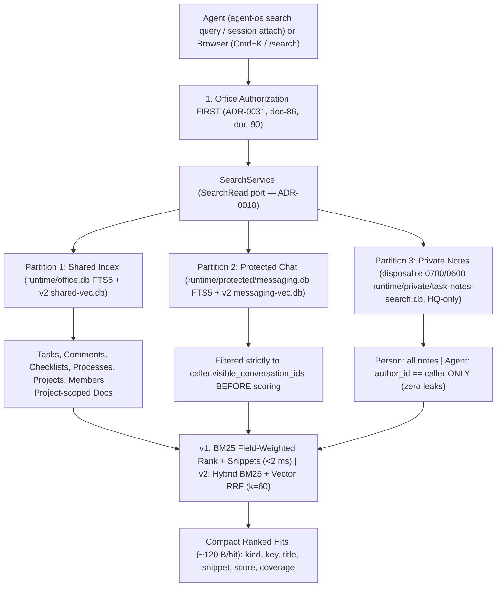

# Design: Dynamic Documentation, Org Processes (DSS / Kanban) & Unified Search

> [!NOTE]
> Prepared jointly by the **Principal UX Designer** and **Principal Search Architect** against live code, specs (`doc-28`, `doc-32`, `doc-34`, `doc-39`, `doc-52`, `doc-54`, `doc-86`, `doc-90`, `doc-96`), `ADR-0016`/`0018`/`0026`/`0031`, and tasks (`TASK-44`, `TASK-55`, `TASK-56`, `TASK-91`, `TASK-110`).

---

## 1. Dynamic Documentation, Org Standards & Composable Processes

### Three Distinct Primitives (Kept Visibly Apart)

| Primitive | Source of Truth & Spec | How Agents Receive It | Status |
| --- | --- | --- | --- |
| **1. Organization Processes & Standards** | Org Git `processes/*.md`, `standards/*.md`, `teams/.../`, `projects/.../` (`doc-34`, `doc-54`) | **Auto-injected into agent standing prompt** along single chain `Org → accountable team chain → Project`. `overridable: false` injected in full (fail-closed); overridable capped at `24 KiB`. | Backend Done (`TASK-44` ACs 1–2); UI live-wiring in AC 3. |
| **2. Composable Development Processes (DSS, Kanban Flow, Feature Delivery)** | Org Git `development-processes/<id>/` (`process.yaml`, `roles/*.md`, `skills/*.md`, `templates/*.md`; `doc-32`, `ADR-0026`) | **Role-filtered skills (`<= 8 KiB`)** in their own prompt section beside org standards; never overrides locked org rules. Product runs **zero** methodology engine or hardcoded gates. | Planned `v1 / m-0` (`TASK-56`); ships **DSS**, **Kanban Flow**, and **Feature Delivery** as built-in packages. |
| **3. Dynamic Project Documentation (Architecture, Specs, ADRs, Runbooks)** | Org Git `projects/<id>/docs/` + office-maintained `index.yaml` + immutable `docs-history/` (`doc-52`, `doc-86`) | **On-demand via `agent-os doc index` / `doc inspect` / `search`** (never dumped into every prompt). Strictly project-scoped for agents. | Planned `v1 / m-0` (`TASK-55`). |

### Six Audited IA / UX / AX Fixes Folded into `TASK-44`, `TASK-55`, and `TASK-56`

1. **Peer `Development processes` Settings Nav (`TASK-44` AC #3):** `apps/agentic-org-ui/src/routes/(shell)/settings/+layout.svelte` listed only `Processes`, hiding `/settings/processes/development` behind an inline prose link. Expose **`Processes & standards`** and **`Development processes`** as adjacent peers in Settings nav (`doc-39` §0.1).
2. **Project Chrome Process Identity, Dynamic Tabs & Seed Roster (`TASK-56` / `TASK-44`):** Surface the active process chip + `/settings/processes?place=project:<id>` link on `ProjectFrame`; wire `SERVED.processTabs` dynamically from `process.yaml` (eliminating hardcoded `false` in `projects/present.ts:58`); render `PKG-6` Seed Roster (`Open` / `Hire drafted` / `Filled`) on `ProjectOverview`.
3. **Eliminate Live `PKG-1` Hardcoding (`TASK-55`):** `apps/agentic-org-ui/src/lib/modules/docs/present.ts:91-92` hardcoded `product-dss` → `product` and `technical-dss` → `technical`. Derive section placement dynamically via `overview.sections.find(s => s.kinds.includes(kind))` so Kanban, DSS, and custom packages work identically.
4. **Split Tree + Reader, `Issued vN` Default & Convergence Bar (`TASK-55` / `TASK-56`):** Desktop (`>= 1024px`) split documentation tree + reader in `DocsTab`; default `DocumentPage` to latest issued version (`DSS-3`) with convergence progress (`DSS-7`) when versioned; keep icon set & status tones aligned with shell design tokens (`SHELL-31`).
5. **Side-by-Side Process Package Chooser (`TASK-56`):** Upgrade blind `<select>` (`ProcessSelect.svelte`) with a **"Browse & compare packages…"** inspector showing seed roles, tabs, doc sections, skills, and cost preview across **DSS**, **Kanban Flow**, and **Feature Delivery**.
6. **CLI Verb Alignment (`TASK-55` / `doc-52`):** Standardize `agent-os doc` on `doc-96` §2.1 canonical verbs (`index | list | inspect | create | update | move | put | get`) with zero-ceremony binding defaults (`--project`, auto-slugged `--path`, caller-default `owner_employee_id`, `--link-task`).

---

## 2. Unified Search Architecture (`SearchRead` Port — `TASK-91` & `TASK-110`)

### Problem Statement in Live Code
- No `search`, `doc`, or chat-search CLI commands exist today.
- `agent-os task list --query <str>` (`crates/org-office/src/tasks/features/queries.rs:143-156`) loads every task (`4N+1` queries), checks a single literal `.to_ascii_lowercase().contains(q)`, skips comments/checklists/details/private notes, and dumps unranked full JSON rows (~15k–40k tokens).
- Browser search (`FC-006`) stubs `work: []` (`shell/http-api.ts:123`) and throws `unavailableCall` (`search/api.ts:10`).

### Two-Phase Architecture Behind One Consumer-Owned `SearchRead` Port (`ADR-0018`)



### FTS5 (`v1 / TASK-91`) vs. Pure Embeddings vs. Hybrid + RRF (`v2 / TASK-110`)

| Dimension | **v1 — Tier A: SQLite FTS5 (`BM25` + `porter unicode61`) + Agentic Multi-Query Expansion (`TASK-91`)** | Pure Vector Embeddings | **v2 — Tier B: Hybrid (FTS5 + Opt-In Embeddings + RRF, `TASK-110`)** |
| --- | --- | --- | --- |
| **Latency (`ADR-0014`)** | **`< 1–2 ms`** (3–4 batched queries in `session attach` `< 5 ms`) | `15–50 ms` local / `150–500 ms` cloud | `15–50 ms` local / instant `< 2 ms` FTS5 fallback offline |
| **Offline & Zero Downloads (`doc-7`)** | **100% built-in** (`rusqlite` `bundled` compiles FTS5) | Requires model download or cloud | **100% compliant** (`EmbeddingProvider` opt-in; never auto-downloaded) |
| **Exact Refs (`T-A42`, `ADR-0026`, `src/auth.rs`)** | **Best-in-class** (10× key/ref boost) | Poor (blurs exact IDs/symbols) | **Best-in-class** (FTS5 anchors exact hits) |
| **Conceptual Queries** | **Agents: ~85–90%** (LLM expands 2–4 synonym queries in one `< 5 ms` `session attach` batch); **Humans: ~55–65%** | **~80–90%** single-shot | **~92–97%** for BOTH single-shot human `⌘K` and large 5k+ orgs |
| **Write-Path & `Delete + Rebuild`** | `+0.1 ms` sync write; `< 1.5 s` full rebuild | Slow/blocking if sync | **Zero write impact** (async via `org-store` consumer watermarks) |
| **Security & `ADR-0018` Portability** | Adapter-private strictly outside `schema.sql` (`tsvector` on Postgres); 3-way physical DB isolation; accounting/budgets (`COST-9`) never indexed | Same 3-way isolation required | Adapter-private INT8 vectors (`< 2 ms` SIMD scan for 20k chunks, zero C extension ABI risk; `pgvector` on Postgres) |

### Agent Multi-Query Expansion Pattern (`v1`)
When an agent asks *"Do we have anything for dynamic documentation, DSS, Kanban, or sidebar IA?"*, it fires one `agent-os session attach` batch (`< 5 ms` total, ~400 tokens returned instead of 30,000):

```json
{"command":"search query","input":{"q":"\"dynamic documentation\" OR \"documentation tree\" OR DSS","limit":8},"options":{"format":"compact"}}
{"command":"search query","input":{"q":"kanban OR \"development process\" OR \"project tabs\"","limit":8},"options":{"format":"compact"}}
{"command":"search query","input":{"q":"sidebar OR navigation OR \"information architecture\"","limit":8},"options":{"format":"compact"}}
```

---

## 3. Backlog Allocation

- **`TASK-91` (`m-0`, v1):** Consumer-owned `SearchRead` port + 3-way isolated SQLite FTS5 (`office.db`, `protected/messaging.db`, disposable HQ `runtime/<office-id>/private/task-notes-search.db` including `--types private_decision` for `TASK-111`) + `MemoryEngine` parity + `agent-os search query` + live Web/UI `⌘K` & `/search`.
- **`TASK-110` (`m-1`, v2):** Opt-in `EmbeddingProvider`, async `org-store` watermark indexer, heading/thread chunking, 3-way isolated INT8 vector sidecars, RRF fusion (`k=60`) behind `SearchRead`, and semantic `similar` work detection (`FC-125`).
- **`TASK-44`, `TASK-55`, `TASK-56` (`m-0`, v1):** Incorporate all 6 audited IA/UX/AX fixes and ship lightweight **Kanban Flow** alongside **DSS** and **Feature Delivery**.
