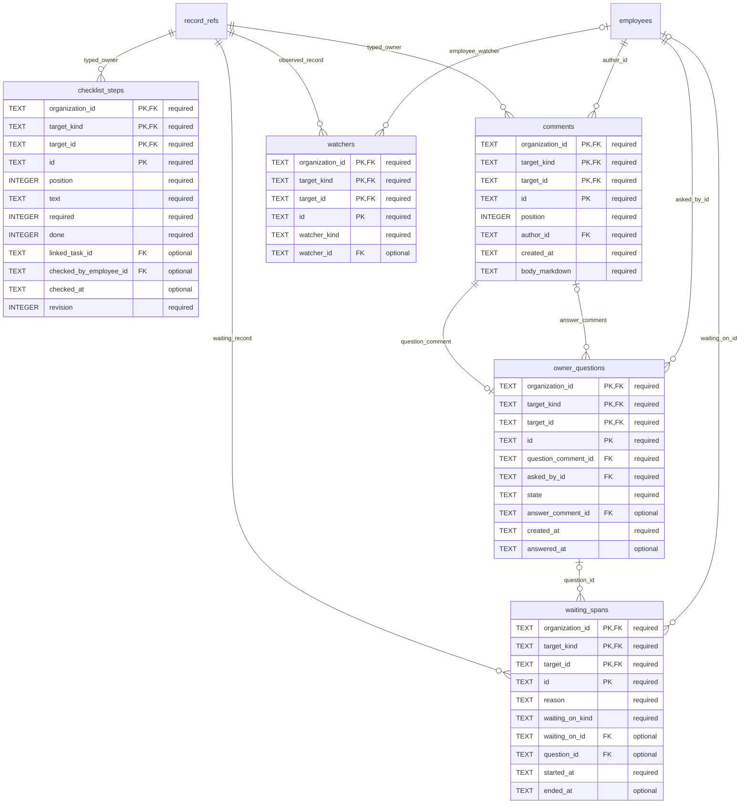
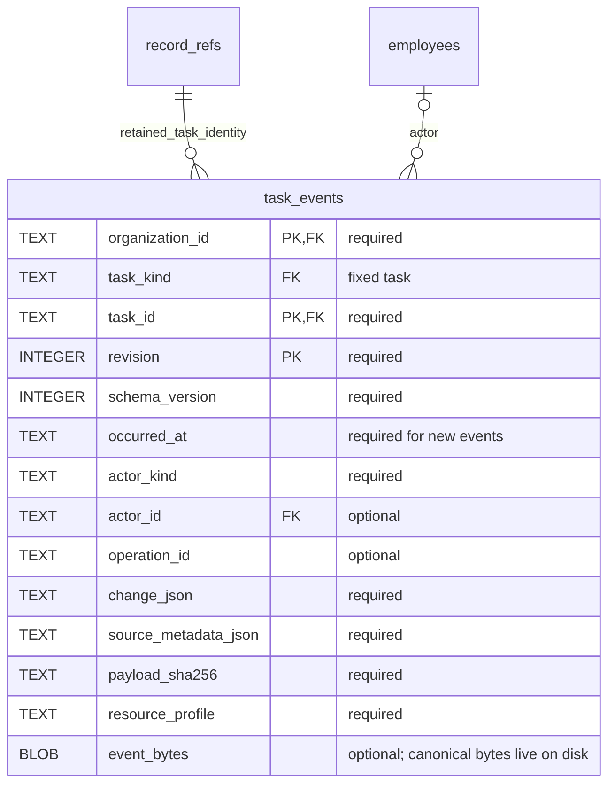
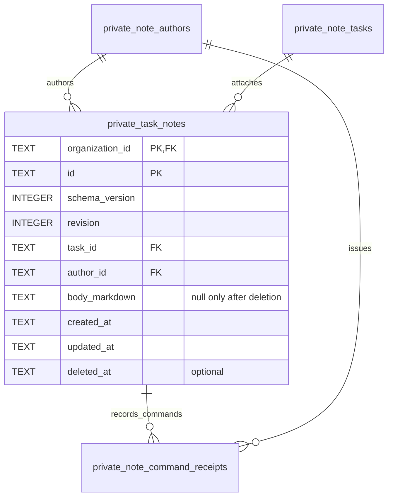

<!-- Source migrated from docs/design/organization-data/05-operational-data.md (set revision 2.24, reviewed 2026-11-21) -->

# Operational data structure

Status: **selected** data contract, revision 2.8. Shared comments, checklist entries, watchers, owner questions, waiting spans, task activity history and private task notes are selected for implementation. This document owns their data models, relationships and storage boundaries; application authorization, notification delivery and process execution remain implementation work. It extends [typed tasks](03-features-and-work.md).

## Scope and related data

This document owns task operational records: comments, checklist steps, watchers, owner questions, waiting spans, task activity events and private notes. Shared records use the task file or shared history archive; private records use their own private store. Logical ownership does not require putting private data into the shared database.

| Related concern | Canonical home | Boundary |
| --- | --- | --- |
| Task identity, ownership, current assignment and reporter | [Tasks](03-features-and-work.md), [assignment semantics](12-task-assignment-and-history.md) | Core task state; changes produce the activity events defined here |
| Typed links and dependencies | [Record contracts](08-record-contracts.md) | Cross-entity relationships shared by tasks, projects, features and documents |
| Token/cost observations and pricing | [Accounting](10-usage-and-cost-accounting.md) | Specialized immutable ledger with its own valuation and recovery contract |
| Runs, attempts, permits, processes and execution receipts | [Execution](11-model-profiles-and-agent-execution.md) | Supervisor/runtime coordination with its own lifecycle and durability contract |
| Providers, connections, pools and discovered models | [Provider/pool data structure](14-model-providers-and-connection-pools.md) | Execution configuration and office-specific discovery, separate from task operational records |
| Employee placement and task workspaces | [Agent structure](04-agent-structure.md) | Execution placement/cache projections extended by document 11 |
| Release/deployment outcomes and snapshots | [Deployments](07-release-deployments.md), [release content](09-release-content-and-flags.md) | Delivery-domain history tied to release/deployment identity |

## Relationships



Each shared record in the diagram above belongs to exactly one task through `target_kind: task` and its stable task ID, irrespective of whether the task type is task, bug or request. A comment's author is always an employee: a person or an agent. A watcher can be an employee or the organization owner. An owner question references its question comment and optional answer comment instead of duplicating the text. A waiting span records who is awaited, why, and its start/end timestamps; a null end marks an open span.

**Who did it, and who is addressed.** Every column that records who did something (an author, a creator, an actor) names an employee or the system; a person who signs in acts as their own person record ([document 04](04-agent-structure.md#accounts-people-and-the-organization-owner)). The organization owner is never recorded as a separate kind of actor. A column that *addresses* someone (`watcher_kind`, `waiting_on_kind`, and a budget notice's `recipient_kind` in document 17) may instead name `owner`, with a null employee ID. That designation means the person whose account owns the organization at the time the record is read, so a question to the owner reaches the current owner. It grants no authority.

## Shared metadata file location

Shared comments, checklist entries, and current watcher/question/waiting metadata live as **sibling files inside their owning task's directory** (`work/tasks/<task-id>/`), never embedded in `task.md` YAML front matter. This keeps `task.md` bounded well below the 64 KiB / 10,000-event front-matter limit regardless of comment volume and ensures comment appends or checklist ticks never rewrite `task.md`. Task activity events have the shared archive defined below. Private task notes use the separate private store defined below.

```text
work/tasks/<task-id>/
├── task.md                     # Core task metadata & description (bounded <=64 KiB front matter)
├── comments/<comment-id>.md    # One append-only Markdown file per shared public comment
├── checklist.yaml              # Ordered checklist_steps[] for this task
└── operations.yaml             # Current watchers[], owner_questions[], waiting_spans[]
```

Example `comments/01930000-0000-7000-8000-000000000050.md`:

```markdown
---
schema_version: 1
id: 01930000-0000-7000-8000-000000000050
task_id: 01930000-0000-7000-8000-000000000040
author_id: 01930000-0000-7000-8000-000000000030
created_at: "2026-11-14T10:00:00Z"
---
Should overlapping reservations lock the whole table group or only the requested seat count?
```

Example `operations.yaml`:

```yaml
schema_version: 1
watchers:
  - id: 01930000-0000-7000-8000-000000000051
    watcher_kind: owner
    watcher_id: null
owner_questions:
  - id: 01930000-0000-7000-8000-000000000052
    question_comment_id: 01930000-0000-7000-8000-000000000050
    asked_by_id: 01930000-0000-7000-8000-000000000030
    state: open
    answer_comment_id: null
    created_at: "2026-11-14T10:00:00Z"
    answered_at: null
waiting_spans:
  - id: 01930000-0000-7000-8000-000000000053
    reason: Owner decision needed
    waiting_on_kind: owner
    waiting_on_id: null
    question_id: 01930000-0000-7000-8000-000000000052
    started_at: "2026-11-14T10:00:00Z"
    ended_at: null
```

The owning task directory's `comments/` folder must contain the referenced comment, and the asking employee must exist. Example snippets show selected fields, not a complete file. Open questions/spans and watcher subscriptions remain recoverable with pending work. Notification receipts and chat are separate data governed by [messaging](15-messaging-and-chat.md) and [recovery](16-recovery-and-office-continuity.md). Pending asks, handoffs and deliveries must survive cache loss; this paragraph does not authorize deleting them.

## File to SQL mapping

| Table | Source |
| --- | --- |
| `checklist_steps` | `checklist.yaml` (`checklist[]`): `id`, `text`, `required`, `done`, `linked_task_id`, `checked_by_employee_id`, `checked_at`, `revision`; `position` is zero-based array order; target type/ID come from the owning task directory. |
| `comments` | `comments/<comment-id>.md`: front matter (`id`, `author_id`, `created_at`) plus Markdown body (`body_markdown`); `position` is deterministic creation/UUIDv7 order within the task's `comments/` folder. `author_id` is the employee who wrote it. |
| `watchers` | `operations.yaml` (`watchers[]`): `id`, `watcher_kind`, `watcher_id`; target type/ID and organization come from the owning task directory. |
| `owner_questions` | `operations.yaml` (`owner_questions[]`): every same-named question field; target type/ID and organization come from the owning task directory. Question and answer comment references must resolve inside that task's `comments/` folder. |
| `waiting_spans` | `operations.yaml` (`waiting_spans[]`): every same-named span field; target type/ID and organization come from the owning task directory. A non-null `question_id` must belong to that same task. |

Closing a record must not discard an unresolved question/span silently. The lifecycle contract chooses its explicit disposition. Durations derive from saved timestamps. Task activity retention is defined below; organization-wide analytics and retention of unrelated operational streams remain separate decisions.

Changes to a task's shared comments, checklist, watchers, questions and waiting spans also append its [task activity history](#task-activity-history) in the same recoverable write.

## Shared SQLite tables

```sql
CREATE TABLE checklist_steps (
  organization_id TEXT NOT NULL,
  target_kind TEXT NOT NULL CHECK (target_kind = 'task'),
  target_id TEXT NOT NULL,
  id TEXT NOT NULL,
  position INTEGER NOT NULL CHECK (position >= 0),
  text TEXT NOT NULL,
  required INTEGER NOT NULL CHECK (required IN (0, 1)),
  done INTEGER NOT NULL CHECK (done IN (0, 1)),
  linked_task_id TEXT,
  checked_by_employee_id TEXT,
  checked_at TEXT,
  revision INTEGER NOT NULL DEFAULT 1 CHECK (revision>=1),
  CHECK (done = 1 OR (checked_by_employee_id IS NULL AND checked_at IS NULL)),
  FOREIGN KEY (organization_id,target_kind,linked_task_id) REFERENCES record_refs(organization_id,kind,id) DEFERRABLE INITIALLY DEFERRED,
  FOREIGN KEY (organization_id,checked_by_employee_id) REFERENCES employees(organization_id,id) DEFERRABLE INITIALLY DEFERRED,
  PRIMARY KEY (organization_id, target_kind, target_id, id),
  UNIQUE (organization_id, target_kind, target_id, position),
  FOREIGN KEY (organization_id, target_kind, target_id) REFERENCES record_refs(organization_id, kind, id)
    DEFERRABLE INITIALLY DEFERRED
) STRICT;

CREATE TABLE comments (
  organization_id TEXT NOT NULL,
  target_kind TEXT NOT NULL CHECK (target_kind = 'task'),
  target_id TEXT NOT NULL,
  id TEXT NOT NULL,
  position INTEGER NOT NULL CHECK (position >= 0),
  author_id TEXT NOT NULL,
  created_at TEXT NOT NULL,
  body_markdown TEXT NOT NULL,
  PRIMARY KEY (organization_id, target_kind, target_id, id),
  UNIQUE (organization_id, target_kind, target_id, position),
  FOREIGN KEY (organization_id, target_kind, target_id) REFERENCES record_refs(organization_id, kind, id)
    DEFERRABLE INITIALLY DEFERRED,
  FOREIGN KEY (organization_id, author_id) REFERENCES employees(organization_id, id)
    DEFERRABLE INITIALLY DEFERRED
) STRICT;

CREATE TABLE watchers (
  organization_id TEXT NOT NULL,
  target_kind TEXT NOT NULL CHECK (target_kind = 'task'),
  target_id TEXT NOT NULL,
  id TEXT NOT NULL,
  watcher_kind TEXT NOT NULL CHECK (watcher_kind IN ('employee', 'owner')),
  watcher_id TEXT,
  PRIMARY KEY (organization_id, target_kind, target_id, id),
  CHECK ((watcher_kind = 'employee' AND watcher_id IS NOT NULL) OR (watcher_kind = 'owner' AND watcher_id IS NULL)),
  FOREIGN KEY (organization_id, target_kind, target_id) REFERENCES record_refs(organization_id, kind, id)
    DEFERRABLE INITIALLY DEFERRED,
  FOREIGN KEY (organization_id, watcher_id) REFERENCES employees(organization_id, id)
    DEFERRABLE INITIALLY DEFERRED
) STRICT;

CREATE TABLE owner_questions (
  organization_id TEXT NOT NULL,
  target_kind TEXT NOT NULL CHECK (target_kind = 'task'),
  target_id TEXT NOT NULL,
  id TEXT NOT NULL,
  question_comment_id TEXT NOT NULL,
  asked_by_id TEXT NOT NULL,
  state TEXT NOT NULL CHECK (state IN ('open', 'answered', 'cancelled')),
  answer_comment_id TEXT,
  created_at TEXT NOT NULL,
  answered_at TEXT,
  PRIMARY KEY (organization_id, target_kind, target_id, id),
  CHECK ((state = 'answered' AND answer_comment_id IS NOT NULL AND answered_at IS NOT NULL) OR
    (state <> 'answered' AND answer_comment_id IS NULL AND answered_at IS NULL)),
  CHECK (answered_at IS NULL OR answered_at >= created_at),
  FOREIGN KEY (organization_id, target_kind, target_id, question_comment_id) REFERENCES comments(organization_id, target_kind, target_id, id)
    DEFERRABLE INITIALLY DEFERRED,
  FOREIGN KEY (organization_id, target_kind, target_id, answer_comment_id) REFERENCES comments(organization_id, target_kind, target_id, id)
    DEFERRABLE INITIALLY DEFERRED,
  FOREIGN KEY (organization_id, asked_by_id) REFERENCES employees(organization_id, id)
    DEFERRABLE INITIALLY DEFERRED
) STRICT;

CREATE TABLE waiting_spans (
  organization_id TEXT NOT NULL,
  target_kind TEXT NOT NULL CHECK (target_kind = 'task'),
  target_id TEXT NOT NULL,
  id TEXT NOT NULL,
  reason TEXT NOT NULL,
  waiting_on_kind TEXT NOT NULL CHECK (waiting_on_kind IN ('owner', 'employee')),
  waiting_on_id TEXT,
  question_id TEXT,
  started_at TEXT NOT NULL,
  ended_at TEXT,
  PRIMARY KEY (organization_id, target_kind, target_id, id),
  CHECK ((waiting_on_kind = 'employee' AND waiting_on_id IS NOT NULL) OR (waiting_on_kind = 'owner' AND waiting_on_id IS NULL)),
  CHECK (ended_at IS NULL OR ended_at >= started_at),
  FOREIGN KEY (organization_id, target_kind, target_id) REFERENCES record_refs(organization_id, kind, id)
    DEFERRABLE INITIALLY DEFERRED,
  FOREIGN KEY (organization_id, waiting_on_id) REFERENCES employees(organization_id, id)
    DEFERRABLE INITIALLY DEFERRED,
  FOREIGN KEY (organization_id, target_kind, target_id, question_id) REFERENCES owner_questions(organization_id, target_kind, target_id, id)
    DEFERRABLE INITIALLY DEFERRED
) STRICT;
```

## Task activity history

The current task file remains its latest state. Each accepted task revision also has an immutable event at:

```text
<organization repository>/work-history/tasks/<task-id>/<revision>.json
```

The event's stable identity is `(organization_id, task_id, revision)`. It has no new human number counter and no regenerated identity during replay. File name, task ID and revision must agree. `task_kind` is always `task`, including for bugs and requests. A command can append several consecutive events; the final task revision is the last event revision.

The service commits the changed task file(s) (`task.md` only for core task changes; `comments/<comment-id>.md`, `checklist.yaml`, or `operations.yaml` for operational changes without rewriting `task.md`), its compact delta event(s), and the command's idempotency result as one recoverable operation before acknowledging. Under [ADR-0014](../../adr/0014-acknowledgement-classes-and-agent-os-latency.md) comments, checklist ticks and watching are acknowledged at that commit, with the flush to the drive following within a bounded interval; every other task change waits for the flush. Comment appends and checklist/watcher updates record delta events referencing the sibling file/ID rather than duplicating full `task.md` snapshots. The durable local journal must retain everything needed to finish materializing these files after a crash, using the platform durability guarantees in [ADR-0002](../../adr/0002-storage-sqlite-sqlcipher-one-writer.md). Hourly Git publication includes the task directory and its events together; it is not the acknowledgement boundary. A machine restore requires unpublished journal records as well as the published organization state. Rebuilding SQLite projects the same event identities; it creates no new history.

**Why history is published to Git, and when to revisit.** One file per accepted change is kept as specified. It is what lets an office database be rebuilt with the same history and what answers who changed what after a task closes. Revisit the shape if the organization repository holds more than 100,000 history files, or a single task more than 1,000. The fallback is one append-only file per task, or keeping events only under `durable/` and publishing a summary when a task closes.

Task commands have one accepting writer and use expected revisions; raw replicated files do not become an independent mutation authority. A task has its number from creation, in any office (document 06). Concurrent edits to an already shared task must stay pending or conflict until its accepting writer resolves them; never publish two different accepted events for the same task/revision or silently choose the last file. Writer handover/fencing and remote delivery remain part of the mutation/replication implementation contract, not permission to bypass it. Work assignment does not by itself transfer write authority.

New tasks start with a `created` event at revision 1, including their initial public task state. Subsequent events capture every accepted task-content/metadata change, including assignments, ownership/scope, status/resolution, fields/body, checklist, comments, links, watchers, questions and waiting spans. `change.type` is a versioned event tag; its payload carries the facts and old/new values needed to explain that change. Unknown future tags are retained and shown as an unknown change, never silently discarded. Automated changes record system attribution and their cause when known. Optional `operation_id` identifies the accepted command and may repeat across events from that command; it is not the event identity or the complete command-receipt store.

`assignment_changed` uses this payload (IDs below represent existing records):

```json
{
  "type": "assignment_changed",
  "from": {"assigned_team_id": null, "assignee_id": null},
  "to": {"assigned_team_id": "platform-team-id", "assignee_id": "ana-employee-id"}
}
```

Both pairs contain both keys, each an ID string or explicit null. The surrounding event supplies actor/time, task identity and revision. Historical IDs inside a payload describe the past; never validate them against today's team membership or rewrite them after reorganization.

Event JSON uses the SQL scalar names except `change` and `source_metadata`, which
are objects projected into lossless canonical `change_json` and
`source_metadata_json` text. Preserve authoritative complete event bytes and unknown
extensions; a SQL numeric extraction or `Value` reserialization is not an event
source. Identical event-identity retries compare the verified canonical hash;
different content conflicts. A verifier checks the actual hash, not its SQL format.

### Task-event codec

Every task event uses `schema_version: 2` and the `canonical-json/2` codec in the
[hash codec registry](08-record-contracts.md#hash-codec-registry). There is one event
codec. The number 2 is kept because the code already implements the codec under that
name; there is no version 1 to read. Admission accepts only this codec and refuses
anything else. History starts at revision 1 with the task's creation; never fabricate an event.

Codec 2 accepts one complete UTF-8 JSON value with JSON whitespace only around it.
Reject BOM, trailing content, malformed numbers, unpaired surrogates and duplicate
**decoded** object keys at every depth. Sort keys by Unicode scalar order (shorter
prefix first), without normalization; preserve array order. Emit compact UTF-8
without a final newline. Escape quote/backslash and use `\b`, `\f`, `\n`, `\r`,
`\t`; other C0 controls use lowercase `\u00xx`. All other scalars, including
U+2028/U+2029 and supplementary characters, are literal; `/` is not escaped.

Numbers retain their exact original token matching
`-?(0|[1-9][0-9]*)(\.[0-9]+)?([eE][+-]?[0-9]+)?`; no float conversion or magnitude
restriction applies. `1`, `1.0`, `1e0`, `1E+000` and negative zero are intentionally
distinct hashed content. Hash canonical UTF-8 with SHA-256, omitting **only** the
top-level `payload_sha256`; nested names remain. The checksum is required and is
64 lowercase hexadecimal characters.

Producers materialize schema, organization/task identity, `task_kind: task`,
revision, occurred time, actor kind/ID, operation ID, change object, source metadata
and `resource_profile: selected-task-resources/1` before hashing. Optional IDs are
explicit nulls; producer-side absent source metadata becomes `{}`. Verifiers never
repair absent required members. Header revision is a positive signed-i64 integer
token without exponent/fraction; schema is exactly integer `2`. Filename, identity,
attribution and timestamps must match their owning contracts. New accepted changes
require actual known actors and UTC times; SQL nullability is not permission to omit
attribution.
Unknown change tags
and extensions remain in the checksum and retained representation.

### Exact public snapshots

Created events retain `change.known_facts` (an object of typed
known public facts) and `change.public_snapshot`,
either `{ "encoding": "utf-8-markdown", "text": "<exact public Markdown>" }`
or `{ "encoding": "utf-8-markdown", "sha256": "<digest>", "byte_length": 0,
"resource_profile": "selected-task-resources/1" }` with the actual byte count.
The latter resolves only to immutable public bytes at
`work-history/blobs/sha256/<digest>`. Verify length/hash and public classification;
publish blobs with referencing events. Select the blob form when the single-string
or canonical-event budget would be exceeded. Never convert unknown YAML extension
numbers to JSON to construct full state. Private or unclassified content never
enters this public store.

Blobs/chunks are <=64 MiB. Each manifest permits <=1,024 references and <=64 MiB
aggregate referenced bytes, counting repeated references. All referenced bytes
must be durable before the manifest. Protected journal blobs are separate from
public snapshot blobs. Native/HTTP envelopes retain 1 MiB limits; authenticated,
task-scoped content reads carry <=256 KiB raw bytes per chunk and check the fully
encoded envelope budget as well.

History is append-only. Fix a mistaken assignment or status with a new event; do not edit earlier facts. Preserve events when a task closes or its active file becomes a tombstone. The tombstone retains the final revision, reporter and last assignment pair in `record_metadata`, and `record_refs` continues resolving the task. The archive is shared task information under the task's visibility rules. Private notes, agent memory and credentials must not be copied into comments, event payloads or provenance metadata by default.

Before publishing/rebuilding an accepted projection, validate event hashes, unique identities, contiguous revision coverage from revision 1, and agreement between the final event revision and the current task/tombstone revision. A missing middle event is an incomplete history that needs recovery. SQL's foreign keys and uniqueness constraints do not implement this whole validator or the atomic file-write protocol. A current snapshot alone is not proof of complete history.




### Task activity SQL projection

```sql
CREATE TABLE task_events (
  organization_id TEXT NOT NULL REFERENCES organizations(id),
  task_kind TEXT NOT NULL DEFAULT 'task' CHECK (task_kind = 'task'),
  task_id TEXT NOT NULL,
  revision INTEGER NOT NULL CHECK (revision >= 1),
  schema_version INTEGER NOT NULL CHECK (schema_version = 2),
  occurred_at TEXT,
  actor_kind TEXT NOT NULL CHECK (actor_kind IN ('employee', 'system', 'unknown')),
  actor_id TEXT,
  operation_id TEXT,
  change_json TEXT NOT NULL CHECK (
    json_valid(change_json) AND json_type(change_json) = 'object'
    AND json_type(change_json, '$.type') IS 'text'
    AND length(json_extract(change_json, '$.type')) > 0),
  source_metadata_json TEXT NOT NULL DEFAULT '{}' CHECK (
    json_valid(source_metadata_json) AND json_type(source_metadata_json) = 'object'),
  payload_sha256 TEXT NOT NULL CHECK (length(payload_sha256) = 64 AND payload_sha256 NOT GLOB '*[^0-9a-f]*'),
  resource_profile TEXT NOT NULL CHECK (resource_profile = 'selected-task-resources/1'),
  event_bytes BLOB,
  PRIMARY KEY (organization_id, task_id, revision),
  CHECK ((actor_kind = 'employee' AND actor_id IS NOT NULL) OR (actor_kind <> 'employee' AND actor_id IS NULL)),
  CHECK (json_extract(change_json, '$.type') <> 'assignment_changed' OR (
    json_type(change_json, '$.from') IS 'object' AND json_type(change_json, '$.to') IS 'object'
    AND COALESCE(json_type(change_json, '$.from.assigned_team_id') IN ('text', 'null'), 0)
    AND COALESCE(json_type(change_json, '$.from.assignee_id') IN ('text', 'null'), 0)
    AND COALESCE(json_type(change_json, '$.to.assigned_team_id') IN ('text', 'null'), 0)
    AND COALESCE(json_type(change_json, '$.to.assignee_id') IN ('text', 'null'), 0))),
  FOREIGN KEY (organization_id, task_kind, task_id) REFERENCES record_refs(organization_id, kind, id)
    DEFERRABLE INITIALLY DEFERRED,
  FOREIGN KEY (organization_id, actor_id) REFERENCES employees(organization_id, id)
    DEFERRABLE INITIALLY DEFERRED
) STRICT;
```

`schema.sql` adds immutable-event triggers, including protection against `INSERT OR REPLACE`, and an assigned-team/status index on tasks. Existing task/revision primary-key ordering serves per-task activity reads. Run the executable draft checks with `python3 docs/design/organization-data/test_schema.py`; these checks do not implement the command service.

## Private notes attached to tasks

**Required capability: a person or agent can create, read, edit and delete their own private notes attached to a task.** A private note is its author's working record on the task: reasoning, an implementation plan, test notes. It is read by its author and by people, and never by another agent, so that one agent's plan does not steer another's work; what everyone on the task should know goes in a shared comment (owner, 2026-11-18; [ADR-0031](../../adr/0031-any-employee-changes-tasks.md)). This is part of the selected requirements. Its absence from v1 is an implementation gap. The data structure and private storage contract follow below.

Code today: private task notes do not exist. `CommentKind::Note` in `crates/org-proto/src/work.rs` is an ordinary shared comment, so it must never be presented as private, and hiding it in the UI would not provide privacy.

Each private note must have stable identity, organization/task references, an immutable author derived from the authenticated actor, body, creation/update timestamps and a revision for conflicting edits. A task can have multiple notes from multiple authors. Only the author edits or deletes a note. The author reads it, and so does any person who can read the task. An agent other than the author never reads it, whatever its assignment, team leadership or place in the organization, and a person's note is hidden from every agent the same way.

Enforce this on reads, writes, search, feeds, notifications, summaries, exports, and on the instructions and context the office gives an agent. Store and back up notes outside the shared task-history/Git path. Private note bodies and identifying metadata must not leak into shared activity, indexes or provenance. Reassignment must not expose another author's notes to an agent or transfer their ownership. Explicitly publishing a note creates a shared comment after the author confirms the intended audience; it does not silently change the private original's visibility.

Private notes must survive restart and task closure/archive with their access restrictions intact. Define authorized recovery, retention, note deletion and task deletion behavior in the private storage contract before implementation. Deletion must include a documented policy for backups and retained versions; immutable shared task history must not prevent private-note deletion. Neither the shared history projection nor an agent-memory folder satisfies this requirement.

Acceptance criteria for the required capability:

| ID | Required evidence |
| --- | --- |
| PN-01 | A bound person or agent can create multiple private notes on a task and read/edit/delete their own notes; forged author IDs and stale edit revisions are rejected. |
| PN-02 | An agent other than the author cannot obtain or mutate a private note through direct IDs, task responses, search, feeds, notifications, summaries, exports or its turn input, including as the task's assignee or as a team lead. A person who can read the task reads the note and cannot edit or delete it. |
| PN-03 | Task reassignment and ownership changes preserve the note's author and its reading rule; no note is copied to the new team or assignee, and a new agent assignee sees none of it. |
| PN-04 | Restart, authorized recovery and task closure/archive retain the note and enforce the same access restrictions. Shared organization Git and task history contain no private-note body or identifying metadata. |
| PN-05 | Only an explicit author action publishes a shared comment; ordinary note saves never publish, and the private original retains its visibility. |
| PN-06 | Note deletion and task deletion follow the documented private retention/backup policy without exposing note content through shared history. |

The [private schema](private-notes-schema.sql) defines its data structure. Completion requires the private store, authorization/API and UI implementation and these acceptance checks. Draft-schema tests check structural constraints, not end-to-end privacy. Shared `note` comments do not satisfy it.


### Records and relationships

The executable definition is [private-notes-schema.sql](private-notes-schema.sql). It belongs to a **separate durable private database**, not `schema.sql`, organization Git or shared task history. There is no public reverse link, note count or shared event revealing a private note's existence.

| Record | Key and relationship | Purpose |
| --- | --- | --- |
| `private_note_authors` | `(organization_id, author_id)` | Private identity mirror populated from the trusted employee/authentication directory; never from an unverified client claim |
| `private_note_tasks` | `(organization_id, task_id)` | Private mirror of shared `record_refs` with `kind = task`, including tombstones; `is_deleted` mirrors task deletion |
| `private_task_notes` | `(organization_id, id)`; same-organization foreign keys to both mirrors | One author's private note attached to one task; many authors and many notes per task are allowed |
| `private_note_command_receipts` | `(organization_id, author_id, operation_id)`; references note and author | Durable request digest, command, accepted note revision, state, publication comment ID, error code and start/finish times; no body copies |

`author_id` is the immutable employee ID of a person or an agent. A person who signs in writes notes as their own person record, the organization owner included; two people never share notes because they share a role. The service derives the author from the authenticated actor. The mirrors contain no credentials and are not authorization grants. Their public-source relationships are validated by the service because SQLite cannot enforce a foreign key into a different database. Retain referenced mirror identities after employee deactivation/task deletion; names, home teams and assignments are not note ownership.



| Note field | Contract |
| --- | --- |
| `id` | Stable UUIDv7 for new notes; no readable number; retained after deletion |
| `organization_id`, `task_id` | Immutable attachment; an existing task of any type, including projectless tasks |
| `author_id` | Immutable original author and exclusive editor/deleter; read by its author and by people who can read the task, never by another agent ([ADR-0031](../../adr/0031-any-employee-changes-tasks.md)); derived from the bound actor |
| `schema_version`, `revision` | Format 1; revision starts at 1 and advances by exactly one on each edit/deletion |
| `body_markdown` | Nonempty current Markdown text; null on a deletion tombstone |
| `created_at`, `updated_at` | Server-generated canonical UTC timestamps using fixed precision; creation is immutable, update time never decreases |
| `deleted_at` | Null while active; equals update time on deletion; deletion cannot be reversed under the same ID |

Example record (an API shape, **not a shared file**):

```json
{
  "organization_id": "example-org-id",
  "id": "019a8440-0000-7000-8000-000000000001",
  "schema_version": 1,
  "revision": 1,
  "task_id": "existing-task-id",
  "author_id": "existing-employee-id",
  "body_markdown": "Check my reproduction before posting a shared update.",
  "created_at": "2026-11-15T12:00:00.000Z",
  "updated_at": "2026-11-15T12:00:00.000Z",
  "deleted_at": null
}
```

### Storage and mutation contract

HQ hosts the single accepting private-note service. Its authoritative database is `<data-root>/<organization-id>/durable/private/task-notes.db`, a SQLite database under the single-writer and durable-write rules of [ADR-0002](../../adr/0002-storage-sqlite-sqlcipher-one-writer.md). Under [ADR-0016](../../adr/0016-no-application-level-data-encryption.md) it is not encrypted by the application and has no database key; the reading rule (the author and people, never another agent) is enforced by the service, and the files by file permissions. It is not a disposable office cache. Its files, WAL and backups remain service-private; SQLite access is server-only. Other offices call this service as the bound caller: the note's author, or a person reading it. They do not replicate private notes through organization Git or shared event delivery. If HQ is unavailable, edits are not acknowledged as accepted. Fenced service recovery is required before another host accepts writes.

Creation validates that the authenticated actor can access the referenced task, installs trusted identity mirrors and inserts the note in one private transaction. Each edit and delete scopes by **organization AND bound author ID**, as well as note/task ID where applicable. Each read, list and search is answered for the bound author, and for a bound person who can read the task; for a bound agent that is not the author it returns nothing. Task membership or role never lets an agent read another author's note. Authorized authors can retain access to their existing notes after task archival/deletion; deactivated credentials still fail authentication. Unauthorized and missing IDs return the same not-found response. SQL foreign keys protect structure; **they do not implement these access checks**.

Edits and deletion use an expected revision in the update predicate and check that exactly one row changed. The transaction supplies the new revision/time. Every mutation has an operation ID and canonical request SHA-256, scoped to the bound author. Persist `private_note_command_receipts` atomically with successful create/edit/delete writes. Check the receipt before current revision checks: the same operation/digest returns the original note ID/revision even after later edits; different payload reuse conflicts. Rejected create/edit/delete requests have no accepted write or receipt. Receipt responses contain metadata only; a subsequent authorized get retrieves the current body. Creation uses a stable note ID as well as the operation ID; another operation cannot overwrite that ID. The schema triggers prevent identity/author/task changes, skipped revisions, replacement and resurrection. No editable `visibility` flag can turn a private row into a shared comment.

Publishing is a separate explicit author command: validate access, persist a `publish` receipt in `pending` state with the chosen revision and a freshly allocated stable shared comment ID, then copy that revision's body through the shared task mutation service. Pending publication blocks edits/deletion of that note so recovery can retry the same body without keeping a second private body archive. Use the shared comment ID as the shared idempotency key, independent of the private operation ID. Query/retry the shared mutation until its outcome is known; only then finish the receipt as `completed` or a definitively `rejected` result with an error code. A lost reply leaves it pending, not rejected. Receipt completion releases the edit/delete guard. Shared history records only the intentionally published comment and normal author/time; it must not include the private note ID or other private provenance. The private original stays private. Comment publication has its own task-access check; owning a private note alone does not authorize posting to a task. The service serializes operations through its single writer; it does not claim one transaction spans both databases.

### Retention and recovery

Task closure, reassignment, ownership changes or archival do not delete notes or transfer their authors. Task tombstones retain the private attachment through `private_note_tasks`; no cascade removes note content. Deleting a note atomically clears its body and leaves only the private identity/revision/timestamps as a tombstone. There is no note-body version archive in this model. The author can create a new note, but cannot resurrect a deleted ID.

Back up the private database consistently, with backups encrypted at their destination and kept separate from shared organization backups. Under [ADR-0016](../../adr/0016-no-application-level-data-encryption.md) there is no database key and so no key recovery. Rebuilding `schema.sql` or restoring organization Git cannot reconstruct private notes. A restore must reconcile deletions accepted after the backup before serving reads; retain those tombstones through the backup retention window. If that deletion evidence is unavailable, recovery blocks rather than exposing an older deleted body. Deployment must define and enforce a maximum private-backup retention period before enabling this feature. Logical deletion does not promise immediate physical erasure from WAL, storage media or older encrypted backups.

Run `python3 docs/design/organization-data/test_schema.py` for structural checks of private-note references, immutable ownership, revisions, tombstones and separation from shared SQL. These tests use in-memory SQLite and do not prove authenticated access, publication idempotency or backup recovery; PN-01–06 require those application tests before the feature is complete.

## Checklist evidence

Checklist step front matter additionally carries `linked_task_id`, `checked_by_employee_id`, `checked_at` and `revision` (default 1). These project directly into `checklist_steps`. `linked_task_id` names another task the step points to; the parent task is the enclosing record. Checker and time are recorded when a step is checked; absence never fabricates an actor. Task closure/tombstones retain checklist evidence with the final record. Promotion, automatic ticking/cascades and Undo are not part of this contract.

[Messaging and chat](15-messaging-and-chat.md) defines employee participation and conversation data independently of team membership and office placement.

[Recovery and office continuity](16-recovery-and-office-continuity.md) defines durable receipt/checkpoint/cleanup evidence separately from disposable office projections.
