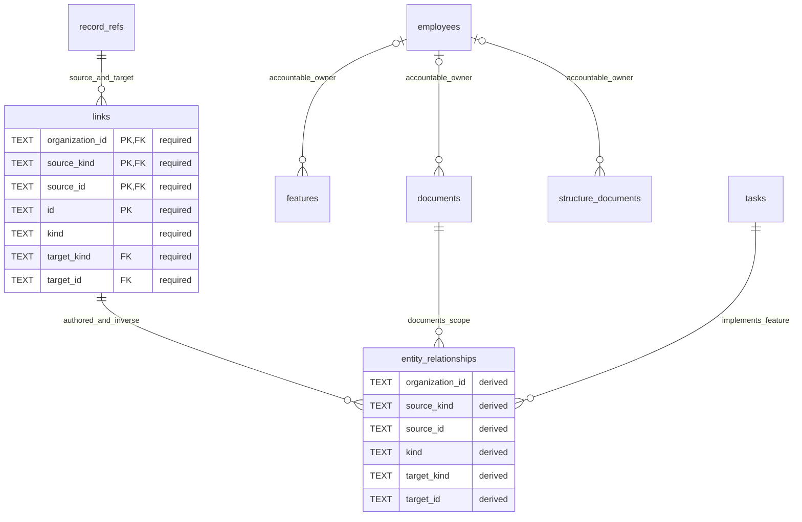

<!-- Source migrated from docs/design/organization-data/08-record-contracts.md (set revision 2.24, reviewed 2026-11-21) -->

# Record ownership, attribution, lifecycle and relationships

Status: **selected** data contract, revision 2.10. These are data contracts shared by the organization/project/work documents, not an implementation of permissions, costs or process execution.

## Accountable owners

Features, supporting documents, feature flag definitions, process/standard content records and organization development processes have optional `owner_employee_id`, referencing one person or agent in the same organization. This is accountability for that record, separate from task assignment, project team ownership and management authority. An owner need not belong to the project's owning team. Planned/unassigned features and draft documents may have no owner; features in `in_progress` or `live` and documents (including process/standard content and organization development processes) marked `current` require an explicit owner. Active flag definitions also require an owner. Validation also requires an active owner for those active records. Transfer accountability before making such an owner inactive; historical attribution can still reference inactive employees.

## Common attribution

The authored tables organizations, repositories, roles, teams, offices, structure_documents, projects, releases, milestones, features, tasks, documents, employees, feature_flags, deployments, development_processes and documentation_media share these fields:

| Field | Meaning |
| --- | --- |
| `created_at` | Original creation time, quoted UTC timestamp; never replaced by a later time |
| `created_by_kind` | `employee`, `system` or `unknown` |
| `created_by_id` | Stable employee ID only when creator kind is employee; otherwise null |
| `updated_at` | Time of the latest content/metadata change |
| `updated_by_kind` | Same actor vocabulary as creator |
| `updated_by_id` | Stable employee ID only when updater kind is employee; otherwise null |

These fields are top-level front-matter/YAML scalars matching the SQL columns. Accepted records must supply actual timestamps and known actor kinds. Do not fabricate provenance. The SQL projection's columns admit `unknown` and null; validation requires real values for every accepted write. `employee` is a person or an agent; a person who signs in, the organization owner included, is recorded as their own person record ([document 04](doc-78%20-%20Organization-Data-04-—-Agent-Structure.md#accounts-people-and-the-organization-owner)). `system` means framework/integration automation and is not an employee. This attribution does not grant authorization or replace authentication/audit infrastructure.

Updating an entity preserves creation fields, advances its revision, and updates its update fields. Nested arrays/association rows inherit the owning entity's update metadata; comments keep their own existing author/time fields. Tombstones retain original record provenance in a YAML `record_metadata` map together with deleted-record identity. SQLite projects that map as `record_metadata_json`, serialized as an object with lexically sorted keys; a missing map defaults to `{}`. These common fields describe current attribution. Tasks additionally retain the immutable activity history defined in [operational data](doc-79%20-%20Organization-Data-05-—-Operational-Data-and-Private-Notes.md#task-activity-history); full organization-wide event history remains unselected.

For tasks of every type, `created_by_kind`/`created_by_id` is the reporter/originator and is never overwritten by assignment, triage or closure. The service derives it from the admitted actor, as the code does today; callers cannot claim another reporter through a normal create command. Current responsibility is the explicit nullable pair `assigned_team_id`/`assignee_id`, independent of owning `team_id`. Reassigning either records the old and new pair, actor and time atomically. A fix/closure event records who reported that transition; it does not prove that actor performed all the work or replace recorded usage contributors.

## Lifecycle data

| Record | Fields / states |
| --- | --- |
| Team | `status: active | archived` (default active) |
| Employee | `status: active | paused | inactive` (default active); `paused` for agents only |
| Supporting document, process/standard content or development process | `status: draft | current | deprecated` (default draft). A versioned tree document becomes `current` when its first version is issued ([document 18](doc-86%20-%20Organization-Data-18-—-Development-Processes-and-Project-Documentation.md#issued-versions)) |
| Project | Existing `archived: false | true` |
| Task | `status: todo | in_progress | blocked | cancelled | done`, set by an authorized actor; `done` or `cancelled` is finished; no transition engine. `priority: urgent | high | normal | low`; optional `effort`, a whole number of points |
| Feature | `status: planned | in_progress | live | retired`, authored; no transition engine |
| Milestone, release | No stored status; done is derived from task status (document 02) |

Archiving/deactivating changes availability, not identity. Preserve profiles, handles, numbers, foreign references and historical metadata. Archived teams and inactive employees cannot receive new active assignments; validation checks this without erasing past rows. Accountability is transferred before an owner is made inactive (rule above); a record found with an inactive owner keeps that owner in history and fails validation until it is reassigned. Document status does not create a mandatory approval workflow. Team moves still update the explicit parent and durable path together.

## Build / Run work classification

The [cost UX specification](../specs/doc-51%20-%20Spec-Costs-Budgets-and-Insights-UX.md) shows **Build, displayed as R&D**. Features and tasks have nullable `work_type: build | run`, displayed as Build (R&D) and Run (KTLO). Build creates or materially improves capabilities; Run maintains existing service and ongoing operations. It is independent of task `type`: a bug found during new-feature development may be Build, while a production maintenance bug may be Run. It is also independent of team, project, release and office.

Null means not classified, not Build or Run. Store each record's classification explicitly; a feature's value can be suggested when creating a task, but task values are not silently changed when the feature changes. Usage events capture the value in force when they are recorded ([usage accounting](doc-87%20-%20Organization-Data-10-—-Usage-and-Cost-Accounting.md)); a later reclassification does not change them.

## Explicit relationship types

| Relationship | Meaning / source of truth |
| --- | --- |
| `depends_on` | Authored task A requires task B. Stored once in A's `links[]`; task dependency cycles and self-links are rejected. |
| `blocks` | Inverse of `depends_on`: B blocks A. Derived on query, never stored as a duplicate link. |
| `implements` | Task implements its single `feature_id`. Derived from the task foreign key, preserving the zero-or-one feature rule. |
| `documents` | Supporting document describes its optional feature, release or deployment, otherwise its project. Derived from document scope foreign keys. |
| `relates_to` | Authored reference from a project, feature, task or document to another registered entity in the same organization. It does not change ownership or imply a dependency. |
| `realizes` | Task brings the code in line with an issued version of a document. Authored in the task's `realizes[]` and stored in `task_document_versions`, not in `links`, because it names a version ([document 18](doc-86%20-%20Organization-Data-18-—-Development-Processes-and-Project-Documentation.md#tasks-that-realize-a-version)). |
| `derived_from` | An issued document version follows issued versions of other documents. Written once with the version (document 18). |

The `entity_relationships` view presents both authored and derived relationships. `links` stores `depends_on`, `relates_to` and `fixes`. A `fixes` edge links a task to a bug-typed task; validation checks the target type. `fixed_by` is its reverse query, not an authored duplicate. Task deletion retains link identity in tombstone metadata; no automatic bug transition/cascade is introduced. For cross-feature knowledge, keep one canonical project document and use `relates_to` links; a document still has at most one feature/release/deployment owner in addition to its required project. Cross-project task dependencies are allowed within one organization. Source and target resolve through `record_refs`, including historical tombstones. A dependency on a deleted task needs explicit disposition before accepting new active work; it is never silently treated as satisfied.

`links[]` belongs in its source record's front matter and contains `id`, `kind`, `target_kind`, `target_id`. Source/organization IDs come from that parent. Every participating project/feature/document may have this array in addition to tasks. `record_refs` includes these document and project identities. Inverse queries use the target index instead of writing duplicate arrays on the target.

```yaml
links:
  - id: 01930000-0000-7000-8000-000000000095
    kind: depends_on
    target_kind: task
    target_id: 01930000-0000-7000-8000-000000000041
```

## Relationships



| Table/view | Canonical source |
| --- | --- |
| `links` | Source entity's `links[]`, with IDs and fields above. |
| `entity_relationships` (view) | Derived from links, task feature membership and supporting-document scope; no authored file. |

## Hash codec registry

Every JSON record hashed by this contract uses one canonical JSON codec (`canonical-json/2`), and raw blobs/journal entries hash stored bytes directly (`raw-bytes/1`). Pre-v1 aliases (`sorted-compact-json/1`, `jcs-rfc8785/1`) were retired before v1 shipped so every domain family shares one canonicalizer and one test-vector suite ([no compatibility obligations before v1 ships](doc-72%20-%20Organization-Data-—-README.md#no-compatibility-obligations-before-v1-ships)). The owning document keeps the field list (what is hashed); this section owns the set of forms (how bytes are produced).

| Codec ID | Canonical form | Defined in | Used for |
| --- | --- | --- | --- |
| `canonical-json/2` | Keys sorted by Unicode scalar order, compact UTF-8 (no ASCII escaping), exact original number tokens (preserving integers beyond JS precision), nullable fields expanded per owning contract, duplicate decoded keys rejected. Exactly one top-level field is omitted: the record's own checksum field (`payload_sha256` or `content_sha256`) | [Document 05](doc-79%20-%20Organization-Data-05-—-Operational-Data-and-Private-Notes.md#task-event-codec) | All hashed JSON records: task events ([05](doc-79%20-%20Organization-Data-05-—-Operational-Data-and-Private-Notes.md)), assignment fingerprint v1 ([12](doc-84%20-%20Organization-Data-12-—-Task-Assignment-and-History.md)), usage event `payload_sha256` ([10](doc-87%20-%20Organization-Data-10-—-Usage-and-Cost-Accounting.md)), execution command digests ([11](doc-88%20-%20Organization-Data-11-—-Model-Profiles-and-Agent-Execution.md)), and message `content_sha256` ([15](doc-90%20-%20Organization-Data-15-—-Messaging-and-Chat.md)) |
| `raw-bytes/1` | The exact stored bytes, no canonicalization | This section | Content-addressed files: message attachments, `work-history/blobs/sha256/`, recovery snapshot and result content; acceptance journal entries ([16](doc-91%20-%20Organization-Data-16-—-Recovery-and-Office-Continuity.md)) |


Rules that keep this extensible:

1. **One codec per stored hash, known without guessing.** The record's `schema_version` selects the codec. A verifier never tries codecs in turn until one matches.
2. **Additive only.** A new canonical form gets a new codec ID and a new `schema_version` on the records that use it. Existing bytes and hashes are never re-encoded, recomputed or renamed.
3. **New record families reuse a registered codec.** The default for new JSON records is `canonical-json/2`: it is specified to the byte, keeps integer amounts and ordinals as exact tokens instead of floating-point numbers, and already has an implementation. Introducing another form needs a row here first.
4. **SHA-256 throughout, lowercase hexadecimal, 64 characters.** A different algorithm is a new codec ID, not a parameter.
5. **Shared test vectors.** Each codec has fixed input/output vectors that every implementation, in any language, must reproduce. A verification failure fails closed; it never falls back to another codec.

## SQLite tables and views

```sql
CREATE TABLE links (
  organization_id TEXT NOT NULL,
  source_kind TEXT NOT NULL CHECK (source_kind IN ('project', 'feature', 'task', 'document')),
  source_id TEXT NOT NULL,
  id TEXT NOT NULL,
  kind TEXT NOT NULL CHECK (kind IN ('depends_on', 'relates_to', 'fixes')),
  target_kind TEXT NOT NULL CHECK (target_kind IN (
    'project', 'feature', 'release', 'milestone', 'deployment',
    'task', 'document', 'development_process', 'media'
  )),
  target_id TEXT NOT NULL,
  PRIMARY KEY (organization_id, source_kind, source_id, id),
  UNIQUE (organization_id, source_kind, source_id, kind, target_kind, target_id),
  CHECK (source_kind <> target_kind OR source_id <> target_id),
  CHECK (kind NOT IN ('depends_on','fixes') OR (source_kind = 'task' AND target_kind = 'task')),
  FOREIGN KEY (organization_id, source_kind, source_id) REFERENCES record_refs(organization_id, kind, id)
    DEFERRABLE INITIALLY DEFERRED,
  FOREIGN KEY (organization_id, target_kind, target_id) REFERENCES record_refs(organization_id, kind, id)
    DEFERRABLE INITIALLY DEFERRED
) STRICT;

CREATE VIEW entity_relationships AS
SELECT organization_id, source_kind, source_id, kind, target_kind, target_id FROM links
UNION ALL
SELECT organization_id, target_kind, target_id, 'blocks', source_kind, source_id
FROM links WHERE kind = 'depends_on'
UNION ALL
SELECT organization_id, 'task', id, 'implements', 'feature', feature_id
FROM tasks WHERE feature_id IS NOT NULL
UNION ALL
SELECT organization_id, 'document', id, 'documents',
       CASE WHEN feature_id IS NOT NULL THEN 'feature' WHEN release_id IS NOT NULL THEN 'release' WHEN deployment_id IS NOT NULL THEN 'deployment' ELSE 'project' END,
       CAST(COALESCE(feature_id, release_id, deployment_id, project_id) AS TEXT)
FROM documents;
```
