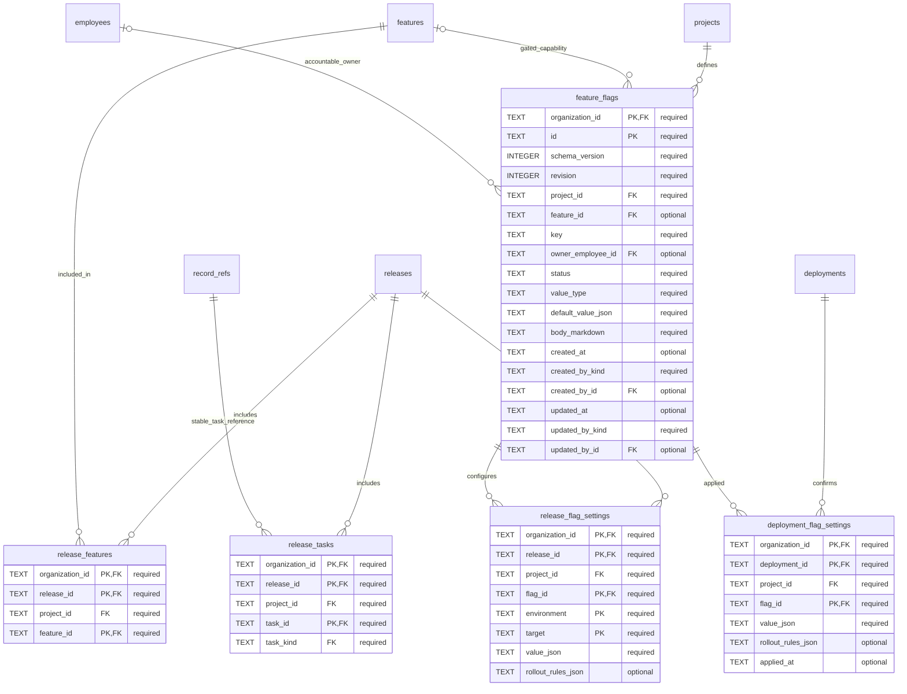

<!-- Source migrated from docs/design/organization-data/09-release-content-and-flags.md (set revision 2.24, reviewed 2026-11-21) -->

# Release content, changelogs and feature flags

Status: **selected** data contract, revision 2.7. This document owns release membership and flag data; [project documents](doc-76%20-%20Organization-Data-02-—-Project-Structure.md) owns document records and [deployment records](doc-81%20-%20Organization-Data-07-—-Release-Deployments.md) owns actual attempts. These are durable knowledge/configuration contracts, not a flag evaluator, deployment executor or build-artifact model.

## Product release knowledge and technical deployment knowledge

| Record | Audience and content |
| --- | --- |
| `release.md` | Product release purpose, explicit included feature/task IDs, compatibility notes and known limitations |
| Release `changelog.md` | Product-facing additions, fixes, changes, removals and breaking changes; explain whether shipped capabilities are enabled or gated |
| Release supporting documents | Migration guidance, rollout plan, validation criteria and rollback instructions |
| `deployment.md` | Actual attempt, environment/target, outcome, commit and applied-flag snapshots |
| Deployment `changelog.md` | Technical delta for that attempt: changed services/repos, commits/configuration, migrations, applied flags, validation results and rollback details |
| Deployment supporting documents | Attempt-specific technical details, operator notes or investigation findings |

One release can have several deployment attempts with different technical changelogs. Do not copy the product changelog onto each attempt. The optional `baseline_deployment_id` identifies the prior recorded state used to explain a technical delta, within the same project/environment/target; null means no reliable baseline was recorded. A failed or rolled-back attempt keeps its technical changelog and outcome. A rollback gets a new attempt and new technical changelog.

```text
projects/<project-id>/
├── feature-flags/<flag-id>.md
└── releases/<release-id>/
    ├── release.md
    ├── changelog.md                         # Product changes
    ├── flag-settings.yaml                   # Intended settings by environment/target
    ├── documents/<document-id>.md
    ├── milestones/<milestone-id>.md
    └── deployments/<deployment-id>/
        ├── deployment.md
        ├── changelog.md                     # Technical changes for this attempt
        └── documents/<document-id>.md
```

Both changelogs are `documents` rows with stable IDs, `kind: changelog`, owner/status and common attribution. The release changelog has `release_id` and null feature/deployment IDs. The deployment changelog has `deployment_id` and null feature/release IDs; its release is reached through its deployment. At most one canonical changelog exists per release or deployment, with revision history in Git. A release/deployment can have zero or many other supporting documents. No changelog is mandatory for an empty draft; ready-to-publish validation requires the relevant product or technical changelog to be populated before claiming it exists.

Example release changelog at release `changelog.md` (selected fields):

```markdown
---
schema_version: 1
id: 01930000-0000-7000-8000-000000000110
revision: 1
project_id: 01930000-0000-7000-8000-000000000010
feature_id: null
release_id: 01930000-0000-7000-8000-000000000032
deployment_id: null
kind: changelog
status: draft
owner_employee_id: 01930000-0000-7000-8000-000000000030
title: R-3 product changes
---
## Added
Table booking is included; availability depends on the environment's rollout settings.

## Fixed
Overlapping bookings are rejected.

## Known limitations
Combined-table bookings are not supported.
```

Example technical changelog at deployment `changelog.md` (selected fields):

```markdown
---
schema_version: 1
id: 01930000-0000-7000-8000-000000000111
revision: 1
project_id: 01930000-0000-7000-8000-000000000010
feature_id: null
release_id: null
deployment_id: 01930000-0000-7000-8000-000000000090
kind: changelog
status: draft
owner_employee_id: 01930000-0000-7000-8000-000000000030
title: Production deployment technical changes
---
## Technical changes
Applied the recorded infrastructure commit and table-booking configuration to production/primary.

## Data migrations
No data migration was required for this attempt.

## Feature flags
Applied the recorded table-booking rollout configuration.

## Validation and rollback
Availability checks passed. Rollback must restore the recorded prior configuration and commits.
```

## Explicit release contents

`release.md` front matter contains `feature_ids: []` and `task_ids: []`, in addition to its existing fields. These are explicit membership selections, not an inference that every task in a milestone shipped. Each reference must belong to the release's project; projectless team tasks cannot be listed as project release content. Released membership describes included work, while the changelog explains product impact and flags explain availability.

Retain release notes and selected membership when tasks close; links can resolve to retained tombstones if an archived task's active file is removed. `release_tasks` therefore references the stable task lookup registry as well as its project, and validation checks the live task or tombstone's project. Before archiving a selected task, preserve its project and release references; do not silently delete the release manifest entry. Published release content is versioned knowledge; corrections are explicit revisions. Deployment snapshots retain the actual attempt even if release prose is corrected later.

## Flag definitions and intended settings

Flags belong to a project and can span releases. Project/key uniqueness is registered through the shared organization authority; local proposals retain stable IDs while conflicting key claims are resolved, rather than letting office replicas independently claim a key. A definition stores stable ID, project-unique `key`, optional same-project `feature_id`, owner, `status: draft | active | retired`, `value_type: boolean | string | number | json`, default value and a Markdown purpose. Active flags require an accountable active employee. Keys/type/project cannot change after a release or deployment references the flag; create a new definition for a different identity/type. Retiring a definition preserves historical settings.

Canonical definition front matter uses `default_value` as a typed YAML value; SQLite projects it into `default_value_json`. Flags have no additional numeric counter. A flag definition's `default_value` is not a historical release or deployment snapshot.

```yaml
id: 01930000-0000-7000-8000-000000000100
schema_version: 1
revision: 1
project_id: 01930000-0000-7000-8000-000000000010
feature_id: 01930000-0000-7000-8000-000000000034
key: table-booking
owner_employee_id: 01930000-0000-7000-8000-000000000030
status: active
value_type: boolean
default_value: false
```

The release's `flag-settings.yaml` stores intent. Every entry selects an environment and target explicitly; there are no implicit wildcard/default merges in this draft:

```yaml
project_id: 01930000-0000-7000-8000-000000000010
release_id: 01930000-0000-7000-8000-000000000032
settings:
  - flag_id: 01930000-0000-7000-8000-000000000100
    environment: production
    target: primary
    value: true
    rollout_rules:
      percentage: 10
      fallback_value: false
```

`value` is the intended value for matching traffic. Optional `rollout_rules` is a recorded configuration object; any fallback needed by that configuration is explicit, not read later from a changed flag default. Rule evaluation/integration is outside this structure. Values must match the definition's type. Missing settings mean unspecified, not disabled. Shipping code does not mean enabling its flag.

## Applied deployment flag snapshots

`deployment.md` adds `flag_settings: []`, recording confirmed applied values and rule objects for that attempt. Environment/target come from the deployment. A flag must belong to the same project. Actual settings may differ from release intent; preserve the difference in the technical changelog rather than rewriting the release's intended settings.

```yaml
flag_settings:
  - flag_id: 01930000-0000-7000-8000-000000000100
    value: true
    rollout_rules:
      percentage: 10
      fallback_value: false
    applied_at: "2026-11-14T11:02:00Z"
```

Only record confirmed applications. A failed attempt may have a partial applied snapshot; absence is unknown/unrecorded, not a false value. Freeze each confirmed snapshot as history. Later flag edits do not rewrite past deployments; these snapshots do not claim to represent live flag state after subsequent configuration changes. A future flag-change execution/history engine remains outside scope.

## File to SQL mapping

| Table | Canonical source |
| --- | --- |
| `release_features` | Release `feature_ids[]`; project/release IDs from the release file. |
| `release_tasks` | Release `task_ids[]`; project/release IDs from the release file; live/tombstone task scope is validated. |
| `feature_flags` | Project flag front matter, common attribution and Markdown body. `default_value` maps to compact JSON `default_value_json`. |
| `release_flag_settings` | Release flag-settings file `settings[]`; `value`/`rollout_rules` map to `value_json`/`rollout_rules_json`. |
| `deployment_flag_settings` | Deployment `flag_settings[]`; inherited project/deployment IDs, typed value/rules JSON and `applied_at`. |

JSON projections preserve booleans, numbers, strings, nulls and structured values without converting them to display text. Serialize object keys lexically; no credentials belong in flag files. Association arrays inherit their release/deployment's revision and attribution metadata. Definition ownership, attribution, lifecycle and typed relationships follow [record contracts](doc-82%20-%20Organization-Data-08-—-Record-Contracts-and-Hash-Codec-Registry.md).

## Relationships



## SQLite tables

```sql
CREATE TABLE release_features (
  organization_id TEXT NOT NULL,
  release_id TEXT NOT NULL,
  project_id TEXT NOT NULL,
  feature_id TEXT NOT NULL,
  PRIMARY KEY (organization_id, release_id, feature_id),
  FOREIGN KEY (organization_id, release_id, project_id) REFERENCES releases(organization_id, id, project_id)
    DEFERRABLE INITIALLY DEFERRED,
  FOREIGN KEY (organization_id, feature_id, project_id) REFERENCES features(organization_id, id, project_id)
    DEFERRABLE INITIALLY DEFERRED
) STRICT;

CREATE TABLE release_tasks (
  organization_id TEXT NOT NULL,
  release_id TEXT NOT NULL,
  project_id TEXT NOT NULL,
  task_id TEXT NOT NULL,
  task_kind TEXT NOT NULL DEFAULT 'task' CHECK (task_kind = 'task'),
  PRIMARY KEY (organization_id, release_id, task_id),
  FOREIGN KEY (organization_id, release_id, project_id) REFERENCES releases(organization_id, id, project_id)
    DEFERRABLE INITIALLY DEFERRED,
  FOREIGN KEY (organization_id, project_id) REFERENCES projects(organization_id, id)
    DEFERRABLE INITIALLY DEFERRED,
  FOREIGN KEY (organization_id, task_kind, task_id) REFERENCES record_refs(organization_id, kind, id)
    DEFERRABLE INITIALLY DEFERRED
) STRICT;

CREATE TABLE feature_flags (
  organization_id TEXT NOT NULL REFERENCES organizations(id),
  id TEXT NOT NULL,
  schema_version INTEGER NOT NULL CHECK (schema_version = 1),
  revision INTEGER NOT NULL CHECK (revision >= 1),
  project_id TEXT NOT NULL,
  feature_id TEXT,
  key TEXT NOT NULL CHECK (
    length(key) > 0 AND key NOT GLOB '*[^a-z0-9-]*'
    AND substr(key, 1, 1) GLOB '[a-z0-9]'
    AND substr(key, -1, 1) GLOB '[a-z0-9]'
    AND instr(key, '--') = 0),
  owner_employee_id TEXT,
  status TEXT NOT NULL DEFAULT 'draft' CHECK (status IN ('draft', 'active', 'retired')),
  value_type TEXT NOT NULL CHECK (value_type IN ('boolean', 'string', 'number', 'json')),
  default_value_json TEXT NOT NULL CHECK (json_valid(default_value_json)),
  body_markdown TEXT NOT NULL DEFAULT '',
  created_at TEXT,
  created_by_kind TEXT NOT NULL DEFAULT 'unknown' CHECK (created_by_kind IN ('employee', 'system', 'unknown')),
  created_by_id TEXT,
  updated_at TEXT,
  updated_by_kind TEXT NOT NULL DEFAULT 'unknown' CHECK (updated_by_kind IN ('employee', 'system', 'unknown')),
  updated_by_id TEXT,
  PRIMARY KEY (organization_id, id),
  UNIQUE (organization_id, project_id, key),
  UNIQUE (organization_id, id, project_id),
  CHECK (status <> 'active' OR owner_employee_id IS NOT NULL),
  CHECK ((value_type = 'boolean' AND json_type(default_value_json) IN ('true', 'false'))
    OR (value_type = 'string' AND json_type(default_value_json) = 'text')
    OR (value_type = 'number' AND json_type(default_value_json) IN ('integer', 'real'))
    OR value_type = 'json'),
  FOREIGN KEY (organization_id, project_id) REFERENCES projects(organization_id, id) DEFERRABLE INITIALLY DEFERRED,
  FOREIGN KEY (organization_id, feature_id, project_id) REFERENCES features(organization_id, id, project_id) DEFERRABLE INITIALLY DEFERRED,
  FOREIGN KEY (organization_id, owner_employee_id) REFERENCES employees(organization_id, id) DEFERRABLE INITIALLY DEFERRED,
  CHECK ((created_by_kind = 'employee' AND created_by_id IS NOT NULL) OR (created_by_kind <> 'employee' AND created_by_id IS NULL)),
  CHECK ((updated_by_kind = 'employee' AND updated_by_id IS NOT NULL) OR (updated_by_kind <> 'employee' AND updated_by_id IS NULL)),
  FOREIGN KEY (organization_id, created_by_id) REFERENCES employees(organization_id, id) DEFERRABLE INITIALLY DEFERRED,
  FOREIGN KEY (organization_id, updated_by_id) REFERENCES employees(organization_id, id) DEFERRABLE INITIALLY DEFERRED
) STRICT;

CREATE TABLE release_flag_settings (
  organization_id TEXT NOT NULL,
  release_id TEXT NOT NULL,
  project_id TEXT NOT NULL,
  flag_id TEXT NOT NULL,
  environment TEXT NOT NULL CHECK (length(environment) > 0),
  target TEXT NOT NULL DEFAULT 'primary' CHECK (length(target) > 0),
  value_json TEXT NOT NULL CHECK (json_valid(value_json)),
  rollout_rules_json TEXT CHECK (rollout_rules_json IS NULL OR (json_valid(rollout_rules_json) AND json_type(rollout_rules_json) = 'object')),
  PRIMARY KEY (organization_id, release_id, environment, target, flag_id),
  FOREIGN KEY (organization_id, release_id, project_id) REFERENCES releases(organization_id, id, project_id)
    DEFERRABLE INITIALLY DEFERRED,
  FOREIGN KEY (organization_id, flag_id, project_id) REFERENCES feature_flags(organization_id, id, project_id)
    DEFERRABLE INITIALLY DEFERRED
) STRICT;

CREATE TABLE deployment_flag_settings (
  organization_id TEXT NOT NULL,
  deployment_id TEXT NOT NULL,
  project_id TEXT NOT NULL,
  flag_id TEXT NOT NULL,
  value_json TEXT NOT NULL CHECK (json_valid(value_json)),
  rollout_rules_json TEXT CHECK (rollout_rules_json IS NULL OR (json_valid(rollout_rules_json) AND json_type(rollout_rules_json) = 'object')),
  applied_at TEXT,
  PRIMARY KEY (organization_id, deployment_id, flag_id),
  FOREIGN KEY (organization_id, deployment_id, project_id) REFERENCES deployments(organization_id, id, project_id)
    DEFERRABLE INITIALLY DEFERRED,
  FOREIGN KEY (organization_id, flag_id, project_id) REFERENCES feature_flags(organization_id, id, project_id)
    DEFERRABLE INITIALLY DEFERRED
) STRICT;
```

The consolidated schema validates flag values both when settings arrive and when a deferred definition arrives, so projection order cannot bypass type checks. Used flag identity cannot be deleted or replaced. Every write connection enables recursive triggers so SQL replacement operations run the deletion guards.
