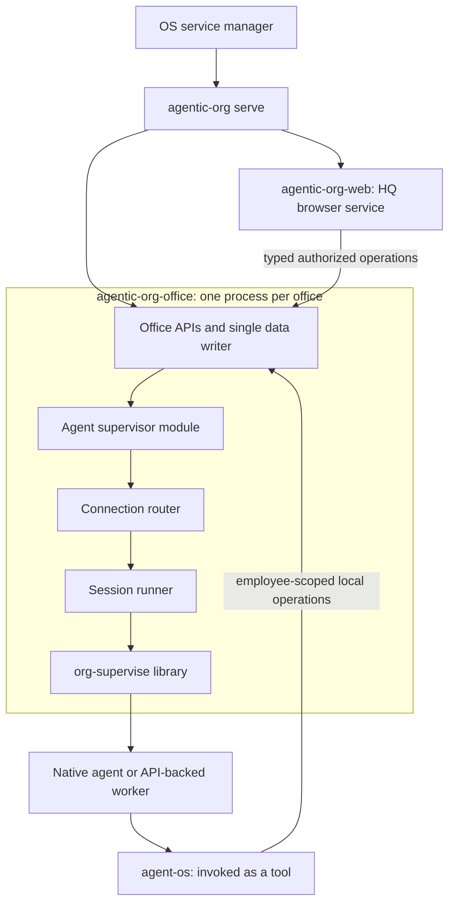
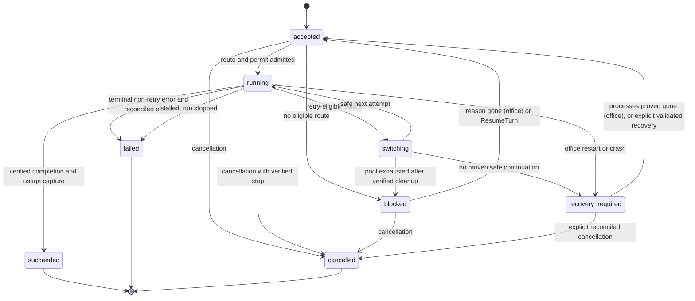
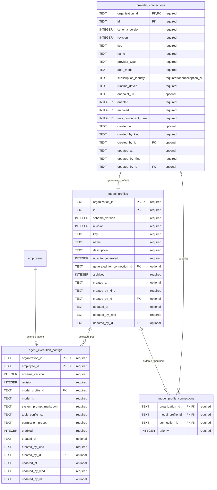
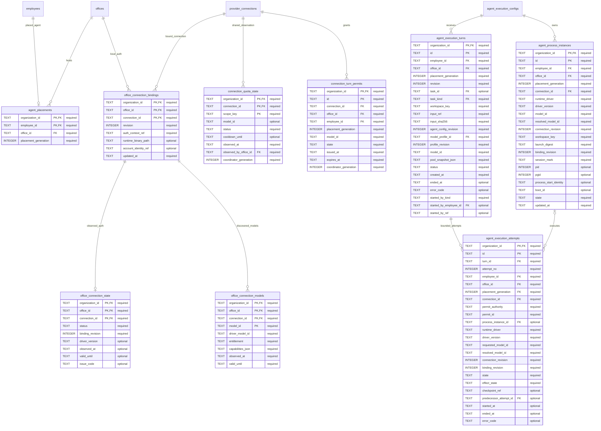

<!-- Source migrated from docs/design/organization-data/11-model-profiles-and-agent-execution.md (set revision 2.24, reviewed 2026-11-21) -->

# Model profiles, provider connections and agent execution

Status: **selected** data and execution contract, revision 9. This document defines the data model, process ownership, commands, state transitions and acceptance criteria for this feature. Implement the decisions here; do not substitute an independently chosen process topology or retry policy.

This document owns provider connections, subscription identity, model profiles and their ordered memberships, discovered models, agent execution configuration, office-local bindings, shared admission records, and execution turns/attempts/process ownership. It is a first-class member of the [organization data specification](doc-72%20-%20Organization-Data-—-README.md), with its SQL included in the consolidated [schema.sql](../../../docs/design/organization-data/schema.sql). The SQL is a design contract; the code does not implement it yet.

| Related document | Boundary |
| --- | --- |
| [Organization structure](doc-75%20-%20Organization-Data-01-—-Organization-Structure.md) | Owns organizations/offices; connection and profile definitions live in the same organization Git repository. |
| [Agent structure](doc-78%20-%20Organization-Data-04-—-Agent-Structure.md) | Owns employee identity/home team and the current placement row; this document owns the optional agent execution configuration and durable placement-generation authority. |
| [Usage accounting](doc-87%20-%20Organization-Data-10-—-Usage-and-Cost-Accounting.md) | Owns immutable usage/cost events; attempts supply actual selected connection/model and consumer context. |
| [Task assignment](doc-84%20-%20Organization-Data-12-—-Task-Assignment-and-History.md), [operational data](doc-79%20-%20Organization-Data-05-—-Operational-Data-and-Private-Notes.md) | Document 12 owns assignment/reporter semantics; document 05 owns activity/history and private notes. A turn can reference a task; turn completion does not close it. |
| [Standalone installation](../design/doc-70%20-%20Design-Standalone-Agentic-Org-Server.md#4-setup-and-service-lifecycle) | Owns HQ setup, service registration, release installation/updates and separate satellite onboarding. |

## Relationship summary

An agent employee has zero or one execution configuration; a runnable agent requires one. The configuration selects exactly one model profile and a canonical target model ID. A profile contains 1–64 ordered provider connections and derives its model catalog from their discovered models. Connections can be shared by many profiles and office-local credential bindings. A subscription connection has one immutable provider/subscription identity across the organization; another office reuses that connection rather than registering a duplicate subscription.

One logical turn belongs to one employee/office/placement generation and has one or more execution attempts once routing succeeds. Each attempt records its selected connection, permit and optional process instance; skipped candidates do not fabricate a running attempt. Shared quota is keyed to the canonical connection, not a profile or credential directory. Full columns, foreign keys and constraints appear in §12; configuration files and recovery authorities appear in §3.

Provider commands and model names in examples are illustrative. Adapter conformance tests establish what an installed version supports; unsupported capability returns a defined error instead of leaving an architecture decision open.

## 1. Fixed decisions and scope

| Topic | Required implementation |
| --- | --- |
| Identity | An agent is an existing employee of kind agent, extended by exactly zero or one `agent_execution_configs` row. People have no execution configuration. |
| Runtime topology | One `agentic-org-office` process per office. Its internal agent supervisor hosts a logical controller and one main-process slot per placed agent. There is no separate agent-supervisor daemon. |
| Launch authority | The supervisor alone selects routes, prepares child environments, launches/drives/stops agent processes and recovers its children. |
| Pool configuration | Agents select one model profile and canonical model ID. Profiles contain only an ordered list of connection IDs, never a manual model map. |
| Subscription identity | One organization-wide connection per provider subscription. Offices bind that same connection locally; pools cannot manufacture additional quota by naming the same subscription twice. |
| Connection capabilities | Discover/cache entitlement and model-ID translation per connection and office. Unknown or stale auth/model evidence cannot qualify a route. |
| Shared quota | HQ's organization service coordinates turn permits across offices. Per-connection concurrency defaults to one and is explicitly configurable. |
| Failover | Same target model, first eligible connection by priority. Each connection is tried at most once per dispatch cycle. Replay/resume requires the proof rules in §7. |
| Fast iteration | Reuse an idle verified process when its connection, model, workspace and launch digest match. Otherwise perform a controlled switch. No Git fetch, model discovery or authentication flow runs on the selection hot path. |
| Persistence | Organization config in Git; local auth and execution records outside Git, written through the office's one acceptance journal ([document 16](doc-91%20-%20Organization-Data-16-—-Recovery-and-Office-Continuity.md#selected-immutable-acceptance-journal)); SQLite is a projection. Accounting remains durable as defined in [usage accounting](doc-87%20-%20Organization-Data-10-—-Usage-and-Cost-Accounting.md). |
| Delivery scope | Configuration, discovery, explicit turn execution, supervision, permits, safe switching and accounting capture. Business-process engines, automatic scheduling, delegated employees, memory consolidation, budget evaluation and interrupting a running turn for a budget are excluded. Admission still honors recorded budget holds (§6 step 3, [document 17](doc-92%20-%20Organization-Data-17-—-Budgets-and-Controls.md)). |

The executable structure uses agentic-org as the human CLI/service host, agentic-org-web as the browser server, agentic-org-office as the office worker, and agent-os as the separate agent CLI; there is no dedicated supervisor process. The static UI package is agentic-org-ui. Pool routing, execution configuration and the complete agent session runner remain implementation work; naming an executable does not establish those capabilities.

## 2. Executables, modules and exclusive ownership

| Component | Current implementation / responsibility |
| --- | --- |
| agentic-org | apps/agentic-org; human CLI and serve host composition over crates/org-host. |
| agentic-org-web | apps/agentic-org-web; browser HTTP/assets/TLS library and guarded executable; production authenticated composition remains unavailable. |
| agentic-org-office | apps/agentic-org-office; one HQ/satellite worker, with the proposed supervisor/router/session-runner modules inside that process. |
| agent-os | apps/agent-os; existing agent-facing messaging/directory CLI, separate from the human CLI. |
| agentic-org-ui | apps/agentic-org-ui; static SvelteKit asset build, not another service executable or Node server. |

Reusable org-* domain/contract libraries retain their names. Provider CLIs remain external runtime dependencies. An isolated API-backed worker is added only with its implemented agent-loop backend. No separate updater, synchronization or employee-supervisor daemon is required.



The OS service manager starts/restarts agentic-org serve. Its host module starts and monitors office workers and the optional web child. Each office worker acquires its exclusive office/ownership locks, replays its acceptance journal and reconciles marked children before admitting starts. After a worker restart the office continues each interrupted turn by itself once it has proved the run's processes are gone ([ADR-0030](../../decisions/decision-30%20-%20ADR-0030-An-agent-works-while-it-has-work-continues-after-a-restart-and-a-stalled-turn-is-stopped.md) decisions 8 and 9); a process does not survive the restart. Host and worker generations are distinct from employee placement generation. Host shutdown stops workers in order; host reconciliation must not race the live worker's ownership of agent children.

Inside agentic-org-office, the agent supervisor owns employee lifecycle, readiness, environment setup and recovery. The connection router owns pool selection, cooldown/permit decisions and failover. The session runner owns protocol pumping and invokes org-supervise for OS operations. Existing org-agent-runtime remains the adapter contract; the planned org-office-sessions integration composes these capabilities without changing pure domain modules into process-control code. Binaries remain thin. New shared wire/launch contracts follow the repository's existing contract ownership/review rules.

The worker has one SQLite writer and one agent recovery owner. Its internal supervisor submits its changes through the office data service; it does not open another writer, keep a journal of its own or communicate with a sibling supervisor daemon. The execution record files, written through the office's acceptance journal, are authoritative for process ownership, turn/attempt changes and command receipts; SQL rows are projections. Integrate existing owned-recovery records into this path before enabling launches. Organization configuration and HQ coordination keep their authorities (§3/§6).

**Release lifecycle.** agentic-org owns online downloads and offline local-bundle installation. Stage and verify a complete platform release, including every framework executable and web assets, before activation. Check signed metadata and checksums against installed trust; offline install/upgrade performs no network requests. Startup uses the pinned installed release even if update checking fails. Background checks do not imply immediate activation: apply the configured policy, drain affected work, switch the release pin, restart through the OS service manager and verify readiness. Preserve the prior release and compatible recoverable data state; executable-only rollback after an incompatible schema change is forbidden. Updating the running host itself needs platform-aware replacement/restart. An offline bundle is not a promise of offline cloud-model access.

**Satellite operation.** HQ and satellite are roles of the same office executable, not different binaries. A satellite enrolls once and reconnects outbound to HQ's authenticated federation endpoint using its office identity; browser authentication and federation TLS remain separate boundaries. Agent tools call the local worker through agent-os. The worker replicates relevant shared data and uses local repository caches/worktrees; teams/projects remain organization-wide. Disconnected tasks/features can be saved with stable IDs and pending readable numbers, as defined in document 06. Turn admission distinguishes two permit authorities: **shared multi-office connections** use `hq_pool` permits coordinated by HQ (blocking new turns and stopping active turns if HQ renewal fails), while **office-local / unshared provider bindings** (such as per-office Claude tokens under ADR-0032 or independent per-office Codex logins) use `office_local` permits admitted and renewed locally by the satellite itself so disconnected satellites keep executing autonomously without waiting on HQ (Non-Negotiable #8). HQ/satellite protocol compatibility is checked during independently activated installation updates.

The host retains office-key custody. The web process and agent-os receive only their scoped capabilities, never host key-access entitlement or office secrets keys. Moving host behavior into agentic-org serve must preserve the existing platform credential and signed-launch boundaries; reusing an executable name does not make human, host and agent authority interchangeable.

### 2.1 Implemented CLI versus specified behavior

Which entry points exist is tracked in [executable migration](../design/doc-63%20-%20Design-Executables-and-Entry-Points.md); `agentic-org setup` is implemented on macOS and refuses unsupported OSes/flags. Model-profile configuration/routing commands in this document are internal execution-service contracts, not public CLI commands.

The [standalone installation contract](../design/doc-70%20-%20Design-Standalone-Agentic-Org-Server.md#4-setup-and-service-lifecycle) defines the intended HQ-only initial setup with automatic service registration/start and separately initiated satellite onboarding. It remains responsible for installers/offline bundles and lifecycle commands; this document does not define another installer.

## 3. Storage authority and exact paths

```text
<organization repository>/
├── provider-connections/<connection-id>.yaml
├── model-profiles/<profile-id>.yaml
└── teams/<team-id>/.../agents/<employee-id>/
    ├── profile.md
    └── execution.md

<data-root>/<organization-id>/durable/
├── authority/agent-execution/              # HQ placement generations, permits and cooldowns (record files)
└── local/offices/<office-id>/
    ├── connections/<connection-id>/binding.yaml
    ├── auth/<connection-id>/               # Private CLI state, or external vault binding
    └── supervision/
        ├── supervisor.lock
        ├── processes/<process-instance-id>.json  # Standalone warm/active process record & lifecycle cleanup evidence (H-09, M-04)
        ├── turns/<turn-id>/turn.json       # Turn state and attempts (references process_instance_id)
        ├── turns/<turn-id>/input.json
        ├── pending-starts/<employee-id>.json   # ADR-0030
        ├── checkpoints/<checkpoint-id>.json
        └── tools/<operation-id>.json

<data-root>/<organization-id>/runtime/<office-id>/
├── supervisor/generated/<process-id>/     # Rendered adapter/native-agent configuration
└── teams/.../agents/<employee-id>/...      # Existing task/project worktrees
```

| Projection tables | Canonical source |
| --- | --- |
| `provider_connections`, `model_profiles` | Same-named YAML fields and common attribution; profiles additionally contain `connection_ids[]`. |
| `model_profile_connections` | Profile `connection_ids[]`; zero-based array position plus one becomes priority. |
| `agent_execution_configs` | `execution.md` front matter: employee/profile/model IDs, revision/schema, enabled, tools_config, `permission_preset` (`safe_ask` default, `read_only`, `workspace_edits`, or `autonomous_sandboxed`; [ADR-0032](../../decisions/decision-32%20-%20ADR-0032-Browser-driven-CLI-sign-in-enrollment-credential-distribution-and-permission-presets.md)); body is system_prompt_markdown. Common attribution follows [record contracts](doc-82%20-%20Organization-Data-08-—-Record-Contracts-and-Hash-Codec-Registry.md). |
| `office_connection_bindings` | Local binding YAML with same-named fields. Never shared Git content. |
| `office_connection_state`, `office_connection_models` | Supervisor-owned discovery/auth observations, rebuilt from verified probes after cache loss. Their journal snapshots improve startup but are not fresh proof after restart. |
| `agent_placements.placement_generation` | HQ's agent-execution record files, written through HQ's acceptance journal; current placement row remains the existing employee-to-office projection. |
| `connection_quota_state`, `connection_turn_permits` | HQ's agent-execution record files, written through HQ's acceptance journal; committed before permit acknowledgement. |
| `agent_process_instances` | Standalone `supervision/processes/<process-instance-id>.json`, preserving single-writer ownership across warm multi-turn reuse and stopping independently of any single turn (Non-Negotiable #3). |
| `agent_execution_turns`, `agent_execution_attempts` | `supervision/turns/<turn-id>/turn.json` referencing `process_instance_id`, with immutable input/checkpoint/tool files. Supervisor command receipts (`RunTurn`, `ResumeTurn`, `CancelTurn`, `StopAgent`, `BindConnection`, `RefreshConnection`) are stored in the canonical `mutation_receipts` table of [document 16](doc-91%20-%20Organization-Data-16-—-Recovery-and-Office-Continuity.md#what-recovery-means) using access-checked `result_ref` pointers (never inline `response_json` in `office.db`). |

**There is no execution journal.** Every durable execution state transition (a turn or attempt transition, a process record, a permit acquisition/release_pending/release, a cooldown, a command receipt, a pending start) is a change to a record file, accepted as one entry of the office's one acceptance journal like any other change (document 16; [ADR-0021](../../decisions/decision-21%20-%20ADR-0021-The-office-store-one-journal-of-file-changes-a-projection-rebuilt-from-files.md); owner, 2026-11-18). High-frequency 10-second permit lease heartbeats are **in-memory lease extensions only**—they never write durable `F_FULLFSYNC` entries through the shared acceptance journal or SQLite writer, preserving committed-class `agent-os` hot-path latency (Non-Negotiable #18). An entry holds file changes, never table rows; the projector builds the tables of section 12 from the files, and a rebuilt cache reads them again. Execution records under `local/` are never published to HQ or to Git; they are replayed only by their own office, and satellite rebuilds never depend on HQ-only `connection_turn_permits` rows. Durable execution transitions are acknowledged in the durable class ([ADR-0014](../../decisions/decision-14%20-%20ADR-0014-Acknowledgement-classes-and-the-agent-os-latency-target.md) decision 3) and have no flush rule of their own: the journal's flush is the only one. Input, checkpoint and tool files that a change names are written in the same entry. Hashes use `canonical-json/2` ([hash codec registry](doc-82%20-%20Organization-Data-08-—-Record-Contracts-and-Hash-Codec-Registry.md#hash-codec-registry)). This paragraph replaces the earlier supervision journal of transaction envelopes with row snapshots.

Credentials never enter organization Git, command payloads, journal events or logs. The local binding holds only a vault/keychain reference or a private auth-directory path. Auth directories are owned by the office user with mode 0700; generated files are 0600. Rebind on a new machine and probe again. Native auth variables require a reviewed adapter allowlist; HTTP keys are resolved into the approved provider-client context, not ordinary tool environments.

Keep live ownership evidence until cleanup is proven. A fresh office cache replays identities/config, HQ authority data and the office's acceptance journal, then performs marked-process recovery before starts. If local recovery evidence or input/checkpoints were lost while a child may exist, return `RECOVERY_REQUIRED`; do not infer that deletion of a cache ended the process. Recovery on a different machine requires a new placement generation and the old office's cleanup acknowledgement or an explicitly verified machine fence; automatic timeout-only reassignment is outside this version. This is agent re-placement between offices. Relocating an office's own durable sources and custody to another machine is a different operation and is not supported in v1 ([document 16](doc-91%20-%20Organization-Data-16-—-Recovery-and-Office-Continuity.md#moving-agents-and-moving-offices)).

Document 04's current placement row is a projection of HQ's agent-execution record files written through HQ's acceptance journal outside Git; employee home-team and organization membership remain unchanged. HQ owns monotonically increasing placement_generation per employee. Moving an agent first requires the previous supervisor's verified cleanup acknowledgement or an explicitly verified machine fence; HQ then journals the new office and incremented generation atomically. Every command, permit and attempt carries that generation. The column default of one is a projection bootstrap, not permission to start a process: recovery must finish before HQ admits its first generation. Lost authority evidence blocks starts until restored. Historical attempts retain their original office/generation independently of current placement.

## 4. Configuration transactions and discovery

For the focused data-structure view—concepts, field diagrams, relationships, canonical files, examples and SQL mapping—see [Model providers, connections and pools](doc-89%20-%20Organization-Data-14-—-Model-Providers-and-Connection-Pools.md). It describes the same records as this execution contract.

All IDs use the stable-ID contract. Every foreign reference is organization-scoped. Provider/profile keys are organization-unique readable strings; no new human number counter is required.

For `subscription_cli`, `subscription_identity` is required: the provider adapter's canonical, non-secret identity for the actual subscription entitlement/quota account, not a connection label, credential path, model name or office ID. HQ registers it once per `(organization_id, provider_type, subscription_identity)`. Two different connection IDs for that same subscription are rejected with `SUBSCRIPTION_ALREADY_REGISTERED`, returning the existing connection ID. Disabled/archived definitions also reserve their identity; reuse/re-enable the existing definition. One connection may appear in several profiles and have one local binding per office, while all those uses share its HQ permit/cooldown state. Multiple subscription connections in a pool represent distinct subscriptions.

Identity normalization and registration happen before creating the default profile. Provider adapters use a canonical provider namespace and verified subscription identity; if the provider exposes no identity API, an explicit operator-attested mapping to the registered subscription is required. Unverified aliases cannot become runnable routes. SQL enforces uniqueness of the registered identity, but cannot prove that two credential sets reach the same external account. Bind/refresh must compare account evidence with the registered identity and return `SUBSCRIPTION_IDENTITY_MISMATCH` on a different subscription, or `SUBSCRIPTION_IDENTITY_UNVERIFIED` without evidence/attestation. These states are not ready. Credential rotation preserves identity; changing the subscription requires selecting/registering its own connection. API/cloud connections that do not represent a subscription leave this field null; this rule does not claim to identify all provider-wide API rate-limit groups.

Connection creation is one idempotent organization transaction: create the connection, an auto-generated model profile, and its one membership. The profile records generated_for_connection_id. Exactly one generated default is allowed per connection. Auto-generated profiles contain exactly their source connection; converting one to a manual pool clears the generated designation in that same revisioned transaction. Profile membership is 1..64 connections in contiguous priority order. Reorder by replacing the membership set inside one transaction, then validate before commit; do not perform individually visible priority swaps.

Archiving or deleting an assigned profile returns `PROFILE_IN_USE` with affected employee IDs. Referenced connections cannot be deleted through a membership cascade. Disable/retire definitions with history and explicitly reassign/detach before deletion. A registered subscription's provider/identity pair is immutable. Other provider/auth-mode/driver/endpoint changes are revisioned and must preserve any registered subscription identity; a supervisor never mutates a live child's environment to adopt them. Missing execution config means an employee is not runnable, not that the framework chooses a default model.

The supervisor probes at startup, after binding changes, on explicit RefreshConnection and every 60 seconds while a connection is in use. Auth/model observations are valid for at most 300 seconds. A changed binding revision invalidates all previous observations immediately. Driver preflight must prove the installed version and the intended account context; provider account identity evidence is retained in account_identity_ref, with explicit operator attestation required when a provider exposes no account identity API. A public `/models` list alone is not entitlement proof.

Canonical model IDs and driver-specific model/deployment IDs are stored on discovered connection observations. Profiles contain no manual per-model mapping. The SQL union view lists discovered confirmed support per office; ListProfileModels returns `{model_id, supporting_connections, first_priority, as_of, stale, ready_connections}` per model. ready_connections counts locally fresh compatible evidence, never guarantees quota admission. Employee-specific policy readiness is returned by GetAgentReadiness. Requested models remain valid declarative configuration while discovery is pending, with readiness `MODEL_UNVERIFIED`. They are not silently replaced or removed from agent files.

```yaml
# execution.md front matter; common attribution fields omitted here for readability
schema_version: 1
employee_id: existing-agent-employee-id
revision: 1
enabled: true
model_profile_id: subscription-pool-id
model_id: canonical-target-model-id
tools_config: [approved-shell-tool-id, approved-org-tool-id]
permission_preset: safe_ask
```

The associated organization files have the following serialization (nullable common attribution fields omitted, created_by_kind and updated_by_kind default to unknown):

```yaml
# provider-connections/subscription-a.yaml
organization_id: example-org-id
id: subscription-a
schema_version: 1
revision: 1
key: subscription-a
name: Subscription A
provider_type: example-provider
auth_mode: subscription_cli
subscription_identity: provider-canonical-subscription-a
runtime_driver: verified-native-driver
endpoint_url: null
enabled: true
archived: false
max_concurrent_turns: 1
```

```yaml
# model-profiles/primary-pool.yaml
organization_id: example-org-id
id: primary-pool
schema_version: 1
revision: 1
key: primary-pool
name: Primary pool
description: Same-model fallback across two verified accounts
is_auto_generated: false
generated_for_connection_id: null
archived: false
connection_ids: [subscription-a, subscription-b]
```

subscription-b must represent a different verified subscription, with its own connection definition and office-local binding before it is eligible. Another office using subscription-a binds the existing subscription-a connection; it does not create subscription-c for that same subscription. This manually assembled pool coexists with each connection's generated single-member default profile. Boolean YAML values become SQLite 0/1; tools_config and connection_ids serialize arrays rather than JSON strings. File and record IDs must match; reject unknown fields or unsupported schema versions. Example IDs denote existing stable IDs, not a new ID format.

For a concrete dispatch: an agent in the east office requests the canonical target model from primary-pool. Both connections have fresh confirmed entitlement. HQ grants the subscription-a permit; its first request returns 429 before any effect. The supervisor records cooldown/attempt usage, verifies cleanup, releases that permit, then requests subscription-b's permit and launches with its isolated binding. Success produces one logical turn, two attempts and route-specific usage. If the first attempt had an uncertain tool result, the same example stops at recovery_required instead of starting subscription-b.

The body is the system prompt. Existing employee identity, role, home team and reporting lines remain in profile.md. Effective role/process authority is resolved by the office and snapshotted with tool/policy revisions; execution.md cannot grant itself extra permissions.

## 5. Commands and admission

The office exposes execution operations through its existing authenticated service boundary and dispatches typed commands to the internal supervisor. There is no additional supervisor socket, framing protocol or server-to-supervisor service credential. Existing local IPC and federation transports retain their own framing and peer admission. Execution command content is bounded to 1 MiB; larger inputs use approved immutable local content references. Validate the admitted principal, organization, office and operation scope before internal dispatch. An employee token permits only the operations explicitly authorized for that employee; it is not host administration authority.

Every internal command envelope contains `{protocol_version:1, organization_id, office_id, operation_id, command, payload, payload_sha256}`; protocol_version is the internal execution-contract version, independent of existing transport API versions. Validate scope/authentication before admission. `payload_sha256` hashes canonical `{command, organization_id, office_id, payload}` only, using codec `canonical-json/2` from the [hash codec registry](doc-82%20-%20Organization-Data-08-—-Record-Contracts-and-Hash-Codec-Registry.md#hash-codec-registry) (the office acceptance journal itself hashes entries as stored using `raw-bytes/1` per [document 16](doc-91%20-%20Organization-Data-16-—-Recovery-and-Office-Continuity.md)); transport capabilities and worker generation are excluded so an original operation can be retried after restart. Mutation payloads include expected object revisions/placement generation; responses are `{operation_id, outcome, code, data}`. Accept the result and associated record-file changes atomically through the office's acceptance journal before replying. Same ID/digest returns the original response; same ID/different payload returns `IDEMPOTENCY_CONFLICT` without side effects. A lost acknowledgement is resolved by `GetOperation(operation_id)` or the same-ID retry, never a newly generated command. Keep receipts while their turn/process/config revision is retained; no time-only dedupe expiry is introduced.

| Command | Required payload / result |
| --- | --- |
| `RunTurn` | turn_id, employee_id, placement_generation, expected_agent_config_revision, expected_profile_revision, task_id or null, workspace_key, immutable input_ref/input_sha256. Returns accepted turn identity. A second open turn for the employee returns BUSY. |
| What started a turn | Every turn records `started_by_kind` (`run`, `message`, `mention`, `ask`, `handoff`, `assignment`, `answer`, `resume`, `recovery` or `background_wake`), the employee who did it in `started_by_employee_id` (null for `recovery` and `background_wake`) and, in `started_by_ref`, the message, task or originating turn/background-task ID it came from ([ADR-0023](../../decisions/decision-23%20-%20ADR-0023-An-agents-ask-hand-off-or-mention-and-an-answer-to-its-own-question-start-a-turn-for-an-idle-agent.md), [ADR-0025](../../decisions/decision-25%20-%20ADR-0025-An-agent-can-start-sub-agents-inside-its-turn.md) decision 6, [ADR-0028](../../decisions/decision-28%20-%20ADR-0028-An-agent-is-always-available-a-persons-message-and-a-task-assignment-also-start-it.md)). `resume` is the turn that continues an agent suspended on a required answer ([ADR-0020](../../decisions/decision-20%20-%20ADR-0020-An-ask-waits-with-a-timeout-a-required-ask-suspends-the-agent-until-it-is-answered.md) decision 8); `answer` is an answer that starts an agent holding no wait; `background_wake` is a reactive follow-up turn woken by the completion of the agent's own active background command or background sub-agent (ADR-0025 decision 6). A suspended agent started by a question or a hand-off from the employee it waits for is recorded as `ask` or `handoff` and counted (ADR-0030 decision 7). A turn that takes several waiting items names the first in `started_by_ref`; its input lists them all. ADR-0023's hourly limit is counted from these rows, leaving out `run`, `resume`, `recovery` and `background_wake`. Presence is not stored here: an agent that is active, configured and not held is available whether or not a process is running. |
| `ResumeTurn` | turn_id, expected_turn_revision; recovery-required turns also require recovery `{checkpoint_ref, receipt_dispositions:[{operation_id, outcome, result_ref, evidence_ref}]}`. Outcome is confirmed_completed or confirmed_not_started, with evidence verified by the tool broker/operator recovery authority. Unknown outcomes remain recovery_required. Retries a blocked turn or resumes only after validated reconciliation. Preserves turn ID, model and workspace. |
| `CancelTurn` | turn_id, expected_turn_revision. Stops current work and becomes cancelled only after completion/cleanup facts are known. |
| `StopAgent` | employee_id, placement_generation. Stops active and idle main processes. It creates no future automatic wake or budget policy. |
| `BindConnection` | connection_id, expected_binding_revision, local credential reference, verified executable path where required. Invalidates observations. Raw credentials use the local auth broker, not this payload. |
| `RefreshConnection` | connection_id. Returns refreshed status/catalog or structured unavailable status. Never starts an employee LLM turn. |
| Queries | GetOperation, GetTurn, GetAgentReadiness, ListProfileModels. Queries have no mutation receipt and expose no secret values. |

The office validates placement/config revisions and dispatches through the internal supervisor against the same admitted snapshot. No new starts occur while the worker is stopping, recovering or has lost its host-control authority. The existing host/worker launch contract controls that lifecycle; there is no separate server-to-supervisor lease. HQ turn-permit renewal remains mandatory under §6. Unresolved cleanup retains the process/turn slot. Client deadlines of 10 seconds are response deadlines only; they do not prove a command failed or cancel accepted work.

Run input (`supervision/turns/<turn-id>/input.json`) is a private immutable JSON manifest containing the resolved employee/role/system instruction references (including the effective processes and standards for the work, with every non-overridable one in a marked must-follow section; [processes design](../design/doc-34%20-%20Design-Organization-Processes-and-Standards.md), decision 4), **references only** (`conversation_id`, `message_id`, `content_sha256`, watermark) to visible messages and attachments inside `durable/messaging/` (never permanent plaintext shadow copies of private chat bodies outside `durable/messaging/`), approved tool/policy manifests, work scope, requested model and ordered pool snapshot. Any ephemeral rendered prompt/context file materialized under `runtime/<office-id>/supervisor/generated/<process-id>/` while a turn executes is mode `0600` and MUST be redacted/purged immediately when the turn finishes or the process is cleaned up. Large content uses content-addressed local references; it is not embedded past the frame limit. Resolve paths against the office's approved roots and reject traversal/symlink substitution. The same turn keeps its original target model, profile order, workspace and input digest through every attempt. Connection disabling, revoked authority and invalid credentials override old eligibility; ordinary profile/prompt changes take effect on the next turn. Resume does not silently broaden the admitted policy.

## 6. Shared quota and deterministic selection

Turn admission uses two permit authorities:
- **`hq_pool` (shared multi-office connections):** HQ's organization service is the single permit/cooldown coordinator. It journals permit acquisition, `release_pending`, and `released` transitions before acknowledging and updates its projection in one atomic transaction serialized against every other permit decision ([ADR-0018](../../decisions/decision-18%20-%20ADR-0018-The-storage-engine-is-replaceable-PostgreSQL-must-be-possible.md)): expire overdue active permits to `release_pending`; read connection and applicable model cooldowns; count `active` plus `release_pending` permits; grant only below `max_concurrent_turns`. Permission to proceed is a scoped opaque permit ID bound to employee/office/placement/model and coordinator generation.
- **`office_local` (office-local / unshared provider bindings):** When a connection is bound exclusively to one office (for example a per-office Claude token under ADR-0032 or an independent per-office Codex login), that office admits and renews `office_local` turn permits locally against `max_concurrent_turns` and its latest known budget-hold state. Disconnected satellites continue starting and sustaining turns on `office_local` bindings without waiting for HQ (Non-Negotiable #8).

Permits last 60 seconds and renew every 10 seconds while a model turn is active. **Lease renewals (heartbeats) extend the coordinator's in-memory deadline only and do not write durable acceptance-journal or SQLite transactions**, preventing 6–10 ms `F_FULLFSYNC` flushes from head-of-line blocking committed-class `agent-os` hot-path commands (Non-Negotiable #18). Only permit acquisition, `release_pending`, and `released` transitions are journaled durably. Compute local deadlines conservatively from the monotonic request-send time and the returned remaining duration. Start stop/recovery with at least 20 seconds remaining when renewal fails. **Expiry does not free capacity:** `release_pending` continues to count until a supervisor proves the model turn ended with no outstanding work, or proves its process/descendants gone. Unknown cleanup is not a release acknowledgement. Warm verified-idle processes consume no turn permit. Coordinator restart replays its journal and marks prior `active` permits `release_pending` before issuing new permits; affected supervisors stop/reconcile rather than reusing an old coordinator generation.

A 429/quota failure is connection-wide unless verified provider evidence identifies a model-specific window. Use the provider reset/Retry-After value when present; otherwise cooldown is 900 seconds. Cooldown expiry permits another guarded attempt if local auth/entitlement evidence is still fresh; it is not an assertion that quota is known available. Unsupported quota probes leave quota status unknown and can still obtain a bounded permit, with that uncertainty exposed. Auth-expired is an office-binding observation until verified reauthentication. Never convert a tool/policy denial into permission to try a less restrictive driver.

For each RunTurn/ResumeTurn dispatch cycle:

1. Read the frozen ordered pool and admitted policy. Reject archived profile, disabled execution config, inactive employee or stale placement.
2. In ascending priority, check connection enabled/non-archived, local binding, exact binding revision, installed driver/verified version, fresh auth readiness, confirmed model entitlement and policy/tool/context compatibility. Unknown/stale evidence produces a skip code and asynchronous refresh, not hot-path discovery.
3. Acquire a turn permit under the route's permit authority (`hq_pool` from HQ for shared multi-office connections; `office_local` from the local office for unshared per-office bindings). Before granting the first permit of a `RunTurn` or `ResumeTurn`, check the authorized budget-control state of [document 17](doc-92%20-%20Organization-Data-17-—-Budgets-and-Controls.md) (HQ authoritative for `hq_pool`; local last-known hold state for `office_local` when disconnected): when an unreleased budget hold applies to the turn's task or to the employee, grant no permit and end dispatch with `BUDGET_HELD`, naming the hold; the turn becomes blocked and no process is started or reused. A turn can come to work on a task it did not start with: when a command of the run names a task, or sets it as the work-for context, and an unreleased hold applies to that task, the office refuses that command with the hold named, so usage does not keep accruing to a held task. A running turn is never refused for a budget: neither renewal of its permit nor the replacement permit a §7 switch requests for the same logical turn is checked, so the current turn finishes as document 17 requires. An open turn that is blocked or recovery_required is not running: ResumeTurn for it is refused while the hold applies, and the hold stays `stop_pending` until the supervisor proves no process for the affected work remains, then becomes `held`. Otherwise a full/cooling-down connection is skipped; for `hq_pool` routes, coordinator unavailability skips to any eligible `office_local` route or blocks dispatch rather than bypassing global pool admission.
4. Reserve the employee's exclusive process slot. Reuse an idle process only if connection, driver/version, canonical model, workspace and launch digest match. The digest covers connection definition revision/endpoint, canonical and resolved model IDs, driver version/executable fingerprint, workspace, resolved instructions/tool-policy revisions and binding revision, never plaintext secret values. Validate the process row matches the admitted connection/driver/model before attaching an attempt.
5. Otherwise stop/reap/recover the previous process, create a new mark/instance, fsync planned ownership, prepare the explicit environment/launch plan, spawn through org-supervise, fsync PID/start/boot identity, then admit input. No replacement starts while cleanup is unresolved.
6. Journal attempt and turn transitions, pump protocol, persist usage before final completion acknowledgement, release the permit after a verified terminal/idle boundary, and keep the process warm for compatible subsequent turns. Configuration changes do not rewrite the current attempt.

Each connection is attempted at most once in a dispatch cycle. Exhaustion yields `POOL_EXHAUSTED` with ordered per-connection reasons and any known earliest cooldown time; the turn becomes blocked. ResumeTurn, by a person or by the office when the reason has gone, starts another bounded cycle, not an unbounded retry loop. Concurrent input is BUSY; what arrives for a busy agent is kept as a pending start ([ADR-0030](../../decisions/decision-30%20-%20ADR-0030-An-agent-works-while-it-has-work-continues-after-a-restart-and-a-stalled-turn-is-stopped.md)), which is the only queue.

## 7. Failover, checkpoints and side effects

Retry-eligible driver errors are rate_limited, quota_exhausted, auth_expired and model_unavailable. Invalid input, policy denial, unsupported capability and unknown protocol/provider errors are not automatic retry instructions. A switching attempt retains usage already consumed, ends/reconciles the old process where required, releases/quarantines its permit and selects the next eligible connection for the same logical turn.

| Proven execution boundary | Required action |
| --- | --- |
| Before any external/tool effect; adapter proves effect_state none | Replay the frozen turn on the next connection after old-process cleanup. Provisional streamed text is attempt output, not a second committed final reply. |
| Effects occurred; a verified compatible checkpoint includes completed operation receipts and no unknown in-flight effect | Resume after that checkpoint. Do not replay completed tools. |
| Effect state unknown, missing checkpoint/receipt or unsupported cross-driver/account resume | Stop/reconcile and set RECOVERY_REQUIRED. Keep the task/worktree and evidence; do not blindly retry. |

A checkpoint is an immutable private JSON object with schema_version, checkpoint_id, turn_id, attempt_id, employee_id, workspace_key, input/policy digests, visible message/event watermark, completed tool receipt references, any native conversation-state reference, format_id, portability and content_sha256. Portability is one of same_process, same_connection, same_driver or portable. A destination adapter must explicitly accept that format/version/scope and pass its conformance tests; same vendor/model name is insufficient. Missing context-window capacity returns CONTEXT_LIMIT, not silent truncation. Opaque account-bound CLI state cannot be relabelled portable.

Every brokered effect has a durable tool receipt `{operation_id, payload_sha256, turn_id, status, result_ref}`. Journal pending before invocation and terminal outcome before acknowledging its result. Same operation/payload returns the recorded outcome; a different payload conflicts. A crash between side effect and receipt completion produces outcome_unknown and requires reconciliation, not an automatic second invocation. Native unbrokered tools need verified start/completion visibility; otherwise the adapter marks effects unknown from the point visibility is lost. Message sends, repository commits and deployment calls are effects too. Pending approvals from an old attempt are cancelled and cannot authorize a replacement.

Native CLI environments change only on a new process launch. When an API-backed backend ships, its isolated HTTP agent worker owns the common agent loop and exposes a versioned turn/usage/tool protocol; a raw SDK completion is not a complete agent runtime. Supervisor-approved tool requests go through the tool broker. API secrets enter only the approved provider-client context; ordinary tool children do not inherit them. An in-process connection switch is allowed only when the worker advertises verified compatible switching and has no in-flight effect; the supervisor remains the sole switch authority.

This qualifies source FR-6 deliberately: automatic mid-turn failover is required at a proven safe replay/resume boundary. RECOVERY_REQUIRED is the specified fallback where the harness cannot prove safety, not an unimplemented decision for the team to invent.

## 8. Driver contract and failures

Each registered driver supplies versioned preflight/discovery, capabilities, launch planning, normalized protocol events, checkpoint export/import and stop instructions. Reuse org-agent-runtime's sans-I/O separation: adapters plan/translate, the supervisor performs I/O and org-supervise owns OS control. The HTTP-worker protocol adapter follows the same boundary. The connection's runtime_driver selects a registered implementation; unknown or unverified installed versions cannot run.

Driver manifest requirements are auth modes, supported isolation mechanism (the modes of [ADR-0015](../../decisions/decision-15%20-%20ADR-0015-Agent-isolation-is-a-selectable-mode-with-a-dedicated-OS-user-provisioned-at-setup.md): `same-user` and `dedicated-user` in v1, with the mode carried in the launch contract and digest), model discovery evidence, tool/policy enforcement, context limits, side-effect visibility, checkpoint formats/portability, usage semantics and stop/cleanup support. A runtime cannot become eligible merely because it answers text requests. The adapter test suite uses fake drivers for deterministic core tests and installed-version fixtures for every production driver. Do not claim a model or variable is supported without that evidence.

| Error code | Stable outcome |
| --- | --- |
| STALE_CONFIG / STALE_PLACEMENT / IDEMPOTENCY_CONFLICT | Reject before admission; no process or permit created. |
| PROFILE_IN_USE / INVALID_PROFILE_MEMBERSHIP | Reject configuration transaction atomically. |
| BINDING_MISSING / AUTH_EXPIRED / DRIVER_UNAVAILABLE / DRIVER_UNVERIFIED | Skip route; return readiness evidence and refresh/rebind action. |
| MODEL_UNVERIFIED / MODEL_NOT_ENTITLED / POLICY_UNSUPPORTED / CONTEXT_LIMIT | Skip route; never change the requested model or drop policy. |
| COORDINATOR_UNAVAILABLE / POOL_EXHAUSTED | A turn a person started becomes blocked; no uncontrolled start. A start the office makes (a message, an assignment, an answer) creates no turn: it stays a pending start and is tried again when a permit or a connection is freed ([ADR-0030](../../decisions/decision-30%20-%20ADR-0030-An-agent-works-while-it-has-work-continues-after-a-restart-and-a-stalled-turn-is-stopped.md)). The office resumes a blocked turn itself when the reason has gone. |
| BUDGET_HELD | A turn a person started becomes blocked with the applicable hold named; no permit, process start or process reuse. A start the office makes creates no turn and stays a pending start. When the hold is released under document 17, the office resumes the blocked turn, or makes the pending start, itself; nobody has to ask. |
| PROCESS_CLEANUP_PENDING / RECOVERY_REQUIRED | Keep ownership/open-turn slots until reconciliation. After a restart the office reconciles and continues the turn itself when it has proved the run's processes are gone and the session resumes; a person is needed only otherwise (ADR-0030 decisions 8 and 9). |
| STALLED | No activity for the stall time: the office stops the run and its sub-agents, the turn fails with `error_code` `STALLED`, the agent is idle (ADR-0030 decisions 10 to 12). |
| UNKNOWN_COMMAND_OUTCOME | Resolve original operation ID; do not resubmit a fresh start. |

## 9. States and accounting



Process states are planned → starting → idle/busy → stopping → gone; any uncertain exit becomes cleanup_required and retains the exclusive slot. Turns in accepted/running/switching/blocked/recovery_required are open. The SQL unique indexes enforce one open turn and one not-gone main process per employee. Transition validation occurs when the change is accepted into the acceptance journal; arbitrary SQL updates are not a public execution API. A turn interrupted by a restart is `recovery_required` only until the office has reconciled it: it returns to `accepted` by itself, in the same turn, when the run's processes are proved gone, passes the permit and budget-hold checks like any start, and the vendor session resumes, and stays `recovery_required` for a person when that cannot be proved or three resumes fail (ADR-0030). What waits for an agent that cannot start now is a pending start (`supervision/pending-starts/<employee-id>.json`: the employee, the waiting items, the reason and since when), not a turn; it has no table and is read from its file by the office that owns it. Cancellation with unknown effects remains recovery_required until reconciled. Turn success is not task closure; task lifecycle remains a separate contract.

Every chargeable attempt captures actual consuming employee/one-off context and work attribution through [usage accounting](doc-87%20-%20Organization-Data-10-—-Usage-and-Cost-Accounting.md). Add the following routing object to source_metadata_json before hashing each new event:

```json
{"routing":{"turn_id":"logical-turn-id","attempt_id":"attempt-id","process_instance_id":"process-id","model_profile_id":"profile-id","provider_connection_id":"selected-connection-id","runtime_driver":"driver-id","requested_model_id":"canonical-id","resolved_model_id":"driver-model-id","agent_config_revision":1,"profile_revision":1,"binding_revision":1}}
```

Provider/model and price_id describe the actual route used, not the first pool member. Retain usage on failed/partial attempts, preserve unknown counts and distinguish normalization of overlapping aggregate/component reports. A failover is not permission to count the same consumed event twice. Runtime attempt projections may later be discarded after termination and accounting handoff; minimal routing evidence remains in the durable usage archive without a foreign key to a live process. Do not rewrite old immutable events to backfill routing fields. Budget evaluation and interrupting a running turn for a budget remain outside this document; §6 step 3 enforces recorded budget holds (`BUDGET_HELD`) at new turn/resume admission, while provider quota cooldown is a separate mechanism.

### Implementation boundaries and known limitations

The SQL enforces scoped references, subscription identity/replacement guards, agent-only execution configuration, unique open-turn/process slots and placement-generation monotonicity. Service transactions still enforce profile cardinality/contiguous ordering, fresh entitlement evidence, policy compatibility, quota permits and safe process cleanup/replay. A valid SQL row alone is not launch authority. Discovered catalog membership is not a guarantee of an available permit or compatible driver. Readiness and skip reasons must expose that distinction.

The installed-version driver probes, authenticated production composition, complete session pump and safe checkpoint portability are acceptance work, not capabilities the code has. Memory consolidation, automatic scheduling, budget evaluation, budget-triggered interruption of a running turn and actual subscription billing remain outside this document; §6 step 3 only refuses new admission while a recorded hold exists. Schema tests verify the data contract; they do not establish production execution or deployment readiness.

## 10. Required acceptance criteria

| ID | Passing evidence |
| --- | --- |
| AE-01 | Person execution config rejected; existing employee IDs/handles/roles/team relationships remain unchanged. |
| AE-02 | Connection registration creates exactly one default pool/member under same-ID retries; generated profile invariants survive restore. |
| AE-03 | Duplicate/out-of-range priorities and cross-organization links fail; reorder is atomic; assigned/used profiles cannot be silently deleted. |
| AE-04 | Two simultaneous RunTurn commands for one employee admit at most one open turn/process; lost ACK replay starts no second child. |
| AE-05 | Isolated bindings select intended accounts; no secrets/global-environment mutation; binding revision invalidates cached readiness. |
| AE-06 | Union is derived; stale/unknown entitlement or unsupported policy does not become runnable; pool order is deterministic. |
| AE-07 | Two offices competing for one configured slot receive at most one active permit; expiry/unresolved cleanup does not free capacity. |
| AE-08 | 429 updates correct quota scope, default cooldown is 900 seconds, attempt count per cycle is bounded by pool size. |
| AE-09 | Pre-effect replay uses the next connection; recorded-effect resume does not repeat a tool; unknown effect enters recovery_required. |
| AE-10 | Crashes before spawn, after spawn before identity acknowledgement, during tools and during supervisor restart all retain evidence and block unsafe replacement. |
| AE-11 | Warm compatible process is reused; changed binding/model/workspace/policy digest causes controlled cleanup/relaunch. |
| AE-12 | Actual successful and failed route usage survives fresh-cache reconstruction; tokens/cost are not assigned to the configured primary when backup consumed them. |
| AE-13 | Cached candidate selection for up to 64 members has p95 below 5 ms over 10,000 warmed lookups on recorded CI hardware. Report quota/network/probe/startup time separately; no performance claim without the result. |
| AE-14 | Every production adapter has pinned-version auth/model/tool/checkpoint/stop/usage fixtures. Unsupported capability returns its defined error, never a permissive fallback. |
| AE-15 | The office worker's supervisor is its single agent recovery owner; host recovery cannot race that live owner. No new placement starts until old ownership is fenced/reconciled. |
| AE-16 | Fresh setup downloads/verifies one complete release, creates HQ only and registers/starts one service. No satellite option is offered; satellite requests are rejected before provisioning. Interrupted/repeated/concurrent setup reuses durable steps and creates no duplicate service, identity or office. HQ-initiated satellite onboarding is a separate flow. |
| AE-17 | Offline HQ setup performs zero external requests, rejects untrusted/incomplete bundles, and never starts satellite enrollment. Missing service-manager support reports foreground instructions; serve starts installed releases without a download prerequisite. |
| AE-18 | Concurrent registration of the same subscription admits one connection/default profile. Disabled/archived duplicates are rejected; distinct subscriptions are accepted. Two office bindings reuse one connection and its quota/cooldown state. Mismatched or unverified binding identity never becomes ready; credential rotation cannot create fresh quota under another connection ID. |
| AE-19 | RunTurn and ResumeTurn for a task or agent with an unreleased budget hold end with `BUDGET_HELD` before any permit, process start or process reuse. A turn already running keeps renewing its permit, may obtain a §7 switch permit, and completes. ResumeTurn of a blocked or recovery_required turn under the hold is refused. Releasing the hold admits the next command. An unreachable coordinator blocks dispatch and never bypasses the hold. |

## 11. Implementation sequence and integration boundaries

1. Implement the schema and its serializers/projectors from the consolidated schema and this contract (AE-01..03 and subscription identity in AE-18). Preserve employee identity; do not create a second agents table. Document 04 and schema.sql already include these design relationships; implementing them is separate work.
2. Add configuration/discovery handlers and typed local credential bindings, using fake driver fixtures first (AE-05..06, AE-18).
3. Implement HQ permit coordinator and the office's execution record families on the acceptance journal (AE-04, AE-07..08).
4. Integrate supervisor/router/session-runner modules inside agentic-org-office, host startup/launch admission and the existing recovery adapter (AE-10..11, AE-15). Apply the executable names in §2 with existing signed-launch/credential tests; retain agent-os as the small separate CLI.
5. Implement native adapters and, when its backend ships, the HTTP worker/agent loop behind the same port; gate each production backend on AE-09/14. Unsupported drivers can remain explicitly unavailable while supported backends ship.
6. Connect durable usage capture/routing evidence and restoration (AE-12), then report the performance gate (AE-13).

The first release starts a turn from an explicit command and from what is addressed to an agent (ADR-0023, ADR-0028, ADR-0030). Automatic schedules, long-term memory/consolidation, native delegate orchestration and cross-agent messaging policy are not hidden prerequisites; callers submit authorized input to this execution service; the office's messaging is one such caller when another agent's ask or hand-off starts a turn ([ADR-0023](../../decisions/decision-23%20-%20ADR-0023-An-agents-ask-hand-off-or-mention-and-an-answer-to-its-own-question-start-a-turn-for-an-idle-agent.md)). Later features use this service rather than creating another process owner. Provider/client libraries and platform launch extensions remain implementation work, but the ownership, state and failure behavior above are fixed.

## 12. SQL tables, relationships and file mapping

The tables, view, indexes and triggers below are included in [schema.sql](../../../docs/design/organization-data/schema.sql). Load that consolidated draft once; there is no second execution-extension apply step. [Agent structure](doc-78%20-%20Organization-Data-04-—-Agent-Structure.md) owns the agent_placements table and its placement_generation column. These triggers reject generation regression, office moves without an increment and changing a configured agent into a person. HQ still verifies cleanup/fencing; a SQL generation check alone cannot prove an old process stopped. Rebuild projections from the authorities in §3. Common attribution follows [record contracts](doc-82%20-%20Organization-Data-08-—-Record-Contracts-and-Hash-Codec-Registry.md); missing metadata is not fabricated.





```sql
CREATE TABLE provider_connections (
organization_id TEXT NOT NULL REFERENCES organizations(id),
  id TEXT NOT NULL,
  schema_version INTEGER NOT NULL CHECK (schema_version = 1),
  revision INTEGER NOT NULL CHECK (revision >= 1),
key TEXT NOT NULL CHECK (length(key)>0),
  name TEXT NOT NULL,
  provider_type TEXT NOT NULL CHECK (length(provider_type)>0),
  auth_mode TEXT NOT NULL CHECK (auth_mode IN ('subscription_cli','api_key','cloud_iam')),
  subscription_identity TEXT CHECK (subscription_identity IS NULL OR length(trim(subscription_identity))>0),
  runtime_driver TEXT NOT NULL,
  endpoint_url TEXT,
  enabled INTEGER NOT NULL DEFAULT 1 CHECK (enabled IN (0,1)),
  archived INTEGER NOT NULL DEFAULT 0 CHECK (archived IN (0,1)),
  max_concurrent_turns INTEGER NOT NULL DEFAULT 1 CHECK (max_concurrent_turns>=1),
  created_at TEXT,
  created_by_kind TEXT NOT NULL DEFAULT 'unknown' CHECK (created_by_kind IN ('employee','system','unknown')),
  created_by_id TEXT,
  updated_at TEXT,
  updated_by_kind TEXT NOT NULL DEFAULT 'unknown' CHECK (updated_by_kind IN ('employee','system','unknown')),
  updated_by_id TEXT,
  PRIMARY KEY (organization_id,id),
UNIQUE (organization_id,key),
  UNIQUE (organization_id,provider_type,subscription_identity),
  CHECK (auth_mode<>'subscription_cli' OR subscription_identity IS NOT NULL),
  CHECK ((created_by_kind = 'employee' AND created_by_id IS NOT NULL) OR (created_by_kind <> 'employee' AND created_by_id IS NULL)),
  CHECK ((updated_by_kind = 'employee' AND updated_by_id IS NOT NULL) OR (updated_by_kind <> 'employee' AND updated_by_id IS NULL)),
  FOREIGN KEY (organization_id,created_by_id) REFERENCES employees(organization_id,id) DEFERRABLE INITIALLY DEFERRED,
  FOREIGN KEY (organization_id,updated_by_id) REFERENCES employees(organization_id,id) DEFERRABLE INITIALLY DEFERRED
) STRICT;

CREATE TRIGGER registered_subscription_cannot_be_replaced
BEFORE INSERT ON provider_connections
WHEN EXISTS (
  SELECT 1 FROM provider_connections p
  WHERE p.organization_id=NEW.organization_id AND p.subscription_identity IS NOT NULL
    AND (p.id=NEW.id OR p.key=NEW.key OR
      (p.provider_type=NEW.provider_type AND p.subscription_identity=NEW.subscription_identity)))
BEGIN SELECT RAISE(ABORT,'registered subscription cannot be replaced; resolve existing connection'); END;

CREATE TRIGGER registered_subscription_cannot_be_displaced
BEFORE UPDATE ON provider_connections
WHEN EXISTS (
  SELECT 1 FROM provider_connections p
  WHERE p.organization_id=NEW.organization_id AND p.subscription_identity IS NOT NULL
    AND NOT (p.organization_id=OLD.organization_id AND p.id=OLD.id)
    AND (p.id=NEW.id OR p.key=NEW.key OR
      (p.provider_type=NEW.provider_type AND p.subscription_identity=NEW.subscription_identity)))
BEGIN SELECT RAISE(ABORT,'registered subscription cannot be displaced by another connection'); END;

CREATE TRIGGER registered_subscription_identity_is_immutable
BEFORE UPDATE OF provider_type,subscription_identity ON provider_connections
WHEN OLD.subscription_identity IS NOT NULL AND
  (NEW.provider_type IS NOT OLD.provider_type OR NEW.subscription_identity IS NOT OLD.subscription_identity)
BEGIN SELECT RAISE(ABORT,'registered subscription identity is immutable'); END;

CREATE TABLE model_profiles (
organization_id TEXT NOT NULL REFERENCES organizations(id),
  id TEXT NOT NULL,
  schema_version INTEGER NOT NULL CHECK (schema_version = 1),
  revision INTEGER NOT NULL CHECK (revision >= 1),
key TEXT NOT NULL CHECK (length(key)>0),
  name TEXT NOT NULL,
  description TEXT NOT NULL DEFAULT '',
  is_auto_generated INTEGER NOT NULL DEFAULT 0 CHECK (is_auto_generated IN (0,1)),
  generated_for_connection_id TEXT,
  archived INTEGER NOT NULL DEFAULT 0 CHECK (archived IN (0,1)),
  created_at TEXT,
  created_by_kind TEXT NOT NULL DEFAULT 'unknown' CHECK (created_by_kind IN ('employee','system','unknown')),
  created_by_id TEXT,
  updated_at TEXT,
  updated_by_kind TEXT NOT NULL DEFAULT 'unknown' CHECK (updated_by_kind IN ('employee','system','unknown')),
  updated_by_id TEXT,
  PRIMARY KEY (organization_id,id),
UNIQUE (organization_id,key),
  UNIQUE (organization_id,generated_for_connection_id),
  CHECK ((is_auto_generated=1 AND generated_for_connection_id IS NOT NULL) OR (is_auto_generated=0 AND generated_for_connection_id IS NULL)),
  FOREIGN KEY (organization_id,generated_for_connection_id) REFERENCES provider_connections(organization_id,id) ON DELETE RESTRICT,
  CHECK ((created_by_kind = 'employee' AND created_by_id IS NOT NULL) OR (created_by_kind <> 'employee' AND created_by_id IS NULL)),
  CHECK ((updated_by_kind = 'employee' AND updated_by_id IS NOT NULL) OR (updated_by_kind <> 'employee' AND updated_by_id IS NULL)),
  FOREIGN KEY (organization_id,created_by_id) REFERENCES employees(organization_id,id) DEFERRABLE INITIALLY DEFERRED,
  FOREIGN KEY (organization_id,updated_by_id) REFERENCES employees(organization_id,id) DEFERRABLE INITIALLY DEFERRED
) STRICT;

CREATE TABLE model_profile_connections (
organization_id TEXT NOT NULL,
  model_profile_id TEXT NOT NULL,
  connection_id TEXT NOT NULL,
  priority INTEGER NOT NULL CHECK (priority BETWEEN 1 AND 64),
  PRIMARY KEY (organization_id,model_profile_id,connection_id),
  UNIQUE (organization_id,model_profile_id,priority),
  FOREIGN KEY (organization_id,model_profile_id) REFERENCES model_profiles(organization_id,id) ON DELETE RESTRICT DEFERRABLE INITIALLY DEFERRED,
  FOREIGN KEY (organization_id,connection_id) REFERENCES provider_connections(organization_id,id) ON DELETE RESTRICT DEFERRABLE INITIALLY DEFERRED
) STRICT;

CREATE TABLE agent_execution_configs (
organization_id TEXT NOT NULL REFERENCES organizations(id),
  employee_id TEXT NOT NULL,
  schema_version INTEGER NOT NULL CHECK (schema_version = 1),
  revision INTEGER NOT NULL CHECK (revision >= 1),
model_profile_id TEXT NOT NULL,
  model_id TEXT NOT NULL CHECK (length(model_id)>0),
  system_prompt_markdown TEXT NOT NULL CHECK (length(system_prompt_markdown)>0),
  tools_config_json TEXT NOT NULL DEFAULT '[]' CHECK (json_valid(tools_config_json) AND json_type(tools_config_json)='array'),
  permission_preset TEXT NOT NULL DEFAULT 'safe_ask' CHECK (permission_preset IN ('safe_ask','read_only','workspace_edits','autonomous_sandboxed')),
  enabled INTEGER NOT NULL DEFAULT 1 CHECK (enabled IN (0,1)),
  created_at TEXT,
  created_by_kind TEXT NOT NULL DEFAULT 'unknown' CHECK (created_by_kind IN ('employee','system','unknown')),
  created_by_id TEXT,
  updated_at TEXT,
  updated_by_kind TEXT NOT NULL DEFAULT 'unknown' CHECK (updated_by_kind IN ('employee','system','unknown')),
  updated_by_id TEXT,
  PRIMARY KEY (organization_id,employee_id),
FOREIGN KEY (organization_id,employee_id) REFERENCES employees(organization_id,id) ON DELETE RESTRICT DEFERRABLE INITIALLY DEFERRED,
  FOREIGN KEY (organization_id,model_profile_id) REFERENCES model_profiles(organization_id,id) ON DELETE RESTRICT DEFERRABLE INITIALLY DEFERRED,
  CHECK ((created_by_kind = 'employee' AND created_by_id IS NOT NULL) OR (created_by_kind <> 'employee' AND created_by_id IS NULL)),
  CHECK ((updated_by_kind = 'employee' AND updated_by_id IS NOT NULL) OR (updated_by_kind <> 'employee' AND updated_by_id IS NULL)),
  FOREIGN KEY (organization_id,created_by_id) REFERENCES employees(organization_id,id) DEFERRABLE INITIALLY DEFERRED,
  FOREIGN KEY (organization_id,updated_by_id) REFERENCES employees(organization_id,id) DEFERRABLE INITIALLY DEFERRED
) STRICT;

CREATE TABLE office_connection_bindings (
organization_id TEXT NOT NULL,
  office_id TEXT NOT NULL,
  connection_id TEXT NOT NULL,
  revision INTEGER NOT NULL CHECK (revision>=1),
  auth_context_ref TEXT NOT NULL CHECK (length(auth_context_ref)>0),
  runtime_binary_path TEXT,
  account_identity_ref TEXT,
  updated_at TEXT NOT NULL,
  PRIMARY KEY (organization_id,office_id,connection_id),
  FOREIGN KEY (organization_id,office_id) REFERENCES offices(organization_id,id) ON DELETE RESTRICT DEFERRABLE INITIALLY DEFERRED,
  FOREIGN KEY (organization_id,connection_id) REFERENCES provider_connections(organization_id,id) ON DELETE RESTRICT DEFERRABLE INITIALLY DEFERRED
) STRICT;

CREATE TABLE office_connection_state (
organization_id TEXT NOT NULL,
  office_id TEXT NOT NULL,
  connection_id TEXT NOT NULL,
  status TEXT NOT NULL CHECK (status IN ('unknown','ready','auth_expired','unavailable')),
  binding_revision INTEGER NOT NULL CHECK (binding_revision>=1),
  driver_version TEXT,
  observed_at TEXT,
  valid_until TEXT,
  issue_code TEXT,
  PRIMARY KEY (organization_id,office_id,connection_id),
  CHECK (status<>'ready' OR (driver_version IS NOT NULL AND observed_at IS NOT NULL AND valid_until IS NOT NULL)),
  FOREIGN KEY (organization_id,office_id,connection_id) REFERENCES office_connection_bindings(organization_id,office_id,connection_id) ON DELETE RESTRICT DEFERRABLE INITIALLY DEFERRED
) STRICT;

CREATE TABLE office_connection_models (
organization_id TEXT NOT NULL,
  office_id TEXT NOT NULL,
  connection_id TEXT NOT NULL,
  model_id TEXT NOT NULL,
  driver_model_id TEXT NOT NULL,
  entitlement TEXT NOT NULL CHECK (entitlement IN ('confirmed','denied','unknown')),
  capabilities_json TEXT NOT NULL DEFAULT '{}' CHECK (json_valid(capabilities_json) AND json_type(capabilities_json)='object'),
  observed_at TEXT NOT NULL,
  valid_until TEXT NOT NULL,
  PRIMARY KEY (organization_id,office_id,connection_id,model_id),
  FOREIGN KEY (organization_id,office_id,connection_id) REFERENCES office_connection_bindings(organization_id,office_id,connection_id) ON DELETE RESTRICT DEFERRABLE INITIALLY DEFERRED
) STRICT;

CREATE TABLE connection_quota_state (
organization_id TEXT NOT NULL,
  connection_id TEXT NOT NULL,
  scope_key TEXT NOT NULL,
  model_id TEXT,
  status TEXT NOT NULL CHECK (status IN ('unknown','open','cooldown')),
  cooldown_until TEXT,
  observed_at TEXT NOT NULL,
  observed_by_office_id TEXT NOT NULL,
  coordinator_generation INTEGER NOT NULL CHECK (coordinator_generation>=1),
  PRIMARY KEY (organization_id,connection_id,scope_key),
  CHECK ((model_id IS NULL AND scope_key='connection') OR (model_id IS NOT NULL AND scope_key='model:'||model_id)),
  CHECK (status<>'cooldown' OR cooldown_until IS NOT NULL),
  FOREIGN KEY (organization_id,connection_id) REFERENCES provider_connections(organization_id,id) ON DELETE RESTRICT DEFERRABLE INITIALLY DEFERRED,
  FOREIGN KEY (organization_id,observed_by_office_id) REFERENCES offices(organization_id,id) ON DELETE RESTRICT DEFERRABLE INITIALLY DEFERRED
) STRICT;

CREATE TABLE connection_turn_permits (
organization_id TEXT NOT NULL,
  id TEXT NOT NULL,
  connection_id TEXT NOT NULL,
  office_id TEXT NOT NULL,
  employee_id TEXT NOT NULL,
  placement_generation INTEGER NOT NULL CHECK (placement_generation>=1),
  model_id TEXT NOT NULL,
  state TEXT NOT NULL CHECK (state IN ('active','release_pending','released')),
  issued_at TEXT NOT NULL,
  expires_at TEXT NOT NULL,
  coordinator_generation INTEGER NOT NULL CHECK (coordinator_generation>=1),
  PRIMARY KEY (organization_id,id),
  UNIQUE (organization_id,id,connection_id,employee_id,office_id,placement_generation,model_id),
  FOREIGN KEY (organization_id,connection_id) REFERENCES provider_connections(organization_id,id) ON DELETE RESTRICT DEFERRABLE INITIALLY DEFERRED,
  FOREIGN KEY (organization_id,office_id) REFERENCES offices(organization_id,id) ON DELETE RESTRICT DEFERRABLE INITIALLY DEFERRED,
  FOREIGN KEY (organization_id,employee_id) REFERENCES employees(organization_id,id) ON DELETE RESTRICT DEFERRABLE INITIALLY DEFERRED
) STRICT;

CREATE TABLE agent_execution_turns (
organization_id TEXT NOT NULL,
  id TEXT NOT NULL,
  employee_id TEXT NOT NULL,
  office_id TEXT NOT NULL,
  placement_generation INTEGER NOT NULL CHECK (placement_generation>=1),
  revision INTEGER NOT NULL CHECK (revision>=1),
  task_id TEXT,
  task_kind TEXT NOT NULL DEFAULT 'task' CHECK (task_kind='task'),
  workspace_key TEXT NOT NULL,
  input_ref TEXT NOT NULL,
  input_sha256 TEXT NOT NULL CHECK (length(input_sha256)=64),
  agent_config_revision INTEGER NOT NULL CHECK (agent_config_revision>=1),
  model_profile_id TEXT NOT NULL,
  profile_revision INTEGER NOT NULL CHECK (profile_revision>=1),
  model_id TEXT NOT NULL,
  pool_snapshot_json TEXT NOT NULL CHECK (json_valid(pool_snapshot_json) AND json_type(pool_snapshot_json)='array'),
  status TEXT NOT NULL CHECK (status IN ('accepted','running','switching','blocked','recovery_required','succeeded','failed','cancelled')),
  created_at TEXT NOT NULL,
  ended_at TEXT,
  error_code TEXT,
  started_by_kind TEXT NOT NULL DEFAULT 'run' CHECK (started_by_kind IN ('run','message','mention','ask','handoff','assignment','answer','resume','recovery','background_wake')),
  started_by_employee_id TEXT,
  started_by_ref TEXT,
  CHECK (started_by_kind NOT IN ('recovery','background_wake') OR started_by_employee_id IS NULL),
  PRIMARY KEY (organization_id,id),
  UNIQUE (organization_id,id,employee_id,office_id,placement_generation),
  FOREIGN KEY (organization_id,started_by_employee_id) REFERENCES employees(organization_id,id) ON DELETE RESTRICT DEFERRABLE INITIALLY DEFERRED,
  FOREIGN KEY (organization_id,employee_id) REFERENCES agent_execution_configs(organization_id,employee_id) ON DELETE RESTRICT DEFERRABLE INITIALLY DEFERRED,
  FOREIGN KEY (organization_id,office_id) REFERENCES offices(organization_id,id) ON DELETE RESTRICT DEFERRABLE INITIALLY DEFERRED,
  FOREIGN KEY (organization_id,model_profile_id) REFERENCES model_profiles(organization_id,id) ON DELETE RESTRICT DEFERRABLE INITIALLY DEFERRED,
  FOREIGN KEY (organization_id,task_kind,task_id) REFERENCES record_refs(organization_id,kind,id) ON DELETE RESTRICT DEFERRABLE INITIALLY DEFERRED
) STRICT;

CREATE TABLE agent_process_instances (
organization_id TEXT NOT NULL,
  id TEXT NOT NULL,
  employee_id TEXT NOT NULL,
  office_id TEXT NOT NULL,
  placement_generation INTEGER NOT NULL CHECK (placement_generation>=1),
  connection_id TEXT NOT NULL,
  runtime_driver TEXT NOT NULL,
  driver_version TEXT NOT NULL,
  model_id TEXT NOT NULL,
  resolved_model_id TEXT NOT NULL,
  connection_revision INTEGER NOT NULL CHECK (connection_revision>=1),
  workspace_key TEXT NOT NULL,
  launch_digest TEXT NOT NULL CHECK (length(launch_digest)=64),
  binding_revision INTEGER NOT NULL CHECK (binding_revision>=1),
  session_mark TEXT NOT NULL,
  pid INTEGER,
  pgid INTEGER,
  process_start_identity TEXT,
  boot_id TEXT,
  state TEXT NOT NULL CHECK (state IN ('planned','starting','idle','busy','stopping','cleanup_required','gone')),
  updated_at TEXT NOT NULL,
  PRIMARY KEY (organization_id,id),
  UNIQUE (organization_id,session_mark),
  UNIQUE (organization_id,id,employee_id,office_id,placement_generation),
  CHECK ((pid IS NULL AND pgid IS NULL AND process_start_identity IS NULL AND boot_id IS NULL)
    OR (pid IS NOT NULL AND pgid IS NOT NULL AND pid>0 AND pgid>0 AND process_start_identity IS NOT NULL AND boot_id IS NOT NULL)),
  CHECK (state NOT IN ('idle','busy') OR (pid IS NOT NULL AND process_start_identity IS NOT NULL AND boot_id IS NOT NULL)),
  FOREIGN KEY (organization_id,employee_id) REFERENCES agent_execution_configs(organization_id,employee_id) ON DELETE RESTRICT DEFERRABLE INITIALLY DEFERRED,
  FOREIGN KEY (organization_id,office_id) REFERENCES offices(organization_id,id) ON DELETE RESTRICT DEFERRABLE INITIALLY DEFERRED,
  FOREIGN KEY (organization_id,connection_id) REFERENCES provider_connections(organization_id,id) ON DELETE RESTRICT DEFERRABLE INITIALLY DEFERRED
) STRICT;

CREATE TABLE agent_execution_attempts (
organization_id TEXT NOT NULL,
  id TEXT NOT NULL,
  turn_id TEXT NOT NULL,
  attempt_no INTEGER NOT NULL CHECK (attempt_no>=1),
  employee_id TEXT NOT NULL,
  office_id TEXT NOT NULL,
  placement_generation INTEGER NOT NULL CHECK (placement_generation>=1),
  connection_id TEXT NOT NULL,
  permit_authority TEXT NOT NULL DEFAULT 'hq_pool' CHECK (permit_authority IN ('hq_pool','office_local')),
  permit_id TEXT NOT NULL CHECK (length(permit_id)>0),
  process_instance_id TEXT,
  runtime_driver TEXT NOT NULL,
  driver_version TEXT NOT NULL,
  requested_model_id TEXT NOT NULL,
  resolved_model_id TEXT NOT NULL,
  connection_revision INTEGER NOT NULL CHECK (connection_revision>=1),
  binding_revision INTEGER NOT NULL CHECK (binding_revision>=1),
  state TEXT NOT NULL CHECK (state IN ('selected','starting','running','switching','succeeded','failed','cancelled','recovery_required')),
  effect_state TEXT NOT NULL CHECK (effect_state IN ('none','recorded','unknown')),
  checkpoint_ref TEXT,
  predecessor_attempt_id TEXT,
  started_at TEXT,
  ended_at TEXT,
  error_code TEXT,
  PRIMARY KEY (organization_id,id),
  UNIQUE (organization_id,turn_id,attempt_no),
  UNIQUE (organization_id,id,turn_id),
  CHECK (predecessor_attempt_id IS NULL OR predecessor_attempt_id<>id),
  FOREIGN KEY (organization_id,turn_id,employee_id,office_id,placement_generation) REFERENCES agent_execution_turns(organization_id,id,employee_id,office_id,placement_generation) ON DELETE RESTRICT DEFERRABLE INITIALLY DEFERRED,
  FOREIGN KEY (organization_id,process_instance_id,employee_id,office_id,placement_generation) REFERENCES agent_process_instances(organization_id,id,employee_id,office_id,placement_generation) ON DELETE RESTRICT DEFERRABLE INITIALLY DEFERRED,
  FOREIGN KEY (organization_id,connection_id) REFERENCES provider_connections(organization_id,id) ON DELETE RESTRICT DEFERRABLE INITIALLY DEFERRED,
  FOREIGN KEY (organization_id,predecessor_attempt_id,turn_id) REFERENCES agent_execution_attempts(organization_id,id,turn_id) ON DELETE RESTRICT DEFERRABLE INITIALLY DEFERRED
) STRICT;

CREATE TRIGGER placement_generation_must_advance BEFORE UPDATE ON agent_placements
WHEN NEW.placement_generation<OLD.placement_generation OR (NEW.office_id<>OLD.office_id AND NEW.placement_generation<=OLD.placement_generation)
BEGIN SELECT RAISE(ABORT,'office changes require a newer placement generation'); END;
CREATE INDEX agent_configs_by_profile ON agent_execution_configs(organization_id,model_profile_id);
CREATE INDEX profiles_by_connection ON model_profile_connections(organization_id,connection_id);
CREATE INDEX attempts_by_turn ON agent_execution_attempts(organization_id,turn_id,state);
CREATE INDEX permits_by_connection ON connection_turn_permits(organization_id,connection_id,state);
CREATE UNIQUE INDEX one_open_turn_per_agent ON agent_execution_turns(organization_id,employee_id)
WHERE status IN ('accepted','running','switching','blocked','recovery_required');
CREATE UNIQUE INDEX one_owned_main_process ON agent_process_instances(organization_id,employee_id)
WHERE state<>'gone';
CREATE TRIGGER agent_config_requires_agent BEFORE INSERT ON agent_execution_configs
BEGIN SELECT RAISE(ABORT,'execution config requires an agent employee') WHERE EXISTS (
 SELECT 1 FROM employees e WHERE e.organization_id=NEW.organization_id AND e.id=NEW.employee_id AND e.kind<>'agent'); END;
CREATE TRIGGER agent_config_update_requires_agent BEFORE UPDATE OF employee_id,organization_id ON agent_execution_configs
BEGIN SELECT RAISE(ABORT,'execution config requires an agent employee') WHERE EXISTS (
 SELECT 1 FROM employees e WHERE e.organization_id=NEW.organization_id AND e.id=NEW.employee_id AND e.kind<>'agent'); END;
CREATE TRIGGER employee_kind_never_changes BEFORE UPDATE OF kind ON employees
WHEN NEW.kind<>OLD.kind
BEGIN SELECT RAISE(ABORT,'an employee''s kind never changes'); END;

CREATE VIEW model_profile_model_union AS
SELECT m.organization_id,m.office_id,p.model_profile_id,m.model_id,
 COUNT(*) AS supporting_connections,MIN(p.priority) AS first_priority
FROM model_profile_connections p JOIN office_connection_models m
 ON m.organization_id=p.organization_id AND m.connection_id=p.connection_id
WHERE m.entitlement='confirmed'
GROUP BY m.organization_id,m.office_id,p.model_profile_id,m.model_id;
```

## Appendix A. What the code holds today

| Component | Role in the code |
| --- | --- |
| `crates/org-supervise` | A library for explicit environments, child spawning, ownership, stopping, cleanup and recovery primitives. It is not a supervisor daemon or a routing engine, and it does not launch agents today. |
| `crates/org-agent-runtime` | The runtime-adapter contract: `AgentRuntime::plan_session` produces a launch plan; the adapter does not spawn or do I/O. It has no caller. |
| `apps/agentic-org-office` | No process ownership: B1b removed the recovery adapter over office-owned process rows (C3 rebuilds it on the new store). The agent launch loop is not wired. |

The office hosts the logical employee supervisor, router and runner defined above; there is no separate supervisor executable.

Environment preparation in `crates/org-supervise` (`runtime.rs`, `environment.rs`) admits only a reviewed list of runtime switches, which does not include connection-specific auth-context variables. Auth isolation needs an adapter/environment-contract extension; arbitrary environment maps must not bypass that boundary.

[Budgets and controls](doc-92%20-%20Organization-Data-17-—-Budgets-and-Controls.md) defines the budget data model. The one execution rule it adds is the admission check in §6 step 3 and criterion AE-19.
