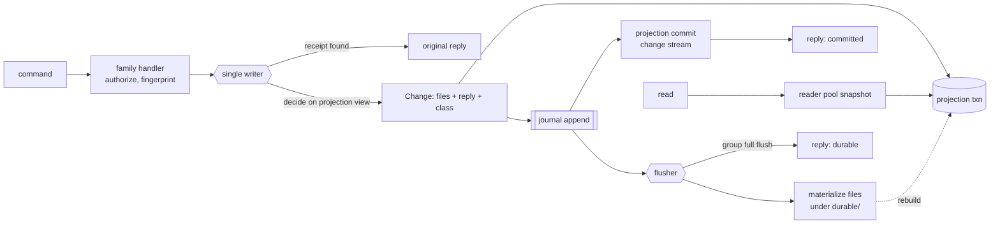

# Office store

How an office stores, acknowledges, reads and rebuilds the organization's data. It
applies the [data contract](organization-data/README.md) and the decision records it
names; [ADR-0021](../adr/0021-office-store-architecture.md) records the choices made
here. The increments that build it are B1a to B1c in the
[implementation plan](../implementation-plan.md#b1a--the-store-core-on-the-organization-family).

## 1. The shape in one page

An office stores three kinds of thing.

| Thing | Where | What it is for |
| --- | --- | --- |
| **Acceptance journal** | `durable/recovery/offices/<office-id>/journals/acceptance/<journal-incarnation>/` | The commit point. One append-only log per office, for every record family. Each entry is one accepted operation: its receipt, the positions it took and the exact files it leaves behind. An entry is kept until its files are written and flushed and every consumer has passed it. |
| **Canonical files** | `durable/state/` (published to organization Git) and the protected trees `durable/messaging/`, `recovery/`, `accounting/`, `budgets/`, `authority/`, `local/` | The source. Every record is a file at the path the data contract names. |
| **Projection** | `runtime/<office-id>/office.db` | The index every read and every decision uses. It holds nothing that is not in the files or the journal, and it can be deleted at any time. |

**The commit point is the journal entry.** An operation is accepted when its entry is
appended to the journal segment. What "acknowledged" then means depends on the class
the operation declares ([ADR-0014](../adr/0014-acknowledgement-classes-and-agent-os-latency.md)):

- **Committed.** The entry is appended (it survives the office process dying) and the
  projection that contains it is committed (it is readable). It can be lost only if the
  machine loses power or the kernel crashes before the next group flush, at most the
  flush interval later.
- **Durable.** As committed, and the journal has been fully flushed through that entry
  (`F_FULLFSYNC` on macOS). It survives a power cut.

Neither class waits for the canonical files. Files are written after the flush that
covers their entry, and the journal keeps every entry whose files are not yet safe.

**What is rebuilt from what.** Files are completed from the journal (materialization,
idempotent). The projection is rebuilt from the files once the journal is materialized.
Nothing rebuilds the journal: for the entries it still holds it is the only copy.

Rejected: the files as the commit point (a change that spans several files cannot be
atomic, and a durable change would need a flush per file); the projection as the commit
point (a cache must be deletable, ADR-0014 decision 6).



**The path of a change.** The family handler in the office authorizes the request and
computes its fingerprint. The writer looks up the receipt for the operation ID: a match
returns the original reply, a different fingerprint or actor is a conflict. Otherwise
the family's decision runs on the writer against the projection at head and returns a
`Change`: the files to create, replace or remove, the reply, and the class. The writer
applies those files to the projection inside the batch's transaction, appends the
batch's entries to the journal in one write, commits the projection, publishes the
change, and answers the committed-class requests. Durable-class requests are answered by
the flusher after its next full flush. The flusher then writes the files.

**The path of a read.** A handler takes a snapshot from the reader pool and calls its
family's read port. A read touches only the projection: no file, no journal, no writer
and no host call.

## 2. Crates and modules

**One new crate, `org-store`.** It holds the engine-neutral foundation: the commit
contract (`Change`, `Ack`, `Operation`, `Refusal`), the writer, the journal, the
flusher, the file materializer, rebuild, the change stream, the `Engine` and
`Projector` traits, and a `testkit` feature with the in-memory engine and the shared
property harness. It exists because every family crate (`org-work`, `org-mailbox`) and
the office's own families must name `Change` and `Ack` (ADR-0014 decision 8 puts each
operation's class in the crate that owns it), and they cannot depend on `org-office`.
It depends on no family. Its full flush and exclusive rename are today's primitives
from `store/acceptance/durable.rs`, carried into `files.rs` as they are: one small
platform-conditional function (`F_FULLFSYNC` on macOS), listed on the Linux track's
check allowlist in place of `durable.rs`. When X1b lands, `org-platform`'s `fs` takes
that function over and `org-store` gains that dependency; B1a does not wait for it.

**No adapter crate.** The SQLite engine is the module `org-office/src/store/sqlite/`, the
only office module that names `rusqlite`. A separate crate would have to depend on
`org-office` to implement the ports of the families that live there (organization,
projects, employees). A later PostgreSQL engine is a sibling module behind the same seam.

**A family is a vertical slice with one shape.** Adding a family copies it; no shared
module grows.

| Part | Holds |
| --- | --- |
| `records.rs` | The typed records, their paths from the data contract, and the codec between record and file bytes (`org-docs` for Markdown and YAML, `serde_json` for JSON) |
| `ports.rs` | Two traits: `<Family>Read` (the queries its decisions and API need) and `<Family>Write` (row upserts and removals for its records) |
| `projector.rs` | One `Projector` implementation, generic over the engine: decode a file, call the write port |
| `features/<operation>.rs` | One operation: its command and `decide`, which returns a `Change` or a `Refusal`. `features/mod.rs` declares every operation's class in one `Op::ack()` match |
| `testkit.rs` | The in-memory implementation of both ports and the conformance suite, as a macro each engine invokes |
| `org-office/src/store/sqlite/<family>.rs` | The SQL behind both ports |

| Family | Home | Built in |
| --- | --- | --- |
| Receipts and sequence positions | `org-store` (core) | B1a |
| Organization and people: organization, offices, office codes, teams, employees, roles, HQ counters and allocations | `org-office/src/organization/` | B1a, B2 |
| Projects | `org-office/src/projects/` | B3 |
| Work: tasks, task events, the office task counter | `org-work` | B4 |
| Messaging: conversations, messages, participant state, status | `org-mailbox` | B6 |
| Execution: placements, permits, turns, process cleanup | `org-office/src/employees/` | C2, C3 |
| Accounting, budgets | Their own module, same shape | L2, L3 |

**Dependencies** point from composition to families to the foundation. `org-store` has no
edge to `org-proto`: it checks only that an ID is one safe path component, and each
family validates the form of its own IDs (UUIDv7):

```text
apps/agentic-org-office ─> org-office ─┬─> org-store    (─> org-platform once X1b lands)
                                       ├─> org-work ────> org-store, org-docs, org-proto
                                       ├─> org-mailbox ─> org-store, org-proto
                                       ├─> org-docs
                                       └─> rusqlite        (only from src/store/sqlite/)
org-sync (parked) ─> org-store          (from S1)
```

`org-office/src/store/mod.rs` is the one composition seam: `open_store(&StoreConfig)`
builds the office's store with the engine the configuration names. Production builds
know `Sqlite`; `Memory` exists only with the `testkit` feature; any other name is
refused at composition.

**Target layout** (B1a to B1c; later families add the parts marked):

```text
crates/org-store/src/
  lib.rs            # public API
  change.rs         # Change, FileChange, Ack, Operation, Refusal, DurablePath
  writer.rs         # the single writer: queue, batch, decide, apply, append, commit, reply
  journal.rs        # segments, entry frame, chain, anchor, checkpoint, recovery scan
  flusher.rs        # group flush, durable replies, materialization, consumer cursors
  files.rs          # atomic, flushed publication under durable/; full flush, exclusive rename
  receipts.rs       # the receipt family: files, projector, lookup before decide
  sequences.rs      # origin streams and feed positions
  changes.rs        # the change stream
  rebuild.rs        # rebuild()
  engine.rs         # Engine, Projector
  testkit/          # MemoryEngine, rebuild-equivalence harness, crash points
crates/org-office/src/
  organization/     # records.rs ports.rs projector.rs features/ testkit.rs
  projects/         # same shape (B3)
  employees/        # same shape (C2, C3)
  store/
    mod.rs          # open_store: the seam
    sqlite/
      mod.rs        # SqliteEngine: connections, pragmas, cursor, sources, reader pool
      schema.rs     # the contract's schema.sql, the adapter's tables and indexes, digest
      receipts.rs   # SQL for org-store's receipt and source tables
      organization.rs
      projects.rs   # (B3)  work.rs (B4)  messaging.rs (B6)  employees.rs (C3)
crates/org-work/src/      # records.rs ports.rs projector.rs features/ testkit/ (B4)
crates/org-mailbox/src/   # the same (B6)
```

**What happens to what exists.**

- `crates/org-office/src/store.rs` and `store/`: deleted whole in B1b and replaced by
  `store/mod.rs` and `store/sqlite/` (section 11).
- `crates/org-docs`: kept as it is: the strict front-matter parser and the
  source-preserving editor that family codecs call. It does no I/O and knows no family.
- `org-work`'s `WorkStore`, `WorkTxn`, `WorkReads` and `OrgView`: replaced in B4 by
  `WorkRead`, `WorkWrite` and decisions that return a `Change`. The in-memory `MemStore`
  becomes the work family's memory port.
- `org-mailbox`'s `MessageStore`, `TriageStore`, `SyncStore` and `ThreadStore`: replaced
  in B6 by `MessagingRead` and `MessagingWrite`; the mailbox's waiters subscribe to the
  change stream instead of being woken by `commit_message`.
- `org-sync`'s `OrgStore`, `MessageStore` and `LocalStreamStore`: parked; S1 re-expresses
  them over the remote apply and outbox of section 10.
- The conformance suites keep their form: a macro in the family's testkit, invoked once
  per engine (today `mailbox_conformance_tests!` in `crates/org-office/src/messaging.rs`
  and the replication suite in `store/org/replication/conformance.rs`).

## 3. The contracts

The sketches are illustrations: names may change, the responsibilities may not.

**What an operation produces** (`org-store`, `change.rs`):

```rust
/// When the office may answer (ADR-0014). Declared by the family that owns the operation.
#[derive(Clone, Copy, PartialEq, Eq, Debug)]
pub enum Ack { Committed, Durable }

/// A relative path under `durable/`: normal components only, the first naming a known tree.
pub struct DurablePath(/* private */);

/// One file an operation leaves behind, in the exact bytes the data contract defines.
pub enum FileChange {
    Create(DurablePath, Bytes), // immutable (an event, a message); other bytes there are a fault
    Put(DurablePath, Bytes),    // mutable (a task, a team); replaces what this office wrote last
    Remove(DurablePath),
}

/// Everything one admitted operation commits, as one unit.
pub struct Change { pub ack: Ack, pub files: Vec<FileChange>, pub reply: Bytes }

pub enum Refusal {
    Rejected(Bytes),    // admitted and rejected: a receipt-only entry, so a retry gets the same answer
    Invalid(StoreError) // refused before admission: nothing is recorded
}

/// What a retry is matched on: document 16's receipt identity.
pub struct Operation { pub id: OperationId, pub kind: &'static str, pub actor: Actor, pub fingerprint: Sha256 }
```

**The unit of work** keeps sequence allocation, idempotency receipt, journal append and
the outbox atomic, because all four are one journal entry. A decision sees only this:

```rust
impl<E: Engine> UnitOfWork<'_, E> {
    /// The projection at head, earlier operations of this batch included.
    pub fn view(&self) -> &E::Tx;
    /// Current bytes of a source file, unmaterialized journal entries included (source-preserving edits).
    pub fn source(&self, path: &DurablePath) -> Result<Option<Bytes>, StoreError>;
    /// The next position of one of this office's origin streams; recorded in the entry.
    pub fn next(&mut self, stream: Stream) -> Result<u64, StoreError>;
    /// The writer's clock, recorded in the entry. A decision reads no other clock.
    pub fn now(&self) -> Timestamp;
}

impl<E: Engine> Store<E> {
    /// Runs `decide` on the single writer; answers in the class its Change declares, or
    /// durable when the caller asks (ADR-0014 decision 4). `FnMut`: a decision may run again
    /// until its entry is appended, never after.
    pub fn submit<F>(&self, op: Option<Operation>, durable: bool, decide: F) -> Result<Bytes, StoreError>
    where F: FnMut(&mut UnitOfWork<'_, E>) -> Result<Change, Refusal> + Send + 'static;
    pub fn read<R>(&self, f: impl FnOnce(&E::Snapshot) -> Result<R, StoreError>)
        -> Result<(R, FeedPosition), StoreError>;
    pub fn subscribe(&self, after: FeedPosition) -> Result<ChangeStream, Resync>;
}
```

**The engine seam** (`engine.rs`). `Engine` and `CorePort` are implemented once per
engine; `Projector` once per family, for every engine at once.

```rust
/// The database the projection lives in (ADR-0018). SqliteEngine and MemoryEngine implement it.
pub trait Engine: Send + Sync + 'static {
    type Tx: CorePort + Send;   // the writer's open transaction
    type Snapshot: CoreRead;    // a consistent read view
    fn begin(&self) -> Result<Self::Tx, EngineError>;
    fn commit(&self, tx: Self::Tx, cursor: &Cursor) -> Result<(), EngineError>;
    fn snapshot(&self) -> Result<Self::Snapshot, EngineError>;
    /// Builds a new projection with `build` and installs it atomically in place of this one.
    fn replace(&self, build: &mut dyn FnMut(&mut Self::Tx) -> Result<Cursor, StoreError>)
        -> Result<(), EngineError>;
}

/// The store's own rows: the applied cursor, the hash of every source file, the receipts.
pub trait CoreRead {
    fn cursor(&self) -> Result<Option<Cursor>, EngineError>;
    fn source_hash(&self, path: &DurablePath) -> Result<Option<Sha256>, EngineError>;
    fn sources_under(&self, prefix: &DurablePath) -> Result<Vec<DurablePath>, EngineError>;
    fn receipt(&self, id: &OperationId) -> Result<Option<Receipt>, EngineError>;
}
pub trait CorePort: CoreRead {
    fn mark(&mut self) -> Result<Mark, EngineError>;             // a savepoint per operation
    fn undo_to(&mut self, mark: Mark) -> Result<(), EngineError>;
    fn set_source(&mut self, path: &DurablePath, hash: Option<Sha256>) -> Result<(), EngineError>;
    fn put_receipt(&mut self, receipt: &Receipt) -> Result<(), EngineError>;
}

/// A family's projection of its own files: the same function on the write path and in rebuild.
pub trait Projector<E: Engine>: Send + Sync {
    fn owns(&self, path: &DurablePath) -> bool;   // every source path has exactly one owner
    /// Replaces every row this file contributes; `None` when the file is removed.
    fn apply(&self, tx: &mut E::Tx, path: &DurablePath, bytes: Option<&[u8]>) -> Result<(), ProjectionError>;
    /// After a rebuild: checks that span files (references, contiguous task history).
    fn validate(&self, _tx: &E::Tx) -> Result<(), ProjectionError> { Ok(()) }
}
```

Receipts are the core's own family: a receipt is the file
`recovery/commands/<operation-id>.json` with its result inline or under `results/`
(document 16), projected into `mutation_receipts` by a core projector through
`CorePort`.

**The journal and the files are concrete types**, not traits: there is one way to
write them.

```rust
impl Journal {
    pub fn open(dir: &JournalDir, id: &OfficeIdentity, custody: &dyn WriterAuthority)
        -> Result<(Journal, Recovered), JournalError>;           // verify chain; torn-tail rule (section 4)
    pub fn append(&mut self, entries: &[Entry]) -> Result<Ordinal, JournalError>; // one write
    pub fn flush(&self) -> Result<Ordinal, JournalError>;        // full flush; flushed through
    pub fn after(&self, ordinal: Ordinal) -> Entries<'_>;         // replay, outbox
    pub fn release_through(&mut self, ordinal: Ordinal) -> Result<(), JournalError>; // checkpoint, drop segments
}
impl Files {
    /// Writes the final state of each path over `entries`: atomic, data flushed before rename.
    pub fn materialize(&self, entries: &[Entry]) -> Result<(), FilesError>;
    pub fn read(&self, path: &DurablePath) -> Result<Option<Bytes>, FilesError>;
    pub fn walk(&self, tree: Tree) -> Walk<'_>;                   // sorted, for rebuild
}
```

`WriterAuthority` is today's host custody contract
(`crates/org-office/src/store/acceptance.rs`, implemented by
`apps/agentic-org-office/src/transfer/writer.rs`); it moves to `org-store` unchanged in
shape and is called once at open and once per flush (section 4).

**The rule for a decision.** It runs on the writer thread, so it is short and bounded
in time. It does no I/O except through the unit of work (`view`, `source`, `next`,
`now`): no file, socket, process or clock of its own. Work that is slow or large
happens on the caller's thread before `submit`: hashing an attachment, encoding a large
body, writing a content-addressed blob, and any network call; the decision receives
their results. A decision that panics fails its own operation alone: the writer catches
the panic, undoes to that operation's mark, answers it with an error, and the batch
continues.

**A change can be tried and discarded.** A dry run asks what a change would do: the
writer takes the mark, runs `decide`, applies the result to the projection as step 4 of
a batch does, then undoes to the mark and answers. Nothing is framed, appended,
recorded as a receipt or published, and every number and position the decision took is
returned by the undo. It skips the receipt lookup of step 1 and takes no operation ID.
It is the `--dry-run` of the [agent command line](agent-os-command-line.md) (section
2.6), and the store gains its entry point with the first writing command (B2).

**How a family declares its classes:** one enum of its operations with one exhaustive
`ack()` match, in `features/mod.rs`. That is the one place ACK-4 asks for.

**Worked example: create a team.**

```rust
// org-office/src/organization/features/mod.rs: the one place classes are declared
pub enum Op { CreateOrganization, CreateTeam /* B2 adds the rest */ }
impl Op { pub const fn ack(self) -> Ack { match self { Op::CreateOrganization | Op::CreateTeam => Ack::Durable } } }

// org-office/src/organization/features/create_team.rs
pub struct CreateTeam { pub id: TeamId, pub name: TeamName, pub parent: TeamId }

pub fn decide<E: Engine>(uow: &mut UnitOfWork<'_, E>, by: &Actor, cmd: &CreateTeam) -> Result<Change, Refusal>
where E::Tx: OrganizationRead {
    let view = uow.view();
    let parent = view.team(&cmd.parent)?.ok_or(Refusal::invalid("no such parent team"))?;
    if !parent.is_active() { return Err(Refusal::rejected(&Rejection::ParentArchived)); }
    if view.team(&cmd.id)?.is_some() { return Err(Refusal::invalid("team id in use")); }
    let counter = view.team_counter()?.advance();                // HQ only; refused at a satellite
    let team = Team::new(cmd, counter.last_number, &parent, by, uow.now());
    Ok(Change::new(Op::CreateTeam.ack())
        .put(records::team_path(view, &team)?, records::encode_team(&team)?)
        .put(counter.path(), counter.encode()?)
        .create(counter.allocation(team.id, uow.now()).path(), counter.allocation(..).encode()?)
        .reply(&TeamCreated { id: team.id, number: team.number }))
}

// org-office/src/organization/projector.rs: one function, live and in rebuild
impl<E: Engine> Projector<E> for OrganizationFiles where E::Tx: OrganizationWrite {
    fn owns(&self, p: &DurablePath) -> bool { records::kind_of(p).is_some() }
    fn apply(&self, tx: &mut E::Tx, p: &DurablePath, bytes: Option<&[u8]>) -> Result<(), ProjectionError> {
        match (records::kind_of(p).expect("owned"), bytes) {
            (Kind::Team, Some(b)) => tx.put_team(&records::decode_team(p, b)?),
            (Kind::Team, None) => tx.remove_team(&records::team_id(p)?),
            // organization, office, employee, counter, allocation: the same two arms each
        }
    }
}

// org-office/src/store/sqlite/organization.rs: the only place this family's SQL lives
impl OrganizationWrite for SqliteTx<'_> {
    fn put_team(&mut self, t: &Team) -> Result<(), StoreError> {
        self.upsert(TEAM_UPSERT, team_params(t))?;   // and its record_refs row
        Ok(())
    }
}

// the handler: authorize, then one call
let reply = store.submit(Some(op), false, move |uow| create_team::decide(uow, &actor, &cmd))?;
```

The memory engine's `OrganizationWrite` is the same four lines over a `BTreeMap` in
`organization/testkit.rs`. The conformance suite drives both through the ports and
`Store::submit`.

## 4. Writing

**Three threads.** One writer owns the projection's write transaction and the journal's
append end. One flusher owns flushing, durable replies and file materialization. A pool
of readers serves reads. Nothing else writes.

**A batch.** The writer takes everything queued, up to 64 operations (today's
`MAX_BATCH` in `crates/org-office/src/store.rs`), and for each in order:

1. Looks up the receipt for its operation ID (projection, this batch included). A match
   on actor and fingerprint returns the original reply; anything else is a conflict
   that discloses nothing.
2. Takes a savepoint mark and runs `decide`. A `Refusal::Invalid` records nothing. A
   `Refusal::Rejected` becomes a receipt-only entry.
3. Frames the entry: the next ordinal, the previous entry's hash, the receipt, the
   positions taken, the feed position, and the file changes with their bytes.
4. Applies the entry to the projection: each file to the projector that owns its path,
   `set_source` with its hash, and the receipt row. A projector error undoes to the mark
   and fails that operation alone.

Then, once per batch: append every entry to the journal segment in **one write**;
commit the projection with the cursor (last ordinal and hash); publish to the change
stream; answer committed-class operations; hand durable-class ones to the flusher with
their ordinal. If the engine ends the transaction before the append (disk full, an
interrupt), the remaining operations decide again in a new transaction, as ADR-0002
decision 3 states. After the append, nothing decides again: if the projection commit
fails, the writer replays the appended entries from the journal; if that fails, the
office stops accepting and reports recovery required. No reply ever reports failure
for an appended entry. A request whose entry is appended when the store stops this way is
answered `OutcomeUnknown`: the operation is accepted, not failed, and the same operation
ID submitted after reopening gets its answer.

**The flusher.** When a durable reply waits, or the flush interval (default 50 ms,
fixed by measurement in B1c) has passed with unflushed entries, it: fully flushes the
segment; confirms the flushed head to the host's writer custody; answers every durable
operation through that ordinal; writes the final state of each path touched by the
newly flushed entries (section 5); and advances the materialized mark. A committed
operation never waits for the drive, even in a batch with a durable one.

**Durable means flushed and confirmed.** A durable answer is given only when the segment
holding the entry is fully flushed and the host's writer custody has confirmed that
flushed head. A flush the host has not confirmed answers nobody as durable: the request
waits for the confirmation, and gets the custody error if it fails.

**A failed flush is fatal.** If a full flush of a journal segment, of a materialized
file or of a directory returns an error, the office never retries it in the same
process: after a flush error the kernel may have dropped the dirty pages, and a second
flush can succeed without the data being on the drive. It answers no waiting durable
request as success (each gets an error and reconciles later by its operation ID),
stops accepting, reports the fault with the path, and exits. On restart it reads the
journal from the drive and proceeds from what is really there.

**A failed append.** If the append returns an error or writes fewer bytes than the
batch, the writer rolls back the batch's projection transaction, fails every operation
of that batch (none was acknowledged), and truncates the segment back to the end of its
last good entry, flushing that truncation, before it takes another batch. If the
truncation fails, the office stops as for a failed flush.

**Back-pressure.** Two tails are bounded in bytes. The unflushed tail (appended, not
yet flushed) is at most 8 MiB; the flushed-but-unmaterialized tail (flushed, files not
yet written) is at most 64 MiB. The second is also the **pending overlay** that
`UnitOfWork::source` reads: an in-memory map, owned by the writer, from path to the
latest bytes in a retained entry. An entry leaves the overlay only after the
materialized mark has advanced past it; at opening the overlay is rebuilt from the
entries after the mark. When either bound is reached, or the projection's log reaches
its bound (section 8), the writer takes no new batch until the flusher catches up, and
the office reports that it is holding writes back. Reads continue.

**Why the projection comes before the files.** Reads and the next decision need the
change at once; files need a flush each and are wanted only by rebuild, Git and backup.
Both are derived from the same entry, and the projection is a function of the files'
bytes, so their order does not change what a rebuild produces.

**Visible at commit, acknowledged by class.** A durable change is readable in the
office from its projection commit, a few milliseconds before its flush. A power cut in
that window removes it, as it removes committed-class changes. Nothing leaves the office
before its entry is flushed: the replication outbox and Git publication read only
flushed entries. So a position or a number that a power cut takes back was never seen
outside. Task numbers, which people see in the office, keep ADR-0019's durable mark
(the work family writes `task-counter.yaml` with a higher `reserved_through` as a
durable change before it uses numbers past it) and jump to the mark after an unclean
stop, which the store reports at open.

**The entry.** Raw bytes, hashed as stored (`raw-bytes/1` in the
[hash codec registry](organization-data/08-record-contracts.md#hash-codec-registry)):

```text
entry   = length:u32 ‖ header ‖ payloads ‖ sha256(header ‖ payloads)
header  = canonical JSON {
  ordinal, previous_sha256, office_id, journal_incarnation, at, ack, feed,
  operation: {id, kind, actor, fingerprint, outcome: completed|rejected} | null,
  positions: {"work": [first, last], "message": [..], "organization": [..]},
  files: [{path, op: create|put|remove, length, sha256, previous_sha256}] }
payloads = the files' bytes, in header order
```

`previous_sha256` is the hash the projection held for that path when the entry was
framed (`CoreRead::source_hash`), so every file change names the version it replaces.

The first entry chains to the immutable `anchor.json` of the journal incarnation, which
binds the office identity, the writer epoch, the origin high-waters it starts from and
the predecessor head, if any. Segments are `segments/<first-ordinal>.log`, rolled at
64 MiB. An entry is at most 16 MiB (the `selected-task-resources/1` manifest limit); a
file larger than 1 MiB is written first as a content-addressed blob, flushed, and the
entry names its digest. Ordinals, origin positions, feed positions and task revisions
stay distinct (ADR-0006).

Rejected: one file per entry (in section 8's indicative harness, 16 µs median per
entry against 0.65 µs for an append, and 580 µs against 228 µs with a flush; and each
file needs its own flush); SQL row images in the entry, as today (they tie the journal to one
engine and one projection schema).

**States of an entry.**

| State | Meaning |
| --- | --- |
| Appended | In the segment; survives a process crash |
| Projected | The projection cursor has passed it; readable |
| Flushed | The segment is fully flushed through it; survives a power cut; may leave the office |
| Materialized | Its files are written and flushed under `durable/` |
| Released | Every consumer (materializer, and from S1 the replication outbox) has passed it; it has left the pending overlay; its segment may be dropped after `checkpoint.json` records the head and high-waters |

**Crashes.**

| Crash | What is on disk | How restart finishes |
| --- | --- | --- |
| During decide or apply | Nothing appended; projection transaction rolled back | Nothing to finish; a retry runs afresh |
| During the append | A torn last entry: a process kill mid-write or a power cut | Above the head the host custody last confirmed, the scan stops at the first bad length or hash and truncates there; that entry was never acknowledged durable. At or below that head a bad entry is corruption: the office refuses to open and names the ordinal |
| After the append, before the projection commit | Journal ahead of projection | Replay the entries after the cursor through the projectors; a retry finds the receipt |
| After the commit, before the reply | Both current | A retry by operation ID gets the original reply |
| After a committed reply, before the flush (power cut) | Journal may end earlier; projection may be ahead of it | A cursor ahead of the journal, or a hash that differs at its ordinal, means: rebuild |
| During materialization | Each file wholly old or wholly new | Write the final state of the retained entries after the materialized mark again |
| During a rebuild | The old projection, or none | Rebuild again: the new projection is built beside the old and swapped in |
| A flush returns an error | Unknown: the data may not be on the drive | The office exits without answering waiting durable requests as success; restart proceeds from what the journal holds on the drive |
| An append fails or is short | Possibly a partial entry at the tail | The batch fails and is rolled back; the segment is truncated to its last good entry before the next batch; a failed truncation stops the office |

**Opening.** Take the office lock and the host custody checkpoint; open the journal
(verify the chain from anchor or checkpoint; refuse a journal behind the custody
checkpoint; recover the high-waters; apply the torn-tail rule below); materialize the retained
entries after the materialized mark; then either replay the entries after the
projection cursor or, if the projection is missing, of another schema digest or ahead
of the journal, rebuild (section 6). Confirm the head to the host and start accepting.

**The torn-tail rule.** A write can be torn by a process kill as well as by a power
cut. Only entries above the head the host custody last confirmed may be truncated, and
only from the first entry whose length or hash is bad. A bad length or hash at or below
that head is corruption: the office refuses to open, names the ordinal, and never
truncates. Two tests inject the cases: the crash harness cuts the last append at a
random byte, as a kill mid-write would, and checks that reopening truncates it and
keeps everything before it; a corruption test flips one byte inside an entry at or
below the confirmed head and checks that opening refuses and names that ordinal. The
power-cut simulation of section 6 drops every byte after the last flush.

**Idempotent retry.** A retry carries the same operation ID. The receipt is matched
before any validation of current state (ADR-0006). A receipt whose entry is not yet
flushed answers after the flush when the original was durable-class. The same ID with
another actor or fingerprint conflicts. Two operations with one ID in one batch: the
second finds the first's receipt. Operations whose record ID is their idempotency key
(a message, ADR-0003 decision 9) need no receipt: their decision finds the record.
Receipts are never deleted by the store; expiry is a reviewed procedure (document 16).

**Directory generations** (ADR-0006, document 16): the generation is the organization
stream's high-water. Every organization decision takes one position of that stream; the
engine commits the stream high-waters with its cursor, so a read returns the generation
of its own snapshot. A rejected organization command gives its position back, so the
generation does not advance. On rebuild the value comes from the journal or its
checkpoint, never from a file, so it is equal after a delete-and-rebuild and after a
segment release. Since every decision runs on the one writer against the projection at
head, task state and directory facts are always read from the same generation.

## 5. Files

**Paths.** A durable path is relative, `/`-separated, at most 512 bytes, and starts with
a known tree (`state`, `authority`, `accounting`, `messaging`, `recovery`, `budgets`,
`local`). Every component comes from the portable set `[a-z0-9._-]`, is at most 255
bytes, is not `.` or `..` and does not begin with the store's temporary-file prefix. No
file system folds, normalizes or refuses any of that set, so two accepted paths never
name one file and every accepted path can be written. An ID is checked by the store as
one such component and no more; its family validates its form. A path names a file or a
directory, never both: a change whose path is a directory, or lies below a file, among
the paths on the drive or accepted and not yet written, is refused before its entry is
accepted. Every source path has exactly one owning family; `state/repositories.yaml` is
the organization family's, and B3 writes it through that family's port.

**From record to file.** The family's codec turns a record into the exact bytes the data
contract defines, at the path it names, under the tree it belongs to:
`state/teams/<team-id>/team.yaml`,
`state/projects/<project-id>/work/tasks/<task-id>.md`,
`state/work-history/tasks/<task-id>/<revision>.json`,
`messaging/conversations/<conversation-id>/messages/<message-id>.json`,
`recovery/commands/<operation-id>.json`, `local/offices/<office-id>/task-counter.yaml`.
File names are stable IDs; a readable reference is never a path. Editing an existing
Markdown record goes through `org-docs`'s source-preserving editor over the bytes
`UnitOfWork::source` returns, so only the changed fields' tokens differ (ADR-0006).

**How a file is written.** The flusher writes the final state of each path touched
since the materialized mark, never intermediate versions:

1. Write a temporary file in the same directory and flush its data (the full flush
   of `files.rs`, section 2).
2. `Create`: exclusive rename; existing identical bytes are a
   no-op, other bytes stop the office. `Put` and `Remove`: the current bytes must hash
   to the `previous_sha256` of the first pending change to that path, or to a later
   version in the retained entries (a crash mid-round); then rename over, or unlink.
3. After the round: flush each touched directory, one full flush, then write the
   materialized mark.

So after any crash a file is wholly old or wholly new, and bytes the office did not
write are never replaced silently: the office stops and names the path. Directories are
created `0700` and files `0600`. A team move is a `Remove` and a `Put` for every file
under the team, which its decision lists with `sources_under` and `source`.

**Publishing to Git is not the store's job.** The publisher, built with the Git work
(C7), takes the store's state barrier (which pauses materialization for its duration),
copies `durable/state/` into the organization repository's clone under
`runtime/<office-id>/repositories/`, commits and pushes on the schedule the data contract
sets (hourly for pending work, promptly for important knowledge). Because only flushed
entries are materialized, the tree under the barrier is a consistent cut at one ordinal.
The store never runs Git and never opens a network connection.

**Protected local records** use the same writer and the same file rules, in other
trees: chat in `messaging/` (document 15's layout, one writing office per file), receipts
in `recovery/commands/`, usage in `accounting/`, budgets in `budgets/`, HQ authority in
`authority/`, office-local state in `local/offices/<office-id>/`. Nothing outside
`state/` is published. The author-private task notes are the one exception: document 05
makes them a separate durable database with its own writer and receipts, outside this
store (L8).

## 6. Rebuilding

```rust
/// Rebuilds the projection from the files and the journal, deterministically, and swaps it in.
pub fn rebuild<E: Engine>(
    durable: &DurableRoot,             // <data-root>/<organization-id>/durable
    journal: &mut Journal,             // this office's, opened and verified
    engine: &E,
    families: &[&dyn Projector<E>],
) -> Result<RebuildReport, RebuildError>;
```

1. Materialize the journal's retained entries, so the files hold everything accepted.
2. Through `Engine::replace`, into a fresh projection beside the live one: walk every
   projected tree (`state/`, `messaging/`, `recovery/commands/`, `accounting/`,
   `budgets/`, `authority/`, `local/offices/<office-id>/`, and any tree a later family
   declares) in byte order of path. Each
   file goes to the one projector that owns its path, then `set_source` records its
   hash. A file no family owns is a failure.
3. Run every family's `validate`. Set the cursor to the journal head. Swap the new
   projection in.

Every failure carries the path and the reason. A family marks the records whose failure
refuses the rebuild (for the organization family: the organization record and the teams
and employees it needs, as document 16's opening rule says); any other failing record is
left out and listed in the report, which the office shows.

**It is deterministic.** Its input is a sorted list of files, and a projector is a pure
function of a path and its bytes: no clock, no random value, no minted ID. Values that
span records are SQL views or queries, never stored by one file's projector.

**When it runs.** At opening when the projection is missing, was built by another schema
digest, or is ahead of or inconsistent with the journal; when an existing organization
is opened from its repository (R1: the office starts a new journal incarnation whose
anchor names the Git commit it opened, then rebuilds); and when an operator asks.

**The property that proves it.** `org-store`'s testkit provides one harness every family
runs, on both engines:

```text
for a generated sequence of the family's commands (valid, invalid, retried, interleaved):
    A = projection after Store::submit of each command, through the real writer
    B = rebuild() from the durable directory A left behind, into a fresh engine
    assert dump(A) == dump(B)
and with a crash injected at a random point (section 4): reopen, then
    assert dump(reopened) == dump(rebuild())
    assert every operation acknowledged before a process kill is present,
       and every durable one after a simulated power cut (unflushed bytes dropped)
```

`dump` is a testkit-only canonical listing of every row, sorted. Because the write path
and rebuild call the same projector on the same bytes, a difference means a projector
kept state or read something other than its file.

**A projection schema change before v1 ships** is a new digest. The SQLite projection's
digest is the SHA-256 of the DDL it loads: the contract's `schema.sql`, the adapter's
own tables (`store_schema`, `store_cursor`, `store_sources`, and `store_receipts`, the
reply table: each receipt whole with its original reply, so a retry is answered without
a file read) and its extra indexes. Opening with a
different digest deletes the projection and rebuilds it. There is no migration code. A
change to a file format before v1 is a change to its codec; files in a format the code
no longer reads are refused by path, because nothing has shipped to keep.

## 7. Reading

**The reader pool.** SQLite read connections in WAL mode, opened `query_only`, up to four
kept idle (today's `MAX_IDLE_READERS`) and more opened under load. A read transaction
is short: a reader that holds one open keeps the log from being checkpointed (section
8). Each `Store::read` call
runs in one read transaction. The memory engine hands out an immutable snapshot.

**What a caller can rely on.**

- One call is one consistent snapshot, taken between batches: never part of a batch.
- A call sees every change acknowledged before it started, because the projection is
  committed before any reply. It may also see a durable change whose flush is still in
  progress (section 4).
- Every result carries the feed position of its snapshot.
- Two calls are two snapshots. A caller that needs several facts from one moment asks
  one read port method for them, or compares positions.
- Reads never wait for the writer, never read a file and never call the host.

**The change stream.** The writer feeds it right after each projection commit: one
`Committed { feed, ordinal, kind, paths }` per entry that changed something, into a
bounded in-memory ring (8,192 entries) and to every subscriber. Feed positions are a
store sequence recorded in each entry, never reused, continued from the journal after a
restart. `subscribe(after)` replays from the ring and then follows; a position older
than the ring, which includes every position from before a restart, answers `Resync`,
and the client reads again (getting a fresh position) and subscribes from there. A
subscriber's own queue is bounded too: one that does not keep up is dropped, never
waited for, and subscribes again.

Families turn paths into their events. The work family emits `work.changed` to the web
process over its office connection (the web process has no database). The messaging
family wakes the waiters of `agent-os msg wait` and of an ask when a message or a
participant file for that recipient commits. Nothing polls the database.

## 8. Speed

ADR-0014 sets the budget end to end in `agent-os` session mode on the reference Mac: a
read or a send at a median of 1 ms and a 95th percentile of 2 ms. The
[non-negotiables](../architecture-non-negotiables.md) ask single-digit milliseconds for
creating and updating a task. Process start and the socket take most of the 1 ms; the
store's share must stay in tens of microseconds.

| Hot path | Class | What it costs here |
| --- | --- | --- |
| Read the inbox | Read | One read transaction; one indexed range on `message_recipient_states` by recipient and state, joined to `messages` by primary key. No file, no host, no writer |
| Send a message | Committed | Membership check by index; encode the message JSON and its `jcs-rfc8785/1` hash; project one message and its recipient rows; one append without flush; one projection commit without flush |
| Mark read | Committed | One participant file `Put`; one row update; append; commit |
| Create a task | Committed | Read the office counter row; encode the task Markdown and its `created` event; project both; append; commit. Once per block of numbers, a durable entry raises `reserved_through` |
| Update a task (status, assignment) | Durable | `source()` of the task file (pending bytes or one file read); source-preserving edit; the event; append; commit; then the group full flush, shared by every durable operation in the window (ADR-0014 estimates 6 to 10 ms on a Mac) |

**Settings.** The projection runs WAL with `synchronous=NORMAL`: it is a cache, so a
power cut may lose its tail, which the cursor check at opening replays or rebuilds. No
projection commit flushes the drive; only the journal is flushed.

**Checkpoints stay off the reply path.** With write-ahead logging an automatic
checkpoint runs on the committing connection and flushes the database file, which would
put a drive flush on the writer thread. So automatic checkpoints are off
(`wal_autocheckpoint=0`), and the flusher runs a passive checkpoint on its own
connection after each materialization round. The log is bounded at 64 MiB; when a
passive checkpoint cannot bring it under that (a long-lived reader holds it), the
writer's back-pressure of section 4 applies until it can. `foreign_keys` and
`recursive_triggers` are on for every write connection, as the data contract requires.
Today every connection sets `synchronous=FULL` and `fullfsync=ON`
(`connect` in `crates/org-office/src/store.rs`), so every commit waits for the drive and
the committed class does not exist yet.

**Costs this design removes.** Today's acceptance path asks the host for its custody
checkpoint before each write and confirms after it, asks again before each read, and
re-reads every materialized file on every read and write (`verify_authority`,
`confirm` and `verify_artifacts` in `crates/org-office/src/store/acceptance.rs`). Here the
host is called once per flush, and reads touch only the projection.

**First indications** (Linux build container, 1 KiB entries, a Python harness,
2026-11-18; not the reference Mac and not a measurement of the store): appending to an open segment took a median of 0.65 µs against
16 µs for writing a file per entry; with a flush, 228 µs against 580 µs. ADR-0014
measured a WAL commit at 0.013 ms without a flush. These support the segment journal;
they are not the measurement B1c owes.

**What B1c measures, and how.** A benchmark target in `org-office` drives the real
writer and SQLite engine in a temporary root and reports the 50th, 95th and 99th
percentiles over at least 10,000 operations of: a committed write alone and beside
continuous durable load; a durable write and the group size per flush; the inbox read
over 10,000 messages and 100 recipients; task create and update including the YAML
codec in the projector; the largest gap between a commit and its flush under continuous
committed load (ACK-5); the 99th percentile of a committed write while a checkpoint
runs; materialization throughput; how often back-pressure engages under sustained load;
and rebuild time for 10,000 and 100,000 files. The results are recorded on Linux CI and the reference Mac in ADR-0014's
measurement section (its decision 7), and CI fails a store benchmark that regresses past
twice its recorded value.

## 9. Engine independence

The engine only holds the projection. The journal and the files, which carry every
guarantee, do not depend on it, so a second engine changes neither.

| Criterion ([ADR-0018](../adr/0018-storage-engine-independence.md)) | How it is met |
| --- | --- |
| ENG-1 SQL only in adapters | The office's SQL and `rusqlite` types live only in `org-office/src/store/sqlite/`; the host's in `org-host/src/hostdb/`. Checked as below |
| ENG-2 one seam, second implementation | `open_store` is the one place an engine is chosen. `MemoryEngine` (in `org-store`'s testkit) is selectable there under the `testkit` feature, and the office's own tests compose the office on it |
| ENG-3 a suite per contract | Each family's testkit holds a conformance macro over its two ports and `Store::submit`; `org-office/src/store/sqlite/<family>.rs` and the family's memory tests both invoke it. `org-store` adds an engine suite for `Engine` and `CorePort` (cursor, sources, receipts, atomic `replace`, snapshot isolation) and the rebuild harness of section 6. Organization in B1a, projects B3, work B4, messaging B6, execution C3, host A3, replication S1 |
| ENG-4 guarantees stated without SQLite | Journal and acknowledgement guarantees here and in ADR-0021 name no engine mechanism; B1c checks documents 06 and 11 and the ADRs |
| ENG-5 trigger and generated-column constraints listed | B1c adds them in words to schema coverage, so another engine can enforce them its own way |

**The check that keeps SQL in the adapter**, run by `cargo test --workspace`:

1. A test reads every `Cargo.toml` in the workspace and fails if `rusqlite` is a
   dependency of anything but `org-office` and `org-host`.
2. A test in `org-office`, built with `syn` like the former `store/tests/opener_policy.rs`,
   parses every `.rs` file of the crate, tests included, and fails on a path that starts
   with `rusqlite` or a string literal that starts with an SQL keyword (`SELECT`,
   `INSERT`, `UPDATE`, `DELETE`, `CREATE`, `DROP`, `PRAGMA`, `BEGIN`, `WITH`, `REPLACE`)
   anywhere outside `src/store/sqlite/`.

**The memory engine** keeps each family's tables as plain `BTreeMap`s in a type map:
`begin` clones the state, `commit` swaps an `Arc`, a snapshot is an `Arc` clone and a
mark is a clone. It is slow on large data and never used in production; its job is to
prove the seam and to make family tests fast.

**A later PostgreSQL engine** is a module `store/postgres/` that implements `Engine`,
`CorePort` and every family's two ports and passes every suite; `open_store` gains one
arm. Its `synchronous_commit` can stay off for every transaction, because the journal,
not the database, is the commit point.

## 10. Replication's place

Replication between offices ships files, stamped with where they came from. The store
offers four things; B1 builds the first three, S1 the fourth.

- **Origin positions.** Every entry records the positions it took in this office's
  four origin streams (organization, work, message content and message state, as the
  data contract names them) under the office's origin
  incarnation. They are recovered from the journal, never from the projection, and a
  new incarnation never reuses them (document 16).
- **An outbox.** `Journal::after` reads flushed entries in order. A consumer registers a
  cursor, and a segment is released only when every cursor has passed it. The
  materializer is the first consumer; S1's replication sender is the second.
- **Snapshots.** A snapshot is the set of files under a scope at one flushed ordinal,
  taken under the state barrier and identified by its content digest. Installing one is
  writing those files and rebuilding. The store has no other snapshot format.
- **Ordered apply (S1).** A peer's change arrives as its file changes with their origin
  `(office, incarnation, sequence)` and organization position. `Store::apply_remote`
  commits it as an ordinary entry whose receipt is that origin identity, so a repeated
  frame is a no-op, and projects it through the same projectors. Each file keeps one
  writing office: an office mirrors a peer's files and never puts a file another office
  owns.

`org-sync` keeps what it already does well (ordering, epochs, version levels, the session
state machine); in S1 its storage traits are restated over these four offers. Milestone
three adds an operation kind and a consumer, not another store.

## 11. What is deleted and what is kept

Today's store is `crates/org-office/src/store.rs` and `store/`: 14,694 lines outside
test files and 33,948 with them, over two SQLite databases (`org.db` and `office.db`
under the host home's `offices/<office-id>/`, `crates/org-office/src/office.rs`), with the
old tables as the source of truth. **B1b deletes all of it**, rather than family by
family, so that the office has one writer, one database and one place for SQL. Calls
that only the old tables served answer `unsupported` until their family is rebuilt on
the new store: work in B4; messaging and status in B6; process ownership in C3. Nobody
uses them yet.

| Deleted in B1b | Replaced by |
| --- | --- |
| `store.rs` (writer, `Schema` upgrades, `Opening`) | `org-store` writer; the SQLite engine |
| `store/org.rs`, `store/org/` (activity, operation, snapshot, work view, replication and its tests) | The organization family; replication in S1 (section 10) |
| `store/acceptance.rs`, `store/acceptance/` (`rows.rs` capture triggers, `schema.rs`, `crash.rs`, `durable.rs`, tests) | `org-store` journal, flusher, files and crash points |
| `store/origin.rs` | `org-store` sequences |
| `store/hq_creation.rs` (`local_hq_creation`) | The organization family; the CA key as a protected record wrapped by the office secrets key (ADR-0016) under `local/offices/<office-id>/` |
| `store/work.rs`, `store/work/` | The work family (B4) |
| `store/messages.rs`, `store/status.rs`, `crates/org-office/src/messaging.rs` | The messaging family (B6) |
| `store/owned_processes.rs` | Process cleanup records as files under `recovery/offices/<office-id>/cleanup/` (C3, document 16) |
| `store/sync.rs` | Nothing: the old sync attempt runner goes with the old writer |
| SQL in `organization/bootstrap.rs`, `organization/admission.rs`, `office.rs` (`put_meta`, `meta`) and `office/hq_creation.rs` | Organization family decisions; office identity in the journal anchor and `offices/<office-id>.yaml` |

A1 already removed the key pragma and deleted `store/tests/` (the opener-policy and
SQLCipher-initialization tests) with SQLCipher (ADR-0016).

**Kept, and how it changes.**

- **The acceptance journal's rules** (`store/acceptance.rs`): a decision is frozen and
  never rerun once published; an anchor and a hash chain; ordinals apart from origin
  positions; exhaustion checked before publication (writes stop, receipt lookups
  continue); files materialized to their final state from a verified predecessor, and
  unfamiliar bytes stop recovery; the crash points of `acceptance/crash.rs` (from
  `Prepared` through `SqlCommitted` and `BeforeReply`) and their reopen tests, mapped
  onto the crash table of section 4. What changes: an entry carries file changes,
  not SQL rows with a projection-schema digest; entries are appended to segments, not
  written one file each; the hash is over the stored bytes; the host confirms once per
  flush; there are no capture triggers and no per-read verification.
- **The publication primitives** of `store/acceptance/durable.rs` (path validation,
  directory checks, temporary file, flush, exclusive rename): into `org-store`'s
  `files.rs` as they are in B1a; X1b later moves the platform-conditional flush into
  `org-platform`'s `fs`.
- **The batching rules of ADR-0002 decision 3** and their tests in `store.rs` (one failing
  request fails alone; when SQLite ends the transaction the others run again; a failed
  commit fails every request): ported to `org-store`'s writer suite.
- **`WriterAuthority`** and its host channel adapter in
  `apps/agentic-org-office/src/transfer/writer.rs`: moved to `org-store` unchanged in
  shape.
- **The conformance suites** of `org-mailbox` (`testkit/conformance.rs`,
  `triage_conformance.rs`) and `org-sync`: restated over the new ports in B6 and S1.
  `org-work`'s `MemStore` becomes the work family's memory port in B4.
- **`org-work`'s `selected_codec`, `selected_assignment` and `selected_history`**: the
  task event codec and assignment rules B4 builds on.

## 12. What it does not do

- **No generic repository layer or ORM.** Each family writes the queries it needs; a
  generic layer would be a second schema to keep in step with the contract's.
- **No event sourcing of everything.** The journal is a short-lived commit log, released
  once its files are safe. History is what the data contract keeps (task events, files),
  not a replay of every operation since the start.
- **No migrations.** The projection is rebuilt when its schema changes; file formats
  change before v1 by replacing them.
- **No query language** or generic query API. A read port has named methods.
- **No caching layer.** SQLite's page cache and the operating system's suffice; the only
  memory the store keeps is the journal tail not yet materialized, the sequence
  high-waters and the change ring.
- **No second writer, async runtime or connection pool for writes.** One thread decides
  and appends; the drive's speed is absorbed by group flushing, not by parallel writers.
- **No network and no Git.** Relaying, replication and publication are consumers of the
  store, never parts of it.
- **No encryption** of data (ADR-0016). Private keys are records wrapped by the office
  secrets key before they reach the store.
- **No database per family.** One projection per office keeps cross-family reads in one
  snapshot and one writer.

## 13. Open points

Each needs a decision during B1; the recommendation is what this design assumes.

1. **Generic office or trait objects.** Decided in B1a: static dispatch, `Office` stays
   non-generic. `store/open.rs` holds `enum OfficeStore` with one arm per engine (`Sqlite`,
   and `Memory` under `testkit`). An operation is a `StoreOp`, a read is a `ReadOp`; each
   is generic over the engine and compiled once per arm. `OfficeEngine` is a blanket
   supertrait that grows by one bound per family. Nothing above `open_store` is generic,
   there are no boxed ports and no forwarding impls, and adding an operation changes no
   shared file. Its costs, accepted: an operation or a read is a named type, because a
   closure cannot be generic over the engine; each is compiled once per engine, so code
   size and build time grow with operations times engines; a new engine adds an arm to
   the enum and to each of its methods; and the operations of a family that the office
   runs are named where the store is composed, not in the family.
2. **The flush interval.** Default 50 ms. Recommendation: keep it unless B1c's
   measurement on the reference Mac shows the full flush costs more than a tenth of it
   under load.
3. **Parsing on the write path.** The projector decodes the bytes the decision just
   encoded. Recommendation: keep it so (it is what makes the write path and rebuild one
   function), and only if B1c shows the YAML decode over budget, let the projector take
   the decision's typed record as a hint, with the rebuild harness still proving equality.
4. **Segment release.** Recommendation: 64 MiB segments; release a segment once every
   consumer cursor has passed its last entry, after writing `checkpoint.json` with the
   head, the high-waters and the materialized mark.
5. **Where the DDL comes from.** Recommendation: the SQLite engine loads the contract's
   `docs/design/organization-data/schema.sql` verbatim (`include_str!`) plus its own
   tables and indexes, so there is one DDL source and `test_schema.py` keeps testing it.
   The alternative, a copy per family, drifts. Taking this makes a file under `docs/` a
   build input, deliberately: moving or renaming it breaks the build; the draft schema
   becomes the real projection schema, so a change to it is a code change that rebuilds
   every office's projection; and the tables of families not yet built exist, empty.
6. **Receipt file count.** One file per operation (document 16) is many small files over
   30 days. Recommendation: keep the contract's layout in v1 and count files in B1c; if
   it hurts, propose daily receipt segments to the contract owner.
7. **The clean-stop marker** that tells the work family to jump its task counter to the
   mark. Recommendation: a file under `local/offices/<office-id>/` written after the last
   flush of an orderly stop and removed at open.

