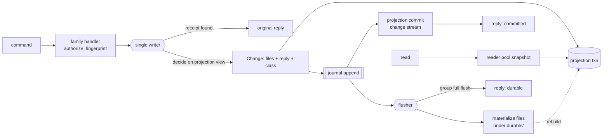

# Office store

How an office stores, acknowledges, reads and rebuilds the organization's data. It
applies the [data contract](organization-data/README.md) and the decision records it
names; [ADR-0021](../adr/0021-office-store-architecture.md) records the choices made
here. The increments that build it are B1a to B1c in the
[implementation plan](../implementation-plan.md#b1a--the-store-core-on-the-organization-family).

## 1. The shape in one page

An office stores three kinds of thing.

| Thing | Where | What it is for |
| --- | --- | --- |
| **Acceptance journal** | `durable/recovery/offices/<office-id>/journals/acceptance/<journal-incarnation>/` | The commit point. One append-only log per office, for every record family. Each entry is one accepted operation: its receipt, the positions it took and the exact files it leaves behind. An entry is kept until its files are written and flushed and every consumer has passed it. |
| **Canonical files** | `durable/state/` (published to organization Git) and the protected trees `durable/messaging/`, `recovery/`, `accounting/`, `budgets/`, `authority/`, `local/` | The source. Every record is a file at the path the data contract names. |
| **Projection** | `runtime/<office-id>/office.db` | The index every read and every decision uses. It holds nothing that is not in the files or the journal, and it can be deleted at any time. |

**The commit point is the journal entry.** An operation is accepted when its entry is
appended to the journal segment. What "acknowledged" then means depends on the class
the operation declares ([ADR-0014](../adr/0014-acknowledgement-classes-and-agent-os-latency.md)):

- **Committed.** The entry is appended (it survives the office process dying) and the
  projection that contains it is committed (it is readable). It can be lost only if the
  machine loses power or the kernel crashes before the next group flush, at most the
  flush interval later.
- **Durable.** As committed, and the journal has been fully flushed through that entry
  (`F_FULLFSYNC` on macOS). It survives a power cut.

Neither class waits for the canonical files. Files are written after the flush that
covers their entry, and the journal keeps every entry whose files are not yet safe.

**What is rebuilt from what.** Files are completed from the journal (materialization,
idempotent). The projection is rebuilt from the files once the journal is materialized.
Nothing rebuilds the journal: for the entries it still holds it is the only copy.

**The path of a change.** The family handler in the office authorizes the request and
computes its fingerprint. The writer looks up the receipt for the operation ID: a match
returns the original reply, a different fingerprint or actor is a conflict. Otherwise
the family's decision runs on the writer against the projection at head and returns a
`Change`: the files to create, replace or remove, the reply, and the class. The writer
applies those files to the projection inside the batch's transaction, appends the
batch's entries to the journal in one write, commits the projection, publishes the
change, and answers the committed-class requests. Durable-class requests are answered by
the flusher after its next full flush. The flusher then writes the files.

**The path of a read.** A handler takes a snapshot from the reader pool and calls its
family's read port. A read touches only the projection: no file, no journal, no writer
and no host call.

## 2. Crates and modules

## 3. The contracts

## 4. Writing

## 5. Files

## 6. Rebuilding

## 7. Reading

## 8. Speed

## 9. Engine independence

## 10. Replication's place

## 11. What is deleted and what is kept

## 12. What it does not do

## 13. Open points
