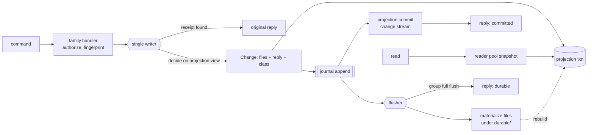

# Office store

How an office stores, acknowledges, reads and rebuilds the organization's data. It
applies the [data contract](organization-data/README.md) and the decision records it
names; [ADR-0021](../adr/0021-office-store-architecture.md) records the choices made
here. The increments that build it are B1a to B1c in the
[implementation plan](../implementation-plan.md#b1a--the-store-core-on-the-organization-family).

## 1. The shape in one page

An office stores three kinds of thing.

| Thing | Where | What it is for |
| --- | --- | --- |
| **Acceptance journal** | `durable/recovery/offices/<office-id>/journals/acceptance/<journal-incarnation>/` | The commit point. One append-only log per office, for every record family. Each entry is one accepted operation: its receipt, the positions it took and the exact files it leaves behind. An entry is kept until its files are written and flushed and every consumer has passed it. |
| **Canonical files** | `durable/state/` (published to organization Git) and the protected trees `durable/messaging/`, `recovery/`, `accounting/`, `budgets/`, `authority/`, `local/` | The source. Every record is a file at the path the data contract names. |
| **Projection** | `runtime/<office-id>/office.db` | The index every read and every decision uses. It holds nothing that is not in the files or the journal, and it can be deleted at any time. |

**The commit point is the journal entry.** An operation is accepted when its entry is
appended to the journal segment. What "acknowledged" then means depends on the class
the operation declares ([ADR-0014](../adr/0014-acknowledgement-classes-and-agent-os-latency.md)):

- **Committed.** The entry is appended (it survives the office process dying) and the
  projection that contains it is committed (it is readable). It can be lost only if the
  machine loses power or the kernel crashes before the next group flush, at most the
  flush interval later.
- **Durable.** As committed, and the journal has been fully flushed through that entry
  (`F_FULLFSYNC` on macOS). It survives a power cut.

Neither class waits for the canonical files. Files are written after the flush that
covers their entry, and the journal keeps every entry whose files are not yet safe.

**What is rebuilt from what.** Files are completed from the journal (materialization,
idempotent). The projection is rebuilt from the files once the journal is materialized.
Nothing rebuilds the journal: for the entries it still holds it is the only copy.



**The path of a change.** The family handler in the office authorizes the request and
computes its fingerprint. The writer looks up the receipt for the operation ID: a match
returns the original reply, a different fingerprint or actor is a conflict. Otherwise
the family's decision runs on the writer against the projection at head and returns a
`Change`: the files to create, replace or remove, the reply, and the class. The writer
applies those files to the projection inside the batch's transaction, appends the
batch's entries to the journal in one write, commits the projection, publishes the
change, and answers the committed-class requests. Durable-class requests are answered by
the flusher after its next full flush. The flusher then writes the files.

**The path of a read.** A handler takes a snapshot from the reader pool and calls its
family's read port. A read touches only the projection: no file, no journal, no writer
and no host call.

## 2. Crates and modules

**One new crate, `org-store`.** It holds the engine-neutral foundation: the commit
contract (`Change`, `Ack`, `Operation`, `Refusal`), the writer, the journal, the
flusher, the file materializer, rebuild, the change stream, the `Engine` and
`Projector` traits, and a `testkit` feature with the in-memory engine and the shared
property harness. It exists because every family crate (`org-work`, `org-mailbox`) and
the office's own families must name `Change` and `Ack` (ADR-0014 decision 8 puts each
operation's class in the crate that owns it), and they cannot depend on `org-office`.
It depends on `org-platform` for flushes and exclusive renames and on no family.

**No adapter crate.** The SQLite engine is the module `org-office/src/store/sqlite/`, the
only office module that names `rusqlite`. A separate crate would have to depend on
`org-office` to implement the ports of the families that live there (organization,
projects, employees). A later PostgreSQL engine is a sibling module behind the same seam.

**A family is a vertical slice with one shape.** Adding a family copies it; no shared
module grows.

| Part | Holds |
| --- | --- |
| `records.rs` | The typed records, their paths from the data contract, and the codec between record and file bytes (`org-docs` for Markdown and YAML, `serde_json` for JSON) |
| `ports.rs` | Two traits: `<Family>Read` (the queries its decisions and API need) and `<Family>Write` (row upserts and removals for its records) |
| `projector.rs` | One `Projector` implementation, generic over the engine: decode a file, call the write port |
| `features/<operation>.rs` | One operation: its command, its `ACK` constant and `decide`, which returns a `Change` or a `Refusal` |
| `testkit.rs` | The in-memory implementation of both ports and the conformance suite, as a macro each engine invokes |
| `org-office/src/store/sqlite/<family>.rs` | The SQL behind both ports |

| Family | Home | Built in |
| --- | --- | --- |
| Receipts and sequence positions | `org-store` (core) | B1a |
| Organization and people: organization, offices, office codes, teams, employees, roles, HQ counters and allocations | `org-office/src/organization/` | B1a, B2 |
| Projects | `org-office/src/projects/` | B3 |
| Work: tasks, task events, the office task counter | `org-work` | B4 |
| Messaging: conversations, messages, participant state, status | `org-mailbox` | B6 |
| Execution: placements, permits, turns, process cleanup | `org-office/src/employees/` | C2, C3 |
| Accounting, budgets | Their own module, same shape | L2, L3 |

**Dependencies** point from composition to families to the foundation:

```text
apps/agentic-org-office ─> org-office ─┬─> org-store ─> org-platform
                                       ├─> org-work ────> org-store, org-docs, org-proto
                                       ├─> org-mailbox ─> org-store, org-proto
                                       ├─> org-docs
                                       └─> rusqlite        (only from src/store/sqlite/)
org-sync (parked) ─> org-store          (from S1)
```

`org-office/src/store/mod.rs` is the one composition seam: `open_store(&StoreConfig)`
builds the office's store with the engine the configuration names. Production builds
know `Sqlite`; `Memory` exists only with the `testkit` feature; any other name is
refused at composition.

**Target layout** (B1a to B1c; later families add the parts marked):

```text
crates/org-store/src/
  lib.rs            # public API
  change.rs         # Change, FileChange, Ack, Operation, Refusal, DurablePath
  writer.rs         # the single writer: queue, batch, decide, apply, append, commit, reply
  journal.rs        # segments, entry frame, chain, anchor, checkpoint, recovery scan
  flusher.rs        # group flush, durable replies, materialization, consumer cursors
  files.rs          # atomic, flushed publication under durable/ (org-platform fs)
  receipts.rs       # the receipt family: files, projector, lookup before decide
  sequences.rs      # origin streams and feed positions
  changes.rs        # the change stream
  rebuild.rs        # rebuild()
  engine.rs         # Engine, Projector
  testkit/          # MemoryEngine, rebuild-equivalence harness, crash points
crates/org-office/src/
  organization/     # records.rs ports.rs projector.rs features/ testkit.rs
  projects/         # same shape (B3)
  employees/        # same shape (C2, C3)
  store/
    mod.rs          # open_store: the seam
    sqlite/
      mod.rs        # SqliteEngine: connections, pragmas, cursor, sources, reader pool
      schema.rs     # the contract's schema.sql, the adapter's tables and indexes, digest
      receipts.rs   # SQL for org-store's receipt and source tables
      organization.rs
      projects.rs   # (B3)  work.rs (B4)  messaging.rs (B6)  employees.rs (C3)
crates/org-work/src/      # records.rs ports.rs projector.rs features/ testkit/ (B4)
crates/org-mailbox/src/   # the same (B6)
```

**What happens to what exists.**

- `crates/org-office/src/store.rs` and `store/`: deleted whole in B1b and replaced by
  `store/mod.rs` and `store/sqlite/` (section 11).
- `crates/org-docs`: kept as it is: the strict front-matter parser and the
  source-preserving editor that family codecs call. It does no I/O and knows no family.
- `org-work`'s `WorkStore`, `WorkTxn`, `WorkReads` and `OrgView`: replaced in B4 by
  `WorkRead`, `WorkWrite` and decisions that return a `Change`. The in-memory `MemStore`
  becomes the work family's memory port.
- `org-mailbox`'s `MessageStore`, `TriageStore`, `SyncStore` and `ThreadStore`: replaced
  in B6 by `MessagingRead` and `MessagingWrite`; the mailbox's waiters subscribe to the
  change stream instead of being woken by `commit_message`.
- `org-sync`'s `OrgStore`, `MessageStore` and `LocalStreamStore`: parked; S1 re-expresses
  them over the remote apply and outbox of section 10.
- The conformance suites keep their form: a macro in the family's testkit, invoked once
  per engine (today `mailbox_conformance_tests!` in `crates/org-office/src/messaging.rs`
  and the replication suite in `store/org/replication/conformance.rs`).

## 3. The contracts

## 4. Writing

## 5. Files

## 6. Rebuilding

## 7. Reading

## 8. Speed

## 9. Engine independence

## 10. Replication's place

## 11. What is deleted and what is kept

## 12. What it does not do

## 13. Open points
