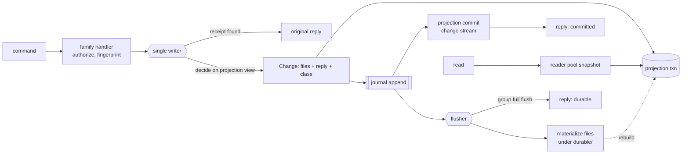

# Office store

How an office stores, acknowledges, reads and rebuilds the organization's data. It
applies the [data contract](organization-data/README.md) and the decision records it
names; [ADR-0021](../adr/0021-office-store-architecture.md) records the choices made
here. The increments that build it are B1a to B1c in the
[implementation plan](../implementation-plan.md#b1a--the-store-core-on-the-organization-family).

## 1. The shape in one page

An office stores three kinds of thing.

| Thing | Where | What it is for |
| --- | --- | --- |
| **Acceptance journal** | `durable/recovery/offices/<office-id>/journals/acceptance/<journal-incarnation>/` | The commit point. One append-only log per office, for every record family. Each entry is one accepted operation: its receipt, the positions it took and the exact files it leaves behind. An entry is kept until its files are written and flushed and every consumer has passed it. |
| **Canonical files** | `durable/state/` (published to organization Git) and the protected trees `durable/messaging/`, `recovery/`, `accounting/`, `budgets/`, `authority/`, `local/` | The source. Every record is a file at the path the data contract names. |
| **Projection** | `runtime/<office-id>/office.db` | The index every read and every decision uses. It holds nothing that is not in the files or the journal, and it can be deleted at any time. |

**The commit point is the journal entry.** An operation is accepted when its entry is
appended to the journal segment. What "acknowledged" then means depends on the class
the operation declares ([ADR-0014](../adr/0014-acknowledgement-classes-and-agent-os-latency.md)):

- **Committed.** The entry is appended (it survives the office process dying) and the
  projection that contains it is committed (it is readable). It can be lost only if the
  machine loses power or the kernel crashes before the next group flush, at most the
  flush interval later.
- **Durable.** As committed, and the journal has been fully flushed through that entry
  (`F_FULLFSYNC` on macOS). It survives a power cut.

Neither class waits for the canonical files. Files are written after the flush that
covers their entry, and the journal keeps every entry whose files are not yet safe.

**What is rebuilt from what.** Files are completed from the journal (materialization,
idempotent). The projection is rebuilt from the files once the journal is materialized.
Nothing rebuilds the journal: for the entries it still holds it is the only copy.



**The path of a change.** The family handler in the office authorizes the request and
computes its fingerprint. The writer looks up the receipt for the operation ID: a match
returns the original reply, a different fingerprint or actor is a conflict. Otherwise
the family's decision runs on the writer against the projection at head and returns a
`Change`: the files to create, replace or remove, the reply, and the class. The writer
applies those files to the projection inside the batch's transaction, appends the
batch's entries to the journal in one write, commits the projection, publishes the
change, and answers the committed-class requests. Durable-class requests are answered by
the flusher after its next full flush. The flusher then writes the files.

**The path of a read.** A handler takes a snapshot from the reader pool and calls its
family's read port. A read touches only the projection: no file, no journal, no writer
and no host call.

## 2. Crates and modules

**One new crate, `org-store`.** It holds the engine-neutral foundation: the commit
contract (`Change`, `Ack`, `Operation`, `Refusal`), the writer, the journal, the
flusher, the file materializer, rebuild, the change stream, the `Engine` and
`Projector` traits, and a `testkit` feature with the in-memory engine and the shared
property harness. It exists because every family crate (`org-work`, `org-mailbox`) and
the office's own families must name `Change` and `Ack` (ADR-0014 decision 8 puts each
operation's class in the crate that owns it), and they cannot depend on `org-office`.
It depends on `org-platform` for flushes and exclusive renames and on no family.

**No adapter crate.** The SQLite engine is the module `org-office/src/store/sqlite/`, the
only office module that names `rusqlite`. A separate crate would have to depend on
`org-office` to implement the ports of the families that live there (organization,
projects, employees). A later PostgreSQL engine is a sibling module behind the same seam.

**A family is a vertical slice with one shape.** Adding a family copies it; no shared
module grows.

| Part | Holds |
| --- | --- |
| `records.rs` | The typed records, their paths from the data contract, and the codec between record and file bytes (`org-docs` for Markdown and YAML, `serde_json` for JSON) |
| `ports.rs` | Two traits: `<Family>Read` (the queries its decisions and API need) and `<Family>Write` (row upserts and removals for its records) |
| `projector.rs` | One `Projector` implementation, generic over the engine: decode a file, call the write port |
| `features/<operation>.rs` | One operation: its command, its `ACK` constant and `decide`, which returns a `Change` or a `Refusal` |
| `testkit.rs` | The in-memory implementation of both ports and the conformance suite, as a macro each engine invokes |
| `org-office/src/store/sqlite/<family>.rs` | The SQL behind both ports |

| Family | Home | Built in |
| --- | --- | --- |
| Receipts and sequence positions | `org-store` (core) | B1a |
| Organization and people: organization, offices, office codes, teams, employees, roles, HQ counters and allocations | `org-office/src/organization/` | B1a, B2 |
| Projects | `org-office/src/projects/` | B3 |
| Work: tasks, task events, the office task counter | `org-work` | B4 |
| Messaging: conversations, messages, participant state, status | `org-mailbox` | B6 |
| Execution: placements, permits, turns, process cleanup | `org-office/src/employees/` | C2, C3 |
| Accounting, budgets | Their own module, same shape | L2, L3 |

**Dependencies** point from composition to families to the foundation:

```text
apps/agentic-org-office ─> org-office ─┬─> org-store ─> org-platform
                                       ├─> org-work ────> org-store, org-docs, org-proto
                                       ├─> org-mailbox ─> org-store, org-proto
                                       ├─> org-docs
                                       └─> rusqlite        (only from src/store/sqlite/)
org-sync (parked) ─> org-store          (from S1)
```

`org-office/src/store/mod.rs` is the one composition seam: `open_store(&StoreConfig)`
builds the office's store with the engine the configuration names. Production builds
know `Sqlite`; `Memory` exists only with the `testkit` feature; any other name is
refused at composition.

**Target layout** (B1a to B1c; later families add the parts marked):

```text
crates/org-store/src/
  lib.rs            # public API
  change.rs         # Change, FileChange, Ack, Operation, Refusal, DurablePath
  writer.rs         # the single writer: queue, batch, decide, apply, append, commit, reply
  journal.rs        # segments, entry frame, chain, anchor, checkpoint, recovery scan
  flusher.rs        # group flush, durable replies, materialization, consumer cursors
  files.rs          # atomic, flushed publication under durable/ (org-platform fs)
  receipts.rs       # the receipt family: files, projector, lookup before decide
  sequences.rs      # origin streams and feed positions
  changes.rs        # the change stream
  rebuild.rs        # rebuild()
  engine.rs         # Engine, Projector
  testkit/          # MemoryEngine, rebuild-equivalence harness, crash points
crates/org-office/src/
  organization/     # records.rs ports.rs projector.rs features/ testkit.rs
  projects/         # same shape (B3)
  employees/        # same shape (C2, C3)
  store/
    mod.rs          # open_store: the seam
    sqlite/
      mod.rs        # SqliteEngine: connections, pragmas, cursor, sources, reader pool
      schema.rs     # the contract's schema.sql, the adapter's tables and indexes, digest
      receipts.rs   # SQL for org-store's receipt and source tables
      organization.rs
      projects.rs   # (B3)  work.rs (B4)  messaging.rs (B6)  employees.rs (C3)
crates/org-work/src/      # records.rs ports.rs projector.rs features/ testkit/ (B4)
crates/org-mailbox/src/   # the same (B6)
```

**What happens to what exists.**

- `crates/org-office/src/store.rs` and `store/`: deleted whole in B1b and replaced by
  `store/mod.rs` and `store/sqlite/` (section 11).
- `crates/org-docs`: kept as it is: the strict front-matter parser and the
  source-preserving editor that family codecs call. It does no I/O and knows no family.
- `org-work`'s `WorkStore`, `WorkTxn`, `WorkReads` and `OrgView`: replaced in B4 by
  `WorkRead`, `WorkWrite` and decisions that return a `Change`. The in-memory `MemStore`
  becomes the work family's memory port.
- `org-mailbox`'s `MessageStore`, `TriageStore`, `SyncStore` and `ThreadStore`: replaced
  in B6 by `MessagingRead` and `MessagingWrite`; the mailbox's waiters subscribe to the
  change stream instead of being woken by `commit_message`.
- `org-sync`'s `OrgStore`, `MessageStore` and `LocalStreamStore`: parked; S1 re-expresses
  them over the remote apply and outbox of section 10.
- The conformance suites keep their form: a macro in the family's testkit, invoked once
  per engine (today `mailbox_conformance_tests!` in `crates/org-office/src/messaging.rs`
  and the replication suite in `store/org/replication/conformance.rs`).

## 3. The contracts

The sketches are illustrations: names may change, the responsibilities may not.

**What an operation produces** (`org-store`, `change.rs`):

```rust
/// When the office may answer (ADR-0014). Declared by the family that owns the operation.
#[derive(Clone, Copy, PartialEq, Eq, Debug)]
pub enum Ack { Committed, Durable }

/// A relative path under `durable/`: normal components only, the first naming a known tree.
pub struct DurablePath(/* private */);

/// One file an operation leaves behind, in the exact bytes the data contract defines.
pub enum FileChange {
    Create(DurablePath, Bytes), // immutable (an event, a message); other bytes there are a fault
    Put(DurablePath, Bytes),    // mutable (a task, a team); replaces what this office wrote last
    Remove(DurablePath),
}

/// Everything one admitted operation commits, as one unit.
pub struct Change { pub ack: Ack, pub files: Vec<FileChange>, pub reply: Bytes }

pub enum Refusal {
    Rejected(Bytes),    // admitted and rejected: a receipt-only entry, so a retry gets the same answer
    Invalid(StoreError) // refused before admission: nothing is recorded
}

/// What a retry is matched on: document 16's receipt identity.
pub struct Operation { pub id: OperationId, pub kind: &'static str, pub actor: Actor, pub fingerprint: Sha256 }
```

**The unit of work** keeps sequence allocation, idempotency receipt, journal append and
the outbox atomic, because all four are one journal entry. A decision sees only this:

```rust
impl<E: Engine> UnitOfWork<'_, E> {
    /// The projection at head, earlier operations of this batch included.
    pub fn view(&self) -> &E::Tx;
    /// Current bytes of a source file, unmaterialized journal entries included (source-preserving edits).
    pub fn source(&self, path: &DurablePath) -> Result<Option<Bytes>, StoreError>;
    /// The next position of one of this office's origin streams; recorded in the entry.
    pub fn next(&mut self, stream: Stream) -> Result<u64, StoreError>;
    /// The writer's clock, recorded in the entry. A decision reads no other clock.
    pub fn now(&self) -> Timestamp;
}

impl<E: Engine> Store<E> {
    /// Runs `decide` on the single writer; answers in the class its Change declares, or
    /// durable when the caller asks (ADR-0014 decision 4). `FnMut`: a decision may run again
    /// until its entry is appended, never after.
    pub fn submit<F>(&self, op: Option<Operation>, durable: bool, decide: F) -> Result<Bytes, StoreError>
    where F: FnMut(&mut UnitOfWork<'_, E>) -> Result<Change, Refusal> + Send + 'static;
    pub fn read<R>(&self, f: impl FnOnce(&E::Snapshot) -> Result<R, StoreError>)
        -> Result<(R, FeedPosition), StoreError>;
    pub fn subscribe(&self, after: FeedPosition) -> Result<ChangeStream, Resync>;
}
```

**The engine seam** (`engine.rs`): the only traits with two implementations.

```rust
/// The database the projection lives in (ADR-0018). SqliteEngine and MemoryEngine implement it.
pub trait Engine: Send + Sync + 'static {
    type Tx: CorePort + Send;   // the writer's open transaction
    type Snapshot: CoreRead;    // a consistent read view
    fn begin(&self) -> Result<Self::Tx, EngineError>;
    fn commit(&self, tx: Self::Tx, cursor: &Cursor) -> Result<(), EngineError>;
    fn snapshot(&self) -> Result<Self::Snapshot, EngineError>;
    /// Builds a new projection with `build` and installs it atomically in place of this one.
    fn replace(&self, build: &mut dyn FnMut(&mut Self::Tx) -> Result<Cursor, StoreError>)
        -> Result<(), EngineError>;
}

/// The store's own rows: the applied cursor, the hash of every source file, the receipts.
pub trait CoreRead {
    fn cursor(&self) -> Result<Option<Cursor>, EngineError>;
    fn source_hash(&self, path: &DurablePath) -> Result<Option<Sha256>, EngineError>;
    fn sources_under(&self, prefix: &DurablePath) -> Result<Vec<DurablePath>, EngineError>;
    fn receipt(&self, id: &OperationId) -> Result<Option<Receipt>, EngineError>;
}
pub trait CorePort: CoreRead {
    fn mark(&mut self) -> Result<Mark, EngineError>;             // a savepoint per operation
    fn undo_to(&mut self, mark: Mark) -> Result<(), EngineError>;
    fn set_source(&mut self, path: &DurablePath, hash: Option<Sha256>) -> Result<(), EngineError>;
}

/// A family's projection of its own files: the same function on the write path and in rebuild.
pub trait Projector<E: Engine>: Send + Sync {
    fn owns(&self, path: &DurablePath) -> bool;   // every source path has exactly one owner
    /// Replaces every row this file contributes; `None` when the file is removed.
    fn apply(&self, tx: &mut E::Tx, path: &DurablePath, bytes: Option<&[u8]>) -> Result<(), ProjectionError>;
    /// After a rebuild: checks that span files (references, contiguous task history).
    fn validate(&self, _tx: &E::Tx) -> Result<(), ProjectionError> { Ok(()) }
}
```

Receipts are the core's own family: a receipt is the file
`recovery/commands/<operation-id>.json` with its result inline or under `results/`
(document 16), projected into `mutation_receipts` by a core projector through
`CorePort`.

**The journal and the files are concrete types**, not traits: there is one way to
write them.

```rust
impl Journal {
    pub fn open(dir: &JournalDir, id: &OfficeIdentity, custody: &dyn WriterAuthority)
        -> Result<(Journal, Recovered), JournalError>;           // verify chain, truncate a torn tail
    pub fn append(&mut self, entries: &[Entry]) -> Result<Ordinal, JournalError>; // one write
    pub fn flush(&self) -> Result<Ordinal, JournalError>;        // full flush; flushed through
    pub fn after(&self, ordinal: Ordinal) -> Entries<'_>;         // replay, outbox
    pub fn release_through(&mut self, ordinal: Ordinal) -> Result<(), JournalError>; // checkpoint, drop segments
}
impl Files {
    /// Writes the final state of each path over `entries`: atomic, data flushed before rename.
    pub fn materialize(&self, entries: &[Entry]) -> Result<(), FilesError>;
    pub fn read(&self, path: &DurablePath) -> Result<Option<Bytes>, FilesError>;
    pub fn walk(&self, tree: Tree) -> Walk<'_>;                   // sorted, for rebuild
}
```

`WriterAuthority` is today's host custody contract
(`crates/org-office/src/store/acceptance.rs`, implemented by
`apps/agentic-org-office/src/transfer/writer.rs`); it moves to `org-store` unchanged in
shape and is called once at open and once per flush (section 4).

**How a family declares its classes:** one enum of its operations with one exhaustive
`ack()` match, in `features/mod.rs`. That is the one place ACK-4 asks for.

**Worked example: create a team.**

```rust
// org-office/src/organization/features/mod.rs: the one place classes are declared
pub enum Op { CreateOrganization, CreateTeam /* B2 adds the rest */ }
impl Op { pub const fn ack(self) -> Ack { match self { Op::CreateOrganization | Op::CreateTeam => Ack::Durable } } }

// org-office/src/organization/features/create_team.rs
pub struct CreateTeam { pub id: TeamId, pub name: TeamName, pub parent: TeamId }

pub fn decide<E: Engine>(uow: &mut UnitOfWork<'_, E>, by: &Actor, cmd: &CreateTeam) -> Result<Change, Refusal>
where E::Tx: OrganizationRead {
    let view = uow.view();
    let parent = view.team(&cmd.parent)?.ok_or(Refusal::invalid("no such parent team"))?;
    if !parent.is_active() { return Err(Refusal::rejected(&Rejection::ParentArchived)); }
    if view.team(&cmd.id)?.is_some() { return Err(Refusal::invalid("team id in use")); }
    let counter = view.team_counter()?.advance();                // HQ only; refused at a satellite
    let team = Team::new(cmd, counter.last_number, &parent, by, uow.now());
    Ok(Change::new(Op::CreateTeam.ack())
        .put(records::team_path(view, &team)?, records::encode_team(&team)?)
        .put(counter.path(), counter.encode()?)
        .create(counter.allocation(team.id, uow.now()).path(), counter.allocation(..).encode()?)
        .reply(&TeamCreated { id: team.id, number: team.number }))
}

// org-office/src/organization/projector.rs: one function, live and in rebuild
impl<E: Engine> Projector<E> for OrganizationFiles where E::Tx: OrganizationWrite {
    fn owns(&self, p: &DurablePath) -> bool { records::kind_of(p).is_some() }
    fn apply(&self, tx: &mut E::Tx, p: &DurablePath, bytes: Option<&[u8]>) -> Result<(), ProjectionError> {
        match (records::kind_of(p).expect("owned"), bytes) {
            (Kind::Team, Some(b)) => tx.put_team(&records::decode_team(p, b)?),
            (Kind::Team, None) => tx.remove_team(&records::team_id(p)?),
            // organization, office, employee, counter, allocation: the same two arms each
        }
    }
}

// org-office/src/store/sqlite/organization.rs: the only place this family's SQL lives
impl OrganizationWrite for SqliteTx<'_> {
    fn put_team(&mut self, t: &Team) -> Result<(), StoreError> {
        self.upsert(TEAM_UPSERT, team_params(t))?;   // and its record_refs row
        Ok(())
    }
}

// the handler: authorize, then one call
let reply = store.submit(Some(op), false, move |uow| create_team::decide(uow, &actor, &cmd))?;
```

The memory engine's `OrganizationWrite` is the same four lines over a `BTreeMap` in
`organization/testkit.rs`. The conformance suite drives both through the ports and
`Store::submit`.

## 4. Writing

**Three threads.** One writer owns the projection's write transaction and the journal's
append end. One flusher owns flushing, durable replies and file materialization. A pool
of readers serves reads. Nothing else writes.

**A batch.** The writer takes everything queued, up to 64 operations (today's
`MAX_BATCH` in `crates/org-office/src/store.rs`), and for each in order:

1. Looks up the receipt for its operation ID (projection, this batch included). A match
   on actor and fingerprint returns the original reply; anything else is a conflict
   that discloses nothing.
2. Takes a savepoint mark and runs `decide`. A `Refusal::Invalid` records nothing. A
   `Refusal::Rejected` becomes a receipt-only entry.
3. Frames the entry: the next ordinal, the previous entry's hash, the receipt, the
   positions taken, the feed position, and the file changes with their bytes.
4. Applies the entry to the projection: each file to the projector that owns its path,
   `set_source` with its hash, and the receipt row. A projector error undoes to the mark
   and fails that operation alone.

Then, once per batch: append every entry to the journal segment in **one write**;
commit the projection with the cursor (last ordinal and hash); publish to the change
stream; answer committed-class operations; hand durable-class ones to the flusher with
their ordinal. If the engine ends the transaction before the append (disk full, an
interrupt), the remaining operations decide again in a new transaction, as ADR-0002
decision 3 states. After the append, nothing decides again: if the projection commit
fails, the writer replays the appended entries from the journal; if that fails, the
office stops accepting and reports recovery required. No reply ever reports failure
for an appended entry.

**The flusher.** When a durable reply waits, or the flush interval (default 50 ms,
fixed by measurement in B1c) has passed with unflushed entries, it: fully flushes the
segment and answers every durable operation through that ordinal; confirms the flushed
head to the host's writer custody; writes the final state of each path touched by the
newly flushed entries (section 5); and advances the materialized mark. A committed
operation never waits for the drive, even in a batch with a durable one.

**Visible at commit, acknowledged by class.** A durable change is readable in the
office from its projection commit, a few milliseconds before its flush. A power cut in
that window removes it, as it removes committed-class changes. Nothing leaves the office
before its entry is flushed: the replication outbox and Git publication read only
flushed entries. So a position or a number that a power cut takes back was never seen
outside. Task numbers, which people see in the office, keep ADR-0019's durable mark
(the work family writes `task-counter.yaml` with a higher `reserved_through` as a
durable change before it uses numbers past it) and jump to the mark after an unclean
stop, which the store reports at open.

**The entry.** Raw bytes, hashed as stored (`raw-bytes/1` in the
[hash codec registry](organization-data/08-record-contracts.md#hash-codec-registry)):

```text
entry   = length:u32 ‖ header ‖ payloads ‖ sha256(header ‖ payloads)
header  = canonical JSON {
  ordinal, previous_sha256, office_id, journal_incarnation, at, ack, feed,
  operation: {id, kind, actor, fingerprint, outcome: completed|rejected} | null,
  positions: {"work": [first, last], "message": [..], "organization": [..]},
  files: [{path, op: create|put|remove, length, sha256}] }
payloads = the files' bytes, in header order
```

The first entry chains to the immutable `anchor.json` of the journal incarnation, which
binds the office identity, the writer epoch, the origin high-waters it starts from and
the predecessor head, if any. Segments are `segments/<first-ordinal>.log`, rolled at
64 MiB. An entry is at most 16 MiB (the `selected-task-resources/1` manifest limit); a
file larger than 1 MiB is written first as a content-addressed blob, flushed, and the
entry names its digest. Ordinals, origin positions, feed positions and task revisions
stay distinct (ADR-0006).

**States of an entry.**

| State | Meaning |
| --- | --- |
| Appended | In the segment; survives a process crash |
| Projected | The projection cursor has passed it; readable |
| Flushed | The segment is fully flushed through it; survives a power cut; may leave the office |
| Materialized | Its files are written and flushed under `durable/` |
| Released | Every consumer (materializer, and from S1 the replication outbox) has passed it; its segment may be dropped after `checkpoint.json` records the head and high-waters |

**Crashes.**

| Crash | What is on disk | How restart finishes |
| --- | --- | --- |
| During decide or apply | Nothing appended; projection transaction rolled back | Nothing to finish; a retry runs afresh |
| During the append | A torn last entry | The scan stops at the first bad length or hash and truncates it. It was never acknowledged durable |
| After the append, before the projection commit | Journal ahead of projection | Replay the entries after the cursor through the projectors; a retry finds the receipt |
| After the commit, before the reply | Both current | A retry by operation ID gets the original reply |
| After a committed reply, before the flush (power cut) | Journal may end earlier; projection may be ahead of it | A cursor ahead of the journal, or a hash that differs at its ordinal, means: rebuild |
| During materialization | Each file wholly old or wholly new | Write the final state of the retained entries after the materialized mark again |
| During a rebuild | The old projection, or none | Rebuild again: the new projection is built beside the old and swapped in |

**Opening.** Take the office lock and the host custody checkpoint; open the journal
(verify the chain from anchor or checkpoint, truncate a torn tail, refuse a journal
behind the custody checkpoint, recover the high-waters); materialize the retained
entries after the materialized mark; then either replay the entries after the
projection cursor or, if the projection is missing, of another schema digest or ahead
of the journal, rebuild (section 6). Confirm the head to the host and start accepting.

**Idempotent retry.** A retry carries the same operation ID. The receipt is matched
before any validation of current state (ADR-0006). A receipt whose entry is not yet
flushed answers after the flush when the original was durable-class. The same ID with
another actor or fingerprint conflicts. Two operations with one ID in one batch: the
second finds the first's receipt. Operations whose record ID is their idempotency key
(a message, ADR-0003 decision 9) need no receipt: their decision finds the record.
Receipts are never deleted by the store; expiry is a reviewed procedure (document 16).

## 5. Files

## 6. Rebuilding

## 7. Reading

## 8. Speed

## 9. Engine independence

## 10. Replication's place

## 11. What is deleted and what is kept

## 12. What it does not do

## 13. Open points
