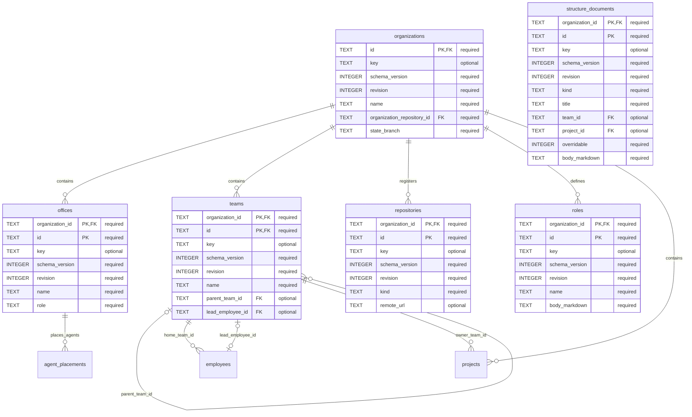

# Organization structure

Structural draft for v1. Document revision 2.0. See the [shared identity/storage contract](README.md), [project structure](02-project-structure.md) and [employee identity boundary](04-agent-structure.md).

## Relationships

An organization contains independent offices, a team forest, projects, roles and repository registrations. Teams own child teams. Projects name their owning team. Offices locate execution; they do not own the team hierarchy.



An employee has exactly one home team. Each team may have direct people, direct agents and child teams together. A team lead is an optional direct employee and manages all other employees in the team's entire subtree, including child-team leads. A TPM located in an ancestor team does not automatically manage descendants. A director/tribe/portfolio is a role or team name, not another entity type.

## Tracked organization repository content

```text
<organization repository>/
├── organization.yaml
├── repositories.yaml
├── offices/<office-id>.yaml
├── roles/<role-id>.md
├── processes/<document-id>.md
├── standards/<document-id>.md
├── teams/<team-id>/
│   ├── team.yaml
│   ├── agents/<employee-id>/profile.md
│   ├── people/<employee-id>/profile.md
│   ├── processes/<document-id>.md
│   ├── standards/<document-id>.md
│   └── teams/<child-team-id>/...   # Same structure at every depth
├── projects/<project-id>/...       # Defined in document 02
├── work/requests/<request-id>.md    # Requests with no project yet
└── tombstones/<kind>/<id>.yaml
```

`team.yaml` explicitly stores `parent_team_id`; null identifies a root team. The employee profile explicitly stores `home_team_id`. Folders must match those fields. Moves update both the fields and their paths while preserving IDs. There is no top-level members folder.

An office file stores its stable ID, key, name, revision and `role: hq` or `satellite`. The schema allows one HQ per organization and any number of satellites. Endpoint selection, enrollment, current connectivity and credentials belong to local configuration/operations, not the team hierarchy. Office definitions survive runtime deletion; the current agent placement can be rebuilt separately.

## Repository types

```yaml
repositories:
  - id: 01J00000000000000000000001
    key: organization
    schema_version: 1
    revision: 1
    kind: remote
    remote_url: https://example.com/restaurant-saas/organization.git
  - id: 01J00000000000000000000002
    key: infrastructure
    schema_version: 1
    revision: 1
    kind: remote
    remote_url: https://example.com/restaurant-saas/infrastructure.git
  - id: 01J00000000000000000000003
    key: kitchen-prototype
    schema_version: 1
    revision: 1
    kind: local
    remote_url: null
```

`organization.yaml.organization_repository_id` must identify a `kind: remote` registration. `state_branch` selects its organization-data publication branch. Organization registrations do not contain project integration branches; those belong to [project/repository associations](02-project-structure.md).

A local-only code registration has no remote URL. Its machine-specific `origin_path` is in `durable/local/offices/<office-id>/repositories/<repository-id>.yaml`, outside Git. Its live cache stays under runtime. Preserve its history and edits in durable local checkpoints before deleting that runtime; a remote organization repository does not back up local-only code. Moving that code to another office needs an explicit bundle/import or a remote, never an assumed fetch URL.

## Examples using the same team model

```text
Restaurant SaaS
├── Front of House
│   ├── Direct employees: Director, TPM, human Product Adviser
│   └── Guest Experience
│       ├── Reservations       → owns Reservations project
│       └── Customer Loyalty   → owns Customer Loyalty project
├── Back of House
│   └── Kitchen Operations     → owns Kitchen Display project
└── Finance
    └── Payments               → owns Payments project

Product Agency
├── Product Group A
│   ├── Direct employee: Group Director
│   ├── Care Platform          → owns Care Platform project
│   │   ├── Direct employees: Product Lead, human Designer
│   │   ├── Engineering
│   │   └── Go to Market
│   └── Secure Workspace       → owns Secure Workspace project
│       ├── Implementation
│       └── Security
└── Market Products
    └── Trading Platform       → owns Trading Platform project
        ├── Engineering
        └── Go to Market
```

Every grouping in those examples is a team. Repeated display names such as Engineering have different stable IDs; their readable keys can repeat under different parent teams.

## File to SQL mapping

Common fields and organization scoping follow [shared contracts](README.md).

| Table | Durable source |
| --- | --- |
| `organizations` | Same-named keys in `organization.yaml`; the selected organization repository must be remote. |
| `repositories` | Entries of `repositories.yaml.repositories[]`, including `kind` and nullable `remote_url`. |
| `roles` | Front matter and body of `roles/<id>.md`; agent-specific setup is pending document 04. |
| `teams` | Same-named keys in `team.yaml`, including nullable `parent_team_id` and `lead_employee_id`. |
| `offices` | Same-named keys in `offices/<id>.yaml`; durable organization structure. |
| `structure_documents` | Process/standard front matter: `id`, `key`, `schema_version`, `revision`, `kind`, `title`, optional `team_id` or `project_id`, `overridable` (default true), and Markdown body. Both scope IDs null means organization scope. This stores content only; no process engine is specified. |
| `local_repository_locations` | Local durable office/repository binding file: `office_id`, `repository_id`, `origin_path`; never organization Git content. |
| `repository_caches` | Runtime-only `office_id`, `repository_id`, `bare_path`; not authored in durable organization files. |

## SQLite tables

```sql
CREATE TABLE organizations (
  id TEXT PRIMARY KEY,
  key TEXT UNIQUE,
  schema_version INTEGER NOT NULL CHECK (schema_version = 1),
  revision INTEGER NOT NULL CHECK (revision >= 1),
  name TEXT NOT NULL,
  organization_repository_id TEXT NOT NULL,
  state_branch TEXT NOT NULL,
  FOREIGN KEY (id, organization_repository_id) REFERENCES repositories(organization_id, id)
    DEFERRABLE INITIALLY DEFERRED
) STRICT;

CREATE TABLE repositories (
  organization_id TEXT NOT NULL REFERENCES organizations(id),
  id TEXT NOT NULL,
  key TEXT,
  schema_version INTEGER NOT NULL CHECK (schema_version = 1),
  revision INTEGER NOT NULL CHECK (revision >= 1),
kind TEXT NOT NULL CHECK (kind IN ('remote', 'local')),
  remote_url TEXT,
  PRIMARY KEY (organization_id, id),
UNIQUE (organization_id, key),
  CHECK ((kind = 'remote' AND remote_url IS NOT NULL) OR (kind = 'local' AND remote_url IS NULL))
) STRICT;

CREATE TABLE roles (
  organization_id TEXT NOT NULL REFERENCES organizations(id),
  id TEXT NOT NULL,
  key TEXT,
  schema_version INTEGER NOT NULL CHECK (schema_version = 1),
  revision INTEGER NOT NULL CHECK (revision >= 1),
name TEXT NOT NULL,
  body_markdown TEXT NOT NULL DEFAULT '',
  PRIMARY KEY (organization_id, id),
UNIQUE (organization_id, key)
) STRICT;

CREATE TABLE teams (
  organization_id TEXT NOT NULL REFERENCES organizations(id),
  id TEXT NOT NULL,
  key TEXT,
  schema_version INTEGER NOT NULL CHECK (schema_version = 1),
  revision INTEGER NOT NULL CHECK (revision >= 1),
name TEXT NOT NULL,
  parent_team_id TEXT,
  lead_employee_id TEXT,
  PRIMARY KEY (organization_id, id),
UNIQUE (organization_id, parent_team_id, key),
  CHECK (parent_team_id IS NULL OR parent_team_id <> id),
  FOREIGN KEY (organization_id, parent_team_id) REFERENCES teams(organization_id, id)
    DEFERRABLE INITIALLY DEFERRED,
  FOREIGN KEY (organization_id, lead_employee_id, id) REFERENCES employees(organization_id, id, home_team_id)
    DEFERRABLE INITIALLY DEFERRED
) STRICT;

CREATE TABLE offices (
  organization_id TEXT NOT NULL REFERENCES organizations(id),
  id TEXT NOT NULL,
  key TEXT,
  schema_version INTEGER NOT NULL CHECK (schema_version = 1),
  revision INTEGER NOT NULL CHECK (revision >= 1),
name TEXT NOT NULL,
  role TEXT NOT NULL CHECK (role IN ('hq', 'satellite')),
  PRIMARY KEY (organization_id, id),
UNIQUE (organization_id, key)
) STRICT;

CREATE TABLE structure_documents (
  organization_id TEXT NOT NULL REFERENCES organizations(id),
  id TEXT NOT NULL,
  key TEXT,
  schema_version INTEGER NOT NULL CHECK (schema_version = 1),
  revision INTEGER NOT NULL CHECK (revision >= 1),
kind TEXT NOT NULL CHECK (kind IN ('process', 'standard')),
  title TEXT NOT NULL,
  team_id TEXT,
  project_id TEXT,
  overridable INTEGER NOT NULL DEFAULT 1 CHECK (overridable IN (0, 1)),
  body_markdown TEXT NOT NULL DEFAULT '',
  PRIMARY KEY (organization_id, id),
CHECK (team_id IS NULL OR project_id IS NULL),
  FOREIGN KEY (organization_id, team_id) REFERENCES teams(organization_id, id)
    DEFERRABLE INITIALLY DEFERRED,
  FOREIGN KEY (organization_id, project_id) REFERENCES projects(organization_id, id)
    DEFERRABLE INITIALLY DEFERRED
) STRICT;

CREATE TABLE local_repository_locations (
  organization_id TEXT NOT NULL,
  office_id TEXT NOT NULL,
  repository_id TEXT NOT NULL,
  origin_path TEXT NOT NULL,
  PRIMARY KEY (organization_id, office_id, repository_id),
  FOREIGN KEY (organization_id, office_id) REFERENCES offices(organization_id, id),
  FOREIGN KEY (organization_id, repository_id) REFERENCES repositories(organization_id, id)
) STRICT;

CREATE TABLE repository_caches (
  organization_id TEXT NOT NULL,
  office_id TEXT NOT NULL,
  repository_id TEXT NOT NULL,
  bare_path TEXT NOT NULL,
  PRIMARY KEY (organization_id, office_id, repository_id),
  FOREIGN KEY (organization_id, office_id) REFERENCES offices(organization_id, id),
  FOREIGN KEY (organization_id, repository_id) REFERENCES repositories(organization_id, id)
) STRICT;
```
