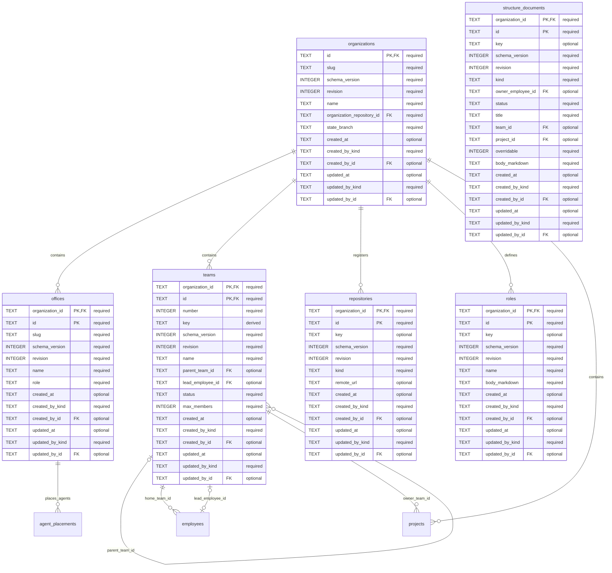

# Organization structure

Status: **selected** data contract, revision 2.9. See the [shared identity/storage contract](README.md), [project structure](02-project-structure.md) and [employee identity boundary](04-agent-structure.md).

## Relationships

An organization contains independent offices, a team forest, projects, roles and repository registrations. HQ creates teams; other offices never do. Teams own child teams. Projects name their owning team. Offices locate execution; they do not own the team hierarchy.



## Creating an organization

Setup creates no account, organization or office. The server's administrator, registered through setup's one-time link ([what the host owns](STATUS.md#outside-this-set-what-the-host-owns)), creates the organization and becomes its owner ([document 04](04-agent-structure.md#accounts-people-and-the-organization-owner)). The request names the organization, its slug, the remote organization repository and the state branch. It asks for no team.

Creation is one accepted transaction, the first of the organization's acceptance journal ([document 16](16-recovery-and-office-continuity.md#how-the-directory-begins)). It writes:

1. the organization;
2. its HQ office;
3. one team with no parent, named after the organization;
4. the creator's person record in that team, appointed its lead, and tied by the host to the creator's account;
5. the built-in HR lead in that team ([document 04](04-agent-structure.md#the-hr-lead-and-how-agents-are-onboarded)).

Every record it writes is attributed to that person. A project's team is created with the project ([document 02](02-project-structure.md#creating-a-project)).

## Team structure

An employee has exactly one home team. Each team may have direct people, direct agents and child teams together. A team lead is an optional direct employee and manages all other employees in the team's entire subtree, including child-team leads. A TPM located in an ancestor team does not automatically manage descendants. A director/tribe/portfolio is a role or team name, not another entity type.

## Tracked organization repository content

```text
<organization repository>/
├── organization.yaml
├── repositories.yaml
├── pricing/models/<price-id>.yaml   # Immutable once used by accounting
├── provider-connections/<connection-id>.yaml
├── model-profiles/<profile-id>.yaml
├── offices/<office-id>.yaml
├── security/ca-escrow.v1.bin        # Public encrypted CA package, ADR-0007
├── roles/<role-id>.md
├── processes/<document-id>.md
├── standards/<document-id>.md
├── development-processes/<id>/
├── teams/<team-id>/
│   ├── team.yaml
│   ├── work/tasks/<task-id>/
│   │   ├── task.md                   # Team task core metadata & description; project_id is null
│   │   ├── comments/<comment-id>.md  # Append-only shared comments
│   │   ├── checklist.yaml            # Checklist items
│   │   └── operations.yaml           # Watchers, owner questions, waiting spans
│   ├── agents/<employee-id>/profile.md
│   ├── people/<employee-id>/profile.md
│   ├── processes/<document-id>.md
│   ├── standards/<document-id>.md
│   └── teams/<child-team-id>/...   # Same structure at every depth
├── projects/<project-id>/...       # Defined in document 02
├── identity/counters/<scope-kind>/<scope-id>/<entity-kind>.yaml
├── identity/allocations/<scope-kind>/<scope-id>/<entity-kind>/<number>.yaml
├── identity/office-codes.yaml       # Office letter codes for task references, document 06
├── work-history/tasks/<task-id>/<revision>.json  # Immutable task activity, document 05
└── tombstones/<kind>/<id>.yaml
```

`team.yaml` explicitly stores `parent_team_id`; null identifies a root team. The employee profile explicitly stores `home_team_id`. Folders must match those fields. Moves update both the fields and their paths while preserving IDs. There is no top-level members folder. Teams have `status: active | archived`; archiving preserves their IDs and the records that refer to them. Common creator/update attribution follows [record contracts](08-record-contracts.md).

[Model profiles and agent execution](11-model-profiles-and-agent-execution.md) owns the connection/profile definitions in this same organization repository. Shared definitions contain references and policy, while office-local auth bindings/credentials stay outside Git.

An office file stores its stable ID, slug, name, revision and `role: hq` or `satellite`. The schema allows one HQ per organization and any number of satellites. Endpoint selection, enrollment, current connectivity and credentials belong to local configuration/operations, not the team hierarchy. Office definitions survive runtime deletion; the current agent placement can be rebuilt separately.

### The HQ's CA records

`security/ca-escrow.v1.bin` contains only the exact versioned encrypted public
package from [ADR-0007](../../adr/0007-hq-creation-escrow.md); it belongs to the
organization and is published to Git verbatim. The usable CA key is the HQ's local
record `durable/local/offices/<office-id>/security/ca-key.v1.json`, wrapped by the
host-held office secrets key ([ADR-0016](../../adr/0016-no-application-level-data-encryption.md))
and never organization Git content. Both are written by the creation's journal entry;
their exact form, what may leave an office and the opening checks are in
[document 16](16-recovery-and-office-continuity.md#the-hqs-ca-records).

## Repository types

```yaml
repositories:
  - id: 01930000-0000-7000-8000-000000000001
    key: organization
    schema_version: 1
    revision: 1
    kind: remote
    remote_url: https://example.com/restaurant-saas/organization.git
  - id: 01930000-0000-7000-8000-000000000002
    key: infrastructure
    schema_version: 1
    revision: 1
    kind: remote
    remote_url: https://example.com/restaurant-saas/infrastructure.git
  - id: 01930000-0000-7000-8000-000000000003
    key: kitchen-prototype
    schema_version: 1
    revision: 1
    kind: local
    remote_url: null
```

`organization.yaml.organization_repository_id` must identify a `kind: remote` registration. `state_branch` selects its organization-data publication branch. Organization registrations do not contain project integration branches; those belong to [project/repository associations](02-project-structure.md).

A local-only code registration has no remote URL. Its machine-specific `origin_path` is in `durable/local/offices/<office-id>/repositories/<repository-id>.yaml`, outside Git. Its live cache stays under runtime. Preserve its history and edits in durable local checkpoints before deleting that runtime; a remote organization repository does not back up local-only code. Moving that code to another office needs an explicit bundle/import or a remote, never an assumed fetch URL.

## Examples using the same team model

```text
Restaurant SaaS
├── Front of House
│   ├── Direct employees: Director, TPM, human Product Adviser
│   └── Guest Experience
│       ├── Reservations       → owns Reservations project
│       └── Customer Loyalty   → owns Customer Loyalty project
├── Back of House
│   └── Kitchen Operations     → owns Kitchen Display project
└── Finance
    └── Payments               → owns Payments project

Product Agency
├── Product Group A
│   ├── Direct employee: Group Director
│   ├── Care Platform          → owns Care Platform project
│   │   ├── Direct employees: Product Lead, human Designer
│   │   ├── Engineering
│   │   └── Go to Market
│   └── Secure Workspace       → owns Secure Workspace project
│       ├── Implementation
│       └── Security
└── Market Products
    └── Trading Platform       → owns Trading Platform project
        ├── Engineering
        └── Go to Market
```

Every grouping in those examples is a team. Repeated display names such as Engineering have different stable IDs and different organization-wide `TEAM-<number>` references. Team numbers do not depend on hierarchy depth or parent names. A director can assign a projectless task to another director through a team backlog.

## File to SQL mapping

Common fields and organization scoping follow [shared contracts](README.md).

| Table | Durable source |
| --- | --- |
| `organizations` | Same-named keys in `organization.yaml`; the selected organization repository must be remote. |
| `repositories` | Entries of `repositories.yaml.repositories[]`, including `kind` and nullable `remote_url`. |
| `roles` | Front matter and body of `roles/<id>.md`. |
| `teams` | Same-named fields in `team.yaml`, including `number`, `status` and common attribution, nullable `parent_team_id` and `lead_employee_id`; `key` is derived as `TEAM-<number>`. |
| `offices` | Same-named keys in `offices/<id>.yaml`; durable organization structure. |
| `structure_documents` | Process/standard front matter: `id`, `key`, `schema_version`, `revision`, `kind`, `title`, `owner_employee_id`, `status: draft | current | deprecated`, common attribution, optional `team_id` or `project_id`, `overridable` (default true), and Markdown body. Both scope IDs null means organization scope. This stores content. Which documents apply to a piece of work is the v1 resolution rule in the [processes design](../processes.md), decision 4 (organization, then the accountable team's chain, then the project; `overridable: false` cannot be replaced below). No enforcement engine is specified. |
| `local_repository_locations` | Local durable office/repository binding file: `office_id`, `repository_id`, `origin_path`; never organization Git content. |
| `repository_caches` | Runtime-only `office_id`, `repository_id`, `bare_path`; not authored in durable organization files. |

## SQLite tables

```sql
CREATE TABLE organizations (
  id TEXT PRIMARY KEY,
  slug TEXT NOT NULL UNIQUE CHECK (
    length(slug) BETWEEN 1 AND 64 AND slug NOT GLOB '*[^a-z0-9-]*'
    AND substr(slug, 1, 1) GLOB '[a-z0-9]'
    AND substr(slug, -1, 1) GLOB '[a-z0-9]'
    AND instr(slug, '--') = 0),
  schema_version INTEGER NOT NULL CHECK (schema_version = 1),
  revision INTEGER NOT NULL CHECK (revision >= 1),
  name TEXT NOT NULL,
  organization_repository_id TEXT NOT NULL,
  state_branch TEXT NOT NULL,
  created_at TEXT,
  created_by_kind TEXT NOT NULL DEFAULT 'unknown' CHECK (created_by_kind IN ('employee', 'system', 'unknown')),
  created_by_id TEXT,
  updated_at TEXT,
  updated_by_kind TEXT NOT NULL DEFAULT 'unknown' CHECK (updated_by_kind IN ('employee', 'system', 'unknown')),
  updated_by_id TEXT,
  FOREIGN KEY (id, organization_repository_id) REFERENCES repositories(organization_id, id)
    DEFERRABLE INITIALLY DEFERRED,
  CHECK ((created_by_kind = 'employee' AND created_by_id IS NOT NULL) OR (created_by_kind <> 'employee' AND created_by_id IS NULL)),
  CHECK ((updated_by_kind = 'employee' AND updated_by_id IS NOT NULL) OR (updated_by_kind <> 'employee' AND updated_by_id IS NULL)),
  FOREIGN KEY (id, created_by_id) REFERENCES employees(organization_id, id) DEFERRABLE INITIALLY DEFERRED,
  FOREIGN KEY (id, updated_by_id) REFERENCES employees(organization_id, id) DEFERRABLE INITIALLY DEFERRED
) STRICT;

CREATE TABLE repositories (
  organization_id TEXT NOT NULL REFERENCES organizations(id),
  id TEXT NOT NULL,
  key TEXT,
  schema_version INTEGER NOT NULL CHECK (schema_version = 1),
  revision INTEGER NOT NULL CHECK (revision >= 1),
kind TEXT NOT NULL CHECK (kind IN ('remote', 'local')),
  remote_url TEXT,
  created_at TEXT,
  created_by_kind TEXT NOT NULL DEFAULT 'unknown' CHECK (created_by_kind IN ('employee', 'system', 'unknown')),
  created_by_id TEXT,
  updated_at TEXT,
  updated_by_kind TEXT NOT NULL DEFAULT 'unknown' CHECK (updated_by_kind IN ('employee', 'system', 'unknown')),
  updated_by_id TEXT,
  PRIMARY KEY (organization_id, id),
UNIQUE (organization_id, key),
  CHECK ((kind = 'remote' AND remote_url IS NOT NULL) OR (kind = 'local' AND remote_url IS NULL)),
  CHECK ((created_by_kind = 'employee' AND created_by_id IS NOT NULL) OR (created_by_kind <> 'employee' AND created_by_id IS NULL)),
  CHECK ((updated_by_kind = 'employee' AND updated_by_id IS NOT NULL) OR (updated_by_kind <> 'employee' AND updated_by_id IS NULL)),
  FOREIGN KEY (organization_id, created_by_id) REFERENCES employees(organization_id, id) DEFERRABLE INITIALLY DEFERRED,
  FOREIGN KEY (organization_id, updated_by_id) REFERENCES employees(organization_id, id) DEFERRABLE INITIALLY DEFERRED
) STRICT;

CREATE TABLE roles (
  organization_id TEXT NOT NULL REFERENCES organizations(id),
  id TEXT NOT NULL,
  key TEXT CHECK (key IS NULL OR (
    length(key) BETWEEN 1 AND 64 AND key NOT GLOB '*[^a-z0-9-]*'
    AND substr(key, 1, 1) GLOB '[a-z0-9]'
    AND substr(key, -1, 1) GLOB '[a-z0-9]'
    AND instr(key, '--') = 0)),
  schema_version INTEGER NOT NULL CHECK (schema_version = 1),
  revision INTEGER NOT NULL CHECK (revision >= 1),
name TEXT NOT NULL,
  body_markdown TEXT NOT NULL DEFAULT '',
  created_at TEXT,
  created_by_kind TEXT NOT NULL DEFAULT 'unknown' CHECK (created_by_kind IN ('employee', 'system', 'unknown')),
  created_by_id TEXT,
  updated_at TEXT,
  updated_by_kind TEXT NOT NULL DEFAULT 'unknown' CHECK (updated_by_kind IN ('employee', 'system', 'unknown')),
  updated_by_id TEXT,
  PRIMARY KEY (organization_id, id),
UNIQUE (organization_id, key),
  CHECK ((created_by_kind = 'employee' AND created_by_id IS NOT NULL) OR (created_by_kind <> 'employee' AND created_by_id IS NULL)),
  CHECK ((updated_by_kind = 'employee' AND updated_by_id IS NOT NULL) OR (updated_by_kind <> 'employee' AND updated_by_id IS NULL)),
  FOREIGN KEY (organization_id, created_by_id) REFERENCES employees(organization_id, id) DEFERRABLE INITIALLY DEFERRED,
  FOREIGN KEY (organization_id, updated_by_id) REFERENCES employees(organization_id, id) DEFERRABLE INITIALLY DEFERRED
) STRICT;

CREATE TABLE teams (
  organization_id TEXT NOT NULL REFERENCES organizations(id),
  id TEXT NOT NULL,
  number INTEGER NOT NULL CHECK (number > 0),
  key TEXT GENERATED ALWAYS AS (CASE WHEN number IS NOT NULL THEN 'TEAM-' || number END) VIRTUAL,
  schema_version INTEGER NOT NULL CHECK (schema_version = 1),
  revision INTEGER NOT NULL CHECK (revision >= 1),
name TEXT NOT NULL,
  parent_team_id TEXT,
  lead_employee_id TEXT,
  status TEXT NOT NULL DEFAULT 'active' CHECK (status IN ('active', 'archived')),
  max_members INTEGER NOT NULL DEFAULT 6 CHECK (max_members >= 1),
  created_at TEXT,
  created_by_kind TEXT NOT NULL DEFAULT 'unknown' CHECK (created_by_kind IN ('employee', 'system', 'unknown')),
  created_by_id TEXT,
  updated_at TEXT,
  updated_by_kind TEXT NOT NULL DEFAULT 'unknown' CHECK (updated_by_kind IN ('employee', 'system', 'unknown')),
  updated_by_id TEXT,
  PRIMARY KEY (organization_id, id),
UNIQUE (organization_id, number),
  CHECK (parent_team_id IS NULL OR parent_team_id <> id),
  FOREIGN KEY (organization_id, parent_team_id) REFERENCES teams(organization_id, id)
    DEFERRABLE INITIALLY DEFERRED,
  FOREIGN KEY (organization_id, lead_employee_id, id) REFERENCES employees(organization_id, id, home_team_id)
    DEFERRABLE INITIALLY DEFERRED,
  CHECK ((created_by_kind = 'employee' AND created_by_id IS NOT NULL) OR (created_by_kind <> 'employee' AND created_by_id IS NULL)),
  CHECK ((updated_by_kind = 'employee' AND updated_by_id IS NOT NULL) OR (updated_by_kind <> 'employee' AND updated_by_id IS NULL)),
  FOREIGN KEY (organization_id, created_by_id) REFERENCES employees(organization_id, id) DEFERRABLE INITIALLY DEFERRED,
  FOREIGN KEY (organization_id, updated_by_id) REFERENCES employees(organization_id, id) DEFERRABLE INITIALLY DEFERRED
) STRICT;

CREATE TABLE offices (
  organization_id TEXT NOT NULL REFERENCES organizations(id),
  id TEXT NOT NULL,
  slug TEXT NOT NULL CHECK (
    length(slug) BETWEEN 1 AND 64 AND slug NOT GLOB '*[^a-z0-9-]*'
    AND substr(slug, 1, 1) GLOB '[a-z0-9]'
    AND substr(slug, -1, 1) GLOB '[a-z0-9]'
    AND instr(slug, '--') = 0),
  schema_version INTEGER NOT NULL CHECK (schema_version = 1),
  revision INTEGER NOT NULL CHECK (revision >= 1),
name TEXT NOT NULL,
  role TEXT NOT NULL CHECK (role IN ('hq', 'satellite')),
  created_at TEXT,
  created_by_kind TEXT NOT NULL DEFAULT 'unknown' CHECK (created_by_kind IN ('employee', 'system', 'unknown')),
  created_by_id TEXT,
  updated_at TEXT,
  updated_by_kind TEXT NOT NULL DEFAULT 'unknown' CHECK (updated_by_kind IN ('employee', 'system', 'unknown')),
  updated_by_id TEXT,
  PRIMARY KEY (organization_id, id),
UNIQUE (organization_id, slug),
  CHECK ((created_by_kind = 'employee' AND created_by_id IS NOT NULL) OR (created_by_kind <> 'employee' AND created_by_id IS NULL)),
  CHECK ((updated_by_kind = 'employee' AND updated_by_id IS NOT NULL) OR (updated_by_kind <> 'employee' AND updated_by_id IS NULL)),
  FOREIGN KEY (organization_id, created_by_id) REFERENCES employees(organization_id, id) DEFERRABLE INITIALLY DEFERRED,
  FOREIGN KEY (organization_id, updated_by_id) REFERENCES employees(organization_id, id) DEFERRABLE INITIALLY DEFERRED
) STRICT;

CREATE TABLE structure_documents (
  organization_id TEXT NOT NULL REFERENCES organizations(id),
  id TEXT NOT NULL,
  key TEXT,
  schema_version INTEGER NOT NULL CHECK (schema_version = 1),
  revision INTEGER NOT NULL CHECK (revision >= 1),
kind TEXT NOT NULL CHECK (kind IN ('process', 'standard')),
  owner_employee_id TEXT,
  status TEXT NOT NULL DEFAULT 'draft' CHECK (status IN ('draft', 'current', 'deprecated')),
  title TEXT NOT NULL,
  team_id TEXT,
  project_id TEXT,
  overridable INTEGER NOT NULL DEFAULT 1 CHECK (overridable IN (0, 1)),
  body_markdown TEXT NOT NULL DEFAULT '',
  created_at TEXT,
  created_by_kind TEXT NOT NULL DEFAULT 'unknown' CHECK (created_by_kind IN ('employee', 'system', 'unknown')),
  created_by_id TEXT,
  updated_at TEXT,
  updated_by_kind TEXT NOT NULL DEFAULT 'unknown' CHECK (updated_by_kind IN ('employee', 'system', 'unknown')),
  updated_by_id TEXT,
  PRIMARY KEY (organization_id, id),
  CHECK (status <> 'current' OR owner_employee_id IS NOT NULL),
  FOREIGN KEY (organization_id, owner_employee_id) REFERENCES employees(organization_id, id) DEFERRABLE INITIALLY DEFERRED,
CHECK (team_id IS NULL OR project_id IS NULL),
  FOREIGN KEY (organization_id, team_id) REFERENCES teams(organization_id, id)
    DEFERRABLE INITIALLY DEFERRED,
  FOREIGN KEY (organization_id, project_id) REFERENCES projects(organization_id, id)
    DEFERRABLE INITIALLY DEFERRED,
  CHECK ((created_by_kind = 'employee' AND created_by_id IS NOT NULL) OR (created_by_kind <> 'employee' AND created_by_id IS NULL)),
  CHECK ((updated_by_kind = 'employee' AND updated_by_id IS NOT NULL) OR (updated_by_kind <> 'employee' AND updated_by_id IS NULL)),
  FOREIGN KEY (organization_id, created_by_id) REFERENCES employees(organization_id, id) DEFERRABLE INITIALLY DEFERRED,
  FOREIGN KEY (organization_id, updated_by_id) REFERENCES employees(organization_id, id) DEFERRABLE INITIALLY DEFERRED
) STRICT;

CREATE TABLE local_repository_locations (
  organization_id TEXT NOT NULL,
  office_id TEXT NOT NULL,
  repository_id TEXT NOT NULL,
  origin_path TEXT NOT NULL,
  PRIMARY KEY (organization_id, office_id, repository_id),
  FOREIGN KEY (organization_id, office_id) REFERENCES offices(organization_id, id),
  FOREIGN KEY (organization_id, repository_id) REFERENCES repositories(organization_id, id)
) STRICT;

CREATE TABLE repository_caches (
  organization_id TEXT NOT NULL,
  office_id TEXT NOT NULL,
  repository_id TEXT NOT NULL,
  bare_path TEXT NOT NULL,
  PRIMARY KEY (organization_id, office_id, repository_id),
  FOREIGN KEY (organization_id, office_id) REFERENCES offices(organization_id, id),
  FOREIGN KEY (organization_id, repository_id) REFERENCES repositories(organization_id, id)
) STRICT;
```

[Messaging and chat](15-messaging-and-chat.md) defines employee participation and conversation data independently of team membership and office placement.

[Recovery and office continuity](16-recovery-and-office-continuity.md) defines durable receipt/checkpoint/cleanup evidence separately from disposable office projections.
