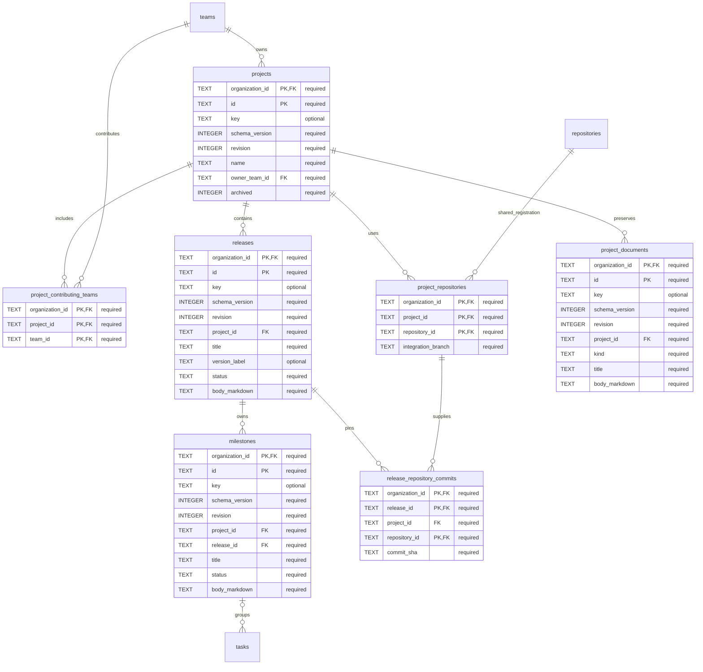

# Project structure

Structural draft for v1. Document revision 2.0. Projects belong to the [organization](01-organization-structure.md); their work is defined in [document 03](03-features-and-work.md).

## Relationships



Each project has exactly one owning team and optional contributing teams. It may use several repositories, including shared infrastructure or libraries. `integration_branch` is required on each project/repository association; the same repository can use different integration branches for different projects.

A release belongs to one project and contains zero or more milestones. Every milestone requires exactly one same-project release. A task can reference zero or one milestone. Releases are delivery records, not organization-wide repository branches.

## Durable project files

```text
projects/<project-id>/
├── project.yaml
├── brief.md
├── features/<feature-id>.md
├── releases/<release-id>/
│   ├── release.md
│   └── milestones/<milestone-id>.md
├── decisions/<document-id>.md
├── designs/<document-id>.md
├── reports/<document-id>.md
├── processes/<document-id>.md
├── standards/<document-id>.md
└── work/
    ├── tasks/<task-id>.md
    ├── bugs/<bug-id>.md
    └── requests/<request-id>.md
```

Tasks stay in the project work folder even when linked to a milestone; their explicit `milestone_id` is the relationship. This avoids moving task documents whenever their planning assignment changes. Milestone files themselves live inside their owning release.

```yaml
schema_version: 1
id: 01J00000000000000000000010
key: reservations
revision: 1
name: Reservations
owner_team_id: 01J00000000000000000000020
contributing_team_ids: []
repositories:
  - repository_id: 01J00000000000000000000002
    integration_branch: release/reservations-v1
```

The Product Agency's Care Platform and Trading Platform projects can reference the same infrastructure registration while selecting `release/care-v1` and `main`, respectively. The office still keeps one local cache for that repository. A Kitchen Display project may reference a local-only code registration without changing the organization repository's remote requirement.

## File to SQL mapping

| Table | Source fields |
| --- | --- |
| `projects` | `project.yaml`: common identity fields, `name`, `owner_team_id`, `archived` (default false). |
| `project_contributing_teams` | One row per `contributing_team_ids[]`; `project_id` comes from that project. |
| `project_repositories` | One row per `repositories[]` entry with `repository_id`, `integration_branch`; `project_id` comes from the project. |
| `releases` | `release.md`: common identity fields, `project_id`, `title`, optional `version_label`, `status`, and Markdown body. |
| `release_repository_commits` | Release `repository_commits` map: repository ID to exact commit SHA; `release_id` and `project_id` come from its parent file. |
| `milestones` | Milestone front matter: common identity fields, required `project_id`, required `release_id`, `title`, `status`, and Markdown body. Path and explicit parent IDs must agree. |
| `project_documents` | Brief/decision/design/report front matter: common identity fields, `project_id`, `kind`, `title`, and body. Structural process/standard content is owned by document 01. |

A manifest may cover multiple code repositories. Dates, release gates, progression rules, budgets and delivery execution are not fixed by this structural draft. They require separate lifecycle/operations decisions; they are not automatically imported from v1.

## SQLite tables

```sql
CREATE TABLE projects (
  organization_id TEXT NOT NULL REFERENCES organizations(id),
  id TEXT NOT NULL,
  key TEXT,
  schema_version INTEGER NOT NULL CHECK (schema_version = 1),
  revision INTEGER NOT NULL CHECK (revision >= 1),
name TEXT NOT NULL,
  owner_team_id TEXT NOT NULL,
  archived INTEGER NOT NULL DEFAULT 0 CHECK (archived IN (0, 1)),
  PRIMARY KEY (organization_id, id),
UNIQUE (organization_id, key),
  FOREIGN KEY (organization_id, owner_team_id) REFERENCES teams(organization_id, id)
    DEFERRABLE INITIALLY DEFERRED
) STRICT;

CREATE TABLE project_contributing_teams (
  organization_id TEXT NOT NULL,
  project_id TEXT NOT NULL,
  team_id TEXT NOT NULL,
  PRIMARY KEY (organization_id, project_id, team_id),
  FOREIGN KEY (organization_id, project_id) REFERENCES projects(organization_id, id)
    DEFERRABLE INITIALLY DEFERRED,
  FOREIGN KEY (organization_id, team_id) REFERENCES teams(organization_id, id)
    DEFERRABLE INITIALLY DEFERRED
) STRICT;

CREATE TABLE project_repositories (
  organization_id TEXT NOT NULL,
  project_id TEXT NOT NULL,
  repository_id TEXT NOT NULL,
  integration_branch TEXT NOT NULL,
  PRIMARY KEY (organization_id, project_id, repository_id),
  FOREIGN KEY (organization_id, project_id) REFERENCES projects(organization_id, id)
    DEFERRABLE INITIALLY DEFERRED,
  FOREIGN KEY (organization_id, repository_id) REFERENCES repositories(organization_id, id)
    DEFERRABLE INITIALLY DEFERRED
) STRICT;

CREATE TABLE releases (
  organization_id TEXT NOT NULL REFERENCES organizations(id),
  id TEXT NOT NULL,
  key TEXT,
  schema_version INTEGER NOT NULL CHECK (schema_version = 1),
  revision INTEGER NOT NULL CHECK (revision >= 1),
project_id TEXT NOT NULL,
  title TEXT NOT NULL,
  version_label TEXT,
  status TEXT NOT NULL,
  body_markdown TEXT NOT NULL DEFAULT '',
  PRIMARY KEY (organization_id, id),
UNIQUE (organization_id, project_id, key),
  UNIQUE (organization_id, id, project_id),
  FOREIGN KEY (organization_id, project_id) REFERENCES projects(organization_id, id)
    DEFERRABLE INITIALLY DEFERRED
) STRICT;

CREATE TABLE release_repository_commits (
  organization_id TEXT NOT NULL,
  release_id TEXT NOT NULL,
  project_id TEXT NOT NULL,
  repository_id TEXT NOT NULL,
  commit_sha TEXT NOT NULL,
  PRIMARY KEY (organization_id, release_id, repository_id),
  FOREIGN KEY (organization_id, release_id, project_id) REFERENCES releases(organization_id, id, project_id)
    DEFERRABLE INITIALLY DEFERRED,
  FOREIGN KEY (organization_id, project_id, repository_id) REFERENCES project_repositories(organization_id, project_id, repository_id)
    DEFERRABLE INITIALLY DEFERRED
) STRICT;

CREATE TABLE milestones (
  organization_id TEXT NOT NULL REFERENCES organizations(id),
  id TEXT NOT NULL,
  key TEXT,
  schema_version INTEGER NOT NULL CHECK (schema_version = 1),
  revision INTEGER NOT NULL CHECK (revision >= 1),
project_id TEXT NOT NULL,
  release_id TEXT NOT NULL,
  title TEXT NOT NULL,
  status TEXT NOT NULL,
  body_markdown TEXT NOT NULL DEFAULT '',
  PRIMARY KEY (organization_id, id),
UNIQUE (organization_id, release_id, key),
  UNIQUE (organization_id, id, project_id),
  FOREIGN KEY (organization_id, release_id, project_id) REFERENCES releases(organization_id, id, project_id)
    DEFERRABLE INITIALLY DEFERRED
) STRICT;

CREATE TABLE project_documents (
  organization_id TEXT NOT NULL REFERENCES organizations(id),
  id TEXT NOT NULL,
  key TEXT,
  schema_version INTEGER NOT NULL CHECK (schema_version = 1),
  revision INTEGER NOT NULL CHECK (revision >= 1),
project_id TEXT NOT NULL,
  kind TEXT NOT NULL CHECK (kind IN ('brief', 'decision', 'design', 'report')),
  title TEXT NOT NULL,
  body_markdown TEXT NOT NULL DEFAULT '',
  PRIMARY KEY (organization_id, id),
FOREIGN KEY (organization_id, project_id) REFERENCES projects(organization_id, id)
    DEFERRABLE INITIALLY DEFERRED
) STRICT;
```
