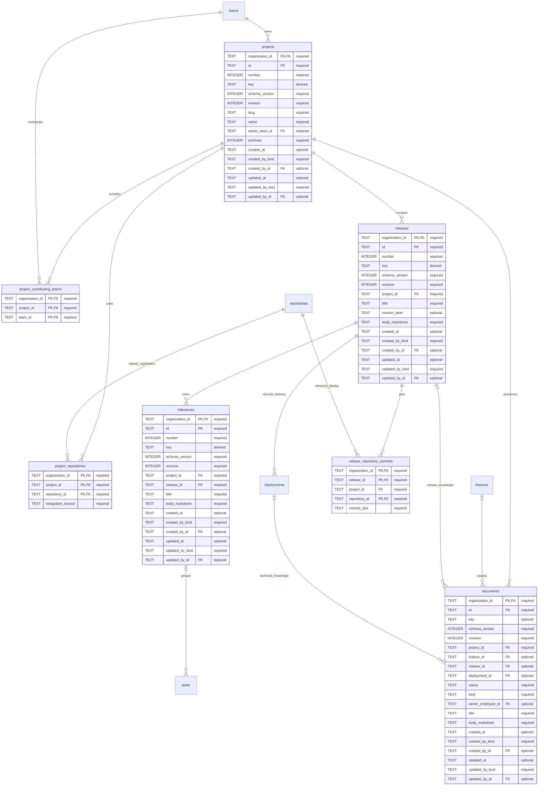

# Project structure

Status: **selected** data contract, revision 2.7. Projects belong to the [organization](01-organization-structure.md); their work is defined in [document 03](03-features-and-work.md).

## Relationships



HQ creates projects, releases and milestones. Other offices can request their creation and replicate the resulting records; replication is not a new creation. This restriction does not make HQ the owner of project data or its tasks. See [creation and registration](06-identity-and-numbering.md).

Each project has exactly one owning team and optional contributing teams. Its organization-wide readable reference is `P-<number>`. It also requires an organization-unique `slug`, such as `reservations`, assigned and registered by HQ when the project is created. Every project task stores that same accountable owning team in required `team_id`; a composite foreign key enforces the match. The task's optional `assigned_team_id` identifies the team currently responsible for doing the work, and `assignee_id` identifies its current individual assignee. Either can be outside the owning team. Reassigning work changes neither project ownership nor task ownership. Reassigning project ownership updates its tasks' `team_id` and records those ownership changes in the same recoverable transaction; existing team/individual assignments stay unchanged. See [task assignment and history](12-task-assignment-and-history.md).

A project may use several repositories, including shared infrastructure or libraries. `integration_branch` is required on each project/repository association; the same repository can use different integration branches for different projects. A contributing-team registration and a task assignment express different facts: assigning a task does not rewrite the project's contributing-team list or grant repository access.

A release has an `R-<number>` reference and an optional plain-text `version_label`, such as `1.4.0` or `Spring launch`. The label is independent of identity and need not follow semantic versioning. A release belongs to one project and contains zero or more milestones. Every milestone requires exactly one same-project release. A task can reference zero or one milestone. Releases are delivery records, not organization-wide repository branches.

Project investment/token totals are derived from [usage records](10-usage-and-cost-accounting.md), including explicitly attributed project overhead. A project/team/task move does not retroactively change recorded consumption. Release accounting uses captured release attribution, not every later release-manifest membership.

## Completion of milestones and releases

Milestones and releases store no status of their own (owner decision 2026-11-17). Whether one is done is derived from task status, where `done` is the one finished value ([document 03](03-features-and-work.md)):

- A milestone is done when it has at least one task and every task assigned to it is `done`.
- A release that has milestones is done when every one of its milestones is done.
- A release that has no milestones is done when its content manifest lists at least one task and every listed task is `done`.

An empty milestone or release is not done, and a release with a milestone that has no tasks is not done either; that reading of "all done" is ours and is open to the owner's correction. A task that was deleted but is still listed in a release's manifest is ignored. A task closed without being completed (cancelled, duplicate, will not fix) has status `done` with a `resolution` that says so, and counts as done. The views `milestone_progress` and `release_progress` compute this and return task counts and done counts for showing progress. The counts follow what completion follows: for a release with milestones they are the tasks of its milestones, and for a release without milestones they are its manifest tasks. Nothing is stored, so reopening a task makes its milestone and release not done again without any other write.

## Durable project files

```text
projects/<project-id>/
├── project.yaml
├── feature-flags/<flag-id>.md
├── brief.md
├── features/<feature-id>/
│   ├── feature.md                   # Definition, behaviour and known limitations
│   ├── designs/<document-id>.md     # Feature-specific designs
│   ├── decisions/<document-id>.md   # Feature-specific decisions
│   └── reports/<document-id>.md     # Feature-specific findings
├── releases/<release-id>/
│   ├── release.md
│   ├── changelog.md                  # Product changes
│   ├── flag-settings.yaml
│   ├── documents/<document-id>.md
│   ├── milestones/<milestone-id>.md
│   └── deployments/<deployment-id>/
│       ├── deployment.md
│       ├── changelog.md              # Technical changes
│       └── documents/<document-id>.md
├── decisions/<document-id>.md
├── designs/<document-id>.md
├── reports/<document-id>.md
├── processes/<document-id>.md
├── standards/<document-id>.md
└── work/tasks/<task-id>.md          # type: task, bug, request, or another task type
```

Tasks stay in the project work folder even when linked to a milestone; their explicit `milestone_id` is the relationship. This avoids moving task documents whenever their planning assignment changes. Milestone files themselves live inside their owning release.

```yaml
schema_version: 1
id: 01J00000000000000000000010
number: 8
slug: reservations
revision: 1
name: Reservations
owner_team_id: 01J00000000000000000000020
contributing_team_ids: []
repositories:
  - repository_id: 01J00000000000000000000002
    integration_branch: release/reservations-v1
```

The Product Agency's Care Platform and Trading Platform projects can reference the same infrastructure registration while selecting `release/care-v1` and `main`, respectively. The office still keeps one local cache for that repository. A Kitchen Display project may reference a local-only code registration without changing the organization repository's remote requirement.

## Project, feature, release and deployment documents

One `documents` table holds supporting knowledge at these four scopes. Each document has `owner_employee_id`, `status: draft | current | deprecated` and common creation/update attribution; a current document requires an accountable owner. See [record contracts](08-record-contracts.md). Every document requires `project_id` and can optionally name exactly one of `feature_id`, `release_id` or `deployment_id`, constrained to that same project. All three null means project scope. Release and deployment documents are described in [release content and flags](09-release-content-and-flags.md). Each scope can have zero or many documents. Reusable cross-feature knowledge stays at project scope and can be linked from several feature documents rather than copied.

| Record | Content | Canonical location |
| --- | --- | --- |
| Project brief | Product purpose, goals and boundaries | `projects/<project-id>/brief.md` |
| Project design | Shared architecture, integrations and cross-feature concepts | Project `designs/<document-id>.md` |
| Project decision/report | Cross-feature decisions or findings | Project `decisions/` or `reports/` |
| Feature definition | Purpose, current behaviour, rules, known limitations and non-goals | `features/<feature-id>/feature.md` |
| Feature design | Detailed flows, interactions and implementation choices | Feature `designs/<document-id>.md` |
| Feature decision/report | Feature-specific rationale, experiments or findings | Feature `decisions/` or `reports/` |

`feature.md` projects into the `features` table; it is not duplicated as a `documents` row. Other feature documents use `kind: design`, `decision` or `report`. A `brief` document is project-wide. `kind: changelog` is restricted to release or deployment scope and lives at its scope's `changelog.md`. Other release/deployment documents live under that scope's `documents/`. All paths above are inside the organization Git repository, retain stable ID filenames, and survive closure of related tasks.

For Restaurant SaaS, shared Reservations architecture is a project design (`feature_id: null`). The table-booking feature definition explains booking behaviour and known limitations. Its overlap-handling design is a separate feature document:

```markdown
---
schema_version: 1
id: 01J00000000000000000000070
revision: 1
project_id: 01J00000000000000000000010
feature_id: 01J00000000000000000000034
kind: design
status: draft
owner_employee_id: 01J00000000000000000000030
created_at: "2026-11-14T10:00:00Z"
created_by_kind: employee
created_by_id: 01J00000000000000000000030
updated_at: "2026-11-14T10:00:00Z"
updated_by_kind: employee
updated_by_id: 01J00000000000000000000030
title: Prevent overlapping table bookings
---
## Design
Validate availability and reserve the selected table atomically.

## Rationale
Concurrent requests must not both reserve the same table and time range.

## Limitations
This design covers individual tables; combining tables needs a separate design.
```

Save it at `projects/<project-id>/features/<feature-id>/designs/<document-id>.md`. A project document has the same metadata with `feature_id`, `release_id` and `deployment_id` all null and lives in the project-level folder. Path, `kind` and scope IDs must agree; the importer rejects mismatches. To associate existing supporting knowledge with a feature, preserve the document ID, set `feature_id`, and move its file to that feature's appropriate folder. Do not retain a duplicate canonical copy.

## File to SQL mapping

| Table | Source fields |
| --- | --- |
| `projects` | `project.yaml`: common identity fields, required organization-unique `slug`, `name`, `owner_team_id`, `archived` (default false). |
| `project_contributing_teams` | One row per `contributing_team_ids[]`; `project_id` comes from that project. |
| `project_repositories` | One row per `repositories[]` entry with `repository_id`, `integration_branch`; `project_id` comes from the project. |
| `releases` | `release.md`: common identity fields, `project_id`, `title`, optional `version_label`, and Markdown body; `feature_ids[]`/`task_ids[]` are projected by document 09. |
| `release_repository_commits` | Release `repository_commits` map: repository ID to exact commit SHA; `release_id` and `project_id` come from its parent file. |
| `milestones` | Milestone front matter: common identity fields, required `project_id`, required `release_id`, `title`, and Markdown body. Path and explicit parent IDs must agree. |
| `documents` | Supporting document front matter: stable `id`, optional `key`, revision fields, required `project_id`, nullable `feature_id`, `release_id` or `deployment_id` (at most one), `kind`, `status`, `owner_employee_id`, common attribution, `title`, and body. Parent folder and explicit fields agree. Structural process/standard content is owned by document 01. |

A manifest may cover multiple code repositories. Release deployment records are defined in [document 07](07-release-deployments.md), including environment/target, outcomes, rollback references and exact commit snapshots. Build artifacts are out of scope. Dates, release gates, progression rules, budgets and delivery execution are not fixed by this structural draft. They require separate lifecycle/operations decisions; they are not automatically imported from v1.

## SQLite tables

```sql
CREATE TABLE projects (
  organization_id TEXT NOT NULL REFERENCES organizations(id),
  id TEXT NOT NULL,
  number INTEGER NOT NULL CHECK (number > 0),
  key TEXT GENERATED ALWAYS AS (CASE WHEN number IS NOT NULL THEN 'P-' || number END) VIRTUAL,
  schema_version INTEGER NOT NULL CHECK (schema_version = 1),
  revision INTEGER NOT NULL CHECK (revision >= 1),
slug TEXT NOT NULL CHECK (
    length(slug) > 0 AND slug NOT GLOB '*[^a-z0-9-]*'
    AND substr(slug, 1, 1) GLOB '[a-z0-9]'
    AND substr(slug, -1, 1) GLOB '[a-z0-9]'
    AND instr(slug, '--') = 0),
  name TEXT NOT NULL,
  owner_team_id TEXT NOT NULL,
  archived INTEGER NOT NULL DEFAULT 0 CHECK (archived IN (0, 1)),
  created_at TEXT,
  created_by_kind TEXT NOT NULL DEFAULT 'unknown' CHECK (created_by_kind IN ('employee', 'owner', 'system', 'unknown')),
  created_by_id TEXT,
  updated_at TEXT,
  updated_by_kind TEXT NOT NULL DEFAULT 'unknown' CHECK (updated_by_kind IN ('employee', 'owner', 'system', 'unknown')),
  updated_by_id TEXT,
  PRIMARY KEY (organization_id, id),
UNIQUE (organization_id, number),
  UNIQUE (organization_id, slug),
  UNIQUE (organization_id, id, owner_team_id),
  FOREIGN KEY (organization_id, owner_team_id) REFERENCES teams(organization_id, id)
    DEFERRABLE INITIALLY DEFERRED,
  CHECK ((created_by_kind = 'employee' AND created_by_id IS NOT NULL) OR (created_by_kind <> 'employee' AND created_by_id IS NULL)),
  CHECK ((updated_by_kind = 'employee' AND updated_by_id IS NOT NULL) OR (updated_by_kind <> 'employee' AND updated_by_id IS NULL)),
  FOREIGN KEY (organization_id, created_by_id) REFERENCES employees(organization_id, id) DEFERRABLE INITIALLY DEFERRED,
  FOREIGN KEY (organization_id, updated_by_id) REFERENCES employees(organization_id, id) DEFERRABLE INITIALLY DEFERRED
) STRICT;

CREATE TABLE project_contributing_teams (
  organization_id TEXT NOT NULL,
  project_id TEXT NOT NULL,
  team_id TEXT NOT NULL,
  PRIMARY KEY (organization_id, project_id, team_id),
  FOREIGN KEY (organization_id, project_id) REFERENCES projects(organization_id, id)
    DEFERRABLE INITIALLY DEFERRED,
  FOREIGN KEY (organization_id, team_id) REFERENCES teams(organization_id, id)
    DEFERRABLE INITIALLY DEFERRED
) STRICT;

CREATE TABLE project_repositories (
  organization_id TEXT NOT NULL,
  project_id TEXT NOT NULL,
  repository_id TEXT NOT NULL,
  integration_branch TEXT NOT NULL,
  PRIMARY KEY (organization_id, project_id, repository_id),
  FOREIGN KEY (organization_id, project_id) REFERENCES projects(organization_id, id)
    DEFERRABLE INITIALLY DEFERRED,
  FOREIGN KEY (organization_id, repository_id) REFERENCES repositories(organization_id, id)
    DEFERRABLE INITIALLY DEFERRED
) STRICT;

CREATE TABLE releases (
  organization_id TEXT NOT NULL REFERENCES organizations(id),
  id TEXT NOT NULL,
  number INTEGER NOT NULL CHECK (number > 0),
  key TEXT GENERATED ALWAYS AS (CASE WHEN number IS NOT NULL THEN 'R-' || number END) VIRTUAL,
  schema_version INTEGER NOT NULL CHECK (schema_version = 1),
  revision INTEGER NOT NULL CHECK (revision >= 1),
project_id TEXT NOT NULL,
  title TEXT NOT NULL,
  version_label TEXT,
  body_markdown TEXT NOT NULL DEFAULT '',
  created_at TEXT,
  created_by_kind TEXT NOT NULL DEFAULT 'unknown' CHECK (created_by_kind IN ('employee', 'owner', 'system', 'unknown')),
  created_by_id TEXT,
  updated_at TEXT,
  updated_by_kind TEXT NOT NULL DEFAULT 'unknown' CHECK (updated_by_kind IN ('employee', 'owner', 'system', 'unknown')),
  updated_by_id TEXT,
  PRIMARY KEY (organization_id, id),
UNIQUE (organization_id, project_id, number),
  UNIQUE (organization_id, id, project_id),
  FOREIGN KEY (organization_id, project_id) REFERENCES projects(organization_id, id)
    DEFERRABLE INITIALLY DEFERRED,
  CHECK ((created_by_kind = 'employee' AND created_by_id IS NOT NULL) OR (created_by_kind <> 'employee' AND created_by_id IS NULL)),
  CHECK ((updated_by_kind = 'employee' AND updated_by_id IS NOT NULL) OR (updated_by_kind <> 'employee' AND updated_by_id IS NULL)),
  FOREIGN KEY (organization_id, created_by_id) REFERENCES employees(organization_id, id) DEFERRABLE INITIALLY DEFERRED,
  FOREIGN KEY (organization_id, updated_by_id) REFERENCES employees(organization_id, id) DEFERRABLE INITIALLY DEFERRED
) STRICT;

CREATE TABLE release_repository_commits (
  organization_id TEXT NOT NULL,
  release_id TEXT NOT NULL,
  project_id TEXT NOT NULL,
  repository_id TEXT NOT NULL,
  commit_sha TEXT NOT NULL,
  PRIMARY KEY (organization_id, release_id, repository_id),
  FOREIGN KEY (organization_id, release_id, project_id) REFERENCES releases(organization_id, id, project_id)
    DEFERRABLE INITIALLY DEFERRED,
  FOREIGN KEY (organization_id, repository_id) REFERENCES repositories(organization_id, id)
    DEFERRABLE INITIALLY DEFERRED
) STRICT;

CREATE TABLE milestones (
  organization_id TEXT NOT NULL REFERENCES organizations(id),
  id TEXT NOT NULL,
  number INTEGER NOT NULL CHECK (number > 0),
  key TEXT GENERATED ALWAYS AS (CASE WHEN number IS NOT NULL THEN 'M-' || number END) VIRTUAL,
  schema_version INTEGER NOT NULL CHECK (schema_version = 1),
  revision INTEGER NOT NULL CHECK (revision >= 1),
project_id TEXT NOT NULL,
  release_id TEXT NOT NULL,
  title TEXT NOT NULL,
  body_markdown TEXT NOT NULL DEFAULT '',
  created_at TEXT,
  created_by_kind TEXT NOT NULL DEFAULT 'unknown' CHECK (created_by_kind IN ('employee', 'owner', 'system', 'unknown')),
  created_by_id TEXT,
  updated_at TEXT,
  updated_by_kind TEXT NOT NULL DEFAULT 'unknown' CHECK (updated_by_kind IN ('employee', 'owner', 'system', 'unknown')),
  updated_by_id TEXT,
  PRIMARY KEY (organization_id, id),
UNIQUE (organization_id, release_id, number),
  UNIQUE (organization_id, id, project_id),
  FOREIGN KEY (organization_id, release_id, project_id) REFERENCES releases(organization_id, id, project_id)
    DEFERRABLE INITIALLY DEFERRED,
  CHECK ((created_by_kind = 'employee' AND created_by_id IS NOT NULL) OR (created_by_kind <> 'employee' AND created_by_id IS NULL)),
  CHECK ((updated_by_kind = 'employee' AND updated_by_id IS NOT NULL) OR (updated_by_kind <> 'employee' AND updated_by_id IS NULL)),
  FOREIGN KEY (organization_id, created_by_id) REFERENCES employees(organization_id, id) DEFERRABLE INITIALLY DEFERRED,
  FOREIGN KEY (organization_id, updated_by_id) REFERENCES employees(organization_id, id) DEFERRABLE INITIALLY DEFERRED
) STRICT;

CREATE VIEW milestone_progress AS
SELECT m.organization_id, m.id AS milestone_id, m.release_id,
  COUNT(t.id) AS task_count,
  COALESCE(SUM(t.status = 'done'), 0) AS done_task_count,
  (COUNT(t.id) > 0 AND COUNT(t.id) = COALESCE(SUM(t.status = 'done'), 0)) AS is_done
FROM milestones m
LEFT JOIN tasks t ON t.organization_id = m.organization_id AND t.milestone_id = m.id
GROUP BY m.organization_id, m.id;

CREATE VIEW release_progress AS
SELECT r.organization_id, r.id AS release_id,
  (SELECT COUNT(*) FROM milestones m WHERE m.organization_id = r.organization_id AND m.release_id = r.id) AS milestone_count,
  CASE
    WHEN EXISTS (SELECT 1 FROM milestones m WHERE m.organization_id = r.organization_id AND m.release_id = r.id)
      THEN (SELECT COALESCE(SUM(p.task_count), 0) FROM milestone_progress p
            WHERE p.organization_id = r.organization_id AND p.release_id = r.id)
    ELSE (SELECT COUNT(*) FROM release_tasks rt
            JOIN tasks t ON t.organization_id = rt.organization_id AND t.id = rt.task_id
          WHERE rt.organization_id = r.organization_id AND rt.release_id = r.id)
  END AS task_count,
  CASE
    WHEN EXISTS (SELECT 1 FROM milestones m WHERE m.organization_id = r.organization_id AND m.release_id = r.id)
      THEN (SELECT COALESCE(SUM(p.done_task_count), 0) FROM milestone_progress p
            WHERE p.organization_id = r.organization_id AND p.release_id = r.id)
    ELSE (SELECT COUNT(*) FROM release_tasks rt
            JOIN tasks t ON t.organization_id = rt.organization_id AND t.id = rt.task_id
          WHERE rt.organization_id = r.organization_id AND rt.release_id = r.id AND t.status = 'done')
  END AS done_task_count,
  CASE
    WHEN EXISTS (SELECT 1 FROM milestones m WHERE m.organization_id = r.organization_id AND m.release_id = r.id)
      THEN NOT EXISTS (SELECT 1 FROM milestone_progress p
                       WHERE p.organization_id = r.organization_id AND p.release_id = r.id AND NOT p.is_done)
    ELSE EXISTS (SELECT 1 FROM release_tasks rt
                 JOIN tasks t ON t.organization_id = rt.organization_id AND t.id = rt.task_id
                 WHERE rt.organization_id = r.organization_id AND rt.release_id = r.id)
      AND NOT EXISTS (SELECT 1 FROM release_tasks rt
                      JOIN tasks t ON t.organization_id = rt.organization_id AND t.id = rt.task_id
                      WHERE rt.organization_id = r.organization_id AND rt.release_id = r.id AND t.status <> 'done')
  END AS is_done
FROM releases r;

CREATE TABLE documents (
  organization_id TEXT NOT NULL REFERENCES organizations(id),
  id TEXT NOT NULL,
  key TEXT,
  schema_version INTEGER NOT NULL CHECK (schema_version = 1),
  revision INTEGER NOT NULL CHECK (revision >= 1),
  project_id TEXT NOT NULL,
  feature_id TEXT,
  release_id TEXT,
  deployment_id TEXT,
  status TEXT NOT NULL DEFAULT 'draft' CHECK (status IN ('draft', 'current', 'deprecated')),
  kind TEXT NOT NULL CHECK (kind IN ('brief', 'decision', 'design', 'report', 'changelog')),
  owner_employee_id TEXT,
  title TEXT NOT NULL,
  body_markdown TEXT NOT NULL DEFAULT '',
  created_at TEXT,
  created_by_kind TEXT NOT NULL DEFAULT 'unknown' CHECK (created_by_kind IN ('employee', 'owner', 'system', 'unknown')),
  created_by_id TEXT,
  updated_at TEXT,
  updated_by_kind TEXT NOT NULL DEFAULT 'unknown' CHECK (updated_by_kind IN ('employee', 'owner', 'system', 'unknown')),
  updated_by_id TEXT,
  PRIMARY KEY (organization_id, id),
  FOREIGN KEY (organization_id, owner_employee_id) REFERENCES employees(organization_id, id)
    DEFERRABLE INITIALLY DEFERRED,
  CHECK (status <> 'current' OR owner_employee_id IS NOT NULL),
  CHECK ((feature_id IS NOT NULL) + (release_id IS NOT NULL) + (deployment_id IS NOT NULL) <= 1),
  CHECK (feature_id IS NULL OR kind IN ('design', 'decision', 'report')),
  CHECK (kind <> 'brief' OR (feature_id IS NULL AND release_id IS NULL AND deployment_id IS NULL)),
  CHECK (kind <> 'changelog' OR release_id IS NOT NULL OR deployment_id IS NOT NULL),
  FOREIGN KEY (organization_id, release_id, project_id) REFERENCES releases(organization_id, id, project_id)
    DEFERRABLE INITIALLY DEFERRED,
  FOREIGN KEY (organization_id, deployment_id, project_id) REFERENCES deployments(organization_id, id, project_id)
    DEFERRABLE INITIALLY DEFERRED,
  FOREIGN KEY (organization_id, project_id) REFERENCES projects(organization_id, id)
    DEFERRABLE INITIALLY DEFERRED,
  FOREIGN KEY (organization_id, feature_id, project_id) REFERENCES features(organization_id, id, project_id)
    DEFERRABLE INITIALLY DEFERRED,
  CHECK ((created_by_kind = 'employee' AND created_by_id IS NOT NULL) OR (created_by_kind <> 'employee' AND created_by_id IS NULL)),
  CHECK ((updated_by_kind = 'employee' AND updated_by_id IS NOT NULL) OR (updated_by_kind <> 'employee' AND updated_by_id IS NULL)),
  FOREIGN KEY (organization_id, created_by_id) REFERENCES employees(organization_id, id) DEFERRABLE INITIALLY DEFERRED,
  FOREIGN KEY (organization_id, updated_by_id) REFERENCES employees(organization_id, id) DEFERRABLE INITIALLY DEFERRED
) STRICT;
```

Repository commit snapshots reference stable repository identity, independent of current project membership. New snapshot capture validates current project/repository eligibility in the accepting service; import validates recorded historical provenance. Later detachment from `project_repositories` must not delete or invalidate release/deployment snapshots. Referenced repository identities remain retained.
