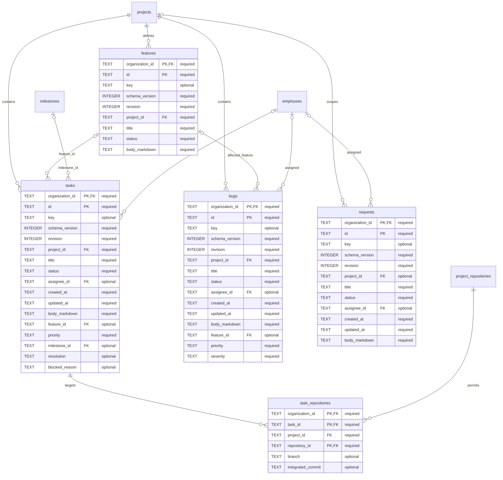
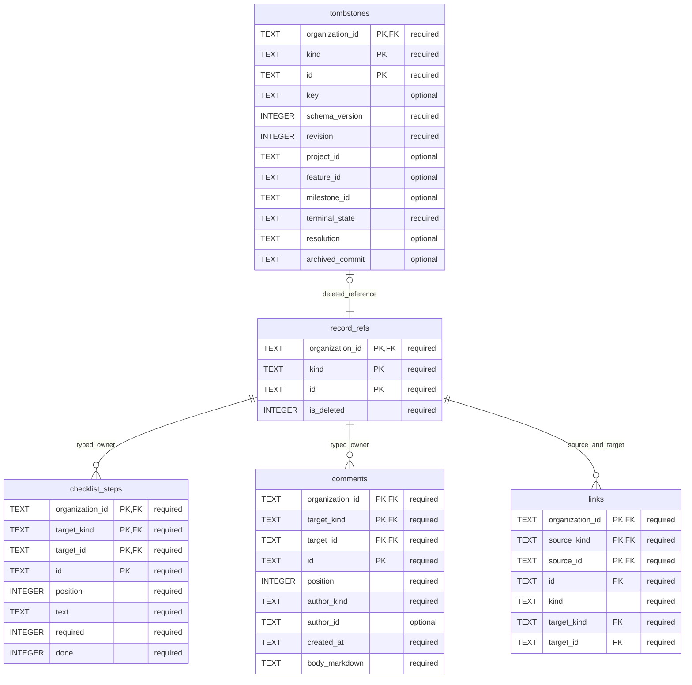

# Features and work structure

Structural draft for v1. Document revision 2.0. Uses [projects/releases/milestones](02-project-structure.md), [employees](04-agent-structure.md) and [operational metadata](05-operational-data.md).

## Explicit entities

Tasks are tasks. The previous `work_items` label was a shared persistence abstraction for tasks, bugs and requests. It is removed from this model's authored entities and physical tables. The three kinds have their own tables and file folders. Shared comments and operational metadata use typed references to those tables.



- A task belongs to exactly one project, zero or one feature, zero or one milestone and zero or one assignee. It can target zero or many project repositories.
- A feature belongs to exactly one project and can have many tasks. Feature and milestone membership are independent: a feature's tasks can span milestones/releases.
- A bug belongs to one project and may name an affected feature. Fix relationships are explicit links from tasks to bugs.
- A request may have no project until routed. Unrouted request files live at organization-level `work/requests/`; moving one into a project preserves its ID.
- Each target repository gets its own task branch/worktree. A local-only target does not acquire a remote URL from being part of a project.

## Task file example

```markdown
---
schema_version: 1
id: 01J00000000000000000000040
key: T-42
revision: 1
project_id: 01J00000000000000000000010
title: Prevent overlapping reservations
status: todo
assignee_id: null
created_at: "2026-11-14T10:00:00Z"
updated_at: "2026-11-14T10:00:00Z"
feature_id: null
milestone_id: null
priority: high
resolution: null
blocked_reason: null
repository_ids: [01J00000000000000000000002]
branches: {}
integrated_commits: {}
checklist: []
comments: []
links: []
operations:
  watchers: []
  owner_questions: []
  waiting_spans: []
---
Reject overlapping reservations for the same table. Include concurrent requests in the tests.
```

The parent folder determines whether this is a task, bug or request. A `kind` column is not needed on each dedicated table. For typed associations, the importer derives `task`, `bug` or `request` from that validated location. All foreign references still use stable IDs, never `T-42`.

## Shared child records



`record_refs` is a derived lookup index across entity types, not a fourth kind of work item. It allows shared metadata to point to `(target_kind, target_id)`. Before publishing a projection, validation must confirm each live lookup row has an actual source entity and each deleted row has a tombstone. Historical author/link references may resolve to tombstones.

## File to SQL mapping

| Table | Source fields |
| --- | --- |
| `features` | `features/<id>.md`: common identity fields, `project_id`, `title`, `status`, body. |
| `tasks` | Task front matter: every same-named scalar column, plus body. `priority` defaults to `normal`; optional references and resolution/reason fields default to null. |
| `bugs` | Bug front matter: every same-named scalar column, including required `severity`, plus body. |
| `requests` | Request front matter: every same-named scalar column; `project_id` and `assignee_id` may be null, plus body. |
| `task_repositories` | `repository_ids[]`; corresponding `branches[repository_id]` and `integrated_commits[repository_id]`. Task/project IDs come from the task file. |
| `checklist_steps` | `checklist[]`: `id`, `text`, `required`, `done`; position is zero-based array order; target type/ID come from the parent file. |
| `comments` | `comments[]`: `id`, `author_kind`, optional `author_id`, `created_at`, `body_markdown`; position is array order. Owner authors have `author_kind: owner` and null `author_id`; actual login identity remains in the separate authentication/audit subsystem. |
| `links` | `links[]`: `id`, `kind`, `target_kind`, `target_id`; source type/ID come from the parent file. |
| `tombstones` | `tombstones/<kind>/<id>.yaml`: every same-named field; references describe historical identity and do not require live owner records. |
| `record_refs` | Derived from parsed entities/tombstones; no extra authored file. |

Status values represent data. This document does not implement v1's triage, Undo, checklist promotion, automatic feature transitions or request-approval engine. Those migration choices remain open. Do not discard existing v1 fields absent from this selected-scope draft; preserve them in staging until their disposition is chosen.

## SQLite tables

```sql
CREATE TABLE features (
  organization_id TEXT NOT NULL REFERENCES organizations(id),
  id TEXT NOT NULL,
  key TEXT,
  schema_version INTEGER NOT NULL CHECK (schema_version = 1),
  revision INTEGER NOT NULL CHECK (revision >= 1),
project_id TEXT NOT NULL,
  title TEXT NOT NULL,
  status TEXT NOT NULL,
  body_markdown TEXT NOT NULL DEFAULT '',
  PRIMARY KEY (organization_id, id),
UNIQUE (organization_id, project_id, key),
  UNIQUE (organization_id, id, project_id),
  FOREIGN KEY (organization_id, project_id) REFERENCES projects(organization_id, id)
    DEFERRABLE INITIALLY DEFERRED
) STRICT;

CREATE TABLE tasks (
  organization_id TEXT NOT NULL REFERENCES organizations(id),
  id TEXT NOT NULL,
  key TEXT,
  schema_version INTEGER NOT NULL CHECK (schema_version = 1),
  revision INTEGER NOT NULL CHECK (revision >= 1),
project_id TEXT NOT NULL,
  title TEXT NOT NULL,
  status TEXT NOT NULL,
  assignee_id TEXT,
  created_at TEXT NOT NULL,
  updated_at TEXT NOT NULL,
  body_markdown TEXT NOT NULL DEFAULT '',
  feature_id TEXT,
  priority TEXT NOT NULL DEFAULT 'normal',
  milestone_id TEXT,
  resolution TEXT,
  blocked_reason TEXT,
  PRIMARY KEY (organization_id, id),
UNIQUE (organization_id, id, project_id),
  UNIQUE (organization_id, project_id, key),
  FOREIGN KEY (organization_id, project_id) REFERENCES projects(organization_id, id) DEFERRABLE INITIALLY DEFERRED,
  FOREIGN KEY (organization_id, assignee_id) REFERENCES employees(organization_id, id) DEFERRABLE INITIALLY DEFERRED,
  FOREIGN KEY (organization_id, feature_id, project_id) REFERENCES features(organization_id, id, project_id) DEFERRABLE INITIALLY DEFERRED,
  FOREIGN KEY (organization_id, milestone_id, project_id) REFERENCES milestones(organization_id, id, project_id) DEFERRABLE INITIALLY DEFERRED
) STRICT;

CREATE TABLE bugs (
  organization_id TEXT NOT NULL REFERENCES organizations(id),
  id TEXT NOT NULL,
  key TEXT,
  schema_version INTEGER NOT NULL CHECK (schema_version = 1),
  revision INTEGER NOT NULL CHECK (revision >= 1),
project_id TEXT NOT NULL,
  title TEXT NOT NULL,
  status TEXT NOT NULL,
  assignee_id TEXT,
  created_at TEXT NOT NULL,
  updated_at TEXT NOT NULL,
  body_markdown TEXT NOT NULL DEFAULT '',
  feature_id TEXT,
  priority TEXT NOT NULL DEFAULT 'normal',
  severity TEXT NOT NULL,
  PRIMARY KEY (organization_id, id),
UNIQUE (organization_id, id, project_id),
  UNIQUE (organization_id, project_id, key),
  FOREIGN KEY (organization_id, project_id) REFERENCES projects(organization_id, id) DEFERRABLE INITIALLY DEFERRED,
  FOREIGN KEY (organization_id, assignee_id) REFERENCES employees(organization_id, id) DEFERRABLE INITIALLY DEFERRED,
  FOREIGN KEY (organization_id, feature_id, project_id) REFERENCES features(organization_id, id, project_id) DEFERRABLE INITIALLY DEFERRED
) STRICT;

CREATE TABLE requests (
  organization_id TEXT NOT NULL REFERENCES organizations(id),
  id TEXT NOT NULL,
  key TEXT,
  schema_version INTEGER NOT NULL CHECK (schema_version = 1),
  revision INTEGER NOT NULL CHECK (revision >= 1),
project_id TEXT,
  title TEXT NOT NULL,
  status TEXT NOT NULL,
  assignee_id TEXT,
  created_at TEXT NOT NULL,
  updated_at TEXT NOT NULL,
  body_markdown TEXT NOT NULL DEFAULT '',
  PRIMARY KEY (organization_id, id),
UNIQUE (organization_id, id, project_id),
  UNIQUE (organization_id, key),
  FOREIGN KEY (organization_id, project_id) REFERENCES projects(organization_id, id) DEFERRABLE INITIALLY DEFERRED,
  FOREIGN KEY (organization_id, assignee_id) REFERENCES employees(organization_id, id) DEFERRABLE INITIALLY DEFERRED
) STRICT;

CREATE TABLE task_repositories (
  organization_id TEXT NOT NULL,
  task_id TEXT NOT NULL,
  project_id TEXT NOT NULL,
  repository_id TEXT NOT NULL,
  branch TEXT,
  integrated_commit TEXT,
  PRIMARY KEY (organization_id, task_id, repository_id),
  FOREIGN KEY (organization_id, task_id, project_id) REFERENCES tasks(organization_id, id, project_id)
    DEFERRABLE INITIALLY DEFERRED,
  FOREIGN KEY (organization_id, project_id, repository_id) REFERENCES project_repositories(organization_id, project_id, repository_id)
    DEFERRABLE INITIALLY DEFERRED
) STRICT;

CREATE TABLE record_refs (
  organization_id TEXT NOT NULL REFERENCES organizations(id),
  kind TEXT NOT NULL,
  id TEXT NOT NULL,
  is_deleted INTEGER NOT NULL CHECK (is_deleted IN (0, 1)),
  PRIMARY KEY (organization_id, kind, id)
) STRICT;

CREATE TABLE checklist_steps (
  organization_id TEXT NOT NULL,
  target_kind TEXT NOT NULL CHECK (target_kind IN ('task', 'bug')),
  target_id TEXT NOT NULL,
  id TEXT NOT NULL,
  position INTEGER NOT NULL CHECK (position >= 0),
  text TEXT NOT NULL,
  required INTEGER NOT NULL CHECK (required IN (0, 1)),
  done INTEGER NOT NULL CHECK (done IN (0, 1)),
  PRIMARY KEY (organization_id, target_kind, target_id, id),
  UNIQUE (organization_id, target_kind, target_id, position),
  FOREIGN KEY (organization_id, target_kind, target_id) REFERENCES record_refs(organization_id, kind, id)
    DEFERRABLE INITIALLY DEFERRED
) STRICT;

CREATE TABLE comments (
  organization_id TEXT NOT NULL,
  target_kind TEXT NOT NULL CHECK (target_kind IN ('task', 'bug', 'request')),
  target_id TEXT NOT NULL,
  id TEXT NOT NULL,
  position INTEGER NOT NULL CHECK (position >= 0),
  author_kind TEXT NOT NULL CHECK (author_kind IN ('employee', 'owner')),
  author_id TEXT,
  created_at TEXT NOT NULL,
  body_markdown TEXT NOT NULL,
  PRIMARY KEY (organization_id, target_kind, target_id, id),
  UNIQUE (organization_id, target_kind, target_id, position),
  CHECK ((author_kind = 'employee' AND author_id IS NOT NULL) OR (author_kind = 'owner' AND author_id IS NULL)),
  FOREIGN KEY (organization_id, target_kind, target_id) REFERENCES record_refs(organization_id, kind, id)
    DEFERRABLE INITIALLY DEFERRED
) STRICT;

CREATE TABLE links (
  organization_id TEXT NOT NULL,
  source_kind TEXT NOT NULL CHECK (source_kind IN ('task', 'bug', 'request')),
  source_id TEXT NOT NULL,
  id TEXT NOT NULL,
  kind TEXT NOT NULL,
  target_kind TEXT NOT NULL,
  target_id TEXT NOT NULL,
  PRIMARY KEY (organization_id, source_kind, source_id, id),
  FOREIGN KEY (organization_id, source_kind, source_id) REFERENCES record_refs(organization_id, kind, id)
    DEFERRABLE INITIALLY DEFERRED,
  FOREIGN KEY (organization_id, target_kind, target_id) REFERENCES record_refs(organization_id, kind, id)
    DEFERRABLE INITIALLY DEFERRED
) STRICT;

CREATE TABLE tombstones (
  organization_id TEXT NOT NULL REFERENCES organizations(id),
  kind TEXT NOT NULL,
  id TEXT NOT NULL,
  key TEXT,
  schema_version INTEGER NOT NULL CHECK (schema_version = 1),
  revision INTEGER NOT NULL CHECK (revision >= 1),
  project_id TEXT,
  feature_id TEXT,
  milestone_id TEXT,
  terminal_state TEXT NOT NULL,
  resolution TEXT,
  archived_commit TEXT,
  PRIMARY KEY (organization_id, kind, id)
) STRICT;
```
