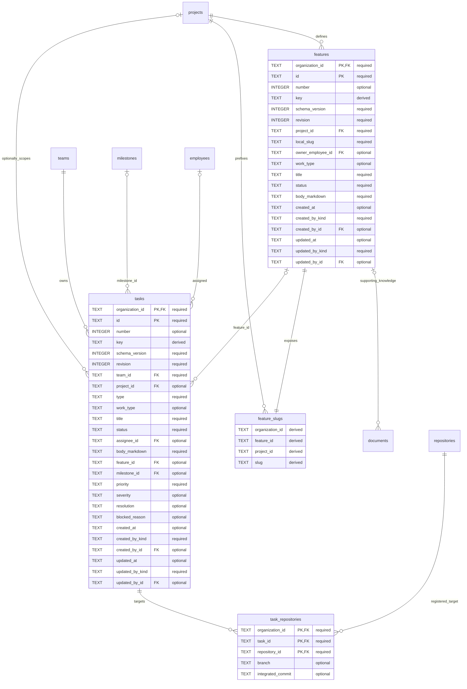
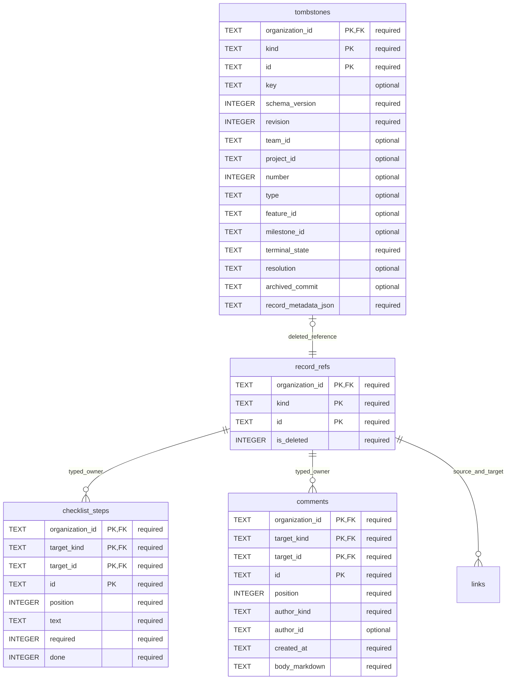

# Features and work structure

Structural draft for v1. Document revision 2.6. Uses [projects/releases/milestones](02-project-structure.md), [employees](04-agent-structure.md) and [operational metadata](05-operational-data.md).

## Explicit entities

There is one authored work entity and one physical `tasks` table. `type` distinguishes `task`, `bug`, `request` or another nonempty task-type identifier. Task `type` is separate from optional `work_type: build | run` (Build/R&D or Run/KTLO). [Record contracts](08-record-contracts.md) records the v1 evidence and proposed classification extension. All types use the same `T-<number>` sequence within their scope and the same comments, checklists and operational metadata. There are no separate bug/request tables, folders or number counters. This entity remains named **task**, not work item.



- Every task requires `team_id`. `project_id` is optional: null means a team task; present means a project task. A project task's team must equal the project's owning team.
- Creator, assignee and the assignee's home team do not determine ownership. A director may assign a team task to another director without creating an artificial project.
- A project task can have zero or one feature and zero or one milestone, both from the same project. Team tasks have neither. Feature and milestone membership are independent.
- A feature belongs to one project and has a numeric reference such as `F-6`. Its file stores project-unique `local_slug: table-booking`. The public feature `slug` is derived automatically as `reservations/table-booking` using the project slug, making it unique within the organization.
- A bug is `type: bug`; `severity` is optional metadata for triage. A request is `type: request`. Changing type preserves the task's ID, number, comments and relationships. Additional types do not require new SQL tables; their workflow behaviour remains out of scope.
- A task can target zero or many organization repositories. For project tasks each target must appear in that project's repository associations; this cross-table rule is validated on import/publication. Team tasks may target registered repositories without an artificial project. Each target can have a separate branch/worktree.

```text
Project work: projects/<project-id>/work/tasks/<task-id>.md
Team work:    teams/<team-id>/.../work/tasks/<task-id>.md
```

The team path includes its full ancestor chain. Task scope and path must agree; a project task does not get a second canonical file under its team.

Task token/cost totals are derived from the [usage ledger](10-usage-and-cost-accounting.md), including reviewers/helpers and retained task identities after archival. They are not counters stored on task files. Attribution captures work scope and Build/Run classification when consumption occurs, rather than joining to the task's current parents later.

## Task file example

```markdown
---
schema_version: 1
id: 01J00000000000000000000040
number: 42
type: bug
work_type: build
team_id: 01J00000000000000000000020
revision: 1
project_id: 01J00000000000000000000010
title: Prevent overlapping reservations
status: todo
assignee_id: null
created_at: "2026-11-14T10:00:00Z"
updated_at: "2026-11-14T10:00:00Z"
created_by_kind: employee
created_by_id: 01J00000000000000000000030
updated_by_kind: employee
updated_by_id: 01J00000000000000000000030
feature_id: null
milestone_id: null
priority: high
severity: major
resolution: null
blocked_reason: null
repository_ids: [01J00000000000000000000002]
branches: {}
integrated_commits: {}
checklist: []
comments: []
links: []
operations:
  watchers: []
  owner_questions: []
  waiting_spans: []
---
Reject overlapping reservations for the same table. Include concurrent requests in the tests.
```

The readable reference is derived as `T-42`, and all foreign references use the stable ID. To represent a projectless request, set `type: request`, keep required `team_id`, set `project_id`, `feature_id` and `milestone_id` to null, and save under that team's `work/tasks/`. All child metadata uses `target_kind: task`, including for bugs and requests; `type` is a classification, not an entity kind.

Tasks and features may be created in any office. Persist their stable IDs and content immediately; final numbers and feature-slug uniqueness are registered through the shared organization authority. Pending local records remain usable by ID. A duplicate local feature slug in the same project requires explicit conflict resolution at registration; the project prefix prevents conflicts across different projects, not within the same project.

```yaml
schema_version: 1
id: 01J00000000000000000000034
number: 6
local_slug: table-booking
owner_employee_id: 01J00000000000000000000030
work_type: build
revision: 1
project_id: 01J00000000000000000000010
title: Table booking
status: planned
```

Save this feature at `projects/<project-id>/features/<feature-id>/feature.md`. Its Markdown body is the current feature definition, with sections for Purpose, How it works, Rules, Known limitations, and Non-goals. Keep detailed designs and decisions in supporting documents under the same feature folder; their association is explicit `feature_id`, not merely a Markdown link. See [document scopes and example](02-project-structure.md).

For table booking, the definition explains how a guest selects a table and time, what happens when availability changes, and limitations such as unsupported combined-table bookings. The feature's overlap-handling design documents the detailed concurrency mechanism. In Product Agency, shared authentication architecture belongs to the Care Platform project, while appointment reminder behaviour and its delivery limitations belong to that feature. Both examples use the same structure.

The feature has nullable `owner_employee_id` and explicit `work_type`, plus common creation/update attribution. Planned features may be unassigned; `in_progress` and `live` features require an active accountable owner. These fields do not grant management or repository permissions.

The feature body contains its description. SQL derives `F-6` from the number; the `feature_slugs` view derives public slug `reservations/table-booking`. Files persist only `local_slug` and `project_id`, so there is no separately authored prefix to drift. A project-slug change automatically changes its features' full slugs; stable IDs, numbers and filenames stay unchanged. Aliases for old slugs are outside this draft.

Full slug lookup splits on the single `/`, resolves the organization/project slug, then uses that project and feature local slug. SQL enforces lowercase kebab-case on both components, so neither can contain `/`. Existing UNIQUE indexes support both steps; a duplicate stored full-path column or extra text index is unnecessary.

## Shared child records



`record_refs` is a derived lookup index across entity types, not another authored work entity. Bugs and requests register as `kind: task`, never as separate entity kinds. It allows shared metadata to point to `(target_kind, target_id)`. Before publishing a projection, validation must confirm each live lookup row has an actual source entity and each deleted row has a tombstone. Historical author/link references may resolve to tombstones.

## File to SQL mapping

| Table | Source fields |
| --- | --- |
| `features` | `features/<id>/feature.md`: stable `id`, `number`, `local_slug`, revision fields, `project_id`, `title`, `status`, body; `key` and public full slug are derived. |
| `feature_slugs` (view) | Derived from each feature's `project_id` and `local_slug`, joined to its project's `slug`; no authored file. |
| `tasks` | Task front matter: every same-named scalar except derived `key`, plus body. Required `team_id`, optional `project_id`; `type` defaults to `task`, `priority` to `normal`, optional fields to null. |
| `task_repositories` | `repository_ids[]`; corresponding `branches[repository_id]` and `integrated_commits[repository_id]`. Task ID comes from the task file; project repository eligibility is validated through its optional project. |
| `checklist_steps` | `checklist[]`: `id`, `text`, `required`, `done`; position is zero-based array order; target type/ID come from the parent file. |
| `comments` | `comments[]`: `id`, `author_kind`, optional `author_id`, `created_at`, `body_markdown`; position is array order. Owner authors have `author_kind: owner` and null `author_id`; actual login identity remains in the separate authentication/audit subsystem. |
| `links` | Source `links[]` is defined in [record contracts](08-record-contracts.md); projects/features/documents also support links. `implements`, `documents` and inverse `blocks` are derived rather than duplicated. |
| `tombstones` | `tombstones/<kind>/<id>.yaml`: identity, scope and terminal-state scalars; the `record_metadata` map projects into `record_metadata_json`. References describe historical identity and do not require live owner records. |
| `record_refs` | Derived from parsed entities/tombstones; no extra authored file. |

Status values represent data. This document does not implement v1's triage, Undo, checklist promotion, automatic feature transitions or request-approval engine. Those migration choices remain open. Do not discard existing v1 fields absent from this selected-scope draft; preserve them in staging until their disposition is chosen.

An eventual import maps existing bug/request records into tasks with the corresponding `type`, preserving their stable IDs and mapping child references to entity kind `task`. It must detect collisions between previously separate entity namespaces before publishing anything. Existing readable references need an explicit mapping; this draft neither silently renumbers records nor implements that migration.

## SQLite tables

```sql
CREATE TABLE features (
  organization_id TEXT NOT NULL REFERENCES organizations(id),
  id TEXT NOT NULL,
  number INTEGER CHECK (number > 0),
  key TEXT GENERATED ALWAYS AS (CASE WHEN number IS NOT NULL THEN 'F-' || number END) VIRTUAL,
  schema_version INTEGER NOT NULL CHECK (schema_version = 1),
  revision INTEGER NOT NULL CHECK (revision >= 1),
project_id TEXT NOT NULL,
  local_slug TEXT NOT NULL CHECK (
    length(local_slug) > 0 AND local_slug NOT GLOB '*[^a-z0-9-]*'
    AND substr(local_slug, 1, 1) GLOB '[a-z0-9]'
    AND substr(local_slug, -1, 1) GLOB '[a-z0-9]'
    AND instr(local_slug, '--') = 0),
  owner_employee_id TEXT,
  work_type TEXT CHECK (work_type IN ('build', 'run')),
  title TEXT NOT NULL,
  status TEXT NOT NULL,
  body_markdown TEXT NOT NULL DEFAULT '',
  created_at TEXT,
  created_by_kind TEXT NOT NULL DEFAULT 'unknown' CHECK (created_by_kind IN ('employee', 'owner', 'system', 'unknown')),
  created_by_id TEXT,
  updated_at TEXT,
  updated_by_kind TEXT NOT NULL DEFAULT 'unknown' CHECK (updated_by_kind IN ('employee', 'owner', 'system', 'unknown')),
  updated_by_id TEXT,
  PRIMARY KEY (organization_id, id),
  CHECK (status NOT IN ('in_progress', 'live') OR owner_employee_id IS NOT NULL),
  FOREIGN KEY (organization_id, owner_employee_id) REFERENCES employees(organization_id, id)
    DEFERRABLE INITIALLY DEFERRED,
UNIQUE (organization_id, project_id, number),
  UNIQUE (organization_id, project_id, local_slug),
  UNIQUE (organization_id, id, project_id),
  FOREIGN KEY (organization_id, project_id) REFERENCES projects(organization_id, id)
    DEFERRABLE INITIALLY DEFERRED,
  CHECK ((created_by_kind = 'employee' AND created_by_id IS NOT NULL) OR (created_by_kind <> 'employee' AND created_by_id IS NULL)),
  CHECK ((updated_by_kind = 'employee' AND updated_by_id IS NOT NULL) OR (updated_by_kind <> 'employee' AND updated_by_id IS NULL)),
  FOREIGN KEY (organization_id, created_by_id) REFERENCES employees(organization_id, id) DEFERRABLE INITIALLY DEFERRED,
  FOREIGN KEY (organization_id, updated_by_id) REFERENCES employees(organization_id, id) DEFERRABLE INITIALLY DEFERRED
) STRICT;

CREATE TABLE tasks (
  organization_id TEXT NOT NULL REFERENCES organizations(id),
  id TEXT NOT NULL,
  number INTEGER CHECK (number > 0),
  key TEXT GENERATED ALWAYS AS (CASE WHEN number IS NOT NULL THEN 'T-' || number END) VIRTUAL,
  schema_version INTEGER NOT NULL CHECK (schema_version = 1),
  revision INTEGER NOT NULL CHECK (revision >= 1),
  team_id TEXT NOT NULL,
  project_id TEXT,
  type TEXT NOT NULL DEFAULT 'task' CHECK (length(type) > 0),
  work_type TEXT CHECK (work_type IN ('build', 'run')),
  title TEXT NOT NULL,
  status TEXT NOT NULL,
  assignee_id TEXT,
  body_markdown TEXT NOT NULL DEFAULT '',
  feature_id TEXT,
  milestone_id TEXT,
  priority TEXT NOT NULL DEFAULT 'normal',
  severity TEXT,
  resolution TEXT,
  blocked_reason TEXT,
  created_at TEXT,
  created_by_kind TEXT NOT NULL DEFAULT 'unknown' CHECK (created_by_kind IN ('employee', 'owner', 'system', 'unknown')),
  created_by_id TEXT,
  updated_at TEXT,
  updated_by_kind TEXT NOT NULL DEFAULT 'unknown' CHECK (updated_by_kind IN ('employee', 'owner', 'system', 'unknown')),
  updated_by_id TEXT,
  PRIMARY KEY (organization_id, id),
  CHECK (project_id IS NOT NULL OR (feature_id IS NULL AND milestone_id IS NULL)),
  UNIQUE (organization_id, project_id, number),
  FOREIGN KEY (organization_id, team_id) REFERENCES teams(organization_id, id) DEFERRABLE INITIALLY DEFERRED,
  FOREIGN KEY (organization_id, project_id, team_id) REFERENCES projects(organization_id, id, owner_team_id) DEFERRABLE INITIALLY DEFERRED,
  FOREIGN KEY (organization_id, assignee_id) REFERENCES employees(organization_id, id) DEFERRABLE INITIALLY DEFERRED,
  FOREIGN KEY (organization_id, feature_id, project_id) REFERENCES features(organization_id, id, project_id) DEFERRABLE INITIALLY DEFERRED,
  FOREIGN KEY (organization_id, milestone_id, project_id) REFERENCES milestones(organization_id, id, project_id) DEFERRABLE INITIALLY DEFERRED,
  CHECK ((created_by_kind = 'employee' AND created_by_id IS NOT NULL) OR (created_by_kind <> 'employee' AND created_by_id IS NULL)),
  CHECK ((updated_by_kind = 'employee' AND updated_by_id IS NOT NULL) OR (updated_by_kind <> 'employee' AND updated_by_id IS NULL)),
  FOREIGN KEY (organization_id, created_by_id) REFERENCES employees(organization_id, id) DEFERRABLE INITIALLY DEFERRED,
  FOREIGN KEY (organization_id, updated_by_id) REFERENCES employees(organization_id, id) DEFERRABLE INITIALLY DEFERRED
) STRICT;

CREATE TABLE task_repositories (
  organization_id TEXT NOT NULL,
  task_id TEXT NOT NULL,
  repository_id TEXT NOT NULL,
  branch TEXT,
  integrated_commit TEXT,
  PRIMARY KEY (organization_id, task_id, repository_id),
  FOREIGN KEY (organization_id, task_id) REFERENCES tasks(organization_id, id)
    DEFERRABLE INITIALLY DEFERRED,
  FOREIGN KEY (organization_id, repository_id) REFERENCES repositories(organization_id, id)
    DEFERRABLE INITIALLY DEFERRED
) STRICT;

CREATE TABLE record_refs (
  organization_id TEXT NOT NULL REFERENCES organizations(id),
  kind TEXT NOT NULL,
  id TEXT NOT NULL,
  is_deleted INTEGER NOT NULL CHECK (is_deleted IN (0, 1)),
  PRIMARY KEY (organization_id, kind, id)
) STRICT;

CREATE TABLE checklist_steps (
  organization_id TEXT NOT NULL,
  target_kind TEXT NOT NULL CHECK (target_kind = 'task'),
  target_id TEXT NOT NULL,
  id TEXT NOT NULL,
  position INTEGER NOT NULL CHECK (position >= 0),
  text TEXT NOT NULL,
  required INTEGER NOT NULL CHECK (required IN (0, 1)),
  done INTEGER NOT NULL CHECK (done IN (0, 1)),
  PRIMARY KEY (organization_id, target_kind, target_id, id),
  UNIQUE (organization_id, target_kind, target_id, position),
  FOREIGN KEY (organization_id, target_kind, target_id) REFERENCES record_refs(organization_id, kind, id)
    DEFERRABLE INITIALLY DEFERRED
) STRICT;

CREATE TABLE comments (
  organization_id TEXT NOT NULL,
  target_kind TEXT NOT NULL CHECK (target_kind = 'task'),
  target_id TEXT NOT NULL,
  id TEXT NOT NULL,
  position INTEGER NOT NULL CHECK (position >= 0),
  author_kind TEXT NOT NULL CHECK (author_kind IN ('employee', 'owner')),
  author_id TEXT,
  created_at TEXT NOT NULL,
  body_markdown TEXT NOT NULL,
  PRIMARY KEY (organization_id, target_kind, target_id, id),
  UNIQUE (organization_id, target_kind, target_id, position),
  CHECK ((author_kind = 'employee' AND author_id IS NOT NULL) OR (author_kind = 'owner' AND author_id IS NULL)),
  FOREIGN KEY (organization_id, target_kind, target_id) REFERENCES record_refs(organization_id, kind, id)
    DEFERRABLE INITIALLY DEFERRED
) STRICT;

CREATE TABLE tombstones (
  organization_id TEXT NOT NULL REFERENCES organizations(id),
  kind TEXT NOT NULL,
  id TEXT NOT NULL,
  key TEXT,
  schema_version INTEGER NOT NULL CHECK (schema_version = 1),
  revision INTEGER NOT NULL CHECK (revision >= 1),
  team_id TEXT,
  project_id TEXT,
  number INTEGER CHECK (number > 0),
  type TEXT,
  feature_id TEXT,
  milestone_id TEXT,
  terminal_state TEXT NOT NULL,
  resolution TEXT,
  archived_commit TEXT,
  record_metadata_json TEXT NOT NULL DEFAULT '{}' CHECK (json_valid(record_metadata_json) AND json_type(record_metadata_json) = 'object'),
  PRIMARY KEY (organization_id, kind, id)
) STRICT;

CREATE VIEW feature_slugs AS
SELECT f.organization_id, f.id AS feature_id, f.project_id,
       p.slug || '/' || f.local_slug AS slug
FROM features AS f
JOIN projects AS p ON p.organization_id = f.organization_id AND p.id = f.project_id;
```
