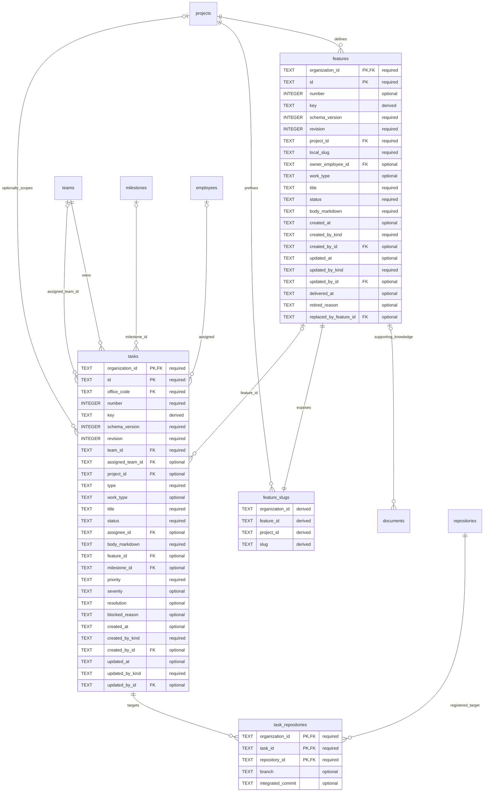
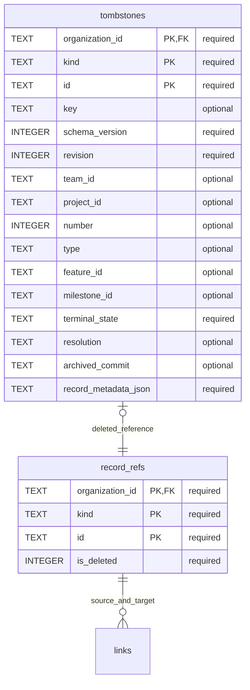
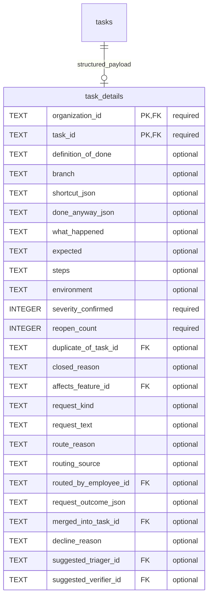

# Features and work structure

Status: **selected** data contract, revision 2.9. Uses [projects/releases/milestones](02-project-structure.md), [employees](04-agent-structure.md) and [operational metadata](05-operational-data.md).

## Explicit entities

There is one authored work entity and one physical `tasks` table. `type` distinguishes `task`, `bug`, `request` or another nonempty task-type identifier. Task `type` is separate from optional `work_type: build | run` (Build/R&D or Run/KTLO). [Record contracts](08-record-contracts.md) records the v1 evidence and proposed classification extension. All types use the same `T-<number>` sequence within their scope and the same comments, checklists and operational metadata. There are no separate bug/request tables, folders or number counters. This entity remains named **task**, not work item.



- Every task requires owning `team_id`. `project_id` is optional: null means a team task; present means a project task. A project task's owning team must equal the project's owning team. Ownership determines its backlog/scope and numbering, not who must perform the work.
- `assigned_team_id` and `assignee_id` are the current team and individual assignment. Both are nullable and independent of owning `team_id`. A task can be assigned to a team awaiting an individual, directly to an individual, to both, or to neither. New assignments must resolve to active teams/employees in the same organization; neither project contribution membership nor the individual's home team is an assignment restriction or an access grant. An employee's later home-team move does not silently change the task's assigned team.
- Creator, assigned team, assignee and the assignee's home team do not determine ownership. A Payments-owned task can be assigned to Platform and Ana without changing its owner or number. A director may assign a team task to another director without creating an artificial project. Owning-team backlog queries use `team_id`; work queues use `assigned_team_id` and/or `assignee_id`.
- The reporter/originator is the task's immutable `created_by_kind`/`created_by_id`, populated from the admitted actor. `updated_by_*` describes only the latest change. [Task assignment and history](12-task-assignment-and-history.md) preserves previous assignments, status changes and their actors/times; it also distinguishes a recorded fix/closure actor from the current assignee.
- A project task can have zero or one feature and zero or one milestone, both from the same project. Team tasks have neither. Feature and milestone membership are independent.
- A feature belongs to one project and has a numeric reference such as `F-6`. Its file stores project-unique `local_slug: table-booking`. The public feature `slug` is derived automatically as `reservations/table-booking` using the project slug, making it unique within the organization.
- A bug is `type: bug`; `severity` is optional metadata for triage. A request is `type: request`. Changing type preserves the task's ID, number, comments and relationships. Additional types do not require new SQL tables; their workflow behaviour remains out of scope.
- A task can target zero or many organization repositories. For project tasks each target must appear in that project's repository associations; this cross-table rule is validated on import/publication. Team tasks may target registered repositories without an artificial project. Each target can have a separate branch/worktree.

```text
Project work: projects/<project-id>/work/tasks/<task-id>.md
Team work:    teams/<team-id>/.../work/tasks/<task-id>.md
```

The team path includes its full ancestor chain. Task scope and path must agree; a project task does not get a second canonical file under its team.

### Selected assignment snapshot admission

[ADR-0006 revision 4](../../adr/0006-selected-task-acceptance.md) selects an additive
source-preserving editor for assignment. Snapshot schema version remains independent
of event codec version. Preserve the exact public Markdown, including BOM, fences,
line endings, extension spellings and body. Assignment replaces only the scalar
tokens of `revision`, `assigned_team_id`, `assignee_id`, `updated_at`,
`updated_by_kind` and `updated_by_id`; it never serializes the parsed value tree.

The initial admitted representation is a block-root mapping with all six entries
present as simple single-line entries with nonempty plain, single-quoted or
double-quoted scalar tokens. Decoded root keys locate values; nested or body
lookalikes are not properties. Reuse the strict parser's structural guards. Convert
parser character offsets to UTF-8 byte offsets over the exact front-matter input;
quoted token ends must exclude trailing whitespace/comments. Reparse the edited
document and verify the intended values and unchanged nonmutable slices/body.
Unsupported forms and numbers rejected by the safe parser are refused with the reason; nothing is rewritten.

Profile `selected-task-resources/1` retains front matter <=64 KiB, depth <=16 and
<=10,000 parser events; body <=8 MiB. The profile is recorded in admission/history
metadata, not a seventh mutable property. Only classified public snapshots can
enter [history snapshot representations](05-operational-data.md#exact-public-snapshots).
IDs are never renamed, and an ID is never concatenated unchecked into a filesystem path.

Task token/cost totals are derived from the [usage ledger](10-usage-and-cost-accounting.md), including reviewers/helpers and retained task identities after archival. They are not counters stored on task files. Attribution captures work scope and Build/Run classification when consumption occurs, rather than joining to the task's current parents later.

## Task file example

```markdown
---
schema_version: 1
id: 01930000-0000-7000-8000-000000000040
number: 42
type: bug
work_type: build
team_id: 01930000-0000-7000-8000-000000000020
assigned_team_id: null
revision: 1
project_id: 01930000-0000-7000-8000-000000000010
title: Prevent overlapping reservations
status: todo
assignee_id: null
created_at: "2026-11-14T10:00:00Z"
updated_at: "2026-11-14T10:00:00Z"
created_by_kind: employee
created_by_id: 01930000-0000-7000-8000-000000000030
updated_by_kind: employee
updated_by_id: 01930000-0000-7000-8000-000000000030
feature_id: null
milestone_id: null
priority: high
severity: major
resolution: null
blocked_reason: null
repository_ids: [01930000-0000-7000-8000-000000000002]
branches: {}
integrated_commits: {}
checklist: []
comments: []
links: []
operations:
  watchers: []
  owner_questions: []
  waiting_spans: []
---
Reject overlapping reservations for the same table. Include concurrent requests in the tests.
```

The readable reference is derived as `T-A42`, and all foreign references use the stable ID. To represent a projectless request, set `type: request`, keep required `team_id`, set `project_id`, `feature_id` and `milestone_id` to null, and save under that team's `work/tasks/`. All child metadata uses `target_kind: task`, including for bugs and requests; `type` is a classification, not an entity kind.

Tasks and features may be created in any office. A task gets its final reference from the creating office at once ([document 06](06-identity-and-numbering.md#multiple-offices)); what follows about registration applies to features. Persist their stable IDs and content immediately; final numbers and feature-slug uniqueness are registered through the shared organization authority. Pending local records remain usable by ID. A duplicate local feature slug in the same project requires explicit conflict resolution at registration; the project prefix prevents conflicts across different projects, not within the same project.

```yaml
schema_version: 1
id: 01930000-0000-7000-8000-000000000034
number: 6
local_slug: table-booking
owner_employee_id: 01930000-0000-7000-8000-000000000030
work_type: build
revision: 1
project_id: 01930000-0000-7000-8000-000000000010
title: Table booking
status: planned
```

Save this feature at `projects/<project-id>/features/<feature-id>/feature.md`. Its Markdown body is the current feature definition, with sections for Purpose, How it works, Rules, Known limitations, and Non-goals. Keep detailed designs and decisions in supporting documents under the same feature folder; their association is explicit `feature_id`, not merely a Markdown link. See [document scopes and example](02-project-structure.md).

For table booking, the definition explains how a guest selects a table and time, what happens when availability changes, and limitations such as unsupported combined-table bookings. The feature's overlap-handling design documents the detailed concurrency mechanism. In Product Agency, shared authentication architecture belongs to the Care Platform project, while appointment reminder behaviour and its delivery limitations belong to that feature. Both examples use the same structure.

The feature has nullable `owner_employee_id` and explicit `work_type`, plus common creation/update attribution. Planned features may be unassigned; `in_progress` and `live` features require an active accountable owner. These fields do not grant management or repository permissions.

The feature body contains its description. SQL derives `F-6` from the number; the `feature_slugs` view derives public slug `reservations/table-booking`. Files persist only `local_slug` and `project_id`, so there is no separately authored prefix to drift. A project-slug change automatically changes its features' full slugs; stable IDs, numbers and filenames stay unchanged. Aliases for old slugs are outside this draft.

Full slug lookup splits on the single `/`, resolves the organization/project slug, then uses that project and feature local slug. SQL enforces lowercase kebab-case on both components, so neither can contain `/`. Existing UNIQUE indexes support both steps; a duplicate stored full-path column or extra text index is unnecessary.

## Record identity and tombstones



`record_refs` is a derived lookup index across entity types, not another authored work entity. Bugs and requests register as `kind: task`, never as separate entity kinds. It allows shared metadata to point to `(target_kind, target_id)`. Before publishing a projection, validation must confirm each live lookup row has an actual source entity and each deleted row has a tombstone. Historical author/link references may resolve to tombstones.

Task comments, checklist entries and activity records are defined in [operational data](05-operational-data.md). Their attachment to task identity does not make them separate work entities.

## File to SQL mapping

| Table | Source fields |
| --- | --- |
| `features` | `features/<id>/feature.md`: stable `id`, `number`, `local_slug`, revision fields, `project_id`, `title`, `status`, body; `key` and public full slug are derived. |
| `feature_slugs` (view) | Derived from each feature's `project_id` and `local_slug`, joined to its project's `slug`; no authored file. |
| `tasks` | Task front matter: every same-named scalar except derived `key`, plus body. Required owning `team_id`, optional `project_id`, nullable current `assigned_team_id` and `assignee_id`; `type` defaults to `task`, `priority` to `normal`, optional fields to null. Reporter/originator uses immutable `created_by_*`. |
| `task_repositories` | `repository_ids[]`; corresponding `branches[repository_id]` and `integrated_commits[repository_id]`. Task ID comes from the task file; project repository eligibility is validated through its optional project. |
| `links` | Source `links[]` is defined in [record contracts](08-record-contracts.md); projects/features/documents also support links. `implements`, `documents` and inverse `blocks` are derived rather than duplicated. |
| `tombstones` | `tombstones/<kind>/<id>.yaml`: identity, scope and terminal-state scalars; the `record_metadata` map projects into `record_metadata_json`. Task tombstones retain reporter metadata, the last assignment pair and the last task revision; their [task events](05-operational-data.md#task-activity-history) remain. References describe historical identity and do not require live owner records. |
| `record_refs` | Derived from parsed entities/tombstones; no extra authored file. |

**Task status is one closed list (owner decisions 2026-11-17):** `todo`, `in_progress`, `blocked`, `cancelled`, `done`, the same for every task type. `done` is the last value. A task is finished when it is `done` or `cancelled`, and both count as done for milestone and release completion ([document 02](02-project-structure.md#completion-of-milestones-and-releases)). An authorized person or agent sets the status, and the change is recorded in task history. Nothing changes it automatically. `resolution` keeps the reason a task was closed, for example duplicate or will not fix. Feature status stays `planned | in_progress | live | retired`. This document does not implement triage, Undo, checklist promotion, automatic feature transitions or a request-approval engine.

Private notes attached to tasks are a required, separate capability defined by [operational data](05-operational-data.md#private-notes-attached-to-tasks), including acceptance criteria PN-01–06. Shared [comments](05-operational-data.md) do not satisfy that requirement; [document 05](05-operational-data.md#private-notes-attached-to-tasks) and [private-notes-schema.sql](private-notes-schema.sql) define separate private storage. Runtime access controls still require implementation.

Bugs and requests are tasks with the corresponding `type` from the start; there are no separate bug or request records to map.

## SQLite tables

```sql
CREATE TABLE features (
  organization_id TEXT NOT NULL REFERENCES organizations(id),
  id TEXT NOT NULL,
  number INTEGER CHECK (number > 0),
  key TEXT GENERATED ALWAYS AS (CASE WHEN number IS NOT NULL THEN 'F-' || number END) VIRTUAL,
  schema_version INTEGER NOT NULL CHECK (schema_version = 1),
  revision INTEGER NOT NULL CHECK (revision >= 1),
project_id TEXT NOT NULL,
  local_slug TEXT NOT NULL CHECK (
    length(local_slug) > 0 AND local_slug NOT GLOB '*[^a-z0-9-]*'
    AND substr(local_slug, 1, 1) GLOB '[a-z0-9]'
    AND substr(local_slug, -1, 1) GLOB '[a-z0-9]'
    AND instr(local_slug, '--') = 0),
  owner_employee_id TEXT,
  work_type TEXT CHECK (work_type IN ('build', 'run')),
  title TEXT NOT NULL,
  status TEXT NOT NULL,
  body_markdown TEXT NOT NULL DEFAULT '',
  created_at TEXT,
  created_by_kind TEXT NOT NULL DEFAULT 'unknown' CHECK (created_by_kind IN ('employee', 'owner', 'system', 'unknown')),
  created_by_id TEXT,
  updated_at TEXT,
  updated_by_kind TEXT NOT NULL DEFAULT 'unknown' CHECK (updated_by_kind IN ('employee', 'owner', 'system', 'unknown')),
  updated_by_id TEXT,
  delivered_at TEXT,
  retired_reason TEXT,
  replaced_by_feature_id TEXT,
  CHECK (replaced_by_feature_id IS NULL OR replaced_by_feature_id<>id),
  FOREIGN KEY (organization_id,replaced_by_feature_id,project_id)
    REFERENCES features(organization_id,id,project_id) DEFERRABLE INITIALLY DEFERRED,
  PRIMARY KEY (organization_id, id),
  CHECK (status NOT IN ('in_progress', 'live') OR owner_employee_id IS NOT NULL),
  FOREIGN KEY (organization_id, owner_employee_id) REFERENCES employees(organization_id, id)
    DEFERRABLE INITIALLY DEFERRED,
UNIQUE (organization_id, project_id, number),
  UNIQUE (organization_id, project_id, local_slug),
  UNIQUE (organization_id, id, project_id),
  FOREIGN KEY (organization_id, project_id) REFERENCES projects(organization_id, id)
    DEFERRABLE INITIALLY DEFERRED,
  CHECK ((created_by_kind = 'employee' AND created_by_id IS NOT NULL) OR (created_by_kind <> 'employee' AND created_by_id IS NULL)),
  CHECK ((updated_by_kind = 'employee' AND updated_by_id IS NOT NULL) OR (updated_by_kind <> 'employee' AND updated_by_id IS NULL)),
  FOREIGN KEY (organization_id, created_by_id) REFERENCES employees(organization_id, id) DEFERRABLE INITIALLY DEFERRED,
  FOREIGN KEY (organization_id, updated_by_id) REFERENCES employees(organization_id, id) DEFERRABLE INITIALLY DEFERRED
) STRICT;

CREATE TABLE tasks (
  organization_id TEXT NOT NULL REFERENCES organizations(id),
  id TEXT NOT NULL,
  office_code TEXT NOT NULL,
  number INTEGER NOT NULL CHECK (number > 0),
  key TEXT GENERATED ALWAYS AS ('T-' || office_code || number) VIRTUAL,
  schema_version INTEGER NOT NULL CHECK (schema_version = 1),
  revision INTEGER NOT NULL CHECK (revision >= 1),
  team_id TEXT NOT NULL,
  assigned_team_id TEXT,
  project_id TEXT,
  type TEXT NOT NULL DEFAULT 'task' CHECK (length(type) > 0),
  work_type TEXT CHECK (work_type IN ('build', 'run')),
  title TEXT NOT NULL,
  status TEXT NOT NULL CHECK (status IN ('todo', 'in_progress', 'blocked', 'cancelled', 'done')),
  assignee_id TEXT,
  body_markdown TEXT NOT NULL DEFAULT '',
  feature_id TEXT,
  milestone_id TEXT,
  priority TEXT NOT NULL DEFAULT 'normal',
  severity TEXT,
  resolution TEXT,
  blocked_reason TEXT,
  created_at TEXT,
  created_by_kind TEXT NOT NULL DEFAULT 'unknown' CHECK (created_by_kind IN ('employee', 'owner', 'system', 'unknown')),
  created_by_id TEXT,
  updated_at TEXT,
  updated_by_kind TEXT NOT NULL DEFAULT 'unknown' CHECK (updated_by_kind IN ('employee', 'owner', 'system', 'unknown')),
  updated_by_id TEXT,
  PRIMARY KEY (organization_id, id),
  CHECK (project_id IS NOT NULL OR (feature_id IS NULL AND milestone_id IS NULL)),
  UNIQUE (organization_id, office_code, number),
  FOREIGN KEY (organization_id, office_code) REFERENCES office_codes(organization_id, code) DEFERRABLE INITIALLY DEFERRED,
  FOREIGN KEY (organization_id, team_id) REFERENCES teams(organization_id, id) DEFERRABLE INITIALLY DEFERRED,
  FOREIGN KEY (organization_id, assigned_team_id) REFERENCES teams(organization_id, id) DEFERRABLE INITIALLY DEFERRED,
  FOREIGN KEY (organization_id, project_id, team_id) REFERENCES projects(organization_id, id, owner_team_id) DEFERRABLE INITIALLY DEFERRED,
  FOREIGN KEY (organization_id, assignee_id) REFERENCES employees(organization_id, id) DEFERRABLE INITIALLY DEFERRED,
  FOREIGN KEY (organization_id, feature_id, project_id) REFERENCES features(organization_id, id, project_id) DEFERRABLE INITIALLY DEFERRED,
  FOREIGN KEY (organization_id, milestone_id, project_id) REFERENCES milestones(organization_id, id, project_id) DEFERRABLE INITIALLY DEFERRED,
  CHECK ((created_by_kind = 'employee' AND created_by_id IS NOT NULL) OR (created_by_kind <> 'employee' AND created_by_id IS NULL)),
  CHECK ((updated_by_kind = 'employee' AND updated_by_id IS NOT NULL) OR (updated_by_kind <> 'employee' AND updated_by_id IS NULL)),
  FOREIGN KEY (organization_id, created_by_id) REFERENCES employees(organization_id, id) DEFERRABLE INITIALLY DEFERRED,
  FOREIGN KEY (organization_id, updated_by_id) REFERENCES employees(organization_id, id) DEFERRABLE INITIALLY DEFERRED
) STRICT;

CREATE TABLE task_repositories (
  organization_id TEXT NOT NULL,
  task_id TEXT NOT NULL,
  repository_id TEXT NOT NULL,
  branch TEXT,
  integrated_commit TEXT,
  PRIMARY KEY (organization_id, task_id, repository_id),
  FOREIGN KEY (organization_id, task_id) REFERENCES tasks(organization_id, id)
    DEFERRABLE INITIALLY DEFERRED,
  FOREIGN KEY (organization_id, repository_id) REFERENCES repositories(organization_id, id)
    DEFERRABLE INITIALLY DEFERRED
) STRICT;

CREATE TABLE record_refs (
  organization_id TEXT NOT NULL REFERENCES organizations(id),
  kind TEXT NOT NULL,
  id TEXT NOT NULL,
  is_deleted INTEGER NOT NULL CHECK (is_deleted IN (0, 1)),
  PRIMARY KEY (organization_id, kind, id)
) STRICT;


CREATE TABLE tombstones (
  organization_id TEXT NOT NULL REFERENCES organizations(id),
  kind TEXT NOT NULL,
  id TEXT NOT NULL,
  key TEXT,
  schema_version INTEGER NOT NULL CHECK (schema_version = 1),
  revision INTEGER NOT NULL CHECK (revision >= 1),
  team_id TEXT,
  project_id TEXT,
  number INTEGER CHECK (number > 0),
  type TEXT,
  feature_id TEXT,
  milestone_id TEXT,
  terminal_state TEXT NOT NULL,
  resolution TEXT,
  archived_commit TEXT,
  record_metadata_json TEXT NOT NULL DEFAULT '{}' CHECK (json_valid(record_metadata_json) AND json_type(record_metadata_json) = 'object'),
  PRIMARY KEY (organization_id, kind, id)
) STRICT;

CREATE VIEW feature_slugs AS
SELECT f.organization_id, f.id AS feature_id, f.project_id,
       p.slug || '/' || f.local_slug AS slug
FROM features AS f
JOIN projects AS p ON p.organization_id = f.organization_id AND p.id = f.project_id;
```

## Detailed task payload and retained feature lifecycle

A task has zero or one `task_details` row, sharing its identity and revision. There are no new bug or request identities/counters. Existing summary fields (type, severity, resolution, priority) stay on `tasks`. Author structured details under `details:` in the same task Markdown front matter; absent optional fields become SQL NULL and absent counters/booleans use the documented defaults. Save details atomically with the task and its activity event. An absent details map produces no row; a present empty map produces a row with defaults.

| Fields | Meaning |
| --- | --- |
| `definition_of_done`, `branch`, `shortcut_json` | Task acceptance text, task branch (not project integration branch), and structured shortcut provenance from `details.shortcut`: `{type: none}` or `{type: debt, ids: [...]}`; preserve IDs without creating a debt subsystem |
| `done_anyway_json` | Front matter `details.done_anyway`: object `{reason, steps: [step-id, ...]}`; preserves exceptional completion evidence without implementing that workflow |
| `what_happened`, `expected`, `steps`, `environment` | Bug reproduction text, kept distinct from the task description |
| `severity_confirmed`, `reopen_count`, `closed_reason` | Confirmation flag, nonnegative reopen count, and closure explanation |
| `duplicate_of_task_id`, `merged_into_task_id` | Same-organization references to retained task identity; validate required target type and cycles when the command is accepted |
| `affects_feature_id` | Affected feature, distinct from the feature implementing the fix; the task's project must match the affected feature's project |
| `request_kind`, `request_text`, `route_reason`, `routing_source`, `routed_by_employee_id` | Original request content/category and routing decision; `routing_source` is `person | rule | copilot`, never an employee FK. An independently known actor may populate nullable `routed_by_employee_id`; otherwise it stays NULL |
| `request_outcome_json` | Front matter `details.request_outcome`: object with optional `feature`, `docs`, `draft_tasks`, `estimate`. `feature` is `{type: new | extends, feature_id}`; each `docs[]` entry is `{project_id, doc_key}`; each `draft_tasks[]` entry has required `draft_id`, `title` and optional `description`, `assignee_id`, `team_id`, `priority`. `estimate` has `effort`, `cost_usd_cents_min`, `cost_usd_cents_max`; amounts are nonnegative and min≤max. This is a proposal estimate, not a budget. Validate nested project/feature/doc/employee references; draft IDs are not created tasks |
| `suggested_triager_id`, `suggested_verifier_id` | Suggested employees; not assignments or permission grants |

`fixes` relationships are stored once as typed links; derive `fixed_by` by reverse query. Do not duplicate those arrays inside details. Validation checks bug-only/request-only fields against task type, shortcut variant tags and request-kind values against the supported variants, and every nested JSON shape; an unknown value is refused. A task becoming a tombstone keeps its final details in `record_metadata` alongside the last revision, and existing immutable history remains.

Feature front matter has `delivered_at`, `retired_reason` and `replaced_by_feature_id`. The replacement must be another feature in the same project; replacement cycles are refused. The file path derives from stable identity. Task totals are derived, not stored. These fields preserve lifecycle facts; they do not introduce automatic feature transitions.

```yaml
details:
  definition_of_done: "Booking survives a retry."
  what_happened: "Retry creates two bookings."
  expected: "Retry returns the original booking."
  steps: "Submit twice with the same key."
  environment: "staging"
  severity_confirmed: true
  reopen_count: 1
```

### Task detail table

```sql
CREATE TABLE task_details (
  organization_id TEXT NOT NULL,
  task_id TEXT NOT NULL,
  definition_of_done TEXT,
  branch TEXT,
  shortcut_json TEXT CHECK (shortcut_json IS NULL OR (json_valid(shortcut_json) AND json_type(shortcut_json)='object')),
  done_anyway_json TEXT CHECK (done_anyway_json IS NULL OR (json_valid(done_anyway_json) AND json_type(done_anyway_json)='object')),
  what_happened TEXT,
  expected TEXT,
  steps TEXT,
  environment TEXT,
  severity_confirmed INTEGER NOT NULL DEFAULT 0 CHECK (severity_confirmed IN (0,1)),
  reopen_count INTEGER NOT NULL DEFAULT 0 CHECK (reopen_count>=0),
  duplicate_of_task_id TEXT,
  closed_reason TEXT,
  affects_feature_id TEXT,
  request_kind TEXT,
  request_text TEXT,
  route_reason TEXT,
  routing_source TEXT CHECK (routing_source IN ('person','rule','copilot')),
  routed_by_employee_id TEXT,
  request_outcome_json TEXT CHECK (request_outcome_json IS NULL OR (json_valid(request_outcome_json) AND json_type(request_outcome_json)='object')),
  merged_into_task_id TEXT,
  decline_reason TEXT,
  suggested_triager_id TEXT,
  suggested_verifier_id TEXT,
  PRIMARY KEY (organization_id,task_id),
  CHECK (duplicate_of_task_id IS NULL OR duplicate_of_task_id<>task_id),
  CHECK (merged_into_task_id IS NULL OR merged_into_task_id<>task_id),
  FOREIGN KEY (organization_id,task_id) REFERENCES tasks(organization_id,id) DEFERRABLE INITIALLY DEFERRED,
  FOREIGN KEY (organization_id,duplicate_of_task_id) REFERENCES tasks(organization_id,id) DEFERRABLE INITIALLY DEFERRED,
  FOREIGN KEY (organization_id,merged_into_task_id) REFERENCES tasks(organization_id,id) DEFERRABLE INITIALLY DEFERRED,
  FOREIGN KEY (organization_id,affects_feature_id) REFERENCES features(organization_id,id) DEFERRABLE INITIALLY DEFERRED,
  FOREIGN KEY (organization_id,routed_by_employee_id) REFERENCES employees(organization_id,id) DEFERRABLE INITIALLY DEFERRED,
  FOREIGN KEY (organization_id,suggested_triager_id) REFERENCES employees(organization_id,id) DEFERRABLE INITIALLY DEFERRED,
  FOREIGN KEY (organization_id,suggested_verifier_id) REFERENCES employees(organization_id,id) DEFERRABLE INITIALLY DEFERRED
) STRICT;
```



[Budgets and controls](17-budgets-and-controls.md) now selects the budget data model. Policy/extension/hold records must survive office cache loss; automatic pausing/evaluation still requires service implementation. Other deferred features remain unchanged.
