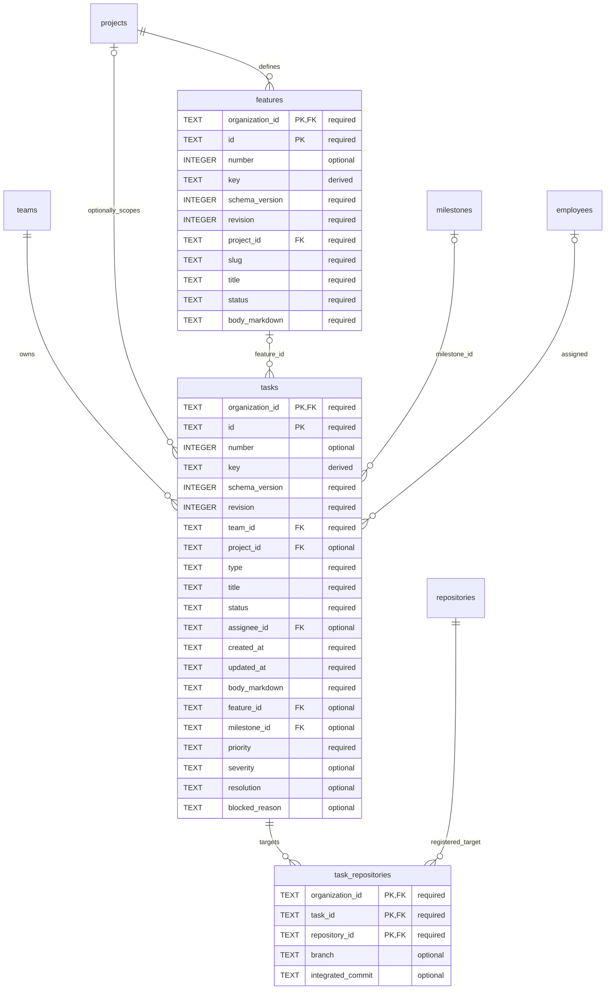
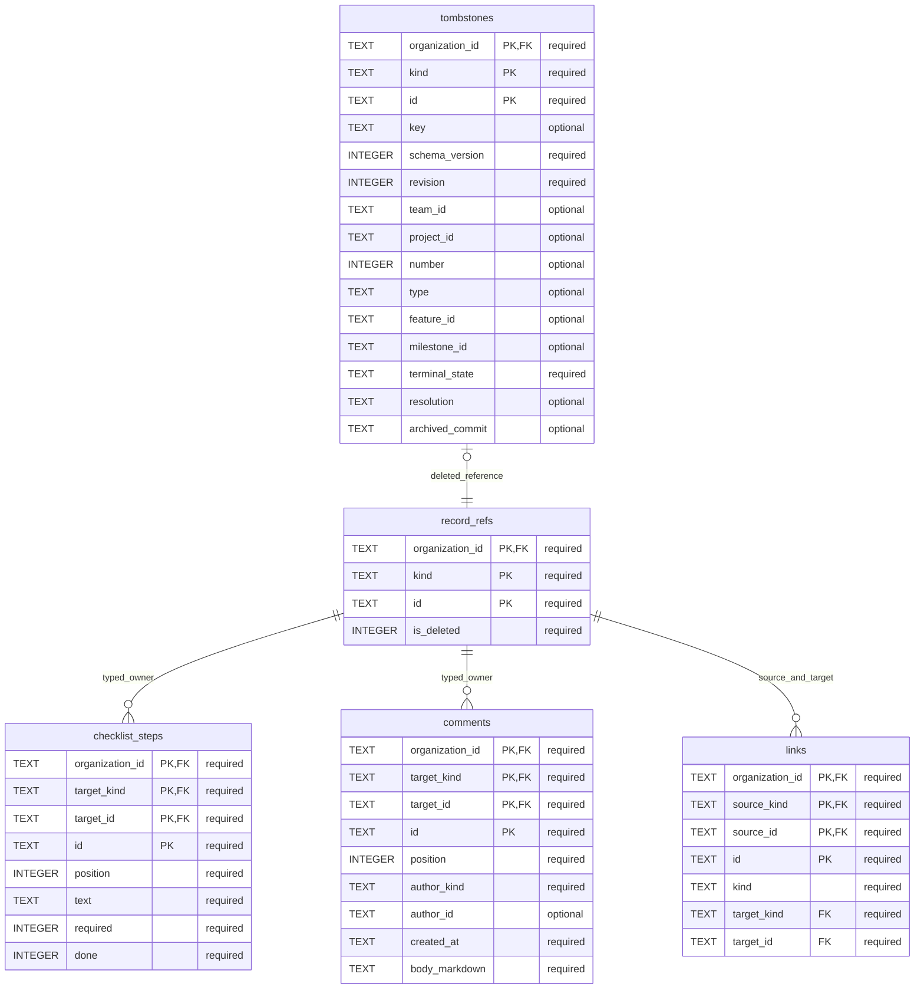

# Features and work structure

Structural draft for v1. Document revision 2.1. Uses [projects/releases/milestones](02-project-structure.md), [employees](04-agent-structure.md) and [operational metadata](05-operational-data.md).

## Explicit entities

There is one authored work entity and one physical `tasks` table. `type` distinguishes `task`, `bug`, `request` or another nonempty task-type identifier. All types use the same `T-<number>` sequence within their scope and the same comments, checklists and operational metadata. There are no separate bug/request tables, folders or number counters. This entity remains named **task**, not work item.



- Every task requires `team_id`. `project_id` is optional: null means a team task; present means a project task. A project task's team must equal the project's owning team.
- Creator, assignee and the assignee's home team do not determine ownership. A director may assign a team task to another director without creating an artificial project.
- A project task can have zero or one feature and zero or one milestone, both from the same project. Team tasks have neither. Feature and milestone membership are independent.
- A feature belongs to one project and has a numeric reference such as `F-6` plus a separate project-unique slug such as `table-booking`.
- A bug is `type: bug`; `severity` is optional metadata for triage. A request is `type: request`. Changing type preserves the task's ID, number, comments and relationships. Additional types do not require new SQL tables; their workflow behaviour remains out of scope.
- A task can target zero or many organization repositories. For project tasks each target must appear in that project's repository associations; this cross-table rule is validated on import/publication. Team tasks may target registered repositories without an artificial project. Each target can have a separate branch/worktree.

```text
Project work: projects/<project-id>/work/tasks/<task-id>.md
Team work:    teams/<team-id>/.../work/tasks/<task-id>.md
```

The team path includes its full ancestor chain. Task scope and path must agree; a project task does not get a second canonical file under its team.

## Task file example

```markdown
---
schema_version: 1
id: 01J00000000000000000000040
number: 42
type: bug
team_id: 01J00000000000000000000020
revision: 1
project_id: 01J00000000000000000000010
title: Prevent overlapping reservations
status: todo
assignee_id: null
created_at: "2026-11-14T10:00:00Z"
updated_at: "2026-11-14T10:00:00Z"
feature_id: null
milestone_id: null
priority: high
severity: major
resolution: null
blocked_reason: null
repository_ids: [01J00000000000000000000002]
branches: {}
integrated_commits: {}
checklist: []
comments: []
links: []
operations:
  watchers: []
  owner_questions: []
  waiting_spans: []
---
Reject overlapping reservations for the same table. Include concurrent requests in the tests.
```

The readable reference is derived as `T-42`, and all foreign references use the stable ID. To represent a projectless request, set `type: request`, keep required `team_id`, set `project_id`, `feature_id` and `milestone_id` to null, and save under that team's `work/tasks/`. All child metadata uses `target_kind: task`, including for bugs and requests; `type` is a classification, not an entity kind.

Feature front matter contains `id`, `number: 6`, `slug: table-booking`, `project_id`, common revision fields, `title` and `status`; its body contains the feature description. `F-6` is derived, while the descriptive slug is explicitly stored.

## Shared child records



`record_refs` is a derived lookup index across entity types, not another authored work entity. Bugs and requests register as `kind: task`, never as separate entity kinds. It allows shared metadata to point to `(target_kind, target_id)`. Before publishing a projection, validation must confirm each live lookup row has an actual source entity and each deleted row has a tombstone. Historical author/link references may resolve to tombstones.

## File to SQL mapping

| Table | Source fields |
| --- | --- |
| `features` | `features/<id>.md`: stable `id`, `number`, `slug`, revision fields, `project_id`, `title`, `status`, body; `key` is derived. |
| `tasks` | Task front matter: every same-named scalar except derived `key`, plus body. Required `team_id`, optional `project_id`; `type` defaults to `task`, `priority` to `normal`, optional fields to null. |
| `task_repositories` | `repository_ids[]`; corresponding `branches[repository_id]` and `integrated_commits[repository_id]`. Task ID comes from the task file; project repository eligibility is validated through its optional project. |
| `checklist_steps` | `checklist[]`: `id`, `text`, `required`, `done`; position is zero-based array order; target type/ID come from the parent file. |
| `comments` | `comments[]`: `id`, `author_kind`, optional `author_id`, `created_at`, `body_markdown`; position is array order. Owner authors have `author_kind: owner` and null `author_id`; actual login identity remains in the separate authentication/audit subsystem. |
| `links` | `links[]`: `id`, `kind`, `target_kind`, `target_id`; source type/ID come from the parent file. |
| `tombstones` | `tombstones/<kind>/<id>.yaml`: every same-named field; references describe historical identity and do not require live owner records. |
| `record_refs` | Derived from parsed entities/tombstones; no extra authored file. |

Status values represent data. This document does not implement v1's triage, Undo, checklist promotion, automatic feature transitions or request-approval engine. Those migration choices remain open. Do not discard existing v1 fields absent from this selected-scope draft; preserve them in staging until their disposition is chosen.

An eventual import maps existing bug/request records into tasks with the corresponding `type`, preserving their stable IDs and mapping child references to entity kind `task`. It must detect collisions between previously separate entity namespaces before publishing anything. Existing readable references need an explicit mapping; this draft neither silently renumbers records nor implements that migration.

## SQLite tables

```sql
CREATE TABLE features (
  organization_id TEXT NOT NULL REFERENCES organizations(id),
  id TEXT NOT NULL,
  number INTEGER CHECK (number > 0),
  key TEXT GENERATED ALWAYS AS (CASE WHEN number IS NOT NULL THEN 'F-' || number END) VIRTUAL,
  schema_version INTEGER NOT NULL CHECK (schema_version = 1),
  revision INTEGER NOT NULL CHECK (revision >= 1),
project_id TEXT NOT NULL,
  slug TEXT NOT NULL CHECK (length(slug) > 0),
  title TEXT NOT NULL,
  status TEXT NOT NULL,
  body_markdown TEXT NOT NULL DEFAULT '',
  PRIMARY KEY (organization_id, id),
UNIQUE (organization_id, project_id, number),
  UNIQUE (organization_id, project_id, slug),
  UNIQUE (organization_id, id, project_id),
  FOREIGN KEY (organization_id, project_id) REFERENCES projects(organization_id, id)
    DEFERRABLE INITIALLY DEFERRED
) STRICT;

CREATE TABLE tasks (
  organization_id TEXT NOT NULL REFERENCES organizations(id),
  id TEXT NOT NULL,
  number INTEGER CHECK (number > 0),
  key TEXT GENERATED ALWAYS AS (CASE WHEN number IS NOT NULL THEN 'T-' || number END) VIRTUAL,
  schema_version INTEGER NOT NULL CHECK (schema_version = 1),
  revision INTEGER NOT NULL CHECK (revision >= 1),
  team_id TEXT NOT NULL,
  project_id TEXT,
  type TEXT NOT NULL DEFAULT 'task' CHECK (length(type) > 0),
  title TEXT NOT NULL,
  status TEXT NOT NULL,
  assignee_id TEXT,
  created_at TEXT NOT NULL,
  updated_at TEXT NOT NULL,
  body_markdown TEXT NOT NULL DEFAULT '',
  feature_id TEXT,
  milestone_id TEXT,
  priority TEXT NOT NULL DEFAULT 'normal',
  severity TEXT,
  resolution TEXT,
  blocked_reason TEXT,
  PRIMARY KEY (organization_id, id),
  CHECK (project_id IS NOT NULL OR (feature_id IS NULL AND milestone_id IS NULL)),
  UNIQUE (organization_id, project_id, number),
  FOREIGN KEY (organization_id, team_id) REFERENCES teams(organization_id, id) DEFERRABLE INITIALLY DEFERRED,
  FOREIGN KEY (organization_id, project_id, team_id) REFERENCES projects(organization_id, id, owner_team_id) DEFERRABLE INITIALLY DEFERRED,
  FOREIGN KEY (organization_id, assignee_id) REFERENCES employees(organization_id, id) DEFERRABLE INITIALLY DEFERRED,
  FOREIGN KEY (organization_id, feature_id, project_id) REFERENCES features(organization_id, id, project_id) DEFERRABLE INITIALLY DEFERRED,
  FOREIGN KEY (organization_id, milestone_id, project_id) REFERENCES milestones(organization_id, id, project_id) DEFERRABLE INITIALLY DEFERRED
) STRICT;

CREATE TABLE task_repositories (
  organization_id TEXT NOT NULL,
  task_id TEXT NOT NULL,
  repository_id TEXT NOT NULL,
  branch TEXT,
  integrated_commit TEXT,
  PRIMARY KEY (organization_id, task_id, repository_id),
  FOREIGN KEY (organization_id, task_id) REFERENCES tasks(organization_id, id)
    DEFERRABLE INITIALLY DEFERRED,
  FOREIGN KEY (organization_id, repository_id) REFERENCES repositories(organization_id, id)
    DEFERRABLE INITIALLY DEFERRED
) STRICT;

CREATE TABLE record_refs (
  organization_id TEXT NOT NULL REFERENCES organizations(id),
  kind TEXT NOT NULL,
  id TEXT NOT NULL,
  is_deleted INTEGER NOT NULL CHECK (is_deleted IN (0, 1)),
  PRIMARY KEY (organization_id, kind, id)
) STRICT;

CREATE TABLE checklist_steps (
  organization_id TEXT NOT NULL,
  target_kind TEXT NOT NULL CHECK (target_kind = 'task'),
  target_id TEXT NOT NULL,
  id TEXT NOT NULL,
  position INTEGER NOT NULL CHECK (position >= 0),
  text TEXT NOT NULL,
  required INTEGER NOT NULL CHECK (required IN (0, 1)),
  done INTEGER NOT NULL CHECK (done IN (0, 1)),
  PRIMARY KEY (organization_id, target_kind, target_id, id),
  UNIQUE (organization_id, target_kind, target_id, position),
  FOREIGN KEY (organization_id, target_kind, target_id) REFERENCES record_refs(organization_id, kind, id)
    DEFERRABLE INITIALLY DEFERRED
) STRICT;

CREATE TABLE comments (
  organization_id TEXT NOT NULL,
  target_kind TEXT NOT NULL CHECK (target_kind = 'task'),
  target_id TEXT NOT NULL,
  id TEXT NOT NULL,
  position INTEGER NOT NULL CHECK (position >= 0),
  author_kind TEXT NOT NULL CHECK (author_kind IN ('employee', 'owner')),
  author_id TEXT,
  created_at TEXT NOT NULL,
  body_markdown TEXT NOT NULL,
  PRIMARY KEY (organization_id, target_kind, target_id, id),
  UNIQUE (organization_id, target_kind, target_id, position),
  CHECK ((author_kind = 'employee' AND author_id IS NOT NULL) OR (author_kind = 'owner' AND author_id IS NULL)),
  FOREIGN KEY (organization_id, target_kind, target_id) REFERENCES record_refs(organization_id, kind, id)
    DEFERRABLE INITIALLY DEFERRED
) STRICT;

CREATE TABLE links (
  organization_id TEXT NOT NULL,
  source_kind TEXT NOT NULL CHECK (source_kind = 'task'),
  source_id TEXT NOT NULL,
  id TEXT NOT NULL,
  kind TEXT NOT NULL,
  target_kind TEXT NOT NULL,
  target_id TEXT NOT NULL,
  PRIMARY KEY (organization_id, source_kind, source_id, id),
  FOREIGN KEY (organization_id, source_kind, source_id) REFERENCES record_refs(organization_id, kind, id)
    DEFERRABLE INITIALLY DEFERRED,
  FOREIGN KEY (organization_id, target_kind, target_id) REFERENCES record_refs(organization_id, kind, id)
    DEFERRABLE INITIALLY DEFERRED
) STRICT;

CREATE TABLE tombstones (
  organization_id TEXT NOT NULL REFERENCES organizations(id),
  kind TEXT NOT NULL,
  id TEXT NOT NULL,
  key TEXT,
  schema_version INTEGER NOT NULL CHECK (schema_version = 1),
  revision INTEGER NOT NULL CHECK (revision >= 1),
  team_id TEXT,
  project_id TEXT,
  number INTEGER CHECK (number > 0),
  type TEXT,
  feature_id TEXT,
  milestone_id TEXT,
  terminal_state TEXT NOT NULL,
  resolution TEXT,
  archived_commit TEXT,
  PRIMARY KEY (organization_id, kind, id)
) STRICT;
```
