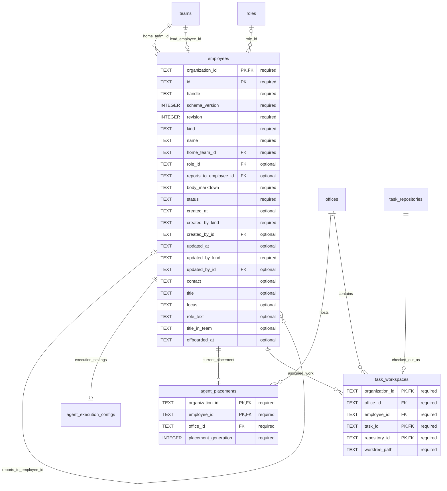

# Agents and employees

Status: **selected** data contract, revision 2.10. This document fixes employee identity relationships, how an account relates to a person, and how agents come to exist. [Model profiles and agent execution](11-model-profiles-and-agent-execution.md) owns execution configuration, routing/lifecycle behavior and durable placement/fencing authority in the same integrated schema. Memory consolidation and scheduling are separate work.

## Confirmed relationships



Employees are agents or people, with one `status` field (below) and common creator/update attribution. Inactive profiles keep their handles and stable IDs so that past records still resolve; new active task assignment or ownership must resolve to an active employee. [Record contracts](08-record-contracts.md) specifies lifecycle and attribution. Each has exactly one home team. A team can contain both kinds directly while owning child teams. Leadership is an explicit team appointment; ordinary members gain no managerial authority simply by being in an ancestor team. Explicit direct reporting references do not remove ancestor-lead management authority.

Office placement is separate from home-team membership. An agent can move between offices without changing its home team or stable identity. People have profiles and reporting relationships but no agent execution process or worktree. The table is a placement projection; reconstruction requires the durable authority generation and verified cleanup/fencing before any replacement starts. Cache reconstruction alone cannot recreate launch authority.

Agent token/cost totals are derived from [usage records](10-usage-and-cost-accounting.md) for that actual consumer, including task work and overhead across projects. The ledger references stable employee identity, not a live process; actual route/attempt context is supplied by document 11, while accounting remains the ledger authority.

## Accounts, people and the organization owner

Whoever signs in is a person (owner, 2026-11-17). An account is held by the host, not by this set ([what the host owns](STATUS.md#outside-this-set-what-the-host-owns)).

- In each organization an account can open, the account is tied to exactly one employee whose `kind` is `person`. A person can open several organizations; it is then tied to one person record in each, because a person record belongs to one organization.
- A person record does not need an account. An account is never tied to an agent.
- The creator's account is tied to the person record made when the organization is created. Further accounts are registered by the person in the browser, through a one-time registration link that the server's administrator or the organization's owner issues from People for an existing person record. That person is placed and moved between teams like anyone else.
- The link between an account and its person record is host data. No employee field names an account, and the link grants no authority by itself: what the account may do is decided at the host and checked by the office on every call.
- What an account does in an organization is recorded under its person record: the actor is kind `employee` with that person's ID. No record names an account or "the owner" as the one who did something.

**The organization owner** is the person whose account currently holds ownership: the creator, until they hand ownership to another person who has an account. An organization has exactly one owner. Ownership is a permission of that account at the host; there is no owner field on an employee, and no record field grants authority. Where a record *addresses* the owner rather than recording what someone did (a watcher, a waiting span or a budget notice of kind `owner`, an owner question, a budget's `owner_account` time zone), `owner` means the person whose account owns the organization at the time the record is read ([document 05](05-operational-data.md#relationships)).

**Who may change what.** There are no access roles. A person is whatever place the owner gives them in the hierarchy, and any person can read the organization, work on tasks and talk to any person or agent. The rights that are not everyone's are these, and each is checked by the office from the caller's principal and host grant, never from a record field:

| Action | Who |
| --- | --- |
| Create an organization; hand over the administrator role | The server's administrator |
| Change the organization's structure: create, rename, move or archive a team; add, place, move or deactivate a person; appoint a lead; create a project (and with it its team) | The organization's owner |
| Invite a person to sign in, issue a new link, remove access | The owner or the administrator |
| Hand over ownership | The owner |
| Approve a hire | The owner, or a person in the lead chain of the team the agent joins |
| Pause or resume an agent, or give it an instruction it must follow | The owner, or a person above the agent in the hierarchy |
| See a project's costs; set or change a task budget in it | The owner, or the project's manager: the lead of the project's accountable team. "Project manager" in the cost and budget documents means that position, not an access role |

## The HR lead and how agents are onboarded

Every organization has a built-in **HR lead**, created with the organization ([document 01](01-organization-structure.md#creating-an-organization)) as an employee of kind `agent` in the organization's top-level team. It appears and is addressed as an agent: it has a handle, it can be messaged and assigned work, and its turns are recorded like any agent's. It is part of the product: its instructions and the code it calls ship with the product. It is not kept running; the office starts it only when it is called, as for any agent turn (document 11).

An agent comes to exist in an organization only through the HR hire flow. HR drafts a hire proposal; a person with the authority to approve it approves it; then product code, not the model, creates the employee record, its private home and its execution configuration. Before approval no employee, home or execution binding exists. There is no other way to add an agent: no command, import or file creates one outside this flow. People are added directly, not through HR. The proposal, its approval and who may approve are specified in [our organization in the app](../../specs/our-org-in-the-app.md); this set adds no table for them, because an approved hire produces only the records already defined here and in document 11.

## Who an agent takes instructions from

An agent always replies to a person who messages it (owner, 2026-11-17). It follows instructions only from a person above it in the organization's hierarchy: the leads of its home team and of each ancestor team, up to the organization owner (the lead of its own home team does not count when that lead is the agent itself). A message from any other person is a request: the agent answers it, and where it conflicts with an instruction from its own chain, the chain wins. The rule is derived from `home_team_id`, `parent_team_id` and `lead_employee_id` and from who owns the organization; there is no field or table for it, and it grants no authority at the office, which still authorizes every call.

## Durable identity files

```text
teams/<team-id>/
├── agents/<employee-id>/
│   ├── profile.md
│   └── execution.md      # Optional configuration; required before the agent is runnable
├── people/<employee-id>/profile.md
└── teams/<child-team-id>/...
```

```markdown
---
schema_version: 1
id: 01930000-0000-7000-8000-000000000030
handle: ana
revision: 1
kind: agent
status: active
name: Ana
home_team_id: 01930000-0000-7000-8000-000000000020
role_id: null
reports_to_employee_id: null
---
Reservations team employee identity. Execution configuration is stored separately in execution.md, as defined in document 11.
```

Agents and people share an organization-wide unique `handle`, stored without `@` and displayed as `@ana`. `here` is not allowed as a handle, because `@here` addresses a channel's members ([ADR-0024](../../adr/0024-a-channel-question-is-watched-for-its-answer.md) decision 7). Handles are readable identity references; stable IDs remain the foreign keys. Employee identity does not embed a model or credentials. An agent requires the separate execution.md profile/model/tool configuration to become runnable; people have no execution configuration. Memory and proactive scheduling are outside this specification.

## Runtime location

```text
runtime/<office-id>/
├── repositories/<repository-id>.git/
└── teams/<root-team-id>/teams/<child-team-id>/.../
    └── agents/<employee-id>/
        ├── projects/<project-id>/tasks/<task-id>/repositories/<repository-id>/
        └── tasks/<task-id>/repositories/<repository-id>/  # Team tasks
```

The runtime team tree is the local office's projection of the organization-wide team hierarchy, containing only its placed agents and their necessary ancestors. One office's directories cannot define or replace organization-wide membership.

## File to SQL mapping

| Table | Source |
| --- | --- |
| `employees` | `profile.md`: stable identity/revision fields, required `handle`, `kind`, `name`, `home_team_id`, optional `role_id`, optional `reports_to_employee_id`, and body. File location and `kind` must agree. |
| `agent_placements` | Current placement projection, rebuilt from HQ's durable execution placement/generation journal. Only agents are eligible. No office_id is silently added to an employee profile. |
| `agent_execution_configs` | execution.md front matter/body; full table and routing contract are owned by document 11. |
| `task_workspaces` | Current workspace-controller state; runtime-only office/employee/task/repository IDs and `worktree_path`. |

### Execution and remaining boundaries

[Document 11](11-model-profiles-and-agent-execution.md) specifies the agent's model profile, target model, prompt/tools configuration, local credential bindings, supervision and turn/attempt lifecycle. This document owns employee, home-team, reporting and placement; there is no separate agent identity. Private memory and proactive scheduling are separate work. [Task assignment](12-task-assignment-and-history.md) owns assignment/reporter semantics; [operational data](05-operational-data.md) owns task events/history and private notes. Execution owns processes.

## SQLite tables

```sql
CREATE TABLE employees (
  organization_id TEXT NOT NULL REFERENCES organizations(id),
  id TEXT NOT NULL,
  handle TEXT NOT NULL CHECK (length(handle) > 0),
  schema_version INTEGER NOT NULL CHECK (schema_version = 1),
  revision INTEGER NOT NULL CHECK (revision >= 1),
kind TEXT NOT NULL CHECK (kind IN ('agent', 'person')),
  name TEXT NOT NULL,
  home_team_id TEXT NOT NULL,
  role_id TEXT,
  reports_to_employee_id TEXT,
  body_markdown TEXT NOT NULL DEFAULT '',
  status TEXT NOT NULL DEFAULT 'active' CHECK (status IN ('active', 'paused', 'inactive')),
  created_at TEXT,
  created_by_kind TEXT NOT NULL DEFAULT 'unknown' CHECK (created_by_kind IN ('employee', 'system', 'unknown')),
  created_by_id TEXT,
  updated_at TEXT,
  updated_by_kind TEXT NOT NULL DEFAULT 'unknown' CHECK (updated_by_kind IN ('employee', 'system', 'unknown')),
  updated_by_id TEXT,
  contact TEXT,
  title TEXT,
  focus TEXT,
  role_text TEXT,
  title_in_team TEXT,
  offboarded_at TEXT,
  CHECK (kind = 'agent' OR status <> 'paused'),
  CHECK (offboarded_at IS NULL OR status = 'inactive'),
  PRIMARY KEY (organization_id, id),
UNIQUE (organization_id, handle),
  UNIQUE (organization_id, id, home_team_id),
  CHECK (reports_to_employee_id IS NULL OR reports_to_employee_id <> id),
  FOREIGN KEY (organization_id, home_team_id) REFERENCES teams(organization_id, id)
    DEFERRABLE INITIALLY DEFERRED,
  FOREIGN KEY (organization_id, role_id) REFERENCES roles(organization_id, id)
    DEFERRABLE INITIALLY DEFERRED,
  FOREIGN KEY (organization_id, reports_to_employee_id) REFERENCES employees(organization_id, id)
    DEFERRABLE INITIALLY DEFERRED,
  CHECK ((created_by_kind = 'employee' AND created_by_id IS NOT NULL) OR (created_by_kind <> 'employee' AND created_by_id IS NULL)),
  CHECK ((updated_by_kind = 'employee' AND updated_by_id IS NOT NULL) OR (updated_by_kind <> 'employee' AND updated_by_id IS NULL)),
  FOREIGN KEY (organization_id, created_by_id) REFERENCES employees(organization_id, id) DEFERRABLE INITIALLY DEFERRED,
  FOREIGN KEY (organization_id, updated_by_id) REFERENCES employees(organization_id, id) DEFERRABLE INITIALLY DEFERRED
) STRICT;

CREATE TABLE agent_placements (
  organization_id TEXT NOT NULL,
  employee_id TEXT NOT NULL,
  office_id TEXT NOT NULL,
  placement_generation INTEGER NOT NULL DEFAULT 1 CHECK (placement_generation>=1),
  PRIMARY KEY (organization_id, employee_id),
  FOREIGN KEY (organization_id, employee_id) REFERENCES employees(organization_id, id),
  FOREIGN KEY (organization_id, office_id) REFERENCES offices(organization_id, id)
) STRICT;

CREATE TABLE task_workspaces (
  organization_id TEXT NOT NULL,
  office_id TEXT NOT NULL,
  employee_id TEXT NOT NULL,
  task_id TEXT NOT NULL,
  repository_id TEXT NOT NULL,
  worktree_path TEXT NOT NULL,
  PRIMARY KEY (organization_id, task_id, repository_id),
  FOREIGN KEY (organization_id, employee_id) REFERENCES employees(organization_id, id),
  FOREIGN KEY (organization_id, office_id) REFERENCES offices(organization_id, id),
  FOREIGN KEY (organization_id, task_id, repository_id) REFERENCES task_repositories(organization_id, task_id, repository_id)
) STRICT;
```

Direct reporting must be acyclic within an organization, independently of the team tree. The consolidated schema rejects cycles on insertion and update, including through deferred references.

## Profile fields and employee state

The same-named scalar fields below live in `profile.md` front matter and project into `employees`: `contact`, `title`, `focus`, `role_text`, `title_in_team`, `offboarded_at`. Nullable text remains NULL if not known.

**Employee state is one field.** `status` is a closed list: `active`, `paused`, `inactive`. `paused` applies to agents only: the agent keeps its employment, handle and history and is not started. `inactive` is a person who has left or an agent that has been offboarded; `offboarded_at` may be set only then, and the profile keeps its handle. There is no second state field. Whether an agent may run is one rule: its status is `active`, it has an enabled execution configuration ([document 11](11-model-profiles-and-agent-execution.md)), and no unreleased budget hold applies ([document 17](17-budgets-and-controls.md)). Holds stay separate records because they belong to a budget and a period, not to the employee.

`role_text` is a free descriptive role, independent of the normalized `role_id`; a role ID is never invented from that text. `title_in_team` describes the home-team appointment, not a second membership. There is no owner field on an employee ([above](#accounts-people-and-the-organization-owner)). Team leadership is a separate appointment.

Runtime and model belong to document 11's execution configuration; machine-specific home remains managed local state. Run modes, scheduling and memory are deferred; there is no schedule table.

```yaml
contact: "product@example.invalid"
title: "Product lead"
focus: "Guest booking"
role_text: "Product management"
title_in_team: "Lead"
status: paused
```

[Messaging and chat](15-messaging-and-chat.md) defines employee participation and conversation data independently of team membership and office placement.

[Recovery and office continuity](16-recovery-and-office-continuity.md) defines durable receipt/checkpoint/cleanup evidence separately from disposable office projections.

[Budgets and controls](17-budgets-and-controls.md) defines the budget data model. Policy, extension and hold records survive office cache loss.
