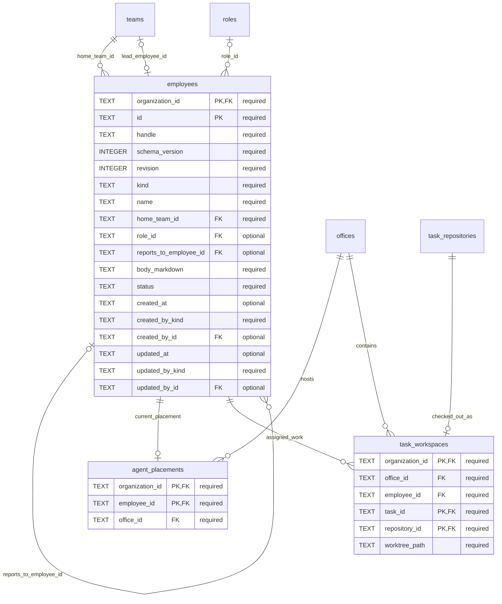

# Agent and employee structure boundary

Structural draft for v1. Document revision 2.6. **Agent setup requires a separate specification and remains pending.** This document only fixes identity relationships needed by the other documents. It is not a provisioning, harness, memory, model or scheduler specification.

## Confirmed relationships



Employees are agents or people, with `status: active | inactive` and common creator/update attribution. Inactive profiles retain their handles and stable IDs for historical references; new active task assignment or ownership must resolve to an active employee. [Record contracts](08-record-contracts.md) specifies lifecycle and attribution. Each has exactly one home team. A team can contain both kinds directly while owning child teams. Leadership is an explicit team appointment; ordinary members gain no managerial authority simply by being in an ancestor team. Explicit direct reporting references do not remove ancestor-lead management authority.

Office placement is separate from home-team membership. An agent can move between offices without changing its home team or stable identity. People have profiles and reporting relationships but no agent execution process or worktree. On a fresh reconstruction, placements may be recreated at HQ; the other durable office definitions remain present.

Agent token/cost totals are derived from [usage records](10-usage-and-cost-accounting.md) for that actual consumer, including task work and overhead across projects. The ledger references stable employee identity, not a live process; this does not decide the pending agent setup or run lifecycle.

## Durable identity files

```text
teams/<team-id>/
├── agents/<employee-id>/profile.md
├── people/<employee-id>/profile.md
└── teams/<child-team-id>/...
```

```markdown
---
schema_version: 1
id: 01J00000000000000000000030
handle: ana
revision: 1
kind: agent
status: active
name: Ana
home_team_id: 01J00000000000000000000020
role_id: null
reports_to_employee_id: null
---
Reservations team employee identity. Agent setup will be defined separately.
```

Agents and people share an organization-wide unique `handle`, stored without `@` and displayed as `@ana`. Handles are readable identity references; stable IDs remain the foreign keys. Preserve existing v1 handles on import where valid and resolve collisions explicitly. Agent provisioning and messaging transport remain pending specifications. No `runtime`, model, tools, run mode, permission policy or memory directory is made mandatory by this draft.

## Runtime location

```text
runtime/<office-id>/
├── repositories/<repository-id>.git/
└── teams/<root-team-id>/teams/<child-team-id>/.../
    └── agents/<employee-id>/
        ├── projects/<project-id>/tasks/<task-id>/repositories/<repository-id>/
        └── tasks/<task-id>/repositories/<repository-id>/  # Team tasks
```

The runtime team tree is the local office's projection of the organization-wide team hierarchy, containing only its placed agents and their necessary ancestors. One office's directories cannot define or replace organization-wide membership.

## File to SQL mapping

| Table | Source |
| --- | --- |
| `employees` | `profile.md`: stable identity/revision fields, required `handle`, `kind`, `name`, `home_team_id`, optional `role_id`, optional `reports_to_employee_id`, and body. File location and `kind` must agree. |
| `agent_placements` | Current office-controller state; runtime-only. Only agent employees are eligible. No durable `office_id` is silently added to a profile. |
| `task_workspaces` | Current workspace-controller state; runtime-only office/employee/task/repository IDs and `worktree_path`. |

### Pending input

The agent setup document must decide its configuration fields, identity/provisioning inputs, memory ownership, tools, models, scheduling and lifecycle. That work may extend this file, but cannot silently change stable IDs, home-team relationships or project references. No implementation agent should infer a complete setup from the minimal table below.

## SQLite tables

```sql
CREATE TABLE employees (
  organization_id TEXT NOT NULL REFERENCES organizations(id),
  id TEXT NOT NULL,
  handle TEXT NOT NULL CHECK (length(handle) > 0),
  schema_version INTEGER NOT NULL CHECK (schema_version = 1),
  revision INTEGER NOT NULL CHECK (revision >= 1),
kind TEXT NOT NULL CHECK (kind IN ('agent', 'person')),
  name TEXT NOT NULL,
  home_team_id TEXT NOT NULL,
  role_id TEXT,
  reports_to_employee_id TEXT,
  body_markdown TEXT NOT NULL DEFAULT '',
  status TEXT NOT NULL DEFAULT 'active' CHECK (status IN ('active', 'inactive')),
  created_at TEXT,
  created_by_kind TEXT NOT NULL DEFAULT 'unknown' CHECK (created_by_kind IN ('employee', 'owner', 'system', 'unknown')),
  created_by_id TEXT,
  updated_at TEXT,
  updated_by_kind TEXT NOT NULL DEFAULT 'unknown' CHECK (updated_by_kind IN ('employee', 'owner', 'system', 'unknown')),
  updated_by_id TEXT,
  PRIMARY KEY (organization_id, id),
UNIQUE (organization_id, handle),
  UNIQUE (organization_id, id, home_team_id),
  CHECK (reports_to_employee_id IS NULL OR reports_to_employee_id <> id),
  FOREIGN KEY (organization_id, home_team_id) REFERENCES teams(organization_id, id)
    DEFERRABLE INITIALLY DEFERRED,
  FOREIGN KEY (organization_id, role_id) REFERENCES roles(organization_id, id)
    DEFERRABLE INITIALLY DEFERRED,
  FOREIGN KEY (organization_id, reports_to_employee_id) REFERENCES employees(organization_id, id)
    DEFERRABLE INITIALLY DEFERRED,
  CHECK ((created_by_kind = 'employee' AND created_by_id IS NOT NULL) OR (created_by_kind <> 'employee' AND created_by_id IS NULL)),
  CHECK ((updated_by_kind = 'employee' AND updated_by_id IS NOT NULL) OR (updated_by_kind <> 'employee' AND updated_by_id IS NULL)),
  FOREIGN KEY (organization_id, created_by_id) REFERENCES employees(organization_id, id) DEFERRABLE INITIALLY DEFERRED,
  FOREIGN KEY (organization_id, updated_by_id) REFERENCES employees(organization_id, id) DEFERRABLE INITIALLY DEFERRED
) STRICT;

CREATE TABLE agent_placements (
  organization_id TEXT NOT NULL,
  employee_id TEXT NOT NULL,
  office_id TEXT NOT NULL,
  PRIMARY KEY (organization_id, employee_id),
  FOREIGN KEY (organization_id, employee_id) REFERENCES employees(organization_id, id),
  FOREIGN KEY (organization_id, office_id) REFERENCES offices(organization_id, id)
) STRICT;

CREATE TABLE task_workspaces (
  organization_id TEXT NOT NULL,
  office_id TEXT NOT NULL,
  employee_id TEXT NOT NULL,
  task_id TEXT NOT NULL,
  repository_id TEXT NOT NULL,
  worktree_path TEXT NOT NULL,
  PRIMARY KEY (organization_id, task_id, repository_id),
  FOREIGN KEY (organization_id, employee_id) REFERENCES employees(organization_id, id),
  FOREIGN KEY (organization_id, office_id) REFERENCES offices(organization_id, id),
  FOREIGN KEY (organization_id, task_id, repository_id) REFERENCES task_repositories(organization_id, task_id, repository_id)
) STRICT;
```
