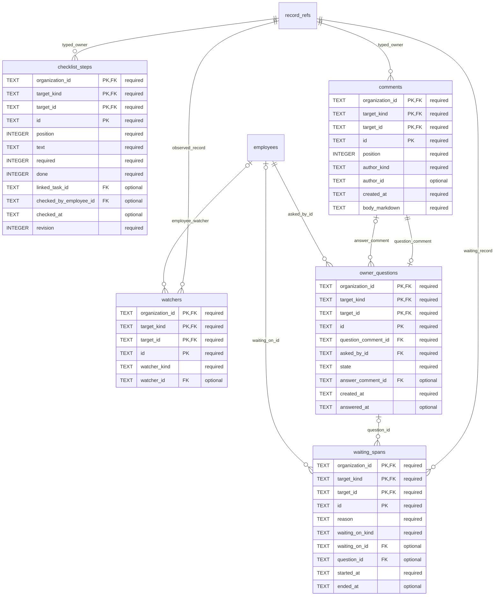
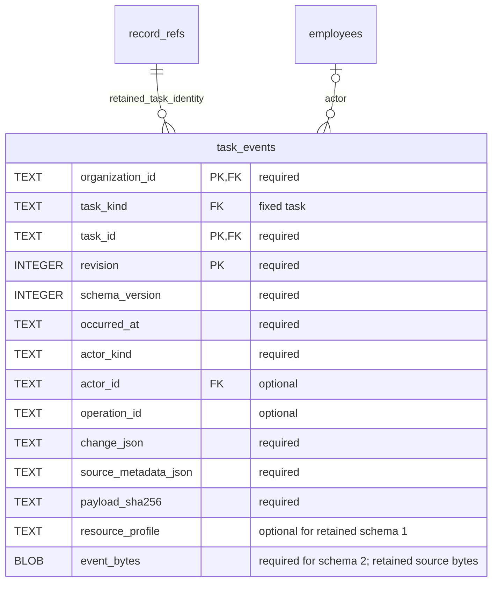
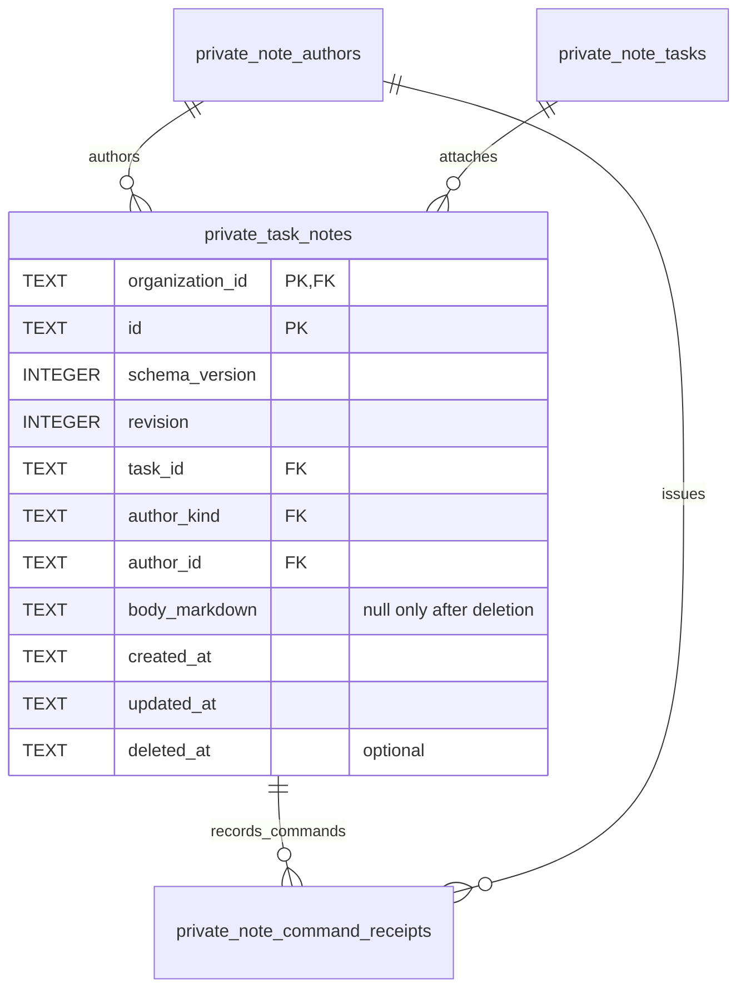

# Operational data structure

Structural draft for v1. Document revision 2.7. Shared comments, checklist entries, watchers, owner questions, waiting spans, task activity history and private task notes are selected for implementation. This document owns their data models, relationships and storage boundaries; application authorization, notification delivery and process execution remain implementation work. It extends [typed tasks](03-features-and-work.md).

## Scope and related data

This document owns task operational records: comments, checklist steps, watchers, owner questions, waiting spans, task activity events and private notes. Shared records use the task file or shared history archive; private records use their own private store. Logical ownership does not require putting private data into the shared database.

| Related concern | Canonical home | Boundary |
| --- | --- | --- |
| Task identity, ownership, current assignment and reporter | [Tasks](03-features-and-work.md), [assignment semantics](12-task-assignment-and-history.md) | Core task state; changes produce the activity events defined here |
| Typed links and dependencies | [Record contracts](08-record-contracts.md) | Cross-entity relationships shared by tasks, projects, features and documents |
| Token/cost observations and pricing | [Accounting](10-usage-and-cost-accounting.md) | Specialized immutable ledger with its own valuation and recovery contract |
| Runs, attempts, permits, processes and execution receipts | [Execution](11-model-profiles-and-agent-execution.md) | Supervisor/runtime coordination with its own lifecycle and durability contract |
| Providers, connections, pools and discovered models | [Provider/pool data structure](14-model-providers-and-connection-pools.md) | Execution configuration and office-specific discovery, separate from task operational records |
| Employee placement and task workspaces | [Agent structure](04-agent-structure.md) | Execution placement/cache projections extended by document 11 |
| Release/deployment outcomes and snapshots | [Deployments](07-release-deployments.md), [release content](09-release-content-and-flags.md) | Delivery-domain history tied to release/deployment identity |

## Relationships



Each shared record in the diagram above belongs to exactly one task through `target_kind: task` and its stable task ID, irrespective of whether the task type is task, bug or request. A watcher can be an employee or the organization owner. An owner question references its question comment and optional answer comment instead of duplicating the text. A waiting span records who is awaited, why, and its start/end timestamps; a null end marks an open span.

For shared operational metadata, the owner is a special recipient/actor designation, not a new employee folder or an authentication record. Owner rows use kind `owner` and a null employee ID. This metadata grants no owner authority; authentication and permissions remain separate.

## Shared metadata file location

Shared comments, checklist entries and current watcher/question/waiting metadata live in their owning task's front matter. Task activity events have the shared archive defined below. Private task notes use the separate private store defined below.

```yaml
operations:
  watchers:
    - id: 01J00000000000000000000051
      watcher_kind: owner
      watcher_id: null
  owner_questions:
    - id: 01J00000000000000000000052
      question_comment_id: 01J00000000000000000000050
      asked_by_id: 01J00000000000000000000030
      state: open
      answer_comment_id: null
      created_at: "2026-11-14T10:00:00Z"
      answered_at: null
  waiting_spans:
    - id: 01J00000000000000000000053
      reason: Owner decision needed
      waiting_on_kind: owner
      waiting_on_id: null
      question_id: 01J00000000000000000000052
      started_at: "2026-11-14T10:00:00Z"
      ended_at: null
```

The parent work file must contain the referenced comment, and the asking employee must exist. Example snippets show selected fields, not a complete import bundle. Open questions/spans and watcher subscriptions remain recoverable with pending work. Notification receipts and chat are separate data governed by [messaging](15-messaging-and-chat.md) and [recovery](16-recovery-and-office-continuity.md). Pending asks, handoffs and deliveries must survive cache loss; this paragraph does not authorize deleting them.

## File to SQL mapping

| Table | Source |
| --- | --- |
| `checklist_steps` | `checklist[]`: `id`, `text`, `required`, `done`; position is zero-based array order; target type/ID come from the parent file. |
| `comments` | `comments[]`: `id`, `author_kind`, optional `author_id`, `created_at`, `body_markdown`; position is array order. Owner authors have `author_kind: owner` and null `author_id`; actual login identity remains in the separate authentication/audit subsystem. |
| `watchers` | `operations.watchers[]`: `id`, `watcher_kind`, `watcher_id`; owner type/ID and organization come from the containing work record. |
| `owner_questions` | `operations.owner_questions[]`: every same-named question field; target type/ID and organization come from the containing work record. Question and answer comment references must resolve inside that same work record. |
| `waiting_spans` | `operations.waiting_spans[]`: every same-named span field; target type/ID and organization come from the containing work record. A non-null `question_id` must belong to that same record. |

Closing a record must not discard an unresolved question/span silently. The eventual lifecycle contract must choose its explicit disposition. Deriving durations from saved timestamps is possible without old runtime logs. Task activity retention is defined below; organization-wide analytics and retention of unrelated operational streams remain separate decisions.

Changes to a task's shared comments, checklist, watchers, questions and waiting spans also append its [task activity history](#task-activity-history) in the same recoverable write. This retains the facts without selecting the old process engine, all analytics or Undo behavior.

## Shared SQLite tables

```sql
CREATE TABLE checklist_steps (
  organization_id TEXT NOT NULL,
  target_kind TEXT NOT NULL CHECK (target_kind = 'task'),
  target_id TEXT NOT NULL,
  id TEXT NOT NULL,
  position INTEGER NOT NULL CHECK (position >= 0),
  text TEXT NOT NULL,
  required INTEGER NOT NULL CHECK (required IN (0, 1)),
  done INTEGER NOT NULL CHECK (done IN (0, 1)),
  linked_task_id TEXT,
  checked_by_employee_id TEXT,
  checked_at TEXT,
  revision INTEGER NOT NULL DEFAULT 1 CHECK (revision>=1),
  FOREIGN KEY (organization_id,linked_task_id) REFERENCES tasks(organization_id,id) DEFERRABLE INITIALLY DEFERRED,
  FOREIGN KEY (organization_id,checked_by_employee_id) REFERENCES employees(organization_id,id) DEFERRABLE INITIALLY DEFERRED,
  PRIMARY KEY (organization_id, target_kind, target_id, id),
  UNIQUE (organization_id, target_kind, target_id, position),
  FOREIGN KEY (organization_id, target_kind, target_id) REFERENCES record_refs(organization_id, kind, id)
    DEFERRABLE INITIALLY DEFERRED
) STRICT;

CREATE TABLE comments (
  organization_id TEXT NOT NULL,
  target_kind TEXT NOT NULL CHECK (target_kind = 'task'),
  target_id TEXT NOT NULL,
  id TEXT NOT NULL,
  position INTEGER NOT NULL CHECK (position >= 0),
  author_kind TEXT NOT NULL CHECK (author_kind IN ('employee', 'owner')),
  author_id TEXT,
  created_at TEXT NOT NULL,
  body_markdown TEXT NOT NULL,
  PRIMARY KEY (organization_id, target_kind, target_id, id),
  UNIQUE (organization_id, target_kind, target_id, position),
  CHECK ((author_kind = 'employee' AND author_id IS NOT NULL) OR (author_kind = 'owner' AND author_id IS NULL)),
  FOREIGN KEY (organization_id, target_kind, target_id) REFERENCES record_refs(organization_id, kind, id)
    DEFERRABLE INITIALLY DEFERRED
) STRICT;

CREATE TABLE watchers (
  organization_id TEXT NOT NULL,
  target_kind TEXT NOT NULL CHECK (target_kind = 'task'),
  target_id TEXT NOT NULL,
  id TEXT NOT NULL,
  watcher_kind TEXT NOT NULL CHECK (watcher_kind IN ('employee', 'owner')),
  watcher_id TEXT,
  PRIMARY KEY (organization_id, target_kind, target_id, id),
  CHECK ((watcher_kind = 'employee' AND watcher_id IS NOT NULL) OR (watcher_kind = 'owner' AND watcher_id IS NULL)),
  FOREIGN KEY (organization_id, target_kind, target_id) REFERENCES record_refs(organization_id, kind, id)
    DEFERRABLE INITIALLY DEFERRED,
  FOREIGN KEY (organization_id, watcher_id) REFERENCES employees(organization_id, id)
    DEFERRABLE INITIALLY DEFERRED
) STRICT;

CREATE TABLE owner_questions (
  organization_id TEXT NOT NULL,
  target_kind TEXT NOT NULL CHECK (target_kind = 'task'),
  target_id TEXT NOT NULL,
  id TEXT NOT NULL,
  question_comment_id TEXT NOT NULL,
  asked_by_id TEXT NOT NULL,
  state TEXT NOT NULL CHECK (state IN ('open', 'answered', 'cancelled')),
  answer_comment_id TEXT,
  created_at TEXT NOT NULL,
  answered_at TEXT,
  PRIMARY KEY (organization_id, target_kind, target_id, id),
  CHECK ((state = 'answered' AND answer_comment_id IS NOT NULL AND answered_at IS NOT NULL) OR
    (state <> 'answered' AND answer_comment_id IS NULL AND answered_at IS NULL)),
  FOREIGN KEY (organization_id, target_kind, target_id, question_comment_id) REFERENCES comments(organization_id, target_kind, target_id, id)
    DEFERRABLE INITIALLY DEFERRED,
  FOREIGN KEY (organization_id, target_kind, target_id, answer_comment_id) REFERENCES comments(organization_id, target_kind, target_id, id)
    DEFERRABLE INITIALLY DEFERRED,
  FOREIGN KEY (organization_id, asked_by_id) REFERENCES employees(organization_id, id)
    DEFERRABLE INITIALLY DEFERRED
) STRICT;

CREATE TABLE waiting_spans (
  organization_id TEXT NOT NULL,
  target_kind TEXT NOT NULL CHECK (target_kind = 'task'),
  target_id TEXT NOT NULL,
  id TEXT NOT NULL,
  reason TEXT NOT NULL,
  waiting_on_kind TEXT NOT NULL CHECK (waiting_on_kind IN ('owner', 'employee')),
  waiting_on_id TEXT,
  question_id TEXT,
  started_at TEXT NOT NULL,
  ended_at TEXT,
  PRIMARY KEY (organization_id, target_kind, target_id, id),
  CHECK ((waiting_on_kind = 'employee' AND waiting_on_id IS NOT NULL) OR (waiting_on_kind = 'owner' AND waiting_on_id IS NULL)),
  FOREIGN KEY (organization_id, target_kind, target_id) REFERENCES record_refs(organization_id, kind, id)
    DEFERRABLE INITIALLY DEFERRED,
  FOREIGN KEY (organization_id, waiting_on_id) REFERENCES employees(organization_id, id)
    DEFERRABLE INITIALLY DEFERRED,
  FOREIGN KEY (organization_id, target_kind, target_id, question_id) REFERENCES owner_questions(organization_id, target_kind, target_id, id)
    DEFERRABLE INITIALLY DEFERRED
) STRICT;
```

## Task activity history

The current task file remains its latest state. Each accepted task revision also has an immutable event at:

```text
<organization repository>/work-history/tasks/<task-id>/<revision>.json
```

The event's stable identity is `(organization_id, task_id, revision)`, preserving v1's task/version identity. It has no new human number counter and no regenerated identity during replay. File name, task ID and revision must agree. `task_kind` is always `task`, including for bugs and requests. A command can append several consecutive events; the final task revision is the last event revision.

The service commits the resulting task snapshot, its event(s), and the command's idempotency result as one recoverable operation before acknowledging. The durable local journal must retain everything needed to finish materializing these files after a crash, using the platform durability guarantees in [ADR-0002](../../adr/0002-storage-sqlite-sqlcipher-one-writer.md). Hourly Git publication includes the task and its events together; it is not the acknowledgement boundary. A machine restore requires unpublished journal records as well as the published organization state. Rebuilding SQLite projects the same event identities; it creates no new history.

Task commands have one accepting writer and use expected revisions; raw replicated files do not become an independent mutation authority. A newly created offline task may have a local history before readable-number registration. Concurrent edits to an already shared task must stay pending or conflict until its accepting writer resolves them; never publish two different accepted events for the same task/revision or silently choose the last file. Writer handover/fencing and remote delivery remain part of the mutation/replication implementation contract, not permission to bypass it. Work assignment does not by itself transfer write authority.

New tasks start with a `created` event at revision 1, including their initial public task state. Subsequent events capture every accepted task-content/metadata change, including assignments, ownership/scope, status/resolution, fields/body, checklist, comments, links, watchers, questions and waiting spans. `change.type` is a versioned event tag; its payload carries the facts and old/new values needed to explain that change. Unknown future tags are retained and shown as an unknown change, never silently discarded. Automated changes record system attribution and their cause when known. Optional `operation_id` identifies the accepted command and may repeat across events from that command; it is not the event identity or the complete command-receipt store.

`assignment_changed` uses this payload (IDs below represent existing records):

```json
{
  "type": "assignment_changed",
  "from": {"assigned_team_id": null, "assignee_id": null},
  "to": {"assigned_team_id": "platform-team-id", "assignee_id": "ana-employee-id"}
}
```

Both pairs contain both keys, each an ID string or explicit null. The surrounding event supplies actor/time, task identity and revision. Historical IDs inside a payload describe the past; never validate them against today's team membership or rewrite them after reorganization.

Event JSON uses the SQL scalar names except `change` and `source_metadata`, which
are objects projected into lossless canonical `change_json` and
`source_metadata_json` text. Preserve authoritative complete event bytes and unknown
extensions; a SQL numeric extraction or `Value` reserialization is not an event
source. Identical event-identity retries compare the verified canonical hash;
different content conflicts. Import verifies the actual hash, not its SQL format.

### Task-event codec 2

New events use `schema_version: 2`, explicitly selecting a new codec rather than
redefining schema 1. It is registered as `canonical-json/2` in the
[hash codec registry](08-record-contracts.md#hash-codec-registry), which lists the
other canonical forms in this set. Keep existing event bytes, hashes and identities unchanged.
Admission dispatches only to supported codecs; unsupported schema-1 or future
codecs remain retained/staged with unverified/unavailable coverage. Never hide
known missing history behind a fabricated baseline.

Codec 2 accepts one complete UTF-8 JSON value with JSON whitespace only around it.
Reject BOM, trailing content, malformed numbers, unpaired surrogates and duplicate
**decoded** object keys at every depth. Sort keys by Unicode scalar order (shorter
prefix first), without normalization; preserve array order. Emit compact UTF-8
without a final newline. Escape quote/backslash and use `\b`, `\f`, `\n`, `\r`,
`\t`; other C0 controls use lowercase `\u00xx`. All other scalars, including
U+2028/U+2029 and supplementary characters, are literal; `/` is not escaped.

Numbers retain their exact original token matching
`-?(0|[1-9][0-9]*)(\.[0-9]+)?([eE][+-]?[0-9]+)?`; no float conversion or magnitude
restriction applies. `1`, `1.0`, `1e0`, `1E+000` and negative zero are intentionally
distinct hashed content. Hash canonical UTF-8 with SHA-256, omitting **only** the
top-level `payload_sha256`; nested names remain. The checksum is required and is
64 lowercase hexadecimal characters.

Producers materialize schema, organization/task identity, `task_kind: task`,
revision, occurred time, actor kind/ID, operation ID, change object, source metadata
and `resource_profile: selected-task-resources/1` before hashing. Optional IDs are
explicit nulls; producer-side absent source metadata becomes `{}`. Verifiers never
repair absent required members. Header revision is a positive signed-i64 integer
token without exponent/fraction; schema is exactly integer `2`. Filename, identity,
attribution and timestamps must match their owning contracts. New accepted changes
require actual known actors and UTC times. An explicit authorized import may retain
genuine unknown actor/time values, including null `occurred_at`, consistently with
document 08; SQL nullability is not permission to omit a new write's attribution.
Unknown change tags
and extensions remain in the checksum and retained representation.

### Explicit legacy-work adoption profile 1

[ADR-0010](../../adr/0010-legacy-task-adoption.md) selects the first bounded
existing-work import. It keeps the adoption Action/Manifest wire version and
codec 2 unchanged. The first newly wrapped event has
`source_metadata.legacy_mapping.version: 1`, complete lossless
`legacy_snapshot` and `legacy_event` objects, exact original-source SHA-256
digests, explicit original kind/reference and selected owner/project/scope/number
and principal mappings. Mappings describe the authorized import, not historical
knowledge at original creation. Original selected event identities are immutable.

This profile admits only a live version-1 work item with exactly its corresponding
version-1 `Created` event and consistent ID, generation, type, original actor and
time. The default selected event is `history_baseline` at revision 1 and import
time with the authenticated migration actor. It retains the exact public selected
Markdown and the complete original Created object, including its actual actor,
time, unknown fields and numeric tokens. Earlier selected history remains
unavailable. This is neither fabricated creation history nor a snapshot-only
import that conceals a surviving event. Longer/gapped histories, tombstones,
extra events or unsupported mappings remain intact in protected staging.

Every copied source component must already be public legacy work information and
be explicitly classified for this import. Unknown extension provenance requires
explicit classification; private-note, memory, credential or unclassified
provenance cannot become public through an owner flag. Do not read/copy private
tables to construct metadata. The original DB objects, event/feed/origin positions
and message watermarks remain untouched. Install selected state and its permanent
legacy mutation gate in the same frozen acceptance transaction, allocating one
journal ordinal and zero new work-event positions. Directory/source comparisons,
number collision checks and account-bound exact retries apply before completion.

Profile-1 mapping scalars are `source_kind: public_legacy_work`,
`source_snapshot_sha256`, `source_event_sha256`, `source_generation`,
`source_version`, `original_kind`, `original_reference`, `accountable_team_id`,
nullable `project_id`, `scope_kind`, `scope_id` and `number`. `reporter` supplies
`legacy_id`, `kind` and nullable `id`; `assignee` supplies nullable `legacy_id`
and `employee_id`. `public_extensions` contains `snapshot` and `event` arrays
of unique JSON Pointer paths explicitly classifying otherwise unknown public
subtrees. These declarations cannot override recognized private provenance.
Known fields retain their existing public legacy-work classification. Member
mappings are checked against retained legacy members and trusted selected
employees; the legacy owner designation cannot be mapped to an employee.

The supplied revision-1 baseline is an unaccepted import template carrying those
classified originals and exact public state. After verification, the writer
constructs the new selected baseline with its actual import time, authenticated
owner attribution and original adoption operation ID, retaining change, metadata
and unknown extensions losslessly. This is an explicit first-wrap rule, not
rehashing or editing any accepted selected event. The original template stays in
protected staging. Frozen acceptance records the final bytes once; exact retries
return the original receipt without repeating mapping or event construction.

The resource profile limits input and canonical output independently to 16 MiB,
container nesting to 64 (root counts as one), nodes to 200,000 (values/containers
and keys), and each decoded string/key or raw numeric token to 8 MiB. Enforce
checked budgets while scanning/emitting, before commit. Resource errors do not
disclose or truncate payloads; oversized imports remain intact in staging.
Recovery retains each acknowledged record's profile and decoder and never silently
substitutes smaller limits. These are byte/work limits, not numeric-magnitude bans.

### Exact public snapshots

Created/baseline schema-2 events retain `change.known_facts` (an object of typed
known public facts) and `change.public_snapshot`,
either `{ "encoding": "utf-8-markdown", "text": "<exact public Markdown>" }`
or `{ "encoding": "utf-8-markdown", "sha256": "<digest>", "byte_length": 0,
"resource_profile": "selected-task-resources/1" }` with the actual byte count.
The latter resolves only to immutable public bytes at
`work-history/blobs/sha256/<digest>`. Verify length/hash and public classification;
publish blobs with referencing events. Select the blob form when the single-string
or canonical-event budget would be exceeded. Never convert unknown YAML extension
numbers to JSON to construct full state. Private/unclassified originals remain
protected staging, outside this public store.

Blobs/chunks are <=64 MiB. Each manifest permits <=1,024 references and <=64 MiB
aggregate referenced bytes, counting repeated references. All referenced bytes
must be durable before the manifest. Protected journal blobs are separate from
public snapshot blobs. Native/HTTP envelopes retain 1 MiB limits; authenticated,
task-scoped content reads carry <=256 KiB raw bytes per chunk and check the fully
encoded envelope budget as well.

History is append-only. Fix a mistaken assignment or status with a new event; do not edit earlier facts. Preserve events when a task closes or its active file becomes a tombstone. The tombstone retains the final revision, reporter and last assignment pair in `record_metadata`, and `record_refs` continues resolving the task. The archive is shared task information under the task's visibility rules. Private notes, agent memory and credentials must not be copied into comments, event payloads or provenance metadata by default.

Before publishing/rebuilding an accepted projection, validate event hashes, unique identities, contiguous revision coverage from the known baseline, and agreement between the final event revision and the current task/tombstone revision. A missing middle event is an incomplete history that needs recovery. SQL's foreign keys and uniqueness constraints do not implement this whole validator or the atomic file-write protocol. A current snapshot alone is not proof of complete history.




### Task activity SQL projection

```sql
CREATE TABLE task_events (
  organization_id TEXT NOT NULL REFERENCES organizations(id),
  task_kind TEXT NOT NULL DEFAULT 'task' CHECK (task_kind = 'task'),
  task_id TEXT NOT NULL,
  revision INTEGER NOT NULL CHECK (revision >= 1),
  schema_version INTEGER NOT NULL CHECK (schema_version IN (1, 2)),
  occurred_at TEXT,
  actor_kind TEXT NOT NULL CHECK (actor_kind IN ('employee', 'owner', 'system', 'unknown')),
  actor_id TEXT,
  operation_id TEXT,
  change_json TEXT NOT NULL CHECK (
    json_valid(change_json) AND json_type(change_json) = 'object'
    AND json_type(change_json, '$.type') IS 'text'
    AND length(json_extract(change_json, '$.type')) > 0),
  source_metadata_json TEXT NOT NULL DEFAULT '{}' CHECK (
    json_valid(source_metadata_json) AND json_type(source_metadata_json) = 'object'),
  payload_sha256 TEXT NOT NULL CHECK (length(payload_sha256) = 64 AND payload_sha256 NOT GLOB '*[^0-9a-f]*'),
  resource_profile TEXT CHECK (resource_profile IS NULL OR resource_profile = 'selected-task-resources/1'),
  event_bytes BLOB,
  CHECK (schema_version <> 2 OR (resource_profile IS 'selected-task-resources/1' AND event_bytes IS NOT NULL)),
  PRIMARY KEY (organization_id, task_id, revision),
  CHECK ((actor_kind = 'employee' AND actor_id IS NOT NULL) OR (actor_kind <> 'employee' AND actor_id IS NULL)),
  CHECK (json_extract(change_json, '$.type') <> 'assignment_changed' OR (
    json_type(change_json, '$.from') IS 'object' AND json_type(change_json, '$.to') IS 'object'
    AND COALESCE(json_type(change_json, '$.from.assigned_team_id') IN ('text', 'null'), 0)
    AND COALESCE(json_type(change_json, '$.from.assignee_id') IN ('text', 'null'), 0)
    AND COALESCE(json_type(change_json, '$.to.assigned_team_id') IN ('text', 'null'), 0)
    AND COALESCE(json_type(change_json, '$.to.assignee_id') IN ('text', 'null'), 0))),
  FOREIGN KEY (organization_id, task_kind, task_id) REFERENCES record_refs(organization_id, kind, id)
    DEFERRABLE INITIALLY DEFERRED,
  FOREIGN KEY (organization_id, actor_id) REFERENCES employees(organization_id, id)
    DEFERRABLE INITIALLY DEFERRED
) STRICT;
```

`schema.sql` adds immutable-event triggers, including protection against `INSERT OR REPLACE`, and an assigned-team/status index on tasks. Existing task/revision primary-key ordering serves per-task activity reads. Run the executable draft checks with `python3 docs/design/organization-data/test_schema.py`; these checks do not claim to implement the future command or import service.

## Private notes attached to tasks

**Required capability: a person or agent can create, read, edit and delete their own private notes attached to a task.** This is part of the selected requirements. Its absence from v1 is an implementation gap. The data structure and private storage contract follow below.

Private task notes are **not implemented in the inspected v1 source**. Its [`CommentKind::Note`](https://github.com/vgmello/agentic-org/blob/ee84e7ba231fbef79373f641c3d24fd26a248be5/crates/org-proto/src/work.rs#L287) is an ordinary shared comment. [`work.comment` parameters](https://github.com/vgmello/agentic-org/blob/ee84e7ba231fbef79373f641c3d24fd26a248be5/crates/org-proto/src/work.rs#L1514) have no note visibility or private owner field. The [comment handler](https://github.com/vgmello/agentic-org/blob/ee84e7ba231fbef79373f641c3d24fd26a248be5/crates/org-work/src/items.rs#L25) stores its body in a regular `WorkEventKind::Comment`; the [change feed](https://github.com/vgmello/agentic-org/blob/ee84e7ba231fbef79373f641c3d24fd26a248be5/crates/org-work/src/feed.rs#L15) emits that event. The [activity read contract](https://github.com/vgmello/agentic-org/blob/ee84e7ba231fbef79373f641c3d24fd26a248be5/crates/org-work/src/ports.rs#L177) has no per-note reader restriction.

Consequently `note` must never be presented as private, and hiding it in the UI would not provide privacy. Existing note comments remain shared in migration; do not relabel them as private retrospectively.

Each private note must have stable identity, organization/task references, an immutable author/owner derived from the authenticated actor, body, creation/update timestamps and a revision for conflicting edits. A task can have multiple notes from multiple authors. The author is the default exclusive reader/editor; task ownership, assignment, team leadership and organization-owner/admin roles do not implicitly grant access. Any exceptional administrative access requires an explicit policy decision before implementation, rather than inheriting ordinary task permissions.

Enforce privacy on reads, writes, search, feeds, notifications and exports. Store and back up notes outside the shared task-history/Git path. Private note bodies and identifying metadata must not leak into shared activity, indexes or provenance. Reassignment must not expose another author's notes or transfer their ownership. Explicitly publishing a note creates a shared comment after the author confirms the intended audience; it does not silently change the private original's visibility.

Private notes must survive restart and task closure/archive with their access restrictions intact. Define authorized recovery, retention, note deletion and task deletion behavior in the private storage contract before implementation. Deletion must include a documented policy for backups and retained versions; immutable shared task history must not prevent private-note deletion. Neither the shared history projection nor an agent-memory folder satisfies this requirement.

Acceptance criteria for the required capability:

| ID | Required evidence |
| --- | --- |
| PN-01 | A bound person or agent can create multiple private notes on a task and read/edit/delete their own notes; forged author IDs and stale edit revisions are rejected. |
| PN-02 | Another task reader, assignee, team lead or administrator cannot obtain or mutate a private note through direct IDs, task responses, search, feeds, notifications or exports under the default author-only policy. |
| PN-03 | Task reassignment and ownership changes preserve the note's author and privacy; no note is copied to the new team or assignee. |
| PN-04 | Restart, authorized recovery and task closure/archive retain the note and enforce the same access restrictions. Shared organization Git and task history contain no private-note body or identifying metadata. |
| PN-05 | Only an explicit author action publishes a shared comment; ordinary note saves never publish, and the private original retains its visibility. |
| PN-06 | Note deletion and task deletion follow the documented private retention/backup policy without exposing note content through shared history. |

The [private schema](private-notes-schema.sql) now defines its data structure. Completion still requires the private store, authorization/API and UI implementation and these acceptance checks. Draft-schema tests check structural constraints, not end-to-end privacy. V1's shared `note` comments alone cannot count as satisfying it.


### Records and relationships

The executable definition is [private-notes-schema.sql](private-notes-schema.sql). It belongs to a **separate durable private database**, not `schema.sql`, organization Git or shared task history. There is no public reverse link, note count or shared event revealing a private note's existence.

| Record | Key and relationship | Purpose |
| --- | --- | --- |
| `private_note_authors` | `(organization_id, author_kind, author_id)` | Private identity mirror populated from the trusted employee/authentication directory; never from an unverified client claim |
| `private_note_tasks` | `(organization_id, task_id)` | Private mirror of shared `record_refs` with `kind = task`, including tombstones; `is_deleted` mirrors task deletion |
| `private_task_notes` | `(organization_id, id)`; same-organization foreign keys to both mirrors | One author's private note attached to one task; many authors and many notes per task are allowed |
| `private_note_command_receipts` | `(organization_id, author_kind, author_id, operation_id)`; references note and author | Durable request digest, command, accepted note revision, state, publication comment ID, error code and start/finish times; no body copies |

An `employee` author uses the immutable employee ID for either a person or an agent. An `owner` author uses the stable authenticated subject ID from the authentication subsystem, **not** the literal role name `owner`. Two people with an owner/admin role do not thereby share notes. The service derives this tuple from the authenticated actor. The mirrors contain no credentials and are not authorization grants. Their public-source relationships are validated by the service because SQLite cannot enforce a foreign key into a different database. Retain referenced mirror identities after employee deactivation/task deletion; names, home teams and assignments are not note ownership.



| Note field | Contract |
| --- | --- |
| `id` | Stable UUIDv7 for new notes; no readable number; retained after deletion |
| `organization_id`, `task_id` | Immutable attachment; an existing task of any type, including projectless tasks |
| `author_kind`, `author_id` | Immutable original author and exclusive default reader/editor; derived from the bound actor |
| `schema_version`, `revision` | Format 1; revision starts at 1 and advances by exactly one on each edit/deletion |
| `body_markdown` | Nonempty current Markdown text; null on a deletion tombstone |
| `created_at`, `updated_at` | Server-generated canonical UTC timestamps using fixed precision; creation is immutable, update time never decreases |
| `deleted_at` | Null while active; equals update time on deletion; deletion cannot be reversed under the same ID |

Example decrypted record (an API shape, **not a shared file**):

```json
{
  "organization_id": "example-org-id",
  "id": "019a8440-0000-7000-8000-000000000001",
  "schema_version": 1,
  "revision": 1,
  "task_id": "existing-task-id",
  "author_kind": "employee",
  "author_id": "existing-employee-id",
  "body_markdown": "Check my reproduction before posting a shared update.",
  "created_at": "2026-11-15T12:00:00.000Z",
  "updated_at": "2026-11-15T12:00:00.000Z",
  "deleted_at": null
}
```

### Storage and mutation contract

HQ hosts the single accepting private-note service. Its authoritative database is `<data-root>/<organization-id>/durable/private/task-notes.db`, a SQLite database under the single-writer and durable-write rules of [ADR-0002](../../adr/0002-storage-sqlite-sqlcipher-one-writer.md). Under [ADR-0016](../../adr/0016-no-application-level-data-encryption.md) it is not encrypted by the application and has no database key; author-only access is enforced by the service and by file permissions. It is not a disposable office cache. Its files, WAL and backups remain service-private; SQLite access is server-only. Other offices call this service as the note's bound author. They do not replicate private notes through organization Git or shared event delivery. If HQ is unavailable, edits are not acknowledged as accepted. Fenced service recovery is required before another host accepts writes.

Creation validates that the authenticated actor can access the referenced task, installs trusted identity mirrors and inserts the note in one private transaction. Each read/list/search/edit/delete scopes by **organization AND bound author kind/ID**, as well as note/task ID where applicable. Task membership or role alone is insufficient. Authorized authors can retain access to their existing notes after task archival/deletion; deactivated credentials still fail authentication. Unauthorized and missing IDs return the same not-found response. SQL foreign keys protect structure; **they do not implement these access checks**.

Edits and deletion use an expected revision in the update predicate and check that exactly one row changed. The transaction supplies the new revision/time. Every mutation has an operation ID and canonical request SHA-256, scoped to the bound author. Persist `private_note_command_receipts` atomically with successful create/edit/delete writes. Check the receipt before current revision checks: the same operation/digest returns the original note ID/revision even after later edits; different payload reuse conflicts. Rejected create/edit/delete requests have no accepted write or receipt. Receipt responses contain metadata only; a subsequent authorized get retrieves the current body. Creation uses a stable note ID as well as the operation ID; another operation cannot overwrite that ID. The schema triggers prevent identity/author/task changes, skipped revisions, replacement and resurrection. No editable `visibility` flag can turn a private row into a shared comment.

Publishing is a separate explicit author command: validate access, persist a `publish` receipt in `pending` state with the chosen revision and a freshly allocated stable shared comment ID, then copy that revision's body through the shared task mutation service. Pending publication blocks edits/deletion of that note so recovery can retry the same body without keeping a second private body archive. Use the shared comment ID as the shared idempotency key, independent of the private operation ID. Query/retry the shared mutation until its outcome is known; only then finish the receipt as `completed` or a definitively `rejected` result with an error code. A lost reply leaves it pending, not rejected. Receipt completion releases the edit/delete guard. Shared history records only the intentionally published comment and normal author/time; it must not include the private note ID or other private provenance. The private original stays private. Comment publication has its own task-access check; owning a private note alone does not authorize posting to a task. The service serializes operations through its single writer; it does not claim one transaction spans both databases.

### Retention and recovery

Task closure, reassignment, ownership changes or archival do not delete notes or transfer their authors. Task tombstones retain the private attachment through `private_note_tasks`; no cascade removes note content. Deleting a note atomically clears its body and leaves only the private identity/revision/timestamps as a tombstone. There is no note-body version archive in this model. The author can create a new note, but cannot resurrect a deleted ID.

Back up the private database consistently, with encrypted backups and authorized key recovery separate from shared organization backups. Rebuilding `schema.sql` or restoring organization Git cannot reconstruct private notes. A restore must reconcile deletions accepted after the backup before serving reads; retain those tombstones through the backup retention window. If that deletion evidence or the key is unavailable, recovery blocks rather than exposing an older deleted body. Deployment must define and enforce a maximum private-backup retention period before enabling this feature. Logical deletion does not promise immediate physical erasure from WAL, storage media or older encrypted backups.

Run `python3 docs/design/organization-data/test_schema.py` for structural checks of private-note references, immutable ownership, revisions, tombstones and separation from shared SQL. These tests use in-memory SQLite and do not prove encryption, authenticated access, publication idempotency or backup recovery; PN-01–06 require those application tests before the feature is complete.

## Retained checklist evidence

Checklist step front matter additionally carries `linked_task_id`, `checked_by_employee_id`, `checked_at` and `revision` (default 1). These project directly into `checklist_steps`. V1's step `task_id` maps to `linked_task_id`, while the parent task ID remains the enclosing record. V1 step version 0 (no step event yet) maps to revision 1; retain the original version in migration evidence if needed. Preserve checker/time when known; absence never fabricates an actor. Task closure/tombstones retain checklist evidence with the final record. This adds data preservation only: promotion, automatic ticking/cascades and Undo remain unselected.

[Messaging and chat](15-messaging-and-chat.md) defines employee participation and conversation data independently of team membership and office placement.

[Recovery and office continuity](16-recovery-and-office-continuity.md) defines durable receipt/checkpoint/cleanup evidence separately from disposable office projections.
