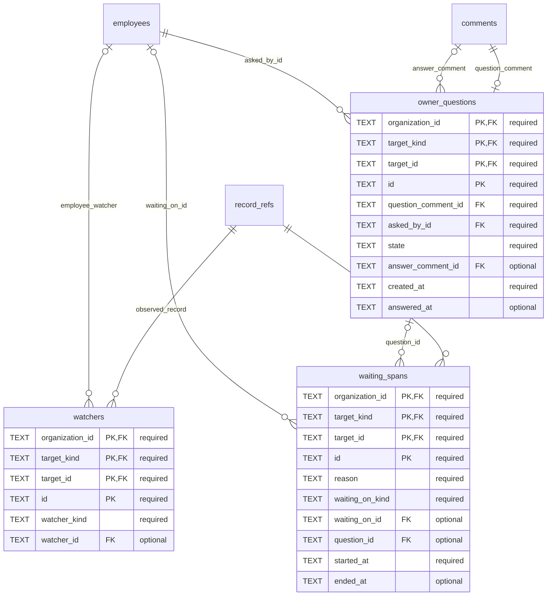

# Operational data structure

Structural draft for v1. Document revision 2.2. Watchers, owner questions and waiting spans are explicitly selected for implementation. This document defines their data, not notification delivery or process execution. It extends [typed tasks](03-features-and-work.md).

## Relationships



Each record belongs to exactly one task through `target_kind: task` and its stable task ID, irrespective of whether the task type is task, bug or request. A watcher can be an employee or the organization owner. An owner question references its question comment and optional answer comment instead of duplicating the text. A waiting span records who is awaited, why, and its start/end timestamps; a null end marks an open span.

The owner is a special recipient/actor designation, not a new employee folder or an authentication record. Owner rows use kind `owner` and a null employee ID. This metadata grants no owner authority; authentication and permissions remain separate.

## Canonical file location

Operational metadata lives in its owning task's front matter. It is not stored in another folder that could drift from the work record.

```yaml
operations:
  watchers:
    - id: 01J00000000000000000000051
      watcher_kind: owner
      watcher_id: null
  owner_questions:
    - id: 01J00000000000000000000052
      question_comment_id: 01J00000000000000000000050
      asked_by_id: 01J00000000000000000000030
      state: open
      answer_comment_id: null
      created_at: "2026-11-14T10:00:00Z"
      answered_at: null
  waiting_spans:
    - id: 01J00000000000000000000053
      reason: Owner decision needed
      waiting_on_kind: owner
      waiting_on_id: null
      question_id: 01J00000000000000000000052
      started_at: "2026-11-14T10:00:00Z"
      ended_at: null
```

The parent work file must contain the referenced comment, and the asking employee must exist. Example snippets show selected fields, not a complete import bundle. Open questions/spans and watcher subscriptions remain recoverable with pending work. Transient notification receipts and old chat messages are separate data; retaining this metadata does not require retaining them.

## File to SQL mapping

| Table | Source |
| --- | --- |
| `watchers` | `operations.watchers[]`: `id`, `watcher_kind`, `watcher_id`; owner type/ID and organization come from the containing work record. |
| `owner_questions` | `operations.owner_questions[]`: every same-named question field; target type/ID and organization come from the containing work record. Question and answer comment references must resolve inside that same work record. |
| `waiting_spans` | `operations.waiting_spans[]`: every same-named span field; target type/ID and organization come from the containing work record. A non-null `question_id` must belong to that same record. |

Closing a record must not discard an unresolved question/span silently. The eventual lifecycle contract must choose its explicit disposition. Deriving durations from saved timestamps is possible without old runtime logs; full historical analytics and event retention remain separate decisions.

## SQLite tables

```sql
CREATE TABLE watchers (
  organization_id TEXT NOT NULL,
  target_kind TEXT NOT NULL CHECK (target_kind = 'task'),
  target_id TEXT NOT NULL,
  id TEXT NOT NULL,
  watcher_kind TEXT NOT NULL CHECK (watcher_kind IN ('employee', 'owner')),
  watcher_id TEXT,
  PRIMARY KEY (organization_id, target_kind, target_id, id),
  CHECK ((watcher_kind = 'employee' AND watcher_id IS NOT NULL) OR (watcher_kind = 'owner' AND watcher_id IS NULL)),
  FOREIGN KEY (organization_id, target_kind, target_id) REFERENCES record_refs(organization_id, kind, id)
    DEFERRABLE INITIALLY DEFERRED,
  FOREIGN KEY (organization_id, watcher_id) REFERENCES employees(organization_id, id)
    DEFERRABLE INITIALLY DEFERRED
) STRICT;

CREATE TABLE owner_questions (
  organization_id TEXT NOT NULL,
  target_kind TEXT NOT NULL CHECK (target_kind = 'task'),
  target_id TEXT NOT NULL,
  id TEXT NOT NULL,
  question_comment_id TEXT NOT NULL,
  asked_by_id TEXT NOT NULL,
  state TEXT NOT NULL CHECK (state IN ('open', 'answered', 'cancelled')),
  answer_comment_id TEXT,
  created_at TEXT NOT NULL,
  answered_at TEXT,
  PRIMARY KEY (organization_id, target_kind, target_id, id),
  CHECK ((state = 'answered' AND answer_comment_id IS NOT NULL AND answered_at IS NOT NULL) OR
    (state <> 'answered' AND answer_comment_id IS NULL AND answered_at IS NULL)),
  FOREIGN KEY (organization_id, target_kind, target_id, question_comment_id) REFERENCES comments(organization_id, target_kind, target_id, id)
    DEFERRABLE INITIALLY DEFERRED,
  FOREIGN KEY (organization_id, target_kind, target_id, answer_comment_id) REFERENCES comments(organization_id, target_kind, target_id, id)
    DEFERRABLE INITIALLY DEFERRED,
  FOREIGN KEY (organization_id, asked_by_id) REFERENCES employees(organization_id, id)
    DEFERRABLE INITIALLY DEFERRED
) STRICT;

CREATE TABLE waiting_spans (
  organization_id TEXT NOT NULL,
  target_kind TEXT NOT NULL CHECK (target_kind = 'task'),
  target_id TEXT NOT NULL,
  id TEXT NOT NULL,
  reason TEXT NOT NULL,
  waiting_on_kind TEXT NOT NULL CHECK (waiting_on_kind IN ('owner', 'employee')),
  waiting_on_id TEXT,
  question_id TEXT,
  started_at TEXT NOT NULL,
  ended_at TEXT,
  PRIMARY KEY (organization_id, target_kind, target_id, id),
  CHECK ((waiting_on_kind = 'employee' AND waiting_on_id IS NOT NULL) OR (waiting_on_kind = 'owner' AND waiting_on_id IS NULL)),
  FOREIGN KEY (organization_id, target_kind, target_id) REFERENCES record_refs(organization_id, kind, id)
    DEFERRABLE INITIALLY DEFERRED,
  FOREIGN KEY (organization_id, waiting_on_id) REFERENCES employees(organization_id, id)
    DEFERRABLE INITIALLY DEFERRED,
  FOREIGN KEY (organization_id, target_kind, target_id, question_id) REFERENCES owner_questions(organization_id, target_kind, target_id, id)
    DEFERRABLE INITIALLY DEFERRED
) STRICT;
```
