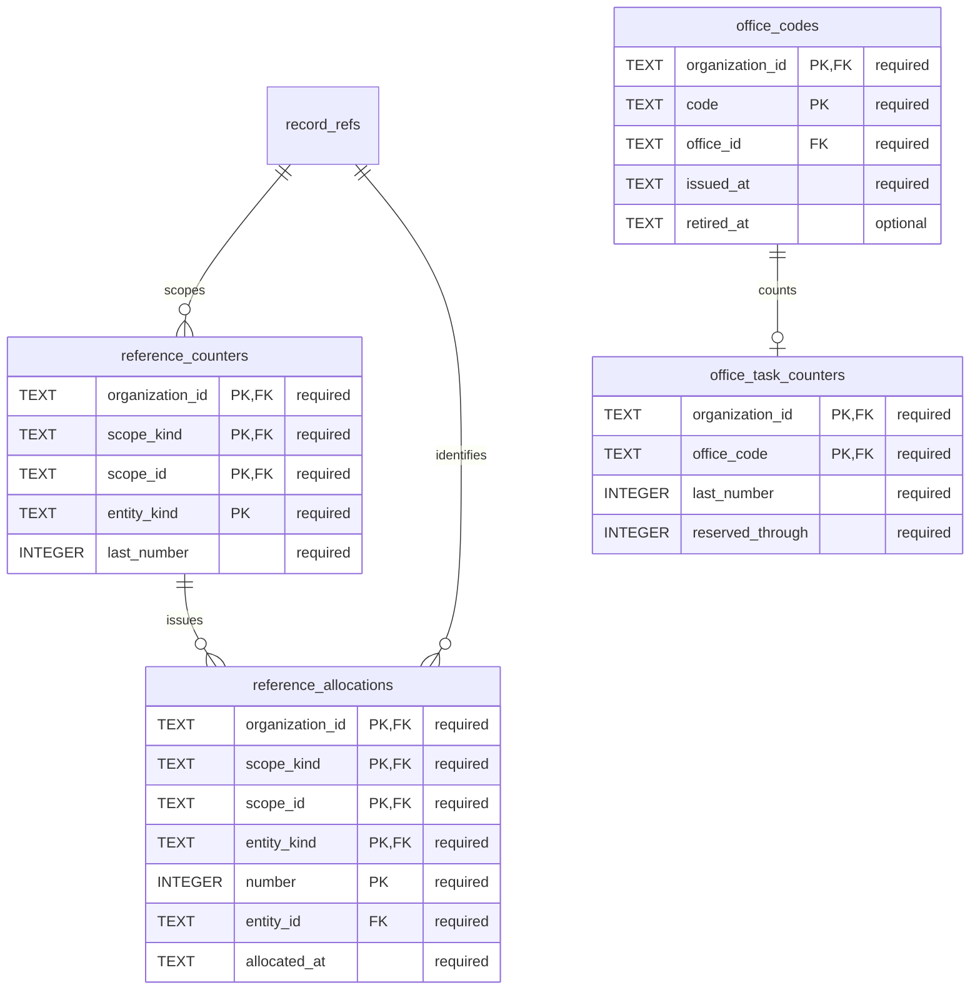

# Identity and numbering

Status: **selected** data contract, revision 2.8. This document owns readable reference allocation data. See the [identity summary](README.md), [task scopes](03-features-and-work.md) and [office placement](04-agent-structure.md). It specifies a data contract and required atomicity; it does not deploy a service or implement failover.

## Stable IDs, readable references and scopes

Generate a new stable ID before submitting a creation. An ID is not an incrementing number.

**Stable IDs are UUID version 7** (RFC 9562; owner decision 2026-11-17). An ID is 128 bits and starts with a 48-bit millisecond timestamp, so IDs made later sort later and indexes stay compact. It is written as 36 characters of lowercase hyphenated text, for example `01930000-0000-7000-8000-000000000040`, in files, file names, wire messages and SQLite, where the column is `TEXT` and sorts in creation order. An adapter for an engine with a native UUID type, such as PostgreSQL, stores it in that type ([ADR-0018](../../adr/0018-storage-engine-independence.md)). It was chosen over ULID because it is the published standard, with direct support in the common Rust library (`uuid`) and in databases; ULID is a community specification with the same properties and a shorter text form. The rule covers every ID the product mints, including operation, message and command IDs. Most of the code mints ULIDs today and changes with the store rebuild (FC-142); documents that describe that code say ULID where they quote it.

 Slugs/handles are explicit identity fields. `key` columns are generated from stored fields, using `TEAM-`, `P-`, `T-`, `F-`, `R-` and `M-`. Numbered records use positive integers. Every numbered record has its number from the moment it exists, except a feature created while HQ is unreachable, whose number is null until HQ registers it. Resolve slugs and handles by their documented scope rather than by display names.

There are two ways a number is given.

**Numbers given by HQ.** Counter rows identify `(organization_id, scope_kind, scope_id, entity_kind)`:

| Entity kind | Scope kind | Scope ID | Prefix |
| --- | --- | --- | --- |
| team | organization | Organization ID | `TEAM-` |
| project | organization | Organization ID | `P-` |
| feature | project | Project ID | `F-` |
| release | project | Project ID | `R-` |
| milestone | release | Release ID | `M-` |

Teams and projects each have their own organization-wide sequence. Team nesting and office placement never introduce another numbering level. A milestone's full reference can be `P-8/R-3/M-2`.

**Task numbers, given by the office that creates the task** (owner decisions 2026-11-17, [ADR-0019](../../adr/0019-office-coded-task-numbers.md)). A task reference is `T-<CODE><N>`:

- `CODE` is the creating office's letter code: one or two uppercase letters from A to Z without I and O. HQ is `A`.
- `N` is a positive integer with no leading zeros, from that office's one sequence for all its tasks, whatever project or team they belong to and whatever their type.
- Examples: `T-A1` is the first task created at HQ; `T-B37` is the thirty-seventh created at the second office. Input is accepted in either case; output is uppercase.

A task reference is unique in the organization and is complete on its own. It never needs a project or team in front, and nothing about it changes afterwards: not when the task is assigned to another team or person, not when it moves to another project or team, not when its type changes, and not when the task or the agent working on it moves to another office. The letter says where the number was made, not where the task lives; routing never uses it.

Commands that need to know which project is meant, such as creating or listing tasks, take the project from the agent's context: `agent-os` knows the project of the task the agent is working on, or the project the agent is assigned to. When the agent has no project, or means another one, the project is a required parameter. Finding a task by its reference never needs it.

## Multiple offices

Teams, projects and their counters belong to organization data. Offices host agent execution and local replicas.

| Entity | Creation authority | Number |
| --- | --- | --- |
| Team, project, release, milestone | HQ only; other offices may submit a request | From HQ, at creation |
| Feature | Any office, including while disconnected | From HQ; null until HQ registers it |
| Task of any type | Any office, including while disconnected | From the creating office, at creation |

Creation authority is a command/API rule, not an `office_id` on projects or teams. Restoring files or replicating an existing HQ-created record into another office is allowed. Replication must not be mistaken for independent creation, and an office replica's raw SQL access cannot establish caller authority. Other office/employee provisioning rules remain outside this decision.

**Tasks.** The creating office takes the next number from its own sequence in the same local transaction that saves the task. It makes no network call, so creating a task takes the same time online and offline, and the reference is final at once. There is no pending state for a task.

**Office codes.** HQ gives each office its code when it creates or enrols the office, which is already an HQ operation. A code is never changed and never given to another office. Two letters allow 600 offices.

**Never reused.** Each office keeps `last_number` and a durable `reserved_through` mark that is always at or above it. The office saves a higher mark durably before it uses numbers up to that mark, so after a crash it continues above the mark; skipped numbers are allowed. An office that cannot prove its sequence is current, for example after being restored from an older backup, must get a new code from HQ before it creates another task. Its old code is retired; tasks made under it keep their references.

**Features.** A locally created feature receives its stable ID and a durable local file immediately and is usable by ID before registration. The shared organization authority registers its final number and validates feature-slug uniqueness. In v1 that authority is the HQ office worker ([organization authority](README.md#organization-authority)); it is a role of that process, not a separate allocation service. It serializes allocations across offices; an office must not independently increment a replicated HQ counter. Pending registration is represented by `number: null`; the final reference is exposed after acknowledgement. HQ assigns project slugs at project creation and enforces organization-wide uniqueness.

Feature files store only a project-scoped `local_slug`. Their full public slug is automatically prefixed with the project's slug, as exposed by `feature_slugs`: `reservations/table-booking`. Two different projects can both use local slug `table-booking`. Two offices creating that local slug in the same project must resolve the conflict before both records can be registered; no silent overwrite or automatic record merge is permitted. Stable IDs allow those pending records to remain distinct.

**HQ allocation.** For two concurrent requests in P-8, the authority assigns F-6 and F-7. In one authoritative transaction: look up an existing allocation by scope/kind/entity ID; return it on retry; otherwise increment the counter, insert the allocation and the entity, and commit, all atomically and serialized against any other allocation in the same scope. How the store achieves that is the adapter's concern ([ADR-0018](../../adr/0018-storage-engine-independence.md)); handle contention by bounded retry. Never use a client-side `MAX(number) + 1`. A stable ID supplied by the client makes retries of the same creation idempotent.

HQ-only entities cannot be independently created at a disconnected satellite office. Published accepted HQ-numbered records require a durable allocation. Gaps are allowed; previously issued numbers are never reused.

## Canonical files and recovery

```text
<organization repository>/identity/
├── counters/<scope-kind>/<scope-id>/<entity-kind>.yaml
├── allocations/<scope-kind>/<scope-id>/<entity-kind>/<number>.yaml
└── office-codes.yaml               # Every code HQ has issued, current and retired

<data-root>/<organization-id>/durable/authority/
└── numbering-journal/             # Acknowledged allocations not yet in Git

<data-root>/<organization-id>/durable/local/offices/<office-id>/
└── task-counter.yaml              # This office's last_number and reserved_through
```

Each counter file stores `scope_kind`, `scope_id`, `entity_kind`, `last_number`. Each allocation file stores `scope_kind`, `scope_id`, `entity_kind`, `number`, `entity_id`, `allocated_at`. Organization ID comes from `organization.yaml`. One writer serializes authority changes; office caches project these files but cannot rewrite the counter independently. The accepted creation's entity and allocation must be recoverable together before acknowledgement; the authority's commit/journal protocol must provide that guarantee before implementation ships.

```yaml
scope_kind: project
scope_id: 01930000-0000-7000-8000-000000000010
entity_kind: feature
number: 6
entity_id: 01930000-0000-7000-8000-000000000040
allocated_at: "2026-11-14T10:00:00Z"
```

Allocation entries survive closure and deletion of the record they name. A cache rebuild loads the latest counter snapshots and allocation journal; it never infers the high-water mark from the records that happen to be open. Removing `runtime/` must not remove that journal. Hourly Git publication leaves an unpublished recovery window: recovering on another machine requires the acknowledged authority journal too. If only an older snapshot remains, pause allocation until a safe high-water mark is established. Automatic failover requires fencing the previous writer; that protocol and a zero-loss remote backup mechanism remain separate implementation decisions. A Git snapshot is not a cross-machine database transaction.

**Task sequences.** An office's `task-counter.yaml` is that office's own durable state. It is part of what the office backs up, it is not a cache, and removing `runtime/` must not remove it. A task that was closed or deleted keeps its reference reserved, because the sequence only moves forward. If the file is lost, or restored from a copy older than tasks the office has already created, the office cannot prove its sequence: it stops creating tasks and asks HQ for a new code. HQ never reconstructs an office's sequence from the tasks it has seen, since an office may hold tasks HQ has not received yet.

Import validation must ensure counter scope IDs resolve, allocations point to the matching live entity or tombstone, accepted entity numbers match their active-scope allocation, and each counter is at least the maximum of every retained allocation in its scope. The schema's `record_refs` is derived from all participating entities/tombstones, including organization, team, project and release scope records. A task's `office_code` must be a code in `office-codes.yaml`, and no two tasks share a code and number.

## Indexes and ownership

Primary keys and UNIQUE constraints already create indexes; do not duplicate them. Organization/office slug and employee handle constraints support scoped lookups. Projects additionally have an organization/slug UNIQUE constraint. Number constraints support team/project/feature/release/milestone lookups; the partial `team_task_numbers` index covers projectless tasks. Features have a separate project/local_slug UNIQUE index. The `feature_slugs` view derives full paths by joining to project slugs; lookups split the path and use the two existing unique indexes. Look up numeric references by their parsed scope and number, not by scanning generated key text. Additional task indexes support team/project/status, assignee and milestone queries. Foreign keys do not automatically index referencing columns.

| Table | Canonical source |
| --- | --- |
| `reference_counters` | Counter YAML: all same-named fields except inherited `organization_id`. Durable authority state, projected into office SQLite caches. |
| `reference_allocations` | Allocation YAML: all same-named fields except inherited `organization_id`. Retained after entity deletion; unpublished entries are in the durable authority journal. |
| `office_codes` | `identity/office-codes.yaml`, written by HQ: code, office, issue and retirement time. Retired codes are kept so that old task references resolve and no code is issued twice. |
| `office_task_counters` | The office's own `task-counter.yaml` under `durable/local/offices/<office-id>/`. Durable office-local state, not Git content and not a cache; other offices do not hold it. |

## Relationships



## SQLite tables

```sql
CREATE TABLE reference_counters (
  organization_id TEXT NOT NULL REFERENCES organizations(id),
  scope_kind TEXT NOT NULL,
  scope_id TEXT NOT NULL,
  entity_kind TEXT NOT NULL,
  last_number INTEGER NOT NULL CHECK (last_number >= 0),
  PRIMARY KEY (organization_id, scope_kind, scope_id, entity_kind),
  CHECK ((scope_kind = 'organization' AND scope_id = organization_id AND entity_kind IN ('team', 'project'))
    OR (scope_kind = 'project' AND entity_kind IN ('feature', 'release'))
    OR (scope_kind = 'release' AND entity_kind = 'milestone')),
  FOREIGN KEY (organization_id, scope_kind, scope_id) REFERENCES record_refs(organization_id, kind, id)
    DEFERRABLE INITIALLY DEFERRED
) STRICT;

CREATE TABLE reference_allocations (
  organization_id TEXT NOT NULL,
  scope_kind TEXT NOT NULL,
  scope_id TEXT NOT NULL,
  entity_kind TEXT NOT NULL,
  number INTEGER NOT NULL CHECK (number > 0),
  entity_id TEXT NOT NULL,
  allocated_at TEXT NOT NULL,
  PRIMARY KEY (organization_id, scope_kind, scope_id, entity_kind, number),
  UNIQUE (organization_id, scope_kind, scope_id, entity_kind, entity_id),
  FOREIGN KEY (organization_id, scope_kind, scope_id, entity_kind)
    REFERENCES reference_counters(organization_id, scope_kind, scope_id, entity_kind)
    DEFERRABLE INITIALLY DEFERRED,
  FOREIGN KEY (organization_id, entity_kind, entity_id) REFERENCES record_refs(organization_id, kind, id)
    DEFERRABLE INITIALLY DEFERRED
) STRICT;

CREATE TABLE office_codes (
  organization_id TEXT NOT NULL REFERENCES organizations(id),
  code TEXT NOT NULL CHECK (code GLOB '[A-HJ-NP-Z]' OR code GLOB '[A-HJ-NP-Z][A-HJ-NP-Z]'),
  office_id TEXT NOT NULL,
  issued_at TEXT NOT NULL,
  retired_at TEXT,
  PRIMARY KEY (organization_id, code),
  FOREIGN KEY (organization_id, office_id) REFERENCES offices(organization_id, id) DEFERRABLE INITIALLY DEFERRED
) STRICT;

CREATE UNIQUE INDEX office_current_code ON office_codes(organization_id, office_id) WHERE retired_at IS NULL;

CREATE TABLE office_task_counters (
  organization_id TEXT NOT NULL,
  office_code TEXT NOT NULL,
  last_number INTEGER NOT NULL CHECK (last_number >= 0),
  reserved_through INTEGER NOT NULL,
  PRIMARY KEY (organization_id, office_code),
  CHECK (reserved_through >= last_number),
  FOREIGN KEY (organization_id, office_code) REFERENCES office_codes(organization_id, code) DEFERRABLE INITIALLY DEFERRED
) STRICT;
```
