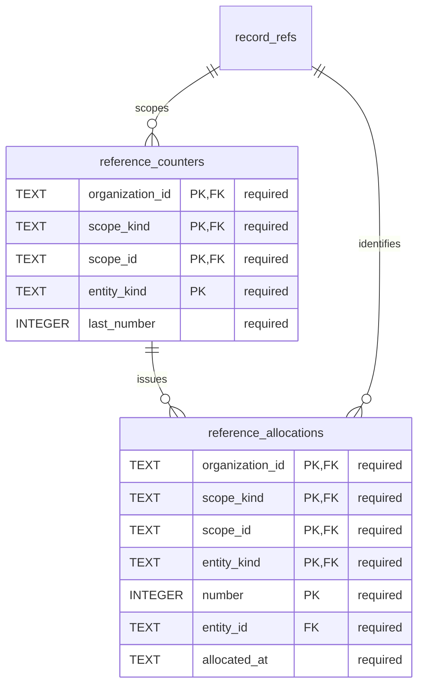

# Identity and numbering

Structural draft for v1. Document revision 2.6. This document owns readable reference allocation data. See the [identity summary](README.md), [task scopes](03-features-and-work.md) and [office placement](04-agent-structure.md). It specifies a data contract and required atomicity; it does not deploy a service or implement failover.

## Stable IDs, readable references and scopes

Generate new UUIDv7 IDs before submitting creation, and preserve all existing v1 IDs. An ID is not an incrementing number. Slugs/handles are explicit identity fields. Numeric `key` columns are generated from stored `number`, using `TEAM-`, `P-`, `T-`, `F-`, `R-` and `M-`. Numbered records use positive integers; null is limited to tasks/features pending organization registration or import staging. Resolve slugs and handles by their documented scope rather than by display names.

Counter rows identify `(organization_id, scope_kind, scope_id, entity_kind)`:

| Entity kind | Scope kind | Scope ID | Prefix |
| --- | --- | --- | --- |
| team | organization | Organization ID | `TEAM-` |
| project | organization | Organization ID | `P-` |
| task (all types) | project | Project ID | `T-` |
| task (all types) | team | Team ID, only when projectless | `T-` |
| feature | project | Project ID | `F-` |
| release | project | Project ID | `R-` |
| milestone | release | Release ID | `M-` |

Teams and projects each have their own organization-wide sequence. A project task uses only the project counter, even though `team_id` is required. Team tasks use only their team's counter. Team nesting and office placement never introduce another numbering level. A milestone's full reference can be `P-8/R-3/M-2`.

Task `assigned_team_id` and `assignee_id` never participate in identity, numbering or canonical path selection. Assigning a team task from Payments to Platform leaves its Payments-scoped number and file in place. Only an explicit ownership/scope move can require the separate reallocation contract below. Assignment changes append [task history](05-operational-data.md#task-activity-history).

## Multiple offices

Teams, projects and their counters belong to organization data. Offices host agent execution and local replicas.

| Entity | Creation authority |
| --- | --- |
| Team, project, release, milestone | HQ only; other offices may submit a request |
| Task of any type, feature | Any office, including a local creation while disconnected |

Creation authority is a command/API rule, not an `office_id` on projects or teams. Restoring files or replicating an existing HQ-created record into another office is allowed. Replication must not be mistaken for independent creation, and an office replica's raw SQL access cannot establish caller authority. Other office/employee provisioning rules remain outside this decision.

Locally created tasks/features receive stable IDs and durable local files immediately; agents can use them before organization registration. The shared logical organization authority registers final numbers and validates feature-slug uniqueness. In v1 that authority is the HQ office worker ([organization authority](README.md#organization-authority)); it is a role of that process, not a separate allocation service. It serializes allocations across offices; an office must not independently increment its replicated counter. Local creation does not require routing all task/feature content creation through HQ. Pending registration is represented by `number: null`; final references are exposed after acknowledgement. HQ assigns project slugs at project creation and enforces organization-wide uniqueness.

Feature files store only a project-scoped `local_slug`. Their full public slug is automatically prefixed with the project's slug, as exposed by `feature_slugs`: `reservations/table-booking`. Two different projects can both use local slug `table-booking`. Two offices creating that local slug in the same project must resolve the conflict before both records can be registered; no silent overwrite or automatic record merge is permitted. Stable IDs allow those pending records to remain distinct.

For two concurrent requests in P-8, the authority assigns T-42 and T-43. In one authoritative transaction: look up an existing allocation by scope/kind/entity ID; return it on retry; otherwise increment the counter with `UPDATE ... RETURNING`, insert the allocation and entity, and commit. Use `BEGIN IMMEDIATE` for SQLite and handle contention by bounded retry. Never use a client-side `MAX(number) + 1`. A GUID supplied by the client makes retries of the same creation idempotent.

An offline office can create and save a local task or feature with a GUID and `number: null`. The final number is assigned after reconnection. HQ-only entities cannot be independently created at a disconnected satellite office. Published accepted records require a durable allocation. Gaps are allowed; previously issued numbers are never reused. Task-type changes do not allocate a new number. Moving a task between team/project scopes is a separate mutation contract: preserve its ID and historical allocations; never silently carry an unrelated scope's number into the destination.

## Canonical files and recovery

```text
<organization repository>/identity/
├── counters/<scope-kind>/<scope-id>/<entity-kind>.yaml
└── allocations/<scope-kind>/<scope-id>/<entity-kind>/<number>.yaml

<data-root>/<organization-id>/durable/authority/
└── numbering-journal/             # Acknowledged allocations not yet in Git
```

Each counter file stores `scope_kind`, `scope_id`, `entity_kind`, `last_number`. Each allocation file stores `scope_kind`, `scope_id`, `entity_kind`, `number`, `entity_id`, `allocated_at`. Organization ID comes from `organization.yaml`. One writer serializes authority changes; office caches project these files but cannot rewrite the counter independently. The accepted creation's entity and allocation must be recoverable together before acknowledgement; the authority's commit/journal protocol must provide that guarantee before implementation ships.

```yaml
scope_kind: project
scope_id: 01J00000000000000000000010
entity_kind: task
number: 42
entity_id: 01J00000000000000000000040
allocated_at: "2026-11-14T10:00:00Z"
```

Allocation entries survive task closure/deletion. A cache rebuild loads the latest counter snapshots and allocation journal; it never infers the high-water mark from open tasks alone. Removing `runtime/` must not remove that journal. Hourly Git publication leaves an unpublished recovery window: recovering on another machine requires the acknowledged authority journal too. If only an older snapshot remains, pause allocation until a safe high-water mark is established. Automatic failover requires fencing the previous writer; that protocol and a zero-loss remote backup mechanism remain separate implementation decisions. A Git snapshot is not a cross-machine database transaction.

Import validation must ensure counter scope IDs resolve, allocations point to the matching live entity or tombstone, accepted entity numbers match their active-scope allocation, and each counter is at least the maximum of every retained allocation in its scope. The schema's `record_refs` is derived from all participating entities/tombstones, including organization, team, project and release scope records. Old v1 references remain in import staging until an explicit mapping is approved; this proposal does not silently renumber existing records.

## Indexes and ownership

Primary keys and UNIQUE constraints already create indexes; do not duplicate them. Organization/office slug and employee handle constraints support scoped lookups. Projects additionally have an organization/slug UNIQUE constraint. Number constraints support team/project/feature/release/milestone lookups; the partial `team_task_numbers` index covers projectless tasks. Features have a separate project/local_slug UNIQUE index. The `feature_slugs` view derives full paths by joining to project slugs; lookups split the path and use the two existing unique indexes. Look up numeric references by their parsed scope and number, not by scanning generated key text. Additional task indexes support team/project/status, assignee and milestone queries. Foreign keys do not automatically index referencing columns.

| Table | Canonical source |
| --- | --- |
| `reference_counters` | Counter YAML: all same-named fields except inherited `organization_id`. Durable authority state, projected into office SQLite caches. |
| `reference_allocations` | Allocation YAML: all same-named fields except inherited `organization_id`. Retained after entity deletion; unpublished entries are in the durable authority journal. |

## Relationships



## SQLite tables

```sql
CREATE TABLE reference_counters (
  organization_id TEXT NOT NULL REFERENCES organizations(id),
  scope_kind TEXT NOT NULL,
  scope_id TEXT NOT NULL,
  entity_kind TEXT NOT NULL,
  last_number INTEGER NOT NULL CHECK (last_number >= 0),
  PRIMARY KEY (organization_id, scope_kind, scope_id, entity_kind),
  CHECK ((scope_kind = 'organization' AND scope_id = organization_id AND entity_kind IN ('team', 'project'))
    OR (scope_kind IN ('team', 'project') AND entity_kind = 'task')
    OR (scope_kind = 'project' AND entity_kind IN ('feature', 'release'))
    OR (scope_kind = 'release' AND entity_kind = 'milestone')),
  FOREIGN KEY (organization_id, scope_kind, scope_id) REFERENCES record_refs(organization_id, kind, id)
    DEFERRABLE INITIALLY DEFERRED
) STRICT;

CREATE TABLE reference_allocations (
  organization_id TEXT NOT NULL,
  scope_kind TEXT NOT NULL,
  scope_id TEXT NOT NULL,
  entity_kind TEXT NOT NULL,
  number INTEGER NOT NULL CHECK (number > 0),
  entity_id TEXT NOT NULL,
  allocated_at TEXT NOT NULL,
  PRIMARY KEY (organization_id, scope_kind, scope_id, entity_kind, number),
  UNIQUE (organization_id, scope_kind, scope_id, entity_kind, entity_id),
  FOREIGN KEY (organization_id, scope_kind, scope_id, entity_kind)
    REFERENCES reference_counters(organization_id, scope_kind, scope_id, entity_kind)
    DEFERRABLE INITIALLY DEFERRED,
  FOREIGN KEY (organization_id, entity_kind, entity_id) REFERENCES record_refs(organization_id, kind, id)
    DEFERRABLE INITIALLY DEFERRED
) STRICT;
```
