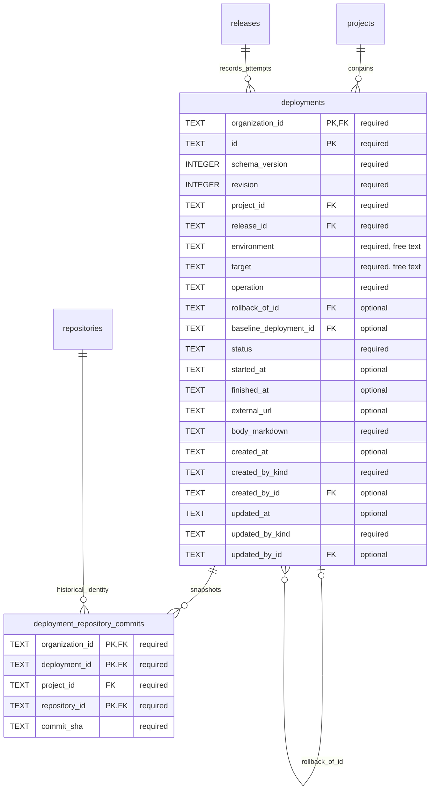

# Release deployment records

Status: **selected** data contract, revision 2.6. This document owns deployment history associated with [project releases](02-project-structure.md). It records attempts and outcomes; build artifacts, deployment execution and pipeline integration are not included.

## Relationships



A release has zero or many deployment records. Each record belongs to exactly one release and its project, one named `environment` such as staging or production, and one `target` such as primary or eu-west. A retry is a new record with a new stable ID. Each attempt can own one technical changelog and other supporting documents, distinct from the release's product changelog. See [release content and flags](09-release-content-and-flags.md). Deployments need no additional readable-number counter; use the release reference, environment and time in the UI.

Each record captures `operation: deploy | rollback`, `status: queued | running | succeeded | failed | cancelled`, actual start/end timestamps when known, an optional external job URL, common creator/update attribution, and a Markdown outcome. These are data values, not a process engine. Optional `baseline_deployment_id` identifies a recorded baseline in the same project/environment/target for the technical delta; null records an unknown baseline. A rollback is a new attempt against the release being restored, with `rollback_of_id` pointing to the attempt being undone in the same project/environment/target. Preserve all earlier attempts; never rewrite a prior successful deployment into a rollback.

`repository_commits` snapshots the exact commit intended for each targeted project repository. Once execution starts, preserve its release, environment, target and commit snapshot, even if the release manifest later changes. It is a commit map, not a build-artifact model. Import/publication validates that every started attempt has at least one commit entry. A successful attempt means the listed target changes completed; a failed attempt may have partial effects, so deployment history alone must not claim a failed attempt established the environment's current state. Outcomes can explain partial results.

## Durable files and example

```text
projects/<project-id>/releases/<release-id>/
├── release.md
├── changelog.md                      # Product changes for the release
├── flag-settings.yaml
├── documents/<document-id>.md
├── milestones/<milestone-id>.md
└── deployments/<deployment-id>/
    ├── deployment.md
    ├── changelog.md                  # Technical changes for this attempt
    └── documents/<document-id>.md
```

```markdown
---
schema_version: 1
id: 01J00000000000000000000090
revision: 1
project_id: 01J00000000000000000000010
release_id: 01J00000000000000000000032
environment: production
target: primary
operation: deploy
rollback_of_id: null
status: succeeded
started_at: "2026-11-14T11:00:00Z"
finished_at: "2026-11-14T11:03:00Z"
external_url: https://example.com/jobs/deploy-90
created_at: "2026-11-14T10:59:00Z"
created_by_kind: employee
created_by_id: 01J00000000000000000000030
updated_at: "2026-11-14T11:03:00Z"
updated_by_kind: employee
updated_by_id: 01J00000000000000000000030
repository_commits:
  01J00000000000000000000002: aaaaaaaaaaaaaaaaaaaaaaaaaaaaaaaaaaaaaaaa
---
Reservations release R-3 deployed to production/primary. Validation passed.
```

These records remain in organization Git after tasks close and runtime caches are deleted. Store metadata and links rather than raw execution logs or credentials. HQ's release-creation restriction does not mean that an office executing a deployment must be HQ: approved execution/integration may report attempts from other offices. No deployment command or authorization policy is implemented by this draft.

Deployment `flag_settings[]` captures confirmed applied flag values/rules, separately from release intent. Technical changelogs record environment changes, migrations, applied flags, validation and rollback details; product-facing release changes stay in the release changelog. The full flag/schema contract is in [document 09](09-release-content-and-flags.md).

## File to SQL mapping

| Table | Source |
| --- | --- |
| `deployments` | Deployment front matter: every same-named scalar, including common attribution, plus Markdown body. Scope IDs must match the release folder. |
| `deployment_repository_commits` | One row per `repository_commits` entry: `repository_id`, `commit_sha`; deployment/project IDs come from its parent. No separate authored file. |

## SQLite tables

```sql
CREATE TABLE deployments (
  organization_id TEXT NOT NULL REFERENCES organizations(id),
  id TEXT NOT NULL,
  schema_version INTEGER NOT NULL CHECK (schema_version = 1),
  revision INTEGER NOT NULL CHECK (revision >= 1),
  project_id TEXT NOT NULL,
  release_id TEXT NOT NULL,
  environment TEXT NOT NULL CHECK (length(environment) > 0),
  target TEXT NOT NULL DEFAULT 'primary' CHECK (length(target) > 0),
  operation TEXT NOT NULL DEFAULT 'deploy' CHECK (operation IN ('deploy', 'rollback')),
  rollback_of_id TEXT,
  baseline_deployment_id TEXT,
  status TEXT NOT NULL CHECK (status IN ('queued', 'running', 'succeeded', 'failed', 'cancelled')),
  started_at TEXT,
  finished_at TEXT,
  external_url TEXT,
  body_markdown TEXT NOT NULL DEFAULT '',
  created_at TEXT,
  created_by_kind TEXT NOT NULL DEFAULT 'unknown' CHECK (created_by_kind IN ('employee', 'owner', 'system', 'unknown')),
  created_by_id TEXT,
  updated_at TEXT,
  updated_by_kind TEXT NOT NULL DEFAULT 'unknown' CHECK (updated_by_kind IN ('employee', 'owner', 'system', 'unknown')),
  updated_by_id TEXT,
  PRIMARY KEY (organization_id, id),
  UNIQUE (organization_id, id, project_id),
  UNIQUE (organization_id, id, project_id, environment, target),
  CHECK (rollback_of_id IS NULL OR rollback_of_id <> id),
  CHECK (baseline_deployment_id IS NULL OR baseline_deployment_id <> id),
  FOREIGN KEY (organization_id, baseline_deployment_id, project_id, environment, target)
    REFERENCES deployments(organization_id, id, project_id, environment, target)
    DEFERRABLE INITIALLY DEFERRED,
  CHECK ((operation = 'deploy' AND rollback_of_id IS NULL) OR (operation = 'rollback' AND rollback_of_id IS NOT NULL)),
  CHECK ((status = 'queued' AND started_at IS NULL AND finished_at IS NULL)
    OR (status = 'running' AND started_at IS NOT NULL AND finished_at IS NULL)
    OR (status IN ('succeeded', 'failed') AND started_at IS NOT NULL AND finished_at IS NOT NULL)
    OR (status = 'cancelled' AND finished_at IS NOT NULL)),
  CHECK (finished_at IS NULL OR started_at IS NULL OR finished_at >= started_at),
  FOREIGN KEY (organization_id, release_id, project_id) REFERENCES releases(organization_id, id, project_id)
    DEFERRABLE INITIALLY DEFERRED,
  FOREIGN KEY (organization_id, rollback_of_id, project_id, environment, target)
    REFERENCES deployments(organization_id, id, project_id, environment, target)
    DEFERRABLE INITIALLY DEFERRED,
  CHECK ((created_by_kind = 'employee' AND created_by_id IS NOT NULL) OR (created_by_kind <> 'employee' AND created_by_id IS NULL)),
  CHECK ((updated_by_kind = 'employee' AND updated_by_id IS NOT NULL) OR (updated_by_kind <> 'employee' AND updated_by_id IS NULL)),
  FOREIGN KEY (organization_id, created_by_id) REFERENCES employees(organization_id, id) DEFERRABLE INITIALLY DEFERRED,
  FOREIGN KEY (organization_id, updated_by_id) REFERENCES employees(organization_id, id) DEFERRABLE INITIALLY DEFERRED
) STRICT;

CREATE TABLE deployment_repository_commits (
  organization_id TEXT NOT NULL,
  deployment_id TEXT NOT NULL,
  project_id TEXT NOT NULL,
  repository_id TEXT NOT NULL,
  commit_sha TEXT NOT NULL CHECK (length(commit_sha) > 0),
  PRIMARY KEY (organization_id, deployment_id, repository_id),
  FOREIGN KEY (organization_id, deployment_id, project_id) REFERENCES deployments(organization_id, id, project_id)
    DEFERRABLE INITIALLY DEFERRED,
  FOREIGN KEY (organization_id, repository_id) REFERENCES repositories(organization_id, id)
    DEFERRABLE INITIALLY DEFERRED
) STRICT;
```

Repository commit snapshots reference stable repository identity, independent of current project membership. New snapshot capture validates current project/repository eligibility in the accepting service; import validates recorded historical provenance. Later detachment from `project_repositories` must not delete or invalidate release/deployment snapshots. Referenced repository identities remain retained.
