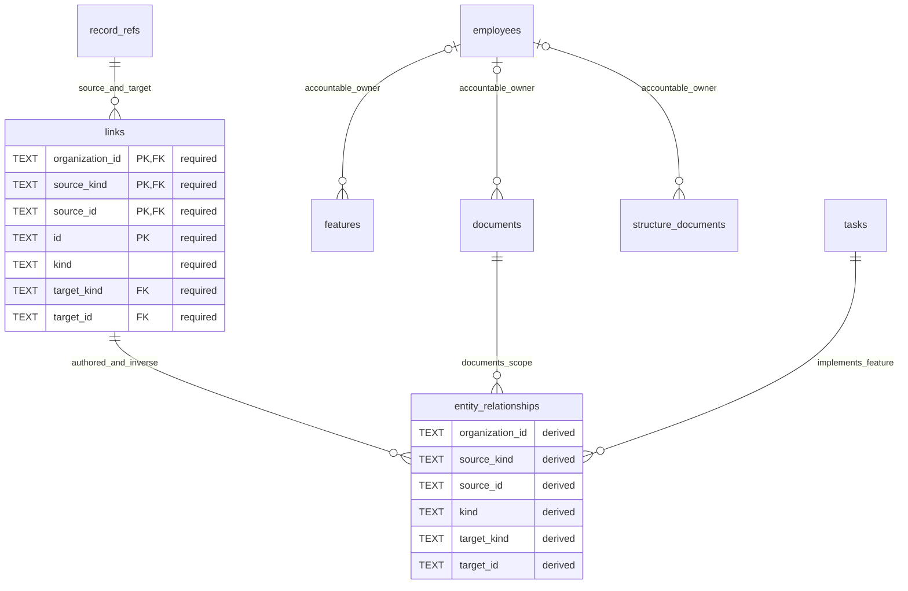

# Record ownership, attribution, lifecycle and relationships

Structural draft for v1. Document revision 2.6. These are data contracts shared by the organization/project/work documents, not an implementation of permissions, costs or process execution.

## Accountable owners

Features, supporting documents, feature flag definitions, and process/standard content records have optional `owner_employee_id`, referencing one person or agent in the same organization. This is accountability for that record, separate from task assignment, project team ownership and management authority. An owner need not belong to the project's owning team. Planned/unassigned features and draft documents may have no owner; features in `in_progress` or `live` and documents (including process/standard content) marked `current` require an explicit owner. Active flag definitions also require an owner. Import validation also requires an active owner for those active records. Transfer accountability before making such an owner inactive; historical attribution can still reference inactive employees.

## Common attribution

The authored tables organizations, repositories, roles, teams, offices, structure_documents, projects, releases, milestones, features, tasks, documents, employees, feature_flags and deployments share these fields:

| Field | Meaning |
| --- | --- |
| `created_at` | Original creation time, quoted UTC timestamp; never replaced by import time |
| `created_by_kind` | `employee`, `owner`, `system` or `unknown` |
| `created_by_id` | Stable employee ID only when creator kind is employee; otherwise null |
| `updated_at` | Time of the latest content/metadata change |
| `updated_by_kind` | Same actor vocabulary as creator |
| `updated_by_id` | Stable employee ID only when updater kind is employee; otherwise null |

These fields are top-level front-matter/YAML scalars matching the SQL columns. New accepted records must supply actual timestamps and known actor kinds; legacy import can preserve null times and `unknown` actors when the source lacks them. Do not fabricate provenance. The SQL projection allows those unknown import values; publication validation distinguishes new writes from legacy staging. `owner` uses the existing organization-owner designation; `system` means framework/integration automation. Neither is an employee profile. This attribution does not grant authorization or replace authentication/audit infrastructure.

Updating an entity preserves creation fields, advances its revision, and updates its update fields. Nested arrays/association rows inherit the owning entity's update metadata; comments keep their own existing author/time fields. Tombstones retain original record provenance in a YAML `record_metadata` map together with deleted-record identity. SQLite projects that map as `record_metadata_json`, serialized as an object with lexically sorted keys; a missing map defaults to `{}` for legacy imports. This is current attribution, not full event history; old content remains subject to the chosen Git retention rules.

## Lifecycle data

| Record | Fields / states |
| --- | --- |
| Team | `status: active | archived` (default active) |
| Employee | `status: active | inactive` (default active) |
| Supporting document or process/standard content | `status: draft | current | deprecated` (default draft) |
| Project | Existing `archived: false | true` |
| Feature/task/release/milestone | Existing status fields; this change does not port their v1 transition engines |

Archiving/deactivating changes availability, not identity. Preserve profiles, handles, numbers, foreign references and historical metadata. Archived teams and inactive employees cannot receive new active assignments; import/publication checks this without erasing historical rows. Existing current documents and live features retain their recorded owners until explicitly reassigned. Document status does not create a mandatory approval workflow. Team moves still update the explicit parent and durable path together.

## Build / Run work classification: v1 finding and proposed extension

At v1 commit `ee84e7ba231fbef79373f641c3d24fd26a248be5`, the [cost UX specification](../../specs/costs-and-insights-ux.md) describes **Build, shown as R&D**, and reserves **KTLO** for a later version (§1, Kind breakdown and Organization Cost). The checked source has no corresponding persisted Build/Run field. Its referenced `costs-and-budgets-v1.md` PRD is not present in this checkout, so this document makes no claim about that absent contract.

Proposed selected-scope extension: features and tasks have nullable `work_type: build | run`, displayed as Build (R&D) and Run (KTLO). Build creates or materially improves capabilities; Run maintains existing service and ongoing operations. It is independent of task `type`: a bug found during new-feature development may be Build, while a production maintenance bug may be Run. It is also independent of team, project, release and office.

Null means not classified, not Build or Run. Store each record's classification explicitly; a feature's value can be suggested when creating a task, but task values are not silently changed when the feature changes. This adds classification data only. Usage events, historical attribution and price versions are now selected in [usage accounting](10-usage-and-cost-accounting.md). Budgets, stop rules and retrospectives remain unselected. Existing usage records are not silently reclassified; the captured Build/Run value is historical accounting data.

## Explicit relationship types

| Relationship | Meaning / source of truth |
| --- | --- |
| `depends_on` | Authored task A requires task B. Stored once in A's `links[]`; task dependency cycles and self-links are rejected. |
| `blocks` | Inverse of `depends_on`: B blocks A. Derived on query, never stored as a duplicate link. |
| `implements` | Task implements its single `feature_id`. Derived from the task foreign key, preserving the zero-or-one feature rule. |
| `documents` | Supporting document describes its optional feature, release or deployment, otherwise its project. Derived from document scope foreign keys. |
| `relates_to` | Authored reference from a project, feature, task or document to another registered entity in the same organization. It does not change ownership or imply a dependency. |

The `entity_relationships` view presents both authored and derived relationships. `links` stores only `depends_on` and `relates_to`. For cross-feature knowledge, keep one canonical project document and use `relates_to` links; a document still has at most one feature/release/deployment owner in addition to its required project. Cross-project task dependencies are allowed within one organization. Source and target resolve through `record_refs`, including historical tombstones. A dependency on a deleted task needs explicit disposition before accepting new active work; it is never silently treated as satisfied.

`links[]` belongs in its source record's front matter and contains `id`, `kind`, `target_kind`, `target_id`. Source/organization IDs come from that parent. Every participating project/feature/document may have this array in addition to tasks. `record_refs` includes these document and project identities. Inverse queries use the target index instead of writing duplicate arrays on the target.

```yaml
links:
  - id: 01J00000000000000000000095
    kind: depends_on
    target_kind: task
    target_id: 01J00000000000000000000041
```

## Relationships



| Table/view | Canonical source |
| --- | --- |
| `links` | Source entity's `links[]`, with IDs and fields above. |
| `entity_relationships` (view) | Derived from links, task feature membership and supporting-document scope; no authored file. |

## SQLite tables and views

```sql
CREATE TABLE links (
  organization_id TEXT NOT NULL,
  source_kind TEXT NOT NULL CHECK (source_kind IN ('project', 'feature', 'task', 'document')),
  source_id TEXT NOT NULL,
  id TEXT NOT NULL,
  kind TEXT NOT NULL CHECK (kind IN ('depends_on', 'relates_to')),
  target_kind TEXT NOT NULL,
  target_id TEXT NOT NULL,
  PRIMARY KEY (organization_id, source_kind, source_id, id),
  UNIQUE (organization_id, source_kind, source_id, kind, target_kind, target_id),
  CHECK (source_kind <> target_kind OR source_id <> target_id),
  CHECK (kind <> 'depends_on' OR (source_kind = 'task' AND target_kind = 'task')),
  FOREIGN KEY (organization_id, source_kind, source_id) REFERENCES record_refs(organization_id, kind, id)
    DEFERRABLE INITIALLY DEFERRED,
  FOREIGN KEY (organization_id, target_kind, target_id) REFERENCES record_refs(organization_id, kind, id)
    DEFERRABLE INITIALLY DEFERRED
) STRICT;

CREATE VIEW entity_relationships AS
SELECT organization_id, source_kind, source_id, kind, target_kind, target_id FROM links
UNION ALL
SELECT organization_id, target_kind, target_id, 'blocks', source_kind, source_id
FROM links WHERE kind = 'depends_on'
UNION ALL
SELECT organization_id, 'task', id, 'implements', 'feature', feature_id
FROM tasks WHERE feature_id IS NOT NULL
UNION ALL
SELECT organization_id, 'document', id, 'documents',
       CASE WHEN feature_id IS NOT NULL THEN 'feature' WHEN release_id IS NOT NULL THEN 'release' WHEN deployment_id IS NOT NULL THEN 'deployment' ELSE 'project' END,
       CAST(COALESCE(feature_id, release_id, deployment_id, project_id) AS TEXT)
FROM documents;
```
