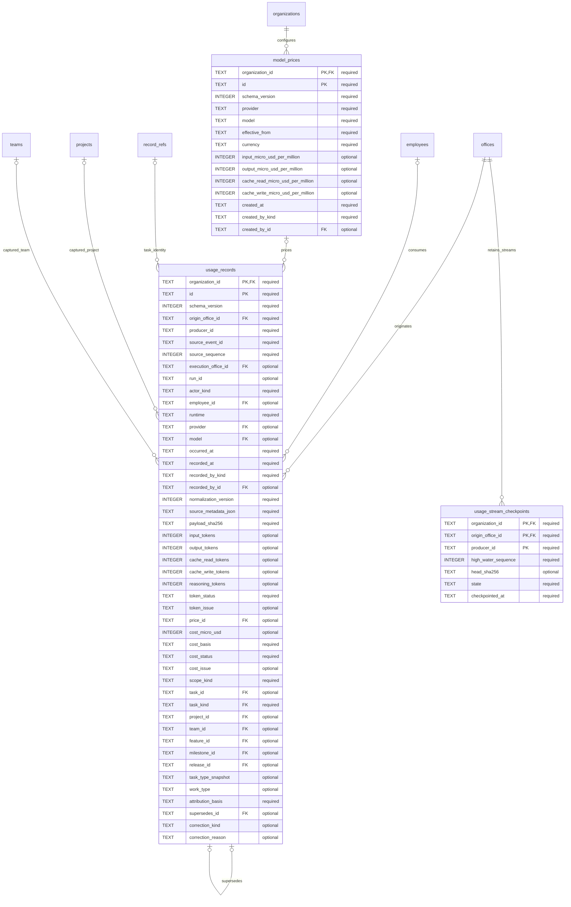

# Usage, token accounting and cost attribution

Status: **selected** data contract, revision 2.8. This document owns usage accounting data, historical attribution, price versions and durable stream checkpoints. It does not implement runtime adapters, pricing services, permission enforcement, budgets or automatic pausing. [Model profiles and agent execution](11-model-profiles-and-agent-execution.md) owns routing/execution records; its attempts supply actual selected connection/model and consumer context for this ledger. Configuration and observations are integrated in the same schema, while immutable usage remains authoritative for accounting.

## v1 evidence and selected port

At v1 commit `ee84e7ba231fbef79373f641c3d24fd26a248be5`, [the runtime usage contract](../../../crates/org-runtime/src/usage.rs) defines input/output/cache-read/cache-write/reasoning counts, runtime list-price estimates, and separate token/cost delta versus cumulative scopes. [The cost UX](../../specs/costs-and-insights-ux.md) defines per-record attribution, agent-by-task rollups, project investment, price versions and honest missing-data handling. The checked office/server code has no complete persisted usage ledger. This document carries over those accounting data needs, not the old session/agent setup, task-guessing heuristics, cost visibility implementation or budget engines.

## One ledger; derived totals

Each accepted normalized report is one immutable `usage_records` event. The record identifies the actual consuming agent or one-off invocation, runtime/model, occurrence time and origin. A run can span several tasks; its identifier is an opaque correlation field, not a foreign key into transient session state. Several agents may contribute to the same task, including reviewers/helpers. Their costs belong to the actual consumers rather than the task's current assignee.

`effective_usage_records` selects records without a replacement. Task, agent and project total views aggregate that same effective set, never independently increment totals on parent entities. Task views sum all contributing agents; agent views include task work and overhead across projects; project views include task work and explicitly attributed project overhead. One-off usage still contributes to task/project/organization totals even when no agent profile exists.

Use `known_tokens` and `known_cost_micro_usd` with incomplete/unpriced record counts. SQL sums stay null when every value is unknown. A partially known subtotal must be labelled incomplete; it is not a complete total. Source-stream gaps also make totals incomplete even when the rows already received are individually complete. `ledger_incomplete_streams` flags organization archive coverage issues alongside every total; it must not be hidden when presenting a subtotal. Team-only and organization overhead have no project, so they are not guessed onto one. Agent-by-task, work-type and time-period breakdowns group the effective records directly.

## Token normalization and valuation

Canonical input, cache-read and cache-write categories are disjoint. `output_tokens` includes reasoning, and `reasoning_tokens` is its optional subset, never an additional total. Total known tokens sum the four disjoint categories only. New normalization must document each provider's cache semantics: v1 explicitly excludes cache reads from input but does not fully settle cache-write overlap. Preserve source metadata and mark ambiguous categories partial/unknown rather than double-counting them.

Normalize cumulative reports into deltas once per producer process epoch, separately for tokens and cost. A runtime's consolidated reports and their component/helper reports must resolve to one authoritative set of consumption facts; do not add an aggregate to its constituents. Preserve the normalization version and source scopes/baselines in `source_metadata_json`. A restart/resume must not subtract another process's baseline. If the baseline or final report is missing, record a fixed issue code and partial/unavailable status rather than inventing zero usage. No prompts, conversation text or credentials belong in these metadata records.

Counters are nullable nonnegative integers: null means unknown, while zero means known zero. `token_status` and `cost_status` are independently complete/partial/unavailable, each with an issue code when incomplete. A runtime can report a complete API-equivalent estimate with incomplete token detail. A subscription plan does not turn that estimate into an actual bill.

`model_prices` stores rates in integer micro-US-dollars per million tokens. A micro-US-dollar is 0.000001 USD. For example, `1000000` means $1 per million tokens. Four nullable rates cover the disjoint categories; null is an unknown rate, not free usage. A zero rate is explicit. A usage event's `price_id` references the exact provider/model price version used. Select the version effective at consumption time; once referenced, its values cannot be changed or removed. Publish future rate changes as new IDs/effective dates. Price administration and unused draft/schedule management remain separate implementation contracts.

Compute a token estimate with exact integer/decimal intermediate arithmetic, sum category charges, then round half up once per usage record to integer `cost_micro_usd`. Avoid overflowing a SQLite integer multiplication or using binary floats for stored ledger amounts. A zero-count category does not need a rate; a nonzero/unknown category with no rate makes the valuation incomplete. The included example's $1/M input, $2/M output and $0.50/M cache-read yield 1650 micro-USD, or $0.001650.

`cost_basis` distinguishes runtime_estimate, token_estimate, unpriced and unknown. A runtime-reported list-price estimate is an estimate, even where a UX table calls it Reported. Existing events are never automatically repriced when model prices change. Actual invoices, currency conversion and billing reconciliation are not represented here.

## Historical attribution and corrections

Capture `scope_kind`, task/project/team/feature/milestone/release IDs, task type and Build/Run classification at consumption time. A project task records its then-owning team; a team task has no project. Project/team context can also capture overhead, and genuinely unknown context stays at organization scope. New capture validates known task/project/team relationships at that time.

The captured `team_id` is ownership attribution. The task's current `assigned_team_id`, individual assignee and the consumer's home team can all differ; they must not be substituted for it. Assignment history is retained separately in [task events](05-operational-data.md#task-activity-history). Reassignment does not move past spend or change the actual consuming employee.

Use explicit work-for/current-task context when known. Otherwise preserve explicit project/team context or mark organization overhead; do not infer a project from an agent's current home team or its number of project memberships. Release attribution is captured only when known; do not join a task to every release that later includes it. Membership moves, role changes, renamed slugs and changed feature/work classifications do not rewrite old attribution.

These are historical snapshot references, so the ledger deliberately does not foreign-key its project/team snapshot to a task's *current* parent combination. Referenced office/employee/project/team/feature/release/milestone identities remain durable archived/inactive records. Task identity resolves through `record_refs` to a live task or retained tombstone. Closing/deleting an active task file must not erase its usage. Runtime placements and run processes are not required for recovery.

Corrections append a full new event with `supersedes_id`, correction kind/reason and the actor/time that recorded it. Register corrections against the current leaf through the shared organization authority; an offline office may retain a proposal but cannot publish a competing accepted correction. One parent may have only one direct replacement; further corrections extend the chain, and its leaf contributes once. An attribution correction preserves consumption, consuming identity, occurrence time and valuation; it changes the attributed work, not who spent the tokens. A usage correction requires evidence for a factual capture error, with its rationale retained; it is not permission to silently reprice old usage at new rates. Source corrections/retries get stable origin event identities. A correction written at HQ can keep the original execution office while its `origin_office_id` identifies the office recording the correction.

An attribution correction requires owner authority or project-manager authority over both the source and destination projects. A project manager cannot move usage into or out of an unauthorized scope. Moving a project task's record to “Not on a task” retains its explicit project as project overhead. A correction reducing spend on a reached task budget requires an authorized person even when the remaining spend still reaches the limit; [document 17](17-budgets-and-controls.md) owns that control. These are service authorization checks, not grants from an employee field or SQL reference. Acceptance must cover both directions across project boundaries and a reduction from 25 to 24 against a limit of 20: an agent manager is refused, a permitted person may correct, and the hold remains.

## Durable storage and multi-office recovery

```text
<organization repository>/
└── pricing/models/<price-id>.yaml          # Versioned rate configuration

<data-root>/<organization-id>/durable/accounting/
├── usage/<origin-office-id>/<producer-id>/<UTC-date>.jsonl
└── checkpoints/<origin-office-id>/<producer-id>.json

<data-root>/<organization-id>/runtime/<office-id>/office.db
    # Indexed projection and derived total views, rebuilt from durable sources
```

JSON Lines avoids a Markdown file or Git commit for every reported event. Each stream is append-only with one stable producer epoch, sequence starting at 1 and monotonically increasing, and source event IDs preserved across delivery retries. Event `organization_id` and `origin_office_id` must match their containing stream. Associate an event with the UTC date of `recorded_at`, preserving its original `occurred_at` when it arrives late. Replication copies event IDs; it never creates new billable events.

`payload_sha256` is SHA-256 of UTF-8 JSON with lexically sorted keys, compact separators, no ASCII escaping, and the checksum field omitted (codec `sorted-compact-json/1` in the [hash codec registry](08-record-contracts.md#hash-codec-registry)). Before hashing, expand nullable fields to explicit nulls and documented defaults (including fixed `task_kind: task`). Canonical event scalars use the table's names/types, including `_json` fields as compact JSON strings; floats/NaN are not ledger numeric values. SQL `task_kind` is fixed to task and needs no separately chosen authored value. Before acknowledging capture, durably append the event and publish its producer checkpoint; recovery can advance a stale checkpoint from complete appended records. A checkpoint must never promise an event not durably recorded. The collection protocol must satisfy this contract before implementation ships. **The writer is named:** the office worker that ran the turn is the producer for its stream and the only process that appends to it; HQ registers corrections. No other office, the web process or an agent writes a usage stream.

Register a sequence-zero checkpoint before accepting a producer's first capture. Checkpoint `high_water_sequence`, last event hash, open/sealed state and time are durable JSON fields with inherited organization/office/producer IDs. Coverage is as of the last known checkpoint, not a claim of real-time visibility into a disconnected office. A replicated checkpoint can arrive before events; cache projections retain it without a foreign key to a missing last event so they can detect gaps. Compare expected sequence coverage and head hash, report missing/corrupt/replayed data, and never treat an incomplete archive as complete zero spend. Checkpoints cannot regress or change the hash at the same sequence. Seal a producer stream when its reporting epoch ends; sealed checkpoints cannot reopen or advance. Never recycle a producer ID after cache deletion.

An identical ID/source-key retry returns the original event only after comparing its canonical payload hash. The same identity with different content is a conflict, not an ignored insert. Replays from two offices do not increase totals. Batches can replicate asynchronously; include freshness and checkpoint coverage when reporting organization-wide totals.

Rebuild into a fresh SQLite database, load organization identities and price versions, then replay original events and correction parents before their children; stage out-of-order replicas until dependencies arrive. Validate checkpoints and hashes before swapping in the projection.

The accounting archive is durable data, not disposable session logs. Back up/replicate it independently of runtime and preserve the existing cost-visibility boundaries. Cross-machine recovery requires that archive and rate versions in addition to organization Git; organization Git alone does not contain per-event history. Raw accounting events need no per-turn Git publication. Backup transport, monetary-data access enforcement and retention infrastructure remain implementation decisions; keep records until a separately approved retention/aggregation policy can preserve the required history. Source and historical attribution records are never removed merely because a task, run or office process ended.

## Examples

Price version YAML (sample rates only):

```yaml
schema_version: 1
organization_id: existing-v1-org-id
id: 01930000-0000-7000-8000-000000000300
provider: example-provider
model: example-model
effective_from: "2026-11-01T00:00:00Z"
currency: USD
input_micro_usd_per_million: 1000000
output_micro_usd_per_million: 2000000
cache_read_micro_usd_per_million: 500000
cache_write_micro_usd_per_million: 1250000
created_at: "2026-10-31T12:00:00Z"
created_by_kind: employee
created_by_id: 01930000-0000-7000-8000-000000000031
```

One usage event, formatted for reading (each JSONL event is one line on disk):

```json
{
  "organization_id": "existing-v1-org-id",
  "id": "01930000-0000-7000-8000-000000000301",
  "schema_version": 1,
  "origin_office_id": "01930000-0000-7000-8000-000000000081",
  "producer_id": "producer-reservations-1",
  "source_event_id": "turn-1/final-usage",
  "source_sequence": 1,
  "execution_office_id": "01930000-0000-7000-8000-000000000081",
  "run_id": "opaque-runtime-run-1",
  "actor_kind": "agent",
  "employee_id": "01930000-0000-7000-8000-000000000030",
  "runtime": "example-runtime",
  "provider": "example-provider",
  "model": "example-model",
  "occurred_at": "2026-11-14T10:00:00Z",
  "recorded_at": "2026-11-14T10:00:01Z",
  "recorded_by_kind": "system",
  "recorded_by_id": null,
  "normalization_version": 1,
  "source_metadata_json": "{\"cost_scope\":\"turn_delta\",\"token_scope\":\"turn_delta\"}",
  "input_tokens": 1000,
  "output_tokens": 200,
  "cache_read_tokens": 500,
  "cache_write_tokens": 0,
  "reasoning_tokens": 50,
  "token_status": "complete",
  "token_issue": null,
  "price_id": "01930000-0000-7000-8000-000000000300",
  "cost_micro_usd": 1650,
  "cost_basis": "token_estimate",
  "cost_status": "complete",
  "cost_issue": null,
  "scope_kind": "task",
  "task_id": "01930000-0000-7000-8000-000000000040",
  "task_kind": "task",
  "project_id": "01930000-0000-7000-8000-000000000010",
  "team_id": "01930000-0000-7000-8000-000000000020",
  "feature_id": "01930000-0000-7000-8000-000000000034",
  "milestone_id": "01930000-0000-7000-8000-000000000033",
  "release_id": "01930000-0000-7000-8000-000000000032",
  "task_type_snapshot": "request",
  "work_type": "build",
  "attribution_basis": "work_for",
  "supersedes_id": null,
  "correction_kind": null,
  "correction_reason": null,
  "payload_sha256": "e7771225368b401b0b8401d5b25951531649999dcc52508fb30387858e2c804e"
}
```

## File to SQL mapping and indexes

| Table/view | Canonical source |
| --- | --- |
| `model_prices` | Price YAML scalar fields; organization ID must match its containing organization. Used versions are immutable. |
| `usage_records` | Immutable JSONL events with same-named scalar fields; source metadata remains canonical JSON text. |
| `usage_stream_checkpoints` | Durable producer checkpoint JSON; IDs come from its namespace, with same-named sequence/hash/state/time fields. |
| `usage_stream_coverage` | Derived checkpoint presence, sequence coverage and head-hash checks, including events received without a checkpoint. |
| `effective_usage_records` | Derived unsuperseded events; no authored file. |
| `usage_task_totals`, `usage_agent_totals`, `usage_project_totals` | Derived groups of effective events with known subtotals and incompleteness counts. No task/agent/project aggregate file. |

Primary/source uniqueness constraints index record IDs, replay identities and stream sequences. The unique replacement reference supports leaf selection; task/agent/project time indexes support their filtered histories and totals. Price lookup uses its provider/model/effective-date UNIQUE index. Checkpoint coverage is an additional completeness check, not another total. Apply existing monetary visibility to every aggregate and its underlying records; this draft grants no new permission from a team lead or file path.

## Relationships



## SQLite tables and derived views

```sql
CREATE TABLE model_prices (
  organization_id TEXT NOT NULL REFERENCES organizations(id),
  id TEXT NOT NULL,
  schema_version INTEGER NOT NULL CHECK (schema_version = 1),
  provider TEXT NOT NULL,
  model TEXT NOT NULL,
  effective_from TEXT NOT NULL,
  currency TEXT NOT NULL DEFAULT 'USD' CHECK (currency = 'USD'),
  input_micro_usd_per_million INTEGER CHECK (input_micro_usd_per_million >= 0),
  output_micro_usd_per_million INTEGER CHECK (output_micro_usd_per_million >= 0),
  cache_read_micro_usd_per_million INTEGER CHECK (cache_read_micro_usd_per_million >= 0),
  cache_write_micro_usd_per_million INTEGER CHECK (cache_write_micro_usd_per_million >= 0),
  created_at TEXT NOT NULL,
  created_by_kind TEXT NOT NULL CHECK (created_by_kind IN ('employee', 'system', 'unknown')),
  created_by_id TEXT,
  PRIMARY KEY (organization_id, id),
  UNIQUE (organization_id, provider, model, effective_from),
  UNIQUE (organization_id, id, provider, model),
  CHECK ((created_by_kind = 'employee' AND created_by_id IS NOT NULL) OR (created_by_kind <> 'employee' AND created_by_id IS NULL)),
  FOREIGN KEY (organization_id, created_by_id) REFERENCES employees(organization_id, id) DEFERRABLE INITIALLY DEFERRED
) STRICT;

CREATE TABLE usage_records (
  organization_id TEXT NOT NULL REFERENCES organizations(id),
  id TEXT NOT NULL,
  schema_version INTEGER NOT NULL CHECK (schema_version = 1),
  origin_office_id TEXT NOT NULL,
  producer_id TEXT NOT NULL,
  source_event_id TEXT NOT NULL,
  source_sequence INTEGER NOT NULL CHECK (source_sequence >= 1),
  execution_office_id TEXT,
  run_id TEXT,
  actor_kind TEXT NOT NULL CHECK (actor_kind IN ('agent', 'one_off')),
  employee_id TEXT,
  runtime TEXT NOT NULL,
  provider TEXT,
  model TEXT,
  occurred_at TEXT NOT NULL,
  recorded_at TEXT NOT NULL,
  recorded_by_kind TEXT NOT NULL CHECK (recorded_by_kind IN ('employee', 'system', 'unknown')),
  recorded_by_id TEXT,
  normalization_version INTEGER NOT NULL CHECK (normalization_version >= 1),
  source_metadata_json TEXT NOT NULL DEFAULT '{}' CHECK (json_valid(source_metadata_json) AND json_type(source_metadata_json) = 'object'),
  payload_sha256 TEXT NOT NULL CHECK (length(payload_sha256) = 64 AND payload_sha256 NOT GLOB '*[^0-9a-f]*'),
  input_tokens INTEGER CHECK (input_tokens >= 0),
  output_tokens INTEGER CHECK (output_tokens >= 0),
  cache_read_tokens INTEGER CHECK (cache_read_tokens >= 0),
  cache_write_tokens INTEGER CHECK (cache_write_tokens >= 0),
  reasoning_tokens INTEGER CHECK (reasoning_tokens >= 0),
  token_status TEXT NOT NULL CHECK (token_status IN ('complete', 'partial', 'unavailable')),
  token_issue TEXT,
  price_id TEXT,
  cost_micro_usd INTEGER CHECK (cost_micro_usd >= 0),
  cost_basis TEXT NOT NULL CHECK (cost_basis IN ('runtime_estimate', 'token_estimate', 'unpriced', 'unknown')),
  cost_status TEXT NOT NULL CHECK (cost_status IN ('complete', 'partial', 'unavailable')),
  cost_issue TEXT,
  scope_kind TEXT NOT NULL CHECK (scope_kind IN ('task', 'project', 'team', 'organization')),
  task_id TEXT,
  task_kind TEXT NOT NULL DEFAULT 'task' CHECK (task_kind = 'task'),
  project_id TEXT,
  team_id TEXT,
  feature_id TEXT,
  milestone_id TEXT,
  release_id TEXT,
  task_type_snapshot TEXT,
  work_type TEXT CHECK (work_type IN ('build', 'run')),
  attribution_basis TEXT NOT NULL CHECK (attribution_basis IN ('work_for', 'current_task', 'explicit_context', 'unattributed', 'manual_correction')),
  supersedes_id TEXT,
  correction_kind TEXT CHECK (correction_kind IN ('usage', 'attribution')),
  correction_reason TEXT,
  PRIMARY KEY (organization_id, id),
  UNIQUE (organization_id, origin_office_id, producer_id, source_event_id),
  UNIQUE (organization_id, origin_office_id, producer_id, source_sequence),
  UNIQUE (organization_id, supersedes_id),
  CHECK ((actor_kind = 'agent' AND employee_id IS NOT NULL) OR (actor_kind = 'one_off' AND employee_id IS NULL)),
  CHECK ((recorded_by_kind = 'employee' AND recorded_by_id IS NOT NULL) OR (recorded_by_kind <> 'employee' AND recorded_by_id IS NULL)),
  CHECK (reasoning_tokens IS NULL OR output_tokens IS NULL OR reasoning_tokens <= output_tokens),
  CHECK (token_status <> 'complete' OR (input_tokens IS NOT NULL AND output_tokens IS NOT NULL AND cache_read_tokens IS NOT NULL AND cache_write_tokens IS NOT NULL)),
  CHECK (token_status <> 'unavailable' OR (input_tokens IS NULL AND output_tokens IS NULL AND cache_read_tokens IS NULL AND cache_write_tokens IS NULL AND reasoning_tokens IS NULL)),
  CHECK (token_status = 'complete' OR (token_issue IS NOT NULL AND length(token_issue) > 0)),
  CHECK ((cost_basis IN ('runtime_estimate', 'token_estimate') AND cost_micro_usd IS NOT NULL AND cost_status IN ('complete', 'partial'))
    OR (cost_basis IN ('unpriced', 'unknown') AND cost_micro_usd IS NULL AND cost_status = 'unavailable')),
  CHECK (cost_status = 'complete' OR (cost_issue IS NOT NULL AND length(cost_issue) > 0)),
  CHECK (cost_basis <> 'token_estimate' OR (price_id IS NOT NULL AND token_status <> 'unavailable')),
  CHECK (price_id IS NULL OR (provider IS NOT NULL AND model IS NOT NULL)),
  CHECK ((scope_kind = 'task' AND task_id IS NOT NULL)
    OR (scope_kind = 'project' AND task_id IS NULL AND project_id IS NOT NULL)
    OR (scope_kind = 'team' AND task_id IS NULL AND project_id IS NULL AND team_id IS NOT NULL)
    OR (scope_kind = 'organization' AND task_id IS NULL AND project_id IS NULL AND team_id IS NULL)),
  CHECK (project_id IS NOT NULL OR (feature_id IS NULL AND milestone_id IS NULL AND release_id IS NULL)),
  CHECK ((supersedes_id IS NULL AND correction_kind IS NULL AND correction_reason IS NULL)
    OR (supersedes_id IS NOT NULL AND supersedes_id <> id AND correction_kind IS NOT NULL AND correction_reason IS NOT NULL AND length(correction_reason) > 0)),
  FOREIGN KEY (organization_id, origin_office_id) REFERENCES offices(organization_id, id) DEFERRABLE INITIALLY DEFERRED,
  FOREIGN KEY (organization_id, execution_office_id) REFERENCES offices(organization_id, id) DEFERRABLE INITIALLY DEFERRED,
  FOREIGN KEY (organization_id, employee_id) REFERENCES employees(organization_id, id) DEFERRABLE INITIALLY DEFERRED,
  FOREIGN KEY (organization_id, recorded_by_id) REFERENCES employees(organization_id, id) DEFERRABLE INITIALLY DEFERRED,
  FOREIGN KEY (organization_id, price_id, provider, model) REFERENCES model_prices(organization_id, id, provider, model) DEFERRABLE INITIALLY DEFERRED,
  FOREIGN KEY (organization_id, task_kind, task_id) REFERENCES record_refs(organization_id, kind, id) DEFERRABLE INITIALLY DEFERRED,
  FOREIGN KEY (organization_id, project_id) REFERENCES projects(organization_id, id) DEFERRABLE INITIALLY DEFERRED,
  FOREIGN KEY (organization_id, team_id) REFERENCES teams(organization_id, id) DEFERRABLE INITIALLY DEFERRED,
  FOREIGN KEY (organization_id, feature_id) REFERENCES features(organization_id, id) DEFERRABLE INITIALLY DEFERRED,
  FOREIGN KEY (organization_id, milestone_id) REFERENCES milestones(organization_id, id) DEFERRABLE INITIALLY DEFERRED,
  FOREIGN KEY (organization_id, release_id) REFERENCES releases(organization_id, id) DEFERRABLE INITIALLY DEFERRED,
  FOREIGN KEY (organization_id, supersedes_id) REFERENCES usage_records(organization_id, id)
) STRICT;

CREATE TABLE usage_stream_checkpoints (
  organization_id TEXT NOT NULL REFERENCES organizations(id),
  origin_office_id TEXT NOT NULL,
  producer_id TEXT NOT NULL,
  high_water_sequence INTEGER NOT NULL CHECK (high_water_sequence >= 0),
  head_sha256 TEXT,
  state TEXT NOT NULL CHECK (state IN ('open', 'sealed')),
  checkpointed_at TEXT NOT NULL,
  PRIMARY KEY (organization_id, origin_office_id, producer_id),
  CHECK ((high_water_sequence = 0 AND head_sha256 IS NULL)
    OR (high_water_sequence > 0 AND head_sha256 IS NOT NULL AND length(head_sha256) = 64 AND head_sha256 NOT GLOB '*[^0-9a-f]*')),
  FOREIGN KEY (organization_id, origin_office_id) REFERENCES offices(organization_id, id) DEFERRABLE INITIALLY DEFERRED
) STRICT;

CREATE VIEW usage_stream_coverage AS
SELECT k.organization_id, k.origin_office_id, k.producer_id,
       c.high_water_sequence, c.checkpointed_at, c.state,
       CASE WHEN c.producer_id IS NULL THEN 1 ELSE 0 END AS checkpoint_missing,
       SUM(CASE WHEN u.source_sequence <= c.high_water_sequence THEN 1 ELSE 0 END) AS received_events,
       CASE WHEN c.producer_id IS NULL THEN NULL ELSE c.high_water_sequence - SUM(CASE WHEN u.source_sequence <= c.high_water_sequence THEN 1 ELSE 0 END) END AS missing_events,
       CASE WHEN c.high_water_sequence = 0 THEN 1
         ELSE MAX(CASE WHEN u.source_sequence = c.high_water_sequence AND u.payload_sha256 = c.head_sha256 THEN 1 ELSE 0 END) END AS head_matches,
       CASE WHEN c.producer_id IS NOT NULL
         AND c.high_water_sequence = SUM(CASE WHEN u.source_sequence <= c.high_water_sequence THEN 1 ELSE 0 END)
         AND SUM(CASE WHEN u.source_sequence > c.high_water_sequence THEN 1 ELSE 0 END) = 0
         AND (c.high_water_sequence = 0 OR MAX(CASE WHEN u.source_sequence = c.high_water_sequence AND u.payload_sha256 = c.head_sha256 THEN 1 ELSE 0 END) = 1)
         THEN 1 ELSE 0 END AS coverage_complete
FROM (SELECT organization_id, origin_office_id, producer_id FROM usage_records
      UNION SELECT organization_id, origin_office_id, producer_id FROM usage_stream_checkpoints) k
LEFT JOIN usage_stream_checkpoints c
  ON c.organization_id=k.organization_id AND c.origin_office_id=k.origin_office_id AND c.producer_id=k.producer_id
LEFT JOIN usage_records u
  ON u.organization_id=k.organization_id AND u.origin_office_id=k.origin_office_id AND u.producer_id=k.producer_id
GROUP BY k.organization_id, k.origin_office_id, k.producer_id;

CREATE VIEW effective_usage_records AS
SELECT u.* FROM usage_records u
WHERE NOT EXISTS (SELECT 1 FROM usage_records replacement
  WHERE replacement.organization_id = u.organization_id AND replacement.supersedes_id = u.id);

CREATE VIEW usage_task_totals AS
SELECT organization_id, task_id, COUNT(*) AS usage_count,
       SUM(input_tokens) AS input_tokens, SUM(output_tokens) AS output_tokens,
       SUM(cache_read_tokens) AS cache_read_tokens, SUM(cache_write_tokens) AS cache_write_tokens,
       SUM(reasoning_tokens) AS reasoning_tokens,
       SUM(CASE WHEN input_tokens IS NULL AND output_tokens IS NULL AND cache_read_tokens IS NULL AND cache_write_tokens IS NULL THEN NULL
         ELSE COALESCE(input_tokens, 0) + COALESCE(output_tokens, 0) + COALESCE(cache_read_tokens, 0) + COALESCE(cache_write_tokens, 0) END) AS known_tokens,
       SUM(CASE WHEN token_status <> 'complete' THEN 1 ELSE 0 END) AS token_incomplete_records,
       SUM(cost_micro_usd) AS known_cost_micro_usd,
       SUM(CASE WHEN cost_status <> 'complete' THEN 1 ELSE 0 END) AS cost_incomplete_records,
       SUM(CASE WHEN cost_micro_usd IS NULL THEN 1 ELSE 0 END) AS unpriced_records,
       (SELECT COUNT(*) FROM usage_stream_coverage c WHERE c.organization_id=e.organization_id AND c.coverage_complete=0) AS ledger_incomplete_streams
FROM effective_usage_records e WHERE task_id IS NOT NULL
GROUP BY organization_id, task_id;

CREATE VIEW usage_agent_totals AS
SELECT organization_id, employee_id, COUNT(*) AS usage_count,
       SUM(input_tokens) AS input_tokens, SUM(output_tokens) AS output_tokens,
       SUM(cache_read_tokens) AS cache_read_tokens, SUM(cache_write_tokens) AS cache_write_tokens,
       SUM(reasoning_tokens) AS reasoning_tokens,
       SUM(CASE WHEN input_tokens IS NULL AND output_tokens IS NULL AND cache_read_tokens IS NULL AND cache_write_tokens IS NULL THEN NULL
         ELSE COALESCE(input_tokens, 0) + COALESCE(output_tokens, 0) + COALESCE(cache_read_tokens, 0) + COALESCE(cache_write_tokens, 0) END) AS known_tokens,
       SUM(CASE WHEN token_status <> 'complete' THEN 1 ELSE 0 END) AS token_incomplete_records,
       SUM(cost_micro_usd) AS known_cost_micro_usd,
       SUM(CASE WHEN cost_status <> 'complete' THEN 1 ELSE 0 END) AS cost_incomplete_records,
       SUM(CASE WHEN cost_micro_usd IS NULL THEN 1 ELSE 0 END) AS unpriced_records,
       (SELECT COUNT(*) FROM usage_stream_coverage c WHERE c.organization_id=e.organization_id AND c.coverage_complete=0) AS ledger_incomplete_streams
FROM effective_usage_records e WHERE employee_id IS NOT NULL
GROUP BY organization_id, employee_id;

CREATE VIEW usage_project_totals AS
SELECT organization_id, project_id, COUNT(*) AS usage_count,
       SUM(input_tokens) AS input_tokens, SUM(output_tokens) AS output_tokens,
       SUM(cache_read_tokens) AS cache_read_tokens, SUM(cache_write_tokens) AS cache_write_tokens,
       SUM(reasoning_tokens) AS reasoning_tokens,
       SUM(CASE WHEN input_tokens IS NULL AND output_tokens IS NULL AND cache_read_tokens IS NULL AND cache_write_tokens IS NULL THEN NULL
         ELSE COALESCE(input_tokens, 0) + COALESCE(output_tokens, 0) + COALESCE(cache_read_tokens, 0) + COALESCE(cache_write_tokens, 0) END) AS known_tokens,
       SUM(CASE WHEN token_status <> 'complete' THEN 1 ELSE 0 END) AS token_incomplete_records,
       SUM(cost_micro_usd) AS known_cost_micro_usd,
       SUM(CASE WHEN cost_status <> 'complete' THEN 1 ELSE 0 END) AS cost_incomplete_records,
       SUM(CASE WHEN cost_micro_usd IS NULL THEN 1 ELSE 0 END) AS unpriced_records,
       (SELECT COUNT(*) FROM usage_stream_coverage c WHERE c.organization_id=e.organization_id AND c.coverage_complete=0) AS ledger_incomplete_streams
FROM effective_usage_records e WHERE project_id IS NOT NULL
GROUP BY organization_id, project_id;
```

The consolidated schema protects usage records, referenced price versions and stream checkpoints against SQL replacement as well as direct mutation. Every write connection enables recursive triggers. Checkpoint stream identity is immutable, and historical agent consumers cannot be retyped as people. Per-record half-up quantization can differ from rounding a combined token total; totals sum the stored event amounts and must not be described as partition-independent billing.

[Budgets and controls](17-budgets-and-controls.md) now selects the budget data model. Policy/extension/hold records must survive office cache loss; automatic pausing/evaluation still requires service implementation. Other deferred features remain unchanged.
