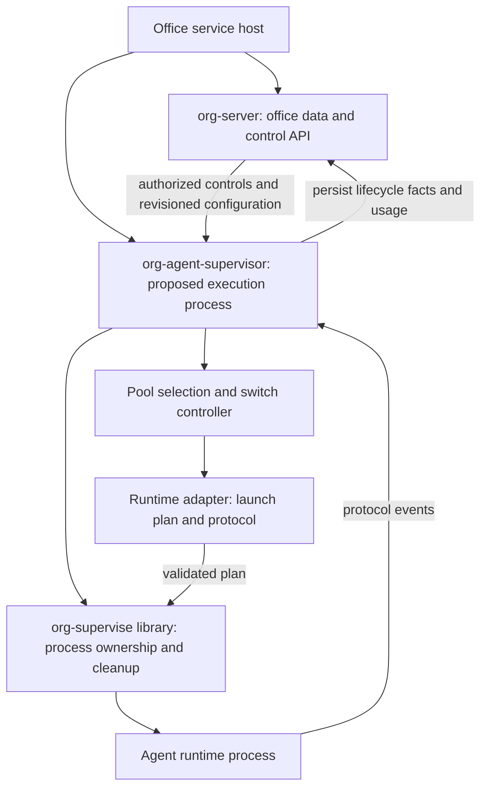
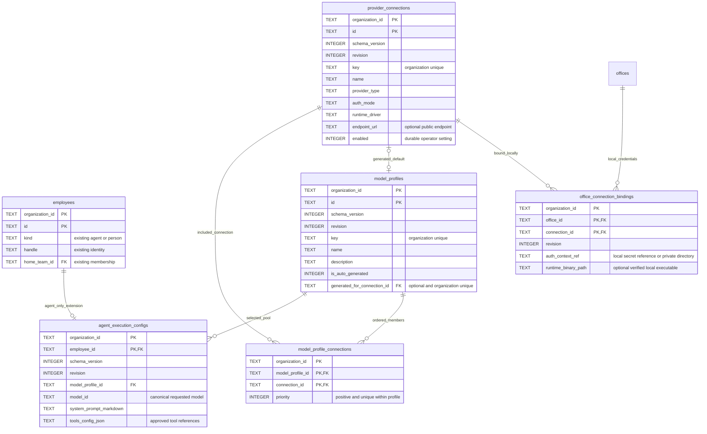

# Addendum: agent execution, subscription pools and supervisor ownership

Status: **separate review proposal**. This addendum does not amend the existing organization documents, `schema.sql`, application code or runtime contracts. It proposes how the supplied subscription-pool design fits the organization model and identifies the remaining decisions before integration.

Source input: `requirements_design_document_subscription_pool_model_profile_architecture.md`, supplied by the owner; SHA-256 `c3189b7af897be77cc9e8d4214edcc71a66039f3c14a95f6d08d3da5678c43dc`. Its implementation checklist is requirements context, not an instruction to run authentication commands, provision accounts or implement the checklist now. Model names, provider commands and isolation variables in that input are examples to verify against supported installed drivers, not a verified capability catalog.

## 1. Decisions supplied by the owner

- Extend the existing agent employees. A person and an agent keep the identity/home-team/handle model in [agent structure](04-agent-structure.md); an execution configuration is a one-to-one extension for employees of kind agent. There is no second competing agent identity table.
- An agent selects a model profile and a target model. A model profile contains ordered provider connections, with no manually maintained per-model list or overrides.
- The proposed **`org-agent-supervisor` process** owns connection switching, preparation of the execution environment and control of the agent process.
- Keep this proposal in one separate addendum for review. Existing canonical diagrams, schema and folder definitions remain unchanged until integration is separately requested.

The supplied design also requests isolated subscription contexts, discovered model capabilities, automatic single-connection profiles, health/entitlement-aware routing and cooldown failover. Those requirements are retained here with the storage and execution qualifications below. This addendum does not select the rest of v1's scheduling, memory, delegation, budget or messaging implementation for porting.

## 2. What starts processes in v1 today?

Inspected `origin/v1` at **`ee84e7ba231fbef79373f641c3d24fd26a248be5`**. These are repository findings, not claims about processes running on a user's machine.

| Component | Verified role in that checkout | Evidence |
| --- | --- | --- |
| `org-office-host` | Starts and supervises an **office server** process, `org-server`. It is not an implemented subscription-pool agent supervisor. | [Spawner::spawn](https://github.com/vgmello/agentic-org/blob/ee84e7ba231fbef79373f641c3d24fd26a248be5/apps/org-office-host/src/supervisor/child.rs#L175) calls the host's suspended-spawn path with the server executable. |
| `org-supervise` | Implemented **library** for explicit environments, child spawning, ownership, stopping, cleanup, probes and recovery primitives. It is not a standalone supervisor daemon or a routing policy engine. | [Library boundary](https://github.com/vgmello/agentic-org/blob/ee84e7ba231fbef79373f641c3d24fd26a248be5/crates/org-supervise/src/lib.rs#L1), [spawn ownership API](https://github.com/vgmello/agentic-org/blob/ee84e7ba231fbef79373f641c3d24fd26a248be5/crates/org-supervise/src/spawn.rs#L43). |
| `org-runtime` | Runtime-adapter contract. `AgentRuntime::plan_session` produces a launch plan and protocol session; the adapter itself does not spawn or do I/O. | [AgentRuntime](https://github.com/vgmello/agentic-org/blob/ee84e7ba231fbef79373f641c3d24fd26a248be5/crates/org-runtime/src/runtime.rs#L10). |
| `org-supervise::runtime` | Maps launch plans into process preparation; its own source explicitly says it is not a complete session runner. | [Runtime mapping](https://github.com/vgmello/agentic-org/blob/ee84e7ba231fbef79373f641c3d24fd26a248be5/crates/org-supervise/src/runtime.rs#L1). |
| `org-server` | Contains a recovery-record adapter over office-owned process rows. This is a real integration component, not proof that the whole agent launch loop is wired. | [Owned recovery adapter](https://github.com/vgmello/agentic-org/blob/ee84e7ba231fbef79373f641c3d24fd26a248be5/apps/org-server/src/owned_recovery.rs#L1). |
| Employee supervisor/session pump | **Proposed design:** the office hosts a logical employee supervisor; `org-office-sessions` is intended to implement the session pump. No `org-office-sessions`, native runtime-adapter packages or `org-agent-supervisor` executable appear in the checked Cargo workspace. A complete native-agent launch integration was not found there. | [Employee-supervision proposal](https://github.com/vgmello/agentic-org/blob/ee84e7ba231fbef79373f641c3d24fd26a248be5/docs/design/employee-supervision.md#L1), [planned session integration](https://github.com/vgmello/agentic-org/blob/ee84e7ba231fbef79373f641c3d24fd26a248be5/docs/design/agent-sessions.md#L125), [workspace](https://github.com/vgmello/agentic-org/blob/ee84e7ba231fbef79373f641c3d24fd26a248be5/Cargo.toml). |

Therefore, v1 supplies useful low-level process machinery and a proposed employee-control design. It does not establish that a finished `org-agent-supervisor` process already launches agents. This proposal introduces that explicit process boundary, whereas the older supervision document allows an office-hosted control loop without requiring a separate daemon.

V1's environment preparation is intentionally restricted. Its reviewed runtime-switch list does not currently include the connection-specific auth-context variables shown in the upload. See [reviewed switches](https://github.com/vgmello/agentic-org/blob/ee84e7ba231fbef79373f641c3d24fd26a248be5/crates/org-supervise/src/runtime.rs#L137) and [explicit environment construction](https://github.com/vgmello/agentic-org/blob/ee84e7ba231fbef79373f641c3d24fd26a248be5/crates/org-supervise/src/environment.rs#L52). Auth isolation needs an adapter/environment-contract extension; arbitrary environment maps must not bypass that boundary.

## 3. Proposed process responsibilities

`org-agent-supervisor` is a deterministic program controlling execution, not an extra LLM deciding how another LLM should behave. It is separate from employee identity and from the `org-agent` CLI employees use to communicate with the organization.

Suggested wiring for review:



The diagram is a proposed integration boundary, not an existing binary arrangement. Reusing the current office host to launch the new supervisor is the initial recommendation; startup/IPC ownership requires review with the host/server contracts. Recommend one supervisor service per office, with a logical controller and exclusive main-run slot per placed agent. One wrapper process per agent remains a deployment option to evaluate; the supplied requirements do not settle that granularity.

| Responsibility | Proposed owner |
| --- | --- |
| Durable organization/employee/profile configuration and authorized commands | Organization/office data services |
| Resolve ordered pool, check local eligibility and coordinate a switch | `org-agent-supervisor` |
| Prepare directories, credential bindings, workspace and explicit child environment | `org-agent-supervisor`, through reviewed binding/adapter contracts |
| Vendor-specific model/driver mapping, launch plan and protocol translation | Runtime adapter |
| Spawn, process identity, signals, stop, cleanup and reaping | `org-supervise`, called by the supervisor |
| Drive pipes/protocol, serialize turns and observe execution outcomes | Supervisor's session-pump layer |
| Persist accounting observations | Durable accounting ingestion using the actual selected route |

Keep one process owner for an agent child. The office server and the new supervisor must not independently reap/recover the same child. The existing server recovery adapter and any new IPC boundary need an explicit ownership handoff. Persist a launch mark before spawn and the process identity before admitting input, as v1's primitives require. Failed cleanup retains the run slot; it does not permit an overlapping replacement process.

## 4. Candidate data relationships

`workspace_id` in the supplied document maps to **`organization_id`** here. Teams, employees, profiles and connection definitions remain organization data outside office placement. Every reference below is scoped to the same organization and uses stable IDs. Readable keys/names do not replace foreign keys.



These are candidate table/field names for review, not additions to `schema.sql`. The employee entity is abbreviated to its existing identity fields; its full definition remains in document 04. Normal authored organization records retain the common attribution contract in [record contracts](08-record-contracts.md). Local bindings are machine data and are not imported as shared organization Git content.

- `agent_execution_configs.employee_id` is the existing employee ID and its primary key extension; only agent employees are eligible. Keep handle, name, role, team and reporting relationships on the employee. Do not duplicate them in a second `agents` entity.
- A profile holds only ordered connection references. Its model union is computed from discovered connection capabilities; it is not a second authored model list.
- `model_profile_connections` has one membership per profile/connection and a unique positive priority per profile. Reordering is one revisioned update; do not expose a half-reordered pool.
- An auto-generated default profile identifies its source connection. Create that profile and its one membership idempotently with the connection registration. Exactly one generated default exists per connection. A default marked auto-generated contains only that connection; promoting it to a manually edited pool clears that designation while preserving its ID/history.
- Deleting an assigned profile is restricted until agents are reassigned. Prefer retiring definitions that have execution/accounting history. Connection removal must explicitly detach memberships rather than silently empty an assigned pool through a cascade.
- A connection's durable `enabled` setting is separate from observed authentication, quota and discovery status. Missing runtime observations mean unknown, not healthy.

### Runtime observations and attempts

| Candidate record | Key and minimum fields | Storage |
| --- | --- | --- |
| `office_connection_state` | Organization, office, connection; observed auth/readiness state, driver version, observation/expiry times and fixed issue code | Runtime projection; rediscovered after loss |
| `office_connection_models` | Organization, office, connection, canonical model ID; driver-specific model/deployment ID, entitlement/capability evidence and observation/expiry times | Runtime discovery cache |
| `connection_quota_state` | Organization, connection, quota scope/key (connection-wide or model-specific); cooldown/reset, source observation and freshness | Coordinated runtime state across offices; provider observations are refreshed after loss |
| `agent_execution_attempts` | Stable attempt ID, employee, office/placement generation, task/run/turn context, selected profile/connection/driver/model, configuration revisions, predecessor attempt, checkpoint reference, state and times | Runtime control/history; minimal charged-attempt evidence also enters durable usage |

Discovery may normalize a provider's model/deployment identifier into a canonical model ID **on the connection observation**. This is driver-discovered routing metadata, not a manual per-model profile mapping. An endpoint's public model catalog is not, by itself, proof that a particular account can invoke every listed model. Preserve unknown entitlement rather than fabricating an available model list.

Expose the configured/discovered union separately from models runnable in a specific office. A model can be in the union while every supporting connection lacks a local binding, is cooling down or cannot enforce the required tools/policy. Healthy/eligible counts must state their office context and freshness. On restoration, an agent's requested model remains intact while discovery is pending; missing caches do not invalidate the durable agent configuration or silently choose another model.

The same subscription used by several offices has shared quota limits. Per-office auth health is local; account/model cooldown evidence must coordinate across offices. A model-specific limit must not automatically disable unrelated models unless provider evidence says the limit is connection-wide. The coordination/admission protocol remains a review decision; independent office-local healthy flags are insufficient.

## 5. Proposed storage layout

```text
<organization repository>/
├── provider-connections/<connection-id>.yaml
├── model-profiles/<profile-id>.yaml       # Ordered connection_ids; no model list
└── teams/<team-id>/.../agents/<employee-id>/
    ├── profile.md                        # Existing identity, role and home team
    └── execution.md                      # Profile/model/tools front matter; prompt body

<data-root>/<organization-id>/durable/local/offices/<office-id>/
├── connections/<connection-id>/binding.yaml
├── auth/<connection-id>/                 # Private CLI state, or external vault binding
└── supervision/ownership-journal/        # Live-process recovery evidence until cleanup

<data-root>/<organization-id>/runtime/<office-id>/
├── supervisor/                          # Attempt state, discovery and temporary files
└── teams/.../agents/<employee-id>/...     # Existing project/task worktrees
```

Only logical connection definitions and agent/model configuration enter organization Git. API keys, OAuth state, local absolute paths and resolved environments stay outside it. CLI authentication directories use private permissions; external vault references resolve locally. Validate that each office binding actually identifies the intended account. Recreating an office restores definitions first, then rebinds credentials and refreshes observations.

Lifecycle marks and exact process identities must remain recoverable while children may exist. The proposed local ownership journal preserves that evidence outside disposable logs/cache, and is retired only after cleanup is verified. This is a proposed adaptation to the new recoverable-storage model; v1 currently provides office-owned process records and recovery ports. Choose one canonical persistence owner/port during integration, not two independently authoritative journals.

Example `execution.md` front matter (selected fields):

```yaml
schema_version: 1
employee_id: existing-agent-employee-id
revision: 1
model_profile_id: subscription-pool-id
model_id: canonical-model-id-from-discovery
tools_config: [approved-shell-tool-id, approved-org-tool-id]
```

The Markdown body is the agent's system prompt. The existing role reference remains on `profile.md`; execution configuration does not override role authority. Tool references request approved capabilities, not access to secrets or arbitrary workspace tools. This example uses illustrative opaque IDs; new records follow the existing stable-ID contract.

## 6. Switching and environment preparation

The supervisor controls the following sequence:

1. Check the authoritative placement generation and the employee's exclusive main-run slot. Read a revisioned agent/pool snapshot from indexed/in-memory state.
2. Examine connections in priority order. Check operator enablement, current-office credential binding, driver availability, entitlement/capability evidence, applicable quota/cooldown and policy compatibility. Record structured skip reasons.
3. Resolve the selected credential context locally. Build an explicit per-child environment and launch context through the reviewed adapter/process boundary. Never mutate the server/supervisor's global environment to switch one agent, and never hand every connection's credentials to the child.
4. Persist attempt/ownership evidence, prepare the launch, spawn through `org-supervise`, persist process identity, then admit input and drive the protocol. Keep prompt, work scope and selected configuration revisions available for recovery.
5. When a connection fails, classify the failure and update the appropriately scoped observation. The supervisor decides whether a replacement can resume or replay, then stops/reaps the old process or uses a verified live-switch capability before admitting the replacement.
6. Retain actual route and usage evidence for every charged attempt, including failures. If no compatible connection can continue, expose the reason and recoverable state rather than silently changing the agent's target model or declaring its task complete.

A native CLI's environment is fixed at process creation. Selecting another auth directory does not change an already-running process. A compatible API-backed agent loop may support connection replacement without an OS restart, but that is an explicit driver capability. The supervisor coordinates either case. Auth variable names in the source document require installed-version evidence and typed allowlist support; this addendum does not establish that any particular variable is supported today.

For HTTP drivers, resolve secret material only into the approved provider-client context; ordinary agent tool processes receive no provider keys. CLI environment switches select an approved private authentication context rather than embedding plaintext credentials in employee configuration.

The supplied FR-6 asks for an immediate mid-turn retry after 429/quota exhaustion. Before tool execution, a retry may be straightforward. After file edits, commits, API calls or other side effects, blindly rerunning the turn can repeat completed work. Continue only from a compatible checkpoint/resume contract or verified idempotent boundary; otherwise preserve the attempt and require recovery. Authentication-context changes may also affect where native conversation state is stored. Same vendor/model name alone does not prove that a conversation is portable between accounts.

An HTTP SDK is an inference transport, while a CLI can own the agent's tool/conversation loop. HTTP drivers require a compatible framework agent loop and equivalent tool/policy/session guarantees before they qualify as overflow targets. Until that exists, report the connection as unsupported for this execution contract rather than treating CLI and HTTP calls as interchangeable.

Connection switching preserves employee identity, task assignment and task workspace. It does not create a new task, close the old one or discard its worktree. At most one main agent process owns that workspace/run slot. Fenced placement and verified cleanup are required before an agent moves offices or a replacement process starts.

The source's routing target of less than 5 ms applies to cached selection work. Discovery, credential refresh, shared-quota admission, checkpointing and OS startup are separately measured operations. This addendum neither claims that target has been measured nor requires network discovery on every turn.

## 7. Accounting integration without changing the ledger now

The [existing accounting draft](10-usage-and-cost-accounting.md) already records actual runtime, provider/model, consumer, work attribution, run correlation and source metadata. Candidate new capture adds a routing snapshot inside `source_metadata_json`:

```json
{
  "routing": {
    "attempt_id": "execution-attempt-id",
    "model_profile_id": "subscription-pool-id",
    "provider_connection_id": "selected-connection-id",
    "runtime_driver": "selected-driver-id",
    "requested_model_id": "canonical-requested-model-id",
    "resolved_model_id": "actual-driver-model-or-deployment-id",
    "agent_config_revision": 1,
    "profile_revision": 1
  }
}
```

Record the route actually used, not only the first configured pool member. Price the actual provider/model using the selected price version; subscription usage remains API-equivalent accounting, not an invoice. Count distinct consumption on retries, while avoiding duplicate reports of the same consumption. Missing failed-attempt usage stays explicitly incomplete. Capture the routing snapshot before hashing a new normalized event; do not rewrite old immutable events to add it.

Detailed live attempt state remains reconstructable/temporary; its minimum attribution evidence survives in the accounting archive without a foreign key to a live runtime process. Typed routing columns or additional durable attempt tables can be proposed after this addendum's review. Neither `usage_records` nor any existing schema table is changed here. Budget enforcement and automatic spending-limit pauses remain outside this addendum.

## 8. Review decisions before integration

| Topic | Proposal / remaining decision |
| --- | --- |
| Employee identity | Accepted by owner: extend the existing agent employee; retain one home team and stable identity. |
| Supervisor responsibility | Accepted by owner: `org-agent-supervisor` owns switching and environment/process setup. |
| Supervisor deployment | Recommend one service per office and one logical main-run controller per placed employee; confirm process granularity and startup/IPC contracts. |
| Reuse from v1 | Reuse the process/adapter boundaries and verified recovery primitives. Implement the missing integration; do not rename the library and claim a complete supervisor already exists. |
| Driver compatibility | Specify which CLI/HTTP combinations can resume the same execution contract; prove installed-driver behavior before advertising failover. |
| Shared subscription coordination | Define quota observation/admission/freshness across offices; it is separate from organizational spending budgets. |
| Recovery storage | Confirm the single canonical ownership-journal/store port and its relationship to process marks, placement fencing and office-cache reconstruction. |
| Source-provider assumptions | Verify model discovery, entitlement evidence and auth isolation for each supported installed version. Provider IDs/model strings in the upload are illustrative. |
| Scope still open | Complete task/session lifecycle, schedules, memory/checkpoints, messaging and delegation need their own selected contracts. This addendum supplies provider selection and supervision boundaries, not a port of every old agent behavior. |

After review, integration can update the agent document, canonical SQL and accounting relationships together. Until then, this file is the only added repository document and the existing structure remains the baseline for comparison.
