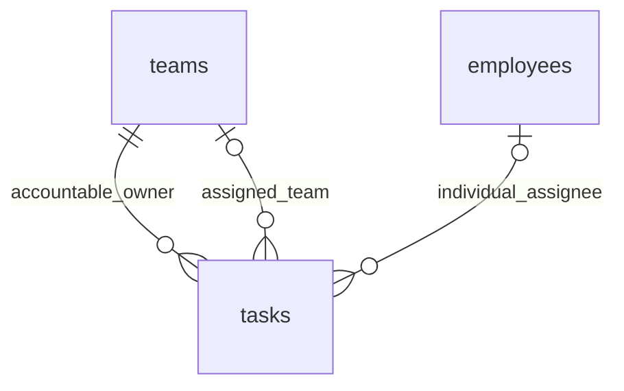

# Task ownership, assignment, reporter and activity history

Status: **selected** data contract, revision 6. This document owns task activity history and separate team and individual assignment. Private task notes are owned by [document 05](05-operational-data.md#private-notes-attached-to-tasks). It extends [typed tasks](03-features-and-work.md) and [record contracts](08-record-contracts.md).

Code today: tasks have individual assignment only. The acceptance journal that this contract's writes go through exists as an internal foundation ([executable migration](../executable-migration.md#where-the-entry-points-stand-2026-11-17)); no command reaches it yet. The selected model replaces the code's task model.

## Ownership and current responsibility

| Fact | Canonical field | Meaning |
| --- | --- | --- |
| Project owner | `projects.owner_team_id` | Accountable team for the project |
| Task owner | `tasks.team_id` | Accountable team for the task; for a project task this remains the project's owner |
| Assigned team | `tasks.assigned_team_id` | Optional team currently responsible for doing the work |
| Individual assignee | `tasks.assignee_id` | Optional current employee responsible for the work |
| Reporter/originator | `created_by_kind`, `created_by_id`, `created_at` | Original admitted creator and creation time |
| Latest updater | `updated_by_kind`, `updated_by_id`, `updated_at` | Actor/time of the latest accepted change |
| Previous assignments and changes | `task_events` | Immutable ordered facts, including actors, times and previous/new values |

Example: Payments owns project P-8 and task T-A42; Platform is assigned to resolve it, with Ana as the individual assignee. Payments remains accountable. Platform's queue includes it through `assigned_team_id`, Ana's queue through `assignee_id`, and Payments' owned backlog through `team_id`.

All task types use these fields. A projectless task has the same assignment choices. Team-only, individual-only, both and completely unassigned are valid states. New assigned teams and employees must be active and in the same organization. An individual need not have the assigned team as their home team. Assigning work does not grant tools/repository permissions, change project contribution membership, alter the reporter, move the canonical file or allocate another readable number. Home-team changes never silently rewrite current task assignment.

An assignment command supplies the complete desired pair, including explicit nulls, and the expected task revision. It replaces that pair atomically and appends an `assignment_changed` event with both old and new values. A stale revision conflicts without changing either field. Clearing the individual while retaining a team explicitly returns the task to that team's queue. Clearing a team does not silently infer another from the individual's profile.

Project ownership changes update affected project tasks' owning `team_id` together, recording their changes in the same recoverable operation. Assigned teams/individuals stay as recorded. Projectless ownership moves retain the separate scope/number-allocation rules in [document 06](06-identity-and-numbering.md).

## Reporter and resolution actors

The bound creator is the reporter, recorded as `created_by_kind`/`created_by_id` and separate from `assignee_id`; normal commands cannot supply another actor. There is no second, mutable reporter field. For bugs this is the reporter, for requests the requester, and for other tasks the originator. A person who signs in, the organization owner included, is recorded as kind `employee` with their person record's ID. Reporting on behalf of another person is not part of this contract.

A `status_changed`, verification or closure event records who reported that transition and when. That actor, the current assignee and the actual people/agents who contributed can differ. Show the recorded facts separately; do not label the latest assignee as the historical fixer. [Usage accounting](10-usage-and-cost-accounting.md) remains the source of actual consuming agents, including reviewers/helpers.

## Durable history and accepted writes

[Operational data — task activity history](05-operational-data.md#task-activity-history) owns the immutable event data, assignment-change payload, durable storage and accepted-write/rebuild contract. Assignment commands use that contract; task ownership and assignment do not confer mutation authority.

Task acceptance ([ADR-0006](../../adr/0006-selected-task-acceptance.md)) checks the
authority of the signed-in account live, at the host, and keeps the stable account
binding in protected receipts. The actor recorded is the account's person record
(`actor_kind: employee`). Instance-administrator authority for provisioning is a
separate check. Assignment grants neither authority nor capabilities. Agents need an explicit selected mutation
capability; a session binding alone does not establish it. Resolve task, desired active
targets and authorization against one writer-ordered directory generation.

`task.set_assignment` replaces the code's `task.assign`. Its command contains
exactly the complete pair and positive i64 `expected_revision`; the browser adapter
uses canonical decimal revision strings through `9223372036854775807`. Decode raw
wrappers/scope/commands before map conversion and reject duplicate keys. Fingerprint
validated typed intent (method/version/scope/task/revision/pair), separately from
codec-2 event token identity. Matching account-bound receipts return the original
authorized outcome before fresh revision/target validation; changed intent or
account conflicts. Even an equal pair validates requested targets and emits a new
revision/event. Exhaustion rejects before mutation.

Selected assignment fingerprint version 1 is SHA-256 over codec-2 canonical JSON
containing exactly `fingerprint_version: 1`, `method: task.set_assignment`,
`instance_id`, `organization_id`, `office_id`, `task_id`, integer
`expected_revision`, `assigned_team_id` and `assignee_id`. Scope comes from checked
channel/registry context; nullable IDs are explicit. The revision is encoded from
the validated i64, independently of its browser string representation. Operation
ID selects the receipt and is not hashed into the intent; actor/account binding
is protected metadata alongside it.

## What the code does today

These facts hold in the code; the selected model keeps their meaning and replaces the storage.

| Capability | Code | In the selected model |
| --- | --- | --- |
| Reporter and current individual assignment | `StoredItem` in `crates/org-work/src/model.rs` has `created_by` and `assignee_id`, taken from the bound actor | Same meaning, plus a separate assigned team |
| Assignment history | `task.assign` (`crates/org-work/src/tasks.rs`) records `Assigned { from, to }` | Each change records both assignment fields |
| Durable immutable events | the `work_events` table in `crates/org-office/src/store/work.rs` refuses replacement, update and deletion | The same invariant, in the file and journal projection |

## Private notes attached to tasks

Private task notes belong to [operational data](05-operational-data.md#private-notes-attached-to-tasks). Document 05 owns their requirements (PN-01–06), data structure and private storage contract. Shared task events must not contain private note bodies, IDs or author associations; only an explicitly published shared comment enters this history.

## Relationships

