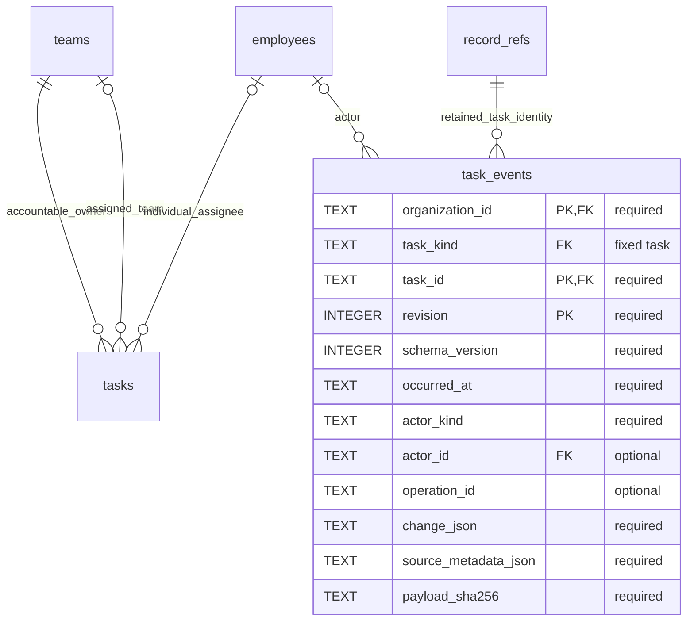

# Task ownership, assignment, reporter and activity history

Structural draft for v1. Document revision 2. This selects task activity history, separate team/individual assignment and private notes attached to tasks as requirements for the proposed data model. It changes documentation and draft SQL only; the application migration, command handlers and UI remain implementation work. The private-note requirement is not yet represented in the draft SQL or implemented in v1. It extends [typed tasks](03-features-and-work.md) and [record contracts](08-record-contracts.md).

## Ownership and current responsibility

| Fact | Canonical field | Meaning |
| --- | --- | --- |
| Project owner | `projects.owner_team_id` | Accountable team for the project |
| Task owner | `tasks.team_id` | Accountable team for the task; for a project task this remains the project's owner |
| Assigned team | `tasks.assigned_team_id` | Optional team currently responsible for doing the work |
| Individual assignee | `tasks.assignee_id` | Optional current employee responsible for the work |
| Reporter/originator | `created_by_kind`, `created_by_id`, `created_at` | Original admitted creator and creation time |
| Latest updater | `updated_by_kind`, `updated_by_id`, `updated_at` | Actor/time of the latest accepted change |
| Previous assignments and changes | `task_events` | Immutable ordered facts, including actors, times and previous/new values |

Example: Payments owns project P-8 and task T-42; Platform is assigned to resolve it, with Ana as the individual assignee. Payments remains accountable. Platform's queue includes it through `assigned_team_id`, Ana's queue through `assignee_id`, and Payments' owned backlog through `team_id`.

All task types use these fields. A projectless task has the same assignment choices. Team-only, individual-only, both and completely unassigned are valid states. New assigned teams and employees must be active and in the same organization. An individual need not have the assigned team as their home team. Assigning work does not grant tools/repository permissions, change project contribution membership, alter the reporter, move the canonical file or allocate another readable number. Home-team changes never silently rewrite current task assignment.

An assignment command supplies the complete desired pair, including explicit nulls, and the expected task revision. It replaces that pair atomically and appends an `assignment_changed` event with both old and new values. A stale revision conflicts without changing either field. Clearing the individual while retaining a team explicitly returns the task to that team's queue. Clearing a team does not silently infer another from the individual's profile.

Project ownership changes update affected project tasks' owning `team_id` together, recording their changes in the same recoverable operation. Assigned teams/individuals stay as recorded. Projectless ownership moves retain the separate scope/number-allocation rules in [document 06](06-identity-and-numbering.md).

## Reporter and resolution actors

V1 uses the bound creator as the reporter: `StoredItem.created_by` is separate from `assignee_id`, and normal commands cannot supply another actor. Preserve that meaning as `created_by_kind`/`created_by_id`; no second mutable reporter field is introduced. For bugs this is the reporter, for requests the requester, and for other tasks the originator. An owner is represented with kind `owner` and no employee ID. Import preserves genuine unknown provenance rather than inventing a reporter. Reporting on behalf of another person would need a separate future contract.

A `status_changed`, verification or closure event records who reported that transition and when. That actor, the current assignee and the actual people/agents who contributed can differ. Show the recorded facts separately; do not label the latest assignee as the historical fixer. [Usage accounting](10-usage-and-cost-accounting.md) remains the source of actual consuming agents, including reviewers/helpers.

## Durable history and accepted writes

The current task file remains its latest state. Each accepted task revision also has an immutable event at:

```text
<organization repository>/work-history/tasks/<task-id>/<revision>.json
```

The event's stable identity is `(organization_id, task_id, revision)`, preserving v1's task/version identity. It has no new human number counter and no regenerated identity during replay. File name, task ID and revision must agree. `task_kind` is always `task`, including for bugs and requests. A command can append several consecutive events; the final task revision is the last event revision.

The service commits the resulting task snapshot, its event(s), and the command's idempotency result as one recoverable operation before acknowledging. The durable local journal must retain everything needed to finish materializing these files after a crash, using the platform durability guarantees in [ADR-0002](../../adr/0002-storage-sqlite-sqlcipher-one-writer.md). Hourly Git publication includes the task and its events together; it is not the acknowledgement boundary. A machine restore requires unpublished journal records as well as the published organization state. Rebuilding SQLite projects the same event identities; it creates no new history.

Task commands have one accepting writer and use expected revisions; raw replicated files do not become an independent mutation authority. A newly created offline task may have a local history before readable-number registration. Concurrent edits to an already shared task must stay pending or conflict until its accepting writer resolves them; never publish two different accepted events for the same task/revision or silently choose the last file. Writer handover/fencing and remote delivery remain part of the mutation/replication implementation contract, not permission to bypass it. Work assignment does not by itself transfer write authority.

New tasks start with a `created` event at revision 1, including their initial public task state. Subsequent events capture every accepted task-content/metadata change, including assignments, ownership/scope, status/resolution, fields/body, checklist, comments, links, watchers, questions and waiting spans. `change.type` is a versioned event tag; its payload carries the facts and old/new values needed to explain that change. Unknown future tags are retained and shown as an unknown change, never silently discarded. Automated changes record system attribution and their cause when known. Optional `operation_id` identifies the accepted command and may repeat across events from that command; it is not the event identity or the complete command-receipt store.

`assignment_changed` uses this payload (IDs below represent existing records):

```json
{
  "type": "assignment_changed",
  "from": {"assigned_team_id": null, "assignee_id": null},
  "to": {"assigned_team_id": "platform-team-id", "assignee_id": "ana-employee-id"}
}
```

Both pairs contain both keys, each an ID string or explicit null. The surrounding event supplies actor/time, task identity and revision. Historical IDs inside a payload describe the past; never validate them against today's team membership or rewrite them after reorganization.

Event JSON uses the SQL scalar names except `change` and `source_metadata`, which are JSON objects projected into compact, sorted-key `change_json` and `source_metadata_json` strings. Expand optional scalar fields to explicit nulls and `source_metadata` to `{}`. `payload_sha256` hashes the UTF-8 JSON file with sorted object keys, compact separators, no ASCII escaping and the checksum field omitted. Identical event-identity retries compare the canonical hash before returning the original event; different content conflicts. Import verifies the actual hash, not merely the SQL column's format.

History is append-only. Fix a mistaken assignment or status with a new event; do not edit earlier facts. Preserve events when a task closes or its active file becomes a tombstone. The tombstone retains the final revision, reporter and last assignment pair in `record_metadata`, and `record_refs` continues resolving the task. The archive is shared task information under the task's visibility rules. Private notes, agent memory and credentials must not be copied into comments, event payloads or provenance metadata by default.

Before publishing/rebuilding an accepted projection, validate event hashes, unique identities, contiguous revision coverage from the known baseline, and agreement between the final event revision and the current task/tombstone revision. A missing middle event is an incomplete history that needs recovery. SQL's foreign keys and uniqueness constraints do not implement this whole validator or the atomic file-write protocol. A current snapshot alone is not proof of complete history.

## Verified v1 behavior and migration boundary

Inspected `v1` at **`ee84e7ba231fbef79373f641c3d24fd26a248be5`**:

| Capability | Source evidence | Proposed-model treatment |
| --- | --- | --- |
| Reporter and current individual assignment | [`StoredItem`](https://github.com/vgmello/agentic-org/blob/ee84e7ba231fbef79373f641c3d24fd26a248be5/crates/org-work/src/model.rs#L26) has `created_by` and `assignee_id`; [command identity](https://github.com/vgmello/agentic-org/blob/ee84e7ba231fbef79373f641c3d24fd26a248be5/crates/org-proto/src/work.rs#L15) comes from the bound actor | Retain those meanings; add a separately assigned team |
| Assignment history | [`task.assign`](https://github.com/vgmello/agentic-org/blob/ee84e7ba231fbef79373f641c3d24fd26a248be5/crates/org-work/src/tasks.rs#L292) records `Assigned { from, to }` | Retain prior individual assignments; record both assignment fields for new changes |
| Activity history | [`WorkEvent`](https://github.com/vgmello/agentic-org/blob/ee84e7ba231fbef79373f641c3d24fd26a248be5/crates/org-proto/src/work.rs#L758) includes version, actor, time, cause and typed change | Preserve events and their original order/provenance |
| Durable immutable events | [`work_events` storage](https://github.com/vgmello/agentic-org/blob/ee84e7ba231fbef79373f641c3d24fd26a248be5/crates/org-office/src/store/work.rs#L33) rejects replacement, update and deletion; current state/events share the office write | Carry the invariant into the proposed file/journal projection |

This is implemented domain/store behavior in v1, not a claim that every standalone browser/CLI workflow is wired. The new data model still requires its own application migration.

An eventual approved import keeps original task IDs, event versions, timestamps and actors. Map v1 bug/request history to `task_kind: task`. Preserve the entire original `WorkEvent` object, including `auto`, `cause` and `org_position`, in `source_metadata.legacy_event`; retain its original `change` payload. New events use this document's explicit assignment pair. Historical v1 `assigned` events describe an individual change only; do not infer a past assigned team from today's membership. Legacy current tasks default `assigned_team_id` to null unless the source explicitly records it.

Where only a snapshot survives, retain it with an explicit `history_baseline` event at its current revision, capturing the import time and source provenance. Mark earlier history unavailable; do not fabricate a sequence of past assignments or backdate the baseline as a user action. A baseline permits subsequent history but never makes the earlier period complete. Preserve v1 events for unselected features/workflows in staging until an explicit disposition is chosen. Selecting task history does not automatically select Undo, every old transition engine, or organization-wide event sourcing.

## Private notes attached to tasks

**Required capability: a person or agent can create, read, edit and delete their own private notes attached to a task.** This is part of the selected requirements. Its absence from v1 and the current SQL draft is a tracked design/implementation gap, not a reason to defer the capability out of scope.

Private task notes are **not implemented in the inspected v1 source**. Its [`CommentKind::Note`](https://github.com/vgmello/agentic-org/blob/ee84e7ba231fbef79373f641c3d24fd26a248be5/crates/org-proto/src/work.rs#L287) is an ordinary shared comment. [`work.comment` parameters](https://github.com/vgmello/agentic-org/blob/ee84e7ba231fbef79373f641c3d24fd26a248be5/crates/org-proto/src/work.rs#L1514) have no note visibility or private owner field. The [comment handler](https://github.com/vgmello/agentic-org/blob/ee84e7ba231fbef79373f641c3d24fd26a248be5/crates/org-work/src/items.rs#L25) stores its body in a regular `WorkEventKind::Comment`; the [change feed](https://github.com/vgmello/agentic-org/blob/ee84e7ba231fbef79373f641c3d24fd26a248be5/crates/org-work/src/feed.rs#L15) emits that event. The [activity read contract](https://github.com/vgmello/agentic-org/blob/ee84e7ba231fbef79373f641c3d24fd26a248be5/crates/org-work/src/ports.rs#L177) has no per-note reader restriction.

Consequently `note` must never be presented as private, and hiding it in the UI would not provide privacy. Existing note comments remain shared in migration; do not relabel them as private retrospectively.

Each private note must have stable identity, organization/task references, an immutable author/owner derived from the authenticated actor, body, creation/update timestamps and a revision for conflicting edits. A task can have multiple notes from multiple authors. The author is the default exclusive reader/editor; task ownership, assignment, team leadership and organization-owner/admin roles do not implicitly grant access. Any exceptional administrative access requires an explicit policy decision before implementation, rather than inheriting ordinary task permissions.

Enforce privacy on reads, writes, search, feeds, notifications and exports. Store and back up notes outside the shared task-history/Git path. Private note bodies and identifying metadata must not leak into shared activity, indexes or provenance. Reassignment must not expose another author's notes or transfer their ownership. Explicitly publishing a note creates a shared comment after the author confirms the intended audience; it does not silently change the private original's visibility.

Private notes must survive restart and task closure/archive with their access restrictions intact. Define authorized recovery, retention, note deletion and task deletion behavior in the private storage contract before implementation. Deletion must include a documented policy for backups and retained versions; immutable shared task history must not prevent private-note deletion. Neither the shared history projection nor an agent-memory folder satisfies this requirement.

Acceptance criteria for the required capability:

| ID | Required evidence |
| --- | --- |
| PN-01 | A bound person or agent can create multiple private notes on a task and read/edit/delete their own notes; forged author IDs and stale edit revisions are rejected. |
| PN-02 | Another task reader, assignee, team lead or administrator cannot obtain or mutate a private note through direct IDs, task responses, search, feeds, notifications or exports under the default author-only policy. |
| PN-03 | Task reassignment and ownership changes preserve the note's author and privacy; no note is copied to the new team or assignee. |
| PN-04 | Restart, authorized recovery and task closure/archive retain the note and enforce the same access restrictions. Shared organization Git and task history contain no private-note body or identifying metadata. |
| PN-05 | Only an explicit author action publishes a shared comment; ordinary note saves never publish, and the private original retains its visibility. |
| PN-06 | Note deletion and task deletion follow the documented private retention/backup policy without exposing note content through shared history. |

Completion remains blocked on the private storage/schema, authorization/API and UI implementation and these acceptance checks. The existing draft-schema tests do not validate this feature. V1's shared `note` comments alone cannot count as satisfying it.

## Relationships



## SQLite projection

```sql
CREATE TABLE task_events (
  organization_id TEXT NOT NULL REFERENCES organizations(id),
  task_kind TEXT NOT NULL DEFAULT 'task' CHECK (task_kind = 'task'),
  task_id TEXT NOT NULL,
  revision INTEGER NOT NULL CHECK (revision >= 1),
  schema_version INTEGER NOT NULL CHECK (schema_version = 1),
  occurred_at TEXT NOT NULL,
  actor_kind TEXT NOT NULL CHECK (actor_kind IN ('employee', 'owner', 'system', 'unknown')),
  actor_id TEXT,
  operation_id TEXT,
  change_json TEXT NOT NULL CHECK (
    json_valid(change_json) AND json_type(change_json) = 'object'
    AND json_type(change_json, '$.type') IS 'text'
    AND length(json_extract(change_json, '$.type')) > 0),
  source_metadata_json TEXT NOT NULL DEFAULT '{}' CHECK (
    json_valid(source_metadata_json) AND json_type(source_metadata_json) = 'object'),
  payload_sha256 TEXT NOT NULL CHECK (length(payload_sha256) = 64 AND payload_sha256 NOT GLOB '*[^0-9a-f]*'),
  PRIMARY KEY (organization_id, task_id, revision),
  CHECK ((actor_kind = 'employee' AND actor_id IS NOT NULL) OR (actor_kind <> 'employee' AND actor_id IS NULL)),
  CHECK (json_extract(change_json, '$.type') <> 'assignment_changed' OR (
    json_type(change_json, '$.from') IS 'object' AND json_type(change_json, '$.to') IS 'object'
    AND COALESCE(json_type(change_json, '$.from.assigned_team_id') IN ('text', 'null'), 0)
    AND COALESCE(json_type(change_json, '$.from.assignee_id') IN ('text', 'null'), 0)
    AND COALESCE(json_type(change_json, '$.to.assigned_team_id') IN ('text', 'null'), 0)
    AND COALESCE(json_type(change_json, '$.to.assignee_id') IN ('text', 'null'), 0))),
  FOREIGN KEY (organization_id, task_kind, task_id) REFERENCES record_refs(organization_id, kind, id)
    DEFERRABLE INITIALLY DEFERRED,
  FOREIGN KEY (organization_id, actor_id) REFERENCES employees(organization_id, id)
    DEFERRABLE INITIALLY DEFERRED
) STRICT;
```

`schema.sql` adds immutable-event triggers, including protection against `INSERT OR REPLACE`, and an assigned-team/status index on tasks. Existing task/revision primary-key ordering serves per-task activity reads. Run the executable draft checks with `python3 docs/design/organization-data/test_schema.py`; these checks do not claim to implement the future command or import service.
