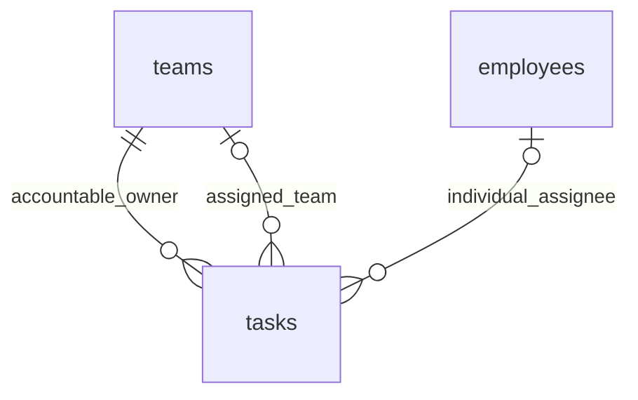

# Task ownership, assignment, reporter and activity history

Structural draft for v1. Document revision 4. This selects task activity history and separate team/individual assignment for the proposed data model. Private task notes are required operational data owned by document 05. Selected assignment integration is in progress under ADR-0006: office schema 7 and library acceptance/recovery consumers now exist. Protected host admission/authentication, actual adoption, public command transport and production UI are still required before runtime availability; storage tests alone are not vertical acceptance. The private-note data structure is defined in [operational data](05-operational-data.md#private-notes-attached-to-tasks) and its separate SQL; it remains unimplemented in v1. It extends [typed tasks](03-features-and-work.md) and [record contracts](08-record-contracts.md).

## Ownership and current responsibility

| Fact | Canonical field | Meaning |
| --- | --- | --- |
| Project owner | `projects.owner_team_id` | Accountable team for the project |
| Task owner | `tasks.team_id` | Accountable team for the task; for a project task this remains the project's owner |
| Assigned team | `tasks.assigned_team_id` | Optional team currently responsible for doing the work |
| Individual assignee | `tasks.assignee_id` | Optional current employee responsible for the work |
| Reporter/originator | `created_by_kind`, `created_by_id`, `created_at` | Original admitted creator and creation time |
| Latest updater | `updated_by_kind`, `updated_by_id`, `updated_at` | Actor/time of the latest accepted change |
| Previous assignments and changes | `task_events` | Immutable ordered facts, including actors, times and previous/new values |

Example: Payments owns project P-8 and task T-42; Platform is assigned to resolve it, with Ana as the individual assignee. Payments remains accountable. Platform's queue includes it through `assigned_team_id`, Ana's queue through `assignee_id`, and Payments' owned backlog through `team_id`.

All task types use these fields. A projectless task has the same assignment choices. Team-only, individual-only, both and completely unassigned are valid states. New assigned teams and employees must be active and in the same organization. An individual need not have the assigned team as their home team. Assigning work does not grant tools/repository permissions, change project contribution membership, alter the reporter, move the canonical file or allocate another readable number. Home-team changes never silently rewrite current task assignment.

An assignment command supplies the complete desired pair, including explicit nulls, and the expected task revision. It replaces that pair atomically and appends an `assignment_changed` event with both old and new values. A stale revision conflicts without changing either field. Clearing the individual while retaining a team explicitly returns the task to that team's queue. Clearing a team does not silently infer another from the individual's profile.

Project ownership changes update affected project tasks' owning `team_id` together, recording their changes in the same recoverable operation. Assigned teams/individuals stay as recorded. Projectless ownership moves retain the separate scope/number-allocation rules in [document 06](06-identity-and-numbering.md).

## Reporter and resolution actors

V1 uses the bound creator as the reporter: `StoredItem.created_by` is separate from `assignee_id`, and normal commands cannot supply another actor. Preserve that meaning as `created_by_kind`/`created_by_id`; no second mutable reporter field is introduced. For bugs this is the reporter, for requests the requester, and for other tasks the originator. An owner is represented with kind `owner` and no employee ID. Import preserves genuine unknown provenance rather than inventing a reporter. Reporting on behalf of another person would need a separate future contract.

A `status_changed`, verification or closure event records who reported that transition and when. That actor, the current assignee and the actual people/agents who contributed can differ. Show the recorded facts separately; do not label the latest assignee as the historical fixer. [Usage accounting](10-usage-and-cost-accounting.md) remains the source of actual consuming agents, including reviewers/helpers.

## Durable history and accepted writes

[Operational data — task activity history](05-operational-data.md#task-activity-history) owns the immutable event data, assignment-change payload, durable storage and accepted-write/rebuild contract. Assignment commands use that contract; task ownership and assignment do not confer mutation authority.

The initial selected integration in [ADR-0006](../../adr/0006-selected-task-acceptance.md)
uses live authenticated organization-owner authority, with stable account binding
kept in protected receipts. An owner has `actor_kind: owner`, null employee ID;
instance-administrator authority for provisioning is a separate check. Assignment
grants neither authority nor capabilities. Agents need an explicit selected mutation
capability; legacy binding alone does not establish it. Resolve task, desired active
targets and authorization against one writer-ordered directory generation.

`task.set_assignment` is additive to legacy `task.assign`. Its command contains
exactly the complete pair and positive i64 `expected_revision`; the browser adapter
uses canonical decimal revision strings through `9223372036854775807`. Decode raw
wrappers/scope/commands before map conversion and reject duplicate keys. Fingerprint
validated typed intent (method/version/scope/task/revision/pair), separately from
codec-2 event token identity. Matching account-bound receipts return the original
authorized outcome before fresh revision/target validation; changed intent or
account conflicts. Even an equal pair validates requested targets and emits a new
revision/event. Exhaustion rejects before mutation.

Selected assignment fingerprint version 1 is SHA-256 over codec-2 canonical JSON
containing exactly `fingerprint_version: 1`, `method: task.set_assignment`,
`instance_id`, `organization_id`, `office_id`, `task_id`, integer
`expected_revision`, `assigned_team_id` and `assignee_id`. Scope comes from checked
channel/registry context; nullable IDs are explicit. The revision is encoded from
the validated i64, independently of its browser string representation. Operation
ID selects the receipt and is not hashed into the intent; actor/account binding
is protected metadata alongside it. This fingerprint version does not redefine
legacy hashes, task-event identities or schema versions.

## Verified v1 behavior and migration boundary

Inspected `v1` at **`ee84e7ba231fbef79373f641c3d24fd26a248be5`**:

| Capability | Source evidence | Proposed-model treatment |
| --- | --- | --- |
| Reporter and current individual assignment | [`StoredItem`](https://github.com/vgmello/agentic-org/blob/ee84e7ba231fbef79373f641c3d24fd26a248be5/crates/org-work/src/model.rs#L26) has `created_by` and `assignee_id`; [command identity](https://github.com/vgmello/agentic-org/blob/ee84e7ba231fbef79373f641c3d24fd26a248be5/crates/org-proto/src/work.rs#L15) comes from the bound actor | Retain those meanings; add a separately assigned team |
| Assignment history | [`task.assign`](https://github.com/vgmello/agentic-org/blob/ee84e7ba231fbef79373f641c3d24fd26a248be5/crates/org-work/src/tasks.rs#L292) records `Assigned { from, to }` | Retain prior individual assignments; record both assignment fields for new changes |
| Activity history | [`WorkEvent`](https://github.com/vgmello/agentic-org/blob/ee84e7ba231fbef79373f641c3d24fd26a248be5/crates/org-proto/src/work.rs#L758) includes version, actor, time, cause and typed change | Preserve events and their original order/provenance |
| Durable immutable events | [`work_events` storage](https://github.com/vgmello/agentic-org/blob/ee84e7ba231fbef79373f641c3d24fd26a248be5/crates/org-office/src/store/work.rs#L33) rejects replacement, update and deletion; current state/events share the office write | Carry the invariant into the proposed file/journal projection |

This is implemented domain/store behavior in v1, not a claim that every standalone browser/CLI workflow is wired. The new data model still requires its own application migration.

An approved import keeps original task IDs, event versions, timestamps and actors.
Map v1 bug/request history to `task_kind: task`. Newly wrapped codec-2 events retain
the entire original `WorkEvent` object **and raw numeric tokens**, including `auto`,
`cause`, `org_position` and original change, in `source_metadata.legacy_event`.
Capture tokens before lossy decoding. Never replace an already accepted selected
event at its identity or rewrite schema-1 bytes/hashes. Unsupported codecs stay
staged/unverified. New assignments use document 05's complete pair; historical
individual changes do not imply a team from today's membership. Legacy current
tasks default `assigned_team_id` to null only when the source lacks that fact.

Adoption supplies evidenced owner/project/home-team/scope/number mappings, preserved
sources and verified writer/continuity evidence. Do not infer a missing owner from
legacy optional team or first membership. Activate durable adoption gates with the
import; every legacy mutator/cascade/Undo/replication path must refuse incompatible
writes to adopted IDs. Nonadopted records retain legacy semantics. Unmapped records
and opaque unsupported sources remain intact in staging.

The first executable existing-work profile is
[LEGACY-ADOPT-1](../../adr/0010-legacy-task-adoption.md), with its persistent
metadata contract in [document 05](05-operational-data.md#explicit-legacy-work-adoption-profile-1).
Admit only a nondeleted version-1 item and its sole matching Created event. Require
explicit public classification and owner/project/scope/number/principal mappings;
verify literal `B-`/`REQ-`/task references against the original type and number,
preserving the literal reference rather than renaming an existing identity.
An owner pseudo-recipient never becomes an employee. Missing facts, collisions,
unknown private provenance and unsupported source/history remain staged.

Default to a revision-1 baseline at import time with the migration actor, retaining
the complete original snapshot and Created event losslessly in metadata. Preserve
the actual original reporter/creation time in current task creation fields and
the original event actor/time inside `legacy_event`; the migration actor/time do
not replace either. Earlier selected facts remain unavailable, even at baseline 1.
Do not backdate newly supplied team/project/mapping facts. Existing selected
creation admission still requires genuine as-of full-state evidence; this bounded
profile does not reconstruct it. After adoption, normal legacy mutation, cascade,
Undo, replication and direct SQL all refuse the adopted ID; unadopted controls
retain their original behavior.

Where only a snapshot survives, retain it with an explicit `history_baseline` event at its current revision, capturing the import time and source provenance. Mark earlier history unavailable; do not fabricate a sequence of past assignments or backdate the baseline as a user action. A baseline permits subsequent history but never makes the earlier period complete. Preserve v1 events for unselected features/workflows in staging until an explicit disposition is chosen. Selecting task history does not automatically select Undo, every old transition engine, or organization-wide event sourcing.

## Private notes attached to tasks

Private task notes belong to [operational data](05-operational-data.md#private-notes-attached-to-tasks). Document 05 owns their requirements (PN-01–06), v1 implementation evidence, data structure and private storage contract. Shared task events must not contain private note bodies, IDs or author associations; only an explicitly published shared comment enters this history.

## Relationships

