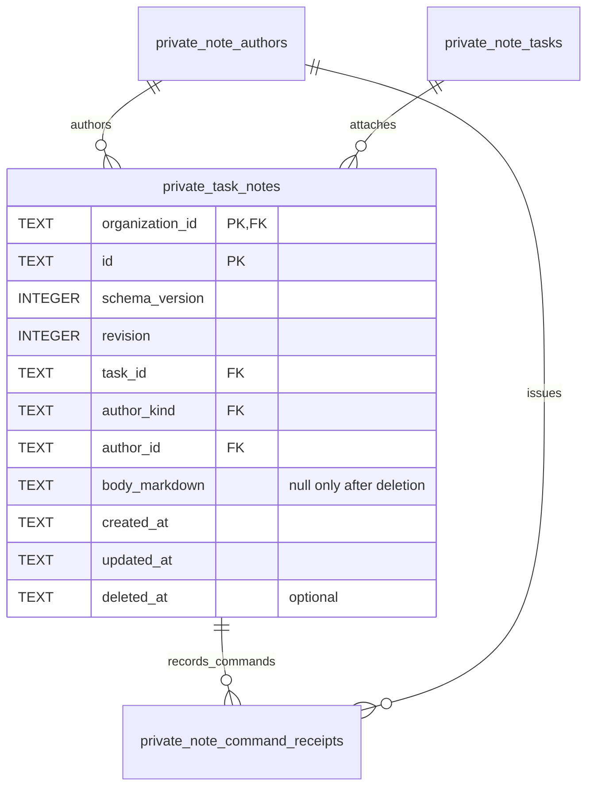

# Private task-note data structure

Structural draft for v1. Revision 1. Implements the data-model part of the required [PN-01–06 capability](12-task-assignment-and-history.md#private-notes-attached-to-tasks). Runtime authorization, API/UI and recovery integration remain application work.

## Records and relationships

The executable definition is [private-notes-schema.sql](private-notes-schema.sql). It belongs to a **separate durable private database**, not `schema.sql`, organization Git or shared task history. There is no public reverse link, note count or shared event revealing a private note's existence.

| Record | Key and relationship | Purpose |
| --- | --- | --- |
| `private_note_authors` | `(organization_id, author_kind, author_id)` | Private identity mirror populated from the trusted employee/authentication directory; never from an unverified client claim |
| `private_note_tasks` | `(organization_id, task_id)` | Private mirror of shared `record_refs` with `kind = task`, including tombstones; `is_deleted` mirrors task deletion |
| `private_task_notes` | `(organization_id, id)`; same-organization foreign keys to both mirrors | One author's private note attached to one task; many authors and many notes per task are allowed |
| `private_note_command_receipts` | `(organization_id, author_kind, author_id, operation_id)`; references note and author | Durable request digest, command, accepted note revision, state, publication comment ID, error code and start/finish times; no body copies |

An `employee` author uses the immutable employee ID for either a person or an agent. An `owner` author uses the stable authenticated subject ID from the authentication subsystem, **not** the literal role name `owner`. Two people with an owner/admin role do not thereby share notes. The service derives this tuple from the authenticated actor. The mirrors contain no credentials and are not authorization grants. Their public-source relationships are validated by the service because SQLite cannot enforce a foreign key into a different database. Retain referenced mirror identities after employee deactivation/task deletion; names, home teams and assignments are not note ownership.



| Note field | Contract |
| --- | --- |
| `id` | Stable UUIDv7 for new notes; no readable number; retained after deletion |
| `organization_id`, `task_id` | Immutable attachment; an existing task of any type, including projectless tasks |
| `author_kind`, `author_id` | Immutable original author and exclusive default reader/editor; derived from the bound actor |
| `schema_version`, `revision` | Format 1; revision starts at 1 and advances by exactly one on each edit/deletion |
| `body_markdown` | Nonempty current Markdown text; null on a deletion tombstone |
| `created_at`, `updated_at` | Server-generated canonical UTC timestamps using fixed precision; creation is immutable, update time never decreases |
| `deleted_at` | Null while active; equals update time on deletion; deletion cannot be reversed under the same ID |

Example decrypted record (an API shape, **not a shared file**):

```json
{
  "organization_id": "example-org-id",
  "id": "019a8440-0000-7000-8000-000000000001",
  "schema_version": 1,
  "revision": 1,
  "task_id": "existing-task-id",
  "author_kind": "employee",
  "author_id": "existing-employee-id",
  "body_markdown": "Check my reproduction before posting a shared update.",
  "created_at": "2026-11-15T12:00:00.000Z",
  "updated_at": "2026-11-15T12:00:00.000Z",
  "deleted_at": null
}
```

## Storage and mutation contract

HQ hosts the single accepting private-note service. Its authoritative database is `<data-root>/<organization-id>/durable/private/task-notes.db`, using SQLCipher and the host key-custody/durable-write rules in [ADR-0002](../../adr/0002-storage-sqlite-sqlcipher-one-writer.md). It is not a disposable office cache. Its files, WAL and backups remain service-private; SQLite access is server-only. Other offices call this service as the note's bound author. They do not replicate private notes through organization Git or shared event delivery. If HQ is unavailable, edits are not acknowledged as accepted. Fenced service recovery is required before another host accepts writes.

Creation validates that the authenticated actor can access the referenced task, installs trusted identity mirrors and inserts the note in one private transaction. Each read/list/search/edit/delete scopes by **organization AND bound author kind/ID**, as well as note/task ID where applicable. Task membership or role alone is insufficient. Authorized authors can retain access to their existing notes after task archival/deletion; deactivated credentials still fail authentication. Unauthorized and missing IDs return the same not-found response. SQL foreign keys protect structure; **they do not implement these access checks**.

Edits and deletion use an expected revision in the update predicate and check that exactly one row changed. The transaction supplies the new revision/time. Every mutation has an operation ID and canonical request SHA-256, scoped to the bound author. Persist `private_note_command_receipts` atomically with successful create/edit/delete writes. Check the receipt before current revision checks: the same operation/digest returns the original note ID/revision even after later edits; different payload reuse conflicts. Rejected create/edit/delete requests have no accepted write or receipt. Receipt responses contain metadata only; a subsequent authorized get retrieves the current body. Creation uses a stable note ID as well as the operation ID; another operation cannot overwrite that ID. The schema triggers prevent identity/author/task changes, skipped revisions, replacement and resurrection. No editable `visibility` flag can turn a private row into a shared comment.

Publishing is a separate explicit author command: validate access, persist a `publish` receipt in `pending` state with the chosen revision and a freshly allocated stable shared comment ID, then copy that revision's body through the shared task mutation service. Pending publication blocks edits/deletion of that note so recovery can retry the same body without keeping a second private body archive. Use the shared comment ID as the shared idempotency key, independent of the private operation ID. Query/retry the shared mutation until its outcome is known; only then finish the receipt as `completed` or a definitively `rejected` result with an error code. A lost reply leaves it pending, not rejected. Receipt completion releases the edit/delete guard. Shared history records only the intentionally published comment and normal author/time; it must not include the private note ID or other private provenance. The private original stays private. Comment publication has its own task-access check; owning a private note alone does not authorize posting to a task. The service serializes operations through its single writer; it does not claim one transaction spans both databases.

## Retention and recovery

Task closure, reassignment, ownership changes or archival do not delete notes or transfer their authors. Task tombstones retain the private attachment through `private_note_tasks`; no cascade removes note content. Deleting a note atomically clears its body and leaves only the private identity/revision/timestamps as a tombstone. There is no note-body version archive in this model. The author can create a new note, but cannot resurrect a deleted ID.

Back up the private database consistently, with encrypted backups and authorized key recovery separate from shared organization backups. Rebuilding `schema.sql` or restoring organization Git cannot reconstruct private notes. A restore must reconcile deletions accepted after the backup before serving reads; retain those tombstones through the backup retention window. If that deletion evidence or the key is unavailable, recovery blocks rather than exposing an older deleted body. Deployment must define and enforce a maximum private-backup retention period before enabling this feature. Logical deletion does not promise immediate physical erasure from WAL, storage media or older encrypted backups.

Run `python3 docs/design/organization-data/test_schema.py` for structural checks of private-note references, immutable ownership, revisions, tombstones and separation from shared SQL. These tests use in-memory SQLite and do not prove encryption, authenticated access, publication idempotency or backup recovery; PN-01–06 require those application tests before the feature is complete.
