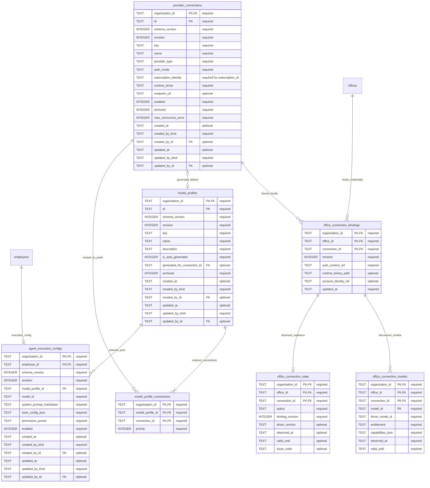

# Model providers, connections and pools

Status: **selected** data contract, revision 2. This is the data-model view of the selected [execution contract](11-model-profiles-and-agent-execution.md), using the same records and SQL. It defines no second provider/pool system. Supervision, turn admission, failover, process recovery and installation remain in document 11.

## Concepts and boundaries

| Concept | Representation | Meaning |
| --- | --- | --- |
| Provider | `provider_connections.provider_type` | Canonical registered provider namespace; identifies the service/vendor, not an account or credential |
| Runtime driver | `provider_connections.runtime_driver` | Registered adapter implementation used to execute requests; distinct from provider identity |
| Connection | `provider_connections` | Organization-wide route configuration for one subscription, API credential context or cloud identity context |
| Subscription | `subscription_identity` on a subscription connection | Canonical non-secret entitlement/account identity; exactly one connection per provider subscription within the organization |
| Pool | `model_profiles` | Named ordered set of connections; the existing schema calls a pool a model profile |
| Pool membership | `model_profile_connections` | Many-to-many pool/connection relationship with explicit priority |
| Local authentication | `office_connection_bindings` | One office's private credential binding for an existing connection |
| Local readiness | `office_connection_state` | Freshness-bound auth/driver observation for that binding |
| Available models | `office_connection_models` | Per-office, per-connection observations of canonical model IDs, adapter model IDs, entitlement and capabilities |
| Agent selection | `agent_execution_configs` | One selected pool and one canonical target model for an agent, plus its execution settings |

Providers and runtime drivers are registered identifiers validated against the adapter registry; this version has no organization-authored `providers` or `runtime_drivers` table. Models are discovered identifiers, not a manually maintained global models table. `model_id` is therefore not a foreign key to a global catalog: an agent can retain a requested model while discovery is pending, with readiness `MODEL_UNVERIFIED`. Provider aliases and canonical model names must be normalized by the adapters; a display label never creates a new provider or subscription identity.

## Relationships



- A runnable agent has one execution configuration selecting one pool and one target model. People have no execution configuration; an agent without one is not runnable.
- A valid pool contains 1–64 distinct connection IDs in contiguous priority order. Many agents can select one pool, and one connection can be reused by several pools. Array order becomes priorities 1, 2, 3, and so on.
- Connection creation atomically creates one generated single-connection default profile. Manually assembled pools coexist with those defaults. Converting a default into a manual pool clears its generated designation; it cannot keep claiming to be that connection's generated default.
- Two connection IDs cannot represent the same `(organization_id, provider_type, subscription_identity)`, even if one is disabled/archived. Two offices using one subscription create two local bindings to the same connection. A subscription pool's different connections represent different subscriptions.
- Each office has at most one binding per connection. Credentials and CLI auth state stay private to the office worker (`agentic-org-office`) or external credential vault under `durable/local/offices/<office-id>/auth/<connection-id>/`, wrapped with the office's per-office secrets key using the provider-credential wrap domain (`agentic-org/provider-credential/v1`, [ADR-0016](../../adr/0016-no-application-level-data-encryption.md) decision 3). Under [ADR-0032](../../adr/0032-browser-driven-cli-signin-and-remote-token-distribution.md), HQ may deliver per-office Claude tokens or—as the default for multi-office Codex subscriptions whose refresh tokens rotate on use—short-lived Codex access tokens (`chatgptAuthTokens`) over the Organization-CA mTLS federation channel (satellites write no `auth.json` under centralized Codex refresh; independent per-office `codex login --device-auth` bindings remain available for extended offline operation). Any persisted credential on a satellite is wrapped locally by the satellite worker under its own office secrets key; the shared connection record and organization Git never contain secrets or office-specific credential paths.
- A connection can expose many models; the same canonical model can be available through multiple connections. A pool's model list is the union of discovered confirmed support. Connections need not expose identical catalogs; only those supporting the agent's chosen model can serve its turn.
- Pool failover preserves the chosen canonical model. Changing models is a separate configuration decision, not an implicit consequence of selecting another connection.
- Quota/cooldown admission belongs to the organization-wide connection and is shared across its pools, agents and office bindings. API/cloud provider-wide quota grouping is not inferred from different API keys; document 11 explicitly limits the subscription-identity rule to verified subscription contexts.

The pool's minimum size, contiguous priorities, generated-profile contents, registry validation, fresh model eligibility and quota capacity are service transaction/readiness rules. SQL enforces the scoped foreign keys, distinct membership/priority, generated-default uniqueness and subscription identity/replacement constraints. SQL alone cannot prove external subscription identity or available quota.

## Canonical files

```text
<organization repository>/
├── provider-connections/<connection-id>.yaml
├── model-profiles/<profile-id>.yaml
└── teams/<team-id>/.../agents/<employee-id>/
    ├── profile.md                    # Employee identity, home team and role
    └── execution.md                  # Selected pool/model and system prompt

<data-root>/<organization-id>/durable/local/offices/<office-id>/
├── connections/<connection-id>/binding.yaml
└── auth/<connection-id>/             # Private CLI state or vault reference
```

Shared records use the common stable IDs, revisions and attribution from [record contracts](08-record-contracts.md). File IDs must match row IDs. Private bindings and auth/model observations are not organization Git content. Observation caches are rebuilt by verified probes; recovering a cached observation does not make it fresh. Document 11 owns their journal and refresh protocol.

## Examples

These examples use illustrative existing IDs and a registered example adapter. Common attribution is omitted for readability; accepted writes supply the required bound actor and timestamps. `subscription-b` has a separate definition with a different verified subscription identity.

```yaml
# provider-connections/subscription-a.yaml
organization_id: example-org
id: subscription-a
schema_version: 1
revision: 1
key: subscription-a
name: Subscription A
provider_type: example-provider
auth_mode: subscription_cli
subscription_identity: provider-canonical-subscription-a
runtime_driver: verified-native-driver
endpoint_url: null
enabled: true
archived: false
max_concurrent_turns: 1
```

```yaml
# model-profiles/primary-pool.yaml
organization_id: example-org
id: primary-pool
schema_version: 1
revision: 1
key: primary-pool
name: Primary pool
description: Same-model fallback across distinct subscriptions
is_auto_generated: false
generated_for_connection_id: null
archived: false
connection_ids: [subscription-a, subscription-b]
```

```markdown
---
# execution.md
schema_version: 1
employee_id: existing-agent-id
revision: 1
enabled: true
model_profile_id: primary-pool
model_id: example-provider/model-v1
tools_config: [approved-shell-tool-id]
permission_preset: safe_ask
---
Work within the assigned role and approved tool policy.
```

```yaml
# Private office binding: not organization Git
organization_id: example-org
office_id: east-office
connection_id: subscription-a
revision: 1
auth_context_ref: vault:office-east/subscription-a
runtime_binary_path: /opt/verified-driver/bin/agent
account_identity_ref: evidence:subscription-a
updated_at: "2026-11-15T12:00:00Z"
```

Example relationship: Ana selects `primary-pool` and `example-provider/model-v1`. The east office has bindings for A and B. The router tries the first eligible connection supporting that model; if A cannot admit the turn, B may be considered under document 11's safe failover rules. A second office using A binds `subscription-a` again locally and shares its quota. It does not register a third connection for A's subscription.

## File to SQL mapping

| Table/view | Source and field meaning |
| --- | --- |
| `provider_connections` | Shared connection YAML: same-named identity/config/attribution fields. `auth_mode` is `subscription_cli`, `api_key` or `cloud_iam`; subscription identity is required for the first and may be null for non-subscription API/cloud contexts. `max_concurrent_turns` is positive and defaults to 1. |
| `model_profiles` | Shared profile YAML: scalar identity/name/description/generated/default/archive/attribution fields. `generated_for_connection_id` is present exactly when `is_auto_generated` is true. |
| `model_profile_connections` | Profile `connection_ids[]`; each element yields a connection ID with one-based `priority`. No separate membership file. |
| `agent_execution_configs` | `execution.md` front matter supplies employee/profile/model IDs, format/revision, enabled, tools and `permission_preset` (`safe_ask` default, `read_only`, `workspace_edits`, or `autonomous_sandboxed`; [ADR-0032](../../adr/0032-browser-driven-cli-signin-and-remote-token-distribution.md)); body maps to `system_prompt_markdown`. `tools_config` is an array projected as `tools_config_json`. Organization comes from its containing organization. |
| `office_connection_bindings` | Private binding YAML: organization/office/connection IDs, binding revision, local auth reference, optional binary path/account-evidence reference and update time. |
| `office_connection_state` | Supervisor observation: status `unknown`, `ready`, `auth_expired` or `unavailable`, observed binding revision, driver version, observation/expiry times and issue code. A binding revision change invalidates old evidence. |
| `office_connection_models` | Verified discovery observation: scope IDs, canonical `model_id`, adapter-specific `driver_model_id`, entitlement `confirmed`, `denied` or `unknown`, capabilities JSON object and observation/expiry times. |
| `model_profile_model_union` | Derived office/profile/model view with supporting-connection count and first priority. It filters confirmed entitlement only; it does not filter expired evidence, disabled connections or exhausted quota. The readiness service applies those checks before offering executable routes. |

Model/deployment translation belongs to connection discovery, not a manual map stored on the pool. Rotating credentials keeps the subscription identity; binding to a different subscription must select/register its own connection. Retiring a referenced pool or connection must preserve history and resolve current assignments/membership explicitly.

## SQLite tables and derived view

[schema.sql](schema.sql) is the executable shared draft, including provider/pool configuration and execution. Load it once. The table definitions for the records described here are kept in one place, [document 11 section 12](11-model-profiles-and-agent-execution.md#12-sql-tables-relationships-and-file-mapping), so that there is a single copy to change.

The full extension also enforces subscription identity immutability/replacement protection, agent-only execution configuration and referenced-record retention. No new tables or migrations are introduced by documenting this existing model. Run `python3 -B docs/design/organization-data/test_schema.py` to validate document fields, the SQL subset and the full shared/private schema relationships.
