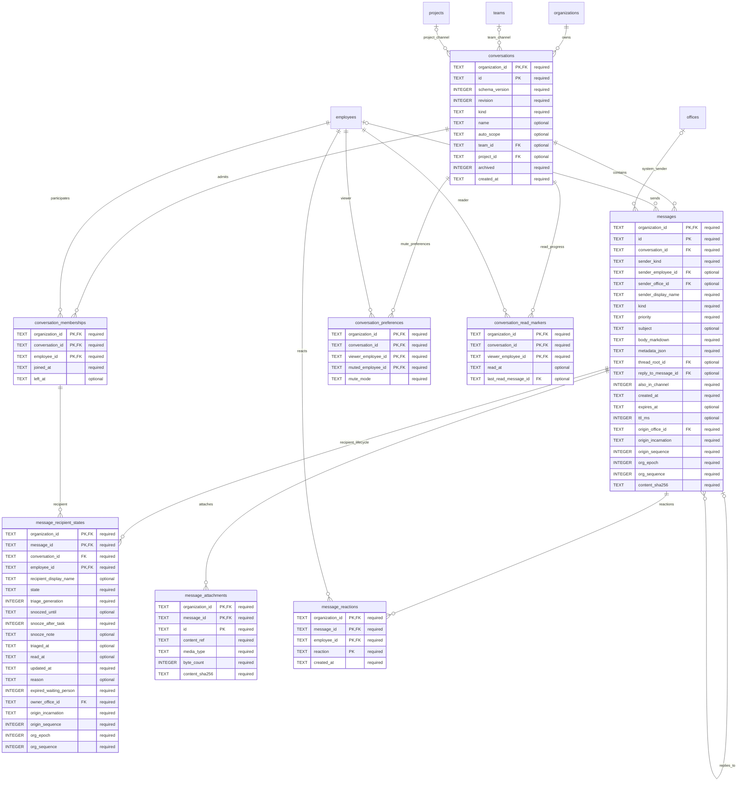

# Messaging and chat data structure

Status: **selected** data contract, revision 6. Data specification for the selected organization model. This document adds conversations and messages to the same organization data model; it does not implement a transport, chat UI, wake scheduler or external platform bridge. It does select who stores and routes messages at run time: see [Runtime ownership and routing](#runtime-ownership-and-routing), merged from ADR-0003. It defines the core channel/group-conversation relationships already described in the chat UX. External bridges and their credentials remain outside this change.

## Relationships and identity

Every conversation belongs to one organization. Its kind is `dm`, `group_dm` or `channel`; optional automatic scope identifies the organization general channel, a team or a project. Teams/projects exist outside offices. Conversation membership is separate from an employee's single home-team membership. Messages belong to one conversation, may reply to another message in that conversation, and identify an employee or office-system sender. Recipient lifecycle is per employee; one read or snooze does not change another recipient's state.

Stable IDs follow document 06. There are no readable number counters. The first message may reference itself as root. Cross-conversation roots/replies and reply cycles are rejected, and each root must be a real top-level message. A sender must be an admitted member at send time, except an explicitly authorized office-system notice. A DM has two members and a group DM at most eight; these cardinality and active-membership checks belong to the command validator.

## Storage and durability

Messages, DM/channel memberships, preferences and bodies are protected operational data, **not shared organization Git content**. The consolidated SQL is a query projection of the protected source files below, not a claim that anyone with organization Git access may read all conversations. Enforce actor/conversation visibility on every read, search, attachment access and write. Owner reading authority follows the explicitly authorized chat policy; no field on an employee record is an authentication grant. Private task notes remain in their separate database and are never included in chat automatically.

Use `durable/messaging/` under the one selected [storage root](README.md#shared-storage-contract), outside disposable office state, with private filesystem permissions and authorized backups. Under [ADR-0016](../../adr/0016-no-application-level-data-encryption.md) the application does not encrypt it. The root is configured and never derived from client IDs without validating paths. Agent office movement does not move conversation ownership. Losing only office caches must not lose acknowledged unresolved asks, pending handoffs or undelivered messages. Losing both the durable source and its backups can lose chat; organization Git alone cannot restore it. No new replication/recovery algorithm or purge policy is selected here.

```text
<data-root>/<organization-id>/durable/messaging/   # protected, never tracked in org Git
├── conversations/<conversation-id>/
│   ├── conversation.json                    # definition and memberships; one writer (see below)
│   ├── messages/<message-id>.json           # content and attachment references; written once by the origin office
│   ├── messages/<message-id>.close.json     # an ask's single close outcome; written once by the origin office
│   └── participants/<employee-id>/          # one writer: the office that owns this employee's state
│       ├── state.json                       # preferences and read markers
│       ├── received/<message-id>.json       # this employee's state for one received message
│       ├── answers/<message-id>.json        # this employee's answer to an ask or card
│       └── reactions/<message-id>.json      # this employee's reactions to one message
└── attachments/<sha256>                      # immutable protected content
<data-root>/<organization-id>/runtime/<office-id>/ # indexed projections, unread/thread indexes
```

Each JSON source envelope has `schema_version: 1`, stable IDs, a positive `revision`, and the same-named table fields below. Every file has exactly one writing office (owner decision 2026-11-17, conflict plan entry A-13). A conversation file embeds `memberships[]` and `pins[]`. A message file embeds `attachments[]` and is written once by the origin office; it never changes after the send. **Who writes a conversation file.** A DM or group DM is created by the sender's office together with its first message, so starting a conversation never waits for HQ. Channels, automatic team and project conversations, and every later membership change go through the organization authority, which is the file's writer from that point; the hand-off is ordered by organization position, as for a re-placed agent. **Answering an ask or a card.** The answer is the answering employee's own record, `answers/<message-id>.json`, committed in that employee's office and acknowledged at once in the committed class; the answerer never waits for another office. It is relayed to the ask's origin office, which records the single close outcome (first close wins, whether an answer or the asker's withdrawal) once in `messages/<message-id>.close.json`. If the origin office is unreachable the answer stays queued for relay; if that office was removed, HQ records the close, as it owns state for recipients with no office. A pin is conversation-wide and belongs to the conversation file; a fold is decided once at send. Everything that belongs to one employee is in that employee's `participants/<employee-id>/` folder and is written only by the office that owns that employee's state under [the routing rules](#runtime-ownership-and-routing): preferences and read markers in `state.json`, the state of each received message in `received/`, answers in `answers/`, and reactions in `reactions/`. Other offices receive these files through synchronization and never edit them. Revisions belong to the containing file. Save a whole file atomically under its single writer before acknowledging it. Under [ADR-0014](../../adr/0014-acknowledgement-classes-and-agent-os-latency.md) this applies to durable-class operations; a committed-class send or state change is acknowledged once the office's durable local store has committed it, and its envelope is written afterwards in the flush batch; expected-revision checks prevent state/reaction changes from overwriting each other. Attachments must be durably stored and hash-verified before their references are acknowledged. The new `content_sha256` hashes the RFC 8785 canonical JSON (UTF-8; codec `jcs-rfc8785/1` in the [hash codec registry](08-record-contracts.md#hash-codec-registry)) of immutable message columns: organization_id, id, conversation_id, sender_kind, sender_employee_id, sender_office_id, sender_display_name, kind, priority, subject, body_markdown, metadata_json parsed as an object, thread_root_id, reply_to_message_id, also_in_channel, created_at, expires_at, ttl_ms, origin_office_id, origin_incarnation, origin_sequence, org_epoch and org_sequence. Include nullable keys as null. The message file holds the card as it was sent and nothing that changes afterwards, so the hash covers the whole parsed metadata. Answers, acceptance, the close outcome, pins, recipient state and reactions live in the other files named above and are excluded; validate their envelope revision independently. No credentials or arbitrary local attachment paths enter metadata. Validators enforce formats, byte limits and nested schemas; SQL does not replace those checks.

## Runtime ownership and routing

[ADR-0003](../../adr/0003-agent-messaging-office-first.md) decided how messages are stored and routed at run time. The routing and ownership decisions in its §2.2 and §§3.1–3.4 are selected and are part of this contract. This section states them in the vocabulary of the model above. Everything else in ADR-0003 (the v1 tables, wire calls, `app_token` discovery, the `agent-os` CLI surface, urgent interruption in §2.3 and the spool in §3.5) stays versioned compatibility and implementation evidence, not target behaviour. Wherever this document and ADR-0003 differ, this document wins. Where this document is silent on routing or ownership, ADR-0003 §2.2 and §§3.1–3.4 apply.

| Rule | Statement | Source |
| --- | --- | --- |
| Office first | The sender's own office commits a send durably and allocates the next origin sequence for `(origin_office_id, origin_incarnation)` in the same transaction as the message. Sending never requires HQ to be reachable. | ADR-0003 §3.1 |
| Local delivery | For a recipient placed in the same office, delivery is complete at that commit and a waiting `wait` or `ask` listener is notified. This does not wake a paused agent or interrupt a busy turn. | ADR-0003 §2.2, §3.1 |
| Routing | Otherwise the change travels office → HQ → recipient's office over the office's outbound connection. HQ deduplicates by `(origin_office_id, origin_incarnation, origin_sequence)`, acknowledges the origin and then forwards. Offices never connect to each other directly. | ADR-0003 §3.1 |
| Owner of recipient state | The office where the recipient agent is placed, as of the organization position recorded on the change, is the single writer of that recipient's `message_recipient_states`. HQ is the owner for people, for the organization owner, and for recipients that were removed or have no office. | ADR-0003 §3.1, §3.2 |
| Ownership hand-off | When an agent is re-placed, ownership moves at that organization position. The previous office stops resolving that agent's state as soon as it applies the move; competing changes are ordered by organization position first. | ADR-0003 §3.1 item 3 |
| Recipient check | The sender's office validates the recipient against the organization position it has applied and records that position on the message. A receiving office that has not yet applied that position stores the message and withholds delivery until it has. | ADR-0003 §3.2 |
| Failure notices | Only the owning office moves a message to `expired` or `dead_letter`, and it emits the single `delivery_failed` notice. Every other office applies the synchronized state and emits nothing. | ADR-0003 §3.2 item 3 |
| Deadlines | An ask carries `expires_at`. A receiving office treats it as live only until `expires_at` plus a skew bound of at most 2 seconds. A late arrival is expired on arrival and never acted on. | ADR-0003 §3.3 |
| Required asks | An ask carries `required`. The asker waits a bounded time (an organization setting). A required ask that is not answered in time does not expire under its asker: the asker is suspended and is started again in the same session when the answer arrives. | [ADR-0020](../../adr/0020-required-asks-suspend-and-resume.md) |
| Idempotent re-ask | A retry reuses the same message ID and content. A matching ID returns the existing ask and its reply if one exists; a different sender or different content is rejected. | ADR-0003 §3.3 item 4 |
| Delivery never interrupts | Urgency controls order and badges. It never cuts a busy turn short ([chat UX §4.2](../../specs/chat-ux.md#42-system-notices-and-delivery)). | Chat UX §4.2; ADR-0003 scope header |
| Conversation ownership | Conversations belong to the organization, not to an office. Membership changes are authorized through the [organization authority](README.md#organization-authority). Re-placing an agent does not move conversation ownership. | This document, storage and durability |

What the merge changes in ADR-0003: its SQL tables (`msg_headers`, `msg_bodies`, `msg_state`, the unread and thread indexes) become projections in `runtime/<office-id>/office.db` of the protected envelopes in `durable/messaging/`. They stop being the source. Its ordering, deduplication, ownership and deadline rules are unchanged.

Three consequences remain open and must be settled before the target adapter is built:

- **Durability cost (direction decided).** [ADR-0014](../../adr/0014-acknowledgement-classes-and-agent-os-latency.md) selects commit-first, materialize-after for messaging and a 1 to 2 ms target; the envelope flush discipline still has to be designed and measured. ADR-0003 §5 sets latency targets (same-office send p50 under 15 ms and p95 under 30 ms) that assume one batched full-flush SQLite commit shared by concurrent senders. Saving one envelope file per message before acknowledgement needs its own flush discipline. Either the adapter batches envelope publication behind one flush, or the targets are restated. Record the choice with measurements.
- **Not a shipped transport.** This section selects rules. The cross-office transport and wake scheduling remain unimplemented. There are no external bridges, and no earlier message queue is carried over (owner, 2026-11-17).
- **The same DM created twice.** A DM is created by the sender's office so that it never waits for HQ. Two offices that are both disconnected can each create a DM between the same two employees. Nothing selected prevents or merges that yet. The candidate is an ID for a two-person DM derived from the pair, so both offices create the same conversation; it needs a decision because stable IDs are otherwise ULIDs.

Settled 2026-11-17: the earlier third consequence, two writers for one message file, is removed by storing each employee's state in that employee's own files (see [Storage and durability](#storage-and-durability)). A read, done or defer therefore writes one small file locally and stays in the committed class.

**Speed of a send (owner decision 2026-11-17, conflict plan entry E-02).** A plain send is acknowledged in single-digit milliseconds in every topology, including when the recipient is in another office: the sender's office commits it locally and answers; relaying to HQ and the recipient's office happens afterwards and is retried until it succeeds or the message expires. An ask is the one holding operation. It always has a deadline, the sender may state how long a reply is expected to take, and the wait is bounded by an organization setting. An ask marked required suspends its asker when the wait ends without an answer, and the answer resumes it ([ADR-0020](../../adr/0020-required-asks-suspend-and-resume.md)). See [ADR-0014](../../adr/0014-acknowledgement-classes-and-agent-os-latency.md) decisions 1 and 9.

## File/SQL mapping

| Table | Canonical source and mapping |
| --- | --- |
| `conversations` | conversation.json scalar fields, including definition revision |
| `conversation_memberships` | `memberships[]`; preserve joined/left state; rejoining updates the current membership snapshot under the envelope revision. This schema does not grant historical access merely because the membership row exists |
| `messages` | Message JSON immutable envelope; `body_markdown` is the body and `metadata_json` the structured metadata; never silently rewrite custom kind tags |
| `message_recipient_states` | `participants/<employee-id>/received/<message-id>.json`; state, triage generation, snooze/read/expiry/dead-letter facts and origin ownership map to same-named columns; `local_seq` is office-specific derived ordering, not global identity |
| `conversation_preferences` | `preferences[]` in the viewer's `participants/<employee-id>/state.json`, keyed by viewer and muted employee; mute state only |
| `conversation_read_markers` | `read_markers[]` in the viewer's `participants/<employee-id>/state.json`, keyed by conversation/viewer; optional last-read message must be in that conversation |
| `message_attachments` | `attachments[]`: content reference, media type, bytes/hash; content never resides in organization Git |
| `message_reactions` | `participants/<employee-id>/reactions/<message-id>.json`: employee/reaction/time |
| Card state shown with a message (no table of its own; assembled in the `messages` projection) | `answer` and acceptance from the answerer's `participants/<employee-id>/answers/<message-id>.json`; the close outcome from `messages/<message-id>.close.json`; pins from `pins[]` in `conversation.json`. None of it is stored in the message file. |

Thread last-message/time/count, participant summaries, unread lists/counts and urgent flags are derived. Preserve each original delivery identity `(origin_office_id, origin_incarnation, origin_sequence)` and organization epoch/sequence; a retry cannot create a second message. Recipient-state origin is independent of message-content origin.

For selected chat cards, `metadata_json` uses versioned `card` objects with fields `addressed_to`, `required` (the asker cannot continue without the answer, [ADR-0020](../../adr/0020-required-asks-suspend-and-resume.md)), `question_type` (`choice`, `yes_no` or `free_text`), `options[{id,label,description}]`, `allow_multiple`, `default_option`, `default_at`, `blocks`, `approval`, `answer{by,at,option_id,option_ids,text}`, `accepted_by`, `accepted_at`, `reason`, `linked_ref`, `pinned`, `folded`. These mirror existing UI contracts and the owner's [REQ-04](../../specs/req-04-channel-messaging-and-question-components.md) question schema (`question_type`, option `description`, `allow_multiple` and the multi-select `option_ids` were added for it on 2026-11-17); validate employee/task references, unique option IDs and that the options fit the question type. An office failure notice preserves `dead_reason` in metadata and recipient `reason`. The card fields split by who writes them. Written once at send by the origin office, inside the message file and covered by its hash: `addressed_to`, `required`, `question_type`, `options`, `allow_multiple`, `default_option`, `default_at`, `blocks`, `approval`, `linked_ref` and `folded` (the system's folding of an announcement, decided at send). Written by the answering employee's office in that employee's `answers/<message-id>.json`: `answer` and, for a hand-off, `accepted_by`, `accepted_at` and `reason`. Written once by the origin office in `messages/<message-id>.close.json`: which answer or withdrawal closed the ask. A pin is conversation-wide, so `pins[]` is part of `conversation.json` and is written by that file's writer. The projection assembles these into the card a screen shows. Only the addressed actor may answer/accept; approval still requires its existing authorized application path. This is structured data, not authorization implemented by JSON. No automatic default application, work transition or wake engine is introduced.

Typing/presence indicators and unsent composer drafts remain runtime/UI state. Notification delivery receipts/session deduplication stay local operational state; no earlier spool or message queue is imported. Snoozed-after-task is retained as data without selecting a new scheduling engine.

## Example

```json
{
  "schema_version": 1,
  "revision": 1,
  "id": "conversation-id",
  "organization_id": "organization-id",
  "kind": "channel",
  "name": "reservations",
  "auto_scope": "project",
  "project_id": "reservations-project-id",
  "team_id": null,
  "archived": false,
  "created_at": "2026-11-15T12:00:00Z",
  "memberships": [{"employee_id": "agent-id", "joined_at": "2026-11-15T12:00:00Z", "left_at": null}],
  "preferences": [],
  "read_markers": []
}
```

Illustrative IDs follow the stable-ID contract in real records. An employee in the restaurant Reservations team or the agency Care Platform team participates through the same relationship; their office location has no effect on conversation ownership. To publish a decision, explicitly create/link a project or feature document; saving chat does not silently create durable product knowledge.

## Tables and enforcement

All tables below are included in the consolidated `schema.sql`. Full field diagrams follow the relationships. SQL enforces organization-scoped foreign keys, origin uniqueness and per-recipient keys. Active membership, actor grants, root cycles, card shapes, immutable-content/revision validation and file durability are command requirements.

```sql
CREATE TABLE conversations (
  organization_id TEXT NOT NULL REFERENCES organizations(id),
  id TEXT NOT NULL,
  schema_version INTEGER NOT NULL DEFAULT 1 CHECK (schema_version=1),
  revision INTEGER NOT NULL DEFAULT 1 CHECK (revision>=1),
  kind TEXT NOT NULL CHECK (kind IN ('dm','group_dm','channel')),
  name TEXT,
  auto_scope TEXT CHECK (auto_scope IN ('organization','team','project')),
  team_id TEXT,
  project_id TEXT,
  archived INTEGER NOT NULL DEFAULT 0 CHECK (archived IN (0,1)),
  created_at TEXT NOT NULL,
  PRIMARY KEY (organization_id,id),
  CHECK (auto_scope IS NULL OR (kind='channel' AND
    ((auto_scope='organization' AND team_id IS NULL AND project_id IS NULL)
    OR (auto_scope='team' AND team_id IS NOT NULL AND project_id IS NULL)
    OR (auto_scope='project' AND project_id IS NOT NULL AND team_id IS NULL)))),
  FOREIGN KEY (organization_id,team_id) REFERENCES teams(organization_id,id) DEFERRABLE INITIALLY DEFERRED,
  FOREIGN KEY (organization_id,project_id) REFERENCES projects(organization_id,id) DEFERRABLE INITIALLY DEFERRED
) STRICT;
CREATE UNIQUE INDEX conversation_auto_org ON conversations(organization_id) WHERE auto_scope='organization';
CREATE UNIQUE INDEX conversation_auto_team ON conversations(organization_id,team_id) WHERE auto_scope='team';
CREATE UNIQUE INDEX conversation_auto_project ON conversations(organization_id,project_id) WHERE auto_scope='project';
CREATE TABLE conversation_memberships (
  organization_id TEXT NOT NULL,
  conversation_id TEXT NOT NULL,
  employee_id TEXT NOT NULL,
  joined_at TEXT NOT NULL,
  left_at TEXT,
  PRIMARY KEY (organization_id,conversation_id,employee_id),
  FOREIGN KEY (organization_id,conversation_id) REFERENCES conversations(organization_id,id) DEFERRABLE INITIALLY DEFERRED,
  FOREIGN KEY (organization_id,employee_id) REFERENCES employees(organization_id,id) DEFERRABLE INITIALLY DEFERRED
) STRICT;
CREATE TABLE messages (
  organization_id TEXT NOT NULL,
  id TEXT NOT NULL,
  conversation_id TEXT NOT NULL,
  sender_kind TEXT NOT NULL CHECK (sender_kind IN ('employee','office')),
  sender_employee_id TEXT,
  sender_office_id TEXT,
  sender_display_name TEXT NOT NULL,
  kind TEXT NOT NULL,
  priority TEXT NOT NULL DEFAULT 'normal' CHECK (priority IN ('normal','high','urgent')),
  subject TEXT,
  body_markdown TEXT NOT NULL,
  metadata_json TEXT NOT NULL DEFAULT '{}' CHECK (json_valid(metadata_json) AND json_type(metadata_json)='object'),
  thread_root_id TEXT,
  reply_to_message_id TEXT,
  also_in_channel INTEGER NOT NULL DEFAULT 0 CHECK (also_in_channel IN (0,1)),
  created_at TEXT NOT NULL,
  expires_at TEXT,
  ttl_ms INTEGER CHECK (ttl_ms>=0),
  origin_office_id TEXT NOT NULL,
  origin_incarnation TEXT NOT NULL,
  origin_sequence INTEGER NOT NULL CHECK (origin_sequence>0),
  org_epoch INTEGER NOT NULL CHECK (org_epoch>=0),
  org_sequence INTEGER NOT NULL CHECK (org_sequence>=0),
  content_sha256 TEXT NOT NULL CHECK (length(content_sha256)=64 AND content_sha256 NOT GLOB '*[^0-9a-f]*'),
  PRIMARY KEY (organization_id,id),
  UNIQUE (organization_id,id,conversation_id),
  UNIQUE (organization_id,origin_office_id,origin_incarnation,origin_sequence),
  CHECK ((sender_kind='employee' AND sender_employee_id IS NOT NULL AND sender_office_id IS NULL)
    OR (sender_kind='office' AND sender_employee_id IS NULL AND sender_office_id IS NOT NULL)),
  FOREIGN KEY (organization_id,conversation_id) REFERENCES conversations(organization_id,id) DEFERRABLE INITIALLY DEFERRED,
  FOREIGN KEY (organization_id,sender_employee_id) REFERENCES employees(organization_id,id) DEFERRABLE INITIALLY DEFERRED,
  FOREIGN KEY (organization_id,sender_office_id) REFERENCES offices(organization_id,id) DEFERRABLE INITIALLY DEFERRED,
  FOREIGN KEY (organization_id,origin_office_id) REFERENCES offices(organization_id,id) DEFERRABLE INITIALLY DEFERRED,
  FOREIGN KEY (organization_id,thread_root_id,conversation_id) REFERENCES messages(organization_id,id,conversation_id) DEFERRABLE INITIALLY DEFERRED,
  FOREIGN KEY (organization_id,reply_to_message_id,conversation_id) REFERENCES messages(organization_id,id,conversation_id) DEFERRABLE INITIALLY DEFERRED
) STRICT;
CREATE INDEX message_conversation_time ON messages(organization_id,conversation_id,created_at,id);
CREATE TABLE message_recipient_states (
  organization_id TEXT NOT NULL,
  message_id TEXT NOT NULL,
  conversation_id TEXT NOT NULL,
  employee_id TEXT NOT NULL,
  recipient_display_name TEXT,
  state TEXT NOT NULL CHECK (state IN ('unread','snoozed','read','done','expired','dead_letter')),
  triage_generation INTEGER NOT NULL DEFAULT 0 CHECK (triage_generation>=0),
  snoozed_until TEXT,
  snooze_after_task INTEGER NOT NULL DEFAULT 0 CHECK (snooze_after_task IN (0,1)),
  snooze_note TEXT,
  triaged_at TEXT,
  read_at TEXT,
  updated_at TEXT NOT NULL,
  reason TEXT,
  expired_waiting_person INTEGER NOT NULL DEFAULT 0 CHECK (expired_waiting_person IN (0,1)),
  owner_office_id TEXT NOT NULL,
  origin_incarnation TEXT NOT NULL,
  origin_sequence INTEGER NOT NULL CHECK (origin_sequence>0),
  org_epoch INTEGER NOT NULL CHECK (org_epoch>=0),
  org_sequence INTEGER NOT NULL CHECK (org_sequence>=0),
  PRIMARY KEY (organization_id,message_id,employee_id),
  FOREIGN KEY (organization_id,message_id,conversation_id) REFERENCES messages(organization_id,id,conversation_id) DEFERRABLE INITIALLY DEFERRED,
  FOREIGN KEY (organization_id,conversation_id,employee_id) REFERENCES conversation_memberships(organization_id,conversation_id,employee_id) DEFERRABLE INITIALLY DEFERRED,
  FOREIGN KEY (organization_id,owner_office_id) REFERENCES offices(organization_id,id) DEFERRABLE INITIALLY DEFERRED
) STRICT;
CREATE INDEX message_recipient_inbox ON message_recipient_states(organization_id,employee_id,state,snoozed_until);
CREATE TABLE conversation_preferences (
  organization_id TEXT NOT NULL,
  conversation_id TEXT NOT NULL,
  viewer_employee_id TEXT NOT NULL,
  muted_employee_id TEXT NOT NULL,
  mute_mode TEXT NOT NULL DEFAULT 'none' CHECK (mute_mode IN ('none','muted','digest')),
  PRIMARY KEY (organization_id,conversation_id,viewer_employee_id,muted_employee_id),
  FOREIGN KEY (organization_id,conversation_id) REFERENCES conversations(organization_id,id) DEFERRABLE INITIALLY DEFERRED,
  FOREIGN KEY (organization_id,viewer_employee_id) REFERENCES employees(organization_id,id) DEFERRABLE INITIALLY DEFERRED,
  FOREIGN KEY (organization_id,muted_employee_id) REFERENCES employees(organization_id,id) DEFERRABLE INITIALLY DEFERRED
) STRICT;
CREATE TABLE conversation_read_markers (
  organization_id TEXT NOT NULL,
  conversation_id TEXT NOT NULL,
  viewer_employee_id TEXT NOT NULL,
  read_at TEXT,
  last_read_message_id TEXT,
  PRIMARY KEY (organization_id,conversation_id,viewer_employee_id),
  FOREIGN KEY (organization_id,conversation_id) REFERENCES conversations(organization_id,id) DEFERRABLE INITIALLY DEFERRED,
  FOREIGN KEY (organization_id,viewer_employee_id) REFERENCES employees(organization_id,id) DEFERRABLE INITIALLY DEFERRED,
  FOREIGN KEY (organization_id,last_read_message_id,conversation_id) REFERENCES messages(organization_id,id,conversation_id) DEFERRABLE INITIALLY DEFERRED
) STRICT;
CREATE TABLE message_attachments (
  organization_id TEXT NOT NULL,
  message_id TEXT NOT NULL,
  id TEXT NOT NULL,
  content_ref TEXT NOT NULL,
  media_type TEXT NOT NULL,
  byte_count INTEGER NOT NULL CHECK (byte_count>=0),
  content_sha256 TEXT NOT NULL CHECK (length(content_sha256)=64 AND content_sha256 NOT GLOB '*[^0-9a-f]*'),
  PRIMARY KEY (organization_id,message_id,id),
  FOREIGN KEY (organization_id,message_id) REFERENCES messages(organization_id,id) DEFERRABLE INITIALLY DEFERRED
) STRICT;
CREATE TABLE message_reactions (
  organization_id TEXT NOT NULL,
  message_id TEXT NOT NULL,
  employee_id TEXT NOT NULL,
  reaction TEXT NOT NULL CHECK (reaction IN ('seen','looking')),
  created_at TEXT NOT NULL,
  PRIMARY KEY (organization_id,message_id,employee_id,reaction),
  FOREIGN KEY (organization_id,message_id) REFERENCES messages(organization_id,id) DEFERRABLE INITIALLY DEFERRED,
  FOREIGN KEY (organization_id,employee_id) REFERENCES employees(organization_id,id) DEFERRABLE INITIALLY DEFERRED
) STRICT;
```



[Recovery and office continuity](16-recovery-and-office-continuity.md) defines durable receipt/checkpoint/cleanup evidence separately from disposable office projections.
