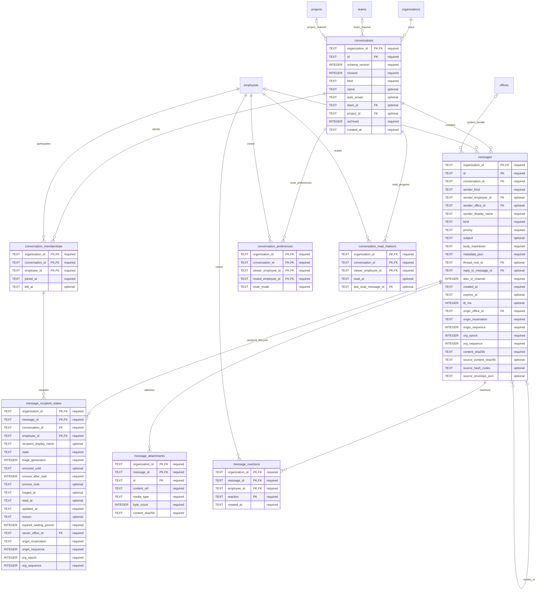

# Messaging and chat data structure

Data specification for the selected organization model. This document adds conversations and messages to the same organization data model; it does not implement a transport, chat UI, wake scheduler or external platform bridge. It does select who stores and routes messages at run time: see [Runtime ownership and routing](#runtime-ownership-and-routing), merged from ADR-0003. It preserves existing v1 directed-message facts and defines the core channel/group-conversation relationships already described in the chat UX. External bridges and their credentials remain outside this change.

## Relationships and identity

Every conversation belongs to one organization. Its kind is `dm`, `group_dm`, `channel` or imported `directed_thread`; optional automatic scope identifies the organization general channel, a team or a project. Teams/projects exist outside offices. Conversation membership is separate from an employee's single home-team membership. Messages belong to one conversation, may reply to another message in that conversation, and identify an employee or office-system sender. Recipient lifecycle is per employee; one read or snooze does not change another recipient's state.

Stable IDs follow document 06, preserving all existing message IDs. There are no new readable number counters. An existing directed thread becomes an internal `directed_thread` conversation preserving its original thread ID and root message ID. V1 permits A→B followed by B→C within one thread: preserve the actual per-message sender/recipient state, not a group-wide visibility grant. For this kind, only each message's sender/recipient (or an authenticated owner under the existing policy) may read it, even if the viewer appears in the thread participant union. Summary counts/last-message/reply previews must also be filtered to visible messages. A hidden parent never leaks its content through reply rendering. This compatibility kind is not a new channel/group-DM creation option; a reply retains the directed recipient restriction. Do not infer channel membership from a v1 thread-summary row. The first message may reference itself as root. Cross-conversation roots/replies are rejected; import also rejects reply cycles and requires each root to be a real top-level message. A sender must be an admitted member at send time, except an explicitly authorized office-system notice. New DMs have two members, group DMs at most eight; imported directed threads retain source participants without applying these group limits; these cardinality/active-membership checks belong to the command/import validator.

## Storage and durability

Messages, DM/channel memberships, preferences and bodies are protected operational data, **not shared organization Git content**. The consolidated SQL is a query projection of the protected source files below, not a claim that anyone with organization Git access may read all conversations. Enforce actor/conversation visibility on every read, search, attachment access and write. Owner reading authority follows the explicitly authorized chat policy; `is_owner` alone is not an authentication grant. Private task notes remain in their separate database and are never included in chat automatically.

Use `durable/messaging/` under the one selected [storage root](README.md#shared-storage-contract), outside disposable office state, with private filesystem permissions and encrypted storage/authorized backups according to the existing storage boundary. The root is configured and never derived from client IDs without validating paths. Agent office movement does not move conversation ownership. Losing only office caches must not lose acknowledged unresolved asks, pending handoffs or undelivered messages. Losing both the durable source and its backups can lose chat; organization Git alone cannot restore it. No new replication/recovery algorithm or purge policy is selected here.

```text
<data-root>/<organization-id>/durable/messaging/   # protected, never tracked in org Git
├── conversations/<conversation-id>/
│   ├── conversation.json                    # definition, memberships, preferences
│   └── messages/<message-id>.json            # envelope, recipients, reactions, attachments
└── attachments/<sha256>                      # immutable protected content
<data-root>/<organization-id>/runtime/<office-id>/ # indexed projections, unread/thread indexes
```

Each JSON source envelope has `schema_version: 1`, stable IDs, a positive `revision`, and the same-named table fields below. Conversations embed `memberships[]`, `preferences[]` and `read_markers[]`; messages embed `recipients[]`, `reactions[]`, `attachments[]`. Revisions belong to the containing envelope. Save a whole envelope atomically under a single owning writer before acknowledging it; expected-revision checks prevent state/reaction changes from overwriting each other. Attachments must be durably stored and hash-verified before their references are acknowledged. The new `content_sha256` hashes the RFC 8785 canonical JSON (UTF-8; codec `jcs-rfc8785/1` in the [hash codec registry](08-record-contracts.md#hash-codec-registry)) of immutable message columns: organization_id, id, conversation_id, sender_kind, sender_employee_id, sender_office_id, sender_display_name, kind, priority, subject, body_markdown, metadata_json parsed as an object, thread_root_id, reply_to_message_id, also_in_channel, created_at, expires_at, ttl_ms, origin_office_id, origin_incarnation, origin_sequence, org_epoch and org_sequence. Include nullable keys as null. Remove mutable card-state keys from that parsed metadata before hashing. Mutable card state (`answer`, acceptance, pin/fold state), recipient state and reactions are excluded; validate their envelope revision independently. No credentials or arbitrary local attachment paths enter metadata. Source/import validators enforce formats, byte limits and nested schemas; SQL does not replace those checks.

## Runtime ownership and routing

[ADR-0003](../../adr/0003-agent-messaging-office-first.md) decided how messages are stored and routed at run time. Its runtime decisions are selected and are part of this contract. This section states them in the vocabulary of the model above. ADR-0003 keeps the exact v1 algorithms, table names and wire calls as compatibility and implementation evidence. Where the two differ on data shape or storage location, this document wins. Where this document is silent on runtime behaviour, ADR-0003 §§2–3 apply.

| Rule | Statement | ADR-0003 |
| --- | --- | --- |
| Office first | The sender's own office commits a send durably and allocates the next origin sequence for `(origin_office_id, origin_incarnation)` in the same transaction as the message. Sending never requires HQ to be reachable. | §3.1 |
| Local delivery | A recipient placed in the same office is delivered and woken immediately after that commit. | §2.2, §3.1 |
| Routing | Otherwise the change travels office → HQ → recipient's office over the office's outbound connection. HQ deduplicates by `(origin_office_id, origin_incarnation, origin_sequence)`, acknowledges the origin and then forwards. Offices never connect to each other directly. | §3.1 |
| Owner of recipient state | The office where the recipient agent is placed, as of the organization position recorded on the change, is the single writer of that recipient's `message_recipient_states`. HQ is the owner for people, for the organization owner, and for recipients that were removed or have no office. | §3.1, §3.2 |
| Ownership hand-off | When an agent is re-placed, ownership moves at that organization position. The previous office stops resolving that agent's state as soon as it applies the move; competing changes are ordered by organization position first. | §3.1 item 3 |
| Recipient check | The sender's office validates the recipient against the organization position it has applied and records that position on the message. A receiving office that has not yet applied that position stores the message and withholds delivery until it has. | §3.2 |
| Failure notices | Only the owning office moves a message to `expired` or `dead_letter`, and it emits the single `delivery_failed` notice. Every other office applies the synchronized state and emits nothing. | §3.2 item 3 |
| Deadlines | An ask carries `expires_at`. A receiving office treats it as live only until `expires_at` plus a skew bound of at most 2 seconds. A late arrival is expired on arrival and never acted on. | §3.3 |
| Idempotent re-ask | A retry reuses the same message ID and content. A matching ID returns the existing ask and its reply if one exists; a different sender or different content is rejected. | §3.3 item 4 |
| Delivery never interrupts | Urgency controls order and badges. It never cuts a busy turn short ([chat UX §4.2](../../specs/chat-ux.md#42-system-notices-and-delivery)). | Scope header |
| Conversation ownership | Conversations belong to the organization, not to an office. Membership changes are authorized through the [organization authority](README.md#organization-authority). Re-placing an agent does not move conversation ownership. | §6.2 |

What the merge changes in ADR-0003: its SQL tables (`msg_headers`, `msg_bodies`, `msg_state`, the unread and thread indexes) become projections in `runtime/<office-id>/office.db` of the protected envelopes in `durable/messaging/`. They stop being the source. Its ordering, deduplication, ownership and deadline rules are unchanged.

Two consequences remain open and must be settled before the target adapter is built:

- **Durability cost.** ADR-0003 §5 sets latency targets (same-office send p50 under 15 ms and p95 under 30 ms) that assume one batched full-flush SQLite commit shared by concurrent senders. Saving one envelope file per message before acknowledgement needs its own flush discipline. Either the adapter batches envelope publication behind one flush, or the targets are restated. Record the choice with measurements.
- **Not a shipped transport.** This section selects rules. The cross-office transport, wake scheduling and external bridges remain unimplemented, and the live Phase A spool stays in place until its separately verified cutover.

## File/SQL mapping and v1 compatibility

| Table | Canonical source and mapping |
| --- | --- |
| `conversations` | conversation.json scalar fields, including definition revision |
| `conversation_memberships` | `memberships[]`; preserve joined/left state; rejoining updates the current membership snapshot under the envelope revision. This schema does not grant historical access merely because the membership row exists |
| `messages` | Message JSON immutable envelope; `body_markdown` maps v1 body, `metadata_json` maps v1 meta; never silently rewrite custom kind tags |
| `message_recipient_states` | `recipients[]`; v1 state, triage generation, snooze/read/expiry/dead-letter facts and origin ownership map explicitly to same-meaning columns; `local_seq` is office-specific derived ordering, not global identity |
| `conversation_preferences` | `preferences[]`, keyed by viewer and muted employee; mute state only |
| `conversation_read_markers` | `read_markers[]`, keyed by conversation/viewer; optional last-read message must be in that conversation |
| `message_attachments` | `attachments[]`: content reference, media type, bytes/hash; content never resides in organization Git |
| `message_reactions` | `reactions[]`: employee/reaction/time |

Thread last-message/time/count, participant summaries, unread lists/counts and urgent flags are derived. Preserve each original delivery identity `(origin_office_id, origin_incarnation, origin_sequence)` and organization epoch/sequence; a retry cannot create a second message. Recipient-state origin is independent of message-content origin. For imported v1 messages, `source_content_sha256` retains the original BLOB hash as lowercase hex; `source_hash_codec` is `v1_lenprefixed_sha256`; `source_envelope_json` (file field `source_envelope`) preserves the original seven hash inputs: to_member_id, kind, priority, subject, reply_to, body and meta. Verify the original version byte 1 plus seven u32be length-prefixed UTF-8 fields using `org-mailbox/src/hash.rs`, including its recursive metadata-key canonicalization. Never compare that hash as if it used the new canonical-JSON codec. Keep the original source hash/envelope immutable alongside the new normalized hash; do not reconstruct it from subsequently edited card state. All three source fields are null for new messages. The importer preserves old display-name snapshots and custom metadata; unresolved legacy values remain in controlled migration staging rather than being guessed.

For selected chat cards, `metadata_json` uses versioned `card` objects with fields `addressed_to`, `options[{id,label}]`, `default_option`, `default_at`, `blocks`, `approval`, `answer{by,at,option_id,text}`, `accepted_by`, `accepted_at`, `reason`, `linked_ref`, `pinned`, `folded`. These mirror existing UI contracts; validate employee/task references and unique option IDs. An office failure notice preserves `dead_reason` in metadata and recipient `reason`. Card answer/acceptance/pin/fold state is mutable within the source envelope, separate from the content hash. Only the addressed actor may answer/accept; approval still requires its existing authorized application path. This is structured data, not authorization implemented by JSON. No automatic default application, work transition or wake engine is introduced.

Typing/presence indicators and unsent composer drafts remain runtime/UI state. Notification delivery receipts/session deduplication stay local operational state; existing active spool messages/asks and read/triage facts require the established conditional cutover before that live spool is removed. Snoozed-after-task is retained as data without selecting a new scheduling engine.

## Example

```json
{
  "schema_version": 1,
  "revision": 1,
  "id": "conversation-id",
  "organization_id": "organization-id",
  "kind": "channel",
  "name": "reservations",
  "auto_scope": "project",
  "project_id": "reservations-project-id",
  "team_id": null,
  "archived": false,
  "created_at": "2026-11-15T12:00:00Z",
  "memberships": [{"employee_id": "agent-id", "joined_at": "2026-11-15T12:00:00Z", "left_at": null}],
  "preferences": [],
  "read_markers": []
}
```

Illustrative IDs follow the stable-ID contract in real records. An employee in the restaurant Reservations team or the agency Care Platform team participates through the same relationship; their office location has no effect on conversation ownership. To publish a decision, explicitly create/link a project or feature document; saving chat does not silently create durable product knowledge.

## Tables and enforcement

All tables below are included in the consolidated `schema.sql`. Full field diagrams follow the relationships. SQL enforces organization-scoped foreign keys, origin uniqueness and per-recipient keys. Active membership, actor grants, root cycles, card shapes, immutable-content/revision validation and file durability are command/import requirements.

```sql
CREATE TABLE conversations (
  organization_id TEXT NOT NULL REFERENCES organizations(id),
  id TEXT NOT NULL,
  schema_version INTEGER NOT NULL DEFAULT 1 CHECK (schema_version=1),
  revision INTEGER NOT NULL DEFAULT 1 CHECK (revision>=1),
  kind TEXT NOT NULL CHECK (kind IN ('dm','group_dm','channel','directed_thread')),
  name TEXT,
  auto_scope TEXT CHECK (auto_scope IN ('organization','team','project')),
  team_id TEXT,
  project_id TEXT,
  archived INTEGER NOT NULL DEFAULT 0 CHECK (archived IN (0,1)),
  created_at TEXT NOT NULL,
  PRIMARY KEY (organization_id,id),
  CHECK (auto_scope IS NULL OR (kind='channel' AND
    ((auto_scope='organization' AND team_id IS NULL AND project_id IS NULL)
    OR (auto_scope='team' AND team_id IS NOT NULL AND project_id IS NULL)
    OR (auto_scope='project' AND project_id IS NOT NULL AND team_id IS NULL)))),
  FOREIGN KEY (organization_id,team_id) REFERENCES teams(organization_id,id) DEFERRABLE INITIALLY DEFERRED,
  FOREIGN KEY (organization_id,project_id) REFERENCES projects(organization_id,id) DEFERRABLE INITIALLY DEFERRED
) STRICT;
CREATE UNIQUE INDEX conversation_auto_org ON conversations(organization_id) WHERE auto_scope='organization';
CREATE UNIQUE INDEX conversation_auto_team ON conversations(organization_id,team_id) WHERE auto_scope='team';
CREATE UNIQUE INDEX conversation_auto_project ON conversations(organization_id,project_id) WHERE auto_scope='project';
CREATE TABLE conversation_memberships (
  organization_id TEXT NOT NULL,
  conversation_id TEXT NOT NULL,
  employee_id TEXT NOT NULL,
  joined_at TEXT NOT NULL,
  left_at TEXT,
  PRIMARY KEY (organization_id,conversation_id,employee_id),
  FOREIGN KEY (organization_id,conversation_id) REFERENCES conversations(organization_id,id) DEFERRABLE INITIALLY DEFERRED,
  FOREIGN KEY (organization_id,employee_id) REFERENCES employees(organization_id,id) DEFERRABLE INITIALLY DEFERRED
) STRICT;
CREATE TABLE messages (
  organization_id TEXT NOT NULL,
  id TEXT NOT NULL,
  conversation_id TEXT NOT NULL,
  sender_kind TEXT NOT NULL CHECK (sender_kind IN ('employee','office')),
  sender_employee_id TEXT,
  sender_office_id TEXT,
  sender_display_name TEXT NOT NULL,
  kind TEXT NOT NULL,
  priority TEXT NOT NULL DEFAULT 'normal' CHECK (priority IN ('normal','high','urgent')),
  subject TEXT,
  body_markdown TEXT NOT NULL,
  metadata_json TEXT NOT NULL DEFAULT '{}' CHECK (json_valid(metadata_json) AND json_type(metadata_json)='object'),
  thread_root_id TEXT,
  reply_to_message_id TEXT,
  also_in_channel INTEGER NOT NULL DEFAULT 0 CHECK (also_in_channel IN (0,1)),
  created_at TEXT NOT NULL,
  expires_at TEXT,
  ttl_ms INTEGER CHECK (ttl_ms>=0),
  origin_office_id TEXT NOT NULL,
  origin_incarnation TEXT NOT NULL,
  origin_sequence INTEGER NOT NULL CHECK (origin_sequence>0),
  org_epoch INTEGER NOT NULL CHECK (org_epoch>=0),
  org_sequence INTEGER NOT NULL CHECK (org_sequence>=0),
  content_sha256 TEXT NOT NULL CHECK (length(content_sha256)=64 AND content_sha256 NOT GLOB '*[^0-9a-f]*'),
  source_content_sha256 TEXT CHECK (source_content_sha256 IS NULL OR (length(source_content_sha256)=64 AND source_content_sha256 NOT GLOB '*[^0-9a-f]*')),
  source_hash_codec TEXT CHECK (source_hash_codec IS NULL OR source_hash_codec='v1_lenprefixed_sha256'),
  source_envelope_json TEXT CHECK (source_envelope_json IS NULL OR (json_valid(source_envelope_json) AND json_type(source_envelope_json)='object')),
  CHECK ((source_content_sha256 IS NULL)=(source_hash_codec IS NULL) AND (source_content_sha256 IS NULL)=(source_envelope_json IS NULL)),
  PRIMARY KEY (organization_id,id),
  UNIQUE (organization_id,id,conversation_id),
  UNIQUE (organization_id,origin_office_id,origin_incarnation,origin_sequence),
  CHECK ((sender_kind='employee' AND sender_employee_id IS NOT NULL AND sender_office_id IS NULL)
    OR (sender_kind='office' AND sender_employee_id IS NULL AND sender_office_id IS NOT NULL)),
  FOREIGN KEY (organization_id,conversation_id) REFERENCES conversations(organization_id,id) DEFERRABLE INITIALLY DEFERRED,
  FOREIGN KEY (organization_id,sender_employee_id) REFERENCES employees(organization_id,id) DEFERRABLE INITIALLY DEFERRED,
  FOREIGN KEY (organization_id,sender_office_id) REFERENCES offices(organization_id,id) DEFERRABLE INITIALLY DEFERRED,
  FOREIGN KEY (organization_id,origin_office_id) REFERENCES offices(organization_id,id) DEFERRABLE INITIALLY DEFERRED,
  FOREIGN KEY (organization_id,thread_root_id,conversation_id) REFERENCES messages(organization_id,id,conversation_id) DEFERRABLE INITIALLY DEFERRED,
  FOREIGN KEY (organization_id,reply_to_message_id,conversation_id) REFERENCES messages(organization_id,id,conversation_id) DEFERRABLE INITIALLY DEFERRED
) STRICT;
CREATE INDEX message_conversation_time ON messages(organization_id,conversation_id,created_at,id);
CREATE TABLE message_recipient_states (
  organization_id TEXT NOT NULL,
  message_id TEXT NOT NULL,
  conversation_id TEXT NOT NULL,
  employee_id TEXT NOT NULL,
  recipient_display_name TEXT,
  state TEXT NOT NULL CHECK (state IN ('unread','snoozed','read','done','expired','dead_letter')),
  triage_generation INTEGER NOT NULL DEFAULT 0 CHECK (triage_generation>=0),
  snoozed_until TEXT,
  snooze_after_task INTEGER NOT NULL DEFAULT 0 CHECK (snooze_after_task IN (0,1)),
  snooze_note TEXT,
  triaged_at TEXT,
  read_at TEXT,
  updated_at TEXT NOT NULL,
  reason TEXT,
  expired_waiting_person INTEGER NOT NULL DEFAULT 0 CHECK (expired_waiting_person IN (0,1)),
  owner_office_id TEXT NOT NULL,
  origin_incarnation TEXT NOT NULL,
  origin_sequence INTEGER NOT NULL CHECK (origin_sequence>0),
  org_epoch INTEGER NOT NULL CHECK (org_epoch>=0),
  org_sequence INTEGER NOT NULL CHECK (org_sequence>=0),
  PRIMARY KEY (organization_id,message_id,employee_id),
  FOREIGN KEY (organization_id,message_id,conversation_id) REFERENCES messages(organization_id,id,conversation_id) DEFERRABLE INITIALLY DEFERRED,
  FOREIGN KEY (organization_id,conversation_id,employee_id) REFERENCES conversation_memberships(organization_id,conversation_id,employee_id) DEFERRABLE INITIALLY DEFERRED,
  FOREIGN KEY (organization_id,owner_office_id) REFERENCES offices(organization_id,id) DEFERRABLE INITIALLY DEFERRED
) STRICT;
CREATE INDEX message_recipient_inbox ON message_recipient_states(organization_id,employee_id,state,snoozed_until);
CREATE TABLE conversation_preferences (
  organization_id TEXT NOT NULL,
  conversation_id TEXT NOT NULL,
  viewer_employee_id TEXT NOT NULL,
  muted_employee_id TEXT NOT NULL,
  mute_mode TEXT NOT NULL DEFAULT 'none' CHECK (mute_mode IN ('none','muted','digest')),
  PRIMARY KEY (organization_id,conversation_id,viewer_employee_id,muted_employee_id),
  FOREIGN KEY (organization_id,conversation_id) REFERENCES conversations(organization_id,id) DEFERRABLE INITIALLY DEFERRED,
  FOREIGN KEY (organization_id,viewer_employee_id) REFERENCES employees(organization_id,id) DEFERRABLE INITIALLY DEFERRED,
  FOREIGN KEY (organization_id,muted_employee_id) REFERENCES employees(organization_id,id) DEFERRABLE INITIALLY DEFERRED
) STRICT;
CREATE TABLE conversation_read_markers (
  organization_id TEXT NOT NULL,
  conversation_id TEXT NOT NULL,
  viewer_employee_id TEXT NOT NULL,
  read_at TEXT,
  last_read_message_id TEXT,
  PRIMARY KEY (organization_id,conversation_id,viewer_employee_id),
  FOREIGN KEY (organization_id,conversation_id) REFERENCES conversations(organization_id,id) DEFERRABLE INITIALLY DEFERRED,
  FOREIGN KEY (organization_id,viewer_employee_id) REFERENCES employees(organization_id,id) DEFERRABLE INITIALLY DEFERRED,
  FOREIGN KEY (organization_id,last_read_message_id,conversation_id) REFERENCES messages(organization_id,id,conversation_id) DEFERRABLE INITIALLY DEFERRED
) STRICT;
CREATE TABLE message_attachments (
  organization_id TEXT NOT NULL,
  message_id TEXT NOT NULL,
  id TEXT NOT NULL,
  content_ref TEXT NOT NULL,
  media_type TEXT NOT NULL,
  byte_count INTEGER NOT NULL CHECK (byte_count>=0),
  content_sha256 TEXT NOT NULL CHECK (length(content_sha256)=64 AND content_sha256 NOT GLOB '*[^0-9a-f]*'),
  PRIMARY KEY (organization_id,message_id,id),
  FOREIGN KEY (organization_id,message_id) REFERENCES messages(organization_id,id) DEFERRABLE INITIALLY DEFERRED
) STRICT;
CREATE TABLE message_reactions (
  organization_id TEXT NOT NULL,
  message_id TEXT NOT NULL,
  employee_id TEXT NOT NULL,
  reaction TEXT NOT NULL CHECK (reaction IN ('seen','looking')),
  created_at TEXT NOT NULL,
  PRIMARY KEY (organization_id,message_id,employee_id,reaction),
  FOREIGN KEY (organization_id,message_id) REFERENCES messages(organization_id,id) DEFERRABLE INITIALLY DEFERRED,
  FOREIGN KEY (organization_id,employee_id) REFERENCES employees(organization_id,id) DEFERRABLE INITIALLY DEFERRED
) STRICT;
```



[Recovery and office continuity](16-recovery-and-office-continuity.md) defines durable receipt/checkpoint/cleanup evidence separately from disposable office projections.
