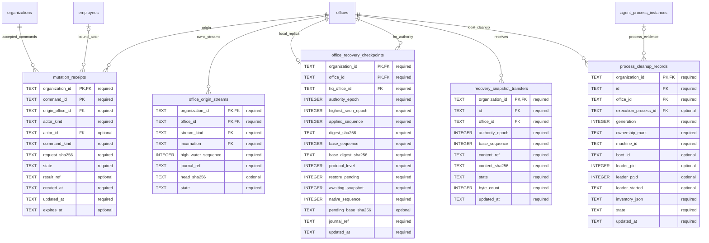

# Recovery and office continuity data

Status: **selected** data contract, revision 2. Data specification, not an implementation of federation, automatic HQ promotion, backup automation or restore commands. This document owns the metadata required to restart/rebuild safely and links existing numbering (06), accounting (10), execution (11), and messaging (15) authorities rather than replacing them.

## What recovery means

Recovery is answering, after a crash or lost cache: “Did this command already finish? Which changes have we accepted? Is this office stale? Is the old agent process still alive?” A restored task list alone cannot answer these questions. Repeating unknown side effects can create two tasks, send two messages, deploy twice or start a second agent.

| Record | Why it exists | Code today |
| --- | --- | --- |
| `mutation_receipts` | Stable command identity, request fingerprint, bound actor, state and protected result reference; retries reuse the recorded outcome | Organization `commands`, office `work_change_results`; host operation journal remains separately protected |
| `office_origin_streams` | Per-office/incarnation high-water identity and journal head; never reuse acknowledged source sequence IDs after restore | `work_origin_counter/log`, message origin sequences and incarnation metadata |
| `office_recovery_checkpoints` | Last applied org epoch/sequence, highest known authority epoch, base digest, pending restore state | `org_replica`, `org_replica_base` |
| `recovery_snapshot_transfers` | Verified snapshot content identity and staging/install state; interruption does not masquerade as a complete install | `org_snapshot_stage/install`, snapshot artifact |
| `process_cleanup_records` | Ownership mark/generation plus machine/boot/start identity and process inventory, linked optionally to a new execution process | `owned_processes`; document 11's process instances and placement fencing remain authoritative |

## Ownership, storage and rebuilding

Organization domain records live in organization Git; these operational records do not. They can contain actor/command relationships and machine-local details. Keep source records, append journals and protected result blobs in `durable/recovery/` under the one selected [storage root](README.md#shared-storage-contract), outside disposable office databases. Owner-verified backup/restore must include these sources and the separately managed credentials. The consolidated SQL is their indexed projection, not a substitute for durable journal evidence.

```text
<data-root>/<organization-id>/durable/recovery/     # protected, never org Git
├── commands/<command-id>.json                    # receipt, immutable fingerprint/actor
├── results/<content-id>                          # protected command outcome
├── offices/<office-id>/
│   ├── streams/<kind>/<incarnation>/journal.jsonl # immutable accepted source changes
│   ├── streams/<kind>/<incarnation>/head.json     # watermark and digest
│   ├── journals/work-acceptance/<journal-incarnation>/
│   │   ├── anchor.json                          # immutable retained continuity evidence
│   │   └── transactions/<commit-ordinal>.json    # immutable frozen acceptance envelopes
│   ├── checkpoint.json                          # current verified authority checkpoint
│   ├── snapshots/<snapshot-id>.json              # transfer metadata and verified content ref
│   └── cleanup/<cleanup-id>.json                 # process ownership evidence
└── snapshots/<content-sha256>                    # immutable protected snapshot content
```

Existing recovery JSON envelopes retain `schema_version: 1`, positive `revision`,
same-named scalar fields and organization/office identity. The selected immutable
work-acceptance journal below has its own explicit envelope schema/codec, separate
from existing source-stream codecs and task snapshot/event schemas. Projection JSON
columns map from objects (`inventory` → `inventory_json`); never store escaped JSON
strings in place of source objects. Keep original payloads/codecs where no lossless
mapping is defined. Use document 11/ADR-0002 full-envelope/platform flush guarantees.
Do not acknowledge until domain change, source evidence and protected receipt/result
have one recoverable commit boundary (this is the durable class; [ADR-0014](../../adr/0014-acknowledgement-classes-and-agent-os-latency.md)
lets named messaging and non-critical task-activity operations be acknowledged at commit); independent SQL/file writes do not establish it.

### Selected immutable work acceptance

[ADR-0006 revision 4](../../adr/0006-selected-task-acceptance.md) distinguishes the
existing **work-origin event** identity `(office_id, origin_incarnation, origin_seq)`
from **journal transaction** identity `(organization_id, office_id,
journal_kind: work-acceptance, journal_incarnation, commit_ordinal)`. A journal
ordinal is a positive i64, canonical decimal filename starting at 1. One new frozen
transaction consumes one ordinal, including receipt-only rejection/no-op outcomes.
Read-only replay and refusals with no durable record consume neither counter.
Journal ordinals never become replication, feed, client or task-revision positions.

`anchor.json` is immutable, not transaction zero. It binds trusted identity, writer
fence/authority, retained origin incarnation/high-water, history evidence and
any verified predecessor journal head. Transaction 1 references its digest; each
later transaction references the preceding ordinal and complete envelope digest.
Envelope hashes use codec-2 normalization (document 05), omitting only their own
top-level `payload_sha256`. Filename and envelope identity must agree. Missing
predecessors, forks, incompatible profiles/codecs or conflicting duplicates stop
recovery. Heads/SQL cursors and any `journal.jsonl` export are derived projections.

The frozen envelope contains origin high-water before/after and the exact ordered
allocated entries: original sequence, target identity/generation/version, feed/client
position, organization position and timestamp, plus complete snapshot/event,
allocation, protected receipt/result and projection mutations. For n entries at h,
allocate exactly h+1 through h+n and record after=h+n. At n=0, after=before; never
append empty origin references or invent a receipt event. Keep the order, IDs and semantics of what is put. The same office writer allocates both positions together;
there is no second writer or competing work-origin allocator. Until the store is rebuilt, mutations of the code's older work store pass through this
boundary as well. Message allocation remains unchanged.

Preparation is effect-free and freezes all decisions outside retryable callbacks.
Durably flush immutable blobs and anchor first; flush a temporary manifest, install
atomically without replacement, then durably flush its parent (including required
macOS full flush). Reconcile uncertain publication before retry. After publication,
retry only frozen projection, never domain decisions or event allocation. Verify
chain and prior origin positions, project the full frozen mutations and both cursors
atomically in SQL, and verify coherent canonical task/event/receipt reads before ACK.
Matching already-applied identity/digest skips effects; mismatch fails closed.

Installation quiesces/fences writers and anchors retained counters, logs, snapshots,
receipts and source hashes. Start ordinal 1 while retaining existing event
high-water; never fabricate historical transactions. Restart/cache rebuild continues
the same incarnation. A new journal incarnation requires verified predecessor head,
retained watermarks and writer fencing. It does not automatically rotate work/message
incarnations; restored offices never promote themselves. Missing continuity stops
acceptance. Check both i64 allocations before publication: event exhaustion may
produce a zero-event rejection if journal capacity remains; journal exhaustion stops
new durable transactions while existing receipt lookup stays available. No wrap/reset
or automatic incarnation change may evade exhaustion.

Manifest profile `selected-task-resources/1` is <=16 MiB, depth <=64, <=200,000
value/key nodes, <=8 MiB decoded string/key/raw number token. Immutable blobs/chunks
are <=64 MiB; <=1,024 references and <=64 MiB aggregate bytes per manifest, repeated
references counted. Validate actual lengths/digests. Recovery retains recorded
profiles, not silently smaller replacements. Protected journal blobs and account-bound receipts never enter public Git.

Receipts cover shared domain commands only. Credentials, passwords, login/reset outcomes, private notes and their existence never enter these shared records: retain those in the host/private stores. `result_ref` resolves through the original command's actor/scope checks, never an unrestricted file path or public URL. `actor_id` is an employee ID only; owner/system principals are bound by the existing authentication layer, not guessed from a display name. One command ID with another fingerprint or actor conflicts. Completed/rejected outcomes remain stable. An `outcome_unknown` command is reconciled before any side effect is repeated.

The office message substrate currently shares an incarnation/sequence allocator between content and state operations; the selected stores must keep one allocator and one global high-water across the two stream categories, not create independent overlapping counters. Work uses its independent source stream. New incarnation after restore never resets/reuses an old incarnation's identity. Archive old high-water records even when payload retention expires. Persist command retention/expiry deliberately; do not delete a receipt while retries may still be valid. SQL blocks deletion/replacement of retained receipts and watermarks; an eventual reviewed expiry/archive procedure must preserve equivalent retry/tombstone evidence.

For selected task commands, protected receipt metadata also binds the stable owner
account and issuing instance, command schema/method, checked organization/task/office
scope and typed fingerprint. Session identity is not the business retry identity.
Renewing a session can recover the same account's result after live authorization
checks; another account or fingerprint conflicts without disclosing the old result.
The owner event still has null employee ID. Neither an assignment nor any profile
field establishes account authority. This protected binding must be included
in the selected receipt schema and frozen journal; the older generic
draft receipt columns alone do not supply it. Recovery keeps expiry/tombstone evidence
and never deletes an eligible retry's only outcome.

Until the store is rebuilt, the code holds an older receipt store beside the selected
one. A work operation ID retained by either cannot be admitted again under the other.
That coexistence rule goes away with the older store; nothing is imported from it.

A checkpoint cannot establish authority by itself. Verify organization identity, trusted HQ/CA pins, codec compatibility, contiguous event sequence and digest chain before applying/rebuilding. Host credentials and CA pins stay in existing protected custody; they are not synthesized from Git or these tables. Higher observed epochs fence stale authority; a restored old office never promotes itself. Snapshot bytes must hash-match their transfer metadata before installation; rejected/partial artifacts confer no authority. SQL is not a lossy replacement for the binary/state-machine journal.

The selected local writer admission binds the registered instance/root filesystem
identity, protected organization/HQ/office binding, writer epoch, device-local
custody identity and journal incarnation. Its last acknowledged journal digest,
ordinal and original work-origin high-water live in host custody outside the
instance/organization root. Release macOS custody is non-synchronizing,
`ThisDeviceOnly`; the explicit development custody directory is outside that root.
Startup never creates missing writer custody for an existing selected office.
Only protected provisioning may establish its initial unanchored binding.
Missing custody, a different root identity, changed epoch/incarnation or a journal
behind its protected checkpoint requires explicit recovery, never automatic
promotion or a reset of either allocator. Recreating a missing host registry must
not sweep existing writer authority.
The protected initial binding records its canonical provisioning
operation ID. An exact authenticated replay may finish marker publication while
retaining its original incarnation, epoch, device and acknowledged checkpoint.
Changed inputs or a different operation cannot replace that binding. This is
resumption of its own protected operation, never promotion of an unknown root.

The authenticated host-worker control channel verifies that retained source
contains the protected checkpoint before recovery modifies projections. It admits
at most one contiguous unacknowledged successor after that checkpoint. This covers
process death between immutable publication and host confirmation without rerunning
the decision. After coherent projection/read verification, the host durably records
the exact next checkpoint before Office returns completion. Live reads/writes also
check the current admission; host EOF or an epoch/root mismatch fences acceptance.
The host checkpoint is continuity/fencing evidence, not another event allocator,
journal or domain decision. Restoring host custody itself, machine migration and
handover remain explicit unsupported recovery cases until verified fencing and
retained-head evidence are supplied; copying files does not authorize them. These
are office relocation, distinct from re-placing one agent; see
[Moving agents and moving offices](#moving-agents-and-moving-offices).

Process cleanup is machine-local. Never send a signal based solely on a restored PID: verify the ownership mark, generation, boot and process-start identity through the existing process-control library. A copied record on another machine is unverified. Cleanup and existing fencing must establish the previous process has stopped before the new one runs. These records complement document 11; they do not allocate a second placement generation or authorize launch.

### Office acceptance projection format

The selected office adapter uses additive office schema 7. Its protected journal
envelope has `schema_version: 1`, `json_codec: 2` and the recorded resource profile;
these versions are independent of task snapshot/event versions. The immutable
anchor and each transaction retain ordered table mutations with full column names,
typed before/after cells (`null`, signed `integer`, exact `text`, hexadecimal
`blob`), a projection-schema digest and the exact original origin mapping. JSON
inside SQL text or blob cells is never parsed or regenerated by this projection
format. A frozen cell larger than 64 KiB uses a verified protected
`blobs/sha256/<digest>` reference, with byte length and `utf-8` or `hex` encoding;
the aggregate recorded profile still applies. Public task/event bytes and protected
account-bound receipts are retained as separate artifact mutations.

Recovery verifies the complete retained prefix before applying SQL projections.
After rebuilding SQL, it materializes final canonical files directly, rather than
rewinding a current file through intermediate historical revisions. A mutable file
may advance from bytes whose hash is a verified predecessor for that same path;
missing files may be recreated. Unfamiliar bytes or conflicting immutable files
stop recovery. Verified final SQL/file reads precede readiness or completion.

Protected owner-account registration is separate from the organization's directory.
Selected directory generations and their exact source JSON pass through the same office
writer; no field on an employee record grants ownership. These library mechanisms do not
establish host lease fencing or production session verification by themselves. Their production composition remains required.

### No adoption or staging interface

Withdrawn (owner decisions 2026-11-17). An earlier revision specified a local `adopt`
command and two interfaces for staging and adopting tasks and a directory from an
earlier store. Nothing has shipped, so there is nothing to adopt: no such command or
interface is built, and no staging area exists. The organization's directory of
teams, employees and projects comes from creating the organization and from ordinary
organization commands, through the same office writer and acceptance journal as every
other change.

Two things the withdrawn interface used to provide need a replacement. The proposed
resolution, to be confirmed in the store rebuild plan (conflict plan entry B-01), is
that both are ordinary accepted commands and neither is an import:

- **The first directory generation.** Creating the organization is the first accepted
  transaction of its acceptance journal. It writes the organization, the HQ office and
  the initial team when one is given, and that is directory generation 1. Every later
  organization command (create a team, add a person or agent, create a project)
  is an accepted transaction that produces the next generation.
- **A task's first entry.** `task.create` goes through the acceptance journal like every
  other task change. Its `created` event is revision 1 of that task's history, written
  in the same transaction as the task snapshot and the office-minted number.
  [ADR-0006](../../adr/0006-selected-task-acceptance.md) covers changes to an existing
  task; the rebuild extends the same path to creation.

## Moving agents and moving offices

Two different moves share the word "machine". They have different status.

| Move | What changes | Status |
| --- | --- | --- |
| Agent re-placement | One agent's current office changes. Its identity, home team, tasks and history do not. | Selected. [Document 11 §3](11-model-profiles-and-agent-execution.md#3-storage-authority-and-exact-paths) owns the rule: the previous supervisor's verified cleanup acknowledgement or an explicitly verified machine fence, then HQ journals the new office and an incremented `placement_generation`. It needs a second office, so it is first exercised when satellite offices ship. |
| Office relocation | An office's durable sources, host key custody and writer custody move to another machine. Replacing the HQ machine is the same operation. | Not supported in v1; planned for v2. Copying or restoring files does not perform it and confers no authority. |

V1 keeps office relocation possible without supporting it. The evidence a
relocation procedure needs is already part of the selected records: office
incarnation and organization epoch on origin streams and checkpoints, placement
generation on every command, permit and attempt, the host's protected
writer-custody checkpoint, and immutable hash-chained journals. A v2 relocation
therefore adds a procedure (verified fencing of the old machine, custody transfer
with retained-head evidence, a new incarnation), not a new record format. Until
then, any change that would bind a durable record to a machine-local identity
without an incarnation, epoch or generation needs a recorded decision, because it
would close that path.

## Loss boundaries

| What is lost | Expected result |
| --- | --- |
| Office SQLite projections/unread indexes | Rebuild from Git plus protected operational sources; rebind credentials; reconcile process ownership before execution |
| Office running process | Restart from retained receipts, stream/checkpoint and cleanup evidence; uncertain effects remain unknown until reconciled |
| Runtime cache/temp/typing/status | Recreate; stale presence expires; no mutation is replayed merely because its UI status vanished |
| Operational sources but a valid backup exists | Restore with verified identity/epoch/digests and disclose changes not covered by backup; no automatic claim of zero data loss |
| Operational sources and backups | Git restores portable definitions/open work already published, not all acknowledged messages, receipts, authority or usage; stop affected work rather than fabricate continuity |

This explicitly limits “delete office state”: the disposable directory cannot contain the only copy of acknowledged recovery evidence. Protect live source journals, host/private databases, keys, unresolved communication and process ownership until safe shutdown/archive. Recovery data is now selected; areas, Undo, automatic scheduling, memory and process-engine behavior remain unchanged.

## SQL and field relationships

All definitions below are included in `schema.sql`. All references are organization scoped. SQL enforces core identity/watermark invariants. Canonical paths, actor authorization, replay coverage, payload hashes, process verification, snapshot state transitions and filesystem/DB commit boundaries remain command/import/platform responsibilities. `generation` is the existing cleanup record generation; it is not the employee placement generation. Preserve existing IDs and generations without issuing new ones during projection rebuild.

```sql
CREATE TABLE mutation_receipts (
  organization_id TEXT NOT NULL REFERENCES organizations(id),
  command_id TEXT NOT NULL,
  origin_office_id TEXT NOT NULL,
  actor_kind TEXT NOT NULL CHECK (actor_kind IN ('employee','owner','system')),
  actor_id TEXT,
  command_kind TEXT NOT NULL,
  request_sha256 TEXT NOT NULL CHECK (length(request_sha256)=64 AND request_sha256 NOT GLOB '*[^0-9a-f]*'),
  state TEXT NOT NULL CHECK (state IN ('reserved','linked','completed','rejected','abandoned','outcome_unknown')),
  result_ref TEXT,
  created_at TEXT NOT NULL,
  updated_at TEXT NOT NULL,
  expires_at TEXT,
  PRIMARY KEY (organization_id,command_id),
  CHECK ((actor_kind='employee')=(actor_id IS NOT NULL)),
  FOREIGN KEY (organization_id,actor_id) REFERENCES employees(organization_id,id) DEFERRABLE INITIALLY DEFERRED,
  FOREIGN KEY (organization_id,origin_office_id) REFERENCES offices(organization_id,id) DEFERRABLE INITIALLY DEFERRED
) STRICT;
CREATE TABLE office_origin_streams (
  organization_id TEXT NOT NULL,
  office_id TEXT NOT NULL,
  stream_kind TEXT NOT NULL CHECK (stream_kind IN ('organization','work','message_content','message_state')),
  incarnation TEXT NOT NULL,
  high_water_sequence INTEGER NOT NULL CHECK (high_water_sequence>=0),
  journal_ref TEXT NOT NULL,
  head_sha256 TEXT CHECK (head_sha256 IS NULL OR (length(head_sha256)=64 AND head_sha256 NOT GLOB '*[^0-9a-f]*')),
  state TEXT NOT NULL CHECK (state IN ('open','sealed')),
  PRIMARY KEY (organization_id,office_id,stream_kind,incarnation),
  FOREIGN KEY (organization_id,office_id) REFERENCES offices(organization_id,id) DEFERRABLE INITIALLY DEFERRED
) STRICT;
CREATE TABLE office_recovery_checkpoints (
  organization_id TEXT NOT NULL,
  office_id TEXT NOT NULL,
  hq_office_id TEXT NOT NULL,
  authority_epoch INTEGER NOT NULL CHECK (authority_epoch>0),
  highest_seen_epoch INTEGER NOT NULL CHECK (highest_seen_epoch>=authority_epoch),
  applied_sequence INTEGER NOT NULL CHECK (applied_sequence>=0),
  digest_sha256 TEXT NOT NULL CHECK (length(digest_sha256)=64 AND digest_sha256 NOT GLOB '*[^0-9a-f]*'),
  base_sequence INTEGER NOT NULL CHECK (base_sequence>=0 AND base_sequence<=applied_sequence),
  base_digest_sha256 TEXT NOT NULL CHECK (length(base_digest_sha256)=64 AND base_digest_sha256 NOT GLOB '*[^0-9a-f]*'),
  protocol_level INTEGER NOT NULL CHECK (protocol_level>0),
  restore_pending INTEGER NOT NULL CHECK (restore_pending IN (0,1)),
  awaiting_snapshot INTEGER NOT NULL CHECK (awaiting_snapshot IN (0,1)),
  native_sequence INTEGER NOT NULL CHECK (native_sequence>=0),
  pending_base_sha256 TEXT CHECK (pending_base_sha256 IS NULL OR (length(pending_base_sha256)=64 AND pending_base_sha256 NOT GLOB '*[^0-9a-f]*')),
  journal_ref TEXT NOT NULL,
  updated_at TEXT NOT NULL,
  PRIMARY KEY (organization_id,office_id),
  CHECK ((authority_epoch<highest_seen_epoch)=(pending_base_sha256 IS NOT NULL)),
  CHECK (authority_epoch=highest_seen_epoch OR restore_pending=1),
  FOREIGN KEY (organization_id,office_id) REFERENCES offices(organization_id,id) DEFERRABLE INITIALLY DEFERRED,
  FOREIGN KEY (organization_id,hq_office_id) REFERENCES offices(organization_id,id) DEFERRABLE INITIALLY DEFERRED
) STRICT;
CREATE TABLE recovery_snapshot_transfers (
  organization_id TEXT NOT NULL,
  id TEXT NOT NULL,
  office_id TEXT NOT NULL,
  authority_epoch INTEGER NOT NULL CHECK (authority_epoch>0),
  base_sequence INTEGER NOT NULL CHECK (base_sequence>=0),
  content_ref TEXT NOT NULL,
  content_sha256 TEXT NOT NULL CHECK (length(content_sha256)=64 AND content_sha256 NOT GLOB '*[^0-9a-f]*'),
  state TEXT NOT NULL CHECK (state IN ('staging','verified','installing','installed','rejected')),
  byte_count INTEGER NOT NULL CHECK (byte_count>=0),
  updated_at TEXT NOT NULL,
  PRIMARY KEY (organization_id,id),
  FOREIGN KEY (organization_id,office_id) REFERENCES offices(organization_id,id) DEFERRABLE INITIALLY DEFERRED
) STRICT;
CREATE TABLE process_cleanup_records (
  organization_id TEXT NOT NULL,
  id TEXT NOT NULL,
  office_id TEXT NOT NULL,
  execution_process_id TEXT,
  generation INTEGER NOT NULL CHECK (generation>0),
  ownership_mark TEXT NOT NULL CHECK (length(ownership_mark)>0),
  machine_id TEXT NOT NULL,
  boot_id TEXT,
  leader_pid INTEGER,
  leader_pgid INTEGER,
  leader_started TEXT,
  inventory_json TEXT NOT NULL CHECK (json_valid(inventory_json) AND json_type(inventory_json)='object'),
  state TEXT NOT NULL CHECK (state IN ('owned','cleanup_pending','cleaned','unverified')),
  updated_at TEXT NOT NULL,
  PRIMARY KEY (organization_id,id),
  UNIQUE (organization_id,office_id,ownership_mark),
  CHECK ((leader_pid IS NULL)=(leader_pgid IS NULL) AND (leader_pid IS NULL)=(leader_started IS NULL) AND (leader_pid IS NULL)=(boot_id IS NULL)),
  FOREIGN KEY (organization_id,office_id) REFERENCES offices(organization_id,id) DEFERRABLE INITIALLY DEFERRED,
  FOREIGN KEY (organization_id,execution_process_id) REFERENCES agent_process_instances(organization_id,id) DEFERRABLE INITIALLY DEFERRED
) STRICT;
CREATE TRIGGER receipt_identity_immutable BEFORE UPDATE ON mutation_receipts
WHEN NEW.organization_id<>OLD.organization_id OR NEW.command_id<>OLD.command_id OR NEW.origin_office_id<>OLD.origin_office_id
 OR NEW.actor_kind<>OLD.actor_kind OR NEW.actor_id IS NOT OLD.actor_id OR NEW.command_kind<>OLD.command_kind OR NEW.request_sha256<>OLD.request_sha256
 OR (OLD.state IN ('completed','rejected','abandoned') AND (NEW.state<>OLD.state OR NEW.result_ref IS NOT OLD.result_ref))
BEGIN SELECT RAISE(ABORT,'receipt identity or terminal outcome changed'); END;
CREATE TRIGGER receipt_no_replace BEFORE INSERT ON mutation_receipts
WHEN EXISTS (SELECT 1 FROM mutation_receipts WHERE organization_id=NEW.organization_id AND command_id=NEW.command_id)
BEGIN SELECT RAISE(ABORT,'receipt command already registered'); END;
CREATE TRIGGER origin_stream_no_regression BEFORE UPDATE ON office_origin_streams
WHEN NEW.organization_id<>OLD.organization_id OR NEW.office_id<>OLD.office_id OR NEW.stream_kind<>OLD.stream_kind OR NEW.incarnation<>OLD.incarnation
 OR NEW.high_water_sequence<OLD.high_water_sequence OR (NEW.high_water_sequence=OLD.high_water_sequence AND NEW.head_sha256 IS NOT OLD.head_sha256)
 OR (OLD.state='sealed' AND (NEW.state<>OLD.state OR NEW.high_water_sequence<>OLD.high_water_sequence))
BEGIN SELECT RAISE(ABORT,'origin stream regressed or forked'); END;
CREATE TRIGGER origin_stream_no_replace BEFORE INSERT ON office_origin_streams
WHEN EXISTS (SELECT 1 FROM office_origin_streams WHERE organization_id=NEW.organization_id AND office_id=NEW.office_id AND stream_kind=NEW.stream_kind AND incarnation=NEW.incarnation)
BEGIN SELECT RAISE(ABORT,'origin identity already registered'); END;
CREATE TRIGGER checkpoint_no_regression BEFORE UPDATE ON office_recovery_checkpoints
WHEN NEW.organization_id<>OLD.organization_id OR NEW.office_id<>OLD.office_id OR NEW.highest_seen_epoch<OLD.highest_seen_epoch
 OR NEW.authority_epoch<OLD.authority_epoch OR (NEW.authority_epoch=OLD.authority_epoch AND NEW.applied_sequence<OLD.applied_sequence)
 OR (NEW.authority_epoch=OLD.authority_epoch AND NEW.applied_sequence=OLD.applied_sequence AND NEW.digest_sha256<>OLD.digest_sha256)
BEGIN SELECT RAISE(ABORT,'recovery checkpoint regressed or forked'); END;
CREATE TRIGGER checkpoint_no_replace BEFORE INSERT ON office_recovery_checkpoints
WHEN EXISTS (SELECT 1 FROM office_recovery_checkpoints WHERE organization_id=NEW.organization_id AND office_id=NEW.office_id)
BEGIN SELECT RAISE(ABORT,'checkpoint identity already registered'); END;
CREATE TRIGGER receipt_no_delete BEFORE DELETE ON mutation_receipts
BEGIN SELECT RAISE(ABORT,'receipt retention requires reviewed expiry/archive procedure'); END;
CREATE TRIGGER origin_stream_no_delete BEFORE DELETE ON office_origin_streams
BEGIN SELECT RAISE(ABORT,'origin watermark must be retained'); END;
CREATE TRIGGER checkpoint_no_delete BEFORE DELETE ON office_recovery_checkpoints
BEGIN SELECT RAISE(ABORT,'authority checkpoint must be retained'); END;
```



[Budgets and controls](17-budgets-and-controls.md) now selects the budget data model. Policy/extension/hold records must survive office cache loss; automatic pausing/evaluation still requires service implementation. Other deferred features remain unchanged.
