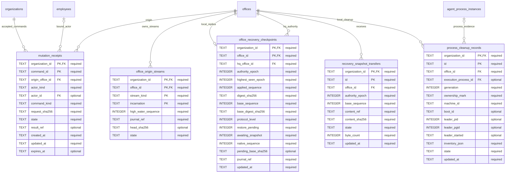

# Recovery and office continuity data

Status: **selected** data contract, revision 4.1. Data specification, not an implementation of federation, automatic HQ promotion, backup automation or restore commands. This document owns the metadata required to restart/rebuild safely and links existing numbering (06), accounting (10), execution (11), and messaging (15) authorities rather than replacing them. Those documents own their records; none owns a journal: the acceptance journal below is the only one in an office.

## What recovery means

Recovery is answering, after a crash or lost cache: “Did this command already finish? Which changes have we accepted? Is this office stale? Is the old agent process still alive?” A restored task list alone cannot answer these questions. Repeating unknown side effects can create two tasks, send two messages, deploy twice or start a second agent.

| Record | Why it exists | Code today |
| --- | --- | --- |
| `mutation_receipts` | Single canonical idempotency receipt table across all families (including supervisor commands from document 11): stable command identity, request fingerprint, bound actor, state and access-checked `result_ref` (never inline plaintext response payloads); retries reuse the recorded outcome | Consolidated receipt model; host operation journal remains separately protected |
| `office_origin_streams` | Per-office/incarnation high-water identity and journal head; never reuse acknowledged source sequence IDs after restore | `work_origin_counter/log`, message origin sequences and incarnation metadata |
| `office_recovery_checkpoints` | Last applied org epoch/sequence, highest known authority epoch, base digest, pending restore state | `org_replica`, `org_replica_base` |
| `recovery_snapshot_transfers` | Verified snapshot content identity and staging/install state; interruption does not masquerade as a complete install | `org_snapshot_stage/install`, snapshot artifact |
| `process_cleanup_records` | Process-cleanup lifecycle extension: for managed agent processes, projected directly from `supervision/processes/<process-instance-id>.json` (document 11) linked via `execution_process_id`; standalone `cleanup/<cleanup-id>.json` files are reserved strictly for unmanaged/orphan OS process cleanup (`execution_process_id IS NULL`) | Document 11's standalone process records and placement fencing remain authoritative |

## Ownership, storage and rebuilding

Organization domain records live in organization Git; these operational records do not. They can contain actor/command relationships and machine-local details. Keep source records, append journals and protected result blobs in `durable/recovery/` under the one selected [storage root](README.md#shared-storage-contract), outside disposable office databases. Owner-verified backup/restore must include these sources and the separately managed credentials. The consolidated SQL is their indexed projection, not a substitute for durable journal evidence.

```text
<data-root>/<organization-id>/durable/recovery/     # protected, never org Git
├── commands/<command-id>.json                    # canonical receipt for all families (incl. supervisor commands), immutable fingerprint/actor
├── results/<content-id>                          # access-checked protected command outcome referenced by result_ref
├── offices/<office-id>/
│   ├── journals/acceptance/<journal-incarnation>/
│   │   ├── anchor.json                          # immutable retained continuity evidence
│   │   ├── checkpoint.json                      # head, high-waters, materialized mark at the last release
│   │   └── segments/<first-ordinal>.log          # append-only accepted entries
│   ├── checkpoint.json                          # current verified authority checkpoint
│   ├── snapshots/<snapshot-id>.json              # transfer metadata and verified content ref
│   └── cleanup/<cleanup-id>.json                 # orphan/unmanaged OS process cleanup only (managed processes live in supervision/processes/)
└── snapshots/<content-sha256>                    # immutable protected snapshot content
```

Recovery JSON records (receipts, checkpoints, snapshot and cleanup records) have
`schema_version: 1`, a positive `revision`, same-named scalar fields and
organization/office identity. The acceptance journal has its own entry format, below.
Projection JSON columns map from objects (`inventory` → `inventory_json`); never store
escaped JSON strings in place of source objects. Do not acknowledge until the domain
change, its source evidence and its protected receipt are one recoverable commit
boundary: one acceptance-journal entry, committed in the operation's class
([ADR-0014](../../adr/0014-acknowledgement-classes-and-agent-os-latency.md)).
Independent SQL or file writes do not establish it. How the office writes, flushes and
replays the journal is the [office store design](../office-store.md).

### Selected immutable acceptance journal

Each office has **one acceptance journal for every record family** (organization,
projects, work, messaging, execution and the rest), journal kind `acceptance`. It is the
office's commit point. [ADR-0006](../../adr/0006-selected-task-acceptance.md)
distinguishes the **work-origin event** identity `(office_id, origin_incarnation,
origin_seq)` from the **journal entry** identity `(organization_id, office_id,
journal_kind: acceptance, journal_incarnation, ordinal)`. An ordinal is a positive i64
starting at 1. One accepted operation is one entry and consumes one ordinal, including a
receipt-only rejection. Read-only replay and refusals with no durable record consume
neither an ordinal nor a position. Ordinals never become replication, feed, client or
task-revision positions.

**Entries.** Entries are appended to segment files `segments/<first-ordinal>.log`. Each
entry is framed as its length, a canonical JSON header, the bytes of the files it writes,
and a SHA-256 over those stored bytes (codec `raw-bytes/1`,
[document 08](08-record-contracts.md#hash-codec-registry)). The header holds the ordinal,
the preceding entry's hash, the office and journal identity, the acknowledgement class,
the receipt (operation ID, kind, bound actor, fingerprint, outcome), the positions the
entry took in each origin stream, its feed position, and its **file changes**: path,
`create`, `put` or `remove`, length, hash, and the hash of the version it replaces. An
entry never holds table mutations, column names or a projection-schema digest: the
projection is rebuilt from the files, and changing its schema changes no entry. Keep the
order, IDs and semantics of what is put.

`anchor.json` is immutable and is not entry zero. It binds trusted identity, writer
fence/authority, the retained origin incarnations and high-waters, history evidence and
any verified predecessor journal head. Entry 1 references the anchor's digest; each later
entry references the preceding entry's hash. Missing predecessors, forks, unknown entry
formats or conflicting duplicates stop recovery. Before segments are released,
`checkpoint.json` records the head hash, the high-waters and the materialized mark; the
anchor, the checkpoint and the remaining segments are the retained continuity evidence.
Heads, SQL cursors and any export are derived.

**Positions.** For n origin entries after high-water h, allocate exactly h+1 through h+n
and record after=h+n. At n=0, after=before; never append empty origin references or
invent a receipt event. The same office writer allocates every position; there is no
second writer or competing allocator. Message allocation is separate from work.

**Freezing.** A decision is effect-free until its entry is appended; after that only the
entry is replayed, never the decision, and no replacement position is allocated.
Matching already-applied identity and hash skips effects; a mismatch fails closed.

**Durability.** A committed-class entry is acknowledged once appended and projected; a
durable-class entry once a full flush of its segment covers it (the macOS full flush).
One flush covers every earlier entry. Files are written after the flush that covers
their entry, to their final state, through a flushed temporary file and an atomic
rename; a file may advance only from a version the journal names as its predecessor, a
missing file may be recreated, and unfamiliar bytes or a conflicting immutable file stop
the office. Content above the entry limit is written as a content-addressed blob,
flushed, before the entry that names it. A failed flush is fatal: the office answers no
waiting durable request as success, stops, and restarts from what is on the drive.

**A torn tail.** An entry above the head the host custody last confirmed whose length or
hash is bad is a torn write (a process kill or a power cut during the append) and is
truncated; it was never acknowledged durable. A bad entry at or below that head is
corruption: the office refuses to open and names the ordinal.

**Positions taken back by a power cut.** Nothing leaves the office before its entry is
flushed: replication and Git publication read flushed entries only. A committed-class
entry lost in a power cut therefore never left the office, and its positions may be
allocated again. Positions that left the office are never reused, and a new incarnation
after a restore never reuses any. Task numbers, which people see in the office, keep the
durable mark of [document 06](06-identity-and-numbering.md).

**Opening and incarnations.** Opening a journal fences writers and anchors the counters,
logs, snapshots, receipts and source hashes the office holds. Ordinals start at 1 with
the office's high-waters kept; never fabricate entries. Restart and cache rebuild
continue the same incarnation. A new journal incarnation requires a verified predecessor
head, retained watermarks and writer fencing. It does not automatically rotate work or
message incarnations; restored offices never promote themselves. Missing continuity
stops acceptance. Check both i64 allocations before appending: position exhaustion may
produce a zero-position rejection if ordinals remain; ordinal exhaustion stops new
entries while existing receipt lookup stays available. No wrap, reset or automatic
incarnation change may evade exhaustion.

**Limits.** Profile `selected-task-resources/1`: an entry is <=16 MiB; a header has depth
<=64, <=200,000 value/key nodes and <=8 MiB decoded string/key/raw number token.
Immutable blobs/chunks are <=64 MiB; <=1,024 references and <=64 MiB aggregate bytes per
entry, repeated references counted. Validate actual lengths/digests. Recovery retains
recorded profiles, not silently smaller replacements. Protected journal blobs and
account-bound receipts never enter public Git.

Receipts cover shared domain commands only. Credentials, passwords, login/reset outcomes, private notes and their existence never enter these shared records: retain those in the host/private stores. `result_ref` resolves through the original command's actor/scope checks, never an unrestricted file path or public URL. `actor_id` is an employee ID, a person or an agent; a person who signs in, the organization owner included, is their own person record. A `system` actor has no employee ID. Accounts are bound by the host's authentication, never guessed from a display name. One command ID with another fingerprint or actor conflicts. Completed/rejected outcomes remain stable. An `outcome_unknown` command is reconciled before any side effect is repeated.

The office message substrate currently shares an incarnation/sequence allocator between content and state operations; the selected stores keep one allocator and one high-water for messaging: content and state changes take their sequence from the single stream kind `message`, never from two counters that could give the same sequence twice. Work uses its independent source stream. New incarnation after restore never resets/reuses an old incarnation's identity. Archive old high-water records even when payload retention expires. Persist command retention/expiry deliberately; do not delete a receipt while retries may still be valid. SQL blocks deletion/replacement of retained receipts and watermarks; an eventual reviewed expiry/archive procedure must preserve equivalent retry/tombstone evidence.

For selected task commands, protected receipt metadata also binds the stable
account and issuing instance, command schema/method, checked organization/task/office
scope and typed fingerprint. Session identity is not the business retry identity.
Renewing a session can recover the same account's result after live authorization
checks; another account or fingerprint conflicts without disclosing the old result.
The recorded actor is the account's person record (`actor_kind: employee`). Neither
an assignment nor any profile field establishes account authority. This protected
binding is part of the receipt schema and frozen journal; the columns of
`mutation_receipts` alone do not supply it. Recovery keeps expiry/tombstone evidence
and never deletes an eligible retry's only outcome.

A checkpoint cannot establish authority by itself. Verify organization identity, trusted HQ/CA pins, codec compatibility, contiguous event sequence and digest chain before applying/rebuilding. Host credentials and CA pins stay in existing protected custody; they are not synthesized from Git or these tables. Higher observed epochs fence stale authority; a restored old office never promotes itself. Snapshot bytes must hash-match their transfer metadata before installation; rejected/partial artifacts confer no authority. SQL is not a lossy replacement for the binary/state-machine journal.

The selected local writer admission binds the registered instance/root filesystem
identity, protected organization/HQ/office binding, writer epoch, device-local
custody identity and journal incarnation. The last journal head it confirmed (ordinal
and hash) and the original work-origin high-water live in host custody outside the
instance/organization root. Release macOS custody is non-synchronizing,
`ThisDeviceOnly`; the explicit development custody directory is outside that root.
Startup never creates missing writer custody for an existing selected office.
Only protected provisioning may establish its initial unanchored binding.
Missing custody, a different root identity, changed epoch/incarnation or a journal
behind its protected checkpoint requires explicit recovery, never automatic
promotion or a reset of either allocator. Recreating a missing host registry must
not sweep existing writer authority. The host never recreates a registry it once
created: after the first creation it records a marker in the instance root, and a
later start that finds the marker without the registry refuses until the registry
is restored from a backup; removing the instance (uninstall, FC-022) must clear the
marker with the registry (ADR-0022).
The protected initial binding records its canonical provisioning
operation ID. An exact authenticated replay may finish marker publication while
retaining its original incarnation, epoch, device and acknowledged checkpoint.
Changed inputs or a different operation cannot replace that binding. This is
resumption of its own protected operation, never promotion of an unknown root.

The authenticated host-worker control channel verifies at opening that the retained
journal contains the confirmed head. The office confirms the flushed head to the host
once per group flush, never per operation and never on the acknowledgement path.
Recovery admits any verified contiguous suffix above the confirmed head. The host
checkpoint is continuity and fencing evidence, not another allocator, journal or domain
decision. Host EOF or an epoch/root mismatch fences acceptance. Restoring host custody
itself, machine migration and handover remain explicit unsupported recovery cases until
verified fencing and retained-head evidence are supplied; copying files does not
authorize them. These are office relocation, distinct from re-placing one agent; see
[Moving agents and moving offices](#moving-agents-and-moving-offices).

Process cleanup is machine-local. Never send a signal based solely on a restored PID: verify the ownership mark, generation, boot and process-start identity through the existing process-control library. A copied record on another machine is unverified. Cleanup and existing fencing must establish the previous process has stopped before the new one runs. These records complement document 11; they do not allocate a second placement generation or authorize launch.

### Projection from the journal

The journal carries file changes only. Recovery verifies the complete retained chain,
writes the final state of every file the retained entries touch (never rewinding a file
through intermediate revisions), and then brings the projection up to the journal head
from the files: by replay when its cursor is consistent, otherwise by a rebuild from all
source files. Public task/event bytes and protected account-bound receipts are separate
files. Verified final reads precede readiness or completion.

The host's account registration, and the link from an account to its person record,
are separate from the organization's directory. Directory generations and their exact source JSON pass through the same office
writer; no field on an employee record grants ownership. These library mechanisms do not
establish host lease fencing or production session verification by themselves. Their production composition remains required.

### How the directory begins

There is no adoption, staging or import interface. The organization's directory of
teams, employees and projects comes from creating the organization and from ordinary
organization commands, through the same office writer and acceptance journal as every
other change.

- **The first directory generation.** Creating the organization is the first accepted
  transaction of its acceptance journal. It writes the organization, the HQ office, the
  top-level team, the creator's person record and the HR lead
  ([document 01](01-organization-structure.md#creating-an-organization)), and that is
  directory generation 1. Every later organization command (create a team, add a
  person, hire an agent, create a project with its team) is an accepted transaction
  that produces the next generation.
- **A task's first entry.** `task.create` goes through the acceptance journal like every
  other task change. Its `created` event is revision 1 of that task's history, written
  in the same transaction as the task snapshot and the office-minted number.
  [ADR-0006](../../adr/0006-selected-task-acceptance.md) covers changes to an existing
  task and the same path covers creation.

## The HQ's CA records

`security/ca-escrow.v1.bin` contains only the exact versioned encrypted public
package from [ADR-0007](../../adr/0007-hq-creation-escrow.md). It belongs to the
organization: its file is a source of the organization's records, published to Git
verbatim. The usable CA key is the HQ's local record
`durable/local/offices/<office-id>/security/ca-key.v1.json`, never organization Git
content. In it the CA private key is only ever wrapped by the host-held office secrets
key ([ADR-0016](../../adr/0016-no-application-level-data-encryption.md)); the raw key
is written nowhere. The delivery code stays in protected host custody until
acknowledged. The public package alone supplies no account, epoch or writer
authority.

Only the public escrow package (`state/security/ca-escrow.v1.bin`) is committed inside Entry 1 of the acceptance journal ([document 16](#how-the-directory-begins)), bound by the creation operation's fingerprint over `(organization_id, office_id, operation_id, public_key, package_sha256)`. The wrapped Org CA key (`durable/local/offices/<office-id>/security/ca-key.v1.json`) is written atomically and exclusively to local security storage (`0700` directory, `0600` file) **outside** `durable/recovery/` acceptance journal segments (`TASK-10` / H-06). As a result, **no CA private-key ciphertext ever enters `durable/recovery/` segments**, organization Git, state exports, or `office.db`, and Entry 1 carries purely public `durable/state/` files with no special-case outbox exclusion needed. If creation crashes after committing Entry 1 and before writing `ca-key.v1.json`, `office.json` is not yet written, and retrying creation recovers the exact CA signing key from `state/security/ca-escrow.v1.bin` + the pending recovery code and completes the local `ca-key.v1.json` write before finalizing `office.json`. The office reads `ca-key.v1.json` directly from its local security path at opening and when the recovery package is read.

**What leaves an office.** Storage trees under `<data-root>/<organization-id>/durable/` fall into three explicit movement classes:

1. **Git-published & state outbox (`durable/state/`):** Shared organization, project, task, document, and feature state (including public `state/security/ca-escrow.v1.bin`). Only `durable/state/` is published to organization Git or included in generic state exports.
2. **Office-to-HQ / peer replicated over Organization-CA mTLS sync (never Git):** Protected operational streams replicated exclusively over authenticated office-to-office sync—`durable/messaging/` ([document 15](15-messaging-and-chat.md)), `durable/accounting/` ([document 10](10-usage-and-cost-accounting.md)), and selected `durable/authority/` coordination state ([documents 06, 11, 17](11-model-profiles-and-agent-execution.md)).
3. **Strictly node-local (never leaves the writing office):** `durable/local/`, `durable/recovery/`, `durable/private/` (HQ-only private task notes), and `durable/budgets/` (HQ-owned protected budget policies/periods).

Replication (S1) inherits a test verifying that neither Git publication nor state outbox export ever ships files outside `durable/state/`, and that strictly node-local trees never leave the writing office over any channel.

**The CA key record's one form.** One JSON object, keys in this order, lowercase hex,
no whitespace, and a final newline; a file in any other form is refused, so the exact
bytes are the contract:

```json
{"schema_version":1,"organization_id":"01930000-0000-7000-8000-0000000000a2","office_id":"01930000-0000-7000-8000-0000000000a3","operation_id":"01930000-0000-7000-8000-000000000001","escrow_version":1,"public_key":"04…","package_sha256":"…","wrapped_ca_key":"…"}
```

| Field | Rule |
| --- | --- |
| `schema_version` | `1` |
| `organization_id`, `office_id` | The organization and the HQ office: UUIDv7, and the office the folder names |
| `operation_id` | The store operation that created the organization: a UUIDv7. While the wire's command IDs are ULIDs, the UUIDv7 the creation's ULID maps to (the one mapping in `crates/org-office/src/organization/operation_id.rs`, removed when the wire carries UUIDv7) |
| `escrow_version` | `1`, the ADR-0007 envelope version of the package |
| `public_key` | The CA's 65-byte uncompressed SEC1 public key (130 hex digits, starting `04`); it equals the package's |
| `package_sha256` | The SHA-256 of `state/security/ca-escrow.v1.bin` (64 hex digits) |
| `wrapped_ca_key` | The `org_pki::wrap` record of the CA's PKCS#8 key: version, nonce, ciphertext and tag |

An HQ whose escrow package or key record is missing, whose package does not hash to
`package_sha256`, or whose public key, organization or operation differ from the
creation's is not opened; nothing is reset or generated again
([ADR-0007](../../adr/0007-hq-creation-escrow.md), step 4). A retry of the creation
carries the same material, and the material is part of what the retry is matched on: a
retry with regenerated material is refused as a reused operation ID.

The package is published like every file of an entry: created exclusively, once its
entry is flushed. A missing copy is written again from the journal on reopen; a
different copy stops the office and is kept, never overwritten. The binary envelope
is the versioned copied record; the organization snapshot codec does not acquire
secret or escrow fields. Copies in Git keep this public file verbatim.

Code today (until increment B1b switches the office to its new store): the worker
keeps the wrapped key in its office database and publishes the package to the state
root its protected creation context names.

## Moving agents and moving offices

Two different moves share the word "machine". They have different status.

| Move | What changes | Status |
| --- | --- | --- |
| Agent re-placement | One agent's current office changes. Its identity, home team, tasks and history do not. | Selected. [Document 11 §3](11-model-profiles-and-agent-execution.md#3-storage-authority-and-exact-paths) owns the rule: the previous supervisor's verified cleanup acknowledgement or an explicitly verified machine fence, then HQ journals the new office and an incremented `placement_generation`. It needs a second office, so it is first exercised when satellite offices ship. |
| Office relocation | An office's durable sources, host key custody and writer custody move to another machine. Replacing the HQ machine is the same operation. | Not supported in v1; planned for v2. Copying or restoring files does not perform it and confers no authority. |

V1 keeps office relocation possible without supporting it. The evidence a
relocation procedure needs is already part of the selected records: office
incarnation and organization epoch on origin streams and checkpoints, placement
generation on every command, permit and attempt, the host's protected
writer-custody checkpoint, and immutable hash-chained journals. A v2 relocation
therefore adds a procedure (verified fencing of the old machine, custody transfer
with retained-head evidence, a new incarnation), not a new record format. Until
then, any change that would bind a durable record to a machine-local identity
without an incarnation, epoch or generation needs a recorded decision, because it
would close that path.

## Retention, compaction and archival windows

Append-only operational streams and receipts are bounded by explicit, reviewed maintenance compaction and archival windows rather than ad-hoc SQL `DELETE` statements:

| Store / stream | Active window | Compaction / archival procedure |
| --- | --- | --- |
| Acceptance journal segments (`durable/recovery/offices/<id>/journals/acceptance/`) | Until covered by flushed `checkpoint.json` head, high-water marks, and full file materialization (configurable minimum floor, default 7 days) | Release covered segments only after `checkpoint.json` records the flushed head hash, origin high-waters, and materialized mark |
| `mutation_receipts` (`durable/recovery/commands/` & `results/`) | Until terminal state + `expires_at` (default 30 days after terminal completion/rejection, unless pinned by an open turn, active hold, or recovery checkpoint) | Archive expired terminal receipts to immutable cold archive bundles and prune from active projection via the reviewed maintenance compaction job |
| Per-participant messaging state (`durable/messaging/.../participants/<emp>/received/`) | Bounded append-only `segments/<first-seq>.jsonl` (default compact at 64 KiB or 256 records) | Compact closed segments atomically into `received/snapshot.json` and release superseded segment files |
| Accounting ledger (`durable/accounting/`, `usage_records`) | Rolling 13-month active window in disposable office projections | Seal closed calendar months into immutable monthly archive bundles with SHA-256 manifests and verified summary checkpoints before pruning older detail rows from office caches |
| Budget periods & events (`durable/budgets/`) | Active periods plus rolling 13-month closed window | Archive closed `budget_periods` and `budget_events` alongside monthly accounting bundles while retaining `budgets` and current `budget_policy_versions` rows |

## Loss boundaries

| What is lost | Expected result |
| --- | --- |
| Office SQLite projections/unread indexes | Rebuild from Git plus protected operational sources (including durable local bindings under `durable/local/`); reconcile process ownership before execution; rebind credentials only if durable local auth state or host key custody was lost |
| Office running process | Restart from retained receipts, stream/checkpoint and cleanup evidence; uncertain effects remain unknown until reconciled |
| Runtime cache/temp/typing/status | Recreate; stale presence expires; no mutation is replayed merely because its UI status vanished |
| The host's own database (accounts, sessions, the organization registry) | Register a new administrator with `agentic-org admin reset`, then open each organization again from its files ([opening an existing organization](#opening-an-existing-organization)); people are invited again, because accounts are host data |
| Operational sources but a valid backup exists | Restore with verified identity/epoch/digests and disclose changes not covered by backup; no automatic claim of zero data loss |
| Operational sources and backups | Git restores portable definitions/open work already published, not all acknowledged messages, receipts, authority or usage; stop affected work rather than fabricate continuity |

This explicitly limits “delete office state”: the disposable directory cannot contain the only copy of acknowledged recovery evidence. Protect live source journals, host/private databases, keys, unresolved communication and process ownership until safe shutdown/archive. Undo, automatic scheduling, memory and process-engine behavior are not part of this contract.

## Opening an existing organization

Owner decision, 2026-11-17: an organization can be opened on an instance that has no
record of it, from its files. This is what makes losing the host's database, or the
whole server, survivable: the files are the source, so a database is rebuilt from them.

- **Who and where.** The signed-in administrator, in the browser, chooses to open an
  existing organization instead of creating one, and names its remote organization
  repository and state branch. Where the previous data root is still on disk, the
  instance offers the organizations it finds there.
- **What is checked.** The files must follow this contract: the organization record,
  schema versions, stable IDs and references. A record that fails is reported by path
  and reason. The open refuses if the organization record itself, or the team and
  employee records it needs, are invalid; it never repairs or guesses.
- **What is built.** The host registers the organization under its existing ID and
  starts its HQ office. The office rebuilds its projection from the files, exactly as it
  does after its cache is deleted. The office starts a new incarnation, so no sequence
  it acknowledged before is reused, and an office that cannot prove its last task number
  takes a new office code ([identity contract](06-identity-and-numbering.md)).
- **Who owns it.** Accounts were host data and are gone. The administrator chooses the
  person record that is theirs, or adds one, and becomes the owner; other people are
  invited to sign in again and are tied to their existing person records.
- **What comes back.** From the repository alone: everything published to it, which is
  the organization's shared records. Chat, usage, budgets, private notes and receipts
  are protected local files: they come back only if `durable/` survived or from a
  backup, as the loss boundaries above say, and the product says plainly what is
  missing.
- **Keys.** With the recovery code, or with the host's secrets intact, the
  organization's certificate authority key is restored. Without either, a new one is
  created and any other office must enrol again.

This is not an import of some other format. The only organization that can be opened
is one whose files this product wrote.

## SQL and field relationships

All definitions below are included in `schema.sql`. All references are organization scoped. SQL enforces core identity/watermark invariants. Canonical paths, actor authorization, replay coverage, payload hashes, process verification, snapshot state transitions and filesystem/DB commit boundaries remain command/platform responsibilities. `generation` is the existing cleanup record generation; it is not the employee placement generation. Preserve existing IDs and generations without issuing new ones during projection rebuild.

```sql
CREATE TABLE mutation_receipts (
  organization_id TEXT NOT NULL REFERENCES organizations(id),
  command_id TEXT NOT NULL,
  origin_office_id TEXT NOT NULL,
  actor_kind TEXT NOT NULL CHECK (actor_kind IN ('employee','system')),
  actor_id TEXT,
  command_kind TEXT NOT NULL,
  request_sha256 TEXT NOT NULL CHECK (length(request_sha256)=64 AND request_sha256 NOT GLOB '*[^0-9a-f]*'),
  state TEXT NOT NULL CHECK (state IN ('reserved','linked','completed','rejected','abandoned','outcome_unknown')),
  result_ref TEXT,
  created_at TEXT NOT NULL,
  updated_at TEXT NOT NULL,
  expires_at TEXT,
  PRIMARY KEY (organization_id,command_id),
  CHECK ((actor_kind='employee')=(actor_id IS NOT NULL)),
  FOREIGN KEY (organization_id,actor_id) REFERENCES employees(organization_id,id) DEFERRABLE INITIALLY DEFERRED,
  FOREIGN KEY (organization_id,origin_office_id) REFERENCES offices(organization_id,id) DEFERRABLE INITIALLY DEFERRED
) STRICT;
CREATE TABLE office_origin_streams (
  organization_id TEXT NOT NULL,
  office_id TEXT NOT NULL,
  stream_kind TEXT NOT NULL CHECK (stream_kind IN ('organization','work','message')),
  incarnation TEXT NOT NULL,
  high_water_sequence INTEGER NOT NULL CHECK (high_water_sequence>=0),
  journal_ref TEXT NOT NULL,
  head_sha256 TEXT CHECK (head_sha256 IS NULL OR (length(head_sha256)=64 AND head_sha256 NOT GLOB '*[^0-9a-f]*')),
  state TEXT NOT NULL CHECK (state IN ('open','sealed')),
  PRIMARY KEY (organization_id,office_id,stream_kind,incarnation),
  FOREIGN KEY (organization_id,office_id) REFERENCES offices(organization_id,id) DEFERRABLE INITIALLY DEFERRED
) STRICT;
CREATE TABLE office_recovery_checkpoints (
  organization_id TEXT NOT NULL,
  office_id TEXT NOT NULL,
  hq_office_id TEXT NOT NULL,
  authority_epoch INTEGER NOT NULL CHECK (authority_epoch>0),
  highest_seen_epoch INTEGER NOT NULL CHECK (highest_seen_epoch>=authority_epoch),
  applied_sequence INTEGER NOT NULL CHECK (applied_sequence>=0),
  digest_sha256 TEXT NOT NULL CHECK (length(digest_sha256)=64 AND digest_sha256 NOT GLOB '*[^0-9a-f]*'),
  base_sequence INTEGER NOT NULL CHECK (base_sequence>=0 AND base_sequence<=applied_sequence),
  base_digest_sha256 TEXT NOT NULL CHECK (length(base_digest_sha256)=64 AND base_digest_sha256 NOT GLOB '*[^0-9a-f]*'),
  protocol_level INTEGER NOT NULL CHECK (protocol_level>0),
  restore_pending INTEGER NOT NULL CHECK (restore_pending IN (0,1)),
  awaiting_snapshot INTEGER NOT NULL CHECK (awaiting_snapshot IN (0,1)),
  native_sequence INTEGER NOT NULL CHECK (native_sequence>=0),
  pending_base_sha256 TEXT CHECK (pending_base_sha256 IS NULL OR (length(pending_base_sha256)=64 AND pending_base_sha256 NOT GLOB '*[^0-9a-f]*')),
  journal_ref TEXT NOT NULL,
  updated_at TEXT NOT NULL,
  PRIMARY KEY (organization_id,office_id),
  CHECK ((authority_epoch<highest_seen_epoch)=(pending_base_sha256 IS NOT NULL)),
  CHECK (authority_epoch=highest_seen_epoch OR restore_pending=1),
  FOREIGN KEY (organization_id,office_id) REFERENCES offices(organization_id,id) DEFERRABLE INITIALLY DEFERRED,
  FOREIGN KEY (organization_id,hq_office_id) REFERENCES offices(organization_id,id) DEFERRABLE INITIALLY DEFERRED
) STRICT;
CREATE TABLE recovery_snapshot_transfers (
  organization_id TEXT NOT NULL,
  id TEXT NOT NULL,
  office_id TEXT NOT NULL,
  authority_epoch INTEGER NOT NULL CHECK (authority_epoch>0),
  base_sequence INTEGER NOT NULL CHECK (base_sequence>=0),
  content_ref TEXT NOT NULL,
  content_sha256 TEXT NOT NULL CHECK (length(content_sha256)=64 AND content_sha256 NOT GLOB '*[^0-9a-f]*'),
  state TEXT NOT NULL CHECK (state IN ('staging','verified','installing','installed','rejected')),
  byte_count INTEGER NOT NULL CHECK (byte_count>=0),
  updated_at TEXT NOT NULL,
  PRIMARY KEY (organization_id,id),
  FOREIGN KEY (organization_id,office_id) REFERENCES offices(organization_id,id) DEFERRABLE INITIALLY DEFERRED
) STRICT;
CREATE TABLE process_cleanup_records (
  organization_id TEXT NOT NULL,
  id TEXT NOT NULL,
  office_id TEXT NOT NULL,
  execution_process_id TEXT,
  generation INTEGER NOT NULL CHECK (generation>0),
  ownership_mark TEXT NOT NULL CHECK (length(ownership_mark)>0),
  machine_id TEXT NOT NULL,
  boot_id TEXT,
  leader_pid INTEGER,
  leader_pgid INTEGER,
  leader_started TEXT,
  inventory_json TEXT NOT NULL CHECK (json_valid(inventory_json) AND json_type(inventory_json)='object'),
  state TEXT NOT NULL CHECK (state IN ('owned','cleanup_pending','cleaned','unverified')),
  updated_at TEXT NOT NULL,
  PRIMARY KEY (organization_id,id),
  UNIQUE (organization_id,office_id,ownership_mark),
  CHECK ((leader_pid IS NULL)=(leader_pgid IS NULL) AND (leader_pid IS NULL)=(leader_started IS NULL) AND (leader_pid IS NULL)=(boot_id IS NULL)),
  FOREIGN KEY (organization_id,office_id) REFERENCES offices(organization_id,id) DEFERRABLE INITIALLY DEFERRED,
  FOREIGN KEY (organization_id,execution_process_id) REFERENCES agent_process_instances(organization_id,id) DEFERRABLE INITIALLY DEFERRED
) STRICT;
CREATE TRIGGER receipt_identity_immutable BEFORE UPDATE ON mutation_receipts
WHEN NEW.organization_id<>OLD.organization_id OR NEW.command_id<>OLD.command_id OR NEW.origin_office_id<>OLD.origin_office_id
 OR NEW.actor_kind<>OLD.actor_kind OR NEW.actor_id IS NOT OLD.actor_id OR NEW.command_kind<>OLD.command_kind OR NEW.request_sha256<>OLD.request_sha256
 OR (OLD.state IN ('completed','rejected','abandoned') AND (NEW.state<>OLD.state OR NEW.result_ref IS NOT OLD.result_ref))
BEGIN SELECT RAISE(ABORT,'receipt identity or terminal outcome changed'); END;
CREATE TRIGGER origin_stream_no_regression BEFORE UPDATE ON office_origin_streams
WHEN NEW.organization_id<>OLD.organization_id OR NEW.office_id<>OLD.office_id OR NEW.stream_kind<>OLD.stream_kind OR NEW.incarnation<>OLD.incarnation
 OR NEW.high_water_sequence<OLD.high_water_sequence OR (NEW.high_water_sequence=OLD.high_water_sequence AND NEW.head_sha256 IS NOT OLD.head_sha256)
 OR (OLD.state='sealed' AND (NEW.state<>OLD.state OR NEW.high_water_sequence<>OLD.high_water_sequence))
BEGIN SELECT RAISE(ABORT,'origin stream regressed or forked'); END;
CREATE TRIGGER checkpoint_no_regression BEFORE UPDATE ON office_recovery_checkpoints
WHEN NEW.organization_id<>OLD.organization_id OR NEW.office_id<>OLD.office_id OR NEW.highest_seen_epoch<OLD.highest_seen_epoch
 OR NEW.authority_epoch<OLD.authority_epoch OR (NEW.authority_epoch=OLD.authority_epoch AND NEW.applied_sequence<OLD.applied_sequence)
 OR (NEW.authority_epoch=OLD.authority_epoch AND NEW.applied_sequence=OLD.applied_sequence AND NEW.digest_sha256<>OLD.digest_sha256)
BEGIN SELECT RAISE(ABORT,'recovery checkpoint regressed or forked'); END;
CREATE TRIGGER receipt_no_delete BEFORE DELETE ON mutation_receipts
BEGIN SELECT RAISE(ABORT,'receipt retention requires reviewed expiry/archive procedure'); END;
CREATE TRIGGER origin_stream_no_delete BEFORE DELETE ON office_origin_streams
BEGIN SELECT RAISE(ABORT,'origin watermark must be retained'); END;
CREATE TRIGGER checkpoint_no_delete BEFORE DELETE ON office_recovery_checkpoints
BEGIN SELECT RAISE(ABORT,'authority checkpoint must be retained'); END;
```



[Budgets and controls](17-budgets-and-controls.md) now selects the budget data model. Policy/extension/hold records must survive office cache loss; automatic pausing/evaluation still requires service implementation. Other deferred features remain unchanged.
