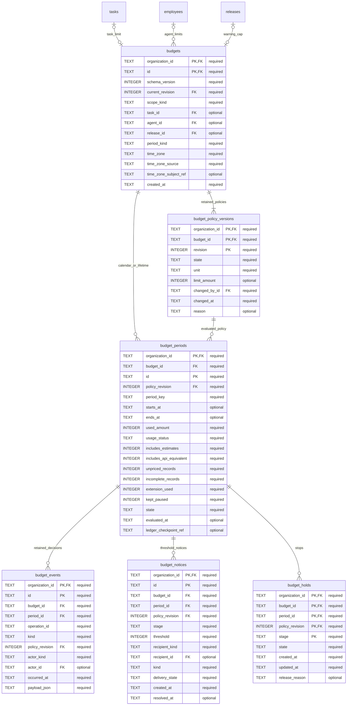

# Budgets and budget-control data

Status: **selected** data and behavior contract, revision 3. This document does not implement the evaluator, notification delivery, scheduler or automatic pausing. It extends the [usage ledger](10-usage-and-cost-accounting.md), [task data](03-features-and-work.md), [employee data](04-agent-structure.md), [execution contract](11-model-profiles-and-agent-execution.md) and [recovery data](16-recovery-and-office-continuity.md). Its UX source is the [cost UX, decisions 8 and BUD-1–3](../../specs/costs-and-insights-ux.md); where they differ, this document governs. There is no fallback attribution, no cost movement under the current plan and no aggregation into a parent budget.

## Scope and units

Optional budgets apply to a typed task (including bugs), an agent per calendar day/month, or a release lifetime cap. No project/team/organization/feature budget is added. Daily and monthly agent budgets coexist; all applicable holds must clear before work resumes. A budget has one unit: integer micro-USD or integer total tokens, never both. Limits must be positive; clearing is an explicit new policy revision with NULL limit. Preserve stable IDs, with no new readable counters. One budget identity per task, per agent/period-kind, or per release remains reserved after clearing; re-enable it through a new revision.

For dollar budgets, use the ledger's recorded API-price-equivalent costs, including estimates and subscription API equivalents; never provider subscription fees. Unpriced records contribute no known dollars but remain explicitly counted as unpriced, not free. Token totals sum input, output, cache-read and cache-write once; reasoning tokens are a subset, not an additional charge. NULL/partial token or cost data produces partial/unavailable evaluation. A partial known lower bound can prove the limit is reached; an incomplete total below it cannot prove capacity remains. Unknown usage does not itself block admission: preserve the existing warning that a runtime without usage cannot be stopped by that budget. Evaluate known reported amounts only, mark the result incomplete and never present unmeasured consumption as zero or capacity as guaranteed. Known amounts reaching a limit still trigger its control. Release warning caps never stop admission.

Usage for a task follows immutable/corrected task attribution in the ledger, across all agents. Agent usage follows actual consumer identity, including overhead and task work. Release usage follows captured release_id; changes to today's milestone/release membership never rewrite historical usage. Use effective corrected observations and record the verified ledger checkpoint in each evaluation. This avoids double counting reported/cumulative records and makes missing or delayed offices visible. Totals are derived and rebuildable; policy changes, extensions, notifications and holds are durable facts.

## Policies, periods and the one-time extension

`budgets` fixes target, period kind and selected IANA timezone. Record its provenance as `time_zone_source: owner_account` (the time zone of the account of the organization owner, [document 04](04-agent-structure.md#accounts-people-and-the-organization-owner)) with the protected host account reference in `time_zone_subject_ref`, or `hq` with a null reference. Never silently choose UTC when the selected owner/HQ zone is unknown; require it before creating periods. This snapshot keeps a period stable across office moves. A later owner-zone change requires an explicit boundary that keeps old period keys/bounds, not rewriting existing consumption. `budget_policy_versions` is append-only; `current_revision` selects the current policy. Changing only the comment or refreshing the same value must not re-arm controls. A genuinely changed limit/unit creates a new revision and re-arms the one-time extension, as the existing UX requires. It does not erase prior events, periods or spending. Clearing also creates a revision. Policy updates and current-revision changes commit together with actor-bound idempotent mutation receipts. Command checks enforce authorized actions and meaningful revisions; SQL does not authenticate actors. `changed_by_id` is the employee who made the change.

Task/release periods have period_key `lifetime` and NULL bounds. Agent periods use calendar dates/months in the selected timezone (the owner account's IANA zone; HQ's zone while the account has none), with stored inclusive UTC starts_at and exclusive ends_at; use a timezone library, including DST. The key is local `YYYY-MM-DD` or `YYYY-MM`, not a rolling 24-hour/30-day duration. One row exists for each budget/period key. On value/unit changes within a period, point that period at the new policy revision, re-evaluate the same whole-period consumption in the selected unit and reset extension_used; never zero used_amount. Preserve previous snapshots in event payloads. New periods start with the current policy, no used extension and a new ledger evaluation. Never edit timezone/target/period-kind to shift spent work into a fresh period.

At base limit L, one authorized “Allow 20% more once” changes the effective limit to L + floor(L/5), using exact integer arithmetic, and records extension_used=1 plus an extended event. If the increment is zero or the new limit is still <= known spend, refuse without consuming the extension. Repeated clicks use the same operation ID; they cannot grant a second extension. A later threshold crossing creates the extended-stage reached item with no Allow once action. A new day/month or a genuinely changed policy value/unit re-arms it; reevaluation, replay, raising only a description or losing an office cache does not.

Allow once is available only after that budget reaches its base limit. An attempt below reach is refused with “Allow 20% once is available only when the budget is reached.” and leaves the extension unused. A unit change is one policy-change event: reevaluate the same lifetime/whole-period captured consumption in the new unit, never clear spend between units. Only its satisfied hold may release.

## Thresholds, notices and holds

| Condition | Retained effect |
| --- | --- |
| 80% base limit | One neutral notice to whoever last changed the policy; no Inbox item. Compare integers without rounding threshold percentages |
| 100% task budget | One Budget reached item for the owner and a task budget hold; finish the current turn then stop admitting work on that task. An in-progress task becomes blocked with Budget reached; other open states retain their status plus the hold |
| 100% agent daily/monthly budget | One item for the owner per reached budget, with agent stop/pause pending until current-turn completion. Two limits create two independent holds/items |
| Release at 80%/100% | Neutral notices only, no hold or Budget reached Inbox item |
| Extended limit reached | New reached notice/hold at extended stage; no second extension. No second 80% warning within the same policy/period |
| Raise/clear/extend | Reevaluate known consumption and release only the holds satisfied by that policy change; do not clear manual/security/other-budget pauses |
| Agent calendar reset | Close old period, release its budget hold and emit a neutral reset event/notice through the ordinary event notification pipeline; keep manually requested pauses and other active holds |

`budget_notices` persists delivery state and the unique policy/period/stage/threshold deduplication key, so a disconnected office or replay does not produce repeated Inbox items. Only base stage uses threshold 80. `budget_holds` distinguishes stop_pending, held and released; recording a reached amount is not proof that a worker has stopped. A notice with `recipient_kind: owner` addresses the organization owner as defined in document 04, with a null `recipient_id`; any other recipient is an employee. The owner's item is not dismissible while the corresponding hold remains unresolved. Resolve stale reached items on satisfied policy changes. Keep-paused retains the item/hold until reset or a later authorized resolution. Stop on a task/bug requests the existing cancel/won't-fix transition; capture actor/reason and transition outcome rather than implementing a second task engine here.

Raising/clearing/extending task budgets requires a person with owner/project-manager authority; an agent project manager cannot perform those actions. Stop follows owner/project-manager authority. Agent-budget actions require the signed-in owner. No field on an employee record confers any of these grants. SQL FKs store actors; runtime/service authorization is still required. Project-manager views exclude org-wide agent limits and usage outside their projects under COST-7.

Changing a task budget's unit also requires that person authority, whether reached or not. An authorized agent project manager may set its first budget or lower its limit in the same unit. Any attribution correction reducing a reached task budget's spend requires an authorized person, even if the correction leaves it reached. This does not extend a parent budget to descendant records. Acceptance checks must refuse an agent manager's unit change, accept its authorized first set/lower, and prove that a below-reach Allow once attempt does not consume the later extension. A positive saved policy at/below known spend is accepted and reevaluated under this contract.

Hard limits are operational controls, not a promise of exact provider spend: reporting lag, current-turn completion and concurrent in-flight turns can overshoot. All offices consult the same authorized budget-control state before admitting new affected turns. The admission point is [document 11 §6 step 3](11-model-profiles-and-agent-execution.md#6-shared-quota-and-deterministic-selection): HQ, which already issues every turn permit, grants none while an unreleased hold applies and returns `BUDGET_HELD`. No office evaluates a hold from its own cache. An unreachable coordinator cannot authorize clearing an existing hold, and an unknown command outcome must be reconciled before retry. Unknown usage alone follows the warning-only rule above, not an automatic admission block. This model does not allocate independent per-office budgets, duplicate spending counters or claim a completed distributed admission engine. Atomic evaluation/action receipts and the existing execution permits/placement fencing must be integrated before automatic stopping is advertised.

## Files and SQL mapping

```text
<data-root>/<organization-id>/durable/budgets/<budget-id>/ # protected, never shared org Git
├── budget.md                    # immutable target/current revision and latest policy
├── versions/<revision>.yaml      # append-only policy history, including limits
├── periods/<period-id>.json      # evaluation and extension/kept-pause state
├── events/<event-id>.json        # immutable actor-bound decisions/evaluation snapshots
├── notices/<notice-id>.json      # durable notification/outcome state
└── holds/<period-id>/<revision>-<stage>.json
<data-root>/<organization-id>/runtime/<office-id>/ # access-controlled SQL/rollups; not sole source
```

budget.md has schema_version, organization_id, id, current_revision, scope_kind, nullable task_id/agent_id/release_id, period_kind, time_zone, time_zone_source, time_zone_subject_ref, created_at and optional Markdown body. Version YAML has organization_id, budget_id, revision, state, unit, limit_amount, changed_by_id, changed_at, reason. The latest version fields shown in budget.md must exactly match its version file, not form a second independently writable policy. Preserve task/release identities as archived records when budget history references them; deletion must archive, not cascade away budget history.

Operational JSON files have schema_version 1, positive envelope revision and all same-named SQL columns; payload_json is authored as object `payload`. Event payloads retain prior/new policy revision, observed amount/completeness, ledger checkpoint, limit/base/effective values, extension choice and action/stop outcome as applicable. Kind-specific schemas reject missing context. Event kind period_reset records both old and new period identities. Event operation IDs use document 16's actor/fingerprint receipts. A single operation creating multiple per-budget events derives deterministic child operation IDs. Files and required journal evidence must be durable before acknowledging the decision, independently of hourly Git publication. Acknowledged policy versions require protected durable journal/backup evidence; organization Git cannot restore budget limits, usage or a just-used extension. Shared org Git and reports contain only explicitly safe state/identity references, never amounts or private limit history. Agent-budget browser bars and full amount/history views are owner-only. Under the existing UX exception, an authenticated agent CLI may read only its own current task budget and its own daily/monthly spent/remaining amounts (including incomplete-data labels); this does not grant raw file/history access, other-agent totals or owner UI authority; task/release amounts follow owner/project-manager scope, while other readers see authorized budget state without amounts. Apply those restrictions to files, APIs, search, exports and notices, not only UI bars.

The policy FK and the version history keep the meaning of past events. Period evaluation fields are projections of ledger + decisions, not independently editable counters; a lower amount must cite a verified correction or new evaluation checkpoint. Extension and hold decisions are never reconstructed from spend alone. Per-source checkpoint refs resolve to the accounting archive, not ephemeral UI cursors. Do not include prompts, private notes, credentials or chat bodies in budget events.

## Example

```yaml
schema_version: 1
organization_id: example-org-id
id: example-budget-id
current_revision: 1
scope_kind: agent
task_id: null
agent_id: example-agent-id
release_id: null
period_kind: day
time_zone: UTC # example: selected owner/HQ zone is UTC
time_zone_source: hq
time_zone_subject_ref: null
created_at: "2026-11-15T12:00:00Z"
state: active
unit: micro_usd
limit_amount: 10000000 # USD 10; one-time extension reaches USD 12
changed_by_id: example-person-id # the owner's person record
changed_at: "2026-11-15T12:00:00Z"
reason: "Daily development allowance"
```

The referenced employee is an agent in the restaurant Reservations team or the agency Care Platform team; the same data shape works in either org. Both a daily and a monthly budget may apply while that agent works a task with its own lifetime limit. None is scoped to the agent's current office.

## SQL and relationships

Tables are included in consolidated schema.sql. SQL enforces scope/uniqueness, organization references and retained immutable policies/events. Calendar boundaries, effective totals, permissions, notice kind versus scope, threshold/stage transitions and actor-bound idempotent state changes require the budget command validator. A SQL draft is not an implemented budget service.

```sql
CREATE TABLE budgets (
  organization_id TEXT NOT NULL REFERENCES organizations(id),
  id TEXT NOT NULL,
  schema_version INTEGER NOT NULL DEFAULT 1 CHECK (schema_version=1),
  current_revision INTEGER NOT NULL CHECK (current_revision>0),
  scope_kind TEXT NOT NULL CHECK (scope_kind IN ('task','agent','release')),
  task_id TEXT,
  agent_id TEXT,
  release_id TEXT,
  period_kind TEXT NOT NULL CHECK (period_kind IN ('lifetime','day','month')),
  time_zone TEXT NOT NULL,
  time_zone_source TEXT NOT NULL CHECK (time_zone_source IN ('owner_account','hq')),
  time_zone_subject_ref TEXT,
  created_at TEXT NOT NULL,
  CHECK ((time_zone_source='owner_account')=(time_zone_subject_ref IS NOT NULL)),
  PRIMARY KEY (organization_id,id),
  CHECK ((scope_kind='task' AND task_id IS NOT NULL AND agent_id IS NULL AND release_id IS NULL AND period_kind='lifetime')
    OR (scope_kind='agent' AND task_id IS NULL AND agent_id IS NOT NULL AND release_id IS NULL AND period_kind IN ('day','month'))
    OR (scope_kind='release' AND task_id IS NULL AND agent_id IS NULL AND release_id IS NOT NULL AND period_kind='lifetime')),
  FOREIGN KEY (organization_id,task_id) REFERENCES tasks(organization_id,id) DEFERRABLE INITIALLY DEFERRED,
  FOREIGN KEY (organization_id,agent_id) REFERENCES employees(organization_id,id) DEFERRABLE INITIALLY DEFERRED,
  FOREIGN KEY (organization_id,release_id) REFERENCES releases(organization_id,id) DEFERRABLE INITIALLY DEFERRED,
  FOREIGN KEY (organization_id,id,current_revision) REFERENCES budget_policy_versions(organization_id,budget_id,revision) DEFERRABLE INITIALLY DEFERRED
) STRICT;
CREATE UNIQUE INDEX budget_task_identity ON budgets(organization_id,task_id) WHERE scope_kind='task';
CREATE UNIQUE INDEX budget_agent_identity ON budgets(organization_id,agent_id,period_kind) WHERE scope_kind='agent';
CREATE UNIQUE INDEX budget_release_identity ON budgets(organization_id,release_id) WHERE scope_kind='release';
CREATE TABLE budget_policy_versions (
  organization_id TEXT NOT NULL,
  budget_id TEXT NOT NULL,
  revision INTEGER NOT NULL CHECK (revision>0),
  state TEXT NOT NULL CHECK (state IN ('active','cleared')),
  unit TEXT NOT NULL CHECK (unit IN ('micro_usd','tokens')),
  limit_amount INTEGER CHECK (limit_amount>0),
  changed_by_id TEXT NOT NULL,
  changed_at TEXT NOT NULL,
  reason TEXT,
  PRIMARY KEY (organization_id,budget_id,revision),
  CHECK ((state='active' AND limit_amount IS NOT NULL) OR (state='cleared' AND limit_amount IS NULL)),
  FOREIGN KEY (organization_id,budget_id) REFERENCES budgets(organization_id,id) DEFERRABLE INITIALLY DEFERRED,
  FOREIGN KEY (organization_id,changed_by_id) REFERENCES employees(organization_id,id) DEFERRABLE INITIALLY DEFERRED
) STRICT;
CREATE TABLE budget_periods (
  organization_id TEXT NOT NULL,
  budget_id TEXT NOT NULL,
  id TEXT NOT NULL,
  policy_revision INTEGER NOT NULL,
  period_key TEXT NOT NULL,
  starts_at TEXT,
  ends_at TEXT,
  used_amount INTEGER NOT NULL DEFAULT 0 CHECK (used_amount>=0),
  usage_status TEXT NOT NULL DEFAULT 'unavailable' CHECK (usage_status IN ('complete','partial','unavailable')),
  includes_estimates INTEGER NOT NULL DEFAULT 0 CHECK (includes_estimates IN (0,1)),
  includes_api_equivalent INTEGER NOT NULL DEFAULT 0 CHECK (includes_api_equivalent IN (0,1)),
  unpriced_records INTEGER NOT NULL DEFAULT 0 CHECK (unpriced_records>=0),
  incomplete_records INTEGER NOT NULL DEFAULT 0 CHECK (incomplete_records>=0),
  extension_used INTEGER NOT NULL DEFAULT 0 CHECK (extension_used IN (0,1)),
  kept_paused INTEGER NOT NULL DEFAULT 0 CHECK (kept_paused IN (0,1)),
  state TEXT NOT NULL CHECK (state IN ('open','closed')),
  evaluated_at TEXT,
  ledger_checkpoint_ref TEXT,
  PRIMARY KEY (organization_id,id),
  UNIQUE (organization_id,budget_id,id),
  UNIQUE (organization_id,budget_id,period_key),
  FOREIGN KEY (organization_id,budget_id,policy_revision) REFERENCES budget_policy_versions(organization_id,budget_id,revision) DEFERRABLE INITIALLY DEFERRED
) STRICT;
CREATE TABLE budget_events (
  organization_id TEXT NOT NULL,
  id TEXT NOT NULL,
  budget_id TEXT NOT NULL,
  period_id TEXT NOT NULL,
  operation_id TEXT NOT NULL,
  kind TEXT NOT NULL CHECK (kind IN ('evaluated','warning','reached','extended','policy_changed','cleared','stop_requested','hold_released','period_reset')),
  policy_revision INTEGER NOT NULL,
  actor_kind TEXT NOT NULL CHECK (actor_kind IN ('employee','system')),
  actor_id TEXT,
  occurred_at TEXT NOT NULL,
  payload_json TEXT NOT NULL CHECK (json_valid(payload_json) AND json_type(payload_json)='object'),
  PRIMARY KEY (organization_id,id),
  UNIQUE (organization_id,budget_id,operation_id),
  CHECK ((actor_kind='employee')=(actor_id IS NOT NULL)),
  FOREIGN KEY (organization_id,budget_id,period_id) REFERENCES budget_periods(organization_id,budget_id,id) DEFERRABLE INITIALLY DEFERRED,
  FOREIGN KEY (organization_id,budget_id,policy_revision) REFERENCES budget_policy_versions(organization_id,budget_id,revision) DEFERRABLE INITIALLY DEFERRED,
  FOREIGN KEY (organization_id,actor_id) REFERENCES employees(organization_id,id) DEFERRABLE INITIALLY DEFERRED
) STRICT;
CREATE TABLE budget_notices (
  organization_id TEXT NOT NULL,
  id TEXT NOT NULL,
  budget_id TEXT NOT NULL,
  period_id TEXT NOT NULL,
  policy_revision INTEGER NOT NULL,
  stage TEXT NOT NULL CHECK (stage IN ('base','extended')),
  threshold INTEGER NOT NULL CHECK (threshold IN (80,100)),
  recipient_kind TEXT NOT NULL CHECK (recipient_kind IN ('employee','owner')),
  recipient_id TEXT,
  kind TEXT NOT NULL CHECK (kind IN ('neutral','budget_reached')),
  delivery_state TEXT NOT NULL CHECK (delivery_state IN ('pending','delivered','resolved')),
  created_at TEXT NOT NULL,
  resolved_at TEXT,
  PRIMARY KEY (organization_id,id),
  UNIQUE (organization_id,budget_id,period_id,policy_revision,stage,threshold),
  CHECK ((recipient_kind='employee')=(recipient_id IS NOT NULL)),
  CHECK (threshold=100 OR kind='neutral'),
  FOREIGN KEY (organization_id,budget_id,period_id) REFERENCES budget_periods(organization_id,budget_id,id) DEFERRABLE INITIALLY DEFERRED,
  FOREIGN KEY (organization_id,budget_id,policy_revision) REFERENCES budget_policy_versions(organization_id,budget_id,revision) DEFERRABLE INITIALLY DEFERRED,
  FOREIGN KEY (organization_id,recipient_id) REFERENCES employees(organization_id,id) DEFERRABLE INITIALLY DEFERRED
) STRICT;
CREATE TABLE budget_holds (
  organization_id TEXT NOT NULL,
  budget_id TEXT NOT NULL,
  period_id TEXT NOT NULL,
  policy_revision INTEGER NOT NULL,
  stage TEXT NOT NULL CHECK (stage IN ('base','extended')),
  state TEXT NOT NULL CHECK (state IN ('stop_pending','held','released')),
  created_at TEXT NOT NULL,
  updated_at TEXT NOT NULL,
  release_reason TEXT,
  PRIMARY KEY (organization_id,budget_id,period_id,policy_revision,stage),
  FOREIGN KEY (organization_id,budget_id,period_id) REFERENCES budget_periods(organization_id,budget_id,id) DEFERRABLE INITIALLY DEFERRED,
  FOREIGN KEY (organization_id,budget_id,policy_revision) REFERENCES budget_policy_versions(organization_id,budget_id,revision) DEFERRABLE INITIALLY DEFERRED
) STRICT;
CREATE TRIGGER budget_target_immutable BEFORE UPDATE ON budgets
WHEN NEW.organization_id<>OLD.organization_id OR NEW.id<>OLD.id OR NEW.scope_kind<>OLD.scope_kind OR NEW.task_id IS NOT OLD.task_id
 OR NEW.agent_id IS NOT OLD.agent_id OR NEW.release_id IS NOT OLD.release_id OR NEW.period_kind<>OLD.period_kind OR NEW.time_zone<>OLD.time_zone OR NEW.time_zone_source<>OLD.time_zone_source OR NEW.time_zone_subject_ref IS NOT OLD.time_zone_subject_ref
 OR NEW.current_revision<OLD.current_revision
BEGIN SELECT RAISE(ABORT,'budget scope or revision changed unsafely'); END;
CREATE TRIGGER budget_agent_insert BEFORE INSERT ON budgets
WHEN NEW.agent_id IS NOT NULL AND EXISTS (SELECT 1 FROM employees WHERE organization_id=NEW.organization_id AND id=NEW.agent_id AND kind<>'agent')
BEGIN SELECT RAISE(ABORT,'agent budget requires an agent'); END;
CREATE TRIGGER employee_budget_kind_update BEFORE UPDATE OF kind ON employees
WHEN NEW.kind<>'agent' AND EXISTS (SELECT 1 FROM budgets WHERE organization_id=NEW.organization_id AND agent_id=NEW.id)
BEGIN SELECT RAISE(ABORT,'budgeted employee must remain an agent'); END;
CREATE TRIGGER employee_budget_kind_insert BEFORE INSERT ON employees
WHEN NEW.kind<>'agent' AND EXISTS (SELECT 1 FROM budgets WHERE organization_id=NEW.organization_id AND agent_id=NEW.id)
BEGIN SELECT RAISE(ABORT,'budgeted employee must be an agent'); END;
CREATE TRIGGER budgets_no_delete BEFORE DELETE ON budgets
BEGIN SELECT RAISE(ABORT,'budget identity/history must be retained'); END;
CREATE TRIGGER budget_policy_versions_no_update BEFORE UPDATE ON budget_policy_versions
BEGIN SELECT RAISE(ABORT,'budget history is immutable'); END;
CREATE TRIGGER budget_policy_versions_no_delete BEFORE DELETE ON budget_policy_versions
BEGIN SELECT RAISE(ABORT,'budget identity/history must be retained'); END;
CREATE TRIGGER budget_periods_no_delete BEFORE DELETE ON budget_periods
BEGIN SELECT RAISE(ABORT,'budget identity/history must be retained'); END;
CREATE TRIGGER budget_events_no_update BEFORE UPDATE ON budget_events
BEGIN SELECT RAISE(ABORT,'budget history is immutable'); END;
CREATE TRIGGER budget_events_no_delete BEFORE DELETE ON budget_events
BEGIN SELECT RAISE(ABORT,'budget identity/history must be retained'); END;
CREATE TRIGGER budget_notices_no_delete BEFORE DELETE ON budget_notices
BEGIN SELECT RAISE(ABORT,'budget identity/history must be retained'); END;
CREATE TRIGGER budget_holds_no_delete BEFORE DELETE ON budget_holds
BEGIN SELECT RAISE(ABORT,'budget identity/history must be retained'); END;
CREATE TRIGGER budget_period_identity_update BEFORE UPDATE ON budget_periods
WHEN NEW.organization_id<>OLD.organization_id OR NEW.id<>OLD.id OR NEW.budget_id<>OLD.budget_id OR NEW.period_key<>OLD.period_key
 OR NEW.starts_at IS NOT OLD.starts_at OR NEW.ends_at IS NOT OLD.ends_at
 OR NEW.policy_revision<OLD.policy_revision OR (NEW.policy_revision=OLD.policy_revision AND NEW.extension_used<OLD.extension_used)
BEGIN SELECT RAISE(ABORT,'budget period identity/extension regressed'); END;
CREATE TRIGGER budget_release_no_hold BEFORE INSERT ON budget_holds
WHEN EXISTS (SELECT 1 FROM budgets WHERE organization_id=NEW.organization_id AND id=NEW.budget_id AND scope_kind='release')
BEGIN SELECT RAISE(ABORT,'release caps do not stop work'); END;
CREATE TRIGGER budget_release_no_hold_update BEFORE UPDATE ON budget_holds
WHEN EXISTS (SELECT 1 FROM budgets WHERE organization_id=NEW.organization_id AND id=NEW.budget_id AND scope_kind='release')
BEGIN SELECT RAISE(ABORT,'release caps do not stop work'); END;
```


