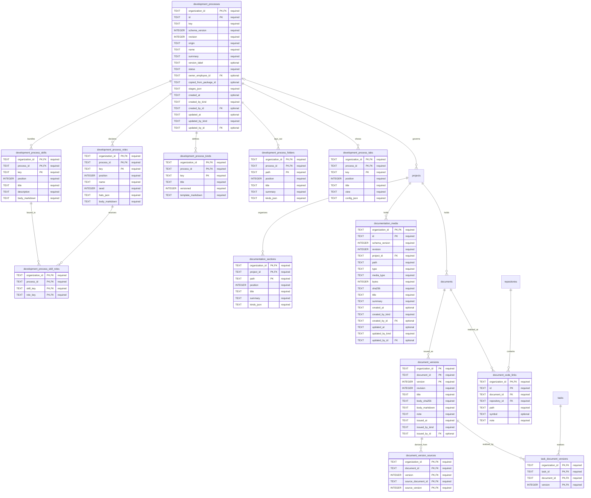

# Development processes and project documentation

Status: **selected** data contract, revision 1.4. It adds the records the owner's [REQ-07](../../specs/req-07-composable-process-packages-and-team-blueprints.md) and [REQ-06](../../specs/req-06-desired-state-spec-authoring-and-reconciliation.md) need: development processes, a project's choice of one, the project documentation tree with its index, issued document versions, code links and the tasks that realize a version. Behaviour is in the [development process design](../development-processes.md) and the [desired state design](../desired-state-specifications.md). [Projects](02-project-structure.md) own `projects` and `documents`, which this document extends; [organization structure](01-organization-structure.md) owns roles and process and standard documents.

The product carries no methodology. A development process is content: a manifest, role definitions, skills and document templates. Nothing here is a process execution engine, and no record in this document starts work, changes a status or blocks an action.

## Relationships



## Development processes

A development process describes one way of working: which roles it needs, what each role does, which kinds of document it produces and how a project's documentation is laid out. A project follows at most one development process. A development process has a stable `id`, an organization-unique `key` such as `dss`, a `revision`, a lifecycle `draft | current | deprecated`, an accountable owner and the common attribution. `version_label` is free text for people, like a release's.

`origin` says where the content comes from:

- `organization`: the development process is a folder in organization Git, created and edited through the product by any person of the organization: in the editor, by copying one, or by importing a process file. `current` requires an active owner. A process file is an archive of the folder below; importing one validates it, gives it a new ID and adds it as a draft, and any development process can be downloaded as that file. There is no link, sync or sharing between organizations (owner, 2026-11-18).
- `built_in`: the development process ships with the product. Its content is the running product's copy, its ID is fixed by the product, it has no file in organization Git and it cannot be edited. Its rows are projected from the product's copy with `system` attribution. To change one, copy it: the copy is an `organization` development process with a new ID and `copied_from_package_id` set. That field is provenance only and is never followed.

### Durable process files

```text
development-processes/<process-id>/
├── process.yaml              # The manifest
├── roles/<role-key>.md       # One per declared role: the role's definition
├── skills/<skill-key>.md     # What a role does, and how
└── templates/<kind-key>.md   # Optional starting body for a document kind
```

The folder is named by the development process's stable ID. Files inside it are named by their key, which is unique within the development process: a development process is one unit of identity and revision, and nothing outside a development process refers to one of its parts by ID. A key is 1 to 64 lowercase ASCII letters, digits or hyphens. Files are regular Markdown or YAML blobs: no symlinks, submodules or traversal. A write to any file of the development process advances the development process's `revision`. A development process belongs to the organization, like a role: HQ writes it and other offices replicate it. Every manifest, role, skill and stage field is listed here; a field that is not is refused.

```yaml
schema_version: 1
id: 01930000-0000-7000-8000-0000000000d0
key: dss-payments
revision: 4
name: Desired State Specification (Payments)
summary: >-
  Specify the product, then the system, as desired state. Plan, staff and build from
  the issued versions, and bring the code back in line whenever a version changes.
version_label: "1.0"
status: current
owner_employee_id: 01930000-0000-7000-8000-000000000001
copied_from_package_id: 01930000-0000-7000-8000-0000000000c0   # the built-in dss development process
roles:
  - key: product-lead
    name: Product Owner / Principal Designer
    hats: [product-owner, principal-designer]
    seed: true
  - key: technical-lead
    name: System Architect / Senior Staff Engineer
    hats: [system-architect, staff-engineer]
    seed: true
  - key: backend-engineer
    name: REST Backend Engineer
    seed: false
kinds:
  - key: product-dss
    title: Product DSS
    versioned: true
  - key: technical-dss
    title: Technical DSS
    versioned: true
folders:
  - path: product
    title: Product documentation
    summary: What the product does, by product domain and area.
    kinds: [product-dss]
  - path: technical
    title: Technical documentation
    summary: How the system is built, with its diagrams and images.
    kinds: [technical-dss]
stages:
  - key: specify
    title: Specify the product
    summary: Talk with the person until the behaviour is clear, then issue it.
    lead_role: product-lead
tabs:
  - key: product
    title: Product
    view: documents
    section: product
    kinds: [product-dss]
  - key: technical
    title: Technical
    view: documents
    section: technical
  - key: releases
    title: Releases
    view: releases
```

This is an organization's copy of the built-in `dss` development process, shortened. A copy has its own key, because a key is unique in the organization.

- **`roles[]`** are the roles the development process needs. `seed: true` marks the few that start the project; the others are hired when the work calls for them. `hats` are labels for people, shown on the roster to say what a combined role covers; nothing reads them. Each role has a definition at `roles/<key>.md`, with the body headings of a [role record](../../specs/roles-ux.md).
- **`kinds[]`** are document kinds the development process adds to the built-in ones (`brief`, `decision`, `design`, `report`, `changelog`). A development process cannot redefine a built-in kind. `versioned: true` means documents of that kind are [issued in versions](#issued-versions). A kind may have a template at `templates/<key>.md`.
- **`folders[]`** are the sections a project's documentation starts with. `kinds` says what a folder is for; it guides and is not enforced.
- **`tabs[]`** are the things the process gives a project, each shown as a tab of the project page, in order. A tab has a `key`, a `title` and a `view`, one of the product's generic views: `documents` (one `section` of the tree, optionally limited to `kinds`), `work` (the project's tasks of the given `types`, with `layout: list | board` and, for a board, `lanes: none | release`, where tasks in no release have a lane of their own), `features` (the feature map) and `releases` (releases with their milestones). Releases, milestones and features are primitives of the system that exist for every project; listing their view is how a process says it uses them, and nothing forces a change into a release (owner, 2026-11-18). A process has at most eight tabs, and a tab's key is not one of the fixed tabs' (`overview`, `work`, `docs`, `team`, `activity`, `conversations`). How the tab bar is worked out is in the [design](../development-processes.md#4-the-projects-tabs); nothing about tabs is stored on a project.
- **`stages[]`** describe the order of work for people and agents. An entry has a `key`, a `title`, an optional `summary` and an optional `lead_role` naming a declared role. The product shows stages to people and includes them in an agent's instructions. No code acts on one.

A skill is a Markdown file whose front matter says who it is for:

```markdown
---
schema_version: 1
key: derive-technical-dss
title: Derive the Technical DSS
description: Use when a Product DSS version has been issued and the system specification has to follow it.
roles: [technical-lead]
---
## When
## Steps
## Done when
```

`roles` lists keys of roles declared in the same manifest. An empty list means every role of the development process. `description` is one or two sentences saying when to use the skill; it is what an agent sees before it retrieves the body.

### What a development process may not carry

A development process grants nothing. It cannot name tools, models, credentials, budgets, approvers or permissions, and a field that tried would be refused as unknown. It is a different primitive from the organization's processes and standards ([process design](../processes.md), decision 9): its skills have no level, no override key and no lock, and they are never part of an effective set. A skill may adjust the organization's overridable guidance for its project; a document the organization or a team marked not overridable is always followed.

### Roles the development process needs, and the organization's roles

An employee's role is still the organization's [role record](01-organization-structure.md) named by `employees.role_id`. A development process role is matched to an organization role by `key`. When a development process is chosen for a project, every development process role whose key has no organization role yet gets one, created from the development process's definition in the same accepted change. A key that already exists is left as it is: the organization's own definition of a role stands, and the person choosing the development process is shown which roles will be created and which existing ones will be used before confirming. An employee holds a development process role when the key of its role equals the development process role's key. The key of an organization role that a development process in use refers to cannot be changed or removed; the refusal names the development process.

## A project's process

`project.yaml` gains one optional field:

```yaml
development_process_id: 01930000-0000-7000-8000-0000000000d0
```

Null means the project follows no development process and behaves exactly as [document 02](02-project-structure.md) describes. The development process must be `current` when it is chosen. A project follows the development process's current content, not a pinned revision: a change to the development process applies to its projects at each agent's next start, as a change to a process document does. A project that must not move copies the development process.

Choosing or changing a project's development process is a change to the project, made by the organization's owner or by a person in the lead chain of the project's owning team. It never deletes, moves or renames a file, never changes a document's kind and never changes anyone's role. Sections the new development process declares and the project lacks are added; everything already there stays. A document that has been issued keeps its versions whatever the project's development process later declares; a new version can be issued only while the document's kind is `versioned` in the project's current development process.

## Project documentation tree

Project-wide documents live in one tree whose layout belongs to the project:

```text
projects/<project-id>/
├── docs/
│   ├── index.yaml                               # The information-architecture index
│   ├── product/
│   │   └── identity-and-access/
│   │       └── user-authentication.md           # A document
│   └── technical/
│       ├── authentication.md
│       └── diagrams/login-sequence.mmd          # A diagram or an image
└── docs-history/<document-id>/<version>.md      # Issued versions, written once
```

- **What is in the tree.** Every document whose scope is the project itself, except the brief: decisions, designs, reports and every process-defined kind. `index.yaml` is the only other file at the tree's root and its name is reserved. The brief stays at `projects/<project-id>/brief.md`. A document that belongs to a feature, a release or a deployment stays beside that record ([document 02](02-project-structure.md#project-feature-release-and-deployment-documents)), and so do changelogs.
- **Paths are readable and can change.** A path is segments separated by `/`, at most 512 bytes and eight levels deep. A folder name is lowercase letters, digits, hyphens and underscores. A file name may also contain single dots; it never starts with one. A document ends in `.md` and holds at most 512 KiB. Identity is the `id` in the document's front matter, never the path: moving or renaming a document keeps its ID, its revisions, its versions and every link to it.
- **Sections** are the folders, each described in the index with a title, a summary and an order. A project without a development process starts with `decisions`, `designs` and `reports`. A project with a development process starts with the folders its manifest declares; any other section, those three included, is added when it is first needed. Agents and people add sections as the work needs them, and saving a file into a folder that has no section yet adds one, titled from the folder's name until someone gives it a better title. A section exists as soon as the index lists it; Git shows the directory with its first file.
- **Media** are diagrams and images stored beside the documents: PNG, JPEG, WebP, GIF and SVG images, and diagram sources as text (Mermaid `.mmd`, `.drawio`, `.excalidraw`). A media file is at most 5 MiB and never ends in `.md`. It has no front matter; its identity and description are its index entry. The product shows an SVG as an image and never runs anything inside it.

A tree document uses the envelope of every supporting document, with a path and an optional summary:

```markdown
---
schema_version: 1
id: 01930000-0000-7000-8000-0000000000e1
revision: 7
project_id: 01930000-0000-7000-8000-000000000010
feature_id: null
release_id: null
deployment_id: null
kind: product-dss
status: current
owner_employee_id: 01930000-0000-7000-8000-000000000031
title: User authentication
summary: Login flows and password expiry rules. Read before changing sign-in.
path: product/identity-and-access/user-authentication.md
version: 3
issued_revision: 6
code_links:
  - id: 01930000-0000-7000-8000-0000000000f1
    repository_id: 01930000-0000-7000-8000-000000000002
    path: services/auth/src/login.rs
    symbol: verify_password
    note: Password check and expiry.
---
## Purpose
```

For a tree document `kind` is `decision`, `design`, `report` or a key the project's development process declares. A document keeps its kind when the project changes development process; a kind no current development process declares is shown by its key and is never rejected on read.

### The index

`projects/<project-id>/docs/index.yaml` is the tree's table of contents: every section, document and media file, in the order people and agents arranged them, each with a one-line reason to open it. One read of it answers "where is it?".

```yaml
schema_version: 1
project_id: 01930000-0000-7000-8000-000000000010
revision: 42
development_process_id: 01930000-0000-7000-8000-0000000000d0
sections:
  - path: product
    title: Product documentation
    summary: What the product does, by product domain and area.
    kinds: [product-dss]
    sections:
      - path: product/identity-and-access
        title: Identity and access management
        summary: Accounts, sign-in and permissions.
        entries:
          - id: 01930000-0000-7000-8000-0000000000e1
            path: product/identity-and-access/user-authentication.md
            type: document
            kind: product-dss
            title: User authentication
            summary: Login flows and password expiry rules. Read before changing sign-in.
            status: current
            version: 3
  - path: technical
    title: Technical documentation
    summary: How the system is built, with its diagrams and images.
    kinds: [technical-dss]
    sections:
      - path: technical/diagrams
        title: Diagrams
        entries:
          - id: 01930000-0000-7000-8000-0000000000e9
            path: technical/diagrams/login-sequence.mmd
            type: diagram
            media_type: text/vnd.mermaid
            bytes: 1840
            sha256: 6b1f0c8d2a4e5f60718293a4b5c6d7e8f9a0b1c2d3e4f5061728394a5b6c7d8e
            title: Login sequence
            summary: Browser, web process and office during sign-in.
```

- **Who writes it.** Agents and people keep the index current by what they do: adding a section, saving a document with its title and summary, storing a diagram, moving a file. The office writes the file, in the same accepted change as the write that caused it, so the index and the tree cannot disagree. Nobody edits `index.yaml` by hand, and an agent has no file access to it ([non-negotiables](../../architecture-non-negotiables.md) 7 and 10).
- **What is authored and what is copied.** For sections (title, summary, order, `kinds`) and for a media file's identity, title and summary, the index is the source: they are written nowhere else. A document's entry is a copy of the document, refreshed on every write: `id`, `path`, `kind`, `title`, `summary`, `status`, `version`. A media entry's `media_type`, `bytes` and `sha256` come from the stored file.
- **One writer.** A project's tree and index have one writing office at a time, as a task has its transport writer ([offices design](../offices-hq-and-satellites.md#office-first-tasks-and-messages)). It starts as HQ and is handed to the office where the project's agents work. An agent in the writing office is acknowledged by its own office and waits for nothing else. An agent in another office reads from its office's replica; its write carries its operation ID and expected revision to the writer through HQ, like a cross-office edit of a task, and is acknowledged when the writer has accepted it.
- **Repair.** If the tree and the index are found to differ, for example after a commit made outside the product, the difference is a visible problem on the project. The office refreshes the copied fields from the documents, adds an entry or a section for a file that has none, and marks an entry whose file is gone. It keeps what is authored in the index and never deletes a file to make the two agree.
- **Size.** A tree holds at most 10,000 entries. The index is returned whole in one read while it is at most 256 KiB, which is about a thousand entries. Beyond that the read returns the sections without their entries, and each section's entries are read by its path.

### Issued versions

A document of a `versioned` kind is the desired state of something, and work is done against a fixed text of it. Issuing fixes that text.

- The file in the tree is the **working text**. Every accepted write advances `revision`, as for any record.
- **Issuing** records the working text as the next version: `version` goes from null to 1, or up by one; `issued_revision` becomes the document's revision; the status becomes `current`; and the text is written once to `docs-history/<document-id>/<version>.md`. That file is never changed or removed. A document that has been issued is deprecated when it stops applying, not deleted.
- **The desired state is the latest issued version.** Edits after it are unissued changes: the document has them when its title or body differs from the latest version's. A change to its summary, owner, path or code links is not a change to the desired state.
- A version may record what it was **derived from**: issued versions of other documents of the same project, for example the Product DSS version a Technical DSS version follows. The sources are part of the version file and are written once with it.
- Who issued a version, and when, come from the admitted actor. Issuing needs no approval record. Whether a person is asked first is the development process's guidance, not a rule of the data.

```markdown
---
schema_version: 1
document_id: 01930000-0000-7000-8000-0000000000e2
version: 2
revision: 11
title: Authentication
note: Passwords now expire after 90 days.
issued_at: "2026-11-18T09:30:00Z"
issued_by_kind: employee
issued_by_id: 01930000-0000-7000-8000-000000000032
derived_from:
  - document_id: 01930000-0000-7000-8000-0000000000e1
    version: 3
---
## Architecture
```

### Code links

A code link says where a document is realized in code: a registered repository, a path inside it, and optionally a symbol. It is authored in the document's `code_links[]` and each has a stable ID. The repository must be one of the project's. The path is relative to the repository root and is stored as written; it is not checked against the repository when the link is saved, because code moves. A check reads the office's verified cache at the association's integration branch and reports each link whose path is gone as stale. Line numbers are not stored.

The reverse question, "which documents say something about this file?", is a query over the same rows.

### Tasks that realize a version

A task says which issued versions it brings the code in line with:

```yaml
realizes:
  - document_id: 01930000-0000-7000-8000-0000000000e2
    version: 2
```

A process that uses releases puts the tasks that realize a version in a release of the project, listed in its content or grouped in one of its milestones ([document 09](09-release-content-and-flags.md), [document 02](02-project-structure.md)); the version's page then names the release. Nothing requires it: a task may be in no release.

`realizes[]` is authored in the task's front matter. Each entry names an issued version of a tree document in the task's own project; the accepting service checks both. A task may realize several versions and a version may be realized by several tasks.

Whether a version has been realized is derived, as a milestone's completion is ([document 02](02-project-structure.md#completion-of-milestones-and-releases)): a version is **converged** when at least one task realizes it and every task that realizes it is finished. A version with no task is not converged. A version that needs no code change is recorded with a task closed with that resolution. A cancelled task counts as finished, as it does for a milestone, so the version's page shows which of its tasks were cancelled. Nothing is stored, so reopening a task makes the version not converged again. `realizes[]` is part of the task: a deleted task's entries go with it into its tombstone and no longer count.

## Who may read and write a project's documentation

People read and write the documentation of every project of their organization, like any other organization record.

An agent reads and writes the documentation of **its own projects only**: a project whose owning team is its home team or an ancestor of it, a project one of whose contributing teams is, and a project in which it is the assignee of an open task. Assigning a task is itself an authorized act, so an agent cannot make a project its own. Any other project's index, listing and files are refused to it with `not_authorized` and the reason `other_project`, and the refusal names the project's lead so that the agent can ask. This is checked by the office from the agent's binding on every call. It is a boundary between projects, not a secrecy rule: what an agent needs from another project it asks that project's people and agents for.

## File to SQL mapping

| Table | Source |
| --- | --- |
| `development_processes` | `process.yaml` scalars; `stages[]` as `stages_json`. For `origin: built_in`, the product's copy. |
| `development_process_roles` | Manifest `roles[]` in order (`position`), with the body of `roles/<key>.md`. |
| `development_process_skills` | Front matter and body of `skills/<key>.md`; `position` is the order by key. |
| `development_process_skill_roles` | One row per entry of a skill's `roles[]`. No row means every role. |
| `development_process_kinds` | Manifest `kinds[]`, with the body of `templates/<key>.md` when present. |
| `development_process_folders` | Manifest `folders[]` in order; `kinds[]` as `kinds_json`. |
| `development_process_tabs` | Manifest `tabs[]` in order (`position`); `section`, `kinds`, `types` and `layout` as `config_json`. |
| `projects.development_process_id` | `project.yaml`. |
| `documentation_sections` | Index `sections[]`, nested sections flattened by `path`; `position` is the order among siblings. |
| `documentation_media` | Index entries of type `image` or `diagram`. |
| `documents` (`summary`, `path`, `version`, `issued_revision`) | Front matter of each tree document. |
| `document_versions` | `docs-history/<document-id>/<version>.md`: front matter and body. |
| `document_version_sources` | `derived_from[]` of the version file. |
| `document_code_links` | `code_links[]` of the document. |
| `task_document_versions` | `realizes[]` of the task file. |
| `document_version_progress` (view) | Derived from the two tables above and task status; no authored source. |

Development processes register in `record_refs` as `development_process` and media files as `media`.

## SQLite tables

```sql
CREATE TABLE development_processes (
  organization_id TEXT NOT NULL REFERENCES organizations(id),
  id TEXT NOT NULL,
  key TEXT NOT NULL CHECK (
    length(key) BETWEEN 1 AND 64 AND key NOT GLOB '*[^a-z0-9-]*'
    AND substr(key, 1, 1) GLOB '[a-z0-9]'),
  schema_version INTEGER NOT NULL CHECK (schema_version = 1),
  revision INTEGER NOT NULL CHECK (revision >= 1),
  origin TEXT NOT NULL CHECK (origin IN ('built_in', 'organization')),
  name TEXT NOT NULL,
  summary TEXT NOT NULL DEFAULT '',
  version_label TEXT,
  status TEXT NOT NULL DEFAULT 'draft' CHECK (status IN ('draft', 'current', 'deprecated')),
  owner_employee_id TEXT,
  copied_from_package_id TEXT,
  stages_json TEXT NOT NULL DEFAULT '[]' CHECK (json_valid(stages_json) AND json_type(stages_json) = 'array'),
  created_at TEXT,
  created_by_kind TEXT NOT NULL DEFAULT 'unknown' CHECK (created_by_kind IN ('employee', 'system', 'unknown')),
  created_by_id TEXT,
  updated_at TEXT,
  updated_by_kind TEXT NOT NULL DEFAULT 'unknown' CHECK (updated_by_kind IN ('employee', 'system', 'unknown')),
  updated_by_id TEXT,
  PRIMARY KEY (organization_id, id),
  UNIQUE (organization_id, key),
  CHECK (origin = 'built_in' OR status <> 'current' OR owner_employee_id IS NOT NULL),
  CHECK (copied_from_package_id IS NULL OR copied_from_package_id <> id),
  FOREIGN KEY (organization_id, owner_employee_id) REFERENCES employees(organization_id, id)
    DEFERRABLE INITIALLY DEFERRED,
  CHECK ((created_by_kind = 'employee' AND created_by_id IS NOT NULL) OR (created_by_kind <> 'employee' AND created_by_id IS NULL)),
  CHECK ((updated_by_kind = 'employee' AND updated_by_id IS NOT NULL) OR (updated_by_kind <> 'employee' AND updated_by_id IS NULL)),
  FOREIGN KEY (organization_id, created_by_id) REFERENCES employees(organization_id, id) DEFERRABLE INITIALLY DEFERRED,
  FOREIGN KEY (organization_id, updated_by_id) REFERENCES employees(organization_id, id) DEFERRABLE INITIALLY DEFERRED
) STRICT;

CREATE TABLE development_process_roles (
  organization_id TEXT NOT NULL,
  process_id TEXT NOT NULL,
  key TEXT NOT NULL CHECK (
    length(key) BETWEEN 1 AND 64 AND key NOT GLOB '*[^a-z0-9-]*'
    AND substr(key, 1, 1) GLOB '[a-z0-9]'),
  position INTEGER NOT NULL CHECK (position >= 0),
  name TEXT NOT NULL,
  seed INTEGER NOT NULL DEFAULT 0 CHECK (seed IN (0, 1)),
  hats_json TEXT NOT NULL DEFAULT '[]' CHECK (json_valid(hats_json) AND json_type(hats_json) = 'array'),
  body_markdown TEXT NOT NULL DEFAULT '',
  PRIMARY KEY (organization_id, process_id, key),
  FOREIGN KEY (organization_id, process_id) REFERENCES development_processes(organization_id, id)
    DEFERRABLE INITIALLY DEFERRED
) STRICT;

CREATE TABLE development_process_skills (
  organization_id TEXT NOT NULL,
  process_id TEXT NOT NULL,
  key TEXT NOT NULL CHECK (
    length(key) BETWEEN 1 AND 64 AND key NOT GLOB '*[^a-z0-9-]*'
    AND substr(key, 1, 1) GLOB '[a-z0-9]'),
  position INTEGER NOT NULL CHECK (position >= 0),
  title TEXT NOT NULL,
  description TEXT NOT NULL CHECK (length(description) > 0),
  body_markdown TEXT NOT NULL DEFAULT '',
  PRIMARY KEY (organization_id, process_id, key),
  FOREIGN KEY (organization_id, process_id) REFERENCES development_processes(organization_id, id)
    DEFERRABLE INITIALLY DEFERRED
) STRICT;

CREATE TABLE development_process_skill_roles (
  organization_id TEXT NOT NULL,
  process_id TEXT NOT NULL,
  skill_key TEXT NOT NULL,
  role_key TEXT NOT NULL,
  PRIMARY KEY (organization_id, process_id, skill_key, role_key),
  FOREIGN KEY (organization_id, process_id, skill_key) REFERENCES development_process_skills(organization_id, process_id, key)
    DEFERRABLE INITIALLY DEFERRED,
  FOREIGN KEY (organization_id, process_id, role_key) REFERENCES development_process_roles(organization_id, process_id, key)
    DEFERRABLE INITIALLY DEFERRED
) STRICT;

CREATE TABLE development_process_kinds (
  organization_id TEXT NOT NULL,
  process_id TEXT NOT NULL,
  key TEXT NOT NULL CHECK (
    length(key) BETWEEN 1 AND 64 AND key NOT GLOB '*[^a-z0-9-]*'
    AND substr(key, 1, 1) GLOB '[a-z0-9]'
    AND key NOT IN ('brief', 'decision', 'design', 'report', 'changelog')),
  title TEXT NOT NULL,
  versioned INTEGER NOT NULL DEFAULT 0 CHECK (versioned IN (0, 1)),
  template_markdown TEXT NOT NULL DEFAULT '',
  PRIMARY KEY (organization_id, process_id, key),
  FOREIGN KEY (organization_id, process_id) REFERENCES development_processes(organization_id, id)
    DEFERRABLE INITIALLY DEFERRED
) STRICT;

CREATE TABLE development_process_folders (
  organization_id TEXT NOT NULL,
  process_id TEXT NOT NULL,
  path TEXT NOT NULL CHECK (
    length(path) BETWEEN 1 AND 256 AND path NOT GLOB '*[^a-z0-9/_-]*'
    AND substr(path, 1, 1) GLOB '[a-z0-9]' AND substr(path, -1, 1) <> '/'
    AND instr(path, '//') = 0),
  position INTEGER NOT NULL CHECK (position >= 0),
  title TEXT NOT NULL,
  summary TEXT NOT NULL DEFAULT '',
  kinds_json TEXT NOT NULL DEFAULT '[]' CHECK (json_valid(kinds_json) AND json_type(kinds_json) = 'array'),
  PRIMARY KEY (organization_id, process_id, path),
  FOREIGN KEY (organization_id, process_id) REFERENCES development_processes(organization_id, id)
    DEFERRABLE INITIALLY DEFERRED
) STRICT;

CREATE TABLE development_process_tabs (
  organization_id TEXT NOT NULL,
  process_id TEXT NOT NULL,
  key TEXT NOT NULL CHECK (
    length(key) BETWEEN 1 AND 64 AND key NOT GLOB '*[^a-z0-9-]*'
    AND substr(key, 1, 1) GLOB '[a-z0-9]'
    AND key NOT IN ('overview', 'work', 'docs', 'team', 'activity', 'conversations')),
  position INTEGER NOT NULL CHECK (position BETWEEN 0 AND 7),
  title TEXT NOT NULL CHECK (length(title) > 0),
  view TEXT NOT NULL CHECK (view IN ('documents', 'work', 'features', 'releases')),
  config_json TEXT NOT NULL DEFAULT '{}' CHECK (json_valid(config_json) AND json_type(config_json) = 'object'),
  PRIMARY KEY (organization_id, process_id, key),
  UNIQUE (organization_id, process_id, position),
  FOREIGN KEY (organization_id, process_id) REFERENCES development_processes(organization_id, id)
    DEFERRABLE INITIALLY DEFERRED
) STRICT;

CREATE TABLE documentation_sections (
  organization_id TEXT NOT NULL,
  project_id TEXT NOT NULL,
  path TEXT NOT NULL CHECK (
    length(path) BETWEEN 1 AND 256 AND path NOT GLOB '*[^a-z0-9/_-]*'
    AND substr(path, 1, 1) GLOB '[a-z0-9]' AND substr(path, -1, 1) <> '/'
    AND instr(path, '//') = 0),
  position INTEGER NOT NULL CHECK (position >= 0),
  title TEXT NOT NULL,
  summary TEXT NOT NULL DEFAULT '',
  kinds_json TEXT NOT NULL DEFAULT '[]' CHECK (json_valid(kinds_json) AND json_type(kinds_json) = 'array'),
  PRIMARY KEY (organization_id, project_id, path),
  FOREIGN KEY (organization_id, project_id) REFERENCES projects(organization_id, id)
    DEFERRABLE INITIALLY DEFERRED
) STRICT;

CREATE TABLE documentation_media (
  organization_id TEXT NOT NULL REFERENCES organizations(id),
  id TEXT NOT NULL,
  schema_version INTEGER NOT NULL CHECK (schema_version = 1),
  revision INTEGER NOT NULL CHECK (revision >= 1),
  project_id TEXT NOT NULL,
  path TEXT NOT NULL CHECK (
    length(path) BETWEEN 3 AND 512 AND path NOT GLOB '*[^a-z0-9/._-]*'
    AND substr(path, 1, 1) GLOB '[a-z0-9]' AND path NOT GLOB '*.md'
    AND instr(path, '//') = 0 AND instr(path, '..') = 0 AND instr(path, '/.') = 0),
  type TEXT NOT NULL CHECK (type IN ('image', 'diagram')),
  media_type TEXT NOT NULL CHECK (length(media_type) > 0),
  bytes INTEGER NOT NULL CHECK (bytes BETWEEN 1 AND 5242880),
  sha256 TEXT NOT NULL CHECK (length(sha256) = 64 AND sha256 NOT GLOB '*[^0-9a-f]*'),
  title TEXT NOT NULL,
  summary TEXT NOT NULL DEFAULT '',
  created_at TEXT,
  created_by_kind TEXT NOT NULL DEFAULT 'unknown' CHECK (created_by_kind IN ('employee', 'system', 'unknown')),
  created_by_id TEXT,
  updated_at TEXT,
  updated_by_kind TEXT NOT NULL DEFAULT 'unknown' CHECK (updated_by_kind IN ('employee', 'system', 'unknown')),
  updated_by_id TEXT,
  PRIMARY KEY (organization_id, id),
  UNIQUE (organization_id, project_id, path),
  FOREIGN KEY (organization_id, project_id) REFERENCES projects(organization_id, id)
    DEFERRABLE INITIALLY DEFERRED,
  CHECK ((created_by_kind = 'employee' AND created_by_id IS NOT NULL) OR (created_by_kind <> 'employee' AND created_by_id IS NULL)),
  CHECK ((updated_by_kind = 'employee' AND updated_by_id IS NOT NULL) OR (updated_by_kind <> 'employee' AND updated_by_id IS NULL)),
  FOREIGN KEY (organization_id, created_by_id) REFERENCES employees(organization_id, id) DEFERRABLE INITIALLY DEFERRED,
  FOREIGN KEY (organization_id, updated_by_id) REFERENCES employees(organization_id, id) DEFERRABLE INITIALLY DEFERRED
) STRICT;

CREATE TABLE document_versions (
  organization_id TEXT NOT NULL REFERENCES organizations(id),
  document_id TEXT NOT NULL,
  version INTEGER NOT NULL CHECK (version >= 1),
  revision INTEGER NOT NULL CHECK (revision >= 1),
  title TEXT NOT NULL,
  body_sha256 TEXT NOT NULL CHECK (length(body_sha256) = 64 AND body_sha256 NOT GLOB '*[^0-9a-f]*'),
  body_markdown TEXT NOT NULL,
  note TEXT NOT NULL DEFAULT '',
  issued_at TEXT NOT NULL,
  issued_by_kind TEXT NOT NULL CHECK (issued_by_kind IN ('employee', 'system')),
  issued_by_id TEXT,
  PRIMARY KEY (organization_id, document_id, version),
  CHECK ((issued_by_kind = 'employee' AND issued_by_id IS NOT NULL) OR (issued_by_kind <> 'employee' AND issued_by_id IS NULL)),
  FOREIGN KEY (organization_id, issued_by_id) REFERENCES employees(organization_id, id) DEFERRABLE INITIALLY DEFERRED
) STRICT;

CREATE TRIGGER document_versions_are_written_once
BEFORE UPDATE ON document_versions
BEGIN
  SELECT RAISE(ABORT, 'an issued document version is never changed');
END;

CREATE TRIGGER document_versions_are_kept
BEFORE DELETE ON document_versions
BEGIN
  SELECT RAISE(ABORT, 'an issued document version is never removed');
END;

CREATE TABLE document_version_sources (
  organization_id TEXT NOT NULL,
  document_id TEXT NOT NULL,
  version INTEGER NOT NULL,
  source_document_id TEXT NOT NULL,
  source_version INTEGER NOT NULL,
  PRIMARY KEY (organization_id, document_id, version, source_document_id, source_version),
  CHECK (source_document_id <> document_id),
  FOREIGN KEY (organization_id, document_id, version) REFERENCES document_versions(organization_id, document_id, version)
    DEFERRABLE INITIALLY DEFERRED,
  FOREIGN KEY (organization_id, source_document_id, source_version) REFERENCES document_versions(organization_id, document_id, version)
    DEFERRABLE INITIALLY DEFERRED
) STRICT;

CREATE TABLE document_code_links (
  organization_id TEXT NOT NULL,
  id TEXT NOT NULL,
  document_id TEXT NOT NULL,
  repository_id TEXT NOT NULL,
  path TEXT NOT NULL CHECK (
    length(path) > 0 AND substr(path, 1, 1) <> '/' AND path <> '..'
    AND path NOT GLOB '../*' AND path NOT GLOB '*/../*' AND path NOT GLOB '*/..'),
  symbol TEXT,
  note TEXT NOT NULL DEFAULT '',
  PRIMARY KEY (organization_id, id),
  FOREIGN KEY (organization_id, document_id) REFERENCES documents(organization_id, id)
    DEFERRABLE INITIALLY DEFERRED,
  FOREIGN KEY (organization_id, repository_id) REFERENCES repositories(organization_id, id)
    DEFERRABLE INITIALLY DEFERRED
) STRICT;

CREATE INDEX document_code_links_by_path ON document_code_links (organization_id, repository_id, path);

CREATE TABLE task_document_versions (
  organization_id TEXT NOT NULL,
  task_id TEXT NOT NULL,
  document_id TEXT NOT NULL,
  version INTEGER NOT NULL,
  PRIMARY KEY (organization_id, task_id, document_id, version),
  FOREIGN KEY (organization_id, task_id) REFERENCES tasks(organization_id, id)
    DEFERRABLE INITIALLY DEFERRED,
  FOREIGN KEY (organization_id, document_id, version) REFERENCES document_versions(organization_id, document_id, version)
    DEFERRABLE INITIALLY DEFERRED
) STRICT;

CREATE VIEW document_version_progress AS
SELECT v.organization_id, v.document_id, v.version,
  COUNT(t.id) AS task_count,
  COALESCE(SUM(t.status IN ('done', 'cancelled')), 0) AS done_task_count,
  (COUNT(t.id) > 0 AND COUNT(t.id) = COALESCE(SUM(t.status IN ('done', 'cancelled')), 0)) AS is_converged
FROM document_versions v
LEFT JOIN task_document_versions r
  ON r.organization_id = v.organization_id AND r.document_id = v.document_id AND r.version = v.version
LEFT JOIN tasks t ON t.organization_id = r.organization_id AND t.id = r.task_id
GROUP BY v.organization_id, v.document_id, v.version;
```

`document_versions` has no foreign key to `documents`: an issued version is history and outlives the live row, resolved through `record_refs` like any historical reference. The other direction is enforced: a document's `version` must be one of its issued versions. Version rows are written once; the two triggers refuse an update, a delete and a replace.

Rules checked by the accepting service, not by SQL: a project's development process is `current` when chosen; a stage's `lead_role` is a declared role; a `documents` tab names a declared folder and kinds that are built in or declared, a `work` tab names at least one task type, and a process lists the `features` view and the `releases` view at most once each; a document's kind is built in or declared by a development process; a document of a kind that is not `versioned` is never issued, versions are issued in order with no gap and a document's `version` never goes down; a document that has been issued is not deleted; a version's sources and a task's `realizes[]` belong to the same project and sources form no cycle; a code link's repository is one of the project's and a document does not hold the same link twice; folder names contain no dot, a path has at most eight levels, no path is `index.yaml`, and every file's folder has a section.

## Acceptance criteria

| ID | Passing evidence |
| --- | --- |
| PPD-1 | A development process's manifest, roles, skills, kinds and folders round-trip between its files and these tables; a built-in development process projects the same rows with no file in organization Git. |
| PPD-2 | A skill naming a role its development process does not declare, a development process kind named like a built-in kind, and an unknown manifest field are refused, each naming the field. |
| PPD-3 | Choosing a development process for a project creates the missing organization roles and the declared sections in one accepted change; choosing another later adds sections and removes nothing. |
| PPD-4 | Every accepted tree write leaves `index.yaml` listing exactly the tree's sections, documents and media; a document's index entry equals its front matter. |
| PPD-5 | Moving a document changes its path and keeps its ID, revisions, versions, code links and the tasks that realize it. |
| PPD-6 | Issuing writes one version file and one `document_versions` row; neither can be changed, removed or replaced afterwards. |
| PPD-7 | A document has unissued changes exactly when its title or body differs from its latest version. |
| PPD-8 | A version is converged only when it has at least one realizing task and all of them are finished; reopening one makes it not converged with no other write. |
| PPD-9 | An agent outside a project is refused that project's index, listing and files with `other_project` and the lead to ask; a person is not. |
| PPD-10 | A code link whose path is gone from the integration branch is reported stale and is not removed. |
