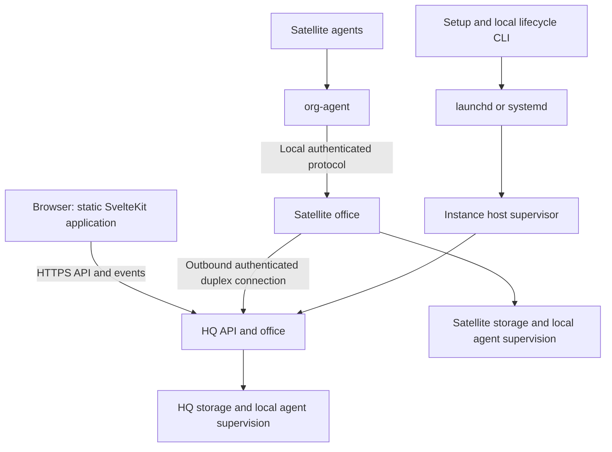

# Design: standalone Agentic Org server (v1)

Status: **proposed implementation design**, 2026-11-09. The product decisions were
made by the owner in the architecture discussion; wire formats, platform adapters
and release mechanics still require review and implementation. Owner: ada.
Base inspected: `v1` at `7a8827875e41cac45b75cbf170d6703417652379`.

Implements [server installation and access](../specs/server-installation-and-access-ux.md)
and [ADR-0005](../adr/0005-standalone-server-v1.md). The
[removal inventory](standalone-server-removal-inventory.md) is the implementation
audit. This is a direct pivot of an undeployed application: remove the superseded
paths rather than maintaining a desktop compatibility layer or importing old data.
Implementation ordering below describes dependencies, not a migration rollout.

## 1. Architecture and evidence

HQ and satellite are persisted **office roles**. An instance is the local service,
its catalog and configuration; it may host several offices. An office belongs to
one organization. A browser session, an instance administrator, an office identity
and an employee identity are distinct principals. A certificate for one office is
never a human owner session or permission to administer the whole instance.

The same release supports both roles. HQ serves the frontend and browser APIs for
its organization, including the synchronized view of its satellites. Multiple HQ
offices in one instance may share one browser listener, with explicit organization
routing and authorization. An instance containing only satellites has no public
application listener. It does not automatically become HQ when the connection fails.

The inspected branch already has a static SvelteKit adapter, a local host, per-office
processes, SQLCipher storage, Unix-socket clients and runtime contracts. It does
**not** have the proposed HTTP server or the `org-sync`, `org-sync-proto` and
`org-pki` crates. `apps/org-office-host/src/sync.rs` is a mutex utility, not office
replication. Browser mode currently selects mocks in office/org/work API factories;
chat always selects its mock. Static asset serving alone cannot make these real.

## 2. Release, install and runtime boundaries

Use one user-facing executable, provisionally `agentic-org`, for setup and local
lifecycle commands. The bootstrap only resolves the platform/version, downloads
and verifies that executable and invokes setup. It is small enough to audit; it
does not own office provisioning logic. Existing installs are discovered before
activation, so re-running bootstrap cannot silently update every instance.

**Proposed packaging:** the release executable carries the static asset/server
payload and platform-matched internal host/office helpers plus the small
`org-agent` helper. It unpacks verified payloads into an immutable versioned
release directory. One download may yield multiple local executables. This retains
the existing process and signing boundaries and the tiny CLI instead of requiring
every agent tool invocation to start a universal server program. `org-relay` is a
legacy alias, not a v1 installation prerequisite. Exact release sizes are measured.

Retain the host and per-office worker processes. The service manager starts the
resolved host executable for an instance; foreground `serve` uses the same entry
point. Setup is not an extra long-running supervisor. Avoid installing from an
agent turn or downloading dependencies inside normal daemon startup.

The server implementation may use a small HTTP adapter crate (Axum/Tokio is a
candidate, not an existing dependency). Libraries own behavior; binaries compose
them. Do not link one app's library from another app to assemble the release.
Extract shared behavior into a crate only where a real second caller needs it.
Embedding a built executable as a release payload is packaging, not an app-to-app
Rust dependency. Keep Tailwind Plus UI sources within `apps/desktop`, as required
by AGENTS.md; that directory can hold the browser application after `src-tauri`
is removed. A rename is unnecessary for this pivot.

The first release must verify download authenticity, executable signatures where
applicable, checksums of embedded helpers and architecture compatibility. Extract
to a private staging directory; reject path traversal and symlink redirection;
publish a complete release atomically. A release pin selects host, worker, assets
and `org-agent` together. The short bootstrap trusts a configured release signing
key; a checksum downloaded from an unauthenticated source is not sufficient.

## 3. Instance selection and storage

An omitted `--name` selects `default`. `--name lab` selects exactly `lab`. Normalize
and validate names consistently across CLI, registry and service names, using a
restricted portable alphabet and rejecting traversal. The instance has a random
immutable ID separate from that name. Renaming and data relocation are not v1 UI
features. A copied directory is not automatically a newly enrolled office.

Proposed default data roots:

| Platform | Instance data root | Runtime/service details |
| --- | --- | --- |
| macOS | `~/Library/Application Support/agentic.org/instances/<name>/` | Per-user launchd label derived from instance ID; short private runtime socket directory |
| Linux | `${XDG_DATA_HOME:-~/.local/share}/agentic-org/instances/<name>/` | systemd user unit derived from instance ID; sockets under a validated private runtime directory |

Setup may accept an explicit absolute data directory. It saves the resolved path;
services and agents never infer it from a later shell's cwd or HOME. Instance
configuration is server-managed and readable only by authorized local users. It
names office IDs, release pin, endpoints and references to credentials, not inline
private keys. SQLCipher databases, workspaces, logs and setup journal live under
the selected root; binaries live outside it. File modes remain private.

Keep office control state in `<instance root>/office-state/`, with each office at
`office-state/offices/<office id>/`. This subtree is `<office home>` (or `<home>`)
in the retained host/session contracts. Employee homes are server-provisioned
siblings at `<instance root>/agents/<office id>/<member id>/`. Both belong to the
instance, while employee homes remain outside the control-state subtree as the
session security rules require. Task worktrees keep their existing office-owned
`workspace/projects/` layout. The instance lock protects the full root; the host
and office locks also protect their own state. None of these paths is browser-editable.

Do not put long data-root paths directly into macOS Unix-socket names: the existing
103-byte limit still applies. A private short runtime directory uses an opaque
instance handle plus office handles. Authenticate the endpoint as well as checking
path ownership; changing a socket location must not weaken agent binding.

Before reading mutable state, hold an instance lock on the actual data directory.
Retain each office's lock and its single-writer invariant. Resolve/check aliases
and refuse symlink replacement so two names cannot operate one directory. Setup
also holds a name/registry lock until it has durably reserved the ID/root. Socket,
port and service collisions fail explicitly. Never silently select another port
on restart because HQ's saved address is part of enrollment configuration.

Credential names, key sweeps, cleanup, logs and process ownership include instance
and office identities. A host only sweeps its own catalog; the previous account-wide
orphan sweep cannot delete another instance's keys. Agent homes are scoped by stable
office and member IDs within the instance. Office storage and configuration are not globally
agent-readable just because everything is under one root. OS-user sharing is not
a security isolation boundary between instances; stronger isolation needs separate
users/containers. The runtime sandbox/permission model must still enforce its denies.

## 4. Setup and service lifecycle

Setup is a resumable state machine: reserve instance, verify release, write config,
establish owner or enrollment credentials, provision the office, register service,
start, probe. Each irreversible identity/provisioning step has a durable operation
ID and completion marker before another invocation may advance it. Persist an
enrollment key/request before sending it; after an ambiguous reply query that
request's outcome rather than minting a second office. Resume the same pending
approval after restart. An explicit mode/config change on existing state is refused
with instructions; setup does not silently convert roles.

Interactive and automated input feed the same validation layer. Noninteractive
mode has no hidden prompt; bounded waiting can finish with an `awaiting_approval`
result. Error codes distinguish invalid input, permission failure, address conflict,
unsupported version, unavailable credential provider and incomplete enrollment.
Secrets use a protected descriptor/file or dedicated stdin input. Normal JSON
status, diagnostics, journals and argv never contain them.

macOS uses a per-user launchd registration independent of SMAppService/Tauri.
Linux supports a systemd user service and foreground execution for environments
without it. A service unit/label resolves to one saved instance ID, root and pinned
release, with an explicit runtime PATH/environment. Reconcile service registration
idempotently; do not take over an unrelated unit with a colliding name. Report
login/session/lingering requirements instead of claiming unconditional boot startup.

`start`, `stop`, `status`, `logs`, `doctor`, `upgrade`, `uninstall` and `serve`
select the same instance. Local lifecycle control works when HTTP is down. An
explicit stop must not trigger the service manager's crash-restart policy. Stop
admission, cancel ephemeral streams, drain writes and stop/reap owned runtime trees
within deadlines. A disconnected browser does not cancel durable submitted work.
Host death retains the existing office-stop/reconciliation behavior; supervise
children rather than leaving agents orphaned.

Release pins are per instance. An explicit upgrade stages/verifies a new complete
release, stops that instance, handles supported new-format schema changes, changes
its pin and probes readiness. Retain the prior release and a recoverable data state.
Never roll back only the executable after an incompatible schema change. Shared
release garbage collection checks all instance pins and running references. No
desktop-data migration or old IPC support is built. Uninstall preserves data;
explicit deletion is scoped, checks the stopped state and cannot remove another
instance's directory or shared release.

## 5. HTTP and browser contract

Serve static assets and `/api/v1/` from the same HQ origin. Hashed assets can be
cached; the entry document is revalidated. SPA fallback applies only to browser
navigation routes, never missing API paths, stream routes or assets. Static file
handling cannot traverse into instance data. The frontend does not need SSR or a
Node server. API/frontend version mismatch gives a refresh/update state rather
than falling back to mock data.

The first HTTP adapter must inventory the existing organization, work, messaging,
process and session contracts. Keep typed domain operations, error codes and
authorization checks; no unrestricted JSON-to-local-RPC tunnel. Remove Tauri
invoke/listen paths and production mock selection when wiring each HTTP caller.
Tests can inject explicit fakes. Mock reducers are not authoritative server rules.

Use HTTP requests for reads/commands and an authenticated SSE stream for ordinary
server-to-browser events. WebSocket support is justified only for a concrete duplex
feature. Browser terminal takeover is not a general-purpose remote shell: v1 can
keep takeover as an explicitly authorized local CLI operation on the office host,
with browser status/log inspection and existing exclusive-session rules.

Mutations carry stable operation IDs and expected versions. A durable acceptance
records operation ID, payload digest, principal/scope and outcome state in one
transaction. Reusing an ID with another payload is refused. A lost response is
resolved by retry/lookup of that ID within the supported deduplication window;
outside it, report expiry rather than blindly rerunning. Reuse existing org/work
deduplication semantics and document windows for new live-control operations.
`accepted` is not `completed`. Requests to an offline office follow the individual
operation's explicit queue/reject rule; never queue arbitrary commands indefinitely.

Snapshot and stream positions must compose without a gap: obtain a snapshot at P,
then consume updates after P, or buffer the stream during snapshot capture. Define
cursor scope per organization/feed and preserve authorization on reconnect. An
expired cursor requires a new snapshot. Use bounded per-client queues; disconnect
slow consumers with a resync signal instead of unbounded buffering. Coalesce
ephemeral status where safe. Give reads and commands timeouts, body limits, rate
limits and backpressure. Distinguish unknown outcome from confirmed rejection.

Existing `org-client` and SQL access are blocking/thread-based. An async HTTP
adapter must use bounded dedicated workers/queues or carefully bounded blocking
tasks. Never block async executor threads or hold a mutex across an await. Timeout
does not imply a blocking operation stopped; preserve operation IDs and track its
eventual outcome. Do not wrap each request in an unbounded `spawn_blocking` call.

## 6. Authentication, keys and platform gates

Owner authentication replaces signed-desktop-client authorization. Bootstrap is
local and protected: initialize owner credentials through setup, or use a short-lived,
single-use exchange bound to the intended instance. Do not expose an unclaimed
public admin interface or place a reusable owner token in a browser URL. Browser
sessions use HttpOnly cookies, appropriate SameSite/Secure handling, expiry,
revocation and CSRF/origin checks. Validate allowed Host headers to prevent DNS
rebinding. No wildcard credentialed CORS. Local loopback access is authenticated
too. Any development-origin exception is explicit and absent from releases.

Authenticate and authorize organization access at HQ on every request and stream.
Office relay commands carry a trusted, validated actor/scope envelope; an office
certificate cannot assert arbitrary owner authority. Keep agent session tokens
restricted to their employee/session. Old app tokens may remain temporarily as
internal implementation capabilities during development, but are never exposed to
the browser or retained as a public compatibility contract; replace the app-only
surface with explicit principal authorization before completing the pivot.

Browser HTTPS certificates and office identity certificates serve different
purposes. The invitation proposal binds proof to a TLS exporter. A browser reverse
proxy cannot transparently terminate that connection and preserve this proof.
Recommended first implementation: browser HTTPS and the office mTLS/enrollment
listener have separate authentication/listener configuration on HQ; both belong
to the same installed service. Terminate office TLS at the component validating
the proof, or explicitly redesign/review channel binding before adding a proxy.
Satellite connections remain outbound. Direct HQ reachability remains required.

Retain host custody of office encryption keys and private launch channels. The
downloaded payload must preserve separate key-access identities where the platform
uses code signing; an `org-agent` alias must not gain the host's key entitlement.
The current app-only peer checks, fixed bundle-relative executable paths and one
pinned home require replacement, not removal of their security invariants.

Before release, prove these platform adapters with the real packaged binaries:

- **macOS:** standalone service registration, stable signed helper identities,
  supported Keychain access without Tauri, lock/unlock behavior and upgrade access.
  A minimal signed helper bundle may be a packaging necessity; it is not a Tauri UI.
- **Linux:** a production credential provider with an explicit unattended unlock
  policy, e.g. an encrypted vault using an externally supplied service credential.
  Do not silently ship the development plaintext key-file store or store its wrapping
  key next to the vault. Specify prerequisites and the same-UID threat boundary.
  Validate SQLCipher's crypto linkage, sandbox/process cleanup and service behavior.
- **Both:** missing or wrong keys fail closed and never generate replacement keys
  over existing data. Restore/backup support must preserve recoverable keys and
  office identity. Replication is not a backup; automatic promotion stays deferred.

Exact Linux secret-provider support and standalone macOS entitlements are release
gates, not claims verified by this documentation change. No new crypto protocol is
invented here. Use maintained libraries and pin approved dependency versions.

## 7. Reuse of HQ and satellite semantics

Retain the offices design's organization single writer, deterministic apply,
`(epoch, seq)` positions, snapshot replacement, transactional work sequence allocation,
origin incarnations, acknowledgements, deduplication, scoped backfill, ownership
generations, handover/reclaim rules and protocol negotiation. Local work can commit
while HQ is unreachable; cross-office messages and org commands keep separate
outboxes. HQ holds every task/message, satellites only relevant work. Runtime
processes, secret credentials and local workspace files are not replicated as UI data.

Enrollment keeps one-time invitations, pinned HQ identity, owner approval, office
certificates, renewal and revocation. Initial enrollment differs from reconnect:
reconnect reuses the identity and resumes positions. Local satellites use the same
identity model (or a proven equivalent private capability); same UID alone is not
proof of enrollment. Headless enrollment replaces desktop deep links. Approvals
happen in an authenticated HQ browser, independent of the browser's machine.

The existing project design currently uses local bare Git in v1 and defers real
GitHub to v2. A remote satellite cannot use an HQ filesystem path as a Git remote.
This pivot adds no folder sync or new Git hosting service. Cross-office coding must
declare a reachable supported repository transport before it is advertised. The
first satellite acceptance run can use a non-repository task; shared-repository
execution remains an explicit feature gate until that contract is resolved.

The [employee requirements](../specs/employee-supervision-ux.md) and
[runtime design](employee-supervision.md) remain responsibilities of the local
office: a deterministic supervisor per employee, owned internal delegates/helpers,
aggregate resource limits and cleanup, and native harness persona provisioning.
[Processes](processes.md#35-context-bounds-fresh-contexts-and-standards-proposed-2026-11-09)
provide bounded instruction delivery and overridable delegation guidance, with
standards retrieved on demand. [Channels](../specs/chat-ux.md) extend office-first
messaging for authorized team questions and DM follow-up; membership does not wake
every employee. A browser connection is never the lifetime owner of this work.

## 8. Implementation order and release evidence

| Work | Result required before moving on |
| --- | --- |
| Inventory and contract amendment | Apply the deletion ledger and spec precedence; identify every production mock path and unsupported server operation |
| Instance/setup foundation | Identity/root locks, service lifecycle, platform key custody, matching release payloads and repeatable automation |
| HTTP and frontend | Authenticated HQ API, asset routing, command outcomes, consistent snapshots/events and real frontend callers; remove Tauri paths in the same feature change |
| Office networking | Reviewed sync/PKI contracts, enrollment, resume, ownership and failure behavior; existing design is not implemented evidence |
| Runtime integration | Selected supported harnesses, scoped CLI binding, deterministic supervision and bounded process cleanup |
| Acceptance and deletion check | macOS/Linux release walkthrough, failure tests and no Tauri dependency or production mock fallback |

Owners follow AGENTS.md: app agent for frontend, server-dev for domain/API/storage,
River for host/platform/sync/PKI, Remy for `org-agent`, runtime owners for adapters,
Ada for shared contracts/design, Eden for UX specs. Cross-cutting changes need their
contract review; this docs proposal does not claim merge approval.

Run repo formatting, applicable Clippy and Rust tests on implementation changes,
plus frontend type checks, tests and build. Meaningful failure tests cover duplicate
setup, data-root aliases, unavailable keys, bad signatures, cross-instance cleanup,
port conflicts, interrupted enrollment, revoked/expired identity, incompatible
versions, lost replies, stream gaps, slow clients, shutdown and orphan cleanup.
Use temporary roots and fake runtimes. Real runtime and signed-platform checks are
explicit opt-in acceptance runs. See [dogfood-run.md](../specs/dogfood-run.md).
