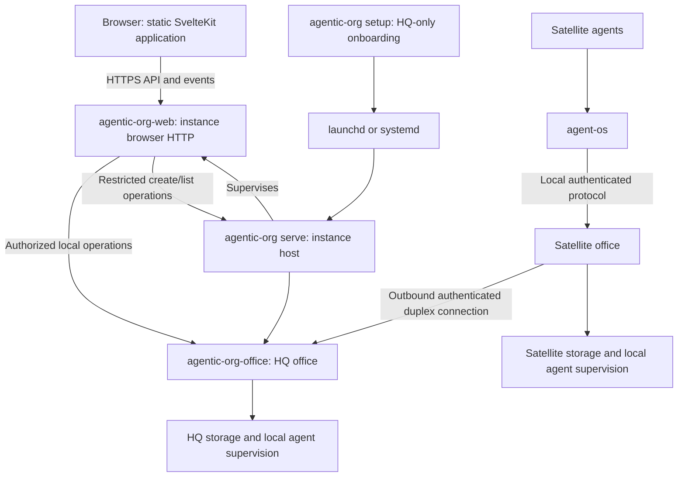

# Design: standalone Agentic Org server (v1)

**Current implementation names:** application directories/packages/executables are agentic-org, agentic-org-office, agentic-org-web and agent-os. Host lifecycle is the library crates/org-host. Older names in historical design observations and pinned source links below refer to the inspected baseline; use [executable-migration.md](executable-migration.md) for current build and entry-point status.


Status: **selected target implementation design**, reconciled 2026-11-15; original
standalone proposal 2026-11-09. The product decisions were
made by the owner in the architecture discussion; wire formats, platform adapters
and release mechanics still require review and implementation. Owner: lead.
Base inspected: `v1` at `7a8827875e41cac45b75cbf170d6703417652379`.

Implements [server installation and access](../specs/server-installation-and-access-ux.md)
and [ADR-0005](../adr/0005-standalone-server-v1.md). The
[removal inventory](standalone-server-removal-inventory.md) is the implementation
audit. This is a direct pivot of an undeployed application: remove the superseded
paths rather than maintaining a desktop compatibility layer or importing old data.
Implementation ordering below describes dependencies, not a migration rollout.
The owner-requested [project structure](project-structure.md) adds target application
names, domain modules containing vertical slices, shared-code placement, and a
source-to-target reorganization plan under the [architecture rules](../architecture-rules.md).

## 1. Architecture and evidence



HQ and satellite are persisted **office roles**. An instance is the local service,
its catalog and configuration; it may host several offices. An office belongs to
one organization. A browser session, an instance administrator, an office identity
and an employee identity are distinct principals. A certificate for one office is
never a human owner session or permission to administer the whole instance.

The same release supports both roles. HQ serves the frontend and browser APIs for
its organization, including the synchronized view of its satellites. Multiple HQ
offices in one instance may share one browser listener, with explicit organization
routing and authorization. An instance containing only satellites has no public
application listener. It does not automatically become HQ when the connection fails.

The inspected baseline had a static SvelteKit adapter, a local host, per-office
processes, SQLCipher storage, Unix-socket clients and runtime contracts. The current
source adds the renamed CLI and a guarded web executable with the existing
HTTP/assets/TLS library. Production browser authentication/backend composition and
remote replication remain incomplete; `org-sync`, `org-sync-proto` and `org-pki`
are still planned. `crates/org-host/src/sync.rs` is a mutex utility, not office
replication. Missing browser capabilities render unavailable; static asset serving
alone cannot make them real. See [executable migration](executable-migration.md)
for implemented entry points.

## 2. Release, install and runtime boundaries

**Platform amendment (owner decision 2026-11-17, [ADR-0017](../adr/0017-linux-and-container-hosting.md)).** macOS and Linux are both v1, and an instance may run as the main process of a container. Statements below that defer Linux, or that assume launchd, the keychain or a code signature, describe the macOS implementation of a platform contract.

**Implementation status (2026-11-17):** designed, not reachable. Release verification exists as a library (`org-release`, linked into `org-host`) and is not called by any command. There is no bootstrap, download, installer or updater. The four executables build from source and are started by hand.

Use one user-facing executable, `agentic-org`, for setup and local
lifecycle commands. The bootstrap only resolves the platform/version, downloads
and verifies that executable and invokes setup. It is small enough to audit; it
does not own office provisioning logic. Existing installs are discovered before
activation, so re-running bootstrap cannot silently update every instance.

**Owner amendment (2026-11-15):** four framework executables define the target release:

| Executable | Role |
| --- | --- |
| `agentic-org` | Human CLI; setup performs initial HQ onboarding; serve runs the host, key custody, child supervision and update management. |
| `agentic-org-web` | Instance browser HTTPS, authentication, static assets, API responses and live events; no office database keys. |
| `agentic-org-office` | One HQ or satellite office worker, including its internal agent supervisor/router/session runner and one data writer. |
| `agent-os` | Small agent-facing CLI, invoked on demand with employee-scoped authority. |

The online bootstrap downloads/verifies agentic-org and invokes agentic-org setup. Setup downloads/verifies missing release components, or extracts a complete local bundle, into an immutable versioned release directory. Embedded payloads are an optional delivery optimization, not a required second installer. One release pin selects all matching binaries/assets together. Application directories, Cargo packages and executable names now agree: apps/agentic-org, apps/agentic-org-office, apps/agentic-org-web and apps/agent-os. Host/platform behavior lives in crates/org-host and is composed by agentic-org serve; there is no additional permanent host or updater daemon. Platform signing, key-custody and restricted launch identities remain stable. The source renames and host extraction are implemented; bootstrap downloads, verified release activation and service registration described here remain requirements.

The service manager starts agentic-org serve for the selected instance. It supervises office workers and, when the instance hosts HQ, agentic-org-web. Each office worker owns its agents through an internal supervisor; do not add a sibling agent-supervisor daemon. Agent runtimes are child processes. An HTTP-agent worker is introduced only with its implemented backend. Serve starts installed releases without requiring a download; setup is a short-lived command, not another long-running supervisor. Avoid installing from an agent turn.

The server implementation may use a small HTTP adapter crate (Axum/Tokio is a
candidate, not an existing dependency). Libraries own behavior; binaries compose
them. Do not link one app's library from another app to assemble the release.
Extract shared behavior into a crate when a real second caller or a meaningful
dependency/visibility boundary justifies it.
Embedding a built executable as a release payload is packaging, not an app-to-app
Rust dependency. The retained browser application is `apps/agentic-org-ui/`, with
frontend package name `agentic-org-ui`. The office worker is
`apps/agentic-org-office/`, Cargo package/executable `agentic-org-office` and Rust
library import `agentic_org_office`. The Tauri-only shell is removed. Keep licensed
Tailwind Plus sources inside the product UI application; AGENTS.md's ownership and
license restrictions apply at its renamed path.

This renames the worker, not the office model: the host inside `agentic-org serve` supervises
one worker per office with the existing private launch/key boundaries. The
user-facing setup/release executable above remains `agentic-org`.
The [project structure](project-structure.md) distinguishes current audited paths
from target names and lists affected workspace, tests, build and packaging references.

The first release must verify download authenticity, executable signatures where
applicable, checksums of embedded helpers and architecture compatibility. Extract
to a private staging directory; reject path traversal and symlink redirection;
publish a complete release atomically. A release pin selects setup, host, worker, web, assets
and `agent-os` together. The short bootstrap trusts a configured release signing
key; a checksum downloaded from an unauthenticated source is not sufficient.

### Browser listener and privilege boundary

The accepted [Rust browser BFF and static SvelteKit architecture](rust-browser-bff-and-static-sveltekit.md) keeps browser-specific response mapping at the web process and reusable use cases in their owning Rust modules, ready for future integration API adapters.

**Chosen topology:** one `agentic-org-web` helper (`apps/agentic-org-web/`; executable present, production handoff pending)
per instance terminates browser HTTP/TLS, serves `agentic-org-ui` assets and manages browser
sessions/events for all authorized HQ organizations on that listener. It runs as
a supervised child of `agentic-org serve`, separately from each `agentic-org-office` worker.
An instance with no HQ has no public browser listener. Office enrollment/mTLS still
terminates at its reviewed federation component, not this browser proxy.

The web process receives browser-session/TLS material and narrowly scoped host/office
clients, never office database keys or the host's key-access entitlement. It does
not open office databases. The host retains catalog locking, credential custody,
worker provisioning and private launch. Typed local operations preserve actor,
instance/organization scope, operation ID and expected versions; they are not an
unrestricted JSON-to-host tunnel. Private peer admission and platform filesystem/
process controls must enforce this separation within the stated same-UID limits.

Selected production startup binds this handoff to the verified complete release.
The host consumes a recovered release-store pin into a privately constructed
runtime token, retains its store lock, verifies its own kernel-loaded image and
selects worker/web paths from that release before opening custody. The v1
nonsecret web first line additionally carries `release` with `version:1`,
`release_id`, lowercase full `manifest_sha256` and positive integer `sequence`.
The complete frame stays within 1024 bytes and rejects unknown/duplicate fields.
The web process independently checks this binding against its embedded publisher
registry, exact sibling manifest/signature, own kernel image and authenticated UI
bytes before confinement/readiness/secrets. An omitted release binding is retained
only for explicitly named debug/legacy fixtures; production refuses it. This
describes the selected integration, not evidence of production signing or setup.

**Create organization** requires an authenticated **instance administrator**.
Owning one organization alone grants no right to create another. Local protected
setup establishes the first instance administrator and creates the first HQ;
later browser creation enters through the web process's restricted host operation.
The host validates the admitted web capability and administrator grant, bound
to the protected instance administrator identity and requested action (never a
browser-supplied role flag), before provisioning, creates the key itself and returns an operation result, never a key.
The same human may hold both roles, but office certificates and employee tokens
grant neither. Tests cover two HQs on one listener and rejected owner-only creates.
**Add office on this instance** (OFC-2) also provisions a key and a worker
on the host, so it needs the same instance-administrator grant; owning the
organization is not enough. Inviting, approving or removing a satellite stays open
to any authorized owner (OFC-7); OFC-7's "add" for the same-instance case needs a
spec follow-up. The web process op is an open point for X-02 §12 Q9 (a draft not yet in this repo; see office-host-boundary.md §3, "Pending: launch v3"). (2026-11-10,
post-merge review question.)

### Setup executable package identity

Cargo package `agentic-org` at `apps/agentic-org/` owns the human CLI and serve
composition. The retired same-named Tauri workspace member is removed; there is no
separate setup package or executable. Release staging must select this CLI's
artifact. `setup` is reserved and currently fails before provisioning; protected
HQ bootstrap and service registration must land before it can perform onboarding.

The complete-release verifier follows [ADR-0009](../adr/0009-complete-release-verification.md).
Its private release store is separate from organization data and input bundles.
The local implementation uses owner-only `staging/`, `releases/`, `intents/` and
`pins/` directories under a caller-selected protected store, serialized by
`store.lock`. Completed release trees are read-only. A version-1 intent freezes
the exact manifest digest, release ID, sequence, private staging handle and prior
pin digest before publication. Immutable version-1 pin records use contiguous
positive 20-digit commit ordinals and a SHA256 chain; these ordinals have no
relationship to office work-event origins or selected acceptance ordinals.
Intents and pins are retained. Only the next frozen intent may finish after a
crash; an unrelated staging tree or installed directory never selects itself.
This layout describes the implementation boundary, not evidence that publication,
platform admission, setup or service activation has passed production checks.
Sealed output trees use private `.stage-<handle>` names under the same `releases/`
parent as their final release IDs. This preserves the directory's parent during
the exclusive rename: macOS refuses cross-parent moves of a `0500` directory.
The separate `staging/` directory holds frozen compressed inputs; it is never a
source of automatic release selection. No output tree is made writable to publish.
Its trusted build inputs are `ORG_RELEASE_TRUST_REGISTRY` (a public registry file,
not a signing private key) and `ORG_RELEASE_MIN_SEQUENCE` (the positive compiled
freshness floor). Host and web embed and strictly validate those inputs at
build time. Neither reads them from its runtime environment or input bundle.
An unconfigured development source build embeds no publisher trust and cannot
activate a production release; malformed configured input fails the build.
Disposable generated-key verification is separate from publisher provisioning.

The selected setup adapter preserves the typed reverse connection: bootstrap-mode
`agentic-org serve` connects to setup's private listener; `bootstrap` and `exit`
are never ordinary `host.sock` methods. Both sides use the same human CLI/host
executable, whose retained signing identifier is
`com.ellosoft.agentic-org.org-office-host`, with the compiled team and hardened
runtime checks. The retired desktop application's identifier does not admit this
CLI. The existing explicit debug executable allowance remains debug-only. Before
creating the registry, the bootstrap host holds the registered instance/root and
host locks; it transfers those same locks and custody into the normal runtime
without an unlocked restart. Replays verify credentials with the live account
verifier and lockout rules before comparing the nonsecret fingerprint. The initial
adapter admits HTTP loopback without a TLS pair; supplied TLS pairs remain
unavailable until the actual host certificate match/validity/coverage verifier
ships. That limitation is not a TLS validation success or setup readiness claim.

## 3. Instance selection and storage

An omitted `--name` selects `default`. `--name lab` selects exactly `lab`. Normalize
and validate names consistently across CLI, registry and service names, using a
restricted portable alphabet and rejecting traversal. The instance has a random
immutable ID separate from that name. Renaming and data relocation are not v1 UI
features. A copied directory is not automatically a newly enrolled office.

Proposed default data roots:

| Platform | Instance data root | Runtime/service details |
| --- | --- | --- |
| macOS | `~/Library/Application Support/agentic.org/instances/<name>/` | Per-user launchd label derived from instance ID; short private runtime socket directory |
| Linux | `${XDG_DATA_HOME:-~/.local/share}/agentic-org/instances/<name>/` | systemd user unit derived from instance ID; sockets under a validated private runtime directory |

Setup may accept an explicit absolute data directory. It saves the resolved path;
services and agents never infer it from a later shell's cwd or HOME. Instance
configuration is server-managed and readable only by authorized local users. It
names office IDs, release pin, endpoints and references to credentials, not inline
private keys. Binaries live outside mutable data and file modes remain private.

The instance resolver must provision each organization's selected data root. The
[organization-data index](organization-data/README.md#shared-storage-contract) owns
the layout: one root, with protected sources under `durable/` and rebuildable
caches under `runtime/<office-id>/`. The target hierarchy is:

```text
<data-root>/<organization-id>/
├── durable/                  # sources: back up all of it; never removed by cleanup
│   ├── state/                # ordinary organization Git files
│   ├── journal/              # acknowledged unpublished changes
│   ├── authority/            # numbering, placement generations, permits (06, 11)
│   ├── accounting/           # durable usage streams/checkpoints (10)
│   ├── messaging/            # protected envelopes and attachments (15)
│   ├── recovery/             # receipts, streams, journals, snapshots, cleanup (16)
│   ├── budgets/              # policies, periods, events, extensions/holds (17)
│   ├── private/              # HQ only: author-private task notes (05)
│   ├── local/offices/        # private local bindings, never Git
│   └── checkpoints/          # local/unpushed code recovery
└── runtime/<office-id>/      # caches: rebuildable
    ├── office.db             # projections and explicitly transient state
    ├── repositories/<repository-id>.git/
    └── teams/<root-team-id>/teams/<child-team-id>/.../agents/<employee-id>/
        ├── projects/<project-id>/tasks/<task-id>/repositories/<repository-id>/
        └── tasks/<task-id>/repositories/<repository-id>/
```

Private task notes are a separate durable author-private database, with no owner
or administrator read exception. Authentication/CA pins, local credentials and
execution journals retain their protected stores outside Git. Nothing under
`durable/` may be a child of a directory that cache cleanup removes; cleanup
is limited to `runtime/<office-id>/`. Organization Git must be remote, using explicit organization slug,
repository ID and state branch. Code repositories may be local-only. Projects
associate many registered repos, each with required integration branch; each
office caches a repo once regardless of how many projects use it.

Current implementation evidence remains `office-state/offices/<office-id>/`
with `org.db`, `office.db`, `office.json` and legacy `workspace/projects/`, plus
managed employee homes at `<instance root>/agents/<office-id>/<member-id>/` in
retained session contracts. Those DBs are not disposable: selected source
extraction, verified restore and the target runtime/sandbox migration are pending.
Re-derive Git-metadata, credential, other-task and managed-state denies against
the target hierarchy before launch. Never turn a renamed directory into a broad
agent allowlist. Task worktrees survive handoff until closure; placement changes
require explicit safe migration and checkpointing of local/unpushed edits.

Rebuild verifies Git plus all authorized protected sources, actor/fingerprint-bound
receipts, stream/incarnation high-waters, snapshot hashes/epochs and allocation
ledger. Rebind credentials and reconcile marked processes before execution.
A restored PID alone never authorizes a signal; require matching ownership mark,
generation and machine/boot/start identity. Only restored placement authority and
verified prior cleanup/fencing permit a new process. Git alone cannot reconstruct
chat, usage, budget history/extensions/holds or authority. Missing source coverage
must block affected recovery rather than fabricate a successful restore. No
backup/restore or budget pause engine is implemented by this storage specification.
The instance, host and office locks retain their single-writer invariants.

Do not put long data-root paths directly into macOS Unix-socket names: the existing
103-byte limit still applies. A private short runtime directory uses an opaque
instance handle plus office handles. Authenticate the endpoint as well as checking
path ownership; changing a socket location must not weaken agent binding.

Before reading mutable state, hold an instance lock on the actual data directory.
Retain each office's lock and its single-writer invariant. Resolve/check aliases
and refuse symlink replacement so two names cannot operate one directory. Setup
also holds a name/registry lock until it has durably reserved the ID/root. Socket,
port and service collisions fail explicitly. Never silently select another port
on restart because HQ's saved address is part of enrollment configuration.

Credential names, key sweeps, cleanup, logs and process ownership include instance
and office identities. A host only sweeps its own catalog; the previous account-wide
orphan sweep cannot delete another instance's keys. Agent homes are scoped by stable
office and member IDs within the instance. Office storage and configuration are not globally
agent-readable just because everything is under one root. OS-user sharing is not
a security isolation boundary between instances; stronger isolation needs separate
users/containers. The runtime sandbox/permission model must still enforce its denies.

**Amended 2026-11-17.** [ADR-0015](../adr/0015-agent-isolation-modes.md) makes agent
isolation a selectable mode: `same-user` (the behaviour described here) and
`dedicated-user`, an OS account that setup provisions and that cannot read the
organization data root. [ADR-0016](../adr/0016-no-application-level-data-encryption.md)
removes application-level encryption of organization data, so file permissions, disk
encryption and the isolation mode are what protect it.

## 4. Setup and service lifecycle

**Implementation status (2026-11-17, unchanged in substance since merged v1 700d5a37):** serve and help/version are implemented; setup returns unavailable without provisioning. The service start/stop/status commands, protected HQ bootstrap, downloads/offline installation, updater activation and authenticated production web startup below remain requirements. Existing agent-os messaging/directory operations remain available. The UI directory/package is agentic-org-ui in this PR and remains a static asset build.


Initial installation is HQ-only. After obtaining the platform executable, the user runs:

```bash
agentic-org setup
```

Setup is one resumable workflow: select/reserve default or --name <name>; verify a complete platform release; collect HQ organization name/slug, remote organization repository/state branch, valid bootstrap home-team choices and listener configuration; establish the instance administrator; provision HQ using protected host operations and the existing recovery-code flow; register/start the per-user service; probe local HQ service readiness and show its browser URL. Service registration is automatic; users do not run a separate install or service install step. Preserve the recovery delivery/deferred-collection behavior in the installation UX spec. Repeating setup resumes the same operation and reuses identity/data/configuration/service without changing roles, silently upgrading or duplicating HQ. Existing satellite-only state is not converted into HQ by rerunning setup.

The local version-1 automation input for `setup --non-interactive --config <file>`
is a strict JSON object with `version: 1`, absolute `root`, `login`,
`organization` (the existing `selected_bootstrap::PlanV1`: version, name, slug,
repository_remote_url, state_branch, home_team_name), and `listen` (the existing
host-control ListenConfig). No password, TLS private key, owner/employee shortcut,
satellite role or extra property belongs in this file. A password comes from the
controlling terminal or an explicit owner-only `--password-file`; the latter is
never copied into setup state. Configuration input is bounded to 64 KiB, and
secret password input to 1024 UTF-8 bytes. Missing required automation input fails
without a prompt. The initial local CLI adapter supports the existing loopback
HTTP profile; unsupported listener/TLS profiles fail explicitly before bootstrap.
This restriction is not a claim that remote HTTPS setup has shipped.

Under the account-owned application base, `setup/<name>/setup.v1.json` freezes
the validated nonsecret request, offline policy, separate bootstrap/HQ operation
IDs and exact release pin before protected creation. Later monotonic fields name
the immutable instance, completed HQ result, successful bootstrap Exit and service
registration. `setup.lock` serializes this workflow separately from the instance
writer and release-store locks. Reopen repeats original protected operations or
verifies their original result; it never generates replacement operation IDs,
changes a configured listener or activates a newer bundle implicitly. The CLI
resolves services from this saved record, not a later HOME/cwd. A selected-image
re-exec occurs before credentials when the installer is not the pinned host
image. Setup records are protected operational metadata, not organization Git.
These concrete adapter formats require implementation and runtime evidence; this
paragraph does not assert completed setup or service readiness.

The initial wizard and noninteractive setup schema offer no satellite role, invitation or --hq join option. Requests to use initial setup for joining are rejected before provisioning and direct the user to HQ's Add office flow. Satellite creation is initiated separately from HQ's authenticated UI or an HQ-issued onboarding command. That destination flow can ensure missing release/service prerequisites through the same internal foundation, but is not a mode of agentic-org setup. Its public command spelling is outside this initial-setup contract; do not invent a setup join flag.

For offline HQ installation:

```bash
agentic-org setup --bundle ./release-linux-x64.tar.gz --offline
```

Verify the complete local bundle with the same trust as online installation; perform no external fetches or update checks. Persist offline policy for background jobs until online operation is explicitly enabled. Local IPC remains available. Missing platform prerequisites produce actionable errors instead of downloads. Offline setup creates HQ only and does not attempt remote enrollment. It still
requires the organization repository to be registered as remote with a valid URL
and state branch; validate syntax and local credential references/configuration
only. Do not fetch, probe remote Git authentication, discover provider models or
make another external request. Save the remote registration and locally authored
state with remote connectivity/publication explicitly unverified or pending until
online operation is authorized. Provider access/authentication also stays
unverified without external probes. Local HQ service readiness is distinct from
remote repository publication and agent-provider readiness; no local-only
organization repository fallback is introduced.

### Satellite enrollment is a separate HQ-initiated flow

On the destination, the HQ-issued flow reserves local instance/office identities, verifies installed release compatibility, starts/reuses the host service and submits the invitation through protected office.join on host.sock. Admission retains destination consent, trusted peer checks and the administrator grant when the instance already has accounts. A satellite-only host initializes its account registry/op journal with no accounts as specified by X-02. No web child or new HQ is created. Unattended enrollment can remain awaiting_approval; it never masquerades as a completed initial HQ setup.

The satellite worker generates and keeps the TLS identity key; see the offices design. Each irreversible identity/provisioning step has a durable operation
ID and completion marker before another invocation may advance it. The satellite
worker persists its TLS identity key, request and invitation key in its `office.db`,
and writes `office.json` (`state: pending`), before sending the request; after an ambiguous reply query that
request's outcome rather than minting a second office. Resume the same pending
approval after restart. If the enrollment flow re-runs `office.join` for its own pending office, gets
`already_exists`, and the status read shows that `office_id` as a pending join, it shows the existing request and check code (JOIN-6) instead of
failing. If the status read shows that office as `active`, enrollment reports it as already
joined; if it shows a terminal state (`expired`, `cancelled` or `rejected`), enrollment points
to `agentic-org office remove-pending <id>` (the offices design, "Provisioning a
satellite"). An explicit mode/config change on existing state is refused
with instructions; neither setup nor enrollment silently converts roles.

Interactive and automated input feed the same validation layer. Noninteractive
mode has no hidden prompt. Only the separate enrollment flow can finish with an awaiting_approval result; initial setup accepts HQ configuration only. Error codes distinguish invalid input, permission failure, address conflict,
unsupported version, unavailable credential provider and incomplete enrollment.
Secrets use a protected descriptor/file or dedicated stdin input. Normal JSON
status, diagnostics, journals and argv never contain them.

macOS uses a per-user launchd registration independent of SMAppService/Tauri.
Linux supports a systemd user service and foreground execution for environments
without it. A service unit/label resolves to one saved instance ID, root and pinned
release, with an explicit runtime PATH/environment. Reconcile service registration
idempotently; do not take over an unrelated unit with a colliding name. Report
login/session/lingering requirements instead of claiming unconditional boot startup.

`service start`, `service stop`, `service status`, `logs`, `doctor`, `upgrade`, `uninstall` and `serve` select the same instance. Setup registers the service automatically; service commands are maintenance operations. Local lifecycle control works when HTTP is down. An
explicit stop must not trigger the service manager's crash-restart policy. Stop
admission, cancel ephemeral streams, drain writes and stop/reap owned runtime trees
within deadlines. A disconnected browser does not cancel durable submitted work.
Host death retains the existing office-stop/reconciliation behavior; supervise
children rather than leaving agents orphaned.

Release pins are per instance. Background checks discover/stage updates under the configured policy; an unavailable update source never prevents startup. Activation drains the selected instance under its maintenance policy. An explicit upgrade stages/verifies a new complete
release, stops that instance, handles supported new-format schema changes, changes
its pin and probes readiness. Retain the prior release and a recoverable data state.
Never roll back only the executable after an incompatible schema change. Shared
release garbage collection checks all instance pins and running references. No
desktop-data migration or old IPC support is built. Uninstall preserves data;
explicit deletion is scoped, checks the stopped state and cannot remove another
instance's directory or shared release. Cache cleanup additionally verifies source
coverage, private stores, credentials, unresolved communication and code checkpoints;
it is distinct from deliberate deletion of a disposable test instance.

## 5. HTTP and browser contract

The initial typed `/api/v1` surface and shared conformance fixtures are specified
in [web-api-v1.md](web-api-v1.md). Contract publication precedes endpoint
implementation; availability is advertised only when the real operation is wired.

Serve static assets and `/api/v1/` from the same HQ origin. Hashed assets can be
cached; the entry document is revalidated. SPA fallback applies only to browser
navigation routes, never missing API paths, stream routes or assets. Static file
handling cannot traverse into instance data. The frontend does not need SSR or a
Node server. API/frontend version mismatch gives a refresh/update state rather
than falling back to mock data.

The first HTTP adapter must inventory the existing organization, work, messaging,
process and session contracts. Keep typed domain operations, error codes and
authorization checks; no unrestricted JSON-to-local-RPC tunnel. Remove Tauri
invoke/listen paths and production mock selection when wiring each HTTP caller.
Tests can inject explicit fakes. Mock reducers are not authoritative server rules.

Use HTTP requests for reads/commands and a shared authenticated SSE connection for
ordinary server-to-browser events. The browser transport coordinator owns at most
one streaming fetch per browser origin across login/session changes, bound to the
active instance/principal and multiplexing authorized
organization feeds with separate cursors. Tabs subscribe through a SharedWorker;
a Web Locks/BroadcastChannel leader is an acceptable tested fallback. Followers
must not open their own streams. If shared coordination is unavailable, use bounded
short polling with no long-lived connections. Do not assume HTTP/2 on loopback:
HTTP/1.1's small per-origin connection pool must retain capacity for commands.
Reauthentication/logout terminates the old stream, and leader loss uses cursor-based
reconnect. Prove that eight tabs can issue commands and replace a closed leader.

Use streaming `fetch` with credentials and the session-proof header described below;
native EventSource cannot carry that header. Proofs never enter stream URLs. WebSocket support is justified only for a concrete duplex
feature. Browser terminal takeover is not a general-purpose remote shell: v1 can
keep takeover as an explicitly authorized local CLI operation on the office host,
with browser status/log inspection and existing exclusive-session rules.

Mutations carry stable operation IDs and expected versions. A durable acceptance
records operation ID, payload digest, principal/scope and outcome state in one
transaction. Reusing an ID with another payload is refused. A lost response is
resolved by retry/lookup of that ID within the supported deduplication window;
outside it, report expiry rather than blindly rerunning. Reuse existing org/work
deduplication semantics and document windows for new live-control operations.
`accepted` is not `completed`. Requests to an offline office follow the individual
operation's explicit queue/reject rule; never queue arbitrary commands indefinitely.

Snapshot and stream positions must compose without a gap: obtain a snapshot at P,
then consume updates after P, or buffer the stream during snapshot capture. Define
cursor scope per organization/feed and preserve authorization on reconnect. An
expired cursor requires a new snapshot. Use bounded per-client queues; disconnect
slow consumers with a resync signal instead of unbounded buffering. Coalesce
ephemeral status where safe. Give reads and commands timeouts, body limits, rate
limits and backpressure. Distinguish unknown outcome from confirmed rejection.

Existing `org-client` and SQL access are blocking/thread-based. An async HTTP
adapter must use bounded dedicated workers/queues or carefully bounded blocking
tasks. Never block async executor threads or hold a mutex across an await. Timeout
does not imply a blocking operation stopped; preserve operation IDs and track its
eventual outcome. Do not wrap each request in an unbounded `spawn_blocking` call.

## 6. Authentication, keys and platform gates

Owner authentication replaces signed-desktop-client authorization. Bootstrap is
local and protected: initialize owner credentials through setup, or use a short-lived,
single-use exchange bound to the intended instance. Do not expose an unclaimed
public admin interface or place a reusable owner token in a browser URL.

**A cookie alone never authenticates a browser operation.** Cookies are scoped by
host, not port ([RFC 6265 §8.5](https://www.rfc-editor.org/rfc/rfc6265#section-8.5));
SameSite does not isolate `localhost` ports. Each login creates an opaque HttpOnly
session cookie, with an instance-specific name, and an independent random 256-bit
origin proof. The web process validates the pair, bound to instance, principal and the
configured browser origin (scheme/host/port), on every protected read, mutation,
stream, refresh and logout. Cookie-only requests cannot obtain or rotate a proof.

Credential/bootstrap verification returns the proof in a no-store response body.
The UI stores it only in origin-scoped IndexedDB or memory, and sends it as
`X-Org-Session-Proof` on same-origin fetches; it never enters a URL, cookie, log,
or cross-origin redirect. A missing proof requires explicit reauthentication, not
cookie-based recovery. Shared workers/tabs use the same origin-scoped session.
Rotation/revocation covers both values; refresh requires the existing valid pair.
Store/verifier details use maintained authentication/crypto libraries and receive
security review before implementation ships.

Use appropriate Secure/HttpOnly/SameSite cookie attributes, expiry, and CSRF/origin
checks. Require HTTPS off loopback; an explicit loopback HTTP configuration still
requires the pair. Validate saved Host/Origin including port, disallow wildcard
credentialed CORS and cross-origin credential forwarding. Another port receiving
or overwriting a cookie can cause reauthentication, but cannot gain authority
without the origin proof. This does not claim protection from same-origin XSS or
an OS user already able to read browser storage; those are separate threat limits.
Default/lab and an unrelated same-host dev server are mandatory adversarial tests.

Authenticate and authorize organization access at HQ on every request and stream.
Office relay commands carry a trusted, validated actor/scope envelope; an office
certificate cannot assert arbitrary owner authority. Keep agent session tokens
restricted to their employee/session. Old app tokens may remain temporarily as
internal implementation capabilities during development, but are never exposed to
the browser or retained as a public compatibility contract; replace the app-only
surface with explicit principal authorization before completing the pivot.

Browser HTTPS certificates and office identity certificates serve different
purposes. The invitation proposal binds proof to a TLS exporter. A browser reverse
proxy cannot transparently terminate that connection and preserve this proof.
Recommended first implementation: browser HTTPS and the office mTLS/enrollment
listener have separate authentication/listener configuration on HQ; both belong
to the same installed service. Terminate office TLS at the component validating
the proof, or explicitly redesign/review channel binding before adding a proxy.
Satellite connections remain outbound. Direct HQ reachability remains required.

Retain host custody of office encryption keys and private launch channels. The
downloaded payload must preserve separate key-access identities where the platform
uses code signing; an `agent-os` alias must not gain the host's key entitlement.
The current app-only peer checks, fixed bundle-relative executable paths and one
pinned home require replacement, not removal of their security invariants.

Before release, prove these platform adapters with the real packaged binaries:

- **macOS:** standalone service registration, stable signed helper identities,
  supported Keychain access without Tauri, lock/unlock behavior and upgrade access.
  A minimal signed helper bundle may be a packaging necessity; it is not a Tauri UI.
- **Linux:** a production credential provider with an explicit unattended unlock
  policy, e.g. an encrypted vault using an externally supplied service credential.
  Do not silently ship the development plaintext key-file store or store its wrapping
  key next to the vault. Specify prerequisites and the same-UID threat boundary.
  Validate SQLCipher's crypto linkage, sandbox/process cleanup and service behavior.
- **Both:** missing or wrong keys fail closed and never generate replacement keys
  over existing data. Restore/backup support must preserve recoverable keys and
  office identity. Replication is not a backup; automatic promotion stays deferred.

Exact Linux secret-provider support and standalone macOS entitlements are release
gates, not claims verified by this documentation change. No new crypto protocol is
invented here. Use maintained libraries and pin approved dependency versions.

### CA escrow and the explicit recovery gate

Creating an HQ organization in v1 creates its CA escrow and one owner recovery
code as required by the offices design. Generate the high-entropy code server-side;
use its reviewed Argon2id/encrypted-escrow format through maintained libraries.
Persist only the encrypted CA package as replicated organization data; the recovery
code and usable CA key never accompany it to a satellite. Record the escrow version
and provisioning completion idempotently. Ordinary retries never rotate the code.

[ADR-0007](../adr/0007-hq-creation-escrow.md) now fixes creation format
REC-ESC-1. The HQ worker stores its usable PKCS#8 and exact public envelope in
one local-only SQLCipher `office.db` record with organization, provisioning
operation and completion version. That record is excluded from organization
replication, selected acceptance capture, snapshot export and public reads. Its
public envelope is the sole source for the copied
`security/ca-escrow.v1.bin` record; the key/code never enter that projection.
The initial record commits atomically on the existing office writer before a
provisioned create succeeds. Reopen verifies the retained record, never generates
a replacement for incomplete/mismatched committed material. Publishing the public
copy is separately resumable from those same committed bytes. This storage
contract does not claim a certificate/enrollment or HQ-loss promotion service.

The new protected creation context binds an explicit canonical state root in
its immutable retry intent. Completion waits for immutable publication of the
copied envelope there. Ordinary reopen repairs a missing public file from the
committed local record and refuses conflicting bytes without replacing them.
Protected export reads only a separately typed public record, verifies that
copy against committed bytes, and never serializes the local PKCS#8 holder.

Stage the pending delivery secret in the host's credential provider, with only an
opaque delivery handle in the setup journal. Before owner acknowledgement, an
interrupted protected delivery resumes the same code/escrow; it does not silently
rotate a committed CA. On acknowledgement, erase the pending delivery secret and
never expose the code through later status/read APIs. A lost already-acknowledged
code requires the separately reviewed recovery/rotation policy, not cookie-only
redisplay or an implicit setup reset.

[ADR-0011](../adr/0011-protected-recovery-delivery.md) fixes selected protected
delivery REC-DEL-1. The protected host registry owns a versioned delivery ledger
bound to the completed HQ reservation and exact committed public package. It
records delivery ordinals, persisted showing dates/counts and the acknowledgement
actor/time, never the code. Each release requires a fresh macOS device-owner
authentication and verified local-console, audit-session and foreground-terminal
context. The private acknowledgement permission belongs to that live native
connection and invocation; it is never a client capability or persisted token.
Delivery plus its code-free audit commits before a secret response. Acknowledgement
first commits a deletion intent, then deletes and verifies absent only that
pending code, then records completion. Startup resumes an interrupted deletion
before that HQ is ready; missing custody without that intent is an error.

Package export uses a separate authenticated launch-v3 `recovery_public_read`
descriptor, not the writer-control stream. Strict version-1 public frames are
limited to 16 KiB, with exact instance/office/organization/create-operation
bindings and at most 4475 original encrypted bytes. The sole worker source is
`Office::hq_creation_public_record()`. No local private-key record enters the
exchange. A native administrator exports to an explicitly selected new local
0600 file without overwrite, and confirms that both package and code are stored
off HQ. Platform authentication, production signing and disaster-recovery
evidence remain separate acceptance obligations; this contract is not proof
that any of them has passed.

Setup offers code collection through the dedicated protected owner channel after HQ creation, before starting its registered service. As already specified in installation UX revision 5, the owner can defer collection/confirmation: HQ setup completes while recovery material remains Waiting or Shown, not confirmed. Noninteractive setup and setup over SSH on macOS receive no code or protected code output; the instance administrator collects it later through agentic-org recovery release at the HQ machine. Acknowledgement that the package/code are retained off HQ is required before marking recovery material collected, not before declaring the HQ service ready. Status JSON/logs never contain the code. A fixture must recover the same CA public identity with the code and fail
closed for a wrong code or damaged package. Escrow is not a backup of office DB
keys, repository data or work records, and does not change device-bound key custody.

**Open release decision REC-1:** the supported manual HQ-loss replacement,
re-certification, highest-epoch/fencing and credential-restoration procedure still
needs its own reviewed design and disaster-recovery evidence. Resolve it before
claiming production v1 HQ-loss recovery. Creating escrow now preserves the required
material; it does not establish a working promotion implementation. Automatic
promotion remains deferred. See the [review decisions](standalone-v1-review-decisions.md).

## 7. Reuse of HQ and satellite semantics

Retain the offices design's organization single writer, deterministic apply,
`(epoch, seq)` positions, snapshot replacement, transactional work sequence allocation,
origin incarnations, acknowledgements, deduplication, scoped backfill, ownership
generations, handover/reclaim rules and protocol negotiation. Local work can commit
while HQ is unreachable; cross-office messages and org commands keep separate
outboxes. HQ retains authorized routing copies of tasks/messages; satellites retain relevant permitted work. Copies do not grant message, private-note or amount access. Runtime
processes, secret credentials and local workspace files are not replicated as UI data.

Enrollment keeps one-time invitations, pinned HQ identity, owner approval, office
certificates, renewal and revocation. Initial enrollment differs from reconnect:
reconnect reuses the identity and resumes positions. Local satellites use the same
identity model in v1 (plan B2-10; 2026-11-10); a proven equivalent private capability
is post-v1. Same UID alone is not proof of enrollment. Headless enrollment replaces desktop deep links. Approvals
happen in an authenticated HQ browser, independent of the browser's machine.

The selected project model registers repositories organization-wide and associates
zero or more code repositories per project, each with an integration branch.
Local-only code repos remain supported; they cannot become another host's remote
by copying an HQ filesystem path. Organization metadata Git must be remote.
This pivot adds neither folder sync nor Git hosting. A cross-office coding claim
requires a reachable supported transport, verified checkout/push/fetch and source
recovery evidence. A non-repository satellite task proves execution only, not that
transport. Preserve unpushed/local-only work via protected checkpoints.

[Document 11](organization-data/11-model-profiles-and-agent-execution.md) owns
execution: one office worker's internal supervisor, a logical controller and main
process slot per agent, selected profile/model, ordered connection candidates,
local bindings, shared connection permits, logical turns/attempts/processes and
durable placement fencing. Employee identity/home team remains in profile.md;
execution.md is separate and required to be runnable. A completed turn or handoff
does not close a task. Reuse verified idle processes only with matching launch
context; account actual connection/attempt usage without fabricating missing data.
The [employee UX](../specs/employee-supervision-ux.md) retains bounded helpers,
resource limits and cleanup. Existing supervision implementation is evidence,
not proof the selected pool/runner backend is wired.

Process/standard content and overridable structural scopes are selected; inherited
resolution/execution, automatic scheduling/memory and delegated-employee engines
remain deferred. [Chat](organization-data/15-messaging-and-chat.md) defines protected
conversation membership/per-message visibility; membership does not wake everyone.
[Budgets](organization-data/17-budgets-and-controls.md) selects data/control records,
not a running evaluator: preserve incomplete usage, independent manual/security/
budget holds, pending stop versus acknowledged held state and durable one-time
extensions. Release caps warn only. Preserve cost access scopes and the own-agent
CLI amount exception; never expose amounts/history to a replica just because it
has an SQL projection. A browser connection never owns durable work's lifetime.

## 8. Implementation order and release evidence

| Work | Result required before moving on |
| --- | --- |
| Inventory and contract amendment | Apply the deletion ledger, naming/reorganization plan, API-version transition and spec precedence; identify every production mock path and unsupported server operation |
| Instance/setup foundation | Identity/root locks, service lifecycle, platform key custody, matching release payloads and repeatable automation |
| HTTP and frontend | Authenticated HQ API, asset routing, command outcomes, consistent snapshots/events and real frontend callers; remove Tauri paths in the same feature change |
| Office networking | Reviewed sync/PKI contracts, enrollment, resume, ownership and failure behavior; existing design is not implemented evidence |
| Runtime integration | Selected supported harnesses, scoped CLI binding, deterministic supervision and bounded process cleanup |
| Acceptance and deletion check | macOS/Linux release walkthrough, failure tests and no Tauri dependency or production mock fallback |

Owners follow AGENTS.md: app agent for frontend, server-dev for domain/API/storage,
River for host/platform/sync/PKI, Remy for `agent-os`, runtime owners for adapters,
Ada for shared contracts/design, Eden for UX specs. Cross-cutting changes need their
contract review; this docs proposal does not claim merge approval.

Run repo formatting, applicable Clippy and Rust tests on implementation changes,
plus frontend type checks, tests and build. Meaningful failure tests cover duplicate
setup, data-root aliases, unavailable keys, bad signatures, cross-instance cleanup,
port conflicts, interrupted enrollment, revoked/expired identity, incompatible
versions, lost replies, stream gaps, slow clients, shutdown and orphan cleanup.
Use temporary roots and fake runtimes. Real runtime and signed-platform checks are
explicit opt-in acceptance runs. See [dogfood-run.md](../specs/dogfood-run.md).


The selected native command is `agentic-org recovery release` (and `status`),
with a saved `--name` or explicit `--host-socket`/`--instance-id`, an exact
`--org-id`, and native administrator sign-in. `--package` chooses an explicit
new local file; `--redeliver` requests a fresh authenticated showing of the same
code. Setup offers the same flow on its existing native connection before Exit;
deferral prints the later command and never implies retention. Native
`recovery.status` version1 returns persisted state/dates/counts and code-free
audit pages (32 delivery ordinals per page, all actions for each ordinal).
`recovery.package` version1 returns the bound public record from the one-shot
worker exchange, with no server filename. Browser/web/agent channels have
no recovery-secret or package-export route. REC-1 HQ-loss recovery remains
unsupported. These APIs do not imply physical-presence or production-release
verification has passed.

### Selected provisioning adapter persistence (implementation in progress)

The `organization.provision.v1` operation in the code keeps a name-only request beside
it; under the owner's decision of 2026-11-17 the create request is changed in place to
the [selected payload](web-api-v1.md#selected-create-organization-payload) and the
name-only form is removed. Protected host-registry schema 2 adds a separate selected provisioning
reservation: account/fingerprint, normalized name and explicit slug, exact prepared
ID plan (UUIDv7 in the code today, ULIDs under FC-142), owner security member, opaque recovery handle, nullable office-key
fingerprint, and linked/completion status. Its replay window uses operation ULID
time plus 30 days; unfinished reservations and their custody are never pruned as
completed receipts. Schema-1 rows retain their identities and semantics.

Credential staging precedes the reservation and is bound to its account,
fingerprint and exact prepared IDs. A key-pending reservation may finish an
add-only office-key installation only before office preparation starts; after the
key fingerprint is recorded, absence/mismatch requires recovery. Interrupted
publication re-reads the original item, never replaces it. All selected office
folders/intents and required-writer markers are retained through legacy startup
discard/sweep. Host completion follows actual selected worker readiness, with
remote connectivity/publication explicitly unverified. No recovery code or
office key enters the reservation or browser result.
