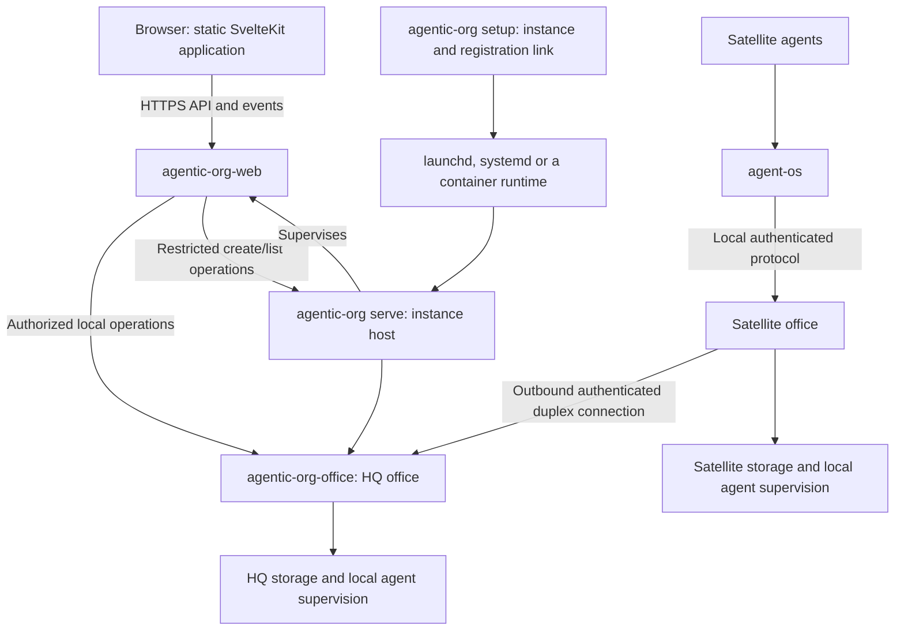

# Design: the standalone Agentic Org server

How the server is released, installed, started and reached. It implements the
[server installation and access UX](../specs/server-installation-and-access-ux.md)
and [ADR-0005](../adr/0005-standalone-server-v1.md). The programs and their jobs are
fixed by the [architecture non-negotiables](../architecture-non-negotiables.md);
[project structure](project-structure.md) owns the code layout. macOS and Linux,
including a Linux container, are both v1 hosts
([ADR-0017](../adr/0017-linux-and-container-hosting.md)): where this document names
launchd, the Keychain or a code signature, that is the macOS adapter of a platform
contract, and the Linux adapter is the one ADR-0017 names.

## 1. Architecture



HQ and satellite are persisted **office roles**. An instance is the local service,
its catalog and its configuration; it may host several offices. An office belongs to
one organization. A browser session, the instance's administrator, an office identity
and an employee identity are distinct principals. An office certificate is never a
person's session or permission to administer the instance.

The same release supports both roles. HQ serves the frontend and browser APIs for
its organization, including the synchronized view of its satellites. Several HQ
offices in one instance may share one browser listener, with explicit organization
routing and authorization. An instance with only satellites has no public listener,
and it never becomes HQ because its connection failed.

## 2. Release, install and runtime boundaries

| Executable | Role |
| --- | --- |
| `agentic-org` | The person's command line. `setup` creates the instance and prints the administrator's registration link; `admin reset` re-issues it or resets the administrator's password; `serve` runs the host: accounts, sessions, secrets, child supervision and update management. |
| `agentic-org-web` | Browser HTTPS, sign-in, static assets, API responses and live events. No keys and no database. |
| `agentic-org-office` | One HQ or satellite office: every domain rule, the one data writer, and the supervisor of its agents. |
| `agent-os` | The agent's command line, with employee-scoped authority. |

A small online bootstrap resolves the platform and version, downloads and verifies
`agentic-org`, and runs `agentic-org setup`. It owns no provisioning logic and does
not update existing instances silently. Setup downloads and verifies the missing
release components, or extracts a complete local bundle, into an immutable
versioned release directory. One release pin selects all matching binaries and
assets together. There is no other permanent host or updater daemon.

The service manager starts `agentic-org serve` for the selected instance. It
supervises the office workers and, when the instance hosts HQ, `agentic-org-web`.
Each office supervises its own agents as child processes; there is no sibling agent
supervisor. `serve` starts an installed release without a download; setup is a
short-lived command. Nothing is installed from inside an agent turn.

Libraries own behaviour and binaries compose them. No app links another app's
library; shared behaviour moves into a crate when a second caller or a dependency
boundary justifies it. Embedding a built executable as a release payload is
packaging, not a Rust dependency. The browser application is `apps/agentic-org-ui/`;
licensed Tailwind Plus sources stay inside it.

A release verifies download authenticity, executable signatures where the platform
has them, checksums of embedded helpers and architecture compatibility. It extracts
to a private staging directory, refuses path traversal and symlink redirection, and
publishes the complete release atomically. The bootstrap trusts a configured release
signing key; a checksum from an unauthenticated source is not enough.

### Browser listener and privilege boundary

The [browser BFF design](rust-browser-bff-and-static-sveltekit.md) keeps browser
response mapping in the web process and use cases in their owning Rust modules.

One `agentic-org-web` per instance terminates browser HTTP and TLS, serves the UI
assets, and manages browser sessions and events for every authorized HQ organization
on that listener. It runs as a supervised child of `agentic-org serve`, separately
from each office. Office enrollment and mutual TLS terminate at the federation
component, not at this listener.

The web process receives browser TLS material and narrowly scoped host and office
clients. It never receives an office's secrets key or the host's key-store
entitlement, and it opens no database. The host keeps catalog locking, credential
custody, worker provisioning and private launch. Typed local operations carry actor,
instance and organization scope, operation ID and expected versions; they are not a
JSON tunnel to the host. Peer admission and the platform's file and process controls
enforce the separation.

Startup binds this handoff to the verified complete release. The host turns the
release-store pin into a private runtime token, keeps its store lock, verifies its
own loaded image and selects the worker and web paths from that release before it
opens custody. The web process's nonsecret first line carries `release` with
`version: 1`, `release_id`, lowercase full `manifest_sha256` and a positive integer
`sequence`, within 1024 bytes, refusing unknown and duplicate fields. The web process
checks this binding against its embedded publisher registry, the sibling manifest
and signature, its own loaded image and the UI bytes before it confines itself,
reports ready or receives secrets. A missing release binding is accepted only by
named debug fixtures; production refuses it.

**Create organization** requires the authenticated **administrator**: the one
account on the instance whose host record carries the administrator flag. The
account registered from setup's link holds it; the administrator can hand it to
another account, in one operation that never leaves two or none. Owning one
organization grants no right to create another. Setup creates no account and no
organization: every organization, including the first, is created in the browser
through the web process's restricted host operation. The host checks the admitted
web capability and an administrator grant bound to the administrator account and the
requested action, never a role flag from the browser. It creates the key itself and
returns an operation result, never a key. The same person may hold both roles;
office certificates and agent session tokens grant neither. **Add office on this
instance** (OFC-2) also provisions a key and a worker on the host, so it needs the
same administrator grant. Inviting, approving or removing a satellite is open to any
authorized owner (OFC-7).

### Setup executable and release store

`apps/agentic-org/` owns the human CLI and the `serve` composition; there is no
separate setup package. Release staging selects this CLI's artifact.

The release verifier follows [ADR-0009](../adr/0009-complete-release-verification.md).
Its private release store is separate from organization data and from input bundles.
It uses owner-only `staging/`, `releases/`, `intents/` and `pins/` directories under a
protected store, serialized by `store.lock`. Completed release trees are read-only. A
version-1 intent freezes the manifest digest, release ID, sequence, private staging
handle and prior pin digest before publication. Immutable version-1 pins use
contiguous positive 20-digit commit ordinals and a SHA-256 chain; these ordinals have
nothing to do with office work positions. Intents and pins are kept. After a crash
only the next frozen intent may finish; an unrelated staging tree never selects
itself. Sealed output trees use private `.stage-<handle>` names under the same
`releases/` parent as their final IDs, because macOS refuses a cross-parent move of a
`0500` directory. No output tree is made writable to publish it.

The trusted build inputs are `ORG_RELEASE_TRUST_REGISTRY` (a public registry, not a
signing key) and `ORG_RELEASE_MIN_SEQUENCE` (a positive freshness floor). Host and web
embed and validate them at build time and never read them at run time. A development
build without them embeds no publisher trust and cannot activate a production
release; a malformed input fails the build.

Setup talks to the host over a typed reverse connection: `agentic-org serve` in
bootstrap mode connects to setup's private listener, and `bootstrap` and `exit` are
never ordinary `host.sock` methods. Both sides are the same executable, with the
retained signing identifier `com.vgmello.agentic-org.org-office-host` and the
compiled team and hardened-runtime checks on macOS. A debug executable allowance is
debug-only. Before creating the registry, the bootstrap host holds the instance,
root and host locks and hands those same locks and custody to the normal runtime
without an unlocked restart. A replay compares the nonsecret fingerprint and never
issues a second registration link. The setup
adapter admits loopback HTTP without a TLS pair; a supplied TLS pair is refused until
the host certificate verifier exists.

## 3. Instance selection and storage

An omitted `--name` selects `default`; `--name lab` selects exactly `lab`. Names are
normalized and validated the same way in the CLI, the registry and service names,
using a restricted portable alphabet that refuses traversal. Each instance has a
random immutable ID separate from its name. Renaming and moving data are not v1
features. A copied directory is not a newly enrolled office.

Default data roots:

| Platform | Instance data root | Service and runtime details |
| --- | --- | --- |
| macOS | `~/Library/Application Support/agentic.org/instances/<name>/` | Per-user launchd agent `com.ellosoft.agentic-org.instance.<instance-id>` in `~/Library/LaunchAgents`; short private socket directory |
| Linux | `${XDG_DATA_HOME:-~/.local/share}/agentic-org/instances/<name>/` | systemd user unit derived from the instance ID, or foreground under a container runtime; sockets in a validated private runtime directory |
| Container | A mounted volume | Nothing the instance keeps is written outside mounted volumes |

Default addresses (A2 decision D9): `default` listens on `http://127.0.0.1:7420`; a named
instance takes the first free port from 7421. A port in use is an actionable error and
leaves the saved address unchanged. The service label comes from the instance ID, never
the name, so renaming cannot collide; a definition with that label but other contents is
never taken over.

Setup may take an explicit absolute data directory. It saves the resolved path;
services and agents never infer it from a later working directory or `HOME`.
Instance configuration is managed by the server and readable only by authorized local
users. It names office IDs, the release pin, endpoints and references to credentials,
never inline private keys. Binaries live outside mutable data.

The [storage contract](organization-data/README.md#shared-storage-contract) owns the
layout of each organization's data root: one root, with sources under `durable/` and
rebuildable caches under `runtime/<office-id>/`:

```text
<data-root>/<organization-id>/
├── durable/                  # sources: back up all of it; never removed by cleanup
│   ├── state/                # organization Git files
│   ├── journal/              # acknowledged unpublished changes
│   ├── authority/            # numbering, placement generations, permits (06, 11)
│   ├── accounting/           # usage streams and checkpoints (10)
│   ├── messaging/            # protected envelopes and attachments (15)
│   ├── recovery/             # receipts, streams, journals, snapshots, cleanup (16)
│   ├── budgets/              # policies, periods, events, extensions and holds (17)
│   ├── private/              # HQ only: author-private task notes (05)
│   ├── local/offices/        # private local bindings and agents' private homes, never Git
│   └── checkpoints/          # local and unpushed code recovery
└── runtime/<office-id>/      # caches: rebuildable
    ├── office.db             # projection and explicitly transient state
    ├── repositories/<repository-id>.git/
    └── teams/<root-team-id>/teams/<child-team-id>/.../agents/<employee-id>/
        ├── projects/<project-id>/tasks/<task-id>/repositories/<repository-id>/
        └── tasks/<task-id>/repositories/<repository-id>/
```

Nothing under `durable/` sits inside a directory that cache cleanup removes; cleanup
is limited to `runtime/<office-id>/`. Organization Git is remote, with an explicit
slug, repository ID and state branch; code repositories may be local-only. A project
associates registered repositories, each with a required integration branch, and an
office caches each repository once. The office derives the Git-metadata, credential,
other-task and managed-state denies for these paths and verifies them before launch;
a renamed directory never becomes a broad agent allowlist. Task worktrees survive
handoff until the task closes; moving an agent to another office checkpoints local
and unpushed edits.

Rebuilding a projection verifies Git and every protected source: actor-bound
receipts, stream and incarnation high-water marks, snapshot hashes and epochs, and
the allocation ledger. Credentials are bound again and marked processes reconciled
before anything runs. A restored PID never authorizes a signal; that needs a matching
ownership mark, generation and machine, boot and start identity. Only restored
placement authority and verified cleanup or fencing permit a new process. Missing
source coverage blocks the affected recovery instead of fabricating a successful
restore. The instance, host and office locks keep their single-writer invariants.

macOS limits a Unix-socket path to 103 bytes, so sockets live in a short private
runtime directory named by an opaque instance handle and office handles. The endpoint
is authenticated as well as its path ownership checked.

Before reading mutable state, the host holds an instance lock on the real data
directory, and each office holds its own lock. Aliases are resolved and symlink
replacement refused, so two names cannot operate one directory. Setup holds a name
and registry lock until it has durably reserved the ID and root. Socket, port and
service collisions fail explicitly; a restart never silently picks another port,
because HQ's saved address is part of enrollment.

Credential names, key sweeps, cleanup, logs and process ownership include instance
and office identities. A host sweeps only its own catalog. Office storage and
configuration are not readable by agents just because they share a root. Agents run
in the isolation mode of [ADR-0015](../adr/0015-agent-isolation-modes.md):
`same-user`, or `dedicated-user`, an OS account that setup provisions and that
cannot read the organization's sources. Each agent has a private home under
`durable/local/offices/<office-id>/agents/<employee-id>/home/`. Organization data is
not encrypted by the application; disk encryption, private file permissions and the
isolation mode protect it ([ADR-0016](../adr/0016-no-application-level-data-encryption.md)).
Sharing an OS user is not an isolation boundary between instances.

## 4. Setup and service lifecycle

Initial installation creates the instance only:

```bash
agentic-org setup
```

Setup is one resumable workflow: select or reserve `default` or `--name <name>`;
verify a complete platform release; collect the listener configuration and the
agent isolation mode; report disk encryption and the file permissions it set;
register and start the service; probe local readiness; and print one registration
link to the instance's own address. Setup asks for no username and no password and
creates no account, organization or office. The link works once, expires after 24
hours, and is stored at the host only as a digest; whoever opens it chooses a
username and a password in the browser and becomes the administrator
([installation UX](../specs/server-installation-and-access-ux.md) §4a.2).
`agentic-org admin reset` on the server machine issues a new link, which cancels the
previous one: a registration link while no administrator exists, and afterwards a
set-new-password link for the administrator's account and no other. Service
registration is automatic. Repeating setup resumes the same operation and reuses
identity, data, configuration and service without changing roles, upgrading silently
or issuing a link. Existing satellite-only state is never converted into HQ.

`setup --non-interactive --config <file>` takes a strict JSON object with
`version: 1`, an absolute `root` and `listen` (the host-control `ListenConfig`). It
holds no login, password, organization, TLS private key, satellite role or extra
property, apart from `service` (`registered` or `foreground`) and `credentials` (the
absolute directory of the Linux credential store, required on Linux;
[Linux host design](linux-host.md#32-credential-provider)). Configuration is at most 64 KiB. Missing required input fails without a
prompt. Noninteractive setup prints no link; its status reports
`administrator: none` until `agentic-org admin reset` is run in a terminal. A
container can run setup this way, without a terminal and offline. Unsupported
listener or TLS profiles fail before bootstrap.

Under the account-owned application base, `setup/<name>/setup.v1.json` freezes the
validated nonsecret request, offline policy, the bootstrap operation ID and the
exact release pin before protected creation. Later fields record the instance, the
bootstrap exit and the service registration.
`setup.lock` serializes this workflow separately from the instance writer and release
store. Reopening repeats the original protected operations or verifies their result;
it never mints new operation IDs, changes a configured listener or activates a newer
bundle. The CLI resolves services from this saved record. When the installer is not
the pinned host image, it re-executes the selected image before handling credentials.
Setup records are protected operational metadata, not organization Git.

The initial wizard and the noninteractive schema offer no satellite role, invitation
or join option. A request to join through setup is refused before provisioning and
points to HQ's Add office flow.

Offline installation:

```bash
agentic-org setup --bundle ./release-linux-x64.tar.gz --offline
```

The local bundle is verified with the same trust as online. No external fetch or
update check happens, and the offline policy persists for background jobs until
online operation is enabled. Missing prerequisites produce actionable errors.
Offline setup creates the instance only. An organization created later on an
offline instance still registers its repository as remote: creation checks URL and
branch syntax and local credential configuration only, never fetches, probes Git
authentication or discovers provider models, and saves the registration with
connectivity and publication unverified
([create organization](create-organization.md)). Local service readiness is distinct
from repository publication and provider readiness. There is no local-only
organization repository fallback.

### Provisioning reservation

Protected host-registry provisioning keeps a separate reservation: account and
fingerprint, normalized name and explicit slug, the exact prepared UUIDv7 ID plan,
the creating administrator's account, an opaque recovery handle, a nullable office-key
fingerprint, and linked and completion status. Its replay window is the operation
ID's time plus 30 days; unfinished reservations and their custody are never pruned.
Credential staging precedes the reservation and is bound to its account, fingerprint
and IDs. A key-pending reservation may finish installing the office secrets key only
before office preparation starts; once the key fingerprint is recorded, absence or
mismatch requires recovery. Interrupted publication re-reads the original item and
never replaces it. Host completion follows the office's actual readiness. No recovery
code or office key enters the reservation or the browser result.

### Satellite enrollment is a separate HQ-initiated flow

On the destination, the flow issued by HQ reserves local instance and office
identities, checks release compatibility, starts or reuses the host service and
submits the invitation through the protected `office.join` on `host.sock`. Admission
keeps destination consent, trusted peer checks and the administrator grant when the
instance already has an administrator. A satellite-only host starts its account
registry with no accounts. No web child or new HQ is created. Unattended enrollment may stay
`awaiting_approval`.

The satellite generates and keeps its TLS identity key ([offices design](offices-hq-and-satellites.md)),
wrapped with its office secrets key. Each irreversible step has a durable operation
ID and completion marker. The satellite stores its TLS identity key, request and
invitation key, and writes `office.json` (`state: pending`), before sending the
request; after an ambiguous reply it queries that request's outcome instead of
minting a second office, and it resumes the same pending approval after a restart.
If `office.join` returns `already_exists` for its own pending office, it shows the
existing request and check code (JOIN-6). If the office is `active`, enrollment
reports it as joined; if `expired`, `cancelled` or `rejected`, it points to
`agentic-org office remove-pending <id>`. A mode or configuration change on existing
state is refused with instructions; nothing converts roles silently.

Interactive and automated input share one validation layer. Noninteractive mode has
no hidden prompt. Error codes distinguish invalid input, permission failure, address
conflict, unsupported version, unavailable credential provider and incomplete
enrollment. Secrets come through a protected descriptor, file or dedicated stdin
input; JSON status, diagnostics, journals and argv never contain them.

### Service and updates

On macOS the service is a per-user launchd registration. On Linux it is a systemd
user unit, or `agentic-org serve` in the foreground as a container's main process,
stopping cleanly on the runtime's stop signal. A unit or label resolves to one saved
instance ID, root and pinned release, with an explicit runtime environment.
Registration is reconciled idempotently and never takes over an unrelated unit with a
colliding name. Login, session and lingering requirements are reported, not assumed.

`service start`, `service stop`, `service status`, `logs`, `doctor`, `upgrade`,
`uninstall` and `serve` select the same instance; the service commands are
maintenance. Local lifecycle control works when HTTP is down. An explicit stop does
not trigger the service manager's restart policy. Stop refuses new admission, cancels
ephemeral streams, drains writes and stops and reaps owned process trees within
deadlines. A disconnected browser does not cancel submitted durable work. When the
host dies, offices stop and reconcile; agents are never left orphaned.

Release pins are per instance. Background checks discover and stage updates under the
configured policy; an unavailable update source never prevents startup. Activation
drains the instance under its maintenance policy. An explicit upgrade stages and
verifies a complete release, stops the instance, changes its pin and probes
readiness, keeping the prior release. Shared release garbage collection checks every
instance's pins and running references. Uninstall keeps data; explicit deletion is
scoped, checks that the instance is stopped and cannot remove another instance's
directory or a shared release. Cache cleanup also verifies source coverage, private
stores, credentials, unresolved communication and code checkpoints.

## 5. HTTP and browser contract

The `/api/v1` surface and its conformance fixtures are in [web-api-v1.md](web-api-v1.md).
A capability is advertised only when the real operation works.

Static assets and `/api/v1/` are served from the same HQ origin. Hashed assets may be
cached; the entry document is revalidated. The SPA fallback applies only to browser
navigation routes, never to API paths, stream routes or assets. Static file handling
cannot reach instance data. There is no SSR and no Node server. An API and frontend
version mismatch shows a refresh or update state, never mock data.

Every HTTP route maps to a typed domain operation with its error codes and
authorization; there is no JSON-to-local-RPC tunnel. Tests inject explicit fakes; a
mock reducer is never an authoritative server rule.

Reads and commands are HTTP requests; server-to-browser events use one shared,
authenticated streaming fetch per origin, coordinated across tabs (web API §6).
Proofs never enter stream URLs. WebSocket is used only for a concrete duplex feature.
There is no terminal in the browser
([ADR-0004](../adr/0004-headless-agent-sessions.md)).

Mutations carry stable operation IDs and expected versions. A durable acceptance
records the operation ID, payload digest, principal, scope and outcome in one
transaction. Reusing an ID with another payload is refused. A lost response is
resolved by retry or lookup of that ID within the deduplication window; outside it,
expiry is reported rather than rerunning. `accepted` is not `completed`. Requests to
an offline office follow the operation's own queue-or-refuse rule.

A snapshot and its stream compose without a gap: take a snapshot at position P and
consume updates after P. Cursors are scoped per organization and feed, and
authorization is rechecked on reconnect. An expired cursor needs a new snapshot.
Per-client queues are bounded; a slow consumer is disconnected with a resync signal.
Reads and commands have timeouts, body limits, rate limits and backpressure. Unknown
outcome is distinct from confirmed rejection.

The office client and SQL access are blocking. An async HTTP adapter uses bounded
dedicated workers or bounded blocking tasks, never blocks executor threads, never
holds a mutex across an await, and never wraps each request in an unbounded
`spawn_blocking`. A timeout does not mean the operation stopped: keep its ID and
track its outcome.

## 6. Authentication, keys and platform gates

Bootstrap is a one-time link: setup prints a registration link bound to the
instance, single-use, expiring after 24 hours and kept at the host only as a digest,
with its secret after `#` so it never reaches a request line or log. Until it is
redeemed no administration is possible, and `agentic-org admin reset` on the server
machine replaces it. No password is typed in a terminal: terminal sign-in prints a
10-minute approval link that a signed-in browser approves. There is no unclaimed
reusable administration page and no reusable owner token in a URL.

**A cookie alone never authenticates a browser operation.** Cookies are scoped by
host, not port ([RFC 6265 §8.5](https://www.rfc-editor.org/rfc/rfc6265#section-8.5)),
and SameSite does not isolate `localhost` ports. Each sign-in creates an opaque
HttpOnly session cookie with an instance-specific name and an independent random
256-bit origin proof. The pair is validated, bound to instance, principal and the
configured origin (scheme, host, port), on every protected read, mutation, stream,
refresh and sign-out. A cookie-only request cannot obtain or rotate a proof.

The proof is returned in a no-store response body. The UI keeps it only in
origin-scoped IndexedDB or memory and sends it as `X-Org-Session-Proof` on
same-origin requests; it never enters a URL, cookie, log or cross-origin redirect. A
missing proof needs a new sign-in. Shared workers and tabs use the same origin-scoped
session. Rotation and revocation cover both values; refresh needs the valid pair.
Sessions are stored at the host as digests and survive restarts
([ADR-0013](../adr/0013-stored-browser-sessions.md)). Authentication and crypto use
maintained libraries and get a security review before release.

Cookies use Secure, HttpOnly and SameSite attributes, expiry and origin checks.
HTTPS is required off loopback; explicit loopback HTTP still requires the pair. Host
and Origin are validated including the port; credentialed wildcard CORS and
cross-origin credential forwarding are refused. Another port that overwrites the
cookie can force a new sign-in but gains no authority without the proof. This does
not protect against same-origin script injection or an OS user who can read browser
storage. A default and a `lab` instance, and an unrelated dev server on the same
host, are mandatory adversarial tests.

Organization access is authorized at HQ on every request and stream. Every request
made for a person reaches the office with that person's principal and a grant from
the host, which the office verifies; there is no application token. An office
relaying a command carries a validated actor and scope envelope; an office
certificate cannot assert owner authority. Agent session tokens are restricted to
their employee and session.

Browser HTTPS certificates and office identity certificates serve different purposes.
The invitation binds its proof to a TLS exporter, so a reverse proxy cannot terminate
that connection transparently. HQ therefore has separate listeners and authentication
for browser HTTPS and for office mutual TLS and enrollment, both in the same service.
Office TLS terminates at the component that validates the proof. Satellite
connections are outbound, and HQ must be directly reachable.

The host holds one office secrets key per office and passes it over the launch
rendezvous; the office wraps its private keys with it
([ADR-0016](../adr/0016-no-application-level-data-encryption.md)). The release keeps
separate key-access identities where the platform uses code signing; `agent-os`
never gains the host's key entitlement. A missing or wrong key never causes a
replacement key to be generated over existing data. An office without its secrets key
still serves its data; only functions that need a private key are unavailable.

Before release, the platform adapters are proven with the real packaged binaries:

- **macOS:** launchd registration, stable signed helper identities and Keychain access
  for host secrets, including lock, unlock and upgrade.
- **Linux and containers:** worker admission by the verified release image, host
  secrets in a host-only owner-only directory or a mounted secret volume, Landlock and
  seccomp confinement of the web process, process cleanup and service behaviour. The
  Linux admission check is weaker against a local attacker who can replace files as
  the service user, and the product says so ([ADR-0017](../adr/0017-linux-and-container-hosting.md)).
- **Both:** a missing adapter or kernel feature refuses to start and says why; nothing
  runs unprotected. Backup guidance says to encrypt backups at their destination.

### CA escrow and the explicit recovery gate

Creating an HQ organization creates its CA escrow and one owner recovery code
([ADR-0007](../adr/0007-hq-creation-escrow.md), format REC-ESC-1). The code is
generated server-side with high entropy and the escrow uses the reviewed
Argon2id-encrypted format through maintained libraries. Only the encrypted CA
package is replicated organization data; the code and the usable CA key never go to
a satellite. Escrow version and provisioning completion are recorded idempotently,
and ordinary retries never rotate the code.

The HQ office keeps the CA private key and the exact public envelope in one
local-only record with the organization, provisioning operation and completion
version. The private key inside it is wrapped with the office secrets key
(ADR-0016). The record is excluded from replication, acceptance capture, snapshot
export and public reads. Its public envelope is the only source of the copied
`security/ca-escrow.v1.bin`. The record commits atomically on the office writer before
a create succeeds; reopening verifies it and never generates a replacement for
incomplete or mismatched material. The creation context binds an explicit canonical
state root in its retry intent, and completion waits for the copied envelope to be
published there. Reopening repairs a missing public file from the committed record
and refuses conflicting bytes. Export reads only a separately typed public record,
checked against the committed bytes, and never serializes the private key.

The pending recovery code is staged in the host's credential provider, with only an
opaque handle in the creation journal. Before acknowledgement, an interrupted delivery
resumes the same code and escrow. On acknowledgement the pending secret is erased and
never exposed again. A lost acknowledged code needs the separate recovery and
rotation policy, never a redisplay or a setup reset.

Protected delivery follows [ADR-0011](../adr/0011-protected-recovery-delivery.md)
(REC-DEL-1). The host registry keeps a versioned delivery ledger bound to the
completed HQ reservation and the exact public package. It records delivery ordinals,
showing dates and counts and the acknowledging actor and time, never the code. Each
release of the code needs a fresh device-owner authentication and a verified local
console context; the acknowledgement permission belongs to that live native
connection and is never a client capability or persisted token. Delivery and its
code-free audit commit before the secret is returned. Acknowledgement commits a
deletion intent, deletes and verifies the absence of that pending code, then records
completion. Startup resumes an interrupted deletion before HQ is ready.

Package export uses a separate authenticated `recovery_public_read` descriptor of the
launch contract, not the writer-control stream. Its version-1 frames are at most
16 KiB with exact instance, office, organization and create-operation bindings and at
most 4475 original encrypted bytes. Its only source is
`Office::hq_creation_public_record()`. A native administrator exports to an
explicitly chosen new local `0600` file without overwrite and confirms that package
and code are stored away from HQ.

The commands are `agentic-org recovery release` and `agentic-org recovery status`,
with a saved `--name` or an explicit `--host-socket` and `--instance-id`, an exact
`--org-id`, and the administrator's sign-in, approved in the browser (no password in
the terminal). `--package` chooses a new local file;
`--redeliver` asks for a fresh authenticated showing of the same code.
`recovery.status` returns state, dates, counts and code-free audit pages (32 delivery
ordinals per page). `recovery.package` returns the bound public record with no server
file name. Browser, web and agent channels have no route to the recovery secret or
package export.

Setup creates no organization and offers no code. After an organization is created
in the browser, its code waits to be collected: the administrator collects it with
`agentic-org recovery release --org '<organization>'` at the HQ machine, and the
browser shows only its state. The organization is usable while recovery material
stays Waiting or Shown. Acknowledging that package and code are kept away from HQ is
required before recovery material is marked collected, not before HQ is ready. Status
JSON and logs never contain the code. A fixture recovers the same CA public identity
with the code and fails closed for a wrong code or a damaged package. Escrow is not a
backup of repository data or work records.

**REC-1, open:** the supported manual HQ-loss procedure (replacement HQ,
re-certification, highest-epoch handling and fencing of a returning old HQ, recovery
of credentials, disclosure of data loss, reachable addresses) has no reviewed design
yet. It must be designed and exercised before production HQ-loss recovery is claimed.
The procedure inventories the protected sources of
[document 16](organization-data/16-recovery-and-office-continuity.md): acknowledged
chat, usage, numbering allocations, mutation receipts, budget extensions and holds,
and execution ownership. Private notes need their own authorized recovery path.
Restoring Git or the CA escrow alone proves none of these complete, and a fresh
database grants no execution authority. Automatic promotion is not in v1, and
replication is not a point-in-time backup. Remote satellite enrollment alone is not
proof that HQ loss is recoverable.

## 7. HQ and satellite semantics

The [offices design](offices-hq-and-satellites.md) owns the organization's single
writer, deterministic apply, `(epoch, seq)` positions, snapshot replacement, work
sequence allocation, origin incarnations, acknowledgements, deduplication, scoped
backfill, ownership generations and handover. Local work commits while HQ is
unreachable; cross-office messages and organization commands have separate outboxes.
HQ keeps authorized routing copies of tasks and messages; satellites keep the work
relevant to them. A copy grants no access to messages, private notes or amounts.
Processes, credentials and local workspace files are not replicated.

Enrollment keeps one-time invitations, a pinned HQ identity, owner approval, office
certificates, renewal and revocation. Reconnecting reuses the identity and resumes
positions. Satellites on the same machine use the same identity model; the same user
ID is not proof of enrollment. Approvals happen in an authenticated HQ browser,
wherever that browser runs.

Repositories are registered organization-wide and associated with projects, each
association with an integration branch. A local-only code repository cannot become
another host's remote by copying a path. The server adds neither folder sync nor Git
hosting. A cross-office coding claim needs a reachable transport and verified
checkout, push and fetch; unpushed local work is kept in protected checkpoints.

[Document 11](organization-data/11-model-profiles-and-agent-execution.md) owns
execution: the office's internal supervisor, a logical controller and process slot
per agent, the selected profile and model, ordered connection candidates, local
bindings, shared connection permits, turns, attempts and processes, and durable
placement fencing. Employee identity and home team are in `profile.md`; `execution.md`
is separate and required to run. A completed turn or handoff does not close a task.

[Chat](organization-data/15-messaging-and-chat.md) defines conversation membership
and per-message visibility; membership does not wake everyone.
[Budgets](organization-data/17-budgets-and-controls.md) are data and control records:
incomplete usage is kept, manual, security and budget holds are independent, a
pending stop differs from an acknowledged hold, and one-time extensions are durable.
Release caps warn only. Cost access scopes and the agent's own-amount exception in
`agent-os` apply, and no amount is exposed to a replica because it has a projection.
A browser connection never owns the lifetime of durable work.

## 8. Verification

Formatting, Clippy and Rust tests run on every change, with frontend type checks,
tests and build. Failure tests cover duplicate setup, data-root aliases, unavailable
keys, bad signatures, cross-instance cleanup, port conflicts, interrupted enrollment,
revoked or expired identity, incompatible versions, lost replies, stream gaps, slow
clients, shutdown and orphan cleanup. Tests use temporary roots and fake runtimes;
real runtime and signed-platform checks are explicit opt-in runs
([dogfood run](../specs/dogfood-run.md)). The release walkthrough runs on macOS and on
Linux, including a container, and confirms no production mock fallback.

## What the code does today

- `agentic-org` implements `serve`, help and version; `setup` refuses without
  changing state. There is no bootstrap, download, installer, updater or service
  registration; the executables are built from source and started by hand.
- Release verification exists as the `org-release` library, linked into `org-host`,
  and no command calls it.
- Protected HQ creation (`crates/org-host/src/provisioning.rs`, the office's
  `hq_creation`) and recovery delivery are implemented and tested, and nothing
  reaches them.
- Office data lives in `org.db` and `office.db` under the host home's
  `offices/<office-id>/`, still encrypted with SQLCipher. The host registry
  (`host-registry.db`) is plain SQLite with no database key. SQLCipher is removed
  under ADR-0016, and the files move to the storage tree above (implementation plan
  A1, B1b).
- Host secrets use the macOS Keychain (`crates/org-host/src/host_secrets`), and the
  host starts workers only on macOS (`crates/org-host/src/spawn.rs`).
- The launch code has two forms, the older first line and the rendezvous in
  `crates/org-office-launch/src/v3.rs`; only the rendezvous stays (A1).
- Provisioning operation IDs are ULIDs; they become UUIDv7 under FC-142.
