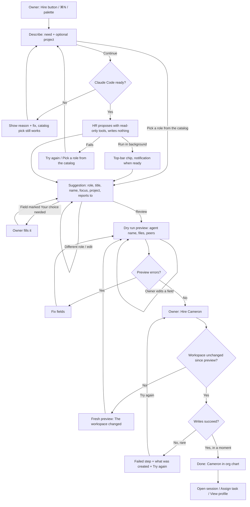
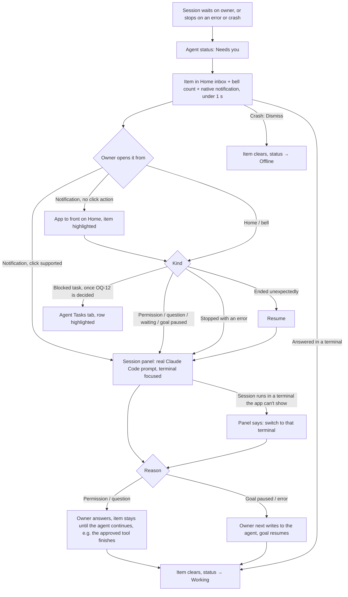
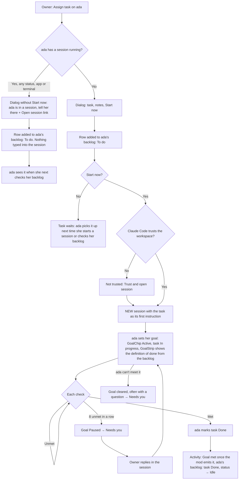
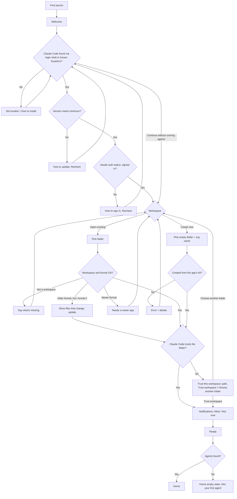

> **Historical desktop specification.** This records the original Tauri desktop direction. The browser architecture in [ADR-0005](../../../../adr/0005-standalone-server-v1.md) supersedes that platform direction. Preserve the original requirement IDs as historical references.

# Spec · Agency desktop app v1 (single machine)

Owner: Eden (`ac-product-designer-eden`) · Status: **draft, iteration 1, revision 4** · 2026-11-07
Inputs (binding): [product brief](../research/product-brief.md) · [design system](../../../design-system.md) · [mockup v0](../prototypes/reference/mockup-v0.png)
Architecture (ada): [desktop app architecture](https://github.com/vgmello/agents/blob/83c3f906429e297d0267106363204fdee6f577b5/projects/ac/agents/ac-staff-engineer-ada/knowledge/designs/desktop-app-architecture.md) · [ADRs 0001–0008](https://github.com/vgmello/agents/tree/83c3f906429e297d0267106363204fdee6f577b5/projects/ac/agents/ac-staff-engineer-ada/knowledge/adrs) (UI tests: [ADR-0008](https://github.com/vgmello/agents/blob/83c3f906429e297d0267106363204fdee6f577b5/projects/ac/agents/ac-staff-engineer-ada/knowledge/adrs/0008-ui-testing-strategy.md)) · [ada's review of revision 3](https://github.com/vgmello/agents/blob/83c3f906429e297d0267106363204fdee6f577b5/projects/ac/agents/ac-staff-engineer-ada/knowledge/reviews/spec-v1-architecture-review.md), whose findings this spec cites as **R#n**
Audience: engineering (`ac-staff-engineer-ada`, `ac-software-engineer-remy`, `ac-software-engineer-riley`), QA, the owner.

**How to read this spec.** Every word in the UI comes from the design system's glossary. Status names come from its status vocabulary. Where a UX need depends on something engineering hasn't decided yet, the spec states the need and links an open question (`OQ-n`, §8). Where ada's design answers a question, the spec follows it and §8 says so. Paths are relative to the workspace root (the repository). Stack, tokens and ownership: §9.

**Criterion IDs are stable**, because UI tests are named after them (ADR-0008). An ID is never renumbered or reused. A changed criterion is rewritten in place under its ID and listed in the changelog; a new one is appended at the end of its prefix; a dropped one stays, marked "Withdrawn (rev n): <reason>"; one waiting on a decision is marked "On hold (rev n)" and its test is skipped until then.

## Changelog

| Date | Revision | Changed sections | Criteria |
| --- | --- | --- | --- |
| 2026-11-07 | **4a**: merged decision list | §8.0 (new): one list of 16 decisions for the user, merging ada's 7 and the open OQs; deferred until M1 | none |
| 2026-11-07 | **4**: ada's architecture review | Header (ADR-0008, ID rule) · §2.4 (notification click target and fallback, clearing when the agent continues, error wording, usage limit, crash while the app was closed, Blocked task on hold, one question = one item) · §2.5 (trust on open, Needs you in other workspaces) · §2.6 (goal row, HR status, attachable vs notifies, two live sessions, format 0) · §2.7 (format 0, trust, tools environment, Claude Code updated, usage limit, attribution by location) · §2.8 new (showing agent-written files) · §3.1 (Clears when, goal shown as definition of done, attribution) · §3.2 HR card status · §3.3 · §3.4 · §3.5 (Overview goal, Sessions tab rows, goal history, Resume rules, two sessions) · §3.6 (Open session in an untrusted workspace, `agent.json` last, HR status) · §3.7 (Assign writes the backlog only; Start now only without a running session) · §3.8 (header key hint, `GoalStrip`, terminal keys, detach and reattach, agent view, trust error, Resume rules, Stop copy, stopped screen, too small, two sessions, sessions without mods) · §3.9 · §3.10 (Goal column) · §3.11 (safe preview) · §3.12 (trust, environment, Claude Code updated, deferred update removed) · §3.13 (new Trust step) · §4.2–4.4 · §5 (how criteria are verified) · §6.1 · §6.3 · §7.2 · §8 (OQ-7, 11, 12, 25, 26 updated; OQ-27–31 new) · §9 | Rewritten: SHELL-5, SHELL-7, SHELL-18 · HOME-3, HOME-5 (on hold, OQ-12), HOME-7, HOME-10 · AGT-4 · ASSIGN-3, ASSIGN-4 · SESS-10, SESS-12. New: SHELL-19–21 · HOME-13, 14 · HIRE-19 · ASSIGN-9 · SESS-14–22 · KNOW-5 · SET-6, 7 · FIRST-9–11. Withdrawn: none |
| 2026-11-07 | **3b**: Riley's questions | §2.4 (goal paused then session stopped) · §3.1 Home order rule | HOME-12 (new) |
| 2026-11-07 | **3a**: product named **Agency**, sample org **Agentic Org** | Title · OQ-5 | none |
| 2026-11-07 | **3**: ada's review (how "Needs you" clears, sessions without mods, approval security), Riley's component names, prototype links | §2.1 (component names; sizes moved to design-system Tokens) · §2.4 (clearing by reason, "Clears when" column, Dismiss for crash and blocked task only) · §2.6 (clearing rule; sessions without the app's mods) · §3.1 (item shows reason and what clears it; Crashes filter) · §3.3, §3.4, §3.5, §3.10, §6.3 (component names) · §3.5 Sessions tab states · §3.8 ("Stopped with an error" keeps the session open; new state "Started outside the app: no notifications") · §4.2 flow · §7.2 (approval security rule) · §9 (Tokens pointer, component names, prototype and canvas) | Changed: HOME-3, HOME-4, SESS-5, SESS-11 (also component names in ASSIGN-7, HOME-7, AGT-4). New: SESS-12, SESS-13 |
| 2026-11-07 | **2**: ada's architecture answers | §1 scope · §2.1 · §2.4 (Open session as the inbox action, new "Stopped with an error" kind) · §2.5 · §2.6 (status rules, sources) · §2.7 (new global states) · §3.1 · §3.2 example · §3.3 · §3.5 (Sessions tab, Offboard) · §3.6 Hire (HR proposes read-only, instant preview, "workspace changed" state) · §3.7 · §3.8 Session panel (embedded terminal, lifetime, terminal sessions) · §3.9 · §3.12 · §3.13 First run · §4.1–4.4 · §6 · §7 (7.1 project placement, 7.2 later items) · §8 (statuses, OQ-25, OQ-26) · §9 new | Changed: SHELL-6, 7, 10 · HOME-1–5 · ORG-1 · QV-2 · HIRE-3, 4, 8, 10, 13 · ASSIGN-3, 4 · SESS-1–9 · PROJ-1 · SET-1, 3, 4 · FIRST-1–6 · A11Y-2. New: SHELL-15–18 · HOME-11 · HIRE-15–18 · ASSIGN-8 · SESS-10, 11 · FIRST-7, 8 · A11Y-6 |
| 2026-11-07 | **1**: first draft | All | 106 criteria |

---

## 1. Problem and goals

The owner runs an AI organization from a repository: HR, `hr/hr.py`, `bin/agent` sessions, backlogs, journals, memory and the goals mod. Today they do all of it from a terminal and by reading files, so they can't see at a glance **what needs them** or **what is running**. The brief (§1–§3) has the full problem, personas and jobs.

**v1 goals** (from brief §3 and §7)

| # | The owner can… | Measured by (UX acceptance) |
| --- | --- | --- |
| G1 | See everything that needs them, in one place, within one click | HOME, SHELL criteria |
| G2 | See what every agent is doing right now | HOME, ORG, AGT criteria |
| G3 | Hire an agent by describing a need, and review what will be created first | HIRE criteria |
| G4 | Give an agent a task and follow its goal to done or blocked | ASSIGN, SESS, TASKS criteria |
| G5 | Open, resume and stop sessions, and answer prompts, without a terminal | SESS criteria |
| G6 | Understand who owns what (org chart, projects) | ORG, PROJ criteria |
| G7 | Read what agents produced (backlog, journal, memory, knowledge) | AGT, KNOW criteria |

**Out of scope for v1:** remote machines (v2, §7), human members (OQ-1), analytics (sessions, tokens, cost), a chat-style session view (the Session panel is the real Claude Code terminal, §3.8), editing agent files in the app until OQ-4 is decided, and anything the design system marks "Not a product concept": work an agent does internally counts as the agent's own work and never appears as extra members, cards, sessions or statuses.

---

## 2. Information architecture

### 2.1 Window layout

```
┌──────────────┬─────────────────────────────────────────────┬──────────────────────┐
│ ◆ Org name   │ Page title            [⌘K Search…] 🔔3 [+ Hire] │ Side panel (optional)│
│              ├─────────────────────────────────────────────┤ `SidePanel` (`Sheet`)│
│ Home       3 │                                             │ width: Tokens        │
│ Org chart    │                                             │                      │
│ Agents       │            Content (scrolls)                │ Quick view · Hire ·  │
│ Projects     │                                             │ Session · New project│
│ Tasks        │                                             │                      │
│ Knowledge    │                                             │ [×] closes (Esc)     │
│              │                                             │                      │
│ Settings     │                                             │                      │
│ ─────────── │                                             │                      │
│ ▾ Org name   │                                             │                      │
│  This computer│                                            │                      │
└──────────────┴─────────────────────────────────────────────┴──────────────────────┘
```

| Region | Spec |
| --- | --- |
| Sizes | Window minimum, nav widths, top bar height, side panel and session panel widths, control heights: the design system's **Tokens** section ("Sizes that matter"). Not repeated here. |
| Window | Native Tauri window controls. Follows the OS theme (light/dark). Remembers size, position, nav collapse and panel width per workspace. |
| Left nav | Full width, collapsing to icons (toggle at the nav's top, `⌘\`). Collapsed items show a `Tooltip` with the label and the shortcut. Nav counts are `Badge`s. |
| Top bar | Page title (and breadcrumb on detail pages) · search field that opens the command palette (`Command`) · bell with the "Needs you" count (opens a `Popover`) · **Hire** (`Button`, default variant). |
| Content | The current page. Scrolls on its own; the top bar stays. |
| Side panel (`SidePanel`, built on `Sheet`) | One panel at a time: Agent quick view, Hire, Session (holds the `SessionTerminal`), New project. Docked on the right when the window is ≥ 1280 px wide; below that it opens **over** the content with a scrim. Opening another panel replaces the current one. A Hire draft that HR is still working on stays reachable from a top-bar chip (see SHELL-6). Closing the Session panel never stops the session. |
| Dialogs (`Dialog`) | Modal, centered: Assign task, Offboard, Stop session, Switch workspace. Destructive confirmations use the `Button` destructive variant for the primary action. |
| Toasts (`Sonner`) | Short confirmations ("Task #2 assigned to ada.") with at most one action. |
| Statuses | Agent status is always a `StatusChip`, task status a `TaskChip`, goal status a `GoalChip` (icon + label + color). |

### 2.2 Navigation

| Item | Shortcut | What it is | Badge |
| --- | --- | --- | --- |
| Home | ⌘1 | "Needs you" inbox, running now, recent activity | Count of open "Needs you" items |
| Org chart | ⌘2 | Owner, HR and agents by reporting line, grouped by department, with a project lens | — |
| Agents | ⌘3 | List of every agent; leads to the agent profile | — |
| Projects | ⌘4 | List of projects; leads to the project page | — |
| Tasks | ⌘5 | Roll-up of every agent's backlog | Count of **Blocked** tasks (not To do) |
| Knowledge | ⌘6 | Read-only browser of agents' knowledge files and the role catalog | — |
| Settings | ⌘, | App and workspace settings | Dot when an update is ready to install |

**Hire is not a nav item.** It is the primary button in the top bar, `⌘N`, a command in the palette, and contextual entry points (org chart department group, project page, empty states). The mockup's "Organizations", "Analytics" and "Agents & People" items are dropped (brief F7).

### 2.3 Command palette (`Command`, ⌘K / Ctrl+K)

| Aspect | Spec |
| --- | --- |
| Opens from | ⌘K anywhere, the top bar search field, the native menu (View › Command palette). |
| Empty query | Shows **Recent** (last 5 agents, projects or files opened) and **Actions**: Hire (⌘N), Assign task…, Open session as…, New project…, Go to Needs you. |
| Search groups | Actions · Agents (by display name, agent name, title, role, project) · Projects (key, name) · Tasks (task text) · Files (journal, memory, knowledge, briefs by file name). Max 5 per group, "Show all" per group. |
| Matching | Any part of the agent name works, as with `bin/agent` (`ac-ada` finds `ac-staff-engineer-ada`). |
| Row content | Icon · label · secondary text (e.g. title · project) · status for agents (icon + label) · shortcut for actions. |
| Keys | ↑/↓ move, Enter runs, ⌘Enter opens an agent's profile instead of its quick view, Tab cycles groups, Esc closes. |
| Agent actions | Typing an agent then → offers: Open profile · Open session / Resume · Assign task · Stop session (only if running) · Offboard… (opens the confirmation dialog, never offboards directly). |
| States | No results: "No matches for "<query>"" plus "Hire for "<query>"" as an action when the query looks like a role. Workspace still loading: agents/projects groups show a skeleton row. |

### 2.4 Notifications and the "Needs you" inbox

- The **bell** and **Home › Needs you** are the same list. The bell opens it as a popover (max 8 items, "See all" goes to Home). The count on the bell, the Home nav badge and the macOS dock badge are the same number.
- **Native notifications** fire when a new "Needs you" item appears, unless switched off in Settings (per kind). Target: **under 1 s** from the session event to the notification (crash detection can take up to about 2 s more, because it comes from a liveness check). One event gives one notification: a question that Claude Code reports through several hook events still gives exactly one item and one notification (R#35).
- **Clicking a notification** brings the app to the front and opens the agent's **Session panel**, with focus on the prompt in the terminal. A crash notification opens the panel on its "Ended unexpectedly" state with **Resume**; a blocked-task notification opens the task row (§2.4 kinds); "Suggestion ready" opens the Hire panel (SHELL-6). **Fallback**, if the OS notification API gives the app no click action: clicking brings the app to the front on **Home** with the item highlighted (the selected-card style) and focused. Which one ships depends on engineering's verification of the notification API (R#7); the owner's need is the same either way: one click from the notification to the thing waiting on them.
- **How items clear depends on the reason**, so every item names its reason and says what will clear it ("Clears when ada continues", "Clears when you next write to ada", "Clears when you resume or dismiss"):
  - **Permission or question:** clears **when the agent continues**, wherever the owner answered (the app or a terminal). For a permission, that is when the approved tool has finished, so after approving a long build or test run the item stays until it ends (R#4). The item says so: "Clears when ada continues".
  - **Goal paused or stopped with an error:** stays until the owner next writes to the agent in its session. That reply is also what resumes a paused goal. The agent finishing its turn doesn't clear it.
  - **Session ended unexpectedly (crash):** stays until the owner resumes the session or presses **Dismiss**, which also clears the agent's **Needs you** status (it becomes Offline). A session that ended while the app was closed (no liveness check was running) still gets its item when the app next starts: "Eden's session ended unexpectedly while the app was closed" (R#38).
  - **Goal paused, then the owner stops the session:** the item clears, because there's no session left to answer in. Activity records "Goal paused · session stopped", and the agent's Overview shows the task's backlog definition of done with "No active goal (the last one paused)".
  - Only crash and blocked-task items have Dismiss. The others can't be dismissed, because the agent stays stuck until the owner acts.
  - A Stop the owner started never becomes a crash item, whatever events the stopped session sends (R#24).
- **v1 has no answering from the inbox.** The primary action for a waiting session is **Open session**, which opens the Session panel on the real prompt. Approve or Answer from the inbox is a v1.1 item (§7.2).
- **Usage limit.** When the Claude account's usage limit stops agents' turns, the app shows **one** org-level banner and sends **one** notification, not one per agent (§2.7). Each affected agent still gets a "Stopped with an error" item, reading "Waiting for the usage limit to reset" instead of "Write to ada to carry on" (R#22).

**"Needs you" item kinds** (`NeedsYouItem`; pattern: agent · what it's waiting for, in plain words · since when · what clears it · primary action · Dismiss where it applies)

| Kind (reason) | Trigger (source) | Example text | Clears when | Primary | Secondary |
| --- | --- | --- | --- | --- | --- |
| Permission | Session is about to ask for a tool permission (hook event) | "ada wants to run Bash" (tool name only; the app never stores the command) | ada continues (for a permission: the approved tool has finished). Item text: "Clears when ada continues" | **Open session** | Open profile |
| Question | Session asked the owner a question (hook event) | "Eden asked you a question" + the question text when the session gives one (length-capped; R#35) | Eden continues. Item text: "Clears when Eden continues" | **Open session** | Open profile |
| Waiting (session without the app's mods) | A background session with no presence mod is listed as waiting by Claude Code (polled, §2.6, R#10) | "ada's session is waiting on you" + "This can show up to 10 s late" | ada continues. Item text: "Clears when ada continues" | **Open session** | Open profile |
| Goal paused | Goals mod paused the goal after 8 unmet checks in a row (goals event) | "ada's goal paused after 8 unmet checks" + the task's definition of done from the backlog, when there is one (§2.6) | The owner next writes to ada (this also resumes the goal) | **Open session** | Open profile |
| Stopped with an error | The agent's turn ended on an error; the session stays open (hook event) | "ada stopped with an error: <plain words>". The error code maps to plain words: usage limit → "the Claude usage limit was reached. Waiting for the usage limit to reset" · model not found → "the model <model> isn't available" · anything else → "<message>" | The owner next writes to ada (e.g. asks her to try again) | **Open session** | Copy details · Open profile |
| Session ended unexpectedly | Session disappeared without ending normally (liveness check, or found at app start, R#38) | "Eden's session ended unexpectedly" (or "… while the app was closed") | The owner resumes it or dismisses the item | **Resume** | Copy details · Dismiss |
| Blocked task (**on hold**: not in v1 until OQ-12 is decided, R#20) | Backlog row `blocked` and waiting on the owner (signal: OQ-12) | "ada is blocked on task 4: <task>" | The row is no longer blocked (Dismiss hides it) | **Open task** | Open session · Dismiss |

A blocked task is an inbox item only. It doesn't change the agent's status, because no session is waiting. Its Dismiss hides it from the inbox and the counts; it stays under a "Dismissed" filter until the row is no longer blocked. Agents renumber and rewrite rows, so a dismissal is keyed on the agent, the task number and the task text: if any of them changes, the item can come back. Until OQ-12 is decided, v1 ships without this kind, its Home filter and its notification setting; the Tasks nav badge still counts Blocked rows.

### 2.5 Organization switcher (bottom left)

| v1 | Shows the organization name (OQ-13) and, below it, `This computer` with a machine icon. Click opens a menu: the current workspace path (mono, with **Reveal in Finder**) · Recent workspaces (max 5), each with its own Needs-you count when it has one · **Open workspace…** · **Create workspace…** · Workspace settings. Switching closes panels. Running sessions keep running in the workspace they belong to; the confirmation says so: "2 agents in <org> keep running." Opening or creating a workspace here goes through the same checks as first run, including **Trust this workspace** (§3.13 step 4) when Claude Code doesn't trust the folder yet. |
| --- | --- |
| Other workspaces | Agents in a workspace the owner switched away from keep running, and the owner must not miss them. Their Needs-you items still count on that workspace's row in the switcher, and their native notifications still fire, naming the organization ("Agentic Org · ada wants to run Bash"). Clicking one switches to that workspace (with the usual confirmation) and opens the item as in §2.4. The bell, Home badge and dock badge count the current workspace only. This needs the app to keep tracking the sessions of recent workspaces; engineering decides how (R#21). |
| v2 | Same control. Below the name: "This computer + 2 machines". The menu adds a **Machines** section listing each machine with its connection state and the projects placed on it, and **Add machine…** (§7). |

### 2.6 Data sources

The app reads the workspace files and watches them for changes. It never caches a file's content as truth: what is on disk wins.

| Data | Source |
| --- | --- |
| Organization | The workspace folder (OQ-13 for its display name) |
| Project list and profile | `projects/<key>/project.json` (key, name, description, created_on) |
| Project brief and team roster | `projects/<key>/CLAUDE.md` (Goals, Context; roster between `<!-- hr:team:start/end -->`) |
| Agent profile | `projects/<key>/agents/<agent>/agent.json` (id, name, project, role, title, department, focus, reports_to, model, tools, status `active`/`offboarded`, hired_on, home, registration) |
| Agent instructions | `…/<agent>/CLAUDE.md` (shown read-only; peers from `<!-- hr:peers -->`) |
| Tasks | `…/<agent>/tasks/BACKLOG.md` table: #, Task, Status (`todo`/`in-progress`/`blocked`/`done`), Requested by, Notes |
| Journal | `…/<agent>/journal/YYYY-MM-DD.md` |
| Memory | `…/<agent>/memory/MEMORY.md` |
| Knowledge | `…/<agent>/knowledge/**` (role-specific folders, e.g. `specs/`, `adrs/`) |
| Role catalog | `hr/roles/*.toml` (title, department, summary, responsibilities, boundaries, directories, tools) |
| HR | `.claude/agents/hr.md`, plus the app's own HR runs (headless, read-only tools, proposals only). HR's status: **Working** while one of the app's proposals runs or an HR session is live, otherwise **Offline**. The app's proposal runs never raise Needs you or a notification, even when HR tries a tool it isn't allowed (R#12). An HR session the owner opens has normal status, Needs you included. |
| Hire preview | The hire dry run (same output as `hr.py hire … --dry-run`: agent name, home, registration, model, tools, reports to, peers, files). Re-runs instantly when a field changes. |
| Agent status, "Needs you" reasons | Claude Code hook events forwarded by a presence mod loaded into **every** agent session (including terminal sessions started with `bin/agent`, once it loads the app's mod first: R#11, §9), plus a liveness check of running sessions. Keeps tool names and notification text only, never tool inputs or outputs. |
| Sessions | The app's own session records plus Claude Code's list of live sessions (where started: App or Terminal). Two separate facts per session (R#10): **can the app show it** (attachable: a background session, wherever it was started) and **does it notify** (the presence mod reports from it). |
| Recent activity | The app's own event log (kept across restarts, trimmed) plus file changes |
| Goal | **Live state** from goals mod events: the chip is **Active** or **Paused** only (design system). **Met** and **Cleared** are history entries (activity feed, Sessions tab), shown once the goals mod emits those events, which engineering is adding (OQ-7). The goals mod gives no condition text, unmet check count or check reason, so v1 shows none of them (OQ-7, OQ-31); the pause event's "8 unmet checks in a row" is the only count. **What the goal is:** the task's definition of done from the backlog: the "DoD (goal)" text in the Notes of the agent's `in-progress` row, labelled "Definition of done (from backlog)". If exactly one `in-progress` row has one, that row is the goal's task. If several do, the app lists them by task number and never guesses which one the live goal belongs to (R#33). If none does: "No definition of done in the backlog". |
| Claude Code install, version and sign-in | First-run and Settings checks: `claude` found through the login shell, `claude --version` against a minimum, `claude auth status`. The version check re-runs when the `claude` binary changes (R#15). |
| Claude Code trust | Whether Claude Code trusts the workspace folder (it won't start an agent's background session in a folder it doesn't trust, R#1). How the app checks it and grants it is engineering's call (OQ-27). |
| Agents' tools environment | Whether Claude Code's background service runs with the owner's login-shell setup, so agents' Bash finds `git`, `gh` and the rest (R#13). Engineering owns the check. |
| Workspace format | `workspace.toml` (`format = 1`) at the workspace root. A folder with `hr/` and `projects/` but no `workspace.toml` (any organization made before the app, including this repository) is **format 0**, an older format (§2.7, R#28). |

**Agent status rules** (one status per agent, always; design system vocabulary)

| Rule | Spec |
| --- | --- |
| Precedence | Unreachable (v2) > Needs you > Working > Idle > Offline |
| Idle after a turn ends | Shown only after a 2 s quiet period, because the goals mod can make the agent keep working. A card never flickers Working → Idle → Working inside that window. |
| Needs you clears | By reason (§2.4): permission or question when the agent continues (for a permission, once the approved tool has finished); goal paused or stopped with an error when the owner next writes to the agent; crash when the owner resumes or dismisses |
| Sessions outside the app | A session the owner started in a terminal has a status like any other. If it's an interactive terminal session (e.g. `bin/agent`), the app can't show it: it's labelled "Running in a terminal on this computer" (§3.8). If it's a background session, the app can show it in the Session panel like one it started. |
| Sessions without the app's mods | A session started some other way, e.g. a plain `claude --resume <agent>`, may load no mods. When no presence report arrives from a live session within a few seconds of finding it (engineering sets the exact rule), it's labelled "No notifications" (§3.8). It shows Working, Idle and Offline. An **interactive** one **never** shows Needs you, so it can wait on the owner silently. A **background** one shows Needs you from Claude Code's own session list, which only says that the session is waiting, so its item reads "ada's session is waiting on you" with the note "This can show up to 10 s late" (R#10). |
| One live session per agent | The app never starts a second session for an agent; it shows the running one instead |
| Two live sessions anyway | The owner can still start a second one outside the app. Then the agent shows the higher-precedence status of the two, a warning chip "2 sessions running", and each session is listed in the Sessions tab with its own **Stop** (§3.5, §3.8, R#39). |

**Display conventions:** agents show their display name (`agent.json` `name`, e.g. "Eden", "ada" as written) with the agent name in mono (`ac-product-designer-eden`) as secondary text. `reports_to: user` shows as **You**. Task status values map: `todo` → To do, `in-progress` → In progress, `blocked` → Blocked, `done` → Done. Any unknown value shows as written with a neutral chip.

### 2.7 Global states (apply on every screen)

| State | What the owner sees | What still works |
| --- | --- | --- |
| Workspace loading | Skeletons in nav badges and content; switcher shows the name | Settings |
| Workspace folder missing or moved | Full-page error: "Can't find the workspace at `<path>`. It may have been moved or deleted." Actions: **Choose folder…**, **Open another workspace**, Copy details | Settings |
| Folder isn't a workspace | "This folder isn't an organization workspace." with what's missing (`projects/`, the HR files). A folder that has `hr/` and `projects/` but no `workspace.toml` is **not** this state: it's format 0, below. Actions: Choose another · Create workspace here | — |
| Workspace made by a newer app | "This workspace needs a newer version of the app." **Check for updates** | Nothing in this workspace; other workspaces open |
| Workspace in an older format | "This workspace uses an older format. The app can update it." **Review changes** (lists the files that will change) · **Update workspace** · Not now (opens read-only). Includes **format 0** (an organization made before the app, with `hr/` and `projects/` but no `workspace.toml`): the update adds `workspace.toml` after the same preview (R#28). | Read-only browsing |
| Claude Code doesn't trust the workspace | No banner. Browsing works. Starting a session (Open session, Resume, Start now, Hire › Open session) shows "Claude Code doesn't trust this folder yet" with **Trust and open session** (§3.8). Settings › Workspace shows the trust state with **Trust workspace** (§3.12). | Everything except starting sessions |
| Agents may not find your tools | Banner: "Agents may not find your tools (git wasn't found). Restart Claude Code's background service when no agents are running." **Restart when idle** (waits until no session is running, then restarts it; the banner says "Restarts when no agents are running" meanwhile; it never stops a session) · Copy details. Appears when engineering's environment check finds Claude Code's background service running without the owner's login-shell setup (R#13). | Everything; agents run, but their commands may fail |
| Claude Code updated under the app | Re-checked when the `claude` binary changes. If the new version is too old: the "too old" state below. If sessions still run the previous version: quiet banner "Claude Code was updated to <version>. 2 sessions still run the old version." **Restart them on the new version**, enabled only while those sessions are Idle (tooltip otherwise: "Waits until ada and Eden are idle"). Their conversations are kept (R#15). | Everything |
| Usage limit reached | One banner for the organization: "Claude usage limit reached. Agents carry on when it resets<, at 3:00 PM>." (reset time when Claude Code reports it). One native notification for the event, not one per agent. Each affected agent keeps its "Stopped with an error" item, reading "Waiting for the usage limit to reset" (R#22). The banner clears at the reset time or when any agent's next turn succeeds. | Everything |
| Claude Code missing | Persistent banner under the top bar: "Claude Code isn't installed or can't be found. Agents can't run until it is." **Set location…** · **How to install** | Browsing everything. Session actions and HR suggestions are disabled with that reason as tooltip; hiring by picking a role from the catalog, New project and Offboard still work (they don't need Claude Code). |
| Claude Code too old | Banner: "Claude Code <version> is older than this app needs (<minimum> or later). Update Claude Code, then Recheck." | Same as above; features that need a newer version stay off rather than half-working |
| Claude Code signed out | Banner: "Claude Code is signed out. Sign in to run agents." **How to sign in** (OQ-15) · Recheck | Same as above |
| Lost connection to this computer's agents | Banner: "The app lost its connection to the agents on this computer. Reconnecting…" Statuses show the last known value, muted, with "as of <time>". Retry. (In v2 the same state on a remote machine is **Unreachable**.) | Browsing files; agents keep running |
| File changed on disk | The view updates in place within 2 s. If the owner is reading the changed part, a non-blocking notice: "Updated just now". Scroll position is kept. The app can't see who wrote a file (an agent, the owner's editor, `git pull`), so it attributes changes **by location**: "ada's backlog: updated just now". It names the agent as the author ("ada updated her backlog") only when the file is in that agent's home and her session is live (R#31). This rule applies to every attribution: notices, write conflicts and Recent activity. | — |
| File unreadable / malformed | Inline error in the affected area only, e.g. "Can't read ada's backlog: the task table is malformed." **Open in editor** · Copy details. The rest of the page renders. | — |
| Update ready | Settings badge dot; a quiet `Sonner` toast once: "Update ready. Restart the app to install it. Your agents keep running." | — |
| App quit or window closed | Agents keep running. The first time the owner quits with sessions running, a one-time notice: "Your agents keep running after you quit. Open the app to see them." Whether "Needs you" notifications still arrive while the app is closed: OQ-25. | — |
| Write conflict | The app wrote nothing because the file changed a moment earlier. "ada's backlog changed just now. Nothing was overwritten." **Try again** (on the fresh content). Attribution follows the location rule above. | — |

### 2.8 Showing files agents wrote

Agents write the Markdown and files the app shows (journal, memory, knowledge, briefs), and what they write can carry content they picked up elsewhere. The app shows it without letting it act on the owner's behalf (R#16):

| Content | Behavior |
| --- | --- |
| Raw HTML in Markdown | Shown as text, never rendered |
| Remote images | Not loaded. In their place: "Remote image not loaded" with the address in mono. Local images inside the workspace show. |
| Links | Show their target on hover and focus. Clicking asks first: "Open <address>?" **Open** · Cancel, as links in the session terminal do. Links to workspace files open in the app. |
| Executable or bundle files (`.app`, `.command`, `.terminal`, `.webloc`, `.sh`, other executables) | **Reveal in Finder** only, never Open or "Open with default app", with the note "Agency doesn't open files that can run programs." Engineering keeps the exact list. |
| Other files | As specced per screen (Open in editor, Open with default app) |

---

## 3. Screens and panels

### 3.1 Home

**Purpose:** answer "What needs me?" and "What is everyone doing?" in one glance (jobs 1 and 2).

**Layout:** three sections, top to bottom: **Needs you** · **Running now** · **Recent activity**. A summary strip above them with real counts only: agents by status (Needs you · Working · Idle · Offline) and tasks by status (To do · In progress · Blocked · Done). Each count is a link to the filtered Agents or Tasks list. No percentages, no on-time metrics (brief F4).

**Needs you**

| Element | Spec |
| --- | --- |
| Order | Oldest first, by the time each item **started** waiting. Tie-break: when two items started within 60 s of each other, permission and question items go above goal-paused, error, ended and blocked-task items. The order depends only on start times, so items never swap as the clock ticks. New items don't reorder the list under the owner's pointer: they slide in, and existing rows keep their place relative to each other. |
| Item (`NeedsYouItem`) | `AgentAvatar` · display name · project chip · reason icon and label (Permission, Question, Waiting, Goal paused, Error, Crash, Blocked task) · plain-words text · "waiting 4 min" · what clears it, in muted text ("Clears when ada continues") · primary action · overflow (Open profile, plus Dismiss for crash and blocked-task items, §2.4). |
| Primary action | **Open session** opens the Session panel on the agent's live session, scrolled to the prompt, with focus in the terminal. For a terminal session the app can't show, the panel shows "Running in a terminal on this computer" and tells the owner to answer there (§3.8). |
| Filter | All · Permissions · Questions · Goals · Errors · Crashes · Tasks · Dismissed (Tasks and Dismissed only once the Blocked-task item ships, OQ-12) |

**Running now:** one row per agent with a live session: `AgentAvatar` · name · `StatusChip` · where it runs ("In the app" / "In a terminal") · goal: the task's definition of done from the backlog (one line) with the `GoalChip` (Active or Paused) when the session reports a goal (§2.6) · session started "12 min ago" · actions: **Open session** (absent when the app can't show the session), **Stop**. Sorted Needs you, Working, Idle.

**Recent activity:** a time-ordered feed, newest first, grouped Today / Yesterday / Earlier. Only events the app can observe:

| Event | Source |
| --- | --- |
| Hired / offboarded "<agent>" | `agent.json` appears / status becomes `offboarded` |
| Session started / resumed / stopped / stopped with an error / ended unexpectedly | Session events |
| Goal paused · Goal met · Goal cleared (met and cleared once the goals mod emits them, OQ-7; no condition or reason text) | Goals mod events |
| Task added / status changed ("ada's backlog: task 2 moved to Done"; attribution by location, §2.7) | Backlog file diff |
| Journal entry added | New or longer `journal/<date>.md` |
| Project created | `project.json` appears |

The app keeps its own event log, so activity survives restarts (it is trimmed, oldest first). Activity from before the app first ran shows only what the files carry (hire dates, journal days). A detailed per-session timeline (what an agent did, step by step) is a later item (§7.2).

**States**

| State | Spec |
| --- | --- |
| Loading | Skeleton rows: 3 in Needs you, 2 in Running now, 5 in activity |
| Empty org (no agents) | Whole page: "Your organization has no agents yet. HR hires them for you." **Hire your first agent** |
| Nothing needs you | "Nothing needs you right now." with a muted check icon. Never hidden: the section header and its empty line stay. |
| Nothing running | "No sessions are running. Agents rest **Offline** until you open a session or give them a task." **Assign task** |
| No activity | "Activity shows up here as agents work." |
| Claude Code missing, too old or signed out | Needs you and Running now show the global banner's reason instead of their content; activity from files still shows. |
| Lost connection to this computer's agents | Needs you and Running now show the last known items, muted, with "as of <time>"; nothing is cleared until the connection is back. |
| Item resolved elsewhere | The item leaves the list when the agent continues, wherever the owner answered (app, terminal). For a permission, that's when the approved tool has finished, so a long build keeps the item up until it ends (§2.4). |
| Agent offboarded while it has an item | Item leaves the list; activity shows "Offboarded". |

### 3.2 Org chart

**Purpose:** "Who owns what?" (job 6), with live status on every card.

**Structure** (`OrgChart`)

| Rule | Spec |
| --- | --- |
| Root | **You** (the owner) node at the top: "You · Owner". |
| HR | A **staff node** beside the root, joined by a dashed horizontal line, never above or between the owner and agents (brief F1). Card: HR · "Creates projects and hires, lists and offboards agents" · status (Working while a hire proposal runs or an HR session is live, otherwise Offline; §2.6) · **Hire** button. |
| Reporting lines | Drawn from `reports_to`. Agents reporting to **You** hang off the root; agents reporting to another agent hang off that agent. |
| Department groups | The owner's direct reports are grouped into labelled frames by `department` (Design, Engineering, …), sorted A–Z, with a count "2 agents". An agent reporting to another agent sits under its manager, even across departments, and shows its own department chip. |
| Cards | `AgentCard`: `AgentAvatar` (from the role icon) · display name · title · department chip · project chip (only in "All projects" view) · status icon + label · overflow (Open profile, Open session/Resume, Assign task, Offboard…). |
| Offboarded agents | Not shown. |

**Toolbar:** **View: All projects ▾** (lens: All projects, or one project; brief F3) · Collapse all / Expand all · zoom − / % / + · **Fit** · Hire. The lens is remembered per workspace and is also set by "View in org chart" from a project page.

Project lens: shows only that project's agents (plus You and HR); department frames with no agents disappear. Project chips are hidden.

**Department group footer:** "+ Hire" opens Hire with the lens's project prefilled (if one is selected).

**Interaction**

| Input | Result |
| --- | --- |
| Click card | Agent quick view in the side panel; card shows selected state (accent outline, distinct from status colors) |
| Double-click / Enter | Agent profile |
| Space | Toggle quick view |
| Arrow keys | ↑ manager, ↓ first report, ←/→ siblings (within group, then next group). Focus never lands on lines or frames. |
| Drag / scroll | Pan; pinch or ⌘ + scroll to zoom (25–200 %) |
| ⌘0 / ⌘= / ⌘− | Fit / zoom in / zoom out |
| Group header click | Collapse/expand the department frame ("Engineering · 3 agents, collapsed") |

**Example (current workspace, All projects):**

```
                 [You · Owner] - - - [HR]
                        │
        ┌───────────────┴─────────────────────┐
   Design · 1 agent                     Engineering · 3 agents
   [Eden · Principal Product            [ada · Staff Engineer · ac · Offline]
    Designer · ac · Offline]                  │
                                  ┌───────────┴────────────┐
                    [Remy · Senior Backend      [Riley · Senior Frontend
                     Engineer · ac · Offline]    Engineer · ac · Offline]
```

A department frame's count includes everyone drawn inside it, so ada's reports count toward Engineering.

**States**

| State | Spec |
| --- | --- |
| Loading | Root and HR nodes render immediately; `AgentCard`s as skeletons |
| No agents | You + HR only, with an empty state under the root: "No agents yet. Hire your first agent." **Hire** |
| Lens project has no agents | "No agents on <project> yet." **Hire for <project>** |
| `reports_to` points to an unknown or offboarded agent | Agent hangs off the root with a warning chip "Manager not found: `<value>`", explained on hover; card still works. |
| Cycle in `reports_to` | Break the cycle at the first repeated agent; both agents show the warning chip. Never hang or crash. |
| Large org (> 50 agents) | Opens with groups collapsed beyond the first 2 levels and "Fit" applied. |
| Agent hired/offboarded while viewing | Card animates in/out (fade only with reduced motion); focus moves to the nearest sibling if the focused card is removed. |

### 3.3 Agent quick view (side panel)

**Purpose:** see an agent's state and act on it without leaving the current page.

| Section | Content (source) |
| --- | --- |
| Header | `AgentAvatar` · display name · agent name (mono, copy button) · title · department `Badge` · project `Badge` · `StatusChip` · machine "This computer" |
| Needs you | If the agent has open items: each item as a `NeedsYouItem`, with its primary action (same component as Home) |
| Now | Goal: "Definition of done (from backlog)" with the task's text (§2.6) and the `GoalChip` (Active or Paused) when the session reports a goal; or "No goal set" · In progress tasks (all `in-progress` rows, max 3, "+2 more") |
| Reports to / Peers | **You** or an agent link; peers from the peer list ("No peers yet") |
| Latest journal | Date + first 4 lines of the newest journal file; "Open journal" |
| Actions | **Open session** (or **Resume** if a previous session exists, or **Go to session** if one is running in the app; for a terminal session, a "Running in a terminal on this computer" note instead) · **Assign task** · **Open profile** · overflow: Stop session, Copy agent name, Reveal home folder, Offboard… |

**States:** loading (skeleton per section) · agent offboarded while open (banner "<name> was offboarded. Their records are kept." All actions except Open profile disabled) · `agent.json` unreadable (header shows the agent name from the folder, sections show the file error) · HR selected (shows HR's description, status, recent hires from activity, **Hire** and **Role catalog**; no tasks, journal or memory sections).

### 3.4 Agents (list)

| Aspect | Spec |
| --- | --- |
| Purpose | Find any agent and see everyone's state as a table |
| Columns (`Table`) | Agent (`AgentAvatar`, display name, agent name) · Title · Department · Project · Status · Current goal (the definition of done from the backlog, one line, with the `GoalChip` when the session reports a goal; §2.6) · Reports to · Hired (`hired_on`). Machine column reserved for v2, hidden in v1. |
| Controls | Search · filters: Project, Department, Status, **Show offboarded** (off by default) · sort by any column · group by Project / Department / none |
| Row actions | Click → quick view; Enter/double-click → profile; hover actions: Open session/Resume, Assign task |
| Offboarded rows | Muted, with an "Offboarded" chip in place of status; open read-only profile |
| States | Loading (8 skeleton rows) · empty org ("No agents yet." **Hire**) · no filter matches ("No agents match these filters." **Clear filters**) · per-row error chip when that agent's `agent.json` can't be read |

### 3.5 Agent profile

**Purpose:** everything about one agent. Header persists across tabs.

**Header:** `AgentAvatar` · display name · agent name (mono, copy) · title · department · project link · `StatusChip` · machine · actions **Open session / Resume / Go to session** (primary) · **Assign task** · overflow (Stop session, Reveal home folder, Open home in editor, Copy terminal command (the command is OQ-28; today `bin/agent <agent>`), Offboard…). Breadcrumb: Agents › Eden.

**Tabs** (`Tabs`)

| Tab | Content | Actions | Empty / edge states |
| --- | --- | --- | --- |
| **Overview** | Status and Needs-you items · **Current goal**: "Definition of done (from backlog)" with the task number and text (§2.6), plus the `GoalChip` (Active or Paused) while the session reports a goal; no condition, check count or check reason (OQ-7, OQ-31) · **In progress tasks** · Role: title, role id, department, focus ("No focus set"), model, hired on · Reports to · Direct reports · Peers · Machine "This computer" · Home folder path (mono) · Latest journal excerpt | Assign task · Open session | No goal: "No goal set. Agents set their own goal when they start a delivery task." · No in-progress tasks: "Nothing in progress." |
| **Tasks** | The backlog table: # · Task · `TaskChip` · Requested by · Notes (goal text highlighted when Notes contains "DoD (goal)"). Filter by status. Source path shown above the table. | **Assign task** · per row: Start a session on this task (only when no session is running; it starts a new session with the task as its first instruction, as Assign task's Start now does, §3.7; with a session running, the row offers **Go to session** instead) · Copy | Empty: "No tasks yet." **Assign task**. Malformed table: file error + Open in editor. |
| **Sessions** | List of this agent's sessions, newest first. Each row: started time · the session's first instruction (one line), or its short session id (mono) when there's none · last active · state (Running · Stopped · Ended unexpectedly) · where started (App · Terminal). A conversation that `/clear` or a resume split into several Claude Code sessions is **one row** (R#29). Under each row, its goal history as entries: "Goal paused", and "Goal met" / "Goal cleared" once the goals mod emits them (OQ-7). Normally at most one is Running; if two are, both show with the "2 sessions running" warning (§2.6). | Open (running, and the app can show it) · Resume (stopped or ended, when no session is running, and only when the app can resume it) · Stop (each running row) | Empty: "<name> hasn't had a session yet." **Open session**. Running in a terminal the app can't show: the row says "Running in a terminal on this computer"; Open isn't offered, Stop is. **A row the app can't resume** (R#6): no Resume; the row shows "Resume it in a terminal:" with the command in mono and Copy (the command: OQ-28). **Resuming a session that was started in a terminal** continues it in the app: the confirmation says "ada's session continues in Agency, not in your terminal." |
| **Journal** | Day list on the left (newest first), rendered markdown on the right, file path above | Open in editor · Reveal | Empty: "No journal entries yet." |
| **Memory** | `memory/MEMORY.md` rendered, path above, last modified | Open in editor | Empty file: "<name> hasn't recorded any memory yet." |
| **Knowledge** | Tree of `knowledge/` (role folders like `specs/`, `research/`, `prototypes/`), file preview (markdown rendered, images shown, other files: name, size, Open with default app; Markdown and files follow §2.8 on every tab) | Open in editor · Reveal · Copy path | Empty folder: "Nothing here yet. <folder purpose from the role spec>." |
| **Settings** | Read-only profile from `agent.json`: role, title, focus, reports to, model, tools, registration path, `CLAUDE.md` (view) · **Danger zone: Offboard** | Offboard… · View `CLAUDE.md` | Editing any field: not in v1 (OQ-18); a note says "Changes go through HR." |

**Offboard dialog** (from Settings tab, quick view, card overflow, palette)

- Title: "Offboard Eden?" Body lists the effect, from `hr.py offboard`: removes Eden's Claude Code registration · marks Eden offboarded · removes Eden from the agentic-consulting team roster · **keeps** Eden's memory, journal and files at `<home path>` · the name stays reserved on the project.
- If a session is running (in the app or in a terminal): "Eden's session is running. It will be stopped first." with the session's status, and "Eden is working right now" when the status is Working.
- If other agents report to Eden: "1 agent reports to Eden: <name>. They'll show 'Manager not found' until reassigned." (OQ-18)
- Eden's stopped sessions must not be woken after she's offboarded (for example from Claude Code's agent view). Whether offboarding deletes them from Claude Code (and the dialog then says "Eden's session history in Claude Code is deleted") or the app refuses to wake them is OQ-30 (R#36).
- Buttons: **Offboard Eden** (destructive) · Cancel (default focus). Delete-folder option: OQ-17.
- Progress: inline spinner "Offboarding Eden…" (near-instant). Success: `Sonner` toast "Eden was offboarded." and the profile switches to read-only. Error: dialog shows what failed and why, **Retry**, Copy details; nothing claims success.

**Profile states**

| State | Spec |
| --- | --- |
| Loading | Header skeleton, tab skeletons |
| Agent not found (deep link, palette history) | "This agent doesn't exist in this workspace." **Go to Agents** |
| Offboarded (opened or while open) | Banner: "Eden was offboarded on <date>. Their records are kept." Header actions and Assign task disabled; Journal, Memory, Knowledge, Tasks stay readable. |
| Agent folder deleted while open | Banner: "Eden's home folder is gone from disk." Tabs show the last error; **Go to Agents** |
| File changed by the agent while reading | Global rule §2.7 |

### 3.6 Hire flow (side panel)

**Purpose:** "Hire someone for this" (job 3). HR proposes; the owner reviews exactly what will be created; only then is anything written (principle 5, brief F6). Opens from **Hire**, ⌘N, palette, org chart group, project page, empty states.

**Where the time goes.** HR's proposal (step 2) is the slow part: HR reads the catalog and the request with read-only tools and **writes nothing**. The preview (step 3) re-runs instantly whenever a field changes. Provisioning (step 4) takes a moment, so it is a brief state, not a wait.

The panel has two tabs at the top: **Hire** · **Create custom role**.

**Steps (Hire tab)** — a step indicator shows: Describe · Suggestion · Review · Provisioning · Done.

| Step | Content | Actions | States |
| --- | --- | --- | --- |
| **1 Describe** | "What do you need?" multi-line field (placeholder: "A QA engineer for agentic-consulting who owns test plans for the desktop app") · Project (optional select: existing projects, "New project…", "Let HR decide"; prefilled from context; if only one project exists it's preselected) · "Pick a role from the catalog instead" link (role list with title, department, summary; skips HR and goes straight to Suggestion with the role picked) | **Continue** (⌘Enter) · Cancel | Continue disabled until the field has text or a role is picked. Claude Code missing, too old or signed out: the field is disabled with the reason, and "Pick a role from the catalog" still works. |
| **2 Suggestion** | Progress text from HR's run, in words: "HR is reading the role catalog…", "HR is matching your request to a role…". Then a suggestion card: Role (title, department, catalog id, summary; or "**New role**: no role in the catalog fits. HR drafted one") · Title (with level, e.g. "Principal Product Designer") · Name (given, or "Picked by HR: Cameron") · Focus · Project (existing, or new: name, key, description) · Reports to (You, or an agent on the project) · HR's one-line reason. Every field has an Edit control. A field HR couldn't settle (e.g. which project) is marked **Your choice needed** and must be filled before Review (OQ-26). | **Review** · Back · Different role ▾ (catalog list) · **Run in background** while HR works (closes the panel; a top-bar chip "HR is preparing a suggestion…" reopens it) | HR error or unusable proposal: what happened, **Try again**, **Pick a role from the catalog**, Copy details. Nothing was written. Ready while the panel is closed: the chip changes to "Suggestion ready" and a native notification says so. |
| **3 Review** | What will be created, from the dry run: agent name (mono, large, e.g. `ac-qa-engineer-cameron`) · home folder · registration · title · focus · project · reports to · model · tools · peers ("none yet" or names) · terminal command (OQ-28) · **Files** list (created / updated, e.g. `projects/ac/CLAUDE.md (updated)`). If new project: key, name, description and the warning "Project keys can't be changed later." If new role: the role spec preview (title, department, summary, responsibilities, boundaries, tools, folders) and its file `hr/roles/<id>.toml`. | **Hire Cameron** (primary, repeats the verb and name) · Back | Field edits re-run the preview immediately (no spinner); the agent name and file list update as the owner types. Validation errors from the dry run show next to the field: name already used on the project, invalid key (2–16 lowercase letters or digits, no hyphens), unknown reports-to agent, role spec invalid. Hire button disabled while any error stands. |
| **4 Provisioning** | The Hire button shows "Hiring Cameron…" with an inline spinner; the step indicator marks Provisioning. If it takes over 2 s, the checklist in words appears: Creating project `<key>` (if new) · Saving the role description (if new) · Creating Cameron's home folder · Adding Cameron to the team roster · Registering Cameron. | — | **Workspace changed since the preview:** nothing is written; the panel returns to Review with a fresh preview and "The workspace changed since your review. Here's the updated preview." The owner must press Hire again. Failure: see edge cases. |
| **5 Done** | "Cameron is hired." Summary: agent name, title, project, reports to, home path, and "Created 11 files" (expandable list). Cameron appears in the org chart (highlighted for 3 s) and Agents list. | **Open session** (primary; first session picks up the onboarding task) · Assign a task · View profile · Hire another | Workspace not trusted by Claude Code: **Open session** opens the Session panel on "Claude Code doesn't trust this folder yet" with **Trust and open session** (§3.8). |

**Create custom role tab** (HR drafts a new role spec; roles are shared by all projects)

| Step | Content | Actions |
| --- | --- | --- |
| Describe | "Describe the job" field · optional department | Continue |
| Draft | Progress: "HR is writing the role description…" (HR writes nothing to disk). Then the draft: title (discipline, no level), department, summary ("Use for …"), responsibilities, boundaries, tools (or "All tools"), folders. Editable. | Review · Back · Run in background |
| Review | File to be created: `hr/roles/<role-id>.toml` · note "This role is shared by all projects." · role id (kebab-case; error if it exists) | **Save role** · Back |
| Done | "Role saved: <title>." | **Hire for this role** (jumps to Hire step 2 with the role picked) · Done |

**Edge cases**

| Case | Behavior |
| --- | --- |
| HR fails or times out while proposing (step 2) | Nothing was written. The panel says what happened in plain words, keeps the owner's description, and offers **Try again** · **Pick a role from the catalog** · Copy details. |
| A write fails during provisioning (rare: disk full, permissions) | The panel names the step that failed and why, then "What was already created": the files that now exist, from comparing the preview's list with the disk. Actions: **Try again** · Reveal in Finder · Copy details. The agent never appears as hired unless `agent.json` exists and the roster includes it. The app writes `agent.json` **last**, so a partial hire never shows up in Agents or the org chart (R#19). Whether the app undoes the partial write: OQ-20. |
| Workspace changed since the preview | See step 4: fresh preview, explicit re-confirm. Never provision against a preview the owner hasn't seen. |
| Owner closes the panel during steps 1–3 | Draft is kept until the app quits; reopening Hire offers "Continue your draft" or "Start over". |
| Owner presses Hire while HR is preparing a suggestion | The panel opens on that draft. One Hire draft at a time; "Start over" discards it after a confirmation. |
| Name already taken on the project | Review shows the error on Name; suggestion "Leave it empty and HR picks one". |
| New project in the hire | Created in the same provisioning step as the agent. If the project was created and the agent wasn't, the error says so: "The project <key> was created. Cameron wasn't hired." **Try again** hires into it. |
| Claude Code signed out while HR is proposing | Step 2 fails with that reason; **How to sign in**, then Try again. Steps 3–5 don't need Claude Code. |
| HR's status while it proposes | HR's card and quick view show **Working**; the proposal never raises Needs you or a notification, even if HR tries a tool it isn't allowed (§2.6, R#12). |
| Which writes ship in v1 | Save role (Create custom role) and a hire that also creates a project or a role in the same step are specced here; the user confirms they're v1 writes (OQ-29). |

### 3.7 Assign task dialog

**Purpose:** give an agent work, explicitly (brief F10). Opens from the agent profile, quick view, card overflow, Tasks page, palette.

| Field | Spec |
| --- | --- |
| Agent | Prefilled when opened from an agent; otherwise a searchable select of active agents (status shown). |
| Task | Required. Single line, plain words ("Review the desktop app v1 spec for feasibility"). |
| Notes | Optional. Single line. |
| What happens | Always visible, updates as fields change: "Adds task #2 to ada's backlog (`projects/ac/agents/ac-staff-engineer-ada/tasks/BACKLOG.md`), status To do, requested by you." (written as `user` in the file). Then, unless Start now is on: "ada will pick this up the next time she starts a session or checks her backlog." |
| Start now | **Offered only when ada has no session running.** Checkbox, on by default: "Open a session so ada starts on it now". It starts a **new** session with the task as its first instruction. |
| When a session is running | No Start now. In its place, for any running session (in the app or in a terminal, any status): "ada is in a session. Tell her in the session, or she'll see it when she next checks her backlog." with an **Open session** link (it opens the Session panel, or the "Running in a terminal on this computer" state). |
| Buttons | **Assign to ada** (primary, ⌘Enter) · Cancel |

**In v1, Assign task writes the backlog row only** (plus the new session when Start now is on). The app appends the row itself, in the backlog's own format, checking first that the file hasn't changed and never overwriting an agent's edit (ada's design §4). The app **never types into a running session's terminal**: text typed there could land in a permission prompt that opened a moment earlier (R#5). Handing a task to a running session is a v1.x item (§7.2, OQ-11). The owner sees the row in the backlog before the dialog reports success.

**States:** submitting (button spinner "Assigning…") · success (`Sonner` toast "Task #2 assigned to ada." with **Open session** or **View task**) · backlog missing or malformed (error naming the file, Open in editor, nothing written) · backlog changed while the dialog was open (the number updates; never overwrite another change) · backlog changed at the moment of writing (write conflict, §2.7: "ada's backlog changed just now. Nothing was overwritten." **Try again**) · agent offboarded while open (dialog shows "ada was offboarded", Assign disabled) · a session starts or ends while the dialog is open (Start now appears or is replaced by the running-session line, live) · Claude Code missing, too old or signed out (Start now disabled with reason; assigning without starting still works) · Claude Code doesn't trust the workspace (the row is written; the new session opens on "Claude Code doesn't trust this folder yet" with **Trust and open session**, §3.8).

Characters that would break the backlog table (`|`, line breaks) are written safely so the agent reads the task as typed.

### 3.8 Session panel

**Purpose:** "Let me talk to them" (job 5): open, resume and stop a session, watch it live, and answer what it asks. Equivalent to `bin/agent <agent>` / `--resume`.

**What it is (decided by engineering, ada's ADR-0004):** an **embedded terminal running the real Claude Code interface**, attached to the agent's session. Everything Claude Code shows appears as it does in a terminal: permission prompts, questions, slash commands such as `/agent-goal`, and the mods' status line. The app adds a header and a goal strip around it; it doesn't rebuild or summarize the session. There is no chat-style view in v1.

**Lifetime rules**

- Closing the panel, closing the window, quitting the app or installing an app update **never stops an agent**. It only detaches the view. Reopening shows the same session, still running.
- **One live session per agent.** Open session on an agent that already has one goes to the running session instead.
- **Stop keeps the conversation**, so Resume picks it up later.

**Layout**

| Part | Content |
| --- | --- |
| Header | `AgentAvatar` · name · `StatusChip` · machine · session started time · key hint in muted text: "Ctrl+Z detaches · ⌥-drag selects text" · overflow: Pop out to its own window, Copy terminal command (OQ-28), Open profile, Stop session |
| Goal strip (`GoalStrip`) | Label "Definition of done (from backlog)" with the task number and its "DoD (goal)" text (2 lines, expand to full), from the agent's `in-progress` row (§2.6; several rows: listed by task number) · `GoalChip` **Active** or **Paused** while the session reports a goal. No condition text, check count or check reason: the goals mod doesn't give them (OQ-7, OQ-31). Fields the app doesn't have are left out, never guessed. No goal and no definition of done: "No goal set" in muted text. Met and Cleared never show here; they're history entries in Recent activity and the Sessions tab. |
| Terminal (`SessionTerminal`) | The live Claude Code session, full width and height of the panel, resizes with it. Uses JetBrains Mono at the owner's chosen size (Settings). Never smaller than **40 columns × 10 rows** (R#37): below that the panel shows "Too small to show the session. Widen the panel or the window." instead of the terminal, and the session keeps running. When the session waits on a permission or question, the prompt is on screen in the terminal and the header status shows **Needs you**; opening from a Needs-you item focuses the terminal on it. Selecting text needs Option-drag, because Claude Code takes mouse input; the header hint says so. |

**Keyboard in the terminal (R#3).** When the terminal has focus, keys go to the session, including Esc and Ctrl chords, and **Claude Code's own keys win**, even where they take the owner out of ada's session:

- **Ctrl+Z detaches** the panel from the session. The session keeps running. The panel shows **"Detached · reattaching…"** over the last screen, and the app reattaches on its own. If that fails, the panel says "Couldn't reattach to ada's session." with **Reattach** · Copy details.
- **←** on an empty prompt, or **Ctrl+C twice**, opens **Claude Code's agent view**, which lists the background sessions on this computer. The app doesn't hide or block it. Leaving the agent view, or a detach from it, ends in the same "Detached · reattaching…" state, back on ada's session.
- App shortcuts with ⌘ keep working. **F6** (or ⌘⇧E) moves focus out of the terminal to the next region; Esc never closes the panel while the terminal has focus.

**Actions and their rules**

| Action | When | Behavior |
| --- | --- | --- |
| Open session | No session running | Starts a new session as the agent, named after it. Panel shows "Starting ada's session…". If Claude Code doesn't trust the workspace: the "Not trusted" state below. |
| Resume | No session running, a previous one the app can resume exists | Resumes the most recent; the Sessions tab lets the owner pick an earlier one. A session started in a terminal continues in the app ("ada's session continues in Agency, not in your terminal."). If the app can't resume it (R#6): "Can't resume this session here." with the terminal command to resume it (mono, Copy; OQ-28) and **Open session** (a new conversation). Not trusted: the state below. |
| Go to session | Session running and the app can show it | Opens the panel on it |
| Stop | Session running (in the app or a terminal) | **Working:** confirmation "Stop ada's session? ada is working on: <task>. The conversation and backlog are kept; you can resume later." **Stop session** · Cancel. (The goal isn't promised: whether it survives a Stop is being verified, R#9.) **Idle / Needs you:** stops without a dialog, toast with **Resume** for 5 s. A Stop never raises "Ended unexpectedly". |
| Pop out | Session running in the app | Moves the session view to its own window; the side panel closes. |

**States**

| State | Spec |
| --- | --- |
| Starting | Spinner + "Starting ada's session…"; over 10 s adds "This is taking longer than usual." + Cancel |
| Not trusted (R#1) | Open session, Resume, Start now or Hire › Open session in a folder Claude Code doesn't trust yet. Nothing has started. The panel says: "Claude Code doesn't trust this folder yet. Agency runs Claude Code agents in this folder. They can read and change the files in it." with the workspace path in mono and **Trust and open session** (primary, one click: trusts the folder, then starts or resumes the session the owner asked for) · Cancel. How the trust is granted is engineering's (OQ-27). |
| Working / Idle / Needs you | Status in the header. Idle appears only after the 2 s quiet period (§2.6). Needs you also shows the item in Home. |
| Detached · reattaching… | After Ctrl+Z, leaving Claude Code's agent view, or any detach the owner didn't ask for. The last screen stays, dimmed, with "Detached · reattaching…"; input is off until the app is back on ada's session. Auto-reattach failed: "Couldn't reattach to ada's session." **Reattach** · Copy details. The session keeps running either way. |
| Too small | The panel is narrower or shorter than 40 × 10 terminal cells: "Too small to show the session. Widen the panel or the window." The session keeps running; the terminal comes back when there's room. |
| Running in a terminal on this computer | The agent's session was started in a terminal as an interactive session (e.g. `bin/agent`), which the app can't show. The panel shows status, goal strip and "ada's session is running in a terminal on this computer. Switch to that terminal to talk to ada." Action: **Stop** (with the same confirmation rules). No terminal view. A **background** session started in a terminal isn't this state: the app shows it like its own, with "Started in a terminal" in the header. |
| No notifications (session without the app's mods) | No presence report from this live session (§2.6, R#10). Header status shows Working, Idle or Offline, plus Needs you for a background session (from Claude Code's session list, "can be up to 10 s late"), with a warning chip "No notifications" and the hint: "This session was started outside the app, so it may not tell you when ada needs you. To get notifications, stop it and open ada's session from the app, or start it with the terminal command." (OQ-28; today `bin/agent ac-staff-engineer-ada`). Actions: **Stop** · Copy terminal command · and, when the app can show the session, the terminal itself. The same chip and hint show on ada's card, quick view and Running now row. |
| Second session refused | Open session or Resume while one is running: the app opens the running session (or the terminal state above) with a one-line note: "ada already has a session running. Agents run one session at a time." |
| Two sessions running (R#39) | Started outside the app. Warning chip "2 sessions running" in the header, on ada's card and in quick view; the agent's status is the higher-precedence one of the two. The panel shows the session the owner opened and a line "ada has another session running. See Sessions." linking to the Sessions tab, where each has its own **Stop**. |
| Stopped by owner | "Session stopped." **Resume**. Right after the stop, the terminal keeps the last screen, read-only. A stopped session opened **later** shows no screen (Claude Code doesn't keep it, R#23): a placeholder "ada's session is stopped." with started and last-active times and **Resume**. |
| Stopped with an error | The session stays open. Error block above the terminal: "ada stopped with an error: <plain words, §2.4>. Write to ada to carry on." (usage limit: "Waiting for the usage limit to reset.") · Copy details. Creates a Needs-you item that clears when the owner next writes to ada. |
| Ended unexpectedly | Error block: "ada's session ended unexpectedly." (or "… while the app was closed", R#38) reason if known · **Resume** · Copy details. Creates a Needs-you item. Like a stopped session, it shows the last screen only if the panel was open when it ended. |
| Panel or app closed and reopened | The terminal reattaches to the running session and shows its current screen. |
| Claude Code missing, too old or signed out | Panel shows the global reason and **Set location…** / **How to sign in**; Open/Resume disabled |
| Lost connection to this computer's agents | Terminal shows "Reconnecting…" over the last screen; input is disabled until it's back. The agent keeps running. |
| Agent offboarded while the panel is open | Offboard stops the session first (§3.5); panel then shows "ada was offboarded." read-only |

**HR runs:** the app's hire proposals are headless HR runs with read-only tools. They show HR as Working on its card but never open the Session panel, and never raise Needs you or a notification (§2.6).

### 3.9 Projects

**Projects list**

| Aspect | Spec |
| --- | --- |
| Columns / card | Project name · key (mono) · description · agents (`AgentAvatar`s + count of active agents) · tasks by status (To do · In progress · Blocked · Done counts from members' backlogs) · created on. No progress %. |
| Actions | Click → project page · **New project** · row overflow: View in org chart, Hire for this project |
| States | Loading skeleton · empty: "No projects yet. A project holds a brief and a team. HR creates it." **New project** · `project.json` unreadable: row with error chip |

**New project (side panel):** Name · Key (suggested from the name; rules shown: 2–16 lowercase letters or digits, no hyphens; "The key starts every agent's name on this project and can't be changed.") · Description (one or two sentences) · Review (dry run: files to be created) · **Create <name>** · then Done with **Hire for <name>**. Errors: key taken, invalid key, workspace changed since the preview (fresh preview, as in Hire), write failure (as in Hire). Creating a project doesn't need Claude Code.

**Project page** (breadcrumb Projects › agentic-consulting)

| Tab | Content | Actions / states |
| --- | --- | --- |
| Brief | `projects/<key>/CLAUDE.md` rendered: description, **Goals**, **Context**, Working together. Empty template sections show a hint: "Goals aren't written yet. Every agent on the project reads this section." | Open in editor (in-app editing: OQ-4) · path shown |
| Team | `AgentCard`s from the roster (`<!-- hr:team -->`, cross-checked with `agent.json`): name, title, focus, reports to, status | **Hire for <name>** · View in org chart. Empty: "No one on this project yet." **Hire** |
| Tasks | Tasks roll-up filtered to this project | Assign task |

Header: name · key · description · counts (agents, tasks by status) · **Hire for this project** · **View in org chart**.

Edge cases: roster and `agent.json` disagree (agent in one but not the other) → show the agent with a chip "Not in the roster" or "Missing profile", explained on hover. The app's own hire writes `agent.json` last (§3.6), so these chips come from edits made outside the app · project folder deleted while open → "This project is gone from disk." **Go to Projects**.

### 3.10 Tasks (roll-up)

| Aspect | Spec |
| --- | --- |
| Purpose | Every backlog row across the organization in one table |
| Columns (`Table`) | `TaskChip` · Task · Agent (`AgentAvatar`, name) · Project · # · Requested by · Notes (truncated) · Goal: the row's "DoD (goal)" text, labelled "from backlog". The `GoalChip` (Active or Paused) shows on a row only when the agent's session reports a goal **and** this is the agent's only `in-progress` row with a definition of done; otherwise the goal is shown at agent level only, never guessed onto a row (R#33). |
| Grouping | By Status (default: Blocked, In progress, To do, Done collapsed) · by Agent · by Project · none |
| Filters | Status · Project · Agent · Requested by · search text. Saved in the URL-like view state and remembered. |
| Row actions | Open → agent profile Tasks tab, row highlighted · **Start a session on this task** (only when the agent has no session running; otherwise **Go to session**, §3.5) · Copy |
| Page actions | **Assign task** |
| Editing | Status changes and edits are not in v1 until OQ-4 is decided. Rows are read-only; a `Tooltip` says agents update their own backlogs. |
| States | Loading (skeleton) · empty org · no tasks: "No tasks yet. Assign one to an agent." **Assign task** · no matches: Clear filters · one backlog malformed: a warning row "Can't read ada's backlog" with Open in editor; other rows still show |

### 3.11 Knowledge

**Purpose (v1):** read what agents produced (job 7) and see the role catalog, all read-only. A cross-agent knowledge library is "Later" (brief §7).

| Tab | Content | Actions |
| --- | --- | --- |
| **Files** | Tree: Project › Agent › `knowledge/` folders (and the project brief). Preview pane on the right, following §2.8 (no raw HTML, no remote images, links ask first). Search by file name and text (text search needs a content index, R#32; if engineering limits v1 to file names, the field's placeholder says "Search file names"). Each file shows its path (mono), last modified, and the agent that owns it. | Open in editor · Reveal in Finder · Copy path · Open agent (executable and bundle files: Reveal in Finder only, §2.8) |
| **Role catalog** | One row per `hr/roles/*.toml` (template excluded): title · department · summary · "Hired: 1" (count of active agents with that role) | View role (read-only spec) · **Hire for this role** · Create custom role (opens Hire panel tab) |

States: loading skeleton · no knowledge files: "Agents' reference material shows up here as they write it." · unsupported file type: name, size, Open with default app (executable or bundle: Reveal in Finder only, "Agency doesn't open files that can run programs.") · large file (> 1 MB text): first 1 MB plus "Open in editor to see all" · file removed while previewed: "This file was removed from disk."

Placement of the role catalog: OQ-23.

### 3.12 Settings

| Section | Settings | States |
| --- | --- | --- |
| Workspace | Folder path (mono) · **Change…** (folder picker, then the same checks as first run, including **Trust this workspace**, §3.13 step 4) · **Reveal** · organization name (OQ-13) · workspace format ("Format 1") · Claude Code trust: "Trusted by Claude Code" or "Not trusted by Claude Code yet" with **Trust workspace** | Folder missing: error inline with Choose folder. Older or newer format: the global states in §2.7. Not trusted: the line explains "Agents can't start until Claude Code trusts this folder." |
| Claude Code | Location (found through the login shell or a known install location; path in mono) · **Change…** · version, with the minimum this app needs (re-checked when the binary changes) · sign-in state (Signed in / Signed out, with the sign-in method Claude Code reports) · Environment: "From your login shell" · **Reload** (R#13) · **Recheck** | Not found: "Claude Code wasn't found at `<path>`." Set location · How to install. Too old: "Version <x> is older than this app needs (<minimum> or later)." Signed out: **How to sign in** (OQ-15). Environment problem: "Agents may not find your tools (git wasn't found)." **Restart when idle** (§2.7). Reload while sessions run: "Takes effect when no agents are running." Sessions on an older version: "2 sessions still run <old version>." **Restart them on the new version** (§2.7) |
| Updates | Current version · last checked · **Check for updates** · "Install updates automatically" toggle (on) · when ready: **Restart to update** with "Your agents keep running." | Checking spinner · "You're up to date." · error: "Couldn't check for updates." Retry. An app update never waits for agents (R#14). |
| Notifications | Native notifications on/off · per kind: Permissions, Questions, Goals paused, Errors and unexpected ends (the usage-limit notification is one of these), Blocked tasks (once that item ships, OQ-12), HR suggestions ready · "Show details in notifications" toggle (off shows only the agent and the kind; on adds the question text when the session gives one; commands are never shown, because the app doesn't keep them) · Dock badge on/off | OS permission denied: "Notifications are off in System Settings." **Open System Settings** (needs a notification API that reports the denied state; engineering is verifying it, R#7) |
| Appearance | Theme: System (default) / Light / Dark · Reduce motion: System / On · Terminal text size (12–20 px, default 13) | — |
| About | Version, licenses, Copy diagnostics | — |

Changes save immediately; no Save button. A field that fails validation shows the error inline and keeps the previous value.

### 3.13 First run

Shown on first launch, and whenever no workspace is set.

| Step | Content | Actions | States |
| --- | --- | --- | --- |
| 1 Welcome | One sentence: "Run your AI organization on this computer." | **Get started** | — |
| 2 Check Claude Code | Checklist, auto-run, top to bottom; each line shows checking / ok / problem with its fix. **Found:** looks for `claude` the way the owner's login shell does, then in the known install locations (path shown). **Version:** `claude --version` meets the app's minimum (shown). **Signed in:** `claude auth status` (method shown when signed in). **Your tools:** agents get the owner's login-shell setup (R#13; a warning only, it never blocks Continue: "Agents may not find your tools (git wasn't found)." with what to do). | **Recheck** · per problem: **Set location…**, **How to install**, **How to update**, **How to sign in** (OQ-15) · **Continue** · **Continue without running agents** | Continue enabled when Found, Version and Signed in pass. A later check waits while an earlier one fails ("Waiting for Claude Code to be found"). "Continue without" lets the owner browse; the banners from §2.7 stay. |
| 3 Workspace | Two choices: **Open an existing workspace** (folder picker; checks it's a workspace and its format) · **Create a new workspace** (folder picker + organization name; the app creates it from the workspace kit it carries, with `workspace.toml`, the HR files, the role catalog and an empty `projects/`) | Continue | Not a workspace: "This folder isn't an organization workspace." with what's missing; Choose another. Older format, including format 0 (`hr/` and `projects/` without `workspace.toml`, e.g. an organization made before the app): offer to update it after showing the files that change (§2.7, R#28). Newer format: "This workspace needs a newer version of the app." Folder not empty (create): "Choose an empty folder." Folder not writable: say so. Create fails: error + Copy details. |
| 4 Trust this workspace (R#1) | Shown once a folder is picked or created, when Claude Code doesn't trust it yet. Title: "Trust this workspace". Body: "Agency runs Claude Code agents in this folder. They can read and change the files in it." The folder path in mono. | **Trust workspace** (primary) · **Choose another folder** (secondary, back to step 3; nothing is trusted) | Already trusted: the step is skipped. Trusting: inline spinner, then on to the next step. How the trust is granted is engineering's (OQ-27); if it needs the owner to confirm in Claude Code's own prompt, that prompt shows inside this step. Trust fails: what happened, **Try again**, Copy details. Claude Code missing, too old or signed out (the owner chose "Continue without running agents"): **Trust workspace** is disabled with that reason, and **Continue without trusting** leads on; the first session start later shows the "Not trusted" state with its one-click fix (§3.8). |
| 5 Notifications | "Get notified when an agent needs you." Shows an example notification. | **Allow notifications** (opens the OS prompt; needs a notification API with an authorization request, which engineering is verifying, R#7) · Not now | Denied: "You can turn them on later in Settings." Continue either way. |
| 6 Ready | Summary: organization name, folder, agents found ("4 agents in 1 project") or "No agents yet", and any agents already running in a terminal | **Open Home** · (empty org) **Hire your first agent** | — |

Back is available on every step. Quitting mid-way resumes at the same step next launch. A workspace opened or created later (org switcher, Settings › Workspace › Change…) goes through steps 3 and 4 in a `Dialog`, so it's trusted before any session starts in it.

---

## 4. Key flows

### 4.1 Hire an agent



### 4.2 Respond to a "Needs you" item



### 4.3 Assign a task and follow its goal to done



### 4.4 First run



---

## 5. UX acceptance criteria

Each is Given / When / Then. "Status" always means icon + text label + color.

**How each criterion is verified** (ADR-0008, R#25, R#26). Layers: **[PW]** Playwright on WebKit against the dev server with mocks typed from `org-proto` (the default) · **[RS]** Rust tests, including replay tests over recorded session events and a latency bench run per release · **[WD]** WebdriverIO smoke tests on the real app, with a fake `claude` · **[M]** the manual release checklist. Every criterion not listed below is [PW]. A criterion with several layers passes only when every layer does; the split is by part, so IDs stay whole.

| Criteria | Layers: which part each one proves |
| --- | --- |
| SHELL-5 | [PW] bell and Home badge agree · [RS] dock badge count · [M] the dock badge shows it |
| SHELL-7, SHELL-21 | [PW] UI after a mocked event and a mocked notification click (both the panel and the Home fallback) · [RS] latency under 1 s over recorded events · [M] a real notification and click in a signed build |
| SHELL-9 | [PW] minimum window size · [M] OS text size scaling |
| SHELL-12, SHELL-17, ORG-7, HOME-10 | [PW] UI with the mock pushing the event · [RS] watcher or status timing over recorded events |
| SHELL-16, SESS-9, SET-3 | [WD] quit, reopen and update restart with a fake `claude` · [M] one live run per release |
| SHELL-19, SHELL-20, SET-7 | [PW] banners and Settings lines with mocked states · [RS] environment and version checks |
| HOME-3, HOME-13, HOME-14, HIRE-19, SESS-6, SESS-13, SESS-20, SESS-22 | [PW] UI with mocked events · [RS] clearing, grouping and crash rules over recorded events |
| SESS-1, SESS-2, SESS-4, SESS-17 | [WD] with a fake `claude` · [M] one live Claude Code run per release |
| SESS-10, SESS-14, SESS-15 | [PW] key routing and states with a mocked terminal · [WD] real detach and reattach with a fake `claude` · [M] the live agent view |
| SESS-16, FIRST-9 | [PW] states and copy · [M] a real untrusted folder |
| SET-4 | [PW] the setting · [M] notification contents |
| SET-5, FIRST-7 | [PW] UI with a mocked permission state · [M] the OS prompt and the denied state, in a signed build (R#7) |
| FIRST-3, FIRST-8, FIRST-11 | [PW] steps and copy · [RS] login-shell detection, the workspace kit, format 0 detection |
| A11Y-5 | [PW] contrast checks in both themes · [M] switching the OS theme |
| A11Y-6 | [M] VoiceOver on |

### Shell, navigation, palette, notifications (SHELL)

- **SHELL-1** Given the app is open on any page, when the owner looks at the left nav, then it shows exactly Home, Org chart, Agents, Projects, Tasks, Knowledge, Settings, in that order, and no Hire item.
- **SHELL-2** Given any page, when the owner presses ⌘N or clicks **Hire** in the top bar, then the Hire panel opens on the Describe step with focus in the "What do you need?" field.
- **SHELL-3** Given any page, when the owner presses ⌘K, then the command palette opens with focus in its field, showing Recent and Actions; Esc closes it and returns focus to where it was.
- **SHELL-4** Given the palette, when the owner types `ac-ada`, then `ac-staff-engineer-ada` appears in Agents with its status, and Enter opens its quick view.
- **SHELL-5** Given 3 open "Needs you" items, when the owner looks at the bell, the Home nav badge and the dock badge, then all three show 3; when one item clears (by its reason, §2.4), all three show 2 within 2 s of it leaving the list.
- **SHELL-6** Given HR is preparing a suggestion and the owner closes the Hire panel, then the top bar shows "HR is preparing a suggestion…"; when the suggestion is ready it changes to "Suggestion ready" and a native notification appears; clicking either reopens the Hire panel on the Suggestion step.
- **SHELL-7** Given native notifications are on and a session starts waiting on a permission, when the app is not focused, then one native notification appears in under 1 s from the session event; clicking it brings the app to the front with that agent's Session panel open on the prompt and the terminal focused. Where the OS notification API gives the app no click action (R#7), clicking it brings the app to the front on Home with that item highlighted and focused instead.
- **SHELL-8** Given the window is narrower than 1280 px, when a side panel opens, then it overlays the content with a scrim, and Esc closes it and returns focus to the element that opened it.
- **SHELL-9** Given the window is at its minimum size (960 × 640), when the owner uses any page, then no content is clipped without a scroll and no text is below 12 px.
- **SHELL-10** Given Claude Code is not found, when the owner opens any page, then a banner names the problem with **Set location…**; Open session, Resume and HR suggestions are disabled with the reason in their tooltip, while browsing, hiring by catalog pick, New project and Offboard still work.
- **SHELL-11** Given the workspace folder was moved, when the app starts, then it shows "Can't find the workspace at `<path>`" with **Choose folder…**, and no other page loads with stale data.
- **SHELL-12** Given an agent edits a file the owner is viewing, when the change lands on disk, then the view updates within 2 s without losing the scroll position and shows "Updated just now".
- **SHELL-13** Given the org switcher, when the owner opens it, then it shows the organization name, "This computer", the workspace path with Reveal in Finder, recent workspaces, Open workspace…, and Create workspace….
- **SHELL-14** Given an agent works inside its session, then every screen, card, list, status and count attributes that work to the agent itself, and nothing the design system marks "Not a product concept" appears as a member, card, session or status.
- **SHELL-15** Given the app loses its connection to this computer's agents, then a banner says "Reconnecting…", statuses show their last value muted with "as of <time>", and no Needs-you item is cleared until the connection is back.
- **SHELL-16** Given sessions are running and the owner quits the app for the first time, then a one-time notice says the agents keep running, and no confirmation dialog blocks quitting.
- **SHELL-17** Given a Stop event from ada's session followed by more work within 2 s, then ada's status stays Working throughout and never shows Idle in between.
- **SHELL-18** Given the owner tries to assign a task while ada edits her backlog, when the write conflicts, then nothing is overwritten and the dialog says "ada's backlog changed just now. Nothing was overwritten." with **Try again**.
- **SHELL-19** Given Claude Code's background service runs without the owner's login-shell setup, then a banner says "Agents may not find your tools (git wasn't found)." with **Restart when idle**; pressing it while a session runs stops no session, the banner says "Restarts when no agents are running", and the restart happens once none is running.
- **SHELL-20** Given the `claude` binary is updated while ada's and Eden's sessions run, then the version check re-runs, and a banner says "Claude Code was updated to <version>. 2 sessions still run the old version." with **Restart them on the new version**, enabled only while both are Idle; afterwards both conversations carry on.
- **SHELL-21** Given the owner switched from Agentic Org to another workspace while ada's session in Agentic Org runs, when ada starts waiting on a permission, then a native notification names Agentic Org, Agentic Org's row in the switcher shows 1, the current workspace's bell doesn't change, and clicking the notification switches back (after the usual confirmation) and opens the item.

### Home (HOME)

- **HOME-1** Given ada's session is about to ask for permission to use Bash, when the owner opens Home, then Needs you shows "ada wants to run Bash", how long she has waited, and **Open session**, and no command text appears anywhere in the item.
- **HOME-2** Given that item, when the owner clicks **Open session**, then the Session panel opens on ada's live session with the real Claude Code prompt on screen and the terminal focused.
- **HOME-3** Given a permission or question item, when the owner answers it in the session (in the app or in a terminal), then the item stays, reading "Clears when ada continues", until ada continues (for a permission: until the approved tool has finished); then it leaves the list, ada's status changes from Needs you to Working, and the bell, Home badge and dock badge drop by one together. (No time limit on clearing; the item still appears within 1 s, SHELL-7.)
- **HOME-4** Given a permission, question, goal-paused or stopped-with-an-error item, then it has no Dismiss; given an "ended unexpectedly" item, when the owner dismisses it, then the item leaves the list and the agent's status changes from Needs you to Offline.
- **HOME-5** **On hold (rev 4):** not in v1 until OQ-12 is decided (R#20); its test is skipped until then. Given a blocked-task item, when the owner dismisses it, then it leaves the list and the counts, the agent's status doesn't change, and the item is listed under the Dismissed filter until the row is no longer blocked; if the row's number or text changes, the item can come back.
- **HOME-6** Given no item needs the owner, then the section shows "Nothing needs you right now." and stays visible.
- **HOME-7** Given Eden and ada have open sessions, then Running now lists both with status, the task's definition of done from the backlog, and the `GoalChip` (Active or Paused) when the session reports a goal, ordered Needs you, Working, Idle, each with Open session and Stop.
- **HOME-8** Given the workspace has no agents, then Home shows only the empty state with **Hire your first agent**.
- **HOME-9** Given the summary strip, then it shows only agents by status and tasks by status, each count equals the matching filtered list, and no percentage or rate appears anywhere on Home.
- **HOME-10** Given ada's backlog changes task 2 to `done`, then Recent activity shows "ada's backlog: task 2 moved to Done" under Today within 2 s, and names ada as the one who made the change only when her session is live.
- **HOME-11** Given a session started with `bin/agent` in a terminal is waiting on a permission, then its item appears in Needs you like any other, and **Open session** opens the panel's "Running in a terminal on this computer" state, which tells the owner to answer there.
- **HOME-12** Given two Needs-you items that started waiting within 60 s of each other, one a permission or question and one any other kind, then the permission or question item is listed first; and given the owner leaves Home open, when time passes, then no two existing items swap places.
- **HOME-13** Given ada's and Eden's turns both stop on the usage limit, then one org-level banner "Claude usage limit reached" (with the reset time when known) and one native notification appear, not one per agent, and each agent's "Stopped with an error" item reads "Waiting for the usage limit to reset".
- **HOME-14** Given Eden asks the owner one question, then exactly one Needs-you item and at most one native notification appear for it, although Claude Code reports it through several events.

### Org chart (ORG)

- **ORG-1** Given the current workspace, when the owner opens Org chart, then the root is "You · Owner", HR is a staff node beside it joined by a dashed line, Eden hangs from the root in Design, ada hangs from the root in Engineering, and Remy and Riley hang under ada inside the Engineering frame ("Engineering · 3 agents").
- **ORG-2** Given an agent whose `reports_to` is another agent, then its card hangs under that agent, not under the root.
- **ORG-3** Given **View: agentic-consulting**, then only that project's agents plus You and HR are shown, empty department groups are hidden, and the choice persists after restart.
- **ORG-4** Given focus on Eden's card, when the owner presses ↑, then focus moves to the root; → moves to the next sibling or group; Enter opens Eden's profile; Space toggles the quick view.
- **ORG-5** Given any zoom, when the owner presses ⌘0 or clicks Fit, then the whole visible tree fits the content area.
- **ORG-6** Given an agent's `reports_to` names an unknown agent, then the card hangs off the root with "Manager not found: `<value>`" and the chart still renders.
- **ORG-7** Given ada changes status, then her card's status icon and label update within 2 s without the chart re-laying out or moving focus.
- **ORG-8** Given no agents, then the chart shows You, HR and "No agents yet. Hire your first agent." with **Hire**.

### Agent quick view (QV)

- **QV-1** Given the owner clicks ada's card, then the side panel shows ada's header, status, machine "This computer", Needs-you items, current goal, in-progress tasks, reports to, peers, latest journal and actions.
- **QV-2** Given ada has a session running in the app, then the primary action reads **Go to session**; running in a terminal, a "Running in a terminal on this computer" note replaces it; with no running session and a previous one, **Resume**; with none ever, **Open session**.
- **QV-3** Given ada is offboarded while her quick view is open, then a banner says she was offboarded and every action except Open profile is disabled.
- **QV-4** Given the owner selects HR, then the panel shows HR's description, status, **Hire** and **Role catalog**, with no Tasks, Journal or Memory sections.

### Agents list and profile (AGT)

- **AGT-1** Given the Agents page, then each row shows display name, agent name, title, department, project, status, current goal, reports to and hired date; offboarded agents are hidden until **Show offboarded** is on.
- **AGT-2** Given Eden's profile, then the tabs are Overview, Tasks, Sessions, Journal, Memory, Knowledge, Settings, in that order.
- **AGT-3** Given Eden has three `in-progress` backlog rows, then Overview lists all three under In progress tasks.
- **AGT-4** Given ada's backlog has one `in-progress` row with a "DoD (goal)" in its Notes, then Overview shows that text labelled "Definition of done (from backlog)" with its task number; given her session reports a goal, the `GoalChip` shows Active or Paused, never Met or Cleared; no goal condition, check count or check reason appears anywhere on the profile; given several `in-progress` rows with a definition of done, all are listed by task number and none is marked as the goal's.
- **AGT-5** Given any file tab (Tasks, Journal, Memory, Knowledge), then the file's path is shown above its content with Open in editor.
- **AGT-6** Given ada's backlog table is malformed, then the Tasks tab shows "Can't read ada's backlog" with Open in editor, and the other tabs still work.
- **AGT-7** Given the owner chooses Offboard on Eden, then a dialog lists the exact effects (registration removed, marked offboarded, removed from the roster, records kept at `<path>`, name reserved), focus starts on Cancel, and the primary button reads **Offboard Eden**.
- **AGT-8** Given Eden has a running session, when the owner offboards her, then the dialog says the session will be stopped first, and after success the session is stopped and the profile is read-only with the offboarded banner.
- **AGT-9** Given offboarding fails, then the dialog shows what failed and why with **Retry**, and Eden still shows as active everywhere.
- **AGT-10** Given the Settings tab, then every `agent.json` field is shown read-only with "Changes go through HR."

### Hire (HIRE)

- **HIRE-1** Given the Describe step with an empty field and no role picked, then **Continue** is disabled.
- **HIRE-2** Given the workspace has exactly one project, when Hire opens without context, then that project is preselected.
- **HIRE-3** Given the owner writes "a QA engineer for agentic-consulting" and continues, then progress text in words is shown while HR works, no workspace file changes during this step, and a suggestion card shows role, title, name, focus, project, reports to and HR's reason, each editable.
- **HIRE-4** Given HR's proposal leaves the project unsettled, then the Project field is marked **Your choice needed** and **Review** stays disabled until the owner picks one.
- **HIRE-5** Given the Review step, then it shows the agent name `ac-qa-engineer-<name>` in mono, home folder, registration, model, tools, peers, and every file to be created or updated, matching the dry run exactly.
- **HIRE-6** Given the owner edits the name to one already used on the project, then Review shows the error on the Name field and **Hire** is disabled.
- **HIRE-7** Given a new project in the suggestion, then Review shows its key, name, description and "Project keys can't be changed later."; an invalid key shows the rule inline.
- **HIRE-8** Given the owner clicks **Hire Cameron** on a valid, current preview, then the Hire button shows "Hiring Cameron…" and the panel reaches Done without any further input; a checklist in words appears only if provisioning takes over 2 s.
- **HIRE-9** Given provisioning succeeds, then Done shows **Open session**, Assign a task, View profile and Hire another, and Cameron appears in Agents and the org chart within 2 s.
- **HIRE-10** Given a write fails during provisioning, then the panel shows the failed step, the reason, the files already created, and **Try again**, and Cameron does not appear as hired unless his `agent.json` exists and the roster lists him.
- **HIRE-11** Given no catalog role fits, then the suggestion says "New role" and Review shows the role spec preview and `hr/roles/<id>.toml` before anything is written.
- **HIRE-12** Given the Create custom role tab, when the owner saves a role, then Done offers **Hire for this role**, which opens the Hire flow at Suggestion with that role picked.
- **HIRE-13** Given HR is preparing a suggestion, when the owner presses ⌘N, then the panel opens on that draft instead of a new one.
- **HIRE-14** Given the owner closes the panel at Review, when they reopen Hire before quitting, then they're offered "Continue your draft" or "Start over".
- **HIRE-15** Given the Review step, when the owner edits the name, then the agent name and the file list update immediately, with no spinner and no model call.
- **HIRE-16** Given the workspace changed after the preview (e.g. another agent joined the project), when the owner clicks **Hire Cameron**, then nothing is written, Review shows a fresh preview with "The workspace changed since your review", and the owner must click Hire again.
- **HIRE-17** Given Claude Code is signed out, when the owner opens Hire, then the Describe field is disabled with the reason, and picking a role from the catalog leads through Suggestion, Review and Done without Claude Code.
- **HIRE-18** Given HR's proposal fails, then the panel says nothing was written, keeps the description, and offers **Try again** and **Pick a role from the catalog**.
- **HIRE-19** Given HR is preparing a proposal, then HR's card and quick view show Working, and Offline once it ends (unless an HR session is live); no Needs-you item or notification ever comes from the proposal, even when HR tries a tool it isn't allowed.

### Assign task (ASSIGN)

- **ASSIGN-1** Given the dialog opened from ada, then Agent is ada, and "What happens" names the backlog path, the next task number, To do and "requested by you", and the row's Requested by is written as `user`.
- **ASSIGN-2** Given the Task field is empty, then **Assign to ada** is disabled.
- **ASSIGN-3** Given ada has no session running and Start now is on, when the owner assigns, then the row appears in ada's backlog and a **new** session opens with the task as its first instruction.
- **ASSIGN-4** Given ada has a session running (in the app or in a terminal, whatever her status), then the dialog offers no Start now and says "ada is in a session. Tell her in the session, or she'll see it when she next checks her backlog." with an **Open session** link; when the owner assigns, only the backlog row is written, and nothing is typed into her session.
- **ASSIGN-5** Given the backlog changed while the dialog was open, when the owner assigns, then the new row gets the next free number and no existing row is lost or altered.
- **ASSIGN-6** Given the task text contains `|`, then the backlog stays a valid table and the agent's row reads exactly what the owner typed.
- **ASSIGN-7** Given success, then a `Sonner` toast says "Task #<n> assigned to ada." and the row is visible in Tasks before the toast appears.
- **ASSIGN-8** Given the backlog changes at the moment the app writes the row, then nothing is overwritten, the dialog says so with **Try again**, and a retry uses the next free number.
- **ASSIGN-9** Given ada has no session running and the owner turns Start now off, then "What happens" adds "ada will pick this up the next time she starts a session or checks her backlog.", and assigning writes only the backlog row and starts no session.

### Session (SESS)

- **SESS-1** Given ada is Offline with no previous session, when the owner clicks Open session, then the panel shows "Starting ada's session…" and then the real Claude Code interface in an embedded terminal, and ada's status becomes Working or Idle.
- **SESS-2** Given ada has a stopped session, when the owner clicks Resume, then the most recent session resumes with its earlier conversation; the Sessions tab lets them resume a specific earlier one.
- **SESS-3** Given ada is Working, when the owner clicks Stop, then a confirmation names what ada is working on and says the conversation is kept; given Idle, the session stops without a dialog and a toast offers Resume for 5 s; after either, Resume continues the same conversation.
- **SESS-4** Given the session waits on a permission, then the prompt shows in the terminal exactly as Claude Code draws it, the header status is Needs you, and answering it in the terminal returns the status to Working.
- **SESS-5** Given the goal is Paused and the agent's turn has ended, then the Needs-you item stays; when the owner next writes to the agent in the session, then the `GoalChip` returns to Active and the item clears.
- **SESS-6** Given the session ends unexpectedly, then the panel shows the error with **Resume** and Copy details, and a Needs-you item appears within about 3 s.
- **SESS-7** Given ada already has a running session, when the owner chooses Open session or Resume from anywhere, then the app opens the running session with "ada already has a session running. Agents run one session at a time." and never starts a second one.
- **SESS-8** Given ada's session was started with `bin/agent` in a terminal, then ada's card, quick view and Running now show her real status and "Running in a terminal on this computer", the panel offers **Stop** but no terminal view, and Stop follows the same confirmation rules.
- **SESS-9** Given sessions are running, when the owner closes the panel, closes the window, quits the app or restarts it for an update, then no session stops; reopening the panel shows the same session, still running, at its current screen.
- **SESS-10** Given the terminal has focus, when the owner presses Esc or a Ctrl chord, then the key goes to the session and the panel stays open, with Claude Code's own exceptions: **Ctrl+Z** detaches the panel (SESS-14), and **←** on an empty prompt or **Ctrl+C twice** opens Claude Code's agent view in the panel; ⌘K still opens the palette, F6 moves focus out, and the panel header shows "Ctrl+Z detaches".
- **SESS-11** Given ada's turn ends with an error, then the session stays open, the panel shows "ada stopped with an error: <message>. Write to ada to carry on.", and a "Stopped with an error" Needs-you item appears that stays until the owner next writes to ada, even if no other event arrives.
- **SESS-12** Given ada's session was started with a plain `claude --resume` and no presence report arrives from it, then her card, quick view, Running now row and panel show a "No notifications" chip and the hint to start it from the app or with the terminal command; given it's an interactive session, no Needs-you item or notification is ever produced for it; given it's a background session that waits on the owner, a "Waiting" item appears with "This can show up to 10 s late".
- **SESS-13** Given Eden's session crashed, then the item stays through any number of app restarts until the owner resumes the session or dismisses the item.
- **SESS-14** Given ada's session is in the panel, when the owner presses Ctrl+Z in the terminal, then the panel shows "Detached · reattaching…" and returns to ada's session on its own, and the session keeps running throughout; the same happens when the owner leaves Claude Code's agent view.
- **SESS-15** Given the panel can't reattach after a detach, then it shows "Couldn't reattach to ada's session." with **Reattach** and Copy details, and Reattach brings back ada's session, still running.
- **SESS-16** Given Claude Code doesn't trust the workspace, when the owner chooses Open session, Resume, Start now or Hire › Open session, then nothing starts and the panel says "Claude Code doesn't trust this folder yet" with the path in mono and **Trust and open session**; one click trusts the folder and starts (or resumes) the session the owner asked for.
- **SESS-17** Given a session row the app can't resume, then the Sessions tab shows no Resume on it but "Resume it in a terminal:" with the command and Copy; given the owner resumes a session that was started in a terminal, the app says it continues in Agency, and it then runs in the app.
- **SESS-18** Given ada's session was stopped while its panel was closed, when the owner opens it, then the panel shows "ada's session is stopped." with **Resume**, not an empty terminal; given the panel was open at the stop, the last screen stays, read-only.
- **SESS-19** Given the panel is resized below 40 columns × 10 rows of terminal, then it shows "Too small to show the session." instead of the terminal, the session keeps running, and the terminal comes back when there's room.
- **SESS-20** Given Eden's session ended while the app was closed, when the app starts, then a "Session ended unexpectedly" item appears reading "… while the app was closed", with **Resume** and Dismiss.
- **SESS-21** Given ada has two live sessions (the second started outside the app), then her card, quick view and panel show "2 sessions running", her status is the higher-precedence one of the two, and the Sessions tab lists both, each with **Stop**.
- **SESS-22** Given the owner stops ada's session (in the app, or one running in a terminal), then no "Session ended unexpectedly" item or notification appears for it.

### Projects (PROJ)

- **PROJ-1** Given the Projects page, then agentic-consulting shows its name, key `ac`, description, 4 agents, and task counts by status, with no percentage.
- **PROJ-2** Given the project page, then tabs are Brief, Team, Tasks; Brief renders `projects/ac/CLAUDE.md` with its path, and empty Goals shows the hint text.
- **PROJ-3** Given **View in org chart**, then the org chart opens with the lens set to that project.
- **PROJ-4** Given New project with a key containing a hyphen or uppercase, then the key field shows the rule and **Create** is disabled.
- **PROJ-5** Given an agent in the roster has no `agent.json` (or the reverse), then the Team tab shows the agent with "Missing profile" (or "Not in the roster").

### Tasks (TASKS)

- **TASKS-1** Given the Tasks page, then every row from every active agent's backlog is listed once, grouped by status with Blocked first and Done collapsed.
- **TASKS-2** Given the Tasks nav badge, then it equals the number of Blocked rows.
- **TASKS-3** Given a row, when the owner clicks it, then ada's profile opens on the Tasks tab with that row highlighted.
- **TASKS-4** Given one backlog is malformed, then a warning row names it and all other rows still show.
- **TASKS-5** Given filters, when the owner restarts the app, then the same filters and grouping are applied.

### Knowledge (KNOW)

- **KNOW-1** Given the Files tab, then the tree shows Project › Agent › knowledge folders, and selecting `specs/desktop-app-v1.md` renders it with path, last modified and owner.
- **KNOW-2** Given the Role catalog tab, then each role shows title, department, summary and active hire count, and `_template.toml` is not listed.
- **KNOW-3** Given a previewed file is deleted on disk, then the preview shows "This file was removed from disk."
- **KNOW-4** Given any view in Knowledge, then there is no edit control (read-only in v1).
- **KNOW-5** Given an agent-written Markdown file with raw HTML, a remote image and a link, then the HTML shows as text, the image shows "Remote image not loaded", and clicking the link asks "Open <address>?" before opening; given a `.command` or `.app` file, its only action is **Reveal in Finder**. The same holds on the Journal, Memory and Knowledge tabs and the project Brief.

### Settings (SET)

- **SET-1** Given Settings, then sections are Workspace, Claude Code, Updates, Notifications, Appearance, About, and changes apply without a Save button.
- **SET-2** Given the owner sets a Claude Code location that doesn't exist, then the field shows the error and the previous value is kept.
- **SET-3** Given an update is ready and a session is Working, when the owner clicks **Restart to update**, then the app restarts and the session is still running, with the same status, when it reopens.
- **SET-4** Given "Show details in notifications" is off, then native notifications name the agent and the kind only; given it is on, they add the question text when the session gives one, and never a command.
- **SET-5** Given OS notifications are denied, then the section says so with **Open System Settings**.
- **SET-6** Given the owner opens another workspace from Settings › Workspace › Change… or the org switcher, and Claude Code doesn't trust it, then the "Trust this workspace" step appears before any session can start there; given a workspace that isn't trusted, Settings › Workspace shows "Not trusted by Claude Code yet" with **Trust workspace**, and "Trusted by Claude Code" afterwards.
- **SET-7** Given Settings › Claude Code, then it shows Environment "From your login shell" with **Reload**; given sessions are running, Reload says it takes effect when no agents are running and stops no session.

### First run (FIRST)

- **FIRST-1** Given a first launch, then the app shows Welcome, then the Claude Code check, and no other page is reachable until a workspace is chosen or created.
- **FIRST-2** Given the owner picks a folder that isn't a workspace, then the step says what's missing and offers Choose another; given a workspace in a newer format, it says "This workspace needs a newer version of the app."
- **FIRST-3** Given `claude` is only on the login shell's PATH, then the Found check still finds it and shows its path; given its version is at or above the minimum and `claude auth status` reports signed in, then all three checks show ok and Continue is enabled.
- **FIRST-4** Given Claude Code is signed out, then that line shows the problem with **How to sign in** and **Recheck**, and **Continue without running agents** leads on with the signed-out banner shown later on Home.
- **FIRST-5** Given the chosen workspace has agents, then Ready says how many agents and projects it found ("4 agents in 1 project") and **Open Home** goes to Home; given none, it offers **Hire your first agent**.
- **FIRST-6** Given the owner quits at the Workspace step, when they relaunch, then first run resumes at that step.
- **FIRST-7** Given the owner reaches the Notifications step, when they click **Allow notifications**, then the OS permission prompt appears; whatever they choose, Continue leads to Ready.
- **FIRST-8** Given the owner creates a new workspace in an empty folder, then the app creates it from its own kit (including `workspace.toml`) without needing Python or network access, and Ready shows "No agents yet".
- **FIRST-9** Given the owner has picked or created a workspace that Claude Code doesn't trust, then the next step is "Trust this workspace" with "Agency runs Claude Code agents in this folder. They can read and change the files in it.", the path in mono, **Trust workspace** as the primary action and **Choose another folder** as the secondary one; after Trust workspace, first run goes on to Notifications, and the first Open session afterwards starts without a trust error.
- **FIRST-10** Given the Trust step, when the owner clicks **Choose another folder**, then first run returns to the Workspace step and nothing is trusted; given the chosen folder is already trusted, the Trust step is skipped.
- **FIRST-11** Given the owner opens a folder with `hr/` and `projects/` but no `workspace.toml` (e.g. this repository), then the app treats it as an older format: it lists the files the update adds (`workspace.toml`) and offers **Update workspace**, and never says "This folder isn't an organization workspace".

### Accessibility (A11Y)

- **A11Y-1** Given any status, then it is shown with icon, text label and color, and the screen reader reads the label (e.g. "Status: Needs you").
- **A11Y-2** Given the whole app, then every action is reachable and operable by keyboard alone, with a visible focus ring of at least 3:1 contrast, and F6 always moves focus out of the session terminal.
- **A11Y-3** Given reduced motion (OS setting or app setting), then the Working icon is static, panels appear without sliding and the chart doesn't animate zoom or layout.
- **A11Y-4** Given a new Needs-you item, then a polite live region announces "<agent> needs you: <kind>" once.
- **A11Y-5** Given both themes, then all text meets 4.5:1 and status icons and focus rings meet 3:1 against their background.
- **A11Y-6** Given the session terminal, then its screen-reader mode is on when the OS screen reader is running, so the session's text and prompts are read out.

---

## 6. Accessibility and keyboard

Target: WCAG 2.2 AA (design system principle 6). Ctrl replaces ⌘ on Windows and Linux (platforms: OQ-6).

### 6.1 Shortcuts

| Shortcut | Action | Scope |
| --- | --- | --- |
| ⌘K | Command palette | Global |
| ⌘N | Hire | Global |
| ⌘1 … ⌘6 | Home, Org chart, Agents, Projects, Tasks, Knowledge | Global |
| ⌘, | Settings | Global |
| ⌘⇧I | Open the "Needs you" popover (bell) | Global |
| ⌘\ | Collapse / expand the nav | Global |
| ⌘T | Assign task (to the selected or open agent) | Agent selected / profile / quick view |
| ⌘O | Open session / Resume / Go to session for the selected agent | Agent selected |
| ⌘. | Stop session (with confirmation rules of §3.8) | Session panel |
| Esc | Close palette, popover, dialog or side panel (in that order). Not while the session terminal has focus: there Esc goes to Claude Code. | Global |
| F6 / ⇧F6 | Move focus between regions: nav → top bar → content → side panel. Always works, including out of the session terminal. | Global |
| ⌘⇧E | Move focus out of the session terminal (for keyboards where F6 needs fn) | Session panel |
| ⌘Enter | Submit (Hire step Continue, Assign) | Forms |
| Any key except ⌘ chords | Goes to the session (Claude Code's own keys: Esc, Ctrl+C, arrows, option numbers). Claude Code's keys win, including these two: **Ctrl+Z** detaches the panel ("Detached · reattaching…", the app reattaches); **←** on an empty prompt or **Ctrl+C twice** opens Claude Code's agent view (§3.8) | Session terminal focused |
| ⌘0 / ⌘= / ⌘− | Fit / zoom in / zoom out | Org chart |
| Arrows · Enter · Space | Move between cards · open profile · toggle quick view | Org chart, lists |
| ⌘[ / ⌘] | Back / forward in page history | Global |

All shortcuts appear in the palette next to their action and in the native menu bar.

### 6.2 Focus order

1. Nav (top to bottom, then the org switcher).
2. Top bar: search, bell, Hire.
3. Content: page header and its actions, tabs, then the page body in reading order.
4. Side panel: close button, header, then content.

Rules: opening a panel moves focus to its first meaningful control (Hire: the Describe field; quick view: the panel heading; Session: the terminal). Closing returns focus to the opener. Dialogs trap focus; the default focus is the safe choice (Cancel) for destructive dialogs. The side panel does not trap focus (it's non-modal) except when overlaying at narrow widths.

### 6.3 Screen-reader labels

| Element | Accessible name / description |
| --- | --- |
| `AgentCard` | "Eden, Principal Product Designer, Design, agentic-consulting. Status: Offline." Adds "Needs you: waiting for permission, 4 minutes" when relevant. |
| `StatusChip` | "Status: Working" (never only the icon or color) |
| `TaskChip` | "Task status: Blocked" |
| `GoalChip` | "Goal: Active" · "Goal: Paused after 8 unmet checks" |
| `GoalStrip` | "Definition of done from backlog, task 2: <text>" |
| Bell | "Needs you, 3 items" |
| Nav badges | "Home, 3 need you" · "Tasks, 1 blocked" |
| Org chart | Tree role with levels: "You, Owner, level 1" › groups › agents; HR as "HR, staff, beside Owner" |
| Session terminal | Region "ada's session"; xterm.js screen-reader mode is on when the OS screen reader runs (A11Y-6). The header status is announced when it changes, e.g. "ada needs you: permission". "Detached, reattaching" and "Reattached to ada's session" are announced politely. |
| Progress (Hire) | Live region, polite: each step's change ("Creating Cameron's home folder: done") |
| Status changes | Polite live region only for agents the owner is looking at (open profile, quick view, session), to avoid noise |

### 6.4 Motion and contrast

- Reduced motion follows the OS by default and can be forced in Settings. With it: no spinning Working icon (static `loader`), no slide or zoom transitions, no highlight pulse on new cards (a static outline for 3 s instead).
- Text 4.5:1, large text and non-text UI (icons, focus ring, chip borders, chart lines) 3:1, in light and dark themes. Statuses differ in lightness as well as hue. Selected (accent) and Needs you (amber) never share a color.
- Minimum text 12 px; hit targets at least 24 × 24 px; the window scales with the OS text size.

---

## 7. Later: v2 Machines and v1.x items

### 7.1 v2: Machines

v2 adds headless machines (a headless background service on Linux first) that the app pairs with (brief §1, F5). The remote model is still the user's decision (OQ-3). **Leading option, recommended by ada and not yet decided:** one organization, with the **project as the unit of placement**.

| Under the leading option | What the owner sees |
| --- | --- |
| A project and all its agents live on one machine | Every project and agent shows its machine. A project's agents always share a machine. |
| The Machines screen places **projects**, not agents | Machines page: machine name, connection state, version, the projects on it and their agents. |
| Moving work between machines | **Move project to another machine…**: an explicit operation with a review step (which sessions stop, what is copied, where it lands), then progress and done. Never a silent sync. |
| Unreachable | When a machine can't be reached, **every** agent on it shows Unreachable, its projects show a machine warning, and their Needs-you items are muted "as of <time>". |
| Hiring | Hire Review shows the machine of the chosen project (read-only). New project asks which machine (default "This computer"). |
| Org-level data (role catalog, HR, settings) | Lives on one primary machine; other machines get a read-only copy. Shown in Machines as "Primary". |

| v2 adds | Where |
| --- | --- |
| **Machines** nav item (between Knowledge and Settings) | List and machine page as above, with **Remove** |
| **Add machine…** flow | Org switcher menu, Machines page. Pairing gives the app a remote shell on that machine, so it's an explicit owner action with a one-time code shown on the headless machine, and a per-machine **Revoke**. |
| **Unreachable** agent status | Already in the status vocabulary (`wifi-off`, `--status-error`) and first in the status precedence |
| Machine on agent cards and project rows | Machine slot reserved in `AgentCard` (design system) |
| Machine column in Agents and Projects | Reserved and hidden in v1 (§3.4) |
| Version mismatch warnings | Machines page, Settings › Updates |

**Already reserved in v1:** "This computer" in the org switcher (§2.5), Machine in quick view, profile header and Overview (§3.3, §3.5), Machine in the session header (§3.8), Unreachable in status labels, precedence and screen-reader text, the "lost connection" state (§2.7, the local form of Unreachable), the side-panel pattern for Add machine, and the "where started" column in Sessions.

v2 states to design then: machine goes offline mid-session; move project with running sessions; answering a prompt on a remote session; the same organization opened from two app installs; primary machine unreachable (no hiring).

### 7.2 v1.x and v1.1 items (not in v1)

| Item | Why later | Depends on |
| --- | --- | --- |
| **Approve or answer from the inbox** (v1.1) | Needs a permission hook that waits for the app's decision, and it's unproven how it behaves next to the terminal prompt. v1 ships Open session. **Security rule:** an approval can only come from the owner acting in the signed app, never from an agent (an agent could be steered to approve its own request). Each approval answers exactly one pending request. | Engineering spike S4 |
| **Read-only activity timeline per session** (v1.x) | What an agent did step by step and what it's waiting for, built from the session transcript, for owners who don't read terminals. The transcript isn't a stable format. | Engineering; a design pass when scheduled |
| **Hand a task to a running session** (v1.x) | v1's Assign task writes the backlog row and only starts a new session when none is running (§3.7). Typing into a running session's terminal is unsafe (the text can land in a permission prompt), so this waits for a safe delivery path, such as Claude Code's own reply channel. | Engineering spike (R#5), OQ-11 |
| Windows and Linux desktop apps | macOS first; Linux next (headless service first, for v2), then Windows | OQ-6 |

---

## 8. Open questions

### 8.0 Decisions for the user: one merged list (deferred)

**Status: deferred by the user** until the app shows the real organization (milestone M1: the real workspace with live Working/Idle/Offline status). Nothing here blocks M1, because M1 only reads. When the user picks it up, present **this list only**. It merges the open questions below with the seven decisions in ada's architecture review (`ac-staff-engineer-ada/knowledge/reviews/spec-v1-architecture-review.md`, "Needs a decision"), so nothing is asked twice. Each recommendation is labeled with whose it is.

| # | Decision | Sources | Options | Recommendation | Needed by |
| --- | --- | --- | --- | --- | --- |
| D1 | Does **Assign task** ship in v1? | ada D1 · R#5 · OQ-11 | (a) v1: writes the backlog row, and Start now only starts a new session for an Offline agent. (b) Move all of Assign to v1.x. | (a) (ada and Eden): giving work is one of the top jobs, and the limit makes it safe. | M2 |
| D2 | Which **writes** does the app make in v1? | ada D2 · R#17 · OQ-29 | Hire, project create, offboard and assign, plus **Save role** (custom role) and a hire that creates a project or role in the same step. | Include all, each with a preview before it writes (Eden). Ada adds tests for the three writes with no `hr.py` counterpart. | M2 |
| D3 | How does the app know a **blocked task is waiting on you**? | ada D3 · R#20 · OQ-12 | (a) A Notes convention in the backlog. (b) Agents ask in their session, which raises a normal "Needs you". (c) Treat every blocked row as waiting on you. | (b) for v1 (Eden): it uses the inbox that already exists and adds no new convention for agents. Revisit (a) later. Until then, the Blocked-task item stays on hold (HOME-5). | M2 |
| D4 | Do "Needs you" notifications arrive **while the app is quit**? | ada D4 · R#27 · OQ-25 | (a) Yes: a signed menu-bar helper, plus a Login Items step in first run. (b) No: only while the app runs. | (a) (Eden): agents keep working after you quit, so "what needs me" mustn't go quiet. Costs a helper and one more first-run step. | M3 |
| D5 | What **command** do you type to run an agent in a terminal? | ada D5 · R#30 · OQ-28 | (a) A command put on your `PATH` at first run. (b) `bin/agent`, kept in the kit as a wrapper. | (a) (Eden and ada): **one binary with two names**. `agency` is the owner-facing name (for example `agency run ada`), so it's discoverable. Agents' instructions and workspace files keep calling `org`, so renaming the product only changes the owner-facing alias. | M2 |
| D6 | **Offboarding:** what happens to the agent's Claude Code session history? | ada D6 · R#36 · OQ-30 | (a) Delete the agent's sessions from Claude Code. (b) Keep them, and have the app refuse to wake them. | (b) (Eden): offboarding already keeps the agent's records, so history should stay too. | M2 |
| D7 | May the app show **why a goal check failed**? The reason can quote the conversation. | ada D7 · R#2 · OQ-31 | (a) Show it in the app behind "Show why", never in notifications. (b) Leave it out of v1. | (a) (Eden). | M2 |
| D8 | **Workspace trust:** may the app ever write Claude Code's trust setting itself? | ada D7 · R#1 · OQ-27 | (a) Never: you always accept in Claude Code's own prompt. (b) The app may write it after you confirm. | (a) (ada and Eden): trust stays a decision you make in Claude Code. | M2 (sessions) |
| D9 | **People in the organization:** human members, and when? | OQ-1 · brief 1 | Later, or v1. | Later (Eden). | Later |
| D10 | **Remote machines:** one organization across machines, with the project as the unit of placement? | OQ-3 · ADR-0005 | ada's recommendation, or one organization per machine aggregated by the app. | ada's recommendation (Eden agrees). | v2 |
| D11 | Can you **edit** backlogs, memory and briefs directly in the app? | OQ-4 · brief 4 | Read-only plus "Open in editor", or edit in the app. | Read-only plus Open in editor for v1 (Eden). | M2 |
| D12 | **Platforms** for v1 | OQ-6 | macOS first (ada), or more platforms. | macOS first. | M1 |
| D13 | Where does the **organization's display name** come from? | OQ-13 | A folder name, or a field in the workspace file. | A field in the workspace file, defaulting to "Agentic Org" (Eden). | M1 |
| D14 | Can the app **sign you in** to Claude Code, or only explain how? | OQ-15 | Sign in from the app, or explain the steps. | Explain the steps plus "Check again" (Eden), unless Claude Code offers a supported flow. | M1 |
| D15 | Should **Offboard** offer "Also delete the home folder"? | OQ-17 | Yes (`--purge`), or no. | No in v1 (Eden): records are kept, matching D6. | M2 |
| D16 | Can an agent's **profile** (focus, title, reports to, model) change after the hire? | OQ-18 | Yes, through HR, or no in v1. | No in v1 (Eden). | Later |

Design-owned questions (OQ-23 role catalog placement, and the narrowed OQ-20, 24 and 26) are mine to settle and aren't on this list.


Carried over from the brief (§8) first, then new ones. Status: **Open** (no answer yet), **Narrowed** (engineering answered part; the rest is open), **Answered** (engineering answered it; the spec follows the answer; the user can still revisit). Product and architecture calls stay with the user and engineering.

| # | Status | Question | Options, trade-offs and answers | Affects |
| --- | --- | --- | --- | --- |
| OQ-1 | Open | Are human members in scope, and when? (brief 1) | (a) Never: simplest model, owner is the only human. (b) Later as tasks-only members: needs a "human" card type and task routing. (c) Full members: needs accounts, sync, and notifications for them. | Org chart, Assign task |
| OQ-2 | **Answered** | Sessions in the app: embedded terminal, chat-like view, or both? (brief 2) | ada (ADR-0004): an embedded terminal running the real Claude Code interface, attached to a background session. No chat view in v1; a read-only activity timeline is a v1.x item (§7.2). Remaining risk: a terminal is less approachable for owners who don't use one. | §3.8 |
| OQ-3 | Narrowed | Remote model: one organization across machines, or one per machine aggregated? (brief 3) | Leading option (ada, ADR-0005, **not decided by the user**): one organization, project as the unit of placement, no file sync, explicit "Move project". Alternatives: agents placed individually with file sync (conflicts on Markdown agents edit together); one organization per machine (separate HR and catalogs, key collisions). | §2.5, §7.1 |
| OQ-4 | Open | Can the owner edit backlogs, memory and briefs in the app? (brief 4) | (a) Read-only + Open in editor (v1 as specced). (b) Edit briefs and backlogs only: conflict handling exists (hash check, no overwrite, §2.7). (c) Everything: highest risk of breaking agent conventions. ada recommends v1 writes be limited to hire, offboard and assign task. | Tasks editing, Project brief |
| OQ-5 | Decided | Product name (brief 5) | The user named the product **Agency** for now. The organization in our designs is **Agentic Org**. Use "Agency" in the window title, installer, About and first-run copy. | Brand (logo, voice) still open |
| OQ-6 | Narrowed | Platforms for v1 (brief 6) | ada recommends macOS first (Apple Silicon and Intel), then Linux (the headless service first, for v2), then Windows (after the HR toolkit moves off Python and bash). The spec uses macOS conventions (⌘, Finder, dock badge). User to confirm. | Shortcuts, copy |
| OQ-7 | Narrowed | How does the app learn a session's goal state? | The goals mod emits a "goal paused" event (committed), and engineering is adding goal met and cleared events (R#2). Met and cleared are transitions, not states, so **Eden decided (rev 4):** the `GoalChip` shows only Active and Paused; Met and Cleared are history entries (activity, Sessions tab) once those events exist. The mod gives no condition text, so the app shows the task's definition of done from the backlog, labelled "Definition of done (from backlog)". v1 shows no unmet check count (beyond the pause's 8) and no check reason. Still open for engineering: how the app learns that a goal is active (e.g. a goal-set event), and that a paused goal resumed (SESS-5). | Goal strip, AGT-4, HOME-7, SESS-5, Activity |
| OQ-8 | **Answered** | Can the app see sessions started outside it? | ada (ADR-0003): yes. A presence mod in every agent session (including `bin/agent` in a terminal) reports status; the app shows it with "Running in a terminal on this computer" and can stop it, but can't attach a terminal view to it. | SESS-8, HOME-11 |
| OQ-9 | **Answered** | What happens to sessions when the window closes, the app quits or updates? | ada (ADR-0002, ADR-0004): agents keep running; nothing the app does stops them except Stop and Offboard. Follow-up in OQ-25. | §2.7, SESS-9, SET-3 |
| OQ-10 | **Answered** for v1 | Can the owner answer prompts from the inbox? | v1: no, the inbox's action is Open session, which lands on the prompt. Approve from the inbox is v1.1 behind a spike (§7.2). | HOME-1–4 |
| OQ-11 | Narrowed | How and when does Assign task write the backlog? | ada: the app appends the row itself through the same operations HR uses, hash-checked and atomic, never overwriting an agent's edit. **Specced for v1 (rev 4, Eden, following ada's recommendation):** Assign writes the backlog row only; Start now is offered only when no session is running and starts a new session with the task as its first instruction; a running session is told by the owner, never typed into (§3.7). The user confirms v1 rather than v1.x (R#5, ada's decision 1). Still open for v1.x: a safe way to hand a task to a running session (§7.2). | ASSIGN |
| OQ-12 | Open | How does the app know a blocked task is waiting on the owner? | (a) A Notes convention (e.g. "waiting on: user") in the role templates: future hires only. (b) Agents ask a question in-session instead, so it arrives as a Question item. (c) Every blocked task counts: noisy. **Until the user decides, v1 ships without the Blocked-task item** (HOME-5 on hold); the Tasks badge still counts Blocked rows (R#20, ada's decision 3). | Needs you "Blocked task", HOME-5 |
| OQ-13 | Open | Where does the organization's display name come from? | (a) Folder name: free, often ugly ("agents"). (b) A field in the new `workspace.toml`: visible to agents and portable. (c) An app setting per workspace: not visible to agents. | Switcher, First run |
| OQ-14 | **Answered** | What does "Create workspace" make? | ada (ADR-0007): the app carries the workspace kit (HR files, role catalog, templates, mods) and creates the workspace from it, with `workspace.toml` (`format = 1`). The app opens known formats, offers to update older ones after a preview, and refuses newer ones. An organization made before the app (`hr/` and `projects/`, no `workspace.toml`) is format 0, an older format (R#28). | First run, §2.7, FIRST-11 |
| OQ-15 | Open | Can the app sign the owner in to Claude Code, or only explain how? | The check is settled (`claude auth status`). (a) In-app sign-in: smoother, needs engineering. (b) Instructions + Recheck (specced). | First run, Settings |
| OQ-16 | **Answered** | Does the app need Python for HR? | ada (ADR-0006): the app ships no Python. The HR toolkit moves to Rust with conformance tests against `hr.py`. The port itself is pending the user's yes; either way no released build depends on Python, so the "HR toolkit" check and Settings section are gone. | First run, Settings |
| OQ-17 | Open | Should Offboard offer "Also delete the home folder" (`--purge`)? | (a) No: records are always kept, safest. (b) Yes, as a separate, extra-confirmed option: irreversible. | Offboard dialog |
| OQ-18 | Open | Can an agent's profile (focus, title, reports to, model) change after the hire? | (a) No: offboard and rehire. (b) A new HR operation and an Edit flow with review. Also covers reassigning reports of an offboarded manager. | Agent Settings tab, AGT-10 |
| OQ-19 | **Answered** | Is recent activity kept across restarts? | ada (ADR-0007): the app keeps its own event log (trimmed) next to the file index. | Home activity |
| OQ-20 | Narrowed | If a hire's writes fail part-way, what is undone? | HR writes nothing before Review, and provisioning is near-instant and atomic per file, so failures are rare. Still open: undo the files already written, or leave them and let Try again finish the hire (specced: show what was created). | HIRE-10 |
| OQ-21 | **Closed** (design) | Can several hires run at once? | Provisioning is near-instant, so there's no queue to design. One Hire draft at a time; HR's proposal can run in the background. | HIRE-13 |
| OQ-22 | **Answered** | Two sessions for one agent? | ada: one live session per agent; the app refuses a second and shows the running one. The owner can still start a second one outside the app; the spec shows it (§2.6, SESS-21). | SESS-7, SESS-21 |
| OQ-23 | Open | Where does the role catalog live in the IA? | (a) Knowledge › Role catalog (specced). (b) HR quick view only. (c) Its own nav item: more visible, nav grows. | §3.11 |
| OQ-24 | Narrowed | What may native notifications show on the lock screen? | Commands never appear (the app keeps tool names only). Still open: default for "Show details" (question text): off is private, on is faster to act on. | SET-4 |
| OQ-25 | Open | Do "Needs you" notifications arrive while the app is quit? | Agents keep running either way (OQ-9). (a) A background service plus a menu-bar item keeps notifications coming: the owner never misses a prompt, one more thing running at login. (b) Notifications only while the app runs: simpler, prompts can wait unseen. ada recommends (a); the user decides. **If (a)** (R#27): notifications must come from a signed menu-bar helper, so first run gains a step to approve it in System Settings › Login Items, and the spec adds the menu-bar item and its states. Neither is specced until the user decides. | §2.7, Settings, First run |
| OQ-26 | Narrowed | Can HR's proposal leave a field unsettled (e.g. which project) for the owner to choose? | HR runs headless and can't ask follow-up questions. UX need: the proposal marks fields it couldn't decide, so the Suggestion step can ask (specced as "Your choice needed"). ada proposes the proposal shape: HR's `reason`; the project as an existing key, a new project (name, key, description) or none; a list of unsettled fields with why; the name optional (R#18). Spike S3 checks HR fills them. | HIRE-3, HIRE-4 |
| OQ-27 | Open | How does the app get Claude Code to trust a workspace? | The UX is specced (§3.13 step 4, §3.8 "Not trusted", §3.12): the owner sees what trusting means and acts with one click. The mechanism is engineering's. ada recommends the owner accepts in Claude Code's own trust prompt, shown in place, rather than the app writing Claude Code's settings; whether the app may ever write them is the user's call (R#1, ada's decision 7). | FIRST-9, FIRST-10, SESS-16, SET-6 |
| OQ-28 | Open | What command does the owner type to run an agent in a terminal? | `bin/agent` is being replaced by `org session` (ADR-0006), and `org` is only on `PATH` inside sessions the app starts. (a) The app puts an `org` command on `PATH` at first run. (b) `bin/agent` stays in the workspace kit as a wrapper. The spec says "terminal command" and shows `bin/agent <agent>` until decided (R#30, ada's decision 5). | §3.5, §3.6, §3.8, SESS-12, SESS-17 |
| OQ-29 | Open | Which writes does the app make in v1? | Specced: hire, a hire that also creates a project or role in the same step, New project, **Save role** (Create custom role), offboard, assign task, and workspace update. ada's design lists hire, offboard and assign; the user confirms Save role and the combined hire are v1 (R#17, ada's decision 2). If not: the Create custom role tab and the new-project and new-role parts of a hire move to v1.x. | §3.6, §3.9, HIRE-7, HIRE-11, HIRE-12 |
| OQ-30 | Open | What happens to an offboarded agent's Claude Code sessions? | Stopped sessions can be woken later, e.g. from Claude Code's agent view, and would run with a registration that no longer exists. (a) Offboard deletes them from Claude Code: the dialog says the session history goes with them. (b) Keep them and the app refuses to wake them: history stays readable in Claude Code. The user decides (R#36, ada's decision 6). | Offboard dialog, AGT-7 |
| OQ-31 | Open | May the app show why a goal check failed? | The goals evaluator's reason can quote the conversation. Specced: v1 leaves it out everywhere. Option: show it in the app only, never in notifications. The user decides (R#2, ada's decision 7). | `GoalStrip`, AGT-4 |

### Top risks

1. **Status depends on new pieces (presence mod, goals events, background sessions).** Engineering spikes S1 and S2 prove them; if S2 fails, the session host changes but the panel UX doesn't. Goal detail is deliberately thin in v1 (Active or Paused, plus the backlog's definition of done; OQ-7).
2. **A terminal as the only session view (OQ-2).** Full fidelity, but less approachable and harder for screen readers; the v1.x activity timeline is the mitigation.
3. **The app and agents writing the same files (OQ-4, OQ-11).** Mitigated by hash checks and no-overwrite writes; the UX shows conflicts plainly (§2.7).
4. **Missed prompts while the app is quit (OQ-25).** Agents keep running, so a prompt can wait unseen until the owner reopens the app.
5. **Claude Code changes under the app.** Hook events, background sessions and the interface evolve; the minimum-version check and features switched on by version keep the UX honest ("too old" state rather than half-working features).
6. **Claude Code's own keys inside the panel.** Ctrl+Z and the agent view take the owner out of the agent's session; the app recovers by reattaching (§3.8). An attach option that turns the agent view off would remove this (ada files the feature request, R#3).

---

## 9. Handoff to engineering

| Topic | Spec |
| --- | --- |
| Stack (ADR-0001) | Tauri 2 · Svelte 5 + SvelteKit (single-page) · Tailwind · shadcn-svelte / Bits UI components wherever one exists · xterm.js for the Session panel. |
| Design tokens | All values and sizes (colors, status tokens, type, radii, spacing, panel widths, control heights) live in the design system's **Tokens** section, already named after shadcn-svelte's variables. This spec doesn't repeat them. **Design owns the values; engineering owns the mapping.** |
| Components | The spec uses the frontend's names. shadcn-svelte: `Sheet` (side panel), `Dialog`, `Command` (⌘K), `Popover` (bell), `Tabs`, `Table`, `Sonner` (toasts), `Tooltip`, `Badge`, `Button` (default/secondary/outline/ghost/destructive). Our own: `StatusChip`, `TaskChip`, `GoalChip`, `AgentAvatar`, `AgentCard`, `NeedsYouItem`, `GoalStrip`, `OrgChart`, `SidePanel`, `SessionTerminal`. |
| Prototype and visual reference | Riley (`ac-software-engineer-riley`) is building the prototype in the real stack with mock data in the sibling repository `/Users/vgmello/projects/agentic-consulting/app`. The visual reference is the screen canvas <https://claude.ai/artifact/RX3srSfDSvxT6EFJvLf8fZ> (sources in `knowledge/prototypes/desktop-app-v1/project/`). Where the canvas and this spec disagree on behavior or states, this spec wins; on visuals, the canvas and the design system win. |
| Owners | Screens and app shell: Riley (`ac-software-engineer-riley`). Background service, status, sessions, HR operations: Remy (`ac-software-engineer-remy`). Architecture and contract: ada (`ac-staff-engineer-ada`). Eden reviews built screens against this spec and its acceptance criteria. |
| Spikes that touch UX | S1 status latency (SHELL-7, HOME-3, SHELL-17) · S2 background sessions and the embedded terminal (SESS-1–22) · S3 first-run checks and HR proposals (FIRST-3, HIRE-3, HIRE-4) · S4 approve from the inbox (v1.1, §7.2) · S5 tolerant backlog parsing (AGT-6, TASKS-4). Follow-ups from ada's review: workspace trust (R#1: FIRST-9, SESS-16) · detach, agent view and reattach (R#3: SESS-10, SESS-14, SESS-15) · the three Resume paths (R#6: SESS-2, SESS-13, SESS-17) · the notification API: authorization, denied state, click action (R#7: SHELL-7, FIRST-7, SET-5) · whether a goal survives Stop (R#9: §3.8 Stop copy) · Stop of an interactive session (R#24: SESS-22). If a spike changes behavior, tell Eden before changing the UX. |
| Dependencies outside the app | HOME-11 and SESS-8 pass only once the terminal command (`bin/agent` today, OQ-28) loads the app's presence mod first (R#11). Native notifications that click through depend on R#7. |
| Contract (`org-proto`) | ada drafts the types every screen needs (R#8): Needs-you items with kind, since, clears-by and dismissibility; sessions with attachable and notifies (§2.6), origin, state and short id; agent status with "as of"; goal (Active/Paused, history); HR runs; activity events; workspace format, trust and environment. Eden checks them against this spec, so every state here can be shown with mock data. The labels in this spec are the UI's words; `org-proto` carries enum kinds (R#34). |
| Gaps to close with Eden | How the app learns a goal is active (OQ-7), the HR proposal shape for unsettled fields (OQ-26), whether Knowledge search covers file text in v1 or only file names (R#32, §3.11), and the minimum Claude Code version shown in first run. |
